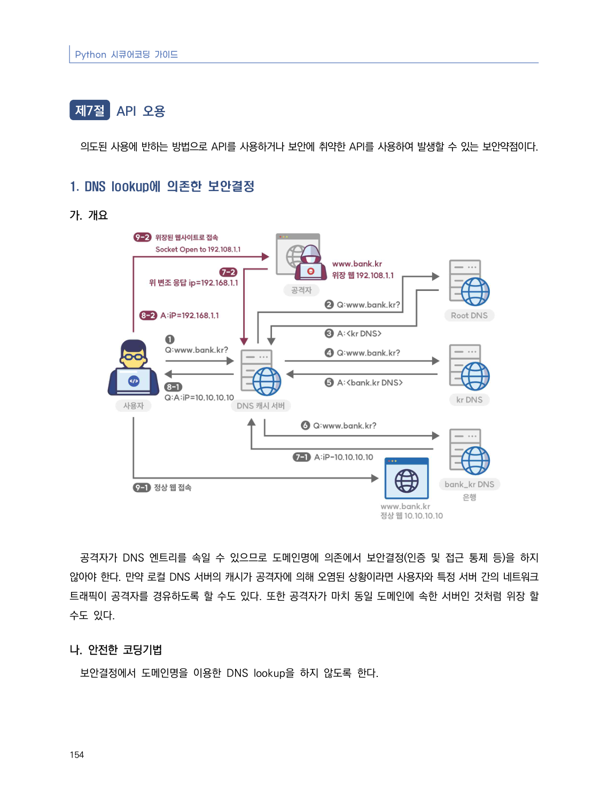
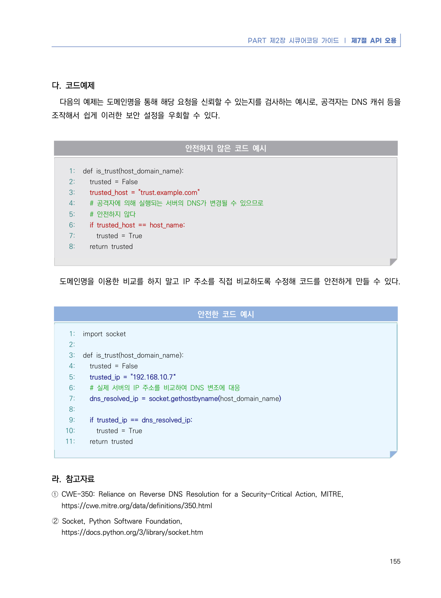

# 1. DNS lookup에 의존한 보안결정

> 변환 안내(원문 외): 아래 본문은 PDF 텍스트를 추출한 전사입니다. 코드 줄번호·특수 공백·원문 오류를 유지했습니다. 실행용 코드가 아닙니다. 표·그림·들여쓰기는 연결된 페이지 이미지와 대조하세요. 페이지 경계의 줄바꿈을 보존하며, 동일 페이지가 여러 항목에 나뉘면 각 항목의 본문은 해당 구간만 포함합니다.

### PDF 160페이지 / 인쇄 154페이지

<!-- source-page:Python-2023:160; source-lines:1,4,5,6,7,8,9,10,11 -->

154

#### 1. DNS lookup에 의존한 보안결정

#### 가. 개요

공격자가 DNS 엔트리를 속일 수 있으므로 도메인명에 의존에서 보안결정(인증 및 접근 통제 등)을 하지 
않아야 한다. 만약 로컬 DNS 서버의 캐시가 공격자에 의해 오염된 상황이라면 사용자와 특정 서버 간의 네트워크 
트래픽이 공격자를 경유하도록 할 수도 있다. 또한 공격자가 마치 동일 도메인에 속한 서버인 것처럼 위장 할 
수도 있다.

#### 나. 안전한 코딩기법

보안결정에서 도메인명을 이용한 DNS lookup을 하지 않도록 한다.

<details><summary>원본 페이지 이미지 (변환 외 보존 자료)</summary>



</details>

### PDF 161페이지 / 인쇄 155페이지

<!-- source-page:Python-2023:161; source-lines:0,1,2,3,4,5,6,7,8,9,10,11,12,13,14,15,16,17,18,19,20,21,22,23,24,25,26,27,28,29,30,31,32,33,34,35,36,37,38,39,40,41,42,43,44,45,46,47,48 -->

PART 제2장 시큐어코딩 가이드 ❘ 제7절 API 오용

155

#### 다. 코드예제

다음의 예제는 도메인명을 통해 해당 요청을 신뢰할 수 있는지를 검사하는 예시로, 공격자는 DNS 캐쉬 등을 
조작해서 쉽게 이러한 보안 설정을 우회할 수 있다.

#### 안전하지 않은 코드 예시

```python
1: def is_trust(host_domain_name):
2:   trusted = False
3:   trusted_host = "trust.example.com"
4:   # 공격자에 의해 실행되는 서버의 DNS가 변경될 수 있으므로 
5:   # 안전하지 않다
6:   if trusted_host == host_name:
7:     trusted = True
8:   return trusted
```

도메인명을 이용한 비교를 하지 말고 IP 주소를 직접 비교하도록 수정해 코드를 안전하게 만들 수 있다.

#### 안전한 코드 예시

```python
1: import socket
2:
3: def is_trust(host_domain_name):
4:   trusted = False
5:   trusted_ip = "192.168.10.7“
6:   # 실제 서버의 IP 주소를 비교하여 DNS 변조에 대응
7:   dns_resolved_ip = socket.gethostbyname(host_domain_name)
8:
9:   if trusted_ip == dns_resolved_ip:
10:     trusted = True
11:   return trusted
```

#### 라. 참고자료

① CWE-350: Reliance on Reverse DNS Resolution for a Security-Critical Action, MITRE,

https://cwe.mitre.org/data/definitions/350.html
➁ Socket, Python Software Foundation,

https://docs.python.org/3/library/socket.htm

<details><summary>원본 페이지 이미지 (변환 외 보존 자료)</summary>



</details>

---

## 탐색 링크 (원문 외)

[통합 인덱스](../../../INDEX.md)

