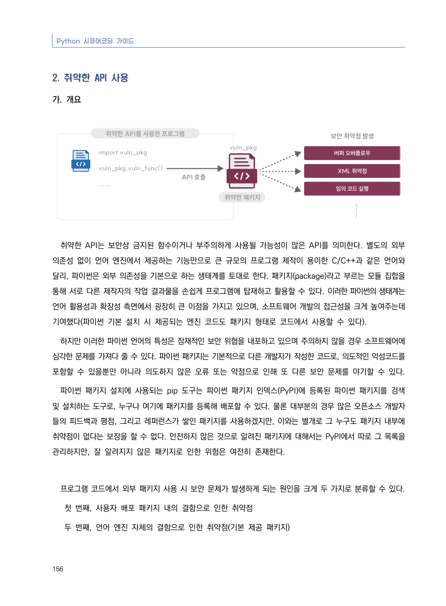
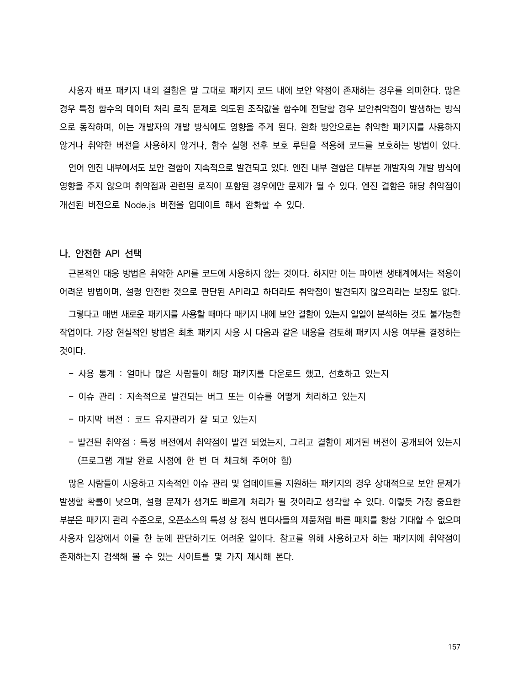
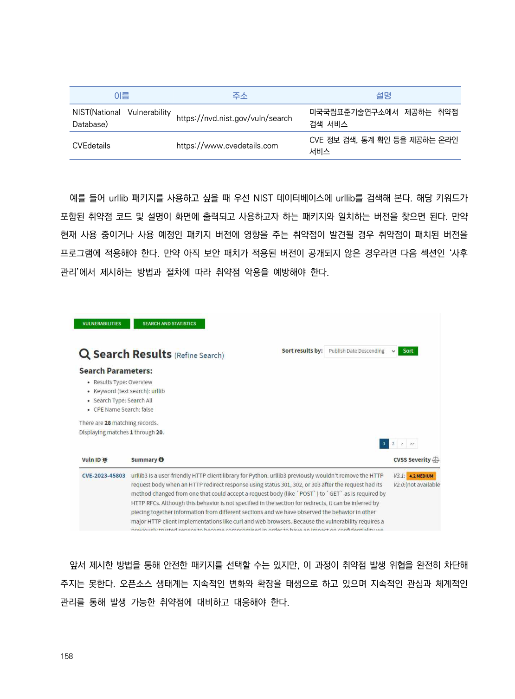
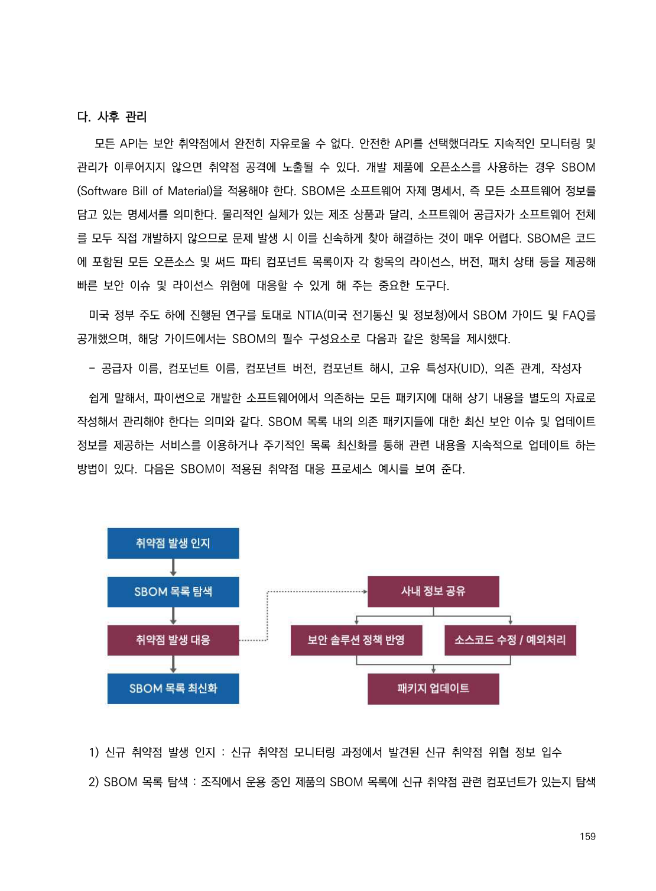
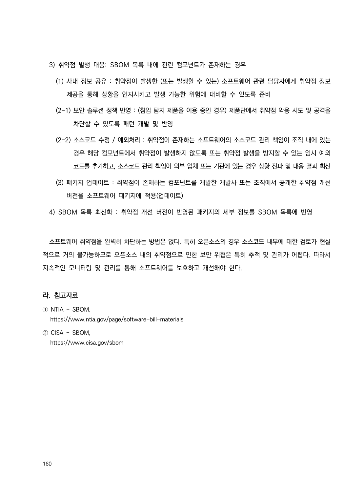

# 2. 취약한 API 사용

> 변환 안내(원문 외): 아래 본문은 PDF 텍스트를 추출한 전사입니다. 코드 줄번호·특수 공백·원문 오류를 유지했습니다. 실행용 코드가 아닙니다. 표·그림·들여쓰기는 연결된 페이지 이미지와 대조하세요. 페이지 경계의 줄바꿈을 보존하며, 동일 페이지가 여러 항목에 나뉘면 각 항목의 본문은 해당 구간만 포함합니다.

### PDF 162페이지 / 인쇄 156페이지

<!-- source-page:Python-2023:162; source-lines:0,1,2,3,4,5,6,7,8,9,10,11,12,13,14,15,16,17,18,19,20 -->

Python 시큐어코딩 가이드

156

#### 2. 취약한 API 사용                             

#### 가. 개요

취약한 API는 보안상 금지된 함수이거나 부주의하게 사용될 가능성이 많은 API를 의미한다. 별도의 외부 
의존성 없이 언어 엔진에서 제공하는 기능만으로 큰 규모의 프로그램 제작이 용이한 C/C++과 같은 언어와 
달리, 파이썬은 외부 의존성을 기본으로 하는 생태계를 토대로 한다. 패키지(package)라고 부르는 모듈 집합을 
통해 서로 다른 제작자의 작업 결과물을 손쉽게 프로그램에 탑재하고 활용할 수 있다. 이러한 파이썬의 생태계는 
언어 활용성과 확장성 측면에서 굉장히 큰 이점을 가지고 있으며, 소프트웨어 개발의 접근성을 크게 높여주는데 
기여했다(파이썬 기본 설치 시 제공되는 엔진 코드도 패키지 형태로 코드에서 사용할 수 있다).

하지만 이러한 파이썬 언어의 특성은 잠재적인 보안 위협을 내포하고 있으며 주의하지 않을 경우 소프트웨어에 
심각한 문제를 가져다 줄 수 있다. 파이썬 패키지는 기본적으로 다른 개발자가 작성한 코드로, 의도적인 악성코드를 
포함할 수 있을뿐만 아니라 의도하지 않은 오류 또는 약점으로 인해 또 다른 보안 문제를 야기할 수 있다. 

파이썬 패키지 설치에 사용되는 pip 도구는 파이썬 패키지 인덱스(PyPI)에 등록된 파이썬 패키지를 검색 
및 설치하는 도구로, 누구나 여기에 패키지를 등록해 배포할 수 있다. 물론 대부분의 경우 많은 오픈소스 개발자
들의 피드백과 평점, 그리고 레퍼런스가 쌓인 패키지를 사용하겠지만, 이와는 별개로 그 누구도 패키지 내부에 
취약점이 없다는 보장을 할 수 없다. 안전하지 않은 것으로 알려진 패키지에 대해서는 PyPI에서 따로 그 목록을 
관리하지만, 잘 알려지지 않은 패키지로 인한 위험은 여전히 존재한다.

프로그램 코드에서 외부 패키지 사용 시 보안 문제가 발생하게 되는 원인을 크게 두 가지로 분류할 수 있다.

 첫 번째, 사용자 배포 패키지 내의 결함으로 인한 취약점

 두 번째, 언어 엔진 자체의 결함으로 인한 취약점(기본 제공 패키지) 

원본 페이지 이미지 (변환 외 보존 자료)

### PDF 163페이지 / 인쇄 157페이지

<!-- source-page:Python-2023:163; source-lines:0,1,2,3,4,5,6,7,8,9,10,11,12,13,14,15,16,17,18,19,20,21,22,23 -->

157

사용자 배포 패키지 내의 결함은 말 그대로 패키지 코드 내에 보안 약점이 존재하는 경우를 의미한다. 많은 
경우 특정 함수의 데이터 처리 로직 문제로 의도된 조작값을 함수에 전달할 경우 보안취약점이 발생하는 방식
으로 동작하며, 이는 개발자의 개발 방식에도 영향을 주게 된다. 완화 방안으로는 취약한 패키지를 사용하지 
않거나 취약한 버전을 사용하지 않거나, 함수 실행 전후 보호 루틴을 적용해 코드를 보호하는 방법이 있다. 

언어 엔진 내부에서도 보안 결함이 지속적으로 발견되고 있다. 엔진 내부 결함은 대부분 개발자의 개발 방식에 
영향을 주지 않으며 취약점과 관련된 로직이 포함된 경우에만 문제가 될 수 있다. 엔진 결함은 해당 취약점이 
개선된 버전으로 Node.js 버전을 업데이트 해서 완화할 수 있다. 

#### 나. 안전한 API 선택

근본적인 대응 방법은 취약한 API를 코드에 사용하지 않는 것이다. 하지만 이는 파이썬 생태계에서는 적용이 
어려운 방법이며, 설령 안전한 것으로 판단된 API라고 하더라도 취약점이 발견되지 않으리라는 보장도 없다. 

그렇다고 매번 새로운 패키지를 사용할 때마다 패키지 내에 보안 결함이 있는지 일일이 분석하는 것도 불가능한 
작업이다. 가장 현실적인 방법은 최초 패키지 사용 시 다음과 같은 내용을 검토해 패키지 사용 여부를 결정하는 
것이다.

- 사용 통계 : 얼마나 많은 사람들이 해당 패키지를 다운로드 했고, 선호하고 있는지 

- 이슈 관리 : 지속적으로 발견되는 버그 또는 이슈를 어떻게 처리하고 있는지

- 마지막 버전 : 코드 유지관리가 잘 되고 있는지

- 발견된 취약점 : 특정 버전에서 취약점이 발견 되었는지, 그리고 결함이 제거된 버전이 공개되어 있는지
    (프로그램 개발 완료 시점에 한 번 더 체크해 주어야 함)

많은 사람들이 사용하고 지속적인 이슈 관리 및 업데이트를 지원하는 패키지의 경우 상대적으로 보안 문제가 
발생할 확률이 낮으며, 설령 문제가 생겨도 빠르게 처리가 될 것이라고 생각할 수 있다. 이렇듯 가장 중요한 
부분은 패키지 관리 수준으로, 오픈소스의 특성 상 정식 벤더사들의 제품처럼 빠른 패치를 항상 기대할 수 없으며 
사용자 입장에서 이를 한 눈에 판단하기도 어려운 일이다. 참고를 위해 사용하고자 하는 패키지에 취약점이 
존재하는지 검색해 볼 수 있는 사이트를 몇 가지 제시해 본다.

원본 페이지 이미지 (변환 외 보존 자료)

### PDF 164페이지 / 인쇄 158페이지

<!-- source-page:Python-2023:164; source-lines:0,1,2,3,4,5,6,7,8,9,10,11,12,13,14,15,16,17,18,19,20 -->

158

이름

주소

설명

NIST(National Vulnerability 
Database)

https://nvd.nist.gov/vuln/search

미국국립표준기술연구소에서 제공하는 취약점 
검색 서비스

CVEdetails

https://www.cvedetails.com

CVE 정보 검색, 통계 확인 등을 제공하는 온라인 
서비스

예를 들어 urllib 패키지를 사용하고 싶을 때 우선 NIST 데이터베이스에 urllib를 검색해 본다. 해당 키워드가 
포함된 취약점 코드 및 설명이 화면에 출력되고 사용하고자 하는 패키지와 일치하는 버전을 찾으면 된다. 만약 
현재 사용 중이거나 사용 예정인 패키지 버전에 영향을 주는 취약점이 발견될 경우 취약점이 패치된 버전을 
프로그램에 적용해야 한다. 만약 아직 보안 패치가 적용된 버전이 공개되지 않은 경우라면 다음 섹션인 ‘사후 
관리’에서 제시하는 방법과 절차에 따라 취약점 악용을 예방해야 한다.

앞서 제시한 방법을 통해 안전한 패키지를 선택할 수는 있지만, 이 과정이 취약점 발생 위협을 완전히 차단해 
주지는 못한다. 오픈소스 생태계는 지속적인 변화와 확장을 태생으로 하고 있으며 지속적인 관심과 체계적인 
관리를 통해 발생 가능한 취약점에 대비하고 대응해야 한다. 

원본 페이지 이미지 (변환 외 보존 자료)

### PDF 165페이지 / 인쇄 159페이지

<!-- source-page:Python-2023:165; source-lines:0,1,2,3,4,5,6,7,8,9,10,11,12,13,14,15,16,17 -->

159

#### 다. 사후 관리

 모든 API는 보안 취약점에서 완전히 자유로울 수 없다. 안전한 API를 선택했더라도 지속적인 모니터링 및 
관리가 이루어지지 않으면 취약점 공격에 노출될 수 있다. 개발 제품에 오픈소스를 사용하는 경우 SBOM 
(Software Bill of Material)을 적용해야 한다. SBOM은 소프트웨어 자제 명세서, 즉 모든 소프트웨어 정보를 
담고 있는 명세서를 의미한다. 물리적인 실체가 있는 제조 상품과 달리, 소프트웨어 공급자가 소프트웨어 전체
를 모두 직접 개발하지 않으므로 문제 발생 시 이를 신속하게 찾아 해결하는 것이 매우 어렵다. SBOM은 코드
에 포함된 모든 오픈소스 및 써드 파티 컴포넌트 목록이자 각 항목의 라이선스, 버전, 패치 상태 등을 제공해 
빠른 보안 이슈 및 라이선스 위험에 대응할 수 있게 해 주는 중요한 도구다.

미국 정부 주도 하에 진행된 연구를 토대로 NTIA(미국 전기통신 및 정보청)에서 SBOM 가이드 및 FAQ를 
공개했으며, 해당 가이드에서는 SBOM의 필수 구성요소로 다음과 같은 항목을 제시했다. 

- 공급자 이름, 컴포넌트 이름, 컴포넌트 버전, 컴포넌트 해시, 고유 특성자(UID), 의존 관계, 작성자

쉽게 말해서, 파이썬으로 개발한 소프트웨어에서 의존하는 모든 패키지에 대해 상기 내용을 별도의 자료로 
작성해서 관리해야 한다는 의미와 같다. SBOM 목록 내의 의존 패키지들에 대한 최신 보안 이슈 및 업데이트 
정보를 제공하는 서비스를 이용하거나 주기적인 목록 최신화를 통해 관련 내용을 지속적으로 업데이트 하는 
방법이 있다. 다음은 SBOM이 적용된 취약점 대응 프로세스 예시를 보여 준다.

1) 신규 취약점 발생 인지 : 신규 취약점 모니터링 과정에서 발견된 신규 취약점 위협 정보 입수

2) SBOM 목록 탐색 : 조직에서 운용 중인 제품의 SBOM 목록에 신규 취약점 관련 컴포넌트가 있는지 탐색

원본 페이지 이미지 (변환 외 보존 자료)

### PDF 166페이지 / 인쇄 160페이지

<!-- source-page:Python-2023:166; source-lines:0,1,2,3,4,5,6,7,8,9,10,11,12,13,14,15,16,17,18,19 -->

160

3) 취약점 발생 대응: SBOM 목록 내에 관련 컴포넌트가 존재하는 경우

  (1) 사내 정보 공유 : 취약점이 발생한 (또는 발생할 수 있는) 소프트웨어 관련 담당자에게 취약점 정보 

제공을 통해 상황을 인지시키고 발생 가능한 위험에 대비할 수 있도록 준비

  (2-1) 보안 솔루션 정책 반영 : (침입 탐지 제품을 이용 중인 경우) 제품단에서 취약점 악용 시도 및 공격을 

차단할 수 있도록 패턴 개발 및 반영

  (2-2) 소스코드 수정 / 예외처리 : 취약점이 존재하는 소프트웨어의 소스코드 관리 책임이 조직 내에 있는 

경우 해당 컴포넌트에서 취약점이 발생하지 않도록 또는 취약점 발생을 방지할 수 있는 임시 예외 
코드를 추가하고, 소스코드 관리 책임이 외부 업체 또는 기관에 있는 경우 상황 전파 및 대응 결과 회신

  (3) 패키지 업데이트 : 취약점이 존재하는 컴포넌트를 개발한 개발사 또는 조직에서 공개한 취약점 개선 

버전을 소프트웨어 패키지에 적용(업데이트)

4) SBOM 목록 최신화 : 취약점 개선 버전이 반영된 패키지의 세부 정보를 SBOM 목록에 반영

소프트웨어 취약점을 완벽히 차단하는 방법은 없다. 특히 오픈소스의 경우 소스코드 내부에 대한 검토가 현실
적으로 거의 불가능하므로 오픈소스 내의 취약점으로 인한 보안 위협은 특히 추적 및 관리가 어렵다. 따라서 
지속적인 모니터링 및 관리를 통해 소프트웨어를 보호하고 개선해야 한다.

#### 라. 참고자료

① NTIA - SBOM,

https://www.ntia.gov/page/software-bill-materials
② CISA - SBOM,

https://www.cisa.gov/sbom

원본 페이지 이미지 (변환 외 보존 자료)

---

## 탐색 링크 (원문 외)

[통합 인덱스](../../../INDEX.md)

