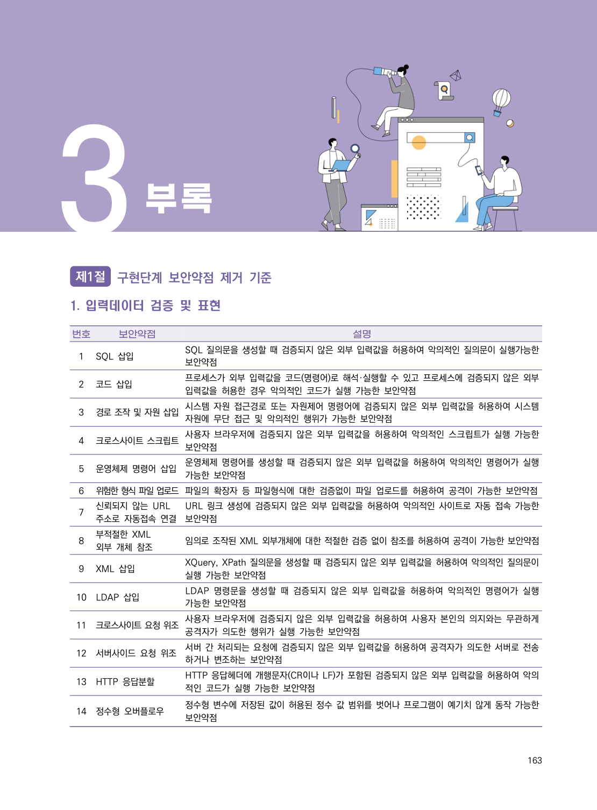
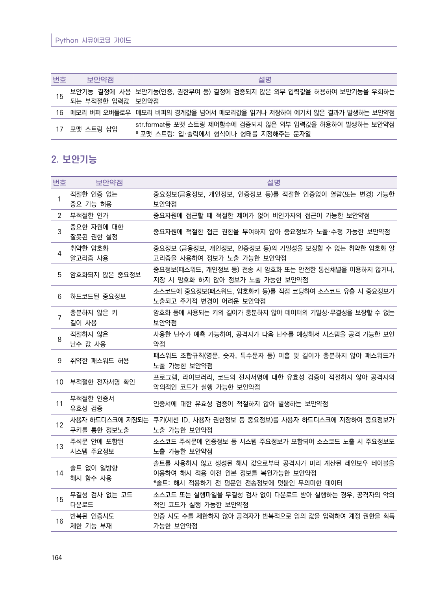

# 1. 입력데이터 검증 및 표현

> 변환 안내(원문 외): 아래 본문은 PDF 텍스트를 추출한 전사입니다. 코드 줄번호·특수 공백·원문 오류를 유지했습니다. 실행용 코드가 아닙니다. 표·그림·들여쓰기는 연결된 페이지 이미지와 대조하세요. 페이지 경계의 줄바꿈을 보존하며, 동일 페이지가 여러 항목에 나뉘면 각 항목의 본문은 해당 구간만 포함합니다.

### PDF 169페이지 / 인쇄 163페이지

<!-- source-page:Python-2023:169; source-lines:0,3,4,5,6,7,8,9,10,11,12,13,14,15,16,17,18,19,20,21,22,23,24,25,26,27,28,29,30,31,32,33,34,35,36,37,38,39,40,41,42,43,44,45,46,47,48,49,50,51,52,53,54,55,56,57,58 -->

163

#### 1. 입력데이터 검증 및 표현

번호

보안약점

설명

1

SQL 삽입

SQL 질의문을 생성할 때 검증되지 않은 외부 입력값을 허용하여 악의적인 질의문이 실행가능한 
보안약점

2

코드 삽입

프로세스가 외부 입력값을 코드(명령어)로 해석·실행할 수 있고 프로세스에 검증되지 않은 외부 
입력값을 허용한 경우 악의적인 코드가 실행 가능한 보안약점

3

경로 조작 및 자원 삽입시스템 자원 접근경로 또는 자원제어 명령어에 검증되지 않은 외부 입력값을 허용하여 시스템 

자원에 무단 접근 및 악의적인 행위가 가능한 보안약점

4

크로스사이트 스크립트사용자 브라우저에 검증되지 않은 외부 입력값을 허용하여 악의적인 스크립트가 실행 가능한 

보안약점

5

운영체제 명령어 삽입

운영체제 명령어를 생성할 때 검증되지 않은 외부 입력값을 허용하여 악의적인 명령어가 실행 
가능한 보안약점

6

위험한 형식 파일 업로드파일의 확장자 등 파일형식에 대한 검증없이 파일 업로드를 허용하여 공격이 가능한 보안약점
7

신뢰되지 않는 URL 
주소로 자동접속 연결

URL 링크 생성에 검증되지 않은 외부 입력값을 허용하여 악의적인 사이트로 자동 접속 가능한 
보안약점

8

부적절한 XML
외부 개체 참조

임의로 조작된 XML 외부개체에 대한 적절한 검증 없이 참조를 허용하여 공격이 가능한 보안약점

9

XML 삽입

XQuery, XPath 질의문을 생성할 때 검증되지 않은 외부 입력값을 허용하여 악의적인 질의문이 
실행 가능한 보안약점

10

LDAP 삽입

LDAP 명령문을 생성할 때 검증되지 않은 외부 입력값을 허용하여 악의적인 명령어가 실행 
가능한 보안약점

11

크로스사이트 요청 위조사용자 브라우저에 검증되지 않은 외부 입력값을 허용하여 사용자 본인의 의지와는 무관하게 

공격자가 의도한 행위가 실행 가능한 보안약점

12

서버사이드 요청 위조

서버 간 처리되는 요청에 검증되지 않은 외부 입력값을 허용하여 공격자가 의도한 서버로 전송
하거나 변조하는 보안약점

13

HTTP 응답분할

HTTP 응답헤더에 개행문자(CR이나 LF)가 포함된 검증되지 않은 외부 입력값을 허용하여 악의
적인 코드가 실행 가능한 보안약점

14

정수형 오버플로우

정수형 변수에 저장된 값이 허용된 정수 값 범위를 벗어나 프로그램이 예기치 않게 동작 가능한 
보안약점

원본 페이지 이미지 (변환 외 보존 자료)

### PDF 170페이지 / 인쇄 164페이지

<!-- source-page:Python-2023:170; source-lines:2,3,4,5,6,7,8,9,10,11,12,13,14,15 -->

번호

보안약점

설명

15

보안기능 결정에 사용
되는 부적절한 입력값

보안기능(인증, 권한부여 등) 결정에 검증되지 않은 외부 입력값을 허용하여 보안기능을 우회하는 
보안약점

16

메모리 버퍼 오버플로우메모리 버퍼의 경계값을 넘어서 메모리값을 읽거나 저장하여 예기치 않은 결과가 발생하는 보안약점

17

포맷 스트링 삽입

str.format등 포맷 스트링 제어함수에 검증되지 않은 외부 입력값을 허용하여 발생하는 보안약점
* 포맷 스트링: 입·출력에서 형식이나 형태를 지정해주는 문자열

원본 페이지 이미지 (변환 외 보존 자료)

---

## 탐색 링크 (원문 외)

[통합 인덱스](../../../INDEX.md)

