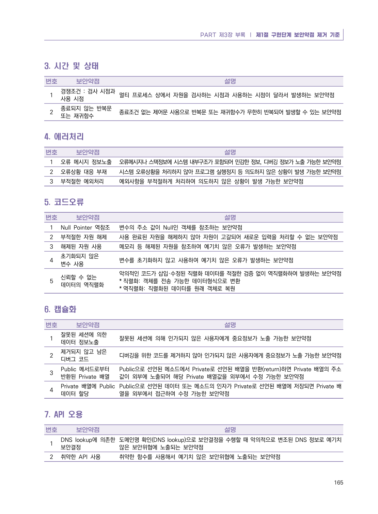

# 3. 시간 및 상태

> 변환 안내(원문 외): 아래 본문은 PDF 텍스트를 추출한 전사입니다. 코드 줄번호·특수 공백·원문 오류를 유지했습니다. 실행용 코드가 아닙니다. 표·그림·들여쓰기는 연결된 페이지 이미지와 대조하세요. 페이지 경계의 줄바꿈을 보존하며, 동일 페이지가 여러 항목에 나뉘면 각 항목의 본문은 해당 구간만 포함합니다.

### PDF 171페이지 / 인쇄 165페이지

<!-- source-page:Python-2023:171; source-lines:0,2,3,4,5,6,7,8,9,10,11,12,13 -->

PART 제3장 부록 ❘ 제1절 구현단계 보안약점 제거 기준

#### 3. 시간 및 상태

번호

보안약점

설명

1

경쟁조건 : 검사 시점과
사용 시점

멀티 프로세스 상에서 자원을 검사하는 시점과 사용하는 시점이 달라서 발생하는 보안약점

2

종료되지 않는 반복문
또는 재귀함수

종료조건 없는 제어문 사용으로 반복문 또는 재귀함수가 무한히 반복되어 발생할 수 있는 보안약점

원본 페이지 이미지 (변환 외 보존 자료)

---

## 탐색 링크 (원문 외)

[통합 인덱스](../../../INDEX.md)

