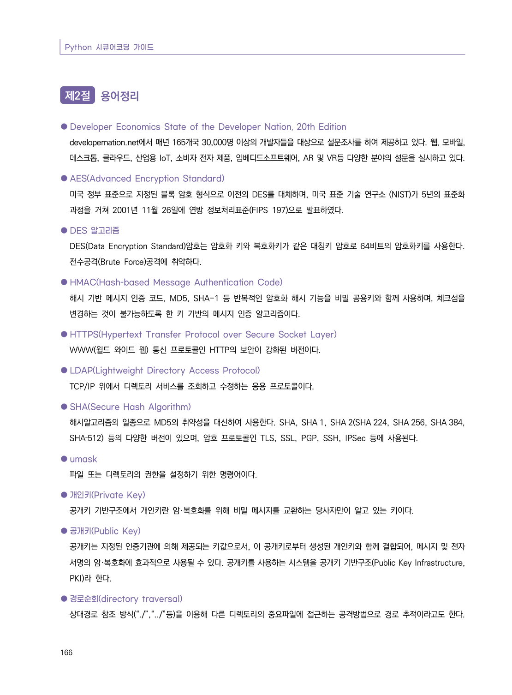
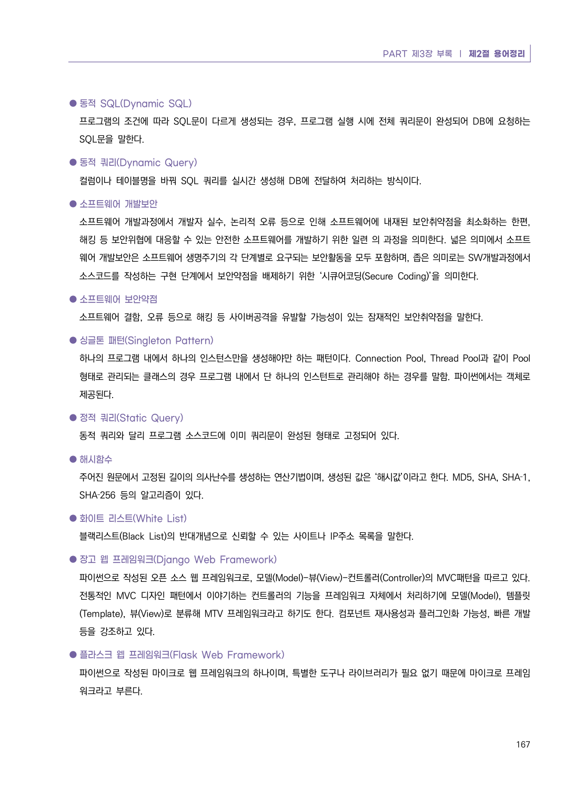
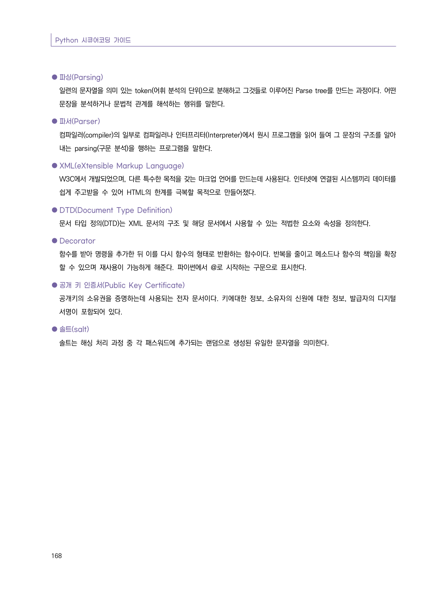

# 제2절 용어정리

> 변환 안내(원문 외): 아래 본문은 PDF 텍스트를 추출한 전사입니다. 코드 줄번호·특수 공백·원문 오류를 유지했습니다. 실행용 코드가 아닙니다. 표·그림·들여쓰기는 연결된 페이지 이미지와 대조하세요. 페이지 경계의 줄바꿈을 보존하며, 동일 페이지가 여러 항목에 나뉘면 각 항목의 본문은 해당 구간만 포함합니다.

### PDF 172페이지 / 인쇄 166페이지

<!-- source-page:Python-2023:172; source-lines:0,1,2,3,4,5,6,7,8,9,10,11,12,13,14,15,16,17,18,19,20,21,22,23,24,25,26,27,28,29,30,31 -->

Python 시큐어코딩 가이드

166

#### 제2절 용어정리

●Developer Economics State of the Developer Nation, 20th Edition

developernation.net에서 매년 165개국 30,000명 이상의 개발자들을 대상으로 설문조사를 하여 제공하고 있다. 웹, 모바일, 
데스크톱, 클라우드, 산업용 IoT, 소비자 전자 제품, 임베디드소프트웨어, AR 및 VR등 다양한 분야의 설문을 실시하고 있다.

●AES(Advanced Encryption Standard)

미국 정부 표준으로 지정된 블록 암호 형식으로 이전의 DES를 대체하며, 미국 표준 기술 연구소 (NIST)가 5년의 표준화 
과정을 거쳐 2001년 11월 26일에 연방 정보처리표준(FIPS 197)으로 발표하였다.

●DES 알고리즘

DES(Data Encryption Standard)암호는 암호화 키와 복호화키가 같은 대칭키 암호로 64비트의 암호화키를 사용한다. 
전수공격(Brute Force)공격에 취약하다.

●HMAC(Hash-based Message Authentication Code)

해시 기반 메시지 인증 코드, MD5, SHA-1 등 반복적인 암호화 해시 기능을 비밀 공용키와 함께 사용하며, 체크섬을 
변경하는 것이 불가능하도록 한 키 기반의 메시지 인증 알고리즘이다.

●HTTPS(Hypertext Transfer Protocol over Secure Socket Layer)

WWW(월드 와이드 웹) 통신 프로토콜인 HTTP의 보안이 강화된 버전이다.

●LDAP(Lightweight Directory Access Protocol)

TCP/IP 위에서 디렉토리 서비스를 조회하고 수정하는 응용 프로토콜이다.

●SHA(Secure Hash Algorithm)

해시알고리즘의 일종으로 MD5의 취약성을 대신하여 사용한다. SHA, SHA‐1, SHA‐2(SHA‐224, SHA‐256, SHA‐384, 
SHA‐512) 등의 다양한 버전이 있으며, 암호 프로토콜인 TLS, SSL, PGP, SSH, IPSec 등에 사용된다.

●umask

파일 또는 디렉토리의 권한을 설정하기 위한 명령어이다.

●개인키(Private Key)

공개키 기반구조에서 개인키란 암·복호화를 위해 비밀 메시지를 교환하는 당사자만이 알고 있는 키이다.

●공개키(Public Key)

공개키는 지정된 인증기관에 의해 제공되는 키값으로서, 이 공개키로부터 생성된 개인키와 함께 결합되어, 메시지 및 전자
서명의 암·복호화에 효과적으로 사용될 수 있다. 공개키를 사용하는 시스템을 공개키 기반구조(Public Key Infrastructure, 
PKI)라 한다.

●경로순회(directory traversal)

상대경로 참조 방식(“./”,“../”등)을 이용해 다른 디렉토리의 중요파일에 접근하는 공격방법으로 경로 추적이라고도 한다.

원본 페이지 이미지 (변환 외 보존 자료)

### PDF 173페이지 / 인쇄 167페이지

<!-- source-page:Python-2023:173; source-lines:0,1,2,3,4,5,6,7,8,9,10,11,12,13,14,15,16,17,18,19,20,21,22,23,24,25,26,27,28,29,30,31,32 -->

PART 제3장 부록 ❘ 제2절 용어정리

167

●동적 SQL(Dynamic SQL)

프로그램의 조건에 따라 SQL문이 다르게 생성되는 경우, 프로그램 실행 시에 전체 쿼리문이 완성되어 DB에 요청하는 
SQL문을 말한다.

●동적 쿼리(Dynamic Query)

컬럼이나 테이블명을 바꿔 SQL 쿼리를 실시간 생성해 DB에 전달하여 처리하는 방식이다.

●소프트웨어 개발보안

소프트웨어 개발과정에서 개발자 실수, 논리적 오류 등으로 인해 소프트웨어에 내재된 보안취약점을 최소화하는 한편, 
해킹 등 보안위협에 대응할 수 있는 안전한 소프트웨어를 개발하기 위한 일련 의 과정을 의미한다. 넓은 의미에서 소프트
웨어 개발보안은 소프트웨어 생명주기의 각 단계별로 요구되는 보안활동을 모두 포함하며, 좁은 의미로는 SW개발과정에서 
소스코드를 작성하는 구현 단계에서 보안약점을 배제하기 위한 ‘시큐어코딩(Secure Coding)’을 의미한다.

●소프트웨어 보안약점

소프트웨어 결함, 오류 등으로 해킹 등 사이버공격을 유발할 가능성이 있는 잠재적인 보안취약점을 말한다.

●싱글톤 패턴(Singleton Pattern)

하나의 프로그램 내에서 하나의 인스턴스만을 생성해야만 하는 패턴이다. Connection Pool, Thread Pool과 같이 Pool 
형태로 관리되는 클래스의 경우 프로그램 내에서 단 하나의 인스턴트로 관리해야 하는 경우를 말함. 파이썬에서는 객체로 
제공된다.

●정적 쿼리(Static Query)

동적 쿼리와 달리 프로그램 소스코드에 이미 쿼리문이 완성된 형태로 고정되어 있다.

●해시함수

주어진 원문에서 고정된 길이의 의사난수를 생성하는 연산기법이며, 생성된 값은 ‘해시값’이라고 한다. MD5, SHA, SHA‐1, 
SHA‐256 등의 알고리즘이 있다.

●화이트 리스트(White List)

블랙리스트(Black List)의 반대개념으로 신뢰할 수 있는 사이트나 IP주소 목록을 말한다.

●장고 웹 프레임워크(Django Web Framework)

파이썬으로 작성된 오픈 소스 웹 프레임워크로, 모델(Model)-뷰(View)-컨트롤러(Controller)의 MVC패턴을 따르고 있다. 
전통적인 MVC 디자인 패턴에서 이야기하는 컨트롤러의 기능을 프레임워크 자체에서 처리하기에 모델(Model), 템플릿
(Template), 뷰(View)로 분류해 MTV 프레임워크라고 하기도 한다. 컴포넌트 재사용성과 플러그인화 가능성, 빠른 개발 
등을 강조하고 있다.

●플라스크 웹 프레임워크(Flask Web Framework)

파이썬으로 작성된 마이크로 웹 프레임워크의 하나이며, 특별한 도구나 라이브러리가 필요 없기 때문에 마이크로 프레임
워크라고 부른다.

원본 페이지 이미지 (변환 외 보존 자료)

### PDF 174페이지 / 인쇄 168페이지

<!-- source-page:Python-2023:174; source-lines:0,1,2,3,4,5,6,7,8,9,10,11,12,13,14,15,16,17,18,19,20 -->

Python 시큐어코딩 가이드

168

●파싱(Parsing)

일련의 문자열을 의미 있는 token(어휘 분석의 단위)으로 분해하고 그것들로 이루어진 Parse tree를 만드는 과정이다. 어떤 
문장을 분석하거나 문법적 관계를 해석하는 행위를 말한다.

●파서(Parser)

컴파일러(compiler)의 일부로 컴파일러나 인터프리터(Interpreter)에서 원시 프로그램을 읽어 들여 그 문장의 구조를 알아
내는 parsing(구문 분석)을 행하는 프로그램을 말한다.

●XML(eXtensible Markup Language)

W3C에서 개발되었으며, 다른 특수한 목적을 갖는 마크업 언어를 만드는데 사용된다. 인터넷에 연결된 시스템끼리 데이터를 
쉽게 주고받을 수 있어 HTML의 한계를 극복할 목적으로 만들어졌다.

●DTD(Document Type Definition)

문서 타입 정의(DTD)는 XML 문서의 구조 및 해당 문서에서 사용할 수 있는 적법한 요소와 속성을 정의한다.

●Decorator

함수를 받아 명령을 추가한 뒤 이를 다시 함수의 형태로 반환하는 함수이다. 반복을 줄이고 메소드나 함수의 책임을 확장
할 수 있으며 재사용이 가능하게 해준다. 파이썬에서 @로 시작하는 구문으로 표시한다.

●공개 키 인증서(Public Key Certificate)

공개키의 소유권을 증명하는데 사용되는 전자 문서이다. 키에대한 정보, 소유자의 신원에 대한 정보, 발급자의 디지털 
서명이 포함되어 있다.

●솔트(salt)

솔트는 해싱 처리 과정 중 각 패스워드에 추가되는 랜덤으로 생성된 유일한 문자열을 의미한다.

원본 페이지 이미지 (변환 외 보존 자료)

---

## 탐색 링크 (원문 외)

[통합 인덱스](../../../INDEX.md)

