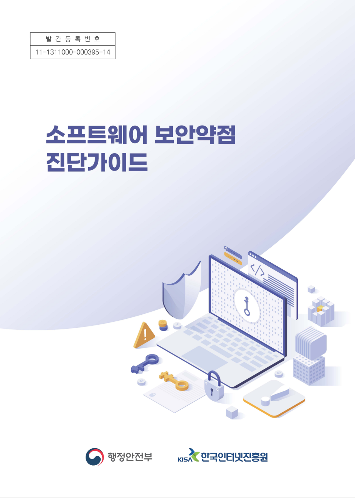
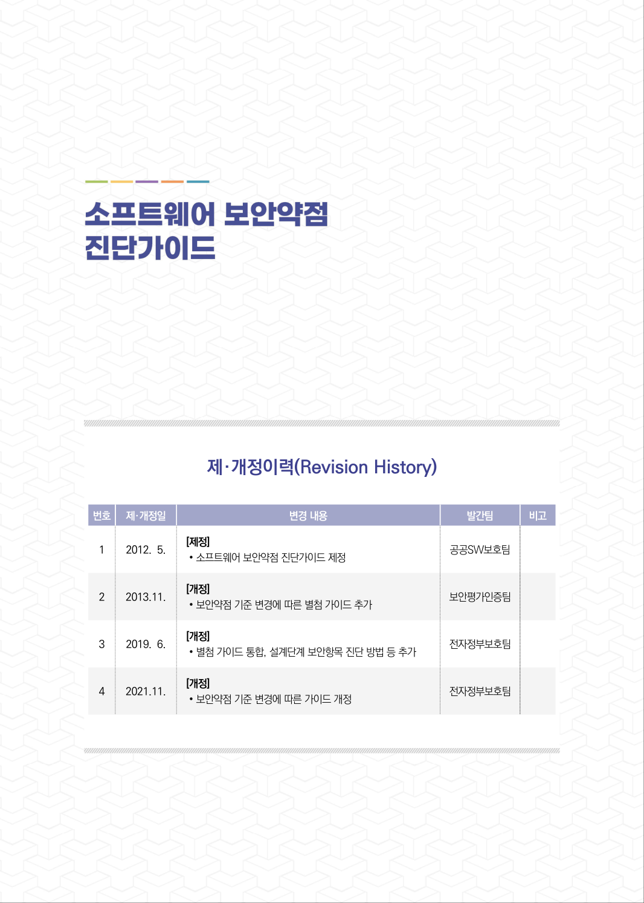
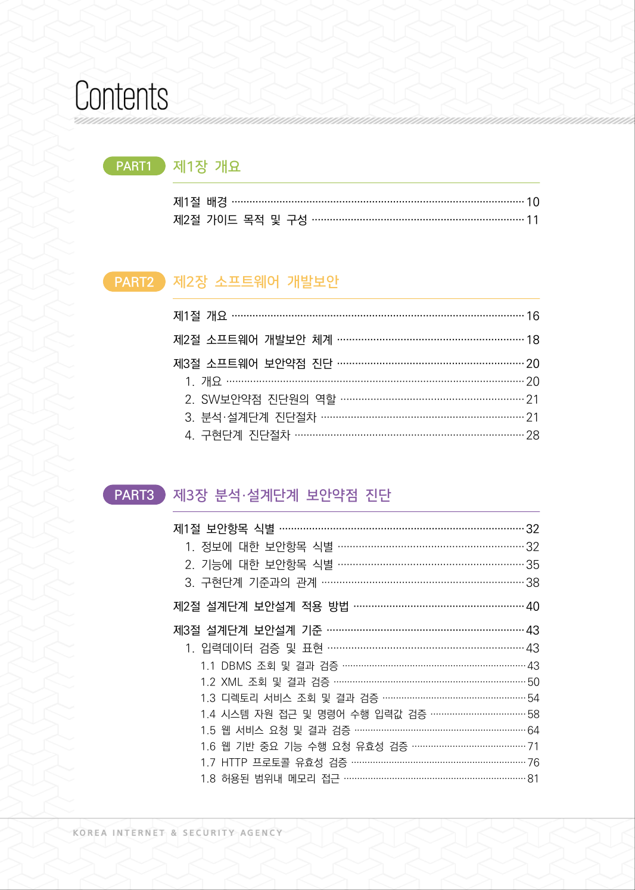
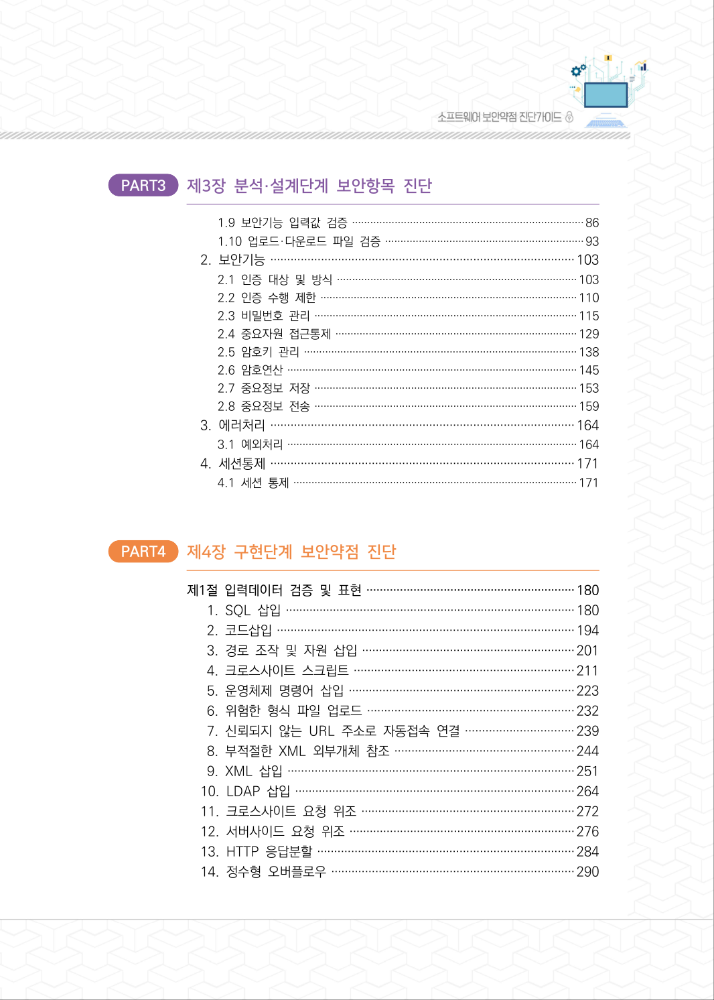
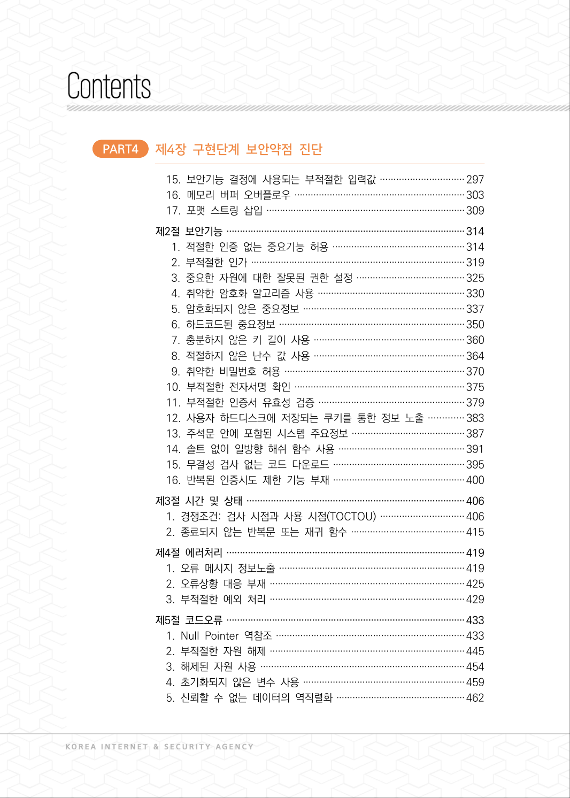
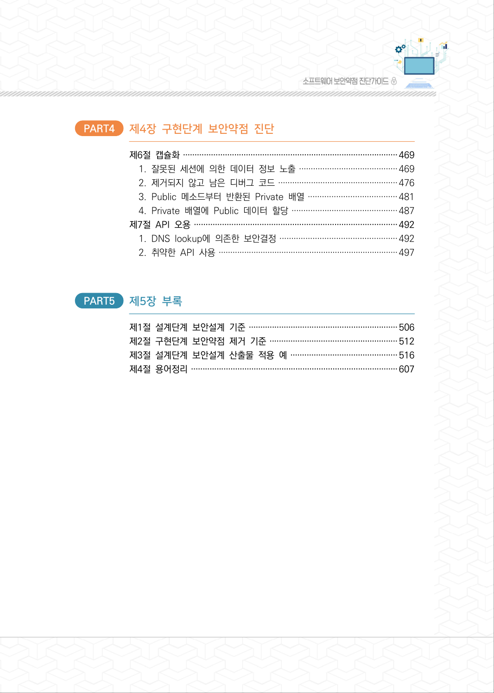
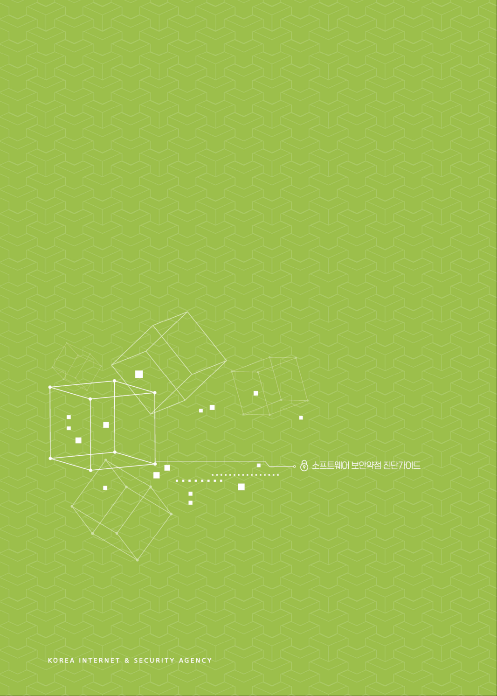
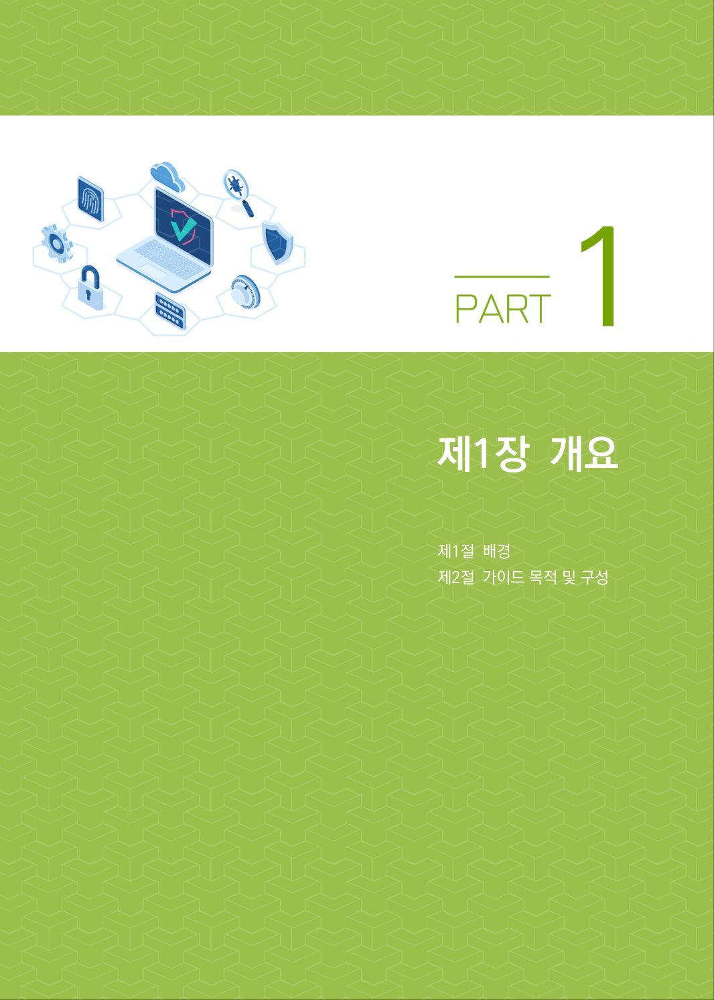

# 표지·목차·앞부분

> 변환 안내(원문 외): 아래 본문은 PDF 텍스트를 추출한 전사입니다. 코드 줄번호·특수 공백·원문 오류를 유지했습니다. 실행용 코드가 아닙니다. 표·그림·들여쓰기는 연결된 페이지 이미지와 대조하세요. 페이지 경계의 줄바꿈을 보존하며, 동일 페이지가 여러 항목에 나뉘면 각 항목의 본문은 해당 구간만 포함합니다.

### PDF 1페이지

<!-- source-page:SW-Diagnosis-2021:1; source-lines: -->

원본 페이지 이미지 (변환 외 보존 자료)

### PDF 2페이지

<!-- source-page:SW-Diagnosis-2021:2; source-lines: -->

원본 페이지 이미지 (변환 외 보존 자료)

### PDF 3페이지

<!-- source-page:SW-Diagnosis-2021:3; source-lines:0,1,2,3,4,5,6,7,8,9,10,11,12,13,14,15,16,17,18,19,20,21,22,23,24,25 -->

제·개정이력(Revision History)

번호

제·개정일 

변경 내용

발간팀 

비고

1

2012. 5.

[제정]
∙소프트웨어 보안약점 진단가이드 제정

공공SW보호팀

2

2013.11.

[개정]
∙보안약점 기준 변경에 따른 별첨 가이드 추가 

보안평가인증팀

3

2019. 6.

[개정]
∙별첨 가이드 통합, 설계단계 보안항목 진단 방법 등 추가

전자정부보호팀

4

2021.11.

[개정]
∙보안약점 기준 변경에 따른 가이드 개정

전자정부보호팀

원본 페이지 이미지 (변환 외 보존 자료)

### PDF 4페이지

<!-- source-page:SW-Diagnosis-2021:4; source-lines:0,1,2,3,4,5,6,7,8,9,10,11,12,13,14,15,16,17,18,19,20,21,22,23,24,25,26,27,28,29 -->

PART1

#### 제1장 개요

제1절배경··································································································10
제2절가이드 목적 및 구성·······································································11

PART2

#### 제2장 소프트웨어 개발보안

제1절개요··································································································16
제2절소프트웨어 개발보안 체계······························································18
제3절소프트웨어 보안약점 진단······························································20

1. 개요····································································································20

#### 2. SW보안약점 진단원의 역할·····························································21

#### 3. 분석·설계단계 진단절차····································································21

#### 4. 구현단계 진단절차·············································································28

PART3

#### 제3장 분석·설계단계 보안약점 진단

제1절보안항목 식별··················································································32

#### 1. 정보에 대한 보안항목 식별······························································32

#### 2. 기능에 대한 보안항목 식별······························································35

#### 3. 구현단계 기준과의 관계····································································38

제2절설계단계 보안설계 적용 방법·························································40
제3절설계단계 보안설계 기준··································································43

#### 1. 입력데이터 검증 및 표현··································································43

1.1 DBMS 조회 및 결과 검증····································································43
1.2 XML 조회 및 결과 검증·······································································50
1.3 디렉토리 서비스 조회 및 결과 검증·····················································54
1.4 시스템 자원 접근 및 명령어 수행 입력값 검증···································58
1.5 웹 서비스 요청 및 결과 검증································································64
1.6 웹 기반 중요 기능 수행 요청 유효성 검증··········································71
1.7 HTTP 프로토콜 유효성 검증·································································76
1.8 허용된 범위내 메모리 접근····································································81

원본 페이지 이미지 (변환 외 보존 자료)

### PDF 5페이지

<!-- source-page:SW-Diagnosis-2021:5; source-lines:0,1,2,3,4,5,6,7,8,9,10,11,12,13,14,15,16,17,18,19,20,21,22,23,24,25,26,27,28,29,30,31,32,33 -->

PART3

#### 제3장 분석·설계단계 보안항목 진단

1.9 보안기능 입력값 검증············································································86
1.10 업로드·다운로드 파일 검증·································································93
2. 보안기능··························································································103

2.1 인증 대상 및 방식···············································································103
2.2 인증 수행 제한·····················································································110
2.3 비밀번호 관리·······················································································115
2.4 중요자원 접근통제················································································129
2.5 암호키 관리··························································································138
2.6 암호연산································································································145
2.7 중요정보 저장·······················································································153
2.8 중요정보 전송·······················································································159
3. 에러처리··························································································164

3.1 예외처리································································································164
4. 세션통제··························································································171

4.1 세션 통제······························································································171

PART4

#### 제4장 구현단계 보안약점 진단

제1절입력데이터 검증 및 표현······························································180

 1. SQL 삽입······················································································180
 2. 코드삽입························································································194
 3. 경로 조작 및 자원 삽입·······························································201
 4. 크로스사이트 스크립트·································································211
 5. 운영체제 명령어 삽입···································································223
 6. 위험한 형식 파일 업로드·····························································232
 7. 신뢰되지 않는 URL 주소로 자동접속 연결································239
 8. 부적절한 XML 외부개체 참조·····················································244
 9. XML 삽입·····················································································251

#### 10. LDAP 삽입···················································································264

#### 11. 크로스사이트 요청 위조·······························································272

#### 12. 서버사이드 요청 위조···································································276

#### 13. HTTP 응답분할············································································284

#### 14. 정수형 오버플로우········································································290

원본 페이지 이미지 (변환 외 보존 자료)

### PDF 6페이지

<!-- source-page:SW-Diagnosis-2021:6; source-lines:0,1,2,3,4,5,6,7,8,9,10,11,12,13,14,15,16,17,18,19,20,21,22,23,24,25,26,27,28,29,30,31,32,33,34 -->

PART4

#### 제4장 구현단계 보안약점 진단

#### 15. 보안기능 결정에 사용되는 부적절한 입력값·······························297

#### 16. 메모리 버퍼 오버플로우·······························································303

#### 17. 포맷 스트링 삽입··········································································309

제2절보안기능·························································································314

 1. 적절한 인증 없는 중요기능 허용·················································314
 2. 부적절한 인가···············································································319
 3. 중요한 자원에 대한 잘못된 권한 설정········································325
 4. 취약한 암호화 알고리즘 사용·······················································330
 5. 암호화되지 않은 중요정보····························································337
 6. 하드코드된 중요정보·····································································350
 7. 충분하지 않은 키 길이 사용························································360
 8. 적절하지 않은 난수 값 사용························································364
 9. 취약한 비밀번호 허용···································································370

#### 10. 부적절한 전자서명 확인·······························································375

#### 11. 부적절한 인증서 유효성 검증······················································379

#### 12. 사용자 하드디스크에 저장되는 쿠키를 통한 정보 노출·············383

#### 13. 주석문 안에 포함된 시스템 주요정보··········································387

#### 14. 솔트 없이 일방향 해쉬 함수 사용···············································391

#### 15. 무결성 검사 없는 코드 다운로드·················································395

#### 16. 반복된 인증시도 제한 기능 부재·················································400

제3절시간 및 상태·················································································406

#### 1. 경쟁조건: 검사 시점과 사용 시점(TOCTOU) ·······························406

#### 2. 종료되지 않는 반복문 또는 재귀 함수··········································415

제4절에러처리·························································································419

#### 1. 오류 메시지 정보노출·····································································419

#### 2. 오류상황 대응 부재········································································425

#### 3. 부적절한 예외 처리········································································429

제5절코드오류·························································································433

#### 1. Null Pointer 역참조······································································433

#### 2. 부적절한 자원 해제········································································445

#### 3. 해제된 자원 사용············································································454

#### 4. 초기화되지 않은 변수 사용····························································459

#### 5. 신뢰할 수 없는 데이터의 역직렬화················································462

원본 페이지 이미지 (변환 외 보존 자료)

### PDF 7페이지

<!-- source-page:SW-Diagnosis-2021:7; source-lines:0,1,2,3,4,5,6,7,8,9,10,11,12,13,14,15 -->

PART4

#### 제4장 구현단계 보안약점 진단

제6절캡슐화····························································································469

#### 1. 잘못된 세션에 의한 데이터 정보 노출··········································469

#### 2. 제거되지 않고 남은 디버그 코드···················································476

#### 3. Public 메소드부터 반환된 Private 배열······································481

#### 4. Private 배열에 Public 데이터 할당·············································487

제7절API 오용·······················································································492

#### 1. DNS lookup에 의존한 보안결정··················································492

#### 2. 취약한 API 사용·············································································497

PART5

#### 제5장 부록

제1절설계단계 보안설계 기준································································506
제2절구현단계 보안약점 제거 기준·······················································512
제3절설계단계 보안설계 산출물 적용 예··············································516
제4절용어정리·························································································607

원본 페이지 이미지 (변환 외 보존 자료)

### PDF 8페이지

<!-- source-page:SW-Diagnosis-2021:8; source-lines: -->

원본 페이지 이미지 (변환 외 보존 자료)

### PDF 9페이지

<!-- source-page:SW-Diagnosis-2021:9; source-lines:3 -->

1

원본 페이지 이미지 (변환 외 보존 자료)

---

## 탐색 링크 (원문 외)

[통합 인덱스](../INDEX.md)

