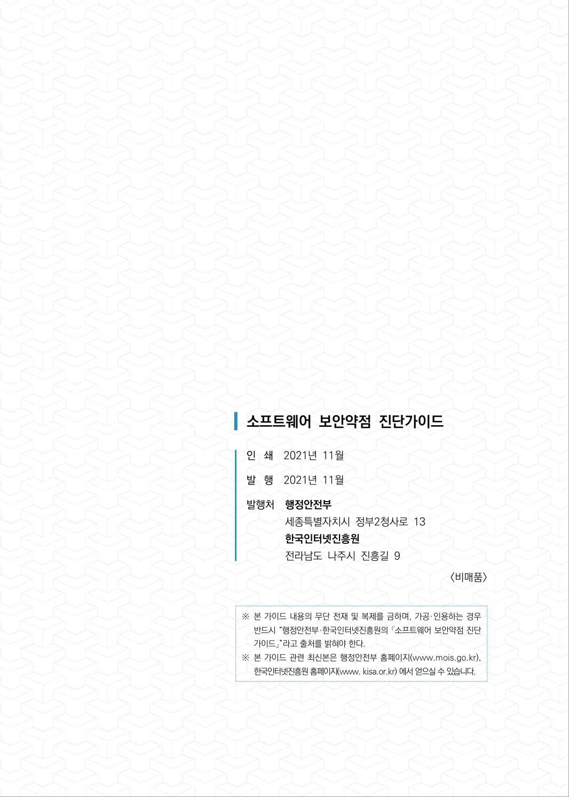

# 발행정보·뒷표지

> 변환 안내(원문 외): 아래 본문은 PDF 텍스트를 추출한 전사입니다. 코드 줄번호·특수 공백·원문 오류를 유지했습니다. 실행용 코드가 아닙니다. 표·그림·들여쓰기는 연결된 페이지 이미지와 대조하세요. 페이지 경계의 줄바꿈을 보존하며, 동일 페이지가 여러 항목에 나뉘면 각 항목의 본문은 해당 구간만 포함합니다.

### PDF 611페이지

<!-- source-page:SW-Diagnosis-2021:611; source-lines:0,1,2,3,4,5,6,7,8,9,10,11,12,13,14,15 -->

소프트웨어 보안약점 진단가이드
인쇄

2021년 11월
발행

2021년 11월
발행처

행정안전부
세종특별자치시 정부2청사로 13
한국인터넷진흥원
전라남도 나주시 진흥길 9

&lt;비매품&gt;

※ 본 가이드 내용의 무단 전재 및 복제를 금하며, 가공·인용하는 경우 

반드시 “행정안전부·한국인터넷진흥원의 『소프트웨어 보안약점 진단
가이드』”라고 출처를 밝혀야 한다. 
※ 본 가이드 관련 최신본은 행정안전부 홈페이지(www.mois.go.kr), 

한국인터넷진흥원 홈페이지(www. kisa.or.kr) 에서 얻으실 수 있습니다.

원본 페이지 이미지 (변환 외 보존 자료)

### PDF 612페이지

<!-- source-page:SW-Diagnosis-2021:612; source-lines: -->

원본 페이지 이미지 (변환 외 보존 자료)

---

## 탐색 링크 (원문 외)

[통합 인덱스](../INDEX.md)

