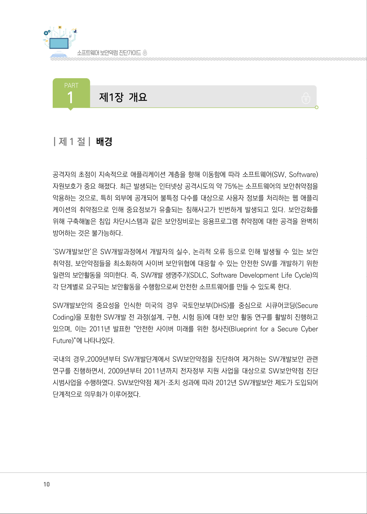
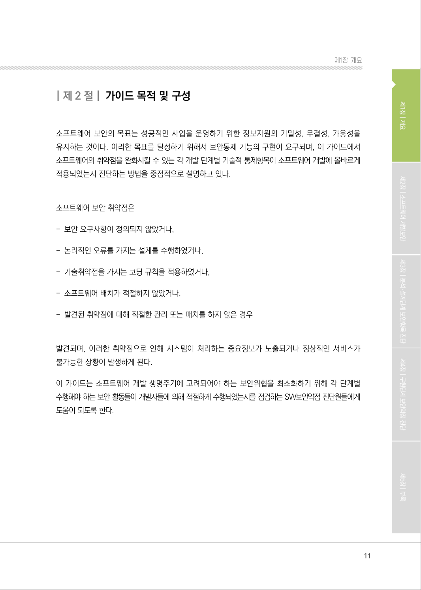

# 제1절 배경

> 변환 안내(원문 외): 아래 본문은 PDF 텍스트를 추출한 전사입니다. 코드 줄번호·특수 공백·원문 오류를 유지했습니다. 실행용 코드가 아닙니다. 표·그림·들여쓰기는 연결된 페이지 이미지와 대조하세요. 페이지 경계의 줄바꿈을 보존하며, 동일 페이지가 여러 항목에 나뉘면 각 항목의 본문은 해당 구간만 포함합니다.

### PDF 10페이지 / 인쇄 10페이지

<!-- source-page:SW-Diagnosis-2021:10; source-lines:0,4,5,6,7,8,9,10,11,12,13,14,15,16,17,18,19,20,21,22 -->

10

| 제1 절| 배경

공격자의 초점이 지속적으로 애플리케이션 계층을 향해 이동함에 따라 소프트웨어(SW, Software) 
자원보호가 중요 해졌다. 최근 발생되는 인터넷상 공격시도의 약 75%는 소프트웨어의 보안취약점을 
악용하는 것으로, 특히 외부에 공개되어 불특정 다수를 대상으로 사용자 정보를 처리하는 웹 애플리
케이션의 취약점으로 인해 중요정보가 유출되는 침해사고가 빈번하게 발생되고 있다. 보안강화를 
위해 구축해놓은 침입 차단시스템과 같은 보안장비로는 응용프로그램 취약점에 대한 공격을 완벽히 
방어하는 것은 불가능하다.

‘SW개발보안’은 SW개발과정에서 개발자의 실수, 논리적 오류 등으로 인해 발생될 수 있는 보안 
취약점, 보안약점들을 최소화하여 사이버 보안위협에 대응할 수 있는 안전한 SW를 개발하기 위한 
일련의 보안활동을 의미한다. 즉, SW개발 생명주기(SDLC, Software Development Life Cycle)의 
각 단계별로 요구되는 보안활동을 수행함으로써 안전한 소프트웨어를 만들 수 있도록 한다.

SW개발보안의 중요성을 인식한 미국의 경우 국토안보부(DHS)를 중심으로 시큐어코딩(Secure 
Coding)을 포함한 SW개발 전 과정(설계, 구현, 시험 등)에 대한 보안 활동 연구를 활발히 진행하고 
있으며, 이는 2011년 발표한 “안전한 사이버 미래를 위한 청사진(Blueprint for a Secure Cyber 
Future)”에 나타나있다.

국내의 경우,2009년부터 SW개발단계에서 SW보안약점을 진단하여 제거하는 SW개발보안 관련 
연구를 진행하면서, 2009년부터 2011년까지 전자정부 지원 사업을 대상으로 SW보안약점 진단 
시범사업을 수행하였다. SW보안약점 제거·조치 성과에 따라 2012년 SW개발보안 제도가 도입되어 
단계적으로 의무화가 이루어졌다.

원본 페이지 이미지 (변환 외 보존 자료)

### PDF 11페이지 / 인쇄 11페이지

<!-- source-page:SW-Diagnosis-2021:11; source-lines:1 -->

제1장개요

원본 페이지 이미지 (변환 외 보존 자료)

---

## 탐색 링크 (원문 외)

[통합 인덱스](../../../INDEX.md)

