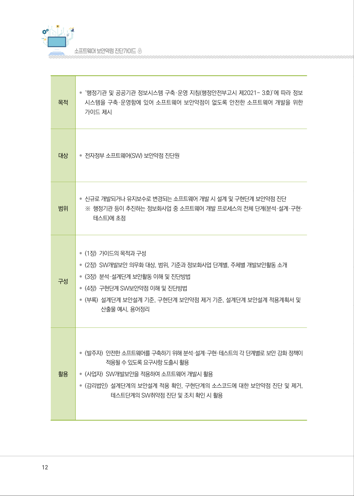
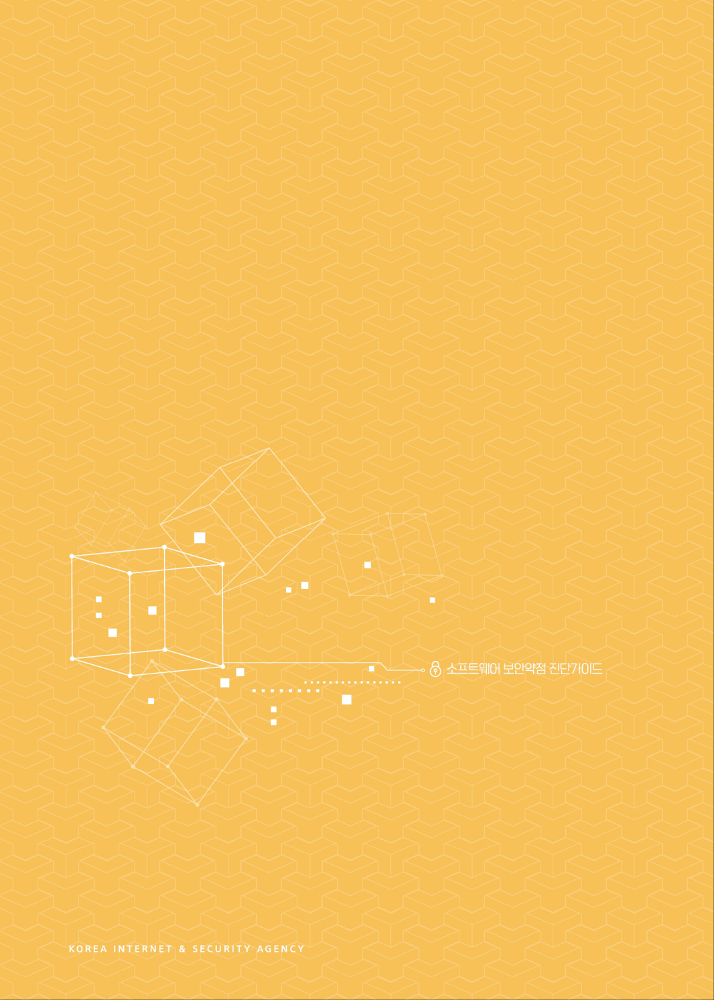
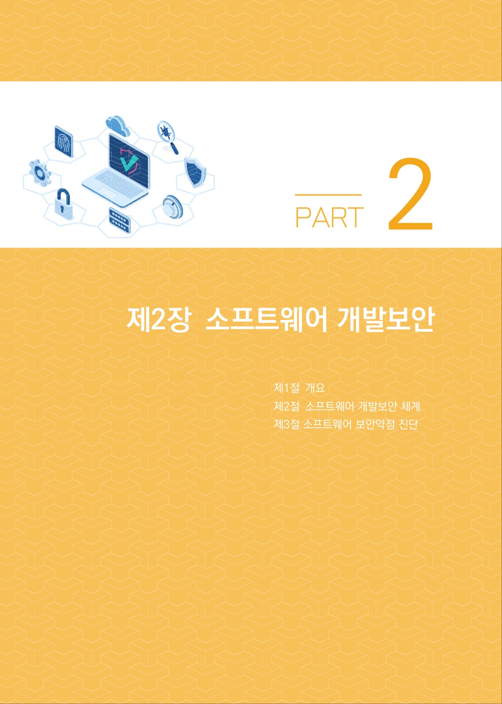

# 제2절 가이드 목적 및 구성

> 변환 안내(원문 외): 아래 본문은 PDF 텍스트를 추출한 전사입니다. 코드 줄번호·특수 공백·원문 오류를 유지했습니다. 실행용 코드가 아닙니다. 표·그림·들여쓰기는 연결된 페이지 이미지와 대조하세요. 페이지 경계의 줄바꿈을 보존하며, 동일 페이지가 여러 항목에 나뉘면 각 항목의 본문은 해당 구간만 포함합니다.

### PDF 11페이지 / 인쇄 11페이지

<!-- source-page:SW-Diagnosis-2021:11; source-lines:0,2,3,4,5,6,7,8,9,10,11,12,13,14,15,16,17 -->

11

| 제2 절| 가이드 목적 및 구성

소프트웨어 보안의 목표는 성공적인 사업을 운영하기 위한 정보자원의 기밀성, 무결성, 가용성을 
유지하는 것이다. 이러한 목표를 달성하기 위해서 보안통제 기능의 구현이 요구되며, 이 가이드에서 
소프트웨어의 취약점을 완화시킬 수 있는 각 개발 단계별 기술적 통제항목이 소프트웨어 개발에 올바르게 
적용되었는지 진단하는 방법을 중점적으로 설명하고 있다.

소프트웨어 보안 취약점은

- 보안 요구사항이 정의되지 않았거나, 

- 논리적인 오류를 가지는 설계를 수행하였거나, 

- 기술취약점을 가지는 코딩 규칙을 적용하였거나, 

- 소프트웨어 배치가 적절하지 않았거나, 

- 발견된 취약점에 대해 적절한 관리 또는 패치를 하지 않은 경우 

발견되며, 이러한 취약점으로 인해 시스템이 처리하는 중요정보가 노출되거나 정상적인 서비스가 
불가능한 상황이 발생하게 된다.

이 가이드는 소프트웨어 개발 생명주기에 고려되어야 하는 보안위협을 최소화하기 위해 각 단계별 
수행해야 하는 보안 활동들이 개발자들에 의해 적절하게 수행되었는지를 점검하는 SW보안약점 진단원들에게 
도움이 되도록 한다.

원본 페이지 이미지 (변환 외 보존 자료)

### PDF 12페이지 / 인쇄 12페이지

<!-- source-page:SW-Diagnosis-2021:12; source-lines:0,1,2,3,4,5,6,7,8,9,10,11,12,13,14,15,16,17,18,19,20,21,22,23 -->

12

|  |  |
| --- | --- |
| 목적 | • ‘행정기관 및 공공기관 정보시스템 구축·운영 지침(행정안전부고시 제2021- 3호)’에 따라 정보 시스템을 구축·운영함에 있어 소프트웨어 보안약점이 없도록 안전한 소프트웨어 개발을 위한 가이드 제시 |
| 대상 | • 전자정부 소프트웨어(SW) 보안약점 진단원 |
| 범위 | • 신규로 개발되거나 유지보수로 변경되는 소프트웨어 개발 시 설계 및 구현단계 보안약점 진단 ※ 행정기관 등이 추진하는 정보화사업 중 소프트웨어 개발 프로세스의 전체 단계(분석·설계·구현· 테스트)에 초점 |
| 구성 | • (1장) 가이드의 목적과 구성 • (2장) SW개발보안 의무화 대상, 범위, 기준과 정보화사업 단계별, 주체별 개발보안활동 소개 • (3장) 분석·설계단계 보안활동 이해 및 진단방법 • (4장) 구현단계 SW보안약점 이해 및 진단방법 • (부록) 설계단계 보안설계 기준, 구현단계 보안약점 제거 기준, 설계단계 보안설계 적용계획서 및 산출물 예시, 용어정리 |
| 활용 | • (발주자) 안전한 소프트웨어를 구축하기 위해 분석·설계·구현·테스트의 각 단계별로 보안 강화 정책이 적용될 수 있도록 요구사항 도출시 활용 • (사업자) SW개발보안을 적용하여 소프트웨어 개발시 활용 • (감리법인) 설계단계의 보안설계 적용 확인, 구현단계의 소스코드에 대한 보안약점 진단 및 제거, 테스트단계의 SW취약점 진단 및 조치 확인 시 활용 |

원본 페이지 이미지 (변환 외 보존 자료)

### PDF 13페이지 / 인쇄 13페이지

<!-- source-page:SW-Diagnosis-2021:13; source-lines: -->

원본 페이지 이미지 (변환 외 보존 자료)

### PDF 14페이지 / 인쇄 14페이지

<!-- source-page:SW-Diagnosis-2021:14; source-lines: -->

원본 페이지 이미지 (변환 외 보존 자료)

### PDF 15페이지 / 인쇄 15페이지

<!-- source-page:SW-Diagnosis-2021:15; source-lines:4 -->

2

원본 페이지 이미지 (변환 외 보존 자료)

---

## 탐색 링크 (원문 외)

[통합 인덱스](../../../INDEX.md)

