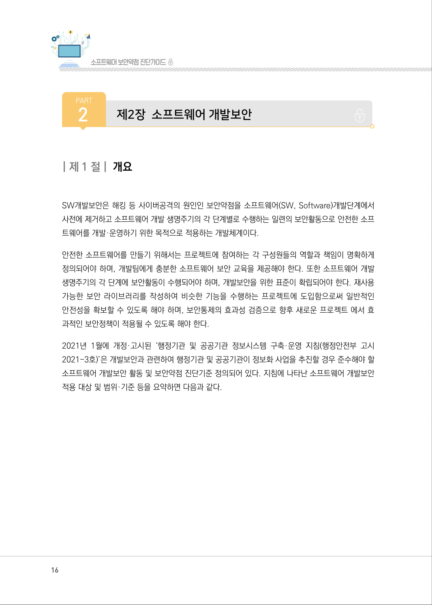
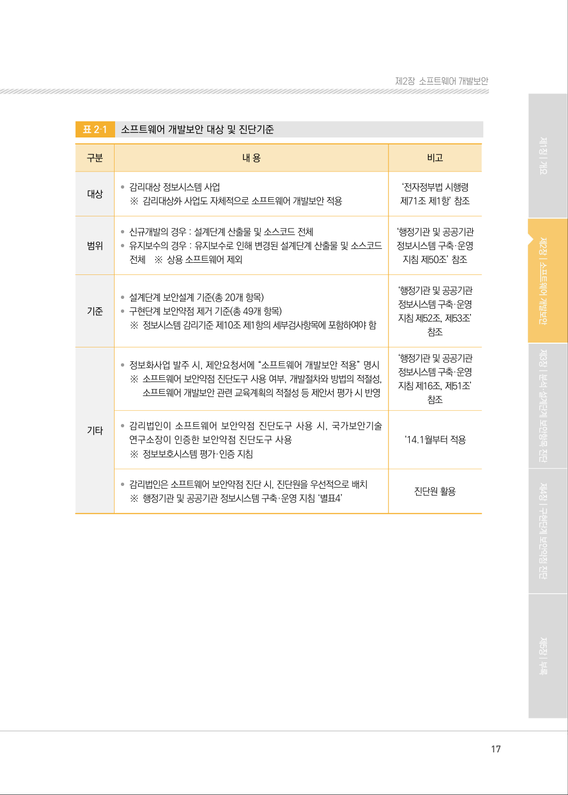

# 제1절 개요

> 변환 안내(원문 외): 아래 본문은 PDF 텍스트를 추출한 전사입니다. 코드 줄번호·특수 공백·원문 오류를 유지했습니다. 실행용 코드가 아닙니다. 표·그림·들여쓰기는 연결된 페이지 이미지와 대조하세요. 페이지 경계의 줄바꿈을 보존하며, 동일 페이지가 여러 항목에 나뉘면 각 항목의 본문은 해당 구간만 포함합니다.

### PDF 16페이지 / 인쇄 16페이지

<!-- source-page:SW-Diagnosis-2021:16; source-lines:0,4,5,6,7,8,9,10,11,12,13,14,15,16,17 -->

16

| 제1 절| 개요

SW개발보안은 해킹 등 사이버공격의 원인인 보안약점을 소프트웨어(SW, Software)개발단계에서 
사전에 제거하고 소프트웨어 개발 생명주기의 각 단계별로 수행하는 일련의 보안활동으로 안전한 소프
트웨어를 개발·운영하기 위한 목적으로 적용하는 개발체계이다.

안전한 소프트웨어를 만들기 위해서는 프로젝트에 참여하는 각 구성원들의 역할과 책임이 명확하게 
정의되어야 하며, 개발팀에게 충분한 소프트웨어 보안 교육을 제공해야 한다. 또한 소프트웨어 개발 
생명주기의 각 단계에 보안활동이 수행되어야 하며, 개발보안을 위한 표준이 확립되어야 한다. 재사용 
가능한 보안 라이브러리를 작성하여 비슷한 기능을 수행하는 프로젝트에 도입함으로써 일반적인 
안전성을 확보할 수 있도록 해야 하며, 보안통제의 효과성 검증으로 향후 새로운 프로젝트 에서 효
과적인 보안정책이 적용될 수 있도록 해야 한다.

2021년 1월에 개정·고시된 ‘행정기관 및 공공기관 정보시스템 구축·운영 지침(행정안전부 고시 
2021-3호)’은 개발보안과 관련하여 행정기관 및 공공기관이 정보화 사업을 추진할 경우 준수해야 할 
소프트웨어 개발보안 활동 및 보안약점 진단기준 정의되어 있다. 지침에 나타난 소프트웨어 개발보안 
적용 대상 및 범위·기준 등을 요약하면 다음과 같다.

<details><summary>원본 페이지 이미지 (변환 외 보존 자료)</summary>



</details>

### PDF 17페이지 / 인쇄 17페이지

<!-- source-page:SW-Diagnosis-2021:17; source-lines:0,1,2,3,4,5,6,7,8,9,10,11,12,13,14,15,16,17,18,19,20,21,22,23,24,25,26,27,28,29,30,31,32,33,34,35,36,37,38,39,40,41,42 -->

17

제2장소프트웨어 개발보안

표2‐1

소프트웨어 개발보안 대상 및 진단기준

```text
구분
내 용
비고
대상
• 감리대상 정보시스템 사업
※ 감리대상外 사업도 자체적으로 소프트웨어 개발보안 적용
‘전자정부법 시행령
제71조 제1항’ 참조
범위
• 신규개발의 경우 : 설계단계 산출물 및 소스코드 전체 
• 유지보수의 경우 : 유지보수로 인해 변경된 설계단계 산출물 및 소스코드 
전체
※ 상용 소프트웨어 제외
‘행정기관 및 공공기관 
정보시스템 구축·운영 
지침 제50조’ 참조
기준
• 설계단계 보안설계 기준(총 20개 항목) 
• 구현단계 보안약점 제거 기준(총 49개 항목) 
※ 정보시스템 감리기준 제10조 제1항의 세부검사항목에 포함하여야 함
‘행정기관 및 공공기관 
정보시스템 구축·운영 
지침 제52조, 제53조’ 
참조
기타
• 정보화사업 발주 시, 제안요청서에 “소프트웨어 개발보안 적용” 명시
※ 소프트웨어 보안약점 진단도구 사용 여부, 개발절차와 방법의 적절성, 
소프트웨어 개발보안 관련 교육계획의 적절성 등 제안서 평가 시 반영
‘행정기관 및 공공기관 
정보시스템 구축·운영 
지침 제16조, 제51조’ 
참조
• 감리법인이 소프트웨어 보안약점 진단도구 사용 시, 국가보안기술
연구소장이 인증한 보안약점 진단도구 사용 
※ 정보보호시스템 평가·인증 지침
‘14.1월부터 적용
• 감리법인은 소프트웨어 보안약점 진단 시, 진단원을 우선적으로 배치
※ 행정기관 및 공공기관 정보시스템 구축·운영 지침 ‘별표4’
진단원 활용
```

<details><summary>원본 페이지 이미지 (변환 외 보존 자료)</summary>



</details>

---

## 탐색 링크 (원문 외)

[통합 인덱스](../../../INDEX.md)

