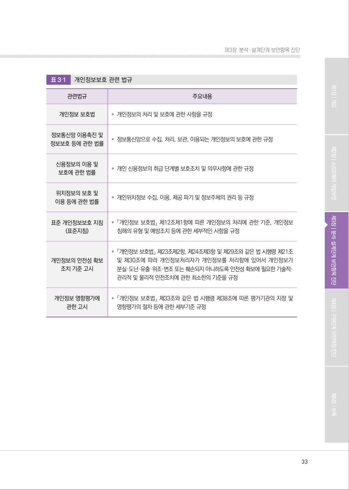
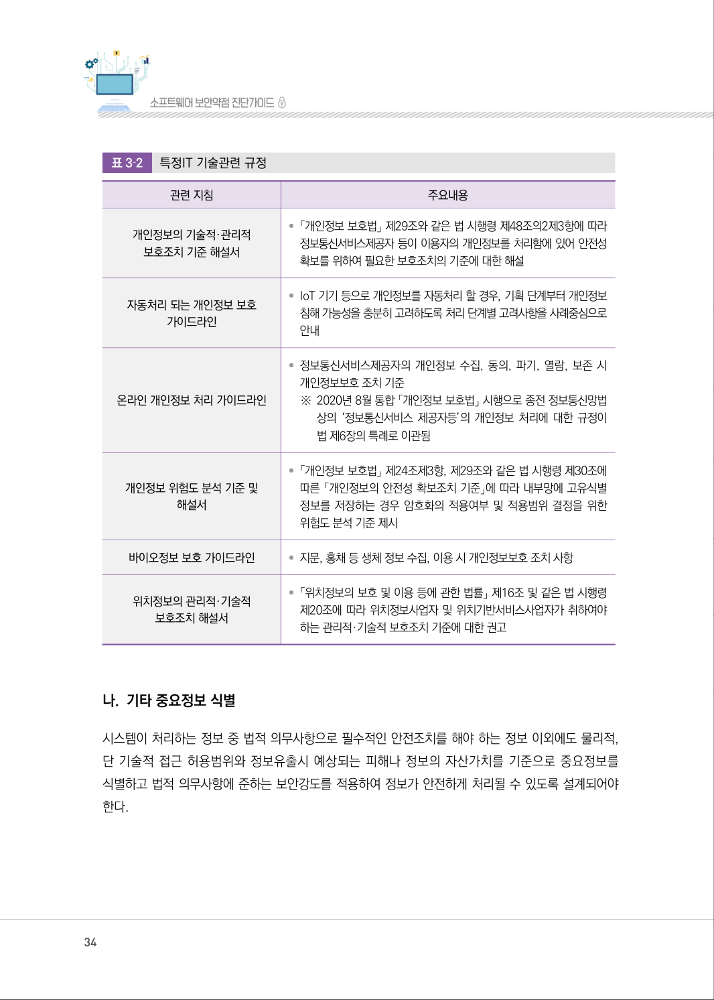

# 1. 정보에 대한 보안항목 식별

> 변환 안내(원문 외): 아래 본문은 PDF 텍스트를 추출한 전사입니다. 코드 줄번호·특수 공백·원문 오류를 유지했습니다. 실행용 코드가 아닙니다. 표·그림·들여쓰기는 연결된 페이지 이미지와 대조하세요. 페이지 경계의 줄바꿈을 보존하며, 동일 페이지가 여러 항목에 나뉘면 각 항목의 본문은 해당 구간만 포함합니다.

### PDF 32페이지 / 인쇄 32페이지

<!-- source-page:SW-Diagnosis-2021:32; source-lines:0,5,6,7,8,9,10,11,12,13,14,15 -->

32

#### 1. 정보에 대한 보안항목 식별

분석단계에서는 처리해야 하는 정보와 그 정보를 처리하는 기능에 대해 적용되어야 하는 보안항목
들을 식별하는 작업이 우선적으로 수행되어야 한다. 정보에 대한 보안항목 식별은 권한을 가진 사용자만이 
안전하게 수집, 전송, 처리, 보관, 폐기해야 하는 정보를 식별하는 것이다. 우리나라는 개인정보 보호법 
등 다양한 법, 제도, 규정에 의해 보호되어야 하는 중요정보들을 정의하고 있으며, 각 기관은 내부 
정책자료, 외부정책자료 등을 기반으로 보안항목을 식별하고 있다. 내부정책 자료로는 기관 내 개인 
정보보호 규정, 정보보안 관련 규정 등이 있으며, 외부정책자료 개인정보보호법, 정보통신망법, 금융 
거래법 등 다양한 법, 법령, 관련지침 등으로 규정한다.

#### 가. 외부환경 분석(법, 제도, 규정 등)으로 보안항목 식별

현재 시스템에서 처리하는 정보 중 중요정보로 분류되어 있는 정보의 대부분은 개인정보이며, 특정 
IT기술과 관련된 규정도 존재한다.

원본 페이지 이미지 (변환 외 보존 자료)

### PDF 33페이지 / 인쇄 33페이지

<!-- source-page:SW-Diagnosis-2021:33; source-lines:0,1,2,3,4,5,6,7,8,9,10,11,12,13,14,15,16,17,18,19,20,21,22,23,24,25,26,27,28,29,30 -->

33

제3장분석․ 설계단계 보안항목 진단

표3‐1

개인정보보호 관련 법규

|  |  |
| --- | --- |
| 관련법규 | 주요내용 |
| 개인정보 보호법 | • 개인정보의 처리 및 보호에 관한 사항을 규정 |
| 정보통신망 이용촉진 및 정보보호 등에 관한 법률 | • 정보통신망으로 수집, 처리, 보관, 이용되는 개인정보의 보호에 관한 규정 |
| 신용정보의 이용 및 보호에 관한 법률 | • 개인 신용정보의 취급 단계별 보호조치 및 의무사항에 관한 규정 |
| 위치정보의 보호 및 이용 등에 관한 법률 | • 개인위치정보 수집, 이용, 제공 파기 및 정보주체의 권리 등 규정 |
| 표준 개인정보보호 지침 (표준지침) | • 「개인정보 보호법」 제12조제1항에 따른 개인정보의 처리에 관한 기준, 개인정보 침해의 유형 및 예방조치 등에 관한 세부적인 사항을 규정 |
| 개인정보의 안전성 확보 조치 기준 고시 | • 「개인정보 보호법」 제23조제2항, 제24조제3항 및 제29조와 같은 법 시행령 제21조 및 제30조에 따라 개인정보처리자가 개인정보를 처리함에 있어서 개인정보가 분실·도난·유출·위조·변조 또는 훼손되지 아니하도록 안전성 확보에 필요한 기술적· 관리적 및 물리적 안전조치에 관한 최소한의 기준을 규정 |
| 개인정보 영향평가에 관한 고시 | • 「개인정보 보호법」 제33조와 같은 법 시행령 제38조에 따른 평가기관의 지정 및 영향평가의 절차 등에 관한 세부기준 규정 |

원본 페이지 이미지 (변환 외 보존 자료)

### PDF 34페이지 / 인쇄 34페이지

<!-- source-page:SW-Diagnosis-2021:34; source-lines:0,1,2,3,4,5,6,7,8,9,10,11,12,13,14,15,16,17,18,19,20,21,22,23,24,25,26,27,28,29,30,31,32,33,34,35,36,37,38 -->

34

표3‐2

특정IT 기술관련 규정

|  |  |
| --- | --- |
| 관련 지침 | 주요내용 |
| 개인정보의 기술적·관리적 보호조치 기준 해설서 | • 「개인정보 보호법」 제29조와 같은 법 시행령 제48조의2제3항에 따라 정보통신서비스제공자 등이 이용자의 개인정보를 처리함에 있어 안전성 확보를 위하여 필요한 보호조치의 기준에 대한 해설 |
| 자동처리 되는 개인정보 보호 가이드라인 | • IoT 기기 등으로 개인정보를 자동처리 할 경우, 기획 단계부터 개인정보 침해 가능성을 충분히 고려하도록 처리 단계별 고려사항을 사례중심으로 안내 |
| 온라인 개인정보 처리 가이드라인 | • 정보통신서비스제공자의 개인정보 수집, 동의, 파기, 열람, 보존 시 개인정보보호 조치 기준 ※ 2020년 8월 통합 「개인정보 보호법」 시행으로 종전 정보통신망법 상의 ‘정보통신서비스 제공자등’의 개인정보 처리에 대한 규정이 법 제6장의 특례로 이관됨 |
| 개인정보 위험도 분석 기준 및 해설서 | • 「개인정보 보호법」 제24조제3항, 제29조와 같은 법 시행령 제30조에 따른 「개인정보의 안전성 확보조치 기준」에 따라 내부망에 고유식별 정보를 저장하는 경우 암호화의 적용여부 및 적용범위 결정을 위한 위험도 분석 기준 제시 |
| 바이오정보 보호 가이드라인 | • 지문, 홍채 등 생체 정보 수집, 이용 시 개인정보보호 조치 사항 |
| 위치정보의 관리적·기술적 보호조치 해설서 | • 「위치정보의 보호 및 이용 등에 관한 법률」 제16조 및 같은 법 시행령 제20조에 따라 위치정보사업자 및 위치기반서비스사업자가 취하여야 하는 관리적·기술적 보호조치 기준에 대한 권고 |

#### 나. 기타 중요정보 식별

시스템이 처리하는 정보 중 법적 의무사항으로 필수적인 안전조치를 해야 하는 정보 이외에도 물리적, 
단 기술적 접근 허용범위와 정보유출시 예상되는 피해나 정보의 자산가치를 기준으로 중요정보를 
식별하고 법적 의무사항에 준하는 보안강도를 적용하여 정보가 안전하게 처리될 수 있도록 설계되어야 
한다.

원본 페이지 이미지 (변환 외 보존 자료)

### PDF 35페이지 / 인쇄 35페이지

<!-- source-page:SW-Diagnosis-2021:35; source-lines:1 -->

제3장분석․ 설계단계 보안항목 진단

원본 페이지 이미지 (변환 외 보존 자료)

---

## 탐색 링크 (원문 외)

[통합 인덱스](../../../INDEX.md)

