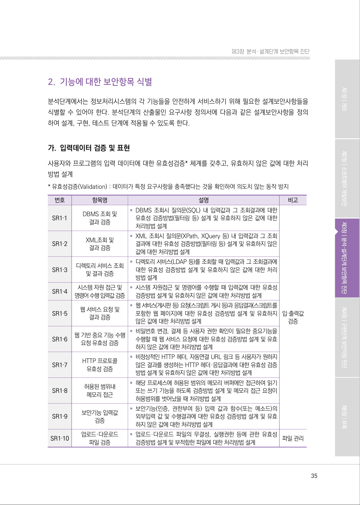
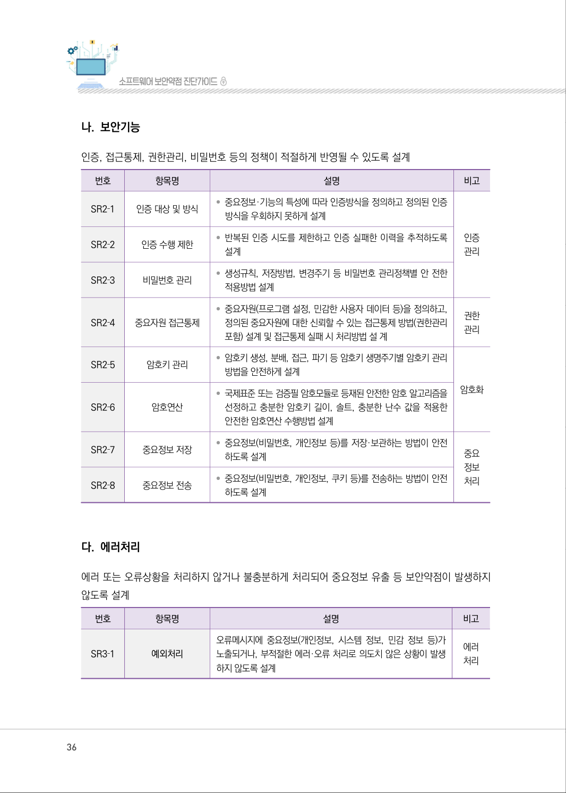
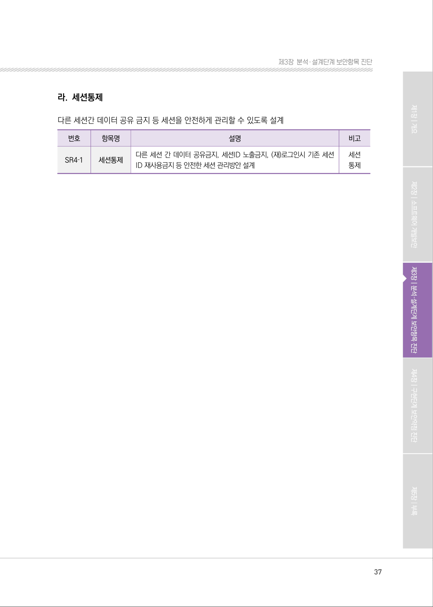

# 2. 기능에 대한 보안항목 식별

> 변환 안내(원문 외): 아래 본문은 PDF 텍스트를 추출한 전사입니다. 코드 줄번호·특수 공백·원문 오류를 유지했습니다. 실행용 코드가 아닙니다. 표·그림·들여쓰기는 연결된 페이지 이미지와 대조하세요. 페이지 경계의 줄바꿈을 보존하며, 동일 페이지가 여러 항목에 나뉘면 각 항목의 본문은 해당 구간만 포함합니다.

### PDF 35페이지 / 인쇄 35페이지

<!-- source-page:SW-Diagnosis-2021:35; source-lines:0,2,3,4,5,6,7,8,9,10,11,12,13,14,15,16,17,18,19,20,21,22,23,24,25,26,27,28,29,30,31,32,33,34,35,36,37,38,39,40,41,42,43,44,45,46,47,48,49,50,51,52,53,54,55,56,57,58,59,60,61,62,63,64,65,66,67,68,69,70,71,72,73,74 -->

35

#### 2. 기능에 대한 보안항목 식별

분석단계에서는 정보처리시스템의 각 기능들을 안전하게 서비스하기 위해 필요한 설계보안사항들을 
식별할 수 있어야 한다. 분석단계의 산출물인 요구사항 정의서에 다음과 같은 설계보안사항을 정의 
하여 설계, 구현, 테스트 단계에 적용될 수 있도록 한다.

#### 가. 입력데이터 검증 및 표현

사용자와 프로그램의 입력 데이터에 대한 유효성검증* 체계를 갖추고, 유효하지 않은 값에 대한 처리
방법 설계
* 유효성검증(Validation) : 데이터가 특정 요구사항을 충족했다는 것을 확인하여 의도치 않는 동작 방지

```text
번호
항목명
설명
비고
SR1‐1
DBMS 조회 및
결과 검증
• DBMS 조회시 질의문(SQL) 내 입력값과 그 조회결과에 대한 
유효성 검증방법(필터링 등) 설계 및 유효하지 않은 값에 대한 
처리방법 설계
입·출력값 
검증
SR1‐2
XML조회 및
결과 검증
• XML 조회시 질의문(XPath, XQuery 등) 내 입력값과 그 조회
결과에 대한 유효성 검증방법(필터링 등) 설계 및 유효하지 않은 
값에 대한 처리방법 설계
SR1‐3
디렉토리 서비스 조회 
및 결과 검증
• 디렉토리 서비스(LDAP 등)를 조회할 때 입력값과 그 조회결과에 
대한 유효성 검증방법 설계 및 유효하지 않은 값에 대한 처리
방법 설계
SR1‐4
시스템 자원 접근 및 
명령어 수행 입력값 검증
• 시스템 자원접근 및 명령어를 수행할 때 입력값에 대한 유효성 
검증방법 설계 및 유효하지 않은 값에 대한 처리방법 설계
SR1‐5
웹 서비스 요청 및
결과 검증
• 웹 서비스(게시판 등) 요청(스크립트 게시 등)과 응답결과(스크립트를 
포함한 웹 페이지)에 대한 유효성 검증방법 설계 및 유효하지 
않은 값에 대한 처리방법 설계
SR1‐6
웹 기반 중요 기능 수행 
요청 유효성 검증
• 비밀번호 변경, 결제 등 사용자 권한 확인이 필요한 중요기능을 
수행할 때 웹 서비스 요청에 대한 유효성 검증방법 설계 및 유효
하지 않은 값에 대한 처리방법 설계
SR1‐7
HTTP 프로토콜
유효성 검증
• 비정상적인 HTTP 헤더, 자동연결 URL 링크 등 사용자가 원하지 
않은 결과를 생성하는 HTTP 헤더·응답결과에 대한 유효성 검증
방법 설계 및 유효하지 않은 값에 대한 처리방법 설계
SR1‐8
허용된 범위내
메모리 접근
• 해당 프로세스에 허용된 범위의 메모리 버퍼에만 접근하여 읽기 
또는 쓰기 기능을 하도록 검증방법 설계 및 메모리 접근 요청이 
허용범위를 벗어났을 때 처리방법 설계
SR1‐9
보안기능 입력값
검증
• 보안기능(인증, 권한부여 등) 입력 값과 함수(또는 메소드)의 
외부입력 값 및 수행결과에 대한 유효성 검증방법 설계 및 유효
하지 않은 값에 대한 처리방법 설계
SR1‐10
업로드·다운로드
파일 검증
• 업로드·다운로드 파일의 무결성, 실행권한 등에 관한 유효성 
검증방법 설계 및 부적합한 파일에 대한 처리방법 설계
파일 관리
```

<details><summary>원본 페이지 이미지 (변환 외 보존 자료)</summary>



</details>

### PDF 36페이지 / 인쇄 36페이지

<!-- source-page:SW-Diagnosis-2021:36; source-lines:0,1,2,3,4,5,6,7,8,9,10,11,12,13,14,15,16,17,18,19,20,21,22,23,24,25,26,27,28,29,30,31,32,33,34,35,36,37,38,39,40,41,42,43,44,45,46,47,48,49,50,51,52,53,54,55,56,57,58,59,60,61,62 -->

36

#### 나. 보안기능

인증, 접근통제, 권한관리, 비밀번호 등의 정책이 적절하게 반영될 수 있도록 설계

```text
번호
항목명
설명
비고
SR2‐1
인증 대상 및 방식 
• 중요정보·기능의 특성에 따라 인증방식을 정의하고 정의된 인증
방식을 우회하지 못하게 설계
인증
관리
SR2‐2
인증 수행 제한 
• 반복된 인증 시도를 제한하고 인증 실패한 이력을 추적하도록 
설계
SR2‐3
비밀번호 관리 
• 생성규칙, 저장방법, 변경주기 등 비밀번호 관리정책별 안 전한 
적용방법 설계
SR2‐4
중요자원 접근통제
• 중요자원(프로그램 설정, 민감한 사용자 데이터 등)을 정의하고, 
정의된 중요자원에 대한 신뢰할 수 있는 접근통제 방법(권한관리 
포함) 설계 및 접근통제 실패 시 처리방법 설 계
권한
관리
SR2‐5
암호키 관리 
• 암호키 생성, 분배, 접근, 파기 등 암호키 생명주기별 암호키 관리 
방법을 안전하게 설계
암호화
SR2‐6
암호연산
• 국제표준 또는 검증필 암호모듈로 등재된 안전한 암호 알고리즘을 
선정하고 충분한 암호키 길이, 솔트, 충분한 난수 값을 적용한 
안전한 암호연산 수행방법 설계
SR2‐7
중요정보 저장 
• 중요정보(비밀번호, 개인정보 등)를 저장·보관하는 방법이 안전
하도록 설계
중요
정보
처리
SR2‐8
중요정보 전송 
• 중요정보(비밀번호, 개인정보, 쿠키 등)를 전송하는 방법이 안전
하도록 설계
```

#### 다. 에러처리

에러 또는 오류상황을 처리하지 않거나 불충분하게 처리되어 중요정보 유출 등 보안약점이 발생하지 
않도록 설계

| 번호 | 항목명 | 설명 | 비고 |
| --- | --- | --- | --- |
| SR3‐1 | 예외처리 | 오류메시지에 중요정보(개인정보, 시스템 정보, 민감 정보 등)가<br>노출되거나, 부적절한 에러·오류 처리로 의도치 않은 상황이 발생<br>하지 않도록 설계 | 에러<br>처리 |

<details><summary>원본 페이지 이미지 (변환 외 보존 자료)</summary>



</details>

### PDF 37페이지 / 인쇄 37페이지

<!-- source-page:SW-Diagnosis-2021:37; source-lines:0,1,2,3,4,5,6,7,8,9,10,11,12,13 -->

37

제3장분석․ 설계단계 보안항목 진단

#### 라. 세션통제

다른 세션간 데이터 공유 금지 등 세션을 안전하게 관리할 수 있도록 설계

번호

| 항목명 | 설명 |
| --- | --- |
| 세션통제 | 다른 세션 간 데이터 공유금지, 세션ID 노출금지, (재)로그인시 기존 세션<br>ID 재사용금지 등 안전한 세션 관리방안 설계 |

비고

SR4‐1

세션
통제

<details><summary>원본 페이지 이미지 (변환 외 보존 자료)</summary>



</details>

---

## 탐색 링크 (원문 외)

[통합 인덱스](../../../INDEX.md)

