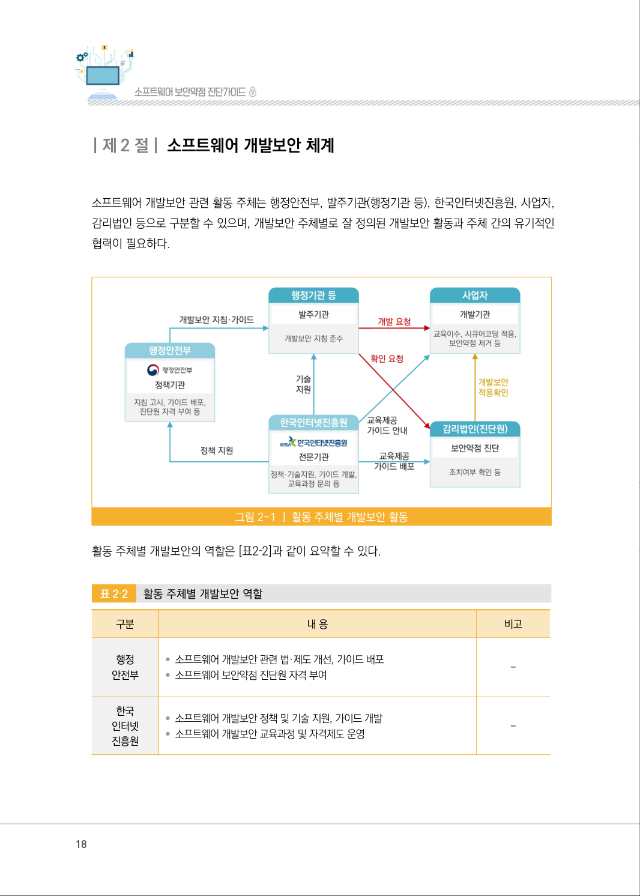
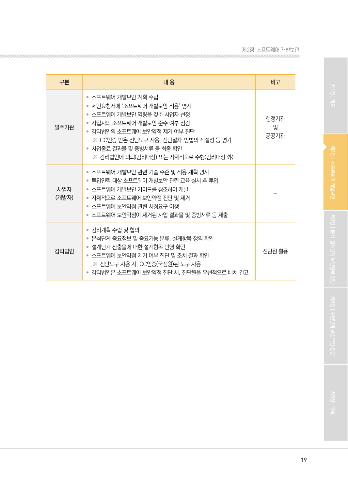

# 제2절 소프트웨어 개발보안 체계

> 변환 안내(원문 외): 아래 본문은 PDF 텍스트를 추출한 전사입니다. 코드 줄번호·특수 공백·원문 오류를 유지했습니다. 실행용 코드가 아닙니다. 표·그림·들여쓰기는 연결된 페이지 이미지와 대조하세요. 페이지 경계의 줄바꿈을 보존하며, 동일 페이지가 여러 항목에 나뉘면 각 항목의 본문은 해당 구간만 포함합니다.

### PDF 18페이지 / 인쇄 18페이지

<!-- source-page:SW-Diagnosis-2021:18; source-lines:0,1,2,3,4,5,6,7,8,9,10,11,12,13,14,15,16,17,18,19,20,21,22 -->

18

| 제2 절| 소프트웨어 개발보안 체계

소프트웨어 개발보안 관련 활동 주체는 행정안전부, 발주기관(행정기관 등), 한국인터넷진흥원, 사업자, 
감리법인 등으로 구분할 수 있으며, 개발보안 주체별로 잘 정의된 개발보안 활동과 주체 간의 유기적인 
협력이 필요하다.

그림2-1 | 활동 주체별 개발보안 활동

활동 주체별 개발보안의 역할은 [표2‐2]과 같이 요약할 수 있다.

표2‐2

활동 주체별 개발보안 역할

| 구분 | 내 용 | 비고 |
| --- | --- | --- |
| 행정 안전부 | • 소프트웨어 개발보안 관련 법·제도 개선, 가이드 배포 • 소프트웨어 보안약점 진단원 자격 부여 | - |
| 한국 인터넷 진흥원 | • 소프트웨어 개발보안 정책 및 기술 지원, 가이드 개발 • 소프트웨어 개발보안 교육과정 및 자격제도 운영 | - |

원본 페이지 이미지 (변환 외 보존 자료)

### PDF 19페이지 / 인쇄 19페이지

<!-- source-page:SW-Diagnosis-2021:19; source-lines:0,1,2,3,4,5,6,7,8,9,10,11,12,13,14,15,16,17,18,19,20,21,22,23,24,25,26,27,28,29,30,31,32,33 -->

19

제2장소프트웨어 개발보안

| 구분 | 내 용 | 비고 |
| --- | --- | --- |
| 발주기관 | • 소프트웨어 개발보안 계획 수립 • 제안요청서에 ‘소프트웨어 개발보안 적용’ 명시 • 소프트웨어 개발보안 역량을 갖춘 사업자 선정 • 사업자의 소프트웨어 개발보안 준수 여부 점검 • 감리법인의 소프트웨어 보안약점 제거 여부 진단 ※ CC인증 받은 진단도구 사용, 진단절차·방법의 적절성 등 평가 • 사업종료 결과물 및 증빙서류 등 최종 확인 ※ 감리법인에 의뢰(감리대상) 또는 자체적으로 수행(감리대상 外) | 행정기관 및 공공기관 |
| 사업자 (개발자) | • 소프트웨어 개발보안 관련 기술 수준 및 적용 계획 명시 • 투입인력 대상 소프트웨어 개발보안 관련 교육 실시 후 투입 • 소프트웨어 개발보안 가이드를 참조하여 개발 • 자체적으로 소프트웨어 보안약점 진단 및 제거 • 소프트웨어 보안약점 관련 시정요구 이행 • 소프트웨어 보안약점이 제거된 사업 결과물 및 증빙서류 등 제출 | - |
| 감리법인 | • 감리계획 수립 및 협의 • 분석단계 중요정보 및 중요기능 분류, 설계항목 정의 확인 • 설계단계 산출물에 대한 설계항목 반영 확인 • 소프트웨어 보안약점 제거 여부 진단 및 조치 결과 확인 ※ 진단도구 사용 시, CC인증(국정원)된 도구 사용 • 감리법인은 소프트웨어 보안약점 진단 시, 진단원을 우선적으로 배치 권고 | 진단원 활용 |

원본 페이지 이미지 (변환 외 보존 자료)

---

## 탐색 링크 (원문 외)

[통합 인덱스](../../../INDEX.md)

