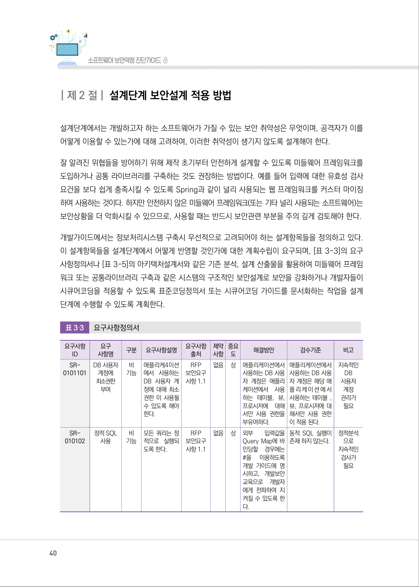
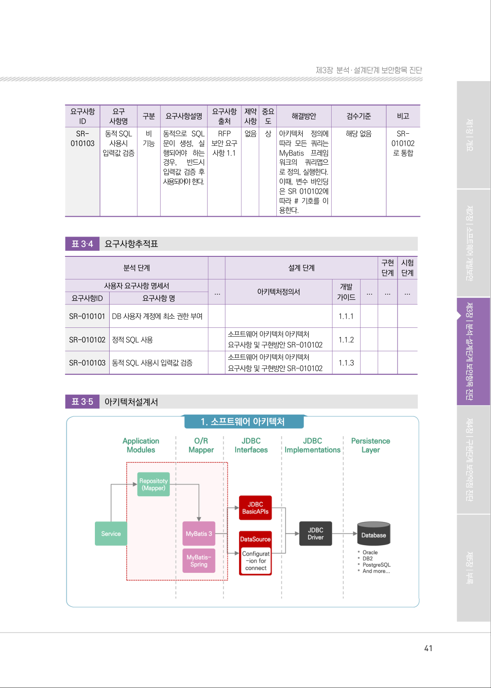
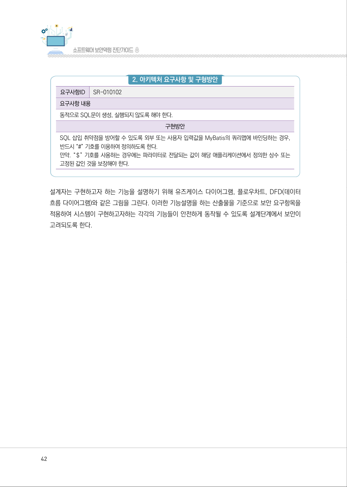

# 제2절 설계단계 보안설계 적용 방법

> 변환 안내(원문 외): 아래 본문은 PDF 텍스트를 추출한 전사입니다. 코드 줄번호·특수 공백·원문 오류를 유지했습니다. 실행용 코드가 아닙니다. 표·그림·들여쓰기는 연결된 페이지 이미지와 대조하세요. 페이지 경계의 줄바꿈을 보존하며, 동일 페이지가 여러 항목에 나뉘면 각 항목의 본문은 해당 구간만 포함합니다.

### PDF 40페이지 / 인쇄 40페이지

<!-- source-page:SW-Diagnosis-2021:40; source-lines:0,1,2,3,4,5,6,7,8,9,10,11,12,13,14,15,16,17,18,19,20,21,22,23,24,25,26,27,28,29,30,31,32,33,34,35,36,37,38,39,40,41,42,43,44,45,46,47,48,49,50,51,52,53,54,55,56,57,58,59,60,61,62,63,64,65,66,67,68,69,70,71,72,73,74,75,76,77,78,79,80,81,82,83,84,85,86,87,88,89,90,91,92,93,94,95,96,97,98,99,100,101,102,103,104 -->

40

| 제2 절| 설계단계 보안설계 적용 방법

설계단계에서는 개발하고자 하는 소프트웨어가 가질 수 있는 보안 취약성은 무엇이며, 공격자가 이를 
어떻게 이용할 수 있는가에 대해 고려하여, 이러한 취약성이 생기지 않도록 설계해야 한다.

잘 알려진 위협들을 방어하기 위해 제작 초기부터 안전하게 설계할 수 있도록 미들웨어 프레임워크를 
도입하거나 공통 라이브러리를 구축하는 것도 권장하는 방법이다. 예를 들어 입력에 대한 유효성 검사 
요건을 보다 쉽게 충족시킬 수 있도록 Spring과 같이 널리 사용되는 웹 프레임워크를 커스터 마이징
하여 사용하는 것이다. 하지만 안전하지 않은 미들웨어 프레임워크(또는 기타 널리 사용되는 소프트웨어)는 
보안상황을 더 악화시킬 수 있으므로, 사용할 때는 반드시 보안관련 부분을 주의 깊게 검토해야 한다.

개발가이드에서는 정보처리시스템 구축시 우선적으로 고려되어야 하는 설계항목들을 정의하고 있다. 
이 설계항목들을 설계단계에서 어떻게 반영할 것인가에 대한 계획수립이 요구되며, [표 3-3]의 요구 
사항정의서나 [표 3-5]의 아키텍처설계서와 같은 기존 분석, 설계 산출물을 활용하여 미들웨어 프레임
워크 또는 공통라이브러리 구축과 같은 시스템의 구조적인 보안설계로 보안을 강화하거나 개발자들이 
시큐어코딩을 적용할 수 있도록 표준코딩정의서 또는 시큐어코딩 가이드를 문서화하는 작업을 설계
단계에 수행할 수 있도록 계획한다.

표3‐3

요구사항정의서

```text
요구사항
ID
요구
사항명
구분 
요구사항설명
요구사항 
출처
제약 
사항
중요 
도
해결방안 
검수기준 
비고
SR-
0101101
DB 사용자 
계정에 
최소권한
부여
비 
기능
애플리케4이션
에서 사용하는 
DB 사용자 계
정에 대해 최소 
권한 이 사용될 
수 있도록 해야 
한다.
RFP 
보안요구 
사항 1.1
없음 
상 애플리케이션에서 
사용하는 DB 사용
자 계정은 애플리
케이션에서 사용
하는 테이블, 뷰, 
프로시저에 대해 
서만 사용 권한을 
부유여하다.
애플리케이션에서 
사용하는 DB 사용
자 계정은 해당 애
플리케이션에서 
사용하는 테이블 , 
뷰, 프로시저에 대
해서만 사용 권한
이 적용 된다.
지속적인 
DB 
사용자 
계정 
관리가 
필요
SR-
010102
정적 SQL 
사용
비 
기능
모든 쿼리는 정
적으로 실행되
도록 한다.
RFP 
보안요구 
사항 1.1
없음 
상 외부 
입력값을 
Query Map에 바
인딩할 경우에는 
#을 
이용하도록 
개발 가이드에 명
시하고, 개발보안 
교육으로 개발자
에게 전파하여 지
켜질 수 있도록 한
다.
동적 SQL 실행이 
존재 하지 않는다.
정적분석
으로 
지속적인 
검사가 
필요
```

<details><summary>원본 페이지 이미지 (변환 외 보존 자료)</summary>



</details>

### PDF 41페이지 / 인쇄 41페이지

<!-- source-page:SW-Diagnosis-2021:41; source-lines:0,1,2,3,4,5,6,7,8,9,10,11,12,13,14,15,16,17,18,19,20,21,22,23,24,25,26,27,28,29,30,31,32,33,34,35,36,37,38,39,40,41,42,43,44,45,46,47,48,49,50,51,52,53,54,55,56,57,58,59,60,61,62,63,64,65,66,67,68,69,70,71,72,73,74,75,76,77,78,79,80,81 -->

41

제3장분석․ 설계단계 보안항목 진단

요구사항
ID

```text
요구
사항명
구분 
요구사항설명
요구사항 
출처
제약 
사항
중요 
도
해결방안
검수기준
동적 SQL 
사용시 
입력값 검증
비 
기능
동적으로 SQL
문이 생성, 실
행되어야 하는 
경우, 
반드시 
입력값 검증 후 
사용되어야 한다.
RFP 
보안 요구 
사항 1.1
없음 
상 아키텍처 정의에 
따라 모든 쿼리는 
MyBatis 프레임
워크의 쿼리맵으
로 정의, 실행한다. 
이때, 변수 바인딩
은 SR 010102에 
따라 # 기호를 이
용한다.
해당 없음
```

비고

SR-
010103

SR-
010102
로 통합

표3‐4

요구사항추적표

```text
분석 단계
설계 단계 
구현 
단계
시험
단계
사용자 요구사항 명세서
...
아키텍처정의서 
개발 
가이드 
...
...
...
요구사항ID
요구사항 명
SR-010101
DB 사용자 계정에 최소 권한 부여
1.1.1
SR-010102
정적 SQL 사용
소프트웨어 아키텍처 아키텍처 
요구사항 및 구현방안 SR-010102 
1.1.2
SR-010103
동적 SQL 사용시 입력값 검증
소프트웨어 아키텍처 아키텍처 
요구사항 및 구현방안 SR-010102 
1.1.3
```

표3‐5

아키텍처설계서

#### 1. 소프트웨어 아키텍처

<details><summary>원본 페이지 이미지 (변환 외 보존 자료)</summary>



</details>

### PDF 42페이지 / 인쇄 42페이지

<!-- source-page:SW-Diagnosis-2021:42; source-lines:0,1,2,3,4,5,6,7,8,9,10,11,12,13,14 -->

42

#### 2. 아키텍처 요구사항 및 구형방안

요구사항ID

SR-010102

요구사항 내용
동적으로 SQL문이 생성, 실행되지 않도록 해야 한다.

구현방안

SQL 삽입 취약점을 방어할 수 있도록 외부 또는 사용자 입력값을 MyBatis의 쿼리맵에 바인딩하는 경우, 
반드시 “#” 기호를 이용하여 정의하도록 한다.
만약. “＄” 기호를 사용하는 경우에는 파라미터로 전달되는 값이 해당 애플리케이션에서 정의한 상수 또는 
고정된 값인 것을 보장해야 한다.

설계자는 구현하고자 하는 기능을 설명하기 위해 유즈케이스 다이어그램, 플로우차트, DFD(데이터 
흐름 다이어그램)와 같은 그림을 그린다. 이러한 기능설명을 하는 산출물을 기준으로 보안 요구항목을 
적용하여 시스템이 구현하고자하는 각각의 기능들이 안전하게 동작될 수 있도록 설계단계에서 보안이 
고려되도록 한다.

<details><summary>원본 페이지 이미지 (변환 외 보존 자료)</summary>



</details>

### PDF 43페이지 / 인쇄 43페이지

<!-- source-page:SW-Diagnosis-2021:43; source-lines:1 -->

제3장분석․ 설계단계 보안항목 진단

<details><summary>원본 페이지 이미지 (변환 외 보존 자료)</summary>


</details>

---

## 탐색 링크 (원문 외)

[통합 인덱스](../../../INDEX.md)

