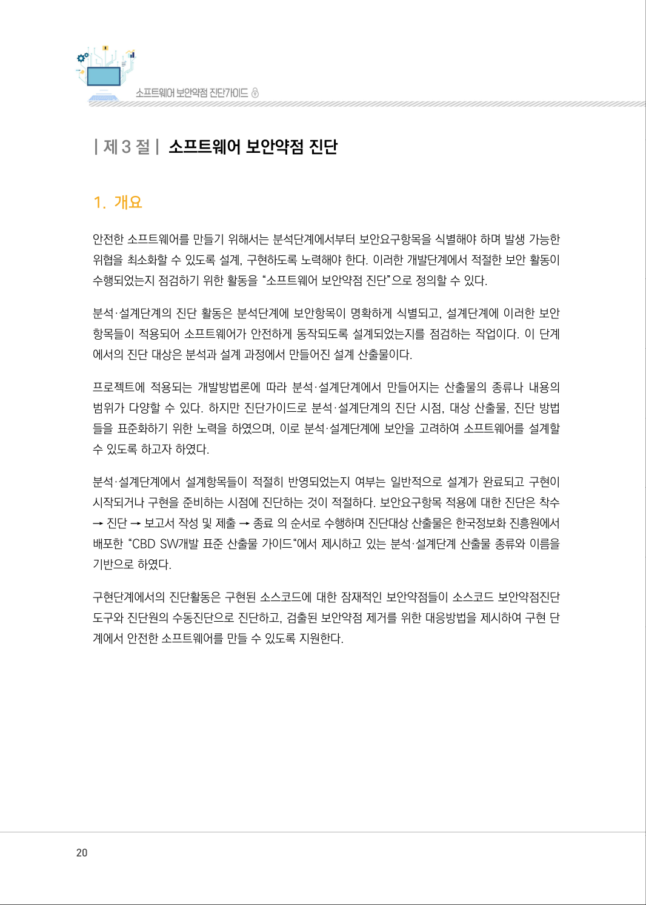
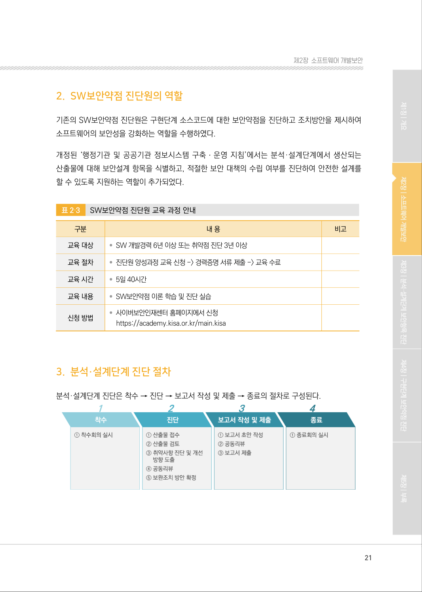

# 1. 개요

> 변환 안내(원문 외): 아래 본문은 PDF 텍스트를 추출한 전사입니다. 코드 줄번호·특수 공백·원문 오류를 유지했습니다. 실행용 코드가 아닙니다. 표·그림·들여쓰기는 연결된 페이지 이미지와 대조하세요. 페이지 경계의 줄바꿈을 보존하며, 동일 페이지가 여러 항목에 나뉘면 각 항목의 본문은 해당 구간만 포함합니다.

### PDF 20페이지 / 인쇄 20페이지

<!-- source-page:SW-Diagnosis-2021:20; source-lines:0,2,3,4,5,6,7,8,9,10,11,12,13,14,15,16,17,18,19,20 -->

20

#### 1. 개요

안전한 소프트웨어를 만들기 위해서는 분석단계에서부터 보안요구항목을 식별해야 하며 발생 가능한 
위협을 최소화할 수 있도록 설계, 구현하도록 노력해야 한다. 이러한 개발단계에서 적절한 보안 활동이 
수행되었는지 점검하기 위한 활동을 “소프트웨어 보안약점 진단”으로 정의할 수 있다.

분석·설계단계의 진단 활동은 분석단계에 보안항목이 명확하게 식별되고, 설계단계에 이러한 보안 
항목들이 적용되어 소프트웨어가 안전하게 동작되도록 설계되었는지를 점검하는 작업이다. 이 단계
에서의 진단 대상은 분석과 설계 과정에서 만들어진 설계 산출물이다.

프로젝트에 적용되는 개발방법론에 따라 분석·설계단계에서 만들어지는 산출물의 종류나 내용의 
범위가 다양할 수 있다. 하지만 진단가이드로 분석·설계단계의 진단 시점, 대상 산출물, 진단 방법
들을 표준화하기 위한 노력을 하였으며, 이로 분석·설계단계에 보안을 고려하여 소프트웨어를 설계할 
수 있도록 하고자 하였다.

분석·설계단계에서 설계항목들이 적절히 반영되었는지 여부는 일반적으로 설계가 완료되고 구현이 
시작되거나 구현을 준비하는 시점에 진단하는 것이 적절하다. 보안요구항목 적용에 대한 진단은 착수 
→ 진단 → 보고서 작성 및 제출 → 종료 의 순서로 수행하며 진단대상 산출물은 한국정보화 진흥원에서 
배포한 “CBD SW개발 표준 산출물 가이드“에서 제시하고 있는 분석·설계단계 산출물 종류와 이름을 
기반으로 하였다.

구현단계에서의 진단활동은 구현된 소스코드에 대한 잠재적인 보안약점들이 소스코드 보안약점진단 
도구와 진단원의 수동진단으로 진단하고, 검출된 보안약점 제거를 위한 대응방법을 제시하여 구현 단
계에서 안전한 소프트웨어를 만들 수 있도록 지원한다.

원본 페이지 이미지 (변환 외 보존 자료)

### PDF 21페이지 / 인쇄 21페이지

<!-- source-page:SW-Diagnosis-2021:21; source-lines:1 -->

제2장소프트웨어 개발보안

원본 페이지 이미지 (변환 외 보존 자료)

---

## 탐색 링크 (원문 외)

[통합 인덱스](../../../INDEX.md)

