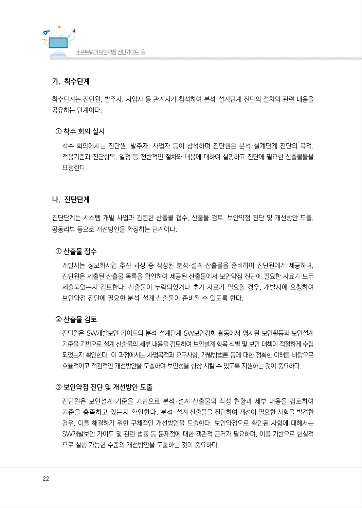
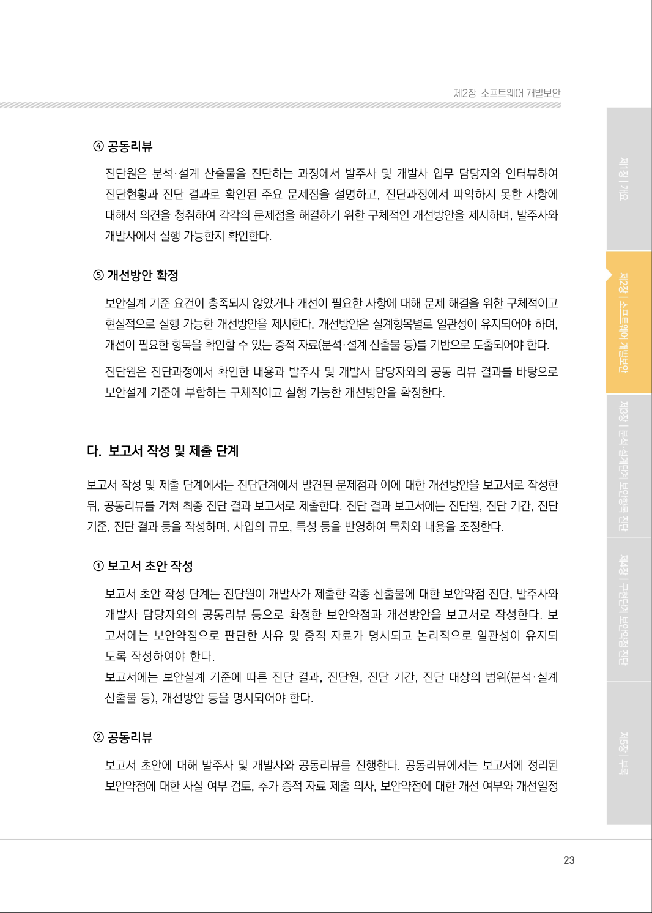
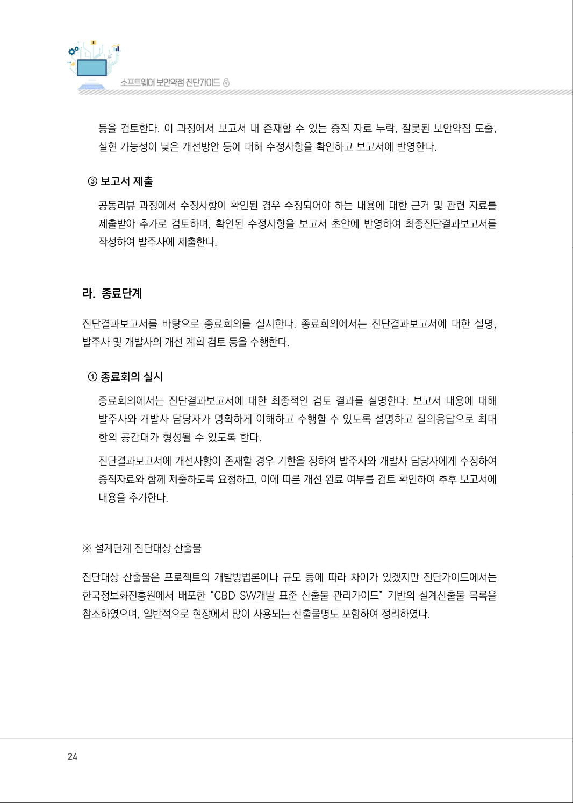
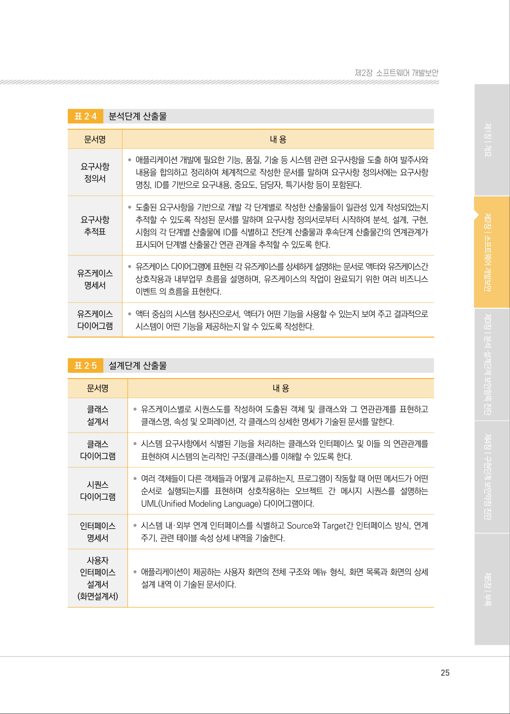
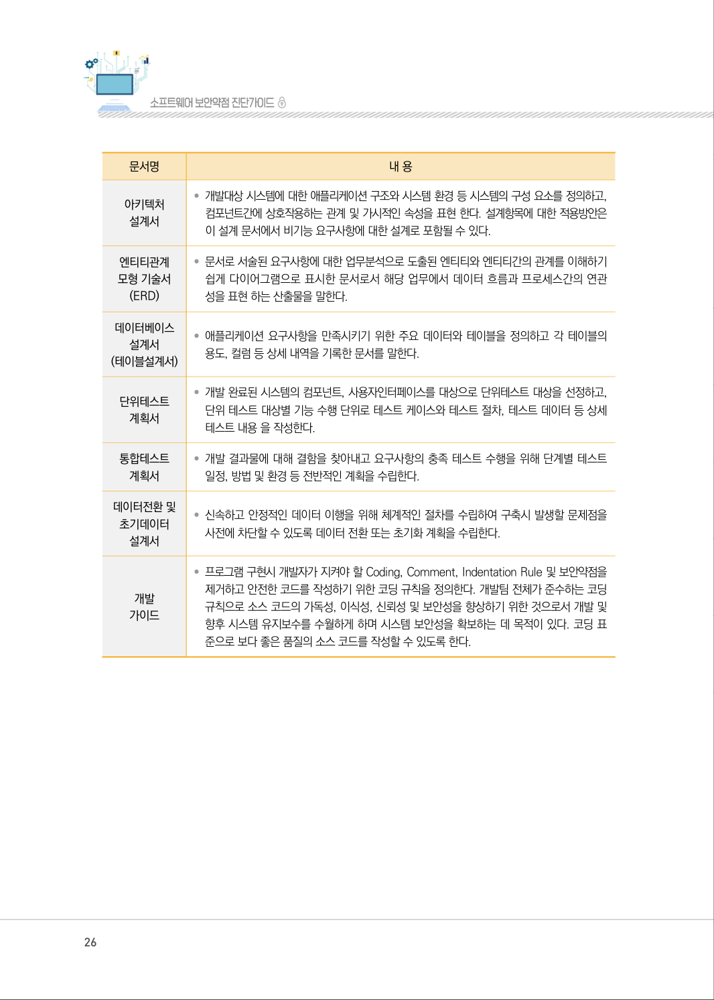
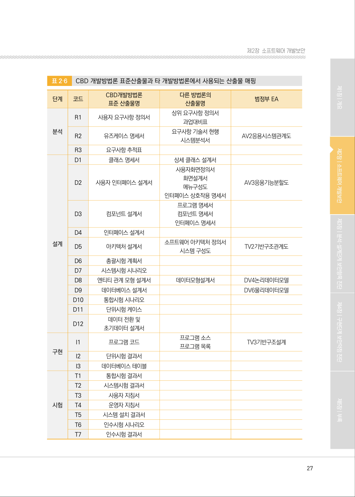

# 3. 분석·설계단계 진단절차

> 변환 안내(원문 외): 아래 본문은 PDF 텍스트를 추출한 전사입니다. 코드 줄번호·특수 공백·원문 오류를 유지했습니다. 실행용 코드가 아닙니다. 표·그림·들여쓰기는 연결된 페이지 이미지와 대조하세요. 페이지 경계의 줄바꿈을 보존하며, 동일 페이지가 여러 항목에 나뉘면 각 항목의 본문은 해당 구간만 포함합니다.

### PDF 21페이지 / 인쇄 21페이지

<!-- source-page:SW-Diagnosis-2021:21; source-lines:0,24,25 -->

21

#### 3. 분석·설계단계 진단 절차

분석·설계단계 진단은 착수 → 진단 → 보고서 작성 및 제출 → 종료의 절차로 구성된다.

<details><summary>원본 페이지 이미지 (변환 외 보존 자료)</summary>


</details>

### PDF 22페이지 / 인쇄 22페이지

<!-- source-page:SW-Diagnosis-2021:22; source-lines:0,1,2,3,4,5,6,7,8,9,10,11,12,13,14,15,16,17,18,19,20,21,22,23,24,25,26 -->

22

#### 가. 착수단계

착수단계는 진단원, 발주자, 사업자 등 관계자가 참석하여 분석·설계단계 진단의 절차와 관련 내용을 
공유하는 단계이다.

① 착수 회의 실시

착수 회의에서는 진단원, 발주자, 사업자 등이 참석하며 진단원은 분석·설계단계 진단의 목적, 
적용기준과 진단항목, 일정 등 전반적인 절차와 내용에 대하여 설명하고 진단에 필요한 산출물들을 
요청한다.

#### 나. 진단단계

진단단계는 시스템 개발 사업과 관련한 산출물 접수, 산출물 검토, 보안약점 진단 및 개선방안 도출, 
공동리뷰 등으로 개선방안을 확정하는 단계이다.

① 산출물 접수

개발사는 정보화사업 추진 과정 중 작성된 분석·설계 산출물을 준비하여 진단원에게 제공하며, 
진단원은 제출된 산출물 목록을 확인하여 제공된 산출물에서 보안약점 진단에 필요한 자료가 모두 
제출되었는지 검토한다. 산출물이 누락되었거나 추가 자료가 필요할 경우, 개발사에 요청하여 
보안약점 진단에 필요한 분석·설계 산출물이 준비될 수 있도록 한다.

② 산출물 검토

진단원은 SW개발보안 가이드의 분석·설계단계 SW보안강화 활동에서 명시된 보안활동과 보안설계 
기준을 기반으로 설계 산출물의 세부 내용을 검토하여 보안설계 항목 식별 및 보안 대책이 적절하게 수립
되었는지 확인한다. 이 과정에서는 사업목적과 요구사항, 개발방법론 등에 대한 정확한 이해를 바탕으로 
효율적이고 객관적인 개선방안을 도출하여 보안성을 향상 시킬 수 있도록 지원하는 것이 중요하다.

③ 보안약점 진단 및 개선방안 도출

진단원은 보안설계 기준을 기반으로 분석·설계 산출물의 작성 현황과 세부 내용을 검토하여 
기준을 충족하고 있는지 확인한다. 분석·설계 산출물을 진단하여 개선이 필요한 사항을 발견한 
경우, 이를 해결하기 위한 구체적인 개선방안을 도출한다. 보안약점으로 확인된 사항에 대해서는 
SW개발보안 가이드 및 관련 법률 등 문제점에 대한 객관적 근거가 필요하며, 이를 기반으로 현실적
으로 실행 가능한 수준의 개선방안을 도출하는 것이 중요하다.

<details><summary>원본 페이지 이미지 (변환 외 보존 자료)</summary>



</details>

### PDF 23페이지 / 인쇄 23페이지

<!-- source-page:SW-Diagnosis-2021:23; source-lines:0,1,2,3,4,5,6,7,8,9,10,11,12,13,14,15,16,17,18,19,20,21,22,23,24,25,26 -->

23

제2장소프트웨어 개발보안

④ 공동리뷰

진단원은 분석·설계 산출물을 진단하는 과정에서 발주사 및 개발사 업무 담당자와 인터뷰하여 
진단현황과 진단 결과로 확인된 주요 문제점을 설명하고, 진단과정에서 파악하지 못한 사항에 
대해서 의견을 청취하여 각각의 문제점을 해결하기 위한 구체적인 개선방안을 제시하며, 발주사와 
개발사에서 실행 가능한지 확인한다.

⑤ 개선방안 확정

보안설계 기준 요건이 충족되지 않았거나 개선이 필요한 사항에 대해 문제 해결을 위한 구체적이고 
현실적으로 실행 가능한 개선방안을 제시한다. 개선방안은 설계항목별로 일관성이 유지되어야 하며, 
개선이 필요한 항목을 확인할 수 있는 증적 자료(분석·설계 산출물 등)를 기반으로 도출되어야 한다.
진단원은 진단과정에서 확인한 내용과 발주사 및 개발사 담당자와의 공동 리뷰 결과를 바탕으로 
보안설계 기준에 부합하는 구체적이고 실행 가능한 개선방안을 확정한다.

#### 다. 보고서 작성 및 제출 단계

보고서 작성 및 제출 단계에서는 진단단계에서 발견된 문제점과 이에 대한 개선방안을 보고서로 작성한 
뒤, 공동리뷰를 거쳐 최종 진단 결과 보고서로 제출한다. 진단 결과 보고서에는 진단원, 진단 기간, 진단
기준, 진단 결과 등을 작성하며, 사업의 규모, 특성 등을 반영하여 목차와 내용을 조정한다.

① 보고서 초안 작성

보고서 초안 작성 단계는 진단원이 개발사가 제출한 각종 산출물에 대한 보안약점 진단, 발주사와 
개발사 담당자와의 공동리뷰 등으로 확정한 보안약점과 개선방안을 보고서로 작성한다. 보
고서에는 보안약점으로 판단한 사유 및 증적 자료가 명시되고 논리적으로 일관성이 유지되
도록 작성하여야 한다.
보고서에는 보안설계 기준에 따른 진단 결과, 진단원, 진단 기간, 진단 대상의 범위(분석·설계 
산출물 등), 개선방안 등을 명시되어야 한다.

② 공동리뷰

보고서 초안에 대해 발주사 및 개발사와 공동리뷰를 진행한다. 공동리뷰에서는 보고서에 정리된 
보안약점에 대한 사실 여부 검토, 추가 증적 자료 제출 의사, 보안약점에 대한 개선 여부와 개선일정 

<details><summary>원본 페이지 이미지 (변환 외 보존 자료)</summary>



</details>

### PDF 24페이지 / 인쇄 24페이지

<!-- source-page:SW-Diagnosis-2021:24; source-lines:0,1,2,3,4,5,6,7,8,9,10,11,12,13,14,15,16,17,18,19,20 -->

24

등을 검토한다. 이 과정에서 보고서 내 존재할 수 있는 증적 자료 누락, 잘못된 보안약점 도출, 
실현 가능성이 낮은 개선방안 등에 대해 수정사항을 확인하고 보고서에 반영한다.

③ 보고서 제출

공동리뷰 과정에서 수정사항이 확인된 경우 수정되어야 하는 내용에 대한 근거 및 관련 자료를 
제출받아 추가로 검토하며, 확인된 수정사항을 보고서 초안에 반영하여 최종진단결과보고서를 
작성하여 발주사에 제출한다.

#### 라. 종료단계

진단결과보고서를 바탕으로 종료회의를 실시한다. 종료회의에서는 진단결과보고서에 대한 설명, 
발주사 및 개발사의 개선 계획 검토 등을 수행한다.

① 종료회의 실시

종료회의에서는 진단결과보고서에 대한 최종적인 검토 결과를 설명한다. 보고서 내용에 대해 
발주사와 개발사 담당자가 명확하게 이해하고 수행할 수 있도록 설명하고 질의응답으로 최대
한의 공감대가 형성될 수 있도록 한다.
진단결과보고서에 개선사항이 존재할 경우 기한을 정하여 발주사와 개발사 담당자에게 수정하여 
증적자료와 함께 제출하도록 요청하고, 이에 따른 개선 완료 여부를 검토 확인하여 추후 보고서에 
내용을 추가한다.

※ 설계단계 진단대상 산출물

진단대상 산출물은 프로젝트의 개발방법론이나 규모 등에 따라 차이가 있겠지만 진단가이드에서는 
한국정보화진흥원에서 배포한 “CBD SW개발 표준 산출물 관리가이드” 기반의 설계산출물 목록을 
참조하였으며, 일반적으로 현장에서 많이 사용되는 산출물명도 포함하여 정리하였다.

<details><summary>원본 페이지 이미지 (변환 외 보존 자료)</summary>



</details>

### PDF 25페이지 / 인쇄 25페이지

<!-- source-page:SW-Diagnosis-2021:25; source-lines:0,1,2,3,4,5,6,7,8,9,10,11,12,13,14,15,16,17,18,19,20,21,22,23,24,25,26,27,28,29,30,31,32,33,34,35,36,37,38,39,40,41,42,43,44,45,46,47,48,49,50,51,52 -->

25

제2장소프트웨어 개발보안

표2‐4

분석단계 산출물

|  |  |
| --- | --- |
| 문서명 | 내 용 |
| 요구사항<br>정의서 | • 애플리케이션 개발에 필요한 기능, 품질, 기술 등 시스템 관련 요구사항을 도출 하여 발주사와<br>내용을 합의하고 정리하여 체계적으로 작성한 문서를 말하며 요구사항 정의서에는 요구사항<br>명칭, ID를 기반으로 요구내용, 중요도, 담당자, 특기사항 등이 포함된다. |
| 요구사항<br>추적표 | • 도출된 요구사항을 기반으로 개발 각 단계별로 작성한 산출물들이 일관성 있게 작성되었는지<br>추적할 수 있도록 작성된 문서를 말하며 요구사항 정의서로부터 시작하여 분석, 설계, 구현,<br>시험의 각 단계별 산출물에 ID를 식별하고 전단계 산출물과 후속단계 산출물간의 연계관계가<br>표시되어 단계별 산출물간 연관 관계을 추적할 수 있도록 한다. |
| 유즈케이스<br>명세서 | • 유즈케이스 다이어그램에 표현된 각 유즈케이스를 상세하게 설명하는 문서로 액터와 유즈케이스간<br>상호작용과 내부업무 흐름을 설명하며, 유즈케이스의 작업이 완료되기 위한 여러 비즈니스<br>이벤트 의 흐름을 표현한다. |
| 유즈케이스<br>다이어그램 | • 액터 중심의 시스템 청사진으로서, 액터가 어떤 기능을 사용할 수 있는지 보여 주고 결과적으로<br>시스템이 어떤 기능을 제공하는지 알 수 있도록 작성한다. |

표2‐5

설계단계 산출물

|  |  |
| --- | --- |
| 문서명 | 내 용 |
| 클래스<br>설계서 | • 유즈케이스별로 시퀀스도를 작성하여 도출된 객체 및 클래스와 그 연관관계를 표현하고<br>클래스명, 속성 및 오퍼레이션, 각 클래스의 상세한 명세가 기술된 문서를 말한다. |
| 클래스<br>다이어그램 | • 시스템 요구사항에서 식별된 기능을 처리하는 클래스와 인터페이스 및 이들 의 연관관계를<br>표현하여 시스템의 논리적인 구조(클래스)를 이해할 수 있도록 한다. |
| 시퀀스<br>다이어그램 | • 여러 객체들이 다른 객체들과 어떻게 교류하는지, 프로그램이 작동할 때 어떤 메서드가 어떤<br>순서로 실행되는지를 표현하며 상호작용하는 오브젝트 간 메시지 시퀀스를 설명하는<br>UML(Unified Modeling Language) 다이어그램이다. |
| 인터페이스<br>명세서 | • 시스템 내·외부 연계 인터페이스를 식별하고 Source와 Target간 인터페이스 방식, 연계<br>주기, 관련 테이블 속성 상세 내역을 기술한다. |
| 사용자<br>인터페이스<br>설계서<br>(화면설계서) | • 애플리케이션이 제공하는 사용자 화면의 전체 구조와 메뉴 형식, 화면 목록과 화면의 상세<br>설계 내역 이 기술된 문서이다. |

<details><summary>원본 페이지 이미지 (변환 외 보존 자료)</summary>



</details>

### PDF 26페이지 / 인쇄 26페이지

<!-- source-page:SW-Diagnosis-2021:26; source-lines:0,1,2,3,4,5,6,7,8,9,10,11,12,13,14,15,16,17,18,19,20,21,22,23,24,25,26,27,28,29,30,31,32,33,34,35,36,37,38,39 -->

26

|  |  |
| --- | --- |
| 문서명 | 내 용 |
| 아키텍처<br>설계서 | • 개발대상 시스템에 대한 애플리케이션 구조와 시스템 환경 등 시스템의 구성 요소를 정의하고,<br>컴포넌트간에 상호작용하는 관계 및 가시적인 속성을 표현 한다. 설계항목에 대한 적용방안은<br>이 설계 문서에서 비기능 요구사항에 대한 설계로 포함될 수 있다. |
| 엔티티관계<br>모형 기술서<br>(ERD) | • 문서로 서술된 요구사항에 대한 업무분석으로 도출된 엔티티와 엔티티간의 관계를 이해하기<br>쉽게 다이어그램으로 표시한 문서로서 해당 업무에서 데이터 흐름과 프로세스간의 연관<br>성을 표현 하는 산출물을 말한다. |
| 데이터베이스<br>설계서<br>(테이블설계서) | • 애플리케이션 요구사항을 만족시키기 위한 주요 데이터와 테이블을 정의하고 각 테이블의<br>용도, 컬럼 등 상세 내역을 기록한 문서를 말한다. |
| 단위테스트<br>계획서 | • 개발 완료된 시스템의 컴포넌트, 사용자인터페이스를 대상으로 단위테스트 대상을 선정하고,<br>단위 테스트 대상별 기능 수행 단위로 테스트 케이스와 테스트 절차, 테스트 데이터 등 상세<br>테스트 내용 을 작성한다. |
| 통합테스트<br>계획서 | • 개발 결과물에 대해 결함을 찾아내고 요구사항의 충족 테스트 수행을 위해 단계별 테스트<br>일정, 방법 및 환경 등 전반적인 계획을 수립한다. |
| 데이터전환 및<br>초기데이터<br>설계서 | • 신속하고 안정적인 데이터 이행을 위해 체계적인 절차를 수립하여 구축시 발생할 문제점을<br>사전에 차단할 수 있도록 데이터 전환 또는 초기화 계획을 수립한다. |
| 개발<br>가이드 | • 프로그램 구현시 개발자가 지켜야 할 Coding, Comment, Indentation Rule 및 보안약점을<br>제거하고 안전한 코드를 작성하기 위한 코딩 규칙을 정의한다. 개발팀 전체가 준수하는 코딩<br>규칙으로 소스 코드의 가독성, 이식성, 신뢰성 및 보안성을 향상하기 위한 것으로서 개발 및<br>향후 시스템 유지보수를 수월하게 하며 시스템 보안성을 확보하는 데 목적이 있다. 코딩 표<br>준으로 보다 좋은 품질의 소스 코드를 작성할 수 있도록 한다. |

<details><summary>원본 페이지 이미지 (변환 외 보존 자료)</summary>



</details>

### PDF 27페이지 / 인쇄 27페이지

<!-- source-page:SW-Diagnosis-2021:27; source-lines:0,1,2,3,4,5,6,7,8,9,10,11,12,13,14,15,16,17,18,19,20,21,22,23,24,25,26,27,28,29,30,31,32,33,34,35,36,37,38,39,40,41,42,43,44,45,46,47,48,49,50,51,52,53,54,55,56,57,58,59,60,61,62,63,64,65,66,67,68,69,70,71,72,73,74,75,76,77,78,79,80,81,82,83,84,85,86,87,88 -->

27

제2장소프트웨어 개발보안

표2‐6

CBD 개발방법론 표준산출물과 타 개발방법론에서 사용되는 산출물 매핑

```text
단계
코드
CBD개발방법론
표준 산출물명
다른 방법론의
산출물명 
범정부 EA
분석
R1
사용자 요구사항 정의서
상위 요구사항 정의서
과업대비표
R2
유즈케이스 명세서 
요구사항 기술서 현행
시스템분석서
AV2응용시스템관계도
R3
요구사항 추적표
설계
D1
클래스 명세서 
상세 클래스 설계서
D2
사용자 인터페이스 설계서
사용자화면정의서
화면설계서
메뉴구성도
인터페이스 상호작용 명세서
AV3응용기능분할도
D3
컴포넌트 설계서
프로그램 명세서
컴포넌트 명세서
인터페이스 명세서
D4
인터페이스 설계서
D5
아키텍처 설계서 
소프트웨어 아키텍처 정의서 
시스템 구성도 
TV2기반구조관계도
D6
총괄시험 계획서
D7
시스템시험 시나리오
D8
엔티티 관계 모형 설계서 
데이터모형설계서 
DV4논리데이터모델
D9
데이터베이스 설계서 
DV6물리데이터모델
D10
통합시험 시나리오
D11
단위시험 케이스
D12
데이터 전환 및
초기데이터 설계서
구현
I1
프로그램 코드 
프로그램 소스
프로그램 목록
TV3기반구조설계
I2
단위시험 결과서
I3
데이터베이스 테이블
시험
T1
통합시험 결과서
T2
시스템시험 결과서
T3
사용자 지침서
T4
운영자 지침서
T5
시스템 설치 결과서
T6
인수시험 시나리오
T7
인수시험 결과서
```

<details><summary>원본 페이지 이미지 (변환 외 보존 자료)</summary>



</details>

---

## 탐색 링크 (원문 외)

[통합 인덱스](../../../INDEX.md)

