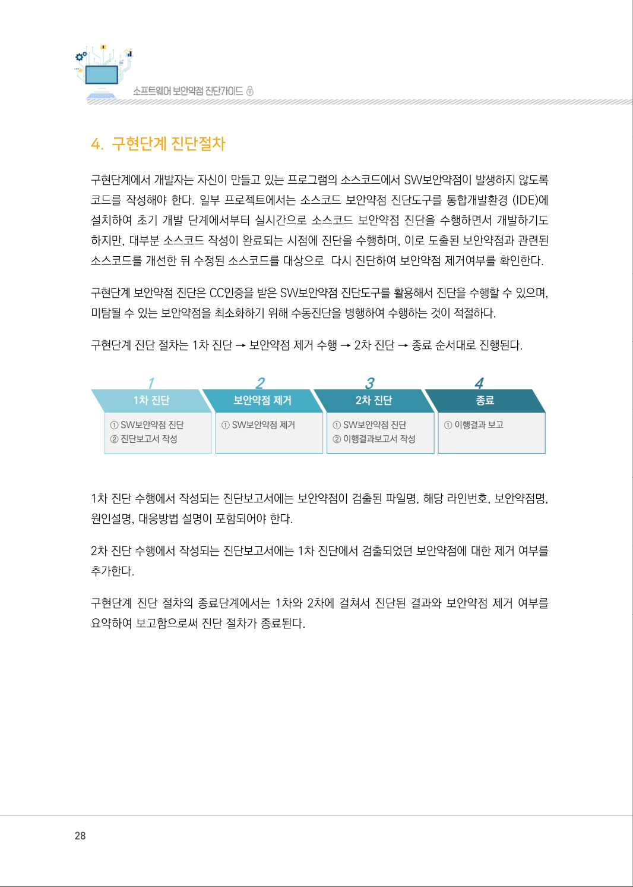
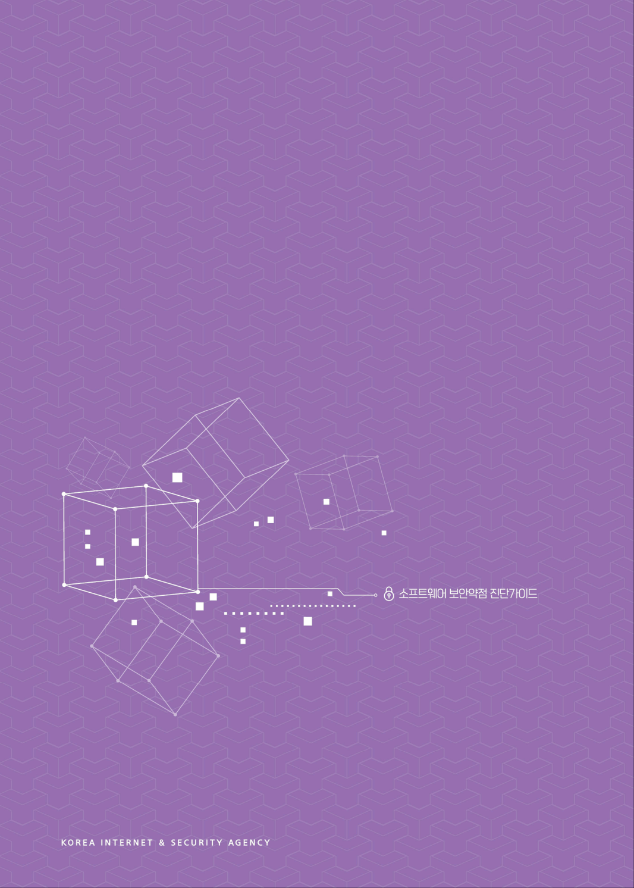
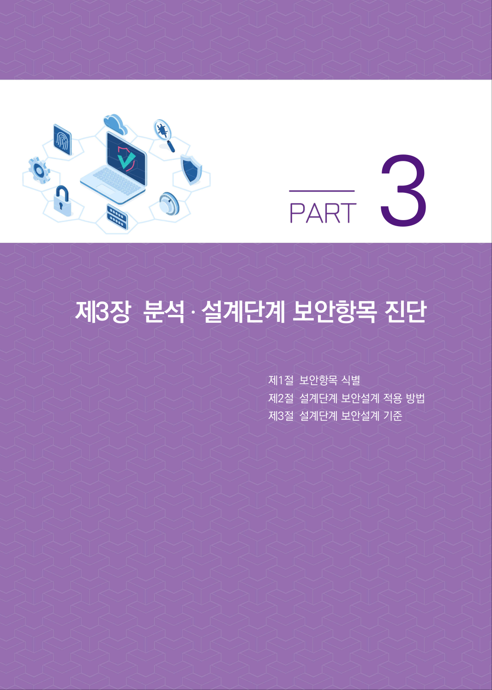
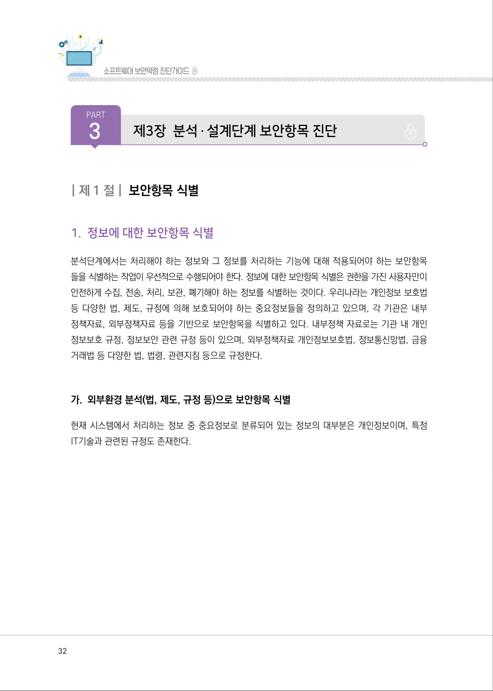

# 4. 구현단계 진단절차

> 변환 안내(원문 외): 아래 본문은 PDF 텍스트를 추출한 전사입니다. 코드 줄번호·특수 공백·원문 오류를 유지했습니다. 실행용 코드가 아닙니다. 표·그림·들여쓰기는 연결된 페이지 이미지와 대조하세요. 페이지 경계의 줄바꿈을 보존하며, 동일 페이지가 여러 항목에 나뉘면 각 항목의 본문은 해당 구간만 포함합니다.

### PDF 28페이지 / 인쇄 28페이지

<!-- source-page:SW-Diagnosis-2021:28; source-lines:0,1,2,3,4,5,6,7,8,9,10,11,12,13,14,15 -->

28

#### 4. 구현단계 진단절차

구현단계에서 개발자는 자신이 만들고 있는 프로그램의 소스코드에서 SW보안약점이 발생하지 않도록 
코드를 작성해야 한다. 일부 프로젝트에서는 소스코드 보안약점 진단도구를 통합개발환경 (IDE)에 
설치하여 초기 개발 단계에서부터 실시간으로 소스코드 보안약점 진단을 수행하면서 개발하기도 
하지만, 대부분 소스코드 작성이 완료되는 시점에 진단을 수행하며, 이로 도출된 보안약점과 관련된 
소스코드를 개선한 뒤 수정된 소스코드를 대상으로  다시 진단하여 보안약점 제거여부를 확인한다. 

구현단계 보안약점 진단은 CC인증을 받은 SW보안약점 진단도구를 활용해서 진단을 수행할 수 있으며, 
미탐될 수 있는 보안약점을 최소화하기 위해 수동진단을 병행하여 수행하는 것이 적절하다.

구현단계 진단 절차는 1차 진단 → 보안약점 제거 수행 → 2차 진단 → 종료 순서대로 진행된다.

1차 진단 수행에서 작성되는 진단보고서에는 보안약점이 검출된 파일명, 해당 라인번호, 보안약점명, 
원인설명, 대응방법 설명이 포함되어야 한다.

2차 진단 수행에서 작성되는 진단보고서에는 1차 진단에서 검출되었던 보안약점에 대한 제거 여부를 
추가한다.

구현단계 진단 절차의 종료단계에서는 1차와 2차에 걸쳐서 진단된 결과와 보안약점 제거 여부를 
요약하여 보고함으로써 진단 절차가 종료된다.

원본 페이지 이미지 (변환 외 보존 자료)

### PDF 29페이지 / 인쇄 29페이지

<!-- source-page:SW-Diagnosis-2021:29; source-lines: -->

원본 페이지 이미지 (변환 외 보존 자료)

### PDF 30페이지 / 인쇄 30페이지

<!-- source-page:SW-Diagnosis-2021:30; source-lines: -->

원본 페이지 이미지 (변환 외 보존 자료)

### PDF 31페이지 / 인쇄 31페이지

<!-- source-page:SW-Diagnosis-2021:31; source-lines:0,1,2,3,4 -->

제3장분석․ 설계단계 보안항목 진단

제1절보안항목 식별
제2절설계단계 보안설계 적용 방법
제3절설계단계 보안설계 기준

3

원본 페이지 이미지 (변환 외 보존 자료)

### PDF 32페이지 / 인쇄 32페이지

<!-- source-page:SW-Diagnosis-2021:32; source-lines:1,2,3 -->

PART
3

제3장분석․ 설계단계 보안항목 진단

원본 페이지 이미지 (변환 외 보존 자료)

---

## 탐색 링크 (원문 외)

[통합 인덱스](../../../INDEX.md)

