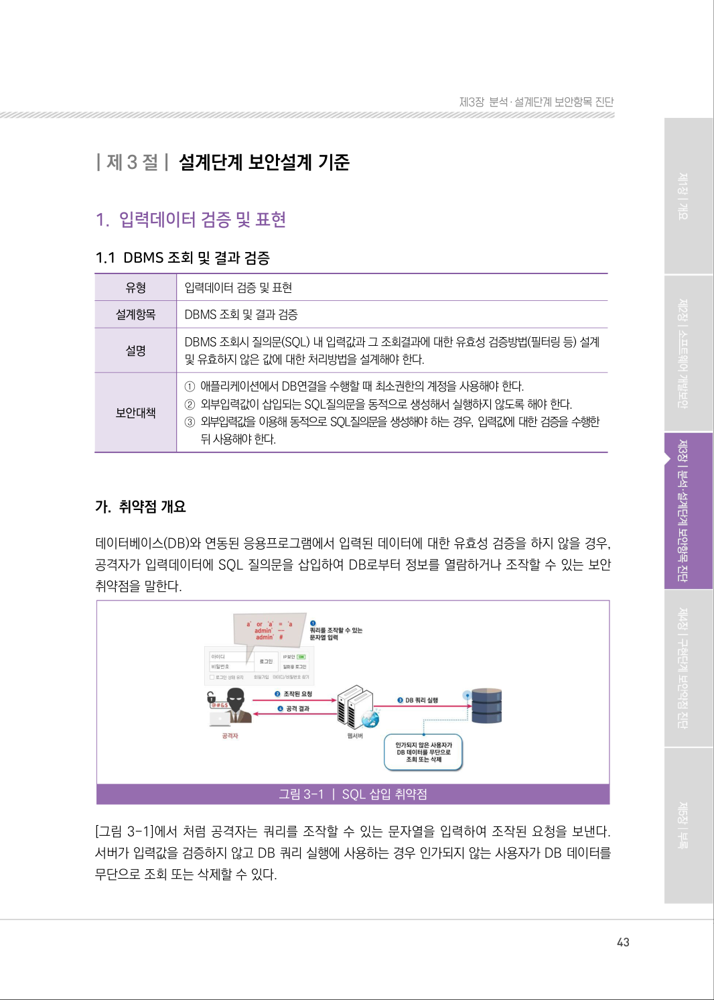
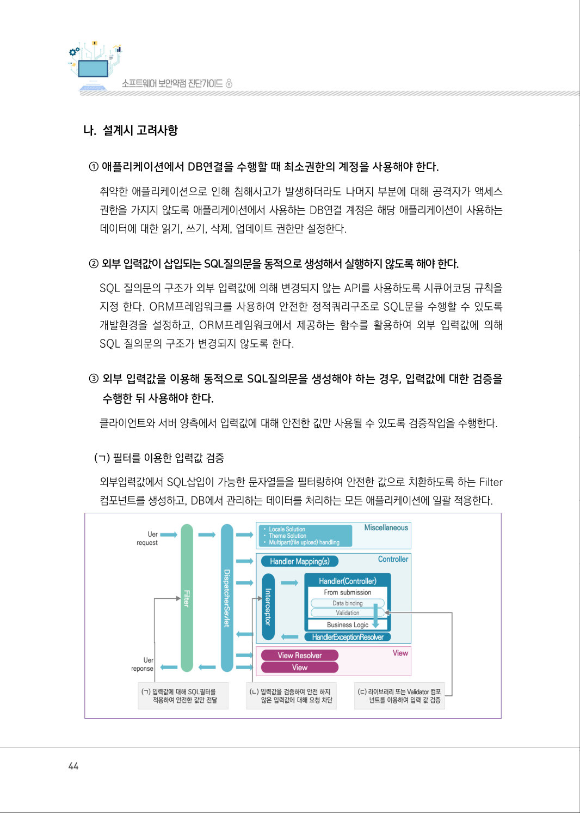
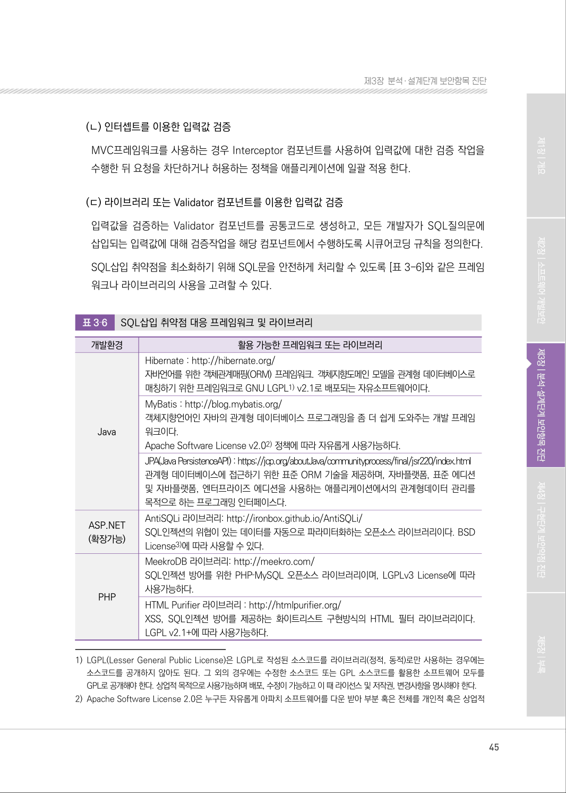
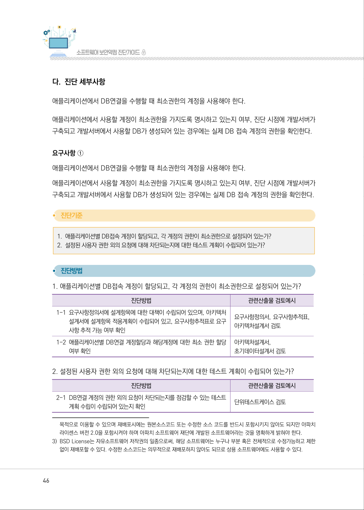
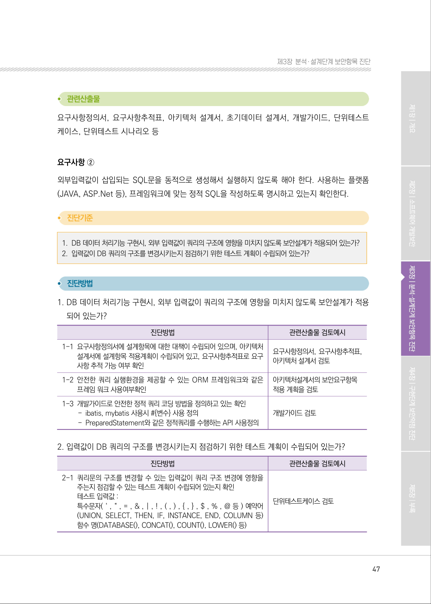
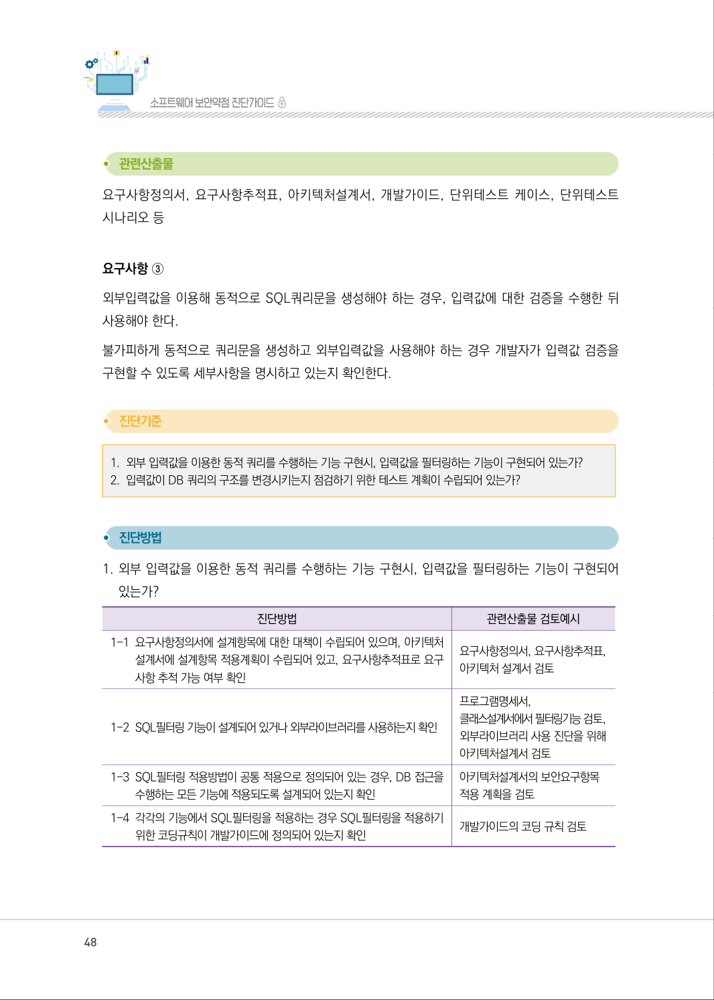
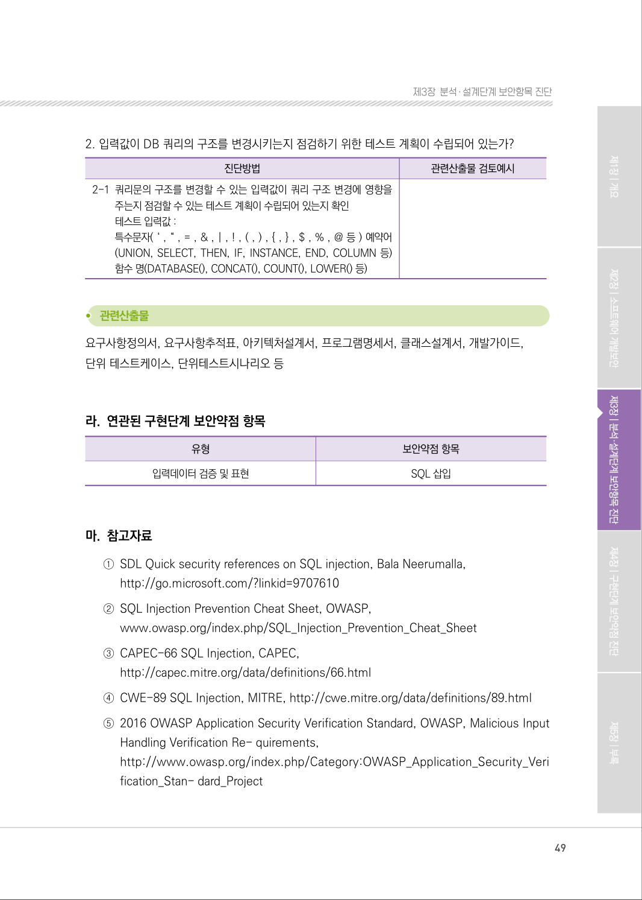

# 1.1 DBMS 조회 및 결과 검증

> 변환 안내(원문 외): 아래 본문은 PDF 텍스트를 추출한 전사입니다. 코드 줄번호·특수 공백·원문 오류를 유지했습니다. 실행용 코드가 아닙니다. 표·그림·들여쓰기는 연결된 페이지 이미지와 대조하세요. 페이지 경계의 줄바꿈을 보존하며, 동일 페이지가 여러 항목에 나뉘면 각 항목의 본문은 해당 구간만 포함합니다.

### PDF 43페이지 / 인쇄 43페이지

<!-- source-page:SW-Diagnosis-2021:43; source-lines:0,4,5,6,7,8,9,10,11,12,13,14,15,16,17,18,19,20,21,22,23,24 -->

43

1.1 DBMS 조회 및 결과 검증

| 유형 | 입력데이터 검증 및 표현 |
| --- | --- |
| 설계항목 | DBMS 조회 및 결과 검증 |
| 설명 | DBMS 조회시 질의문(SQL) 내 입력값과 그 조회결과에 대한 유효성 검증방법(필터링 등) 설계<br>및 유효하지 않은 값에 대한 처리방법을 설계해야 한다. |
| 보안대책 | ① 애플리케이션에서 DB연결을 수행할 때 최소권한의 계정을 사용해야 한다.<br>② 외부입력값이 삽입되는 SQL질의문을 동적으로 생성해서 실행하지 않도록 해야 한다.<br>③ 외부입력값을 이용해 동적으로 SQL질의문을 생성해야 하는 경우, 입력값에 대한 검증을 수행한<br>뒤 사용해야 한다. |

#### 가. 취약점 개요

데이터베이스(DB)와 연동된 응용프로그램에서 입력된 데이터에 대한 유효성 검증을 하지 않을 경우, 
공격자가 입력데이터에 SQL 질의문을 삽입하여 DB로부터 정보를 열람하거나 조작할 수 있는 보안 
취약점을 말한다.

그림3-1 | SQL 삽입 취약점

[그림 3-1]에서 처럼 공격자는 쿼리를 조작할 수 있는 문자열을 입력하여 조작된 요청을 보낸다. 
서버가 입력값을 검증하지 않고 DB 쿼리 실행에 사용하는 경우 인가되지 않는 사용자가 DB 데이터를 
무단으로 조회 또는 삭제할 수 있다.

<details><summary>원본 페이지 이미지 (변환 외 보존 자료)</summary>



</details>

### PDF 44페이지 / 인쇄 44페이지

<!-- source-page:SW-Diagnosis-2021:44; source-lines:0,1,2,3,4,5,6,7,8,9,10,11,12,13,14,15,16 -->

44

#### 나. 설계시 고려사항

① 애플리케이션에서 DB연결을 수행할 때 최소권한의 계정을 사용해야 한다.

취약한 애플리케이션으로 인해 침해사고가 발생하더라도 나머지 부분에 대해 공격자가 액세스 
권한을 가지지 않도록 애플리케이션에서 사용하는 DB연결 계정은 해당 애플리케이션이 사용하는 
데이터에 대한 읽기, 쓰기, 삭제, 업데이트 권한만 설정한다.

② 외부 입력값이 삽입되는 SQL질의문을 동적으로 생성해서 실행하지 않도록 해야 한다.

SQL 질의문의 구조가 외부 입력값에 의해 변경되지 않는 API를 사용하도록 시큐어코딩 규칙을 
지정 한다. ORM프레임워크를 사용하여 안전한 정적쿼리구조로 SQL문을 수행할 수 있도록 
개발환경을 설정하고, ORM프레임워크에서 제공하는 함수를 활용하여 외부 입력값에 의해 
SQL 질의문의 구조가 변경되지 않도록 한다.

③ 외부 입력값을 이용해 동적으로 SQL질의문을 생성해야 하는 경우, 입력값에 대한 검증을 

수행한 뒤 사용해야 한다.
클라이언트와 서버 양측에서 입력값에 대해 안전한 값만 사용될 수 있도록 검증작업을 수행한다.

(ㄱ) 필터를 이용한 입력값 검증
외부입력값에서 SQL삽입이 가능한 문자열들을 필터링하여 안전한 값으로 치환하도록 하는 Filter 
컴포넌트를 생성하고, DB에서 관리하는 데이터를 처리하는 모든 애플리케이션에 일괄 적용한다.

<details><summary>원본 페이지 이미지 (변환 외 보존 자료)</summary>



</details>

### PDF 45페이지 / 인쇄 45페이지

<!-- source-page:SW-Diagnosis-2021:45; source-lines:0,1,2,3,4,5,6,7,8,9,10,11,12,13,14,15,16,17,18,19,20,21,22,23,24,25,26,27,28,29,30,31,32,33,34,35,36,37,38,39,40,41 -->

45

제3장분석․ 설계단계 보안항목 진단

(ㄴ) 인터셉트를 이용한 입력값 검증
MVC프레임워크를 사용하는 경우 Interceptor 컴포넌트를 사용하여 입력값에 대한 검증 작업을 
수행한 뒤 요청을 차단하거나 허용하는 정책을 애플리케이션에 일괄 적용 한다.

(ㄷ) 라이브러리 또는 Validator 컴포넌트를 이용한 입력값 검증
입력값을 검증하는 Validator 컴포넌트를 공통코드로 생성하고, 모든 개발자가 SQL질의문에 
삽입되는 입력값에 대해 검증작업을 해당 컴포넌트에서 수행하도록 시큐어코딩 규칙을 정의한다.
SQL삽입 취약점을 최소화하기 위해 SQL문을 안전하게 처리할 수 있도록 [표 3-6]와 같은 프레임
워크나 라이브러리의 사용을 고려할 수 있다.

표3‐6

SQL삽입 취약점 대응 프레임워크 및 라이브러리

```text
개발환경
활용 가능한 프레임워크 또는 라이브러리
Java
Hibernate : http://hibernate.org/
자바언어를 위한 객체관계매핑(ORM) 프레임워크. 객체지향도메인 모델을 관계형 데이터베이스로 
매칭하기 위한 프레임워크로 GNU LGPL1) v2.1로 배포되는 자유소프트웨어이다.
MyBatis : http://blog.mybatis.org/ 
객체지향언어인 자바의 관계형 데이터베이스 프로그래밍을 좀 더 쉽게 도와주는 개발 프레임
워크이다.
Apache Software License v2.02) 정책에 따라 자유롭게 사용가능하다.
JPA(Java PersistenceAPI) : https://jcp.org/aboutJava/communityprocess/final/jsr220/index.html
관계형 데이터베이스에 접근하기 위한 표준 ORM 기술을 제공하며, 자바플랫폼, 표준 에디션 
및 자바플랫폼, 엔터프라이즈 에디션을 사용하는 애플리케이션에서의 관계형데이터 관리를 
목적으로 하는 프로그래밍 인터페이스다.
ASP.NET
(확장가능)
AntiSQLi 라이브러리: http://ironbox.github.io/AntiSQLi/ 
SQL인젝션의 위협이 있는 데이터를 자동으로 파라미터화하는 오픈소스 라이브러리이다. BSD 
License3)에 따라 사용할 수 있다.
PHP
MeekroDB 라이브러리: http://meekro.com/
SQL인젝션 방어를 위한 PHP‐MySQL 오픈소스 라이브러리이며, LGPLv3 License에 따라 
사용가능하다.
HTML Purifier 라이브러리 : http://htmlpurifier.org/
XSS, SQL인젝션 방어를 제공하는 화이트리스트 구현방식의 HTML 필터 라이브러리이다. 
LGPL v2.1+에 따라 사용가능하다.
```

1) LGPL(Lesser General Public License)은 LGPL로 작성된 소스코드를 라이브러리(정적, 동적)로만 사용하는 경우에는 

소스코드를 공개하지 않아도 된다. 그 외의 경우에는 수정한 소스코드 또는 GPL 소스코드를 활용한 소프트웨어 모두를 
GPL로 공개해야 한다. 상업적 목적으로 사용가능하며 배포, 수정이 가능하고 이 때 라이선스 및 저작권, 변경사항을 명시해야 한다.
2) Apache Software License 2.0은 누구든 자유롭게 아파치 소프트웨어를 다운 받아 부분 혹은 전체를 개인적 혹은 상업적 

<details><summary>원본 페이지 이미지 (변환 외 보존 자료)</summary>



</details>

### PDF 46페이지 / 인쇄 46페이지

<!-- source-page:SW-Diagnosis-2021:46; source-lines:0,1,2,3,4,5,6,7,8,9,10,11,12,13,14,15,16,17,18,19,20,21,22,23,24,25,26,27,28,29,30,31,32 -->

46

#### 다. 진단 세부사항

애플리케이션에서 DB연결을 수행할 때 최소권한의 계정을 사용해야 한다.

애플리케이션에서 사용할 계정이 최소권한을 가지도록 명시하고 있는지 여부, 진단 시점에 개발서버가 
구축되고 개발서버에서 사용할 DB가 생성되어 있는 경우에는 실제 DB 접속 계정의 권한을 확인한다.

요구사항 ①
애플리케이션에서 DB연결을 수행할 때 최소권한의 계정을 사용해야 한다.
애플리케이션에서 사용할 계정이 최소권한을 가지도록 명시하고 있는지 여부, 진단 시점에 개발서버가 
구축되고 개발서버에서 사용할 DB가 생성되어 있는 경우에는 실제 DB 접속 계정의 권한을 확인한다.

#### 1. 애플리케이션별 DB접속 계정이 할당되고, 각 계정의 권한이 최소권한으로 설정되어 있는가?

#### 2. 설정된 사용자 권한 외의 요청에 대해 차단되는지에 대한 테스트 계획이 수립되어 있는가?

#### 1. 애플리케이션별 DB접속 계정이 할당되고, 각 계정의 권한이 최소권한으로 설정되어 있는가?

| 진단방법 | 관련산출물 검토예시 |
| --- | --- |
| 1-1 요구사항정의서에 설계항목에 대한 대책이 수립되어 있으며, 아키텍처<br>설계서에 설계항목 적용계획이 수립되어 있고, 요구사항추적표로 요구<br>사항 추적 가능 여부 확인 | 요구사항정의서, 요구사항추적표,<br>아키텍처설계서 검토 |
| 1-2 애플리케이션별 DB연결 계정할당과 해당계정에 대한 최소 권한 할당<br>여부 확인 | 아키텍처설계서,<br>초기데이터설계서 검토 |

#### 2. 설정된 사용자 권한 외의 요청에 대해 차단되는지에 대한 테스트 계획이 수립되어 있는가?

| 진단방법 | 관련산출물 검토예시 |
| --- | --- |
| 2-1 DB연결 계정의 권한 외의 요청이 차단되는지를 점검할 수 있는 테스트<br>계획 수립이 수립되어 있는지 확인 | 단위테스트케이스 검토 |

목적으로 이용할 수 있으며 재배포시에는 원본소스코드 또는 수정한 소스 코드를 반드시 포함시키지 않아도 되지만 아파치 
라이센스 버전 2.0을 포함시켜야 하며 아파치 소프트웨어 재단에 개발된 소프트웨어라는 것을 명확하게 밝혀야 한다.
3) BSD License는 자유소프트웨어 저작권의 일종으로써, 해당 소프트웨어는 누구나 부분 혹은 전체적으로 수정가능하고 제한 

없이 재배포할 수 있다. 수정한 소스코드는 의무적으로 재배포하지 않아도 되므로 상용 소프트웨어에도 사용할 수 있다.

<details><summary>원본 페이지 이미지 (변환 외 보존 자료)</summary>



</details>

### PDF 47페이지 / 인쇄 47페이지

<!-- source-page:SW-Diagnosis-2021:47; source-lines:0,1,2,3,4,5,6,7,8,9,10,11,12,13,14,15,16,17,18,19,20,21,22,23,24,25,26,27,28,29,30,31,32,33,34,35 -->

47

제3장분석․ 설계단계 보안항목 진단

요구사항정의서, 요구사항추적표, 아키텍처 설계서, 초기데이터 설계서, 개발가이드, 단위테스트 
케이스, 단위테스트 시나리오 등

요구사항 ②
외부입력값이 삽입되는 SQL문을 동적으로 생성해서 실행하지 않도록 해야 한다. 사용하는 플랫폼
(JAVA, ASP.Net 등), 프레임워크에 맞는 정적 SQL을 작성하도록 명시하고 있는지 확인한다.

#### 1. DB 데이터 처리기능 구현시, 외부 입력값이 쿼리의 구조에 영향을 미치지 않도록 보안설계가 적용되어 있는가?

#### 2. 입력값이 DB 쿼리의 구조를 변경시키는지 점검하기 위한 테스트 계획이 수립되어 있는가?

#### 1. DB 데이터 처리기능 구현시, 외부 입력값이 쿼리의 구조에 영향을 미치지 않도록 보안설계가 적용 

되어 있는가?

| 진단방법 | 관련산출물 검토예시 |
| --- | --- |
| 1-1 요구사항정의서에 설계항목에 대한 대책이 수립되어 있으며, 아키텍처<br>설계서에 설계항목 적용계획이 수립되어 있고, 요구사항추적표로 요구<br>사항 추적 가능 여부 확인 | 요구사항정의서, 요구사항추적표,<br>아키텍처 설계서 검토 |
| 1-2 안전한 쿼리 실행환경을 제공할 수 있는 ORM 프레임워크와 같은<br>프레임 워크 사용여부확인 | 아키텍처설계서의 보안요구항목<br>적용 계획을 검토 |
| 1-3 개발가이드로 안전한 정적 쿼리 코딩 방법을 정의하고 있는 확인<br>- ibatis, mybatis 사용시 #{변수} 사용 정의<br>- PreparedStatement와 같은 정적쿼리를 수행하는 API 사용정의 | 개발가이드 검토 |

#### 2. 입력값이 DB 쿼리의 구조를 변경시키는지 점검하기 위한 테스트 계획이 수립되어 있는가?

| 진단방법 | 관련산출물 검토예시 |
| --- | --- |
| 2-1 쿼리문의 구조를 변경할 수 있는 입력값이 쿼리 구조 변경에 영향을<br>주는지 점검할 수 있는 테스트 계획이 수립되어 있는지 확인<br>테스트 입력값 :<br>특수문자( ‘ , “ , = , & , \| , ! , ( , ) , { , } , $ , % , @ 등 ) 예약어<br>(UNION, SELECT, THEN, IF, INSTANCE, END, COLUMN 등)<br>함수 명(DATABASE(), CONCAT(), COUNT(), LOWER() 등) | 단위테스트케이스 검토 |

<details><summary>원본 페이지 이미지 (변환 외 보존 자료)</summary>



</details>

### PDF 48페이지 / 인쇄 48페이지

<!-- source-page:SW-Diagnosis-2021:48; source-lines:0,1,2,3,4,5,6,7,8,9,10,11,12,13,14,15,16,17,18,19,20,21,22,23,24,25,26,27,28,29,30 -->

48

요구사항정의서, 요구사항추적표, 아키텍처설계서, 개발가이드, 단위테스트 케이스, 단위테스트 
시나리오 등

요구사항 ③
외부입력값을 이용해 동적으로 SQL쿼리문을 생성해야 하는 경우, 입력값에 대한 검증을 수행한 뒤 
사용해야 한다.
불가피하게 동적으로 쿼리문을 생성하고 외부입력값을 사용해야 하는 경우 개발자가 입력값 검증을 
구현할 수 있도록 세부사항을 명시하고 있는지 확인한다.

#### 1. 외부 입력값을 이용한 동적 쿼리를 수행하는 기능 구현시, 입력값을 필터링하는 기능이 구현되어 있는가?

#### 2. 입력값이 DB 쿼리의 구조를 변경시키는지 점검하기 위한 테스트 계획이 수립되어 있는가?

#### 1. 외부 입력값을 이용한 동적 쿼리를 수행하는 기능 구현시, 입력값을 필터링하는 기능이 구현되어 

있는가?

| 진단방법 | 관련산출물 검토예시 |
| --- | --- |
| 1-1 요구사항정의서에 설계항목에 대한 대책이 수립되어 있으며, 아키텍처<br>설계서에 설계항목 적용계획이 수립되어 있고, 요구사항추적표로 요구<br>사항 추적 가능 여부 확인 | 요구사항정의서, 요구사항추적표,<br>아키텍처 설계서 검토 |
| 1-2 SQL필터링 기능이 설계되어 있거나 외부라이브러리를 사용하는지 확인 | 프로그램명세서,<br>클래스설계서에서 필터링기능 검토,<br>외부라이브러리 사용 진단을 위해<br>아키텍처설계서 검토 |
| 1-3 SQL필터링 적용방법이 공통 적용으로 정의되어 있는 경우, DB 접근을<br>수행하는 모든 기능에 적용되도록 설계되어 있는지 확인 | 아키텍처설계서의 보안요구항목<br>적용 계획을 검토 |
| 1-4 각각의 기능에서 SQL필터링을 적용하는 경우 SQL필터링을 적용하기<br>위한 코딩규칙이 개발가이드에 정의되어 있는지 확인 | 개발가이드의 코딩 규칙 검토 |

<details><summary>원본 페이지 이미지 (변환 외 보존 자료)</summary>



</details>

### PDF 49페이지 / 인쇄 49페이지

<!-- source-page:SW-Diagnosis-2021:49; source-lines:0,1,2,3,4,5,6,7,8,9,10,11,12,13,14,15,16,17,18,19,20,21,22,23,24,25,26,27,28,29 -->

49

제3장분석․ 설계단계 보안항목 진단

#### 2. 입력값이 DB 쿼리의 구조를 변경시키는지 점검하기 위한 테스트 계획이 수립되어 있는가?

| 진단방법 | 관련산출물 검토예시 |
| --- | --- |
| 2-1 쿼리문의 구조를 변경할 수 있는 입력값이 쿼리 구조 변경에 영향을<br>주는지 점검할 수 있는 테스트 계획이 수립되어 있는지 확인<br>테스트 입력값 :<br>특수문자( ‘ , “ , = , & , \| , ! , ( , ) , { , } , $ , % , @ 등 ) 예약어<br>(UNION, SELECT, THEN, IF, INSTANCE, END, COLUMN 등)<br>함수 명(DATABASE(), CONCAT(), COUNT(), LOWER() 등) |  |

요구사항정의서, 요구사항추적표, 아키텍처설계서, 프로그램명세서, 클래스설계서, 개발가이드,
단위 테스트케이스, 단위테스트시나리오 등

#### 라. 연관된 구현단계 보안약점 항목

| 유형 | 보안약점 항목 |
| --- | --- |
| 입력데이터 검증 및 표현 | SQL 삽입 |

#### 마. 참고자료

①SDL Quick security references on SQL injection, Bala Neerumalla,

http://go.microsoft.com/?linkid=9707610 
②SQL Injection Prevention Cheat Sheet, OWASP,

www.owasp.org/index.php/SQL_Injection_Prevention_Cheat_Sheet
③CAPEC-66 SQL Injection, CAPEC,

http://capec.mitre.org/data/definitions/66.html
④CWE-89 SQL Injection, MITRE, http://cwe.mitre.org/data/definitions/89.html
⑤2016 OWASP Application Security Verification Standard, OWASP, Malicious Input 

Handling Verification Re- quirements,
http://www.owasp.org/index.php/Category:OWASP_Application_Security_Veri 
fication_Stan- dard_Project

<details><summary>원본 페이지 이미지 (변환 외 보존 자료)</summary>



</details>

---

## 탐색 링크 (원문 외)

[통합 인덱스](../../../INDEX.md)

