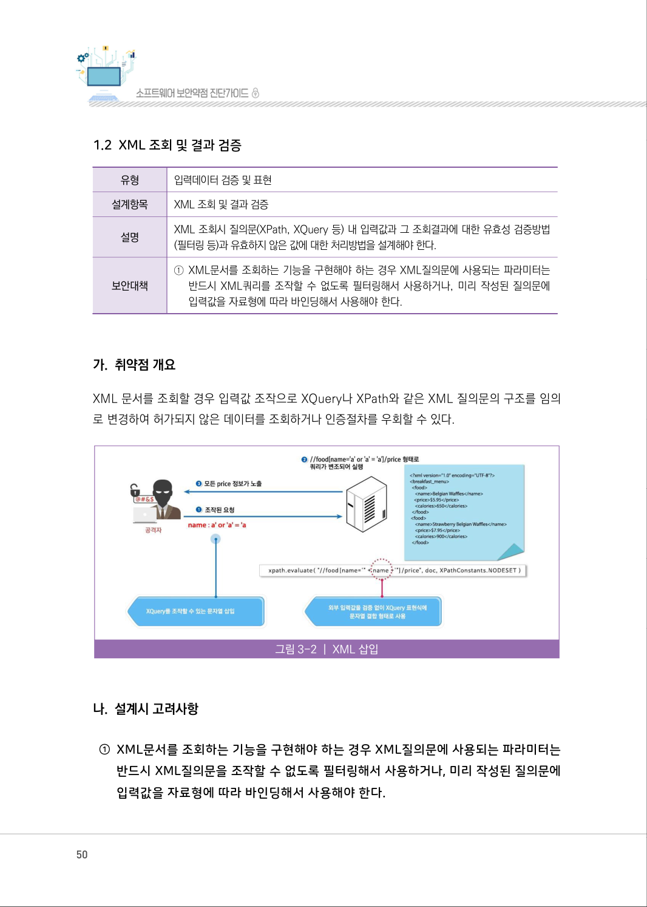
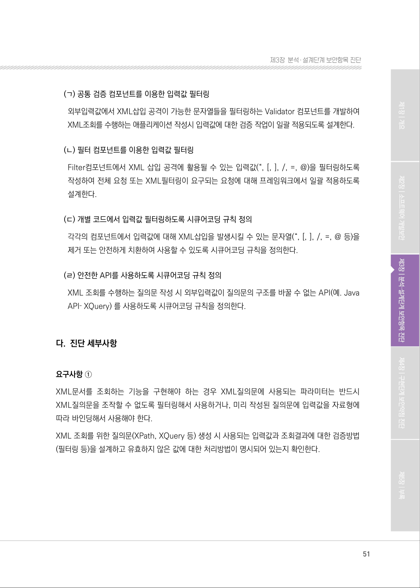
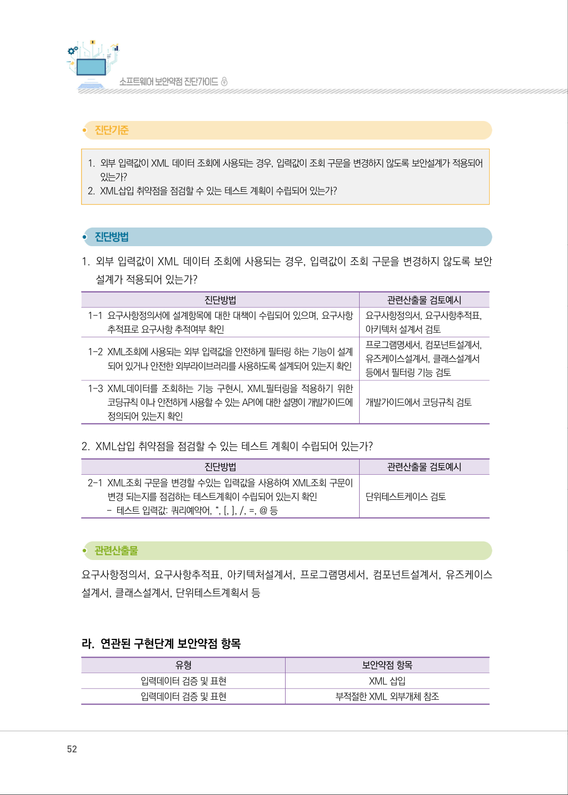
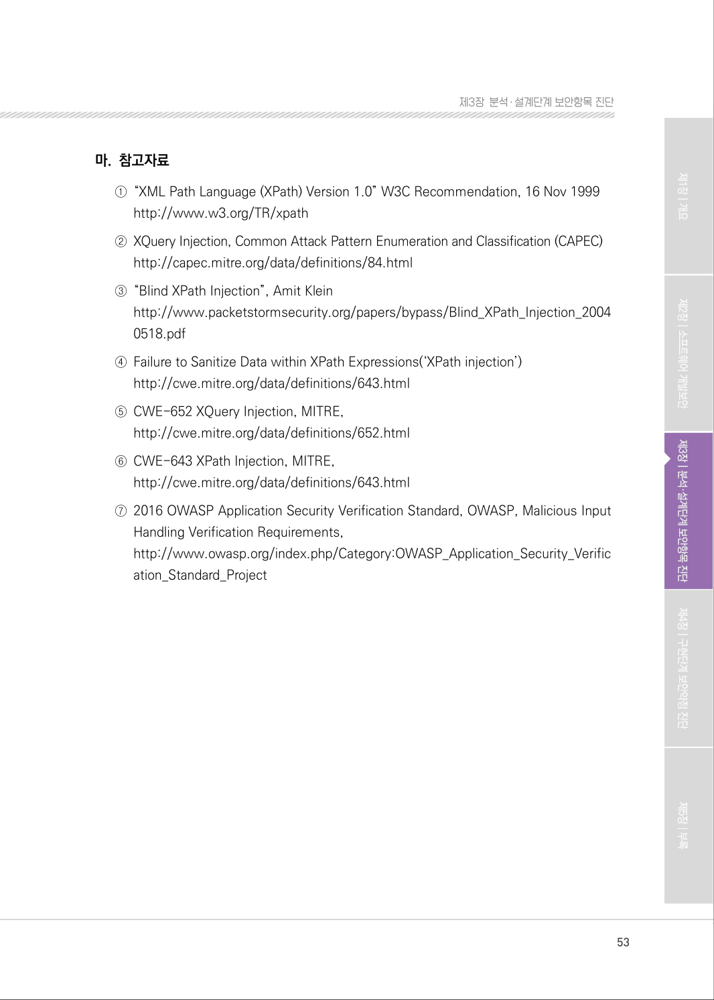

# 1.2 XML 조회 및 결과 검증

> 변환 안내(원문 외): 아래 본문은 PDF 텍스트를 추출한 전사입니다. 코드 줄번호·특수 공백·원문 오류를 유지했습니다. 실행용 코드가 아닙니다. 표·그림·들여쓰기는 연결된 페이지 이미지와 대조하세요. 페이지 경계의 줄바꿈을 보존하며, 동일 페이지가 여러 항목에 나뉘면 각 항목의 본문은 해당 구간만 포함합니다.

### PDF 50페이지 / 인쇄 50페이지

<!-- source-page:SW-Diagnosis-2021:50; source-lines:0,1,2,3,4,5,6,7,8,9,10,11,12,13,14,15,16,17,18,19,20 -->

50

1.2 XML 조회 및 결과 검증

| 유형 | 입력데이터 검증 및 표현 |
| --- | --- |
| 설계항목 | XML 조회 및 결과 검증 |
| 설명 | XML 조회시 질의문(XPath, XQuery 등) 내 입력값과 그 조회결과에 대한 유효성 검증방법 (필터링 등)과 유효하지 않은 값에 대한 처리방법을 설계해야 한다. |
| 보안대책 | ① XML문서를 조회하는 기능을 구현해야 하는 경우 XML질의문에 사용되는 파라미터는 반드시 XML쿼리를 조작할 수 없도록 필터링해서 사용하거나, 미리 작성된 질의문에 입력값을 자료형에 따라 바인딩해서 사용해야 한다. |

#### 가. 취약점 개요

XML 문서를 조회할 경우 입력값 조작으로 XQuery나 XPath와 같은 XML 질의문의 구조를 임의
로 변경하여 허가되지 않은 데이터를 조회하거나 인증절차를 우회할 수 있다.

그림3-2 | XML 삽입

#### 나. 설계시 고려사항

①XML문서를 조회하는 기능을 구현해야 하는 경우 XML질의문에 사용되는 파라미터는 

반드시 XML질의문을 조작할 수 없도록 필터링해서 사용하거나, 미리 작성된 질의문에 
입력값을 자료형에 따라 바인딩해서 사용해야 한다.

원본 페이지 이미지 (변환 외 보존 자료)

### PDF 51페이지 / 인쇄 51페이지

<!-- source-page:SW-Diagnosis-2021:51; source-lines:0,1,2,3,4,5,6,7,8,9,10,11,12,13,14,15,16,17,18,19,20,21 -->

51

제3장분석․ 설계단계 보안항목 진단

(ㄱ) 공통 검증 컴포넌트를 이용한 입력값 필터링
외부입력값에서 XML삽입 공격이 가능한 문자열들을 필터링하는 Validator 컴포넌트를 개발하여 
XML조회를 수행하는 애플리케이션 작성시 입력값에 대한 검증 작업이 일괄 적용되도록 설계한다.

(ㄴ) 필터 컴포넌트를 이용한 입력값 필터링
Filter컴포넌트에서 XML 삽입 공격에 활용될 수 있는 입력값(“, [, ], /, =, @)을 필터링하도록 
작성하여 전체 요청 또는 XML필터링이 요구되는 요청에 대해 프레임워크에서 일괄 적용하도록 
설계한다.

(ㄷ) 개별 코드에서 입력값 필터링하도록 시큐어코딩 규칙 정의
각각의 컴포넌트에서 입력값에 대해 XML삽입을 발생시킬 수 있는 문자열(“, [, ], /, =, @ 등)을 
제거 또는 안전하게 치환하여 사용할 수 있도록 시큐어코딩 규칙을 정의한다.

(ㄹ) 안전한 API를 사용하도록 시큐어코딩 규칙 정의
XML 조회를 수행하는 질의문 작성 시 외부입력값이 질의문의 구조를 바꿀 수 없는 API(예. Java 
API‐ XQuery) 를 사용하도록 시큐어코딩 규칙을 정의한다.

#### 다. 진단 세부사항

요구사항 ①
XML문서를 조회하는 기능을 구현해야 하는 경우 XML질의문에 사용되는 파라미터는 반드시 
XML질의문을 조작할 수 없도록 필터링해서 사용하거나, 미리 작성된 질의문에 입력값을 자료형에 
따라 바인딩해서 사용해야 한다.
XML 조회를 위한 질의문(XPath, XQuery 등) 생성 시 사용되는 입력값과 조회결과에 대한 검증방법 
(필터링 등)을 설계하고 유효하지 않은 값에 대한 처리방법이 명시되어 있는지 확인한다.

원본 페이지 이미지 (변환 외 보존 자료)

### PDF 52페이지 / 인쇄 52페이지

<!-- source-page:SW-Diagnosis-2021:52; source-lines:0,1,2,3,4,5,6,7,8,9,10,11,12,13,14,15,16,17,18,19,20,21,22,23,24,25,26,27,28,29,30,31,32,33,34,35,36 -->

52

#### 1. 외부 입력값이 XML 데이터 조회에 사용되는 경우, 입력값이 조회 구문을 변경하지 않도록 보안설계가 적용되어 

있는가?

#### 2. XML삽입 취약점을 점검할 수 있는 테스트 계획이 수립되어 있는가?

#### 1. 외부 입력값이 XML 데이터 조회에 사용되는 경우, 입력값이 조회 구문을 변경하지 않도록 보안 

설계가 적용되어 있는가?

| 진단방법 | 관련산출물 검토예시 |
| --- | --- |
| 1-1 요구사항정의서에 설계항목에 대한 대책이 수립되어 있으며, 요구사항 추적표로 요구사항 추적여부 확인 | 요구사항정의서, 요구사항추적표, 아키텍처 설계서 검토 |
| 1-2 XML조회에 사용되는 외부 입력값을 안전하게 필터링 하는 기능이 설계 되어 있거나 안전한 외부라이브러리를 사용하도록 설계되어 있는지 확인 | 프로그램명세서, 컴포넌트설계서, 유즈케이스설계서, 클래스설계서 등에서 필터링 기능 검토 |
| 1-3 XML데이터를 조회하는 기능 구현시, XML필터링을 적용하기 위한 코딩규칙 이나 안전하게 사용할 수 있는 API에 대한 설명이 개발가이드에 정의되어 있는지 확인 | 개발가이드에서 코딩규칙 검토 |

#### 2. XML삽입 취약점을 점검할 수 있는 테스트 계획이 수립되어 있는가? 

| 진단방법 | 관련산출물 검토예시 |
| --- | --- |
| 2-1 XML조회 구문을 변경할 수있는 입력값을 사용하여 XML조회 구문이 변경 되는지를 점검하는 테스트계획이 수립되어 있는지 확인 - 테스트 입력값: 쿼리예약어, “, [, ], /, =, @ 등 | 단위테스트케이스 검토 |

요구사항정의서, 요구사항추적표, 아키텍처설계서, 프로그램명세서, 컴포넌트설계서, 유즈케이스 
설계서, 클래스설계서, 단위테스트계획서 등

#### 라. 연관된 구현단계 보안약점 항목

유형

보안약점 항목

입력데이터 검증 및 표현

XML 삽입

입력데이터 검증 및 표현

부적절한 XML 외부개체 참조

원본 페이지 이미지 (변환 외 보존 자료)

### PDF 53페이지 / 인쇄 53페이지

<!-- source-page:SW-Diagnosis-2021:53; source-lines:0,1,2,3,4,5,6,7,8,9,10,11,12,13,14,15,16,17,18,19 -->

53

제3장분석․ 설계단계 보안항목 진단

#### 마. 참고자료

①“XML Path Language (XPath) Version 1.0” W3C Recommendation, 16 Nov 1999

http://www.w3.org/TR/xpath 
②XQuery Injection, Common Attack Pattern Enumeration and Classification (CAPEC)

http://capec.mitre.org/data/definitions/84.html
③“Blind XPath Injection”, Amit Klein

http://www.packetstormsecurity.org/papers/bypass/Blind_XPath_Injection_2004
0518.pdf
④Failure to Sanitize Data within XPath Expressions(‘XPath injection’)

http://cwe.mitre.org/data/definitions/643.html
⑤CWE-652 XQuery Injection, MITRE,

http://cwe.mitre.org/data/definitions/652.html
⑥CWE-643 XPath Injection, MITRE,

http://cwe.mitre.org/data/definitions/643.html
⑦2016 OWASP Application Security Verification Standard, OWASP, Malicious Input 

Handling Verification Requirements,
http://www.owasp.org/index.php/Category:OWASP_Application_Security_Verific
ation_Standard_Project

원본 페이지 이미지 (변환 외 보존 자료)

---

## 탐색 링크 (원문 외)

[통합 인덱스](../../../INDEX.md)

