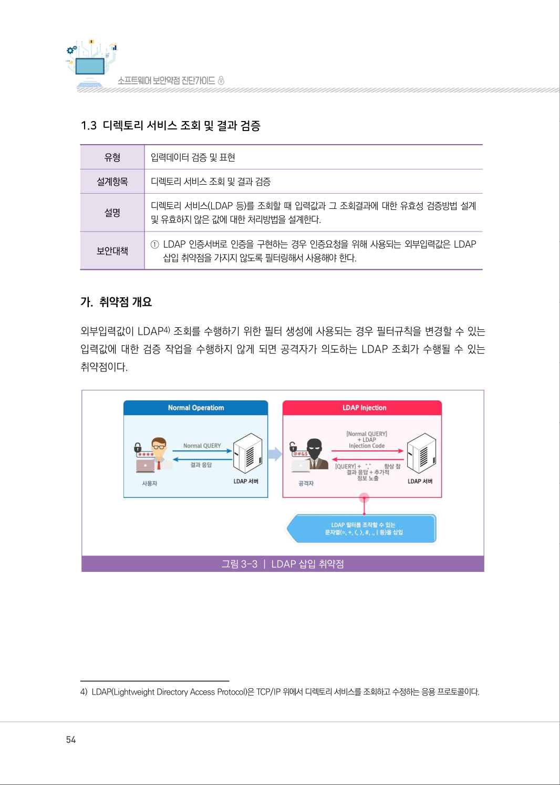
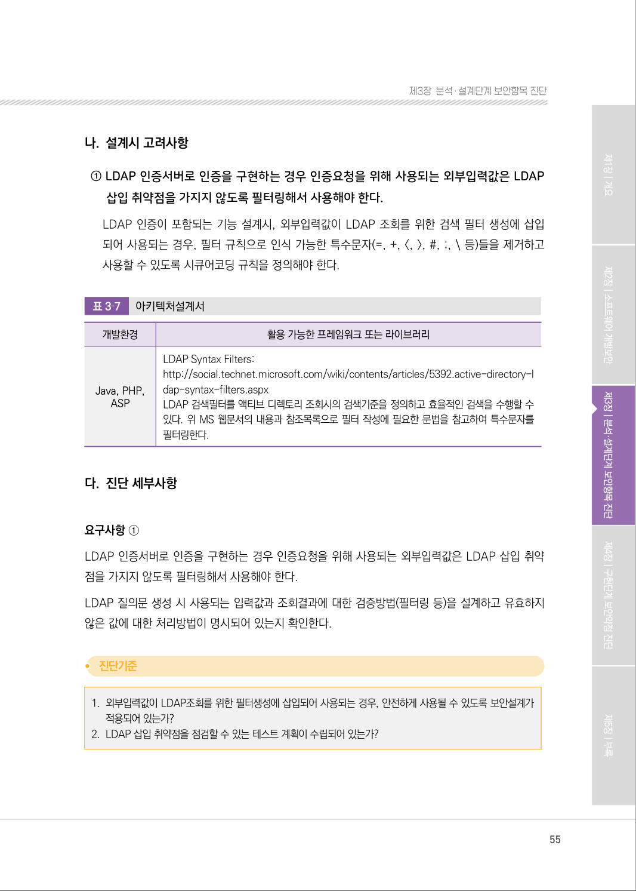
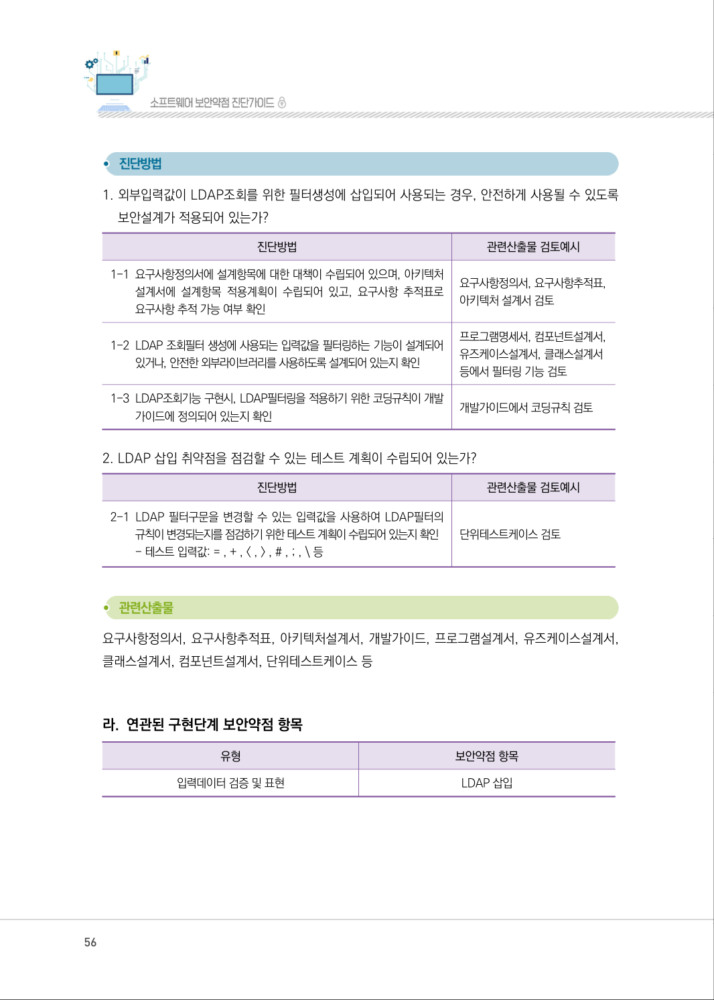
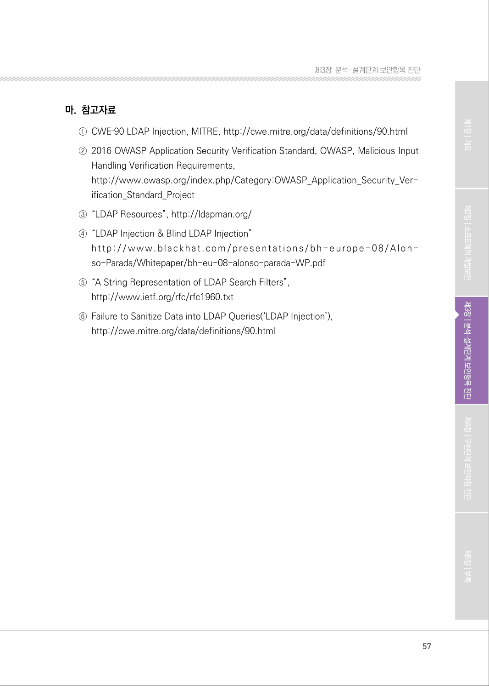

# 1.3 디렉토리 서비스 조회 및 결과 검증

> 변환 안내(원문 외): 아래 본문은 PDF 텍스트를 추출한 전사입니다. 코드 줄번호·특수 공백·원문 오류를 유지했습니다. 실행용 코드가 아닙니다. 표·그림·들여쓰기는 연결된 페이지 이미지와 대조하세요. 페이지 경계의 줄바꿈을 보존하며, 동일 페이지가 여러 항목에 나뉘면 각 항목의 본문은 해당 구간만 포함합니다.

### PDF 54페이지 / 인쇄 54페이지

<!-- source-page:SW-Diagnosis-2021:54; source-lines:0,1,2,3,4,5,6,7,8,9,10,11,12,13,14,15,16,17 -->

54

1.3 디렉토리 서비스 조회 및 결과 검증

| 유형 | 입력데이터 검증 및 표현 |
| --- | --- |
| 설계항목 | 디렉토리 서비스 조회 및 결과 검증 |
| 설명 | 디렉토리 서비스(LDAP 등)를 조회할 때 입력값과 그 조회결과에 대한 유효성 검증방법 설계 및 유효하지 않은 값에 대한 처리방법을 설계한다. |
| 보안대책 | ① LDAP 인증서버로 인증을 구현하는 경우 인증요청을 위해 사용되는 외부입력값은 LDAP 삽입 취약점을 가지지 않도록 필터링해서 사용해야 한다. |

#### 가. 취약점 개요

외부입력값이 LDAP4) 조회를 수행하기 위한 필터 생성에 사용되는 경우 필터규칙을 변경할 수 있는 
입력값에 대한 검증 작업을 수행하지 않게 되면 공격자가 의도하는 LDAP 조회가 수행될 수 있는 
취약점이다.

그림3-3 | LDAP 삽입 취약점

4) LDAP(Lightweight Directory Access Protocol)은 TCP/IP 위에서 디렉토리 서비스를 조회하고 수정하는 응용 프로토콜이다.

원본 페이지 이미지 (변환 외 보존 자료)

### PDF 55페이지 / 인쇄 55페이지

<!-- source-page:SW-Diagnosis-2021:55; source-lines:0,1,2,3,4,5,6,7,8,9,10,11,12,13,14,15,16,17,18,19,20,21,22,23,24,25,26,27,28 -->

55

제3장분석․ 설계단계 보안항목 진단

#### 나. 설계시 고려사항

① LDAP 인증서버로 인증을 구현하는 경우 인증요청을 위해 사용되는 외부입력값은 LDAP 

삽입 취약점을 가지지 않도록 필터링해서 사용해야 한다.
LDAP 인증이 포함되는 기능 설계시, 외부입력값이 LDAP 조회를 위한 검색 필터 생성에 삽입 
되어 사용되는 경우, 필터 규칙으로 인식 가능한 특수문자(=, +, &lt;, &gt;, #, ;, \ 등)들을 제거하고 
사용할 수 있도록 시큐어코딩 규칙을 정의해야 한다.

표3‐7

아키텍처설계서

|  |  |
| --- | --- |
| 개발환경 | 활용 가능한 프레임워크 또는 라이브러리 |
| Java, PHP, ASP | LDAP Syntax Filters: http://social.technet.microsoft.com/wiki/contents/articles/5392.active-directory-l dap-syntax-filters.aspx LDAP 검색필터를 액티브 디렉토리 조회시의 검색기준을 정의하고 효율적인 검색을 수행할 수 있다. 위 MS 웹문서의 내용과 참조목록으로 필터 작성에 필요한 문법을 참고하여 특수문자를 필터링한다. |

#### 다. 진단 세부사항

요구사항 ①
LDAP 인증서버로 인증을 구현하는 경우 인증요청을 위해 사용되는 외부입력값은 LDAP 삽입 취약
점을 가지지 않도록 필터링해서 사용해야 한다.
LDAP 질의문 생성 시 사용되는 입력값과 조회결과에 대한 검증방법(필터링 등)을 설계하고 유효하지 
않은 값에 대한 처리방법이 명시되어 있는지 확인한다.

#### 1. 외부입력값이 LDAP조회를 위한 필터생성에 삽입되어 사용되는 경우, 안전하게 사용될 수 있도록 보안설계가 

적용되어 있는가?

#### 2. LDAP 삽입 취약점을 점검할 수 있는 테스트 계획이 수립되어 있는가?

원본 페이지 이미지 (변환 외 보존 자료)

### PDF 56페이지 / 인쇄 56페이지

<!-- source-page:SW-Diagnosis-2021:56; source-lines:0,1,2,3,4,5,6,7,8,9,10,11,12,13,14,15,16,17,18,19,20,21,22,23,24,25,26,27,28,29,30,31 -->

56

#### 1. 외부입력값이 LDAP조회를 위한 필터생성에 삽입되어 사용되는 경우, 안전하게 사용될 수 있도록 

보안설계가 적용되어 있는가?

| 진단방법 | 관련산출물 검토예시 |
| --- | --- |
| 1-1 요구사항정의서에 설계항목에 대한 대책이 수립되어 있으며, 아키텍처 설계서에 설계항목 적용계획이 수립되어 있고, 요구사항 추적표로 요구사항 추적 가능 여부 확인 | 요구사항정의서, 요구사항추적표, 아키텍처 설계서 검토 |
| 1-2 LDAP 조회필터 생성에 사용되는 입력값을 필터링하는 기능이 설계되어 있거나, 안전한 외부라이브러리를 사용하도록 설계되어 있는지 확인 | 프로그램명세서, 컴포넌트설계서, 유즈케이스설계서, 클래스설계서 등에서 필터링 기능 검토 |
| 1-3 LDAP조회기능 구현시, LDAP필터링을 적용하기 위한 코딩규칙이 개발 가이드에 정의되어 있는지 확인 | 개발가이드에서 코딩규칙 검토 |

#### 2. LDAP 삽입 취약점을 점검할 수 있는 테스트 계획이 수립되어 있는가?

| 진단방법 | 관련산출물 검토예시 |
| --- | --- |
| 2-1 LDAP 필터구문을 변경할 수 있는 입력값을 사용하여 LDAP필터의 규칙이 변경되는지를 점검하기 위한 테스트 계획이 수립되어 있는지 확인 - 테스트 입력값: = , + , < , > , # , ; , \ 등 | 단위테스트케이스 검토 |

요구사항정의서, 요구사항추적표, 아키텍처설계서, 개발가이드, 프로그램설계서, 유즈케이스설계서, 
클래스설계서, 컴포넌트설계서, 단위테스트케이스 등

#### 라. 연관된 구현단계 보안약점 항목

| 유형 | 보안약점 항목 |
| --- | --- |
| 입력데이터 검증 및 표현 | LDAP 삽입 |

원본 페이지 이미지 (변환 외 보존 자료)

### PDF 57페이지 / 인쇄 57페이지

<!-- source-page:SW-Diagnosis-2021:57; source-lines:0,1,2,3,4,5,6,7,8,9,10,11,12,13,14,15 -->

57

제3장분석․ 설계단계 보안항목 진단

#### 마. 참고자료

①CWE‐90 LDAP Injection, MITRE, http://cwe.mitre.org/data/definitions/90.html 
②2016 OWASP Application Security Verification Standard, OWASP, Malicious Input 

Handling Verification Requirements,
http://www.owasp.org/index.php/Category:OWASP_Application_Security_Ver- 
ification_Standard_Project
③“LDAP Resources”, http://ldapman.org/
④“LDAP Injection &amp; Blind LDAP Injection”

http :// ww w.blackh at .com/present ations/bh -europe-08/ Alon- 
so-Parada/Whitepaper/bh-eu-08-alonso-parada-WP.pdf
⑤“A String Representation of LDAP Search Filters”,

http://www.ietf.org/rfc/rfc1960.txt
⑥Failure to Sanitize Data into LDAP Queries(‘LDAP Injection’),

http://cwe.mitre.org/data/definitions/90.html

원본 페이지 이미지 (변환 외 보존 자료)

---

## 탐색 링크 (원문 외)

[통합 인덱스](../../../INDEX.md)

