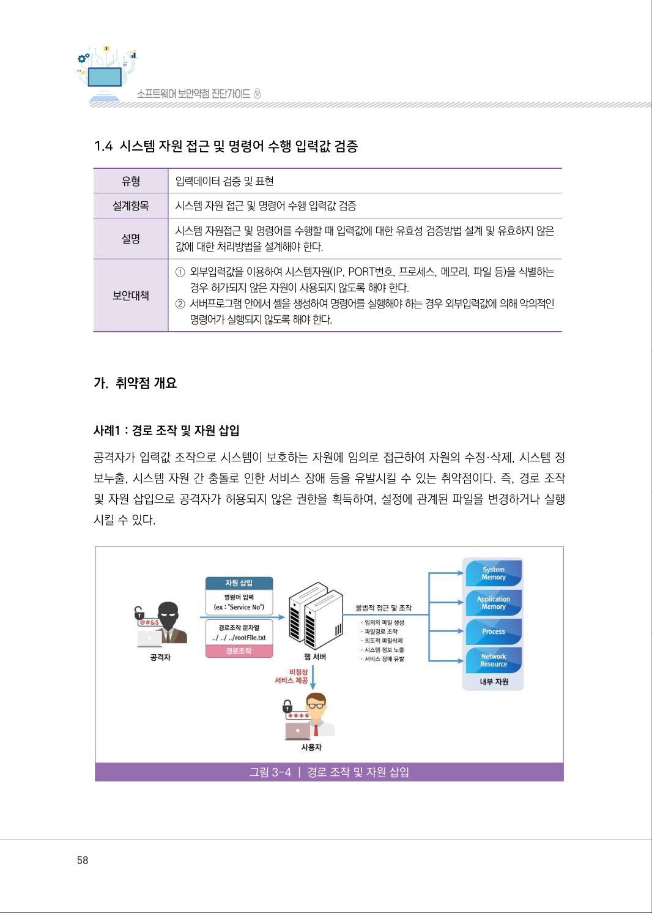
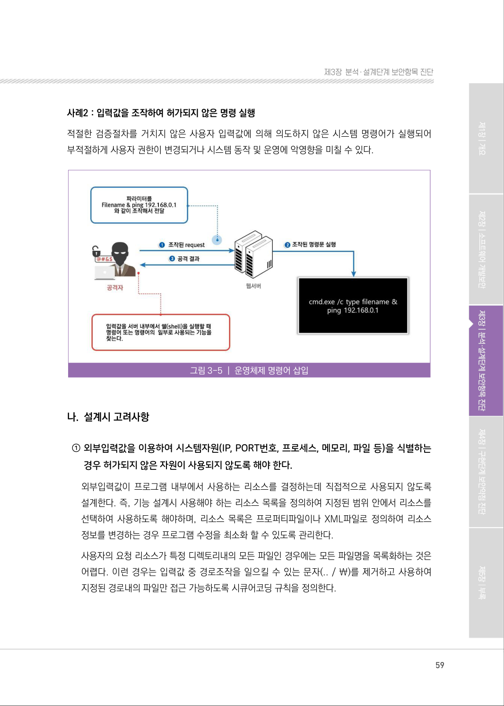
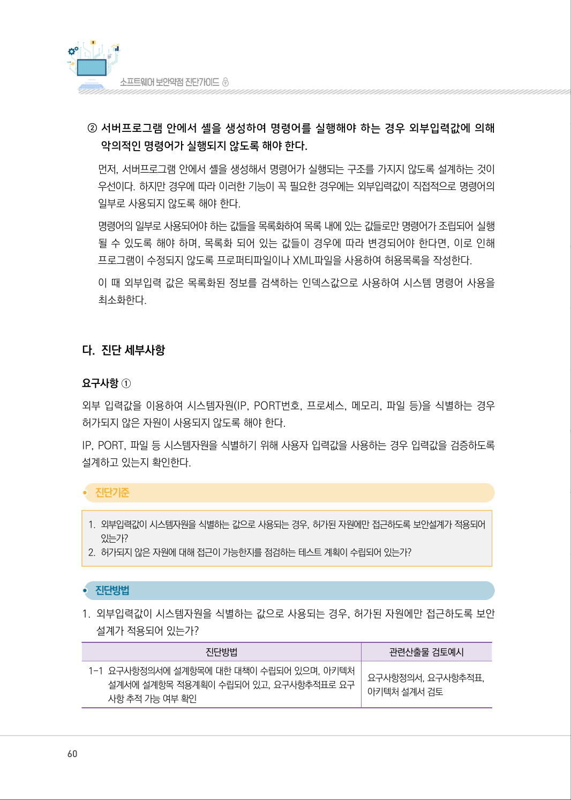
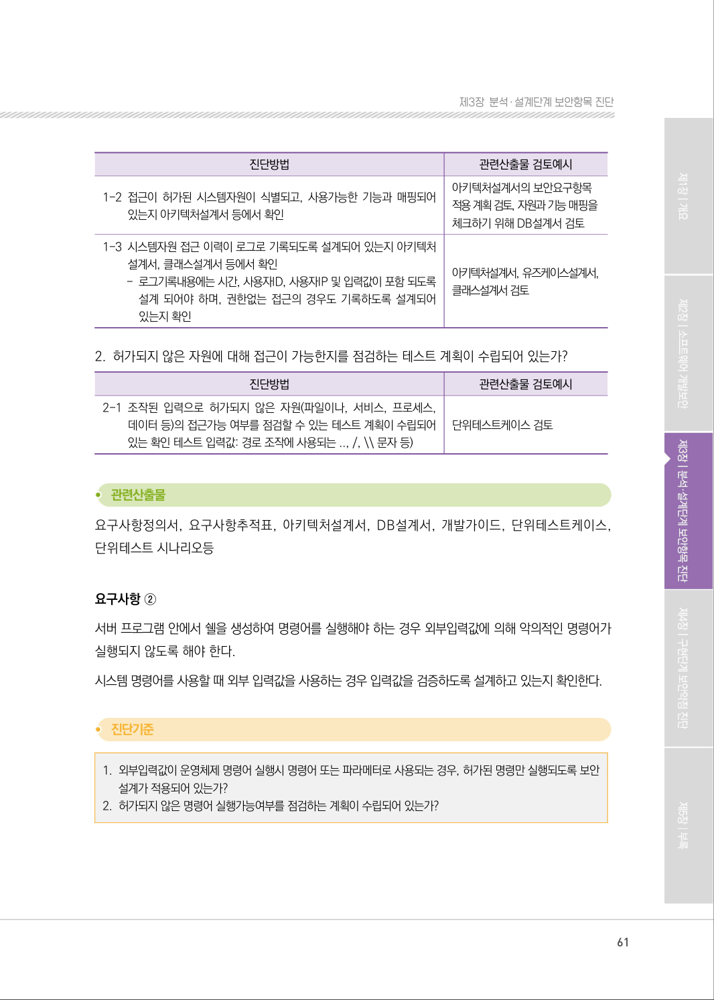
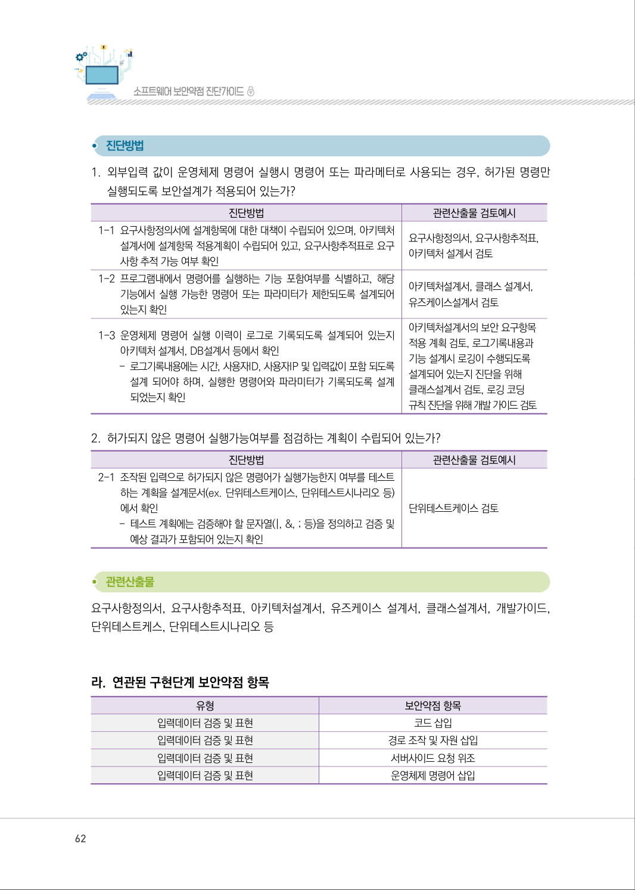
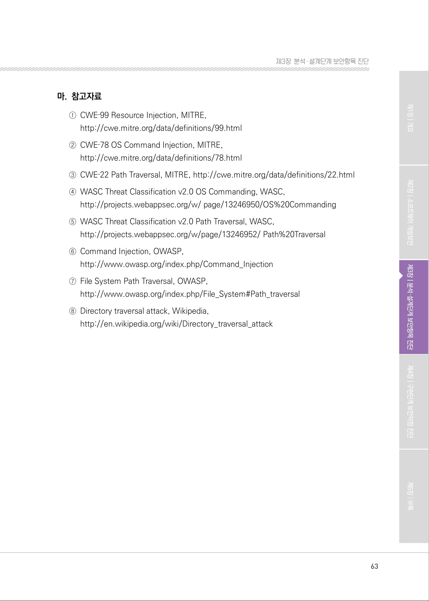

# 1.4 시스템 자원 접근 및 명령어 수행 입력값 검증

> 변환 안내(원문 외): 아래 본문은 PDF 텍스트를 추출한 전사입니다. 코드 줄번호·특수 공백·원문 오류를 유지했습니다. 실행용 코드가 아닙니다. 표·그림·들여쓰기는 연결된 페이지 이미지와 대조하세요. 페이지 경계의 줄바꿈을 보존하며, 동일 페이지가 여러 항목에 나뉘면 각 항목의 본문은 해당 구간만 포함합니다.

### PDF 58페이지 / 인쇄 58페이지

<!-- source-page:SW-Diagnosis-2021:58; source-lines:0,1,2,3,4,5,6,7,8,9,10,11,12,13,14,15,16,17,18,19,20 -->

58

1.4 시스템 자원 접근 및 명령어 수행 입력값 검증

유형

입력데이터 검증 및 표현

설계항목

시스템 자원 접근 및 명령어 수행 입력값 검증

설명

시스템 자원접근 및 명령어를 수행할 때 입력값에 대한 유효성 검증방법 설계 및 유효하지 않은 
값에 대한 처리방법을 설계해야 한다.

보안대책

①외부입력값을 이용하여 시스템자원(IP, PORT번호, 프로세스, 메모리, 파일 등)을 식별하는 

경우 허가되지 않은 자원이 사용되지 않도록 해야 한다.
②서버프로그램 안에서 셸을 생성하여 명령어를 실행해야 하는 경우 외부입력값에 의해 악의적인 

명령어가 실행되지 않도록 해야 한다. 

#### 가. 취약점 개요

사례1 : 경로 조작 및 자원 삽입
공격자가 입력값 조작으로 시스템이 보호하는 자원에 임의로 접근하여 자원의 수정·삭제, 시스템 정
보누출, 시스템 자원 간 충돌로 인한 서비스 장애 등을 유발시킬 수 있는 취약점이다. 즉, 경로 조작 
및 자원 삽입으로 공격자가 허용되지 않은 권한을 획득하여, 설정에 관계된 파일을 변경하거나 실행
시킬 수 있다.

그림3-4 | 경로 조작 및 자원 삽입

원본 페이지 이미지 (변환 외 보존 자료)

### PDF 59페이지 / 인쇄 59페이지

<!-- source-page:SW-Diagnosis-2021:59; source-lines:0,1,2,3,4,5,6,7,8,9,10,11,12,13,14,15 -->

59

제3장분석․ 설계단계 보안항목 진단

사례2 : 입력값을 조작하여 허가되지 않은 명령 실행
적절한 검증절차를 거치지 않은 사용자 입력값에 의해 의도하지 않은 시스템 명령어가 실행되어 
부적절하게 사용자 권한이 변경되거나 시스템 동작 및 운영에 악영향을 미칠 수 있다.

그림3-5 | 운영체제 명령어 삽입

#### 나. 설계시 고려사항

① 외부입력값을 이용하여 시스템자원(IP, PORT번호, 프로세스, 메모리, 파일 등)을 식별하는 

경우 허가되지 않은 자원이 사용되지 않도록 해야 한다.
외부입력값이 프로그램 내부에서 사용하는 리소스를 결정하는데 직접적으로 사용되지 않도록 
설계한다. 즉, 기능 설계시 사용해야 하는 리소스 목록을 정의하여 지정된 범위 안에서 리소스를 
선택하여 사용하도록 해야하며, 리소스 목록은 프로퍼티파일이나 XML파일로 정의하여 리소스 
정보를 변경하는 경우 프로그램 수정을 최소화 할 수 있도록 관리한다.
사용자의 요청 리소스가 특정 디렉토리내의 모든 파일인 경우에는 모든 파일명을 목록화하는 것은 
어렵다. 이런 경우는 입력값 중 경로조작을 일으킬 수 있는 문자(.. / ￦)를 제거하고 사용하여 
지정된 경로내의 파일만 접근 가능하도록 시큐어코딩 규칙을 정의한다.

원본 페이지 이미지 (변환 외 보존 자료)

### PDF 60페이지 / 인쇄 60페이지

<!-- source-page:SW-Diagnosis-2021:60; source-lines:0,1,2,3,4,5,6,7,8,9,10,11,12,13,14,15,16,17,18,19,20,21,22,23,24,25,26,27,28 -->

60

② 서버프로그램 안에서 셸을 생성하여 명령어를 실행해야 하는 경우 외부입력값에 의해 

악의적인 명령어가 실행되지 않도록 해야 한다.
먼저, 서버프로그램 안에서 셸을 생성해서 명령어가 실행되는 구조를 가지지 않도록 설계하는 것이 
우선이다. 하지만 경우에 따라 이러한 기능이 꼭 필요한 경우에는 외부입력값이 직접적으로 명령어의 
일부로 사용되지 않도록 해야 한다.
명령어의 일부로 사용되어야 하는 값들을 목록화하여 목록 내에 있는 값들로만 명령어가 조립되어 실행 
될 수 있도록 해야 하며, 목록화 되어 있는 값들이 경우에 따라 변경되어야 한다면, 이로 인해 
프로그램이 수정되지 않도록 프로퍼티파일이나 XML파일을 사용하여 허용목록을 작성한다.
이 때 외부입력 값은 목록화된 정보를 검색하는 인덱스값으로 사용하여 시스템 명령어 사용을 
최소화한다.

#### 다. 진단 세부사항

요구사항 ①
외부 입력값을 이용하여 시스템자원(IP, PORT번호, 프로세스, 메모리, 파일 등)을 식별하는 경우 
허가되지 않은 자원이 사용되지 않도록 해야 한다.
IP, PORT, 파일 등 시스템자원을 식별하기 위해 사용자 입력값을 사용하는 경우 입력값을 검증하도록 
설계하고 있는지 확인한다.

#### 1. 외부입력값이 시스템자원을 식별하는 값으로 사용되는 경우, 허가된 자원에만 접근하도록 보안설계가 적용되어 

있는가?

#### 2. 허가되지 않은 자원에 대해 접근이 가능한지를 점검하는 테스트 계획이 수립되어 있는가?

#### 1. 외부입력값이 시스템자원을 식별하는 값으로 사용되는 경우, 허가된 자원에만 접근하도록 보안

설계가 적용되어 있는가?

| 진단방법 | 관련산출물 검토예시 |
| --- | --- |
| 1-1 요구사항정의서에 설계항목에 대한 대책이 수립되어 있으며, 아키텍처 설계서에 설계항목 적용계획이 수립되어 있고, 요구사항추적표로 요구 사항 추적 가능 여부 확인 | 요구사항정의서, 요구사항추적표, 아키텍처 설계서 검토 |

원본 페이지 이미지 (변환 외 보존 자료)

### PDF 61페이지 / 인쇄 61페이지

<!-- source-page:SW-Diagnosis-2021:61; source-lines:0,1,2,3,4,5,6,7,8,9,10,11,12,13,14,15,16,17,18,19,20,21,22,23,24,25,26,27,28,29,30,31 -->

61

제3장분석․ 설계단계 보안항목 진단

| 진단방법 | 관련산출물 검토예시 |
| --- | --- |
| 1-2 접근이 허가된 시스템자원이 식별되고, 사용가능한 기능과 매핑되어 있는지 아키텍처설계서 등에서 확인 | 아키텍처설계서의 보안요구항목 적용 계획 검토, 자원과 기능 매핑을 체크하기 위해 DB설계서 검토 |
| 1-3 시스템자원 접근 이력이 로그로 기록되도록 설계되어 있는지 아키텍처 설계서, 클래스설계서 등에서 확인 - 로그기록내용에는 시간, 사용자ID, 사용자IP 및 입력값이 포함 되도록 설계 되어야 하며, 권한없는 접근의 경우도 기록하도록 설계되어 있는지 확인 | 아키텍처설계서, 유즈케이스설계서, 클래스설계서 검토 |

#### 2. 허가되지 않은 자원에 대해 접근이 가능한지를 점검하는 테스트 계획이 수립되어 있는가?

| 진단방법 | 관련산출물 검토예시 |
| --- | --- |
| 2-1 조작된 입력으로 허가되지 않은 자원(파일이나, 서비스, 프로세스, 데이터 등)의 접근가능 여부를 점검할 수 있는 테스트 계획이 수립되어 있는 확인 테스트 입력값: 경로 조작에 사용되는 .., /, \\ 문자 등) | 단위테스트케이스 검토 |

요구사항정의서, 요구사항추적표, 아키텍처설계서, DB설계서, 개발가이드, 단위테스트케이스, 
단위테스트 시나리오등

요구사항 ②
서버 프로그램 안에서 쉘을 생성하여 명령어를 실행해야 하는 경우 외부입력값에 의해 악의적인 명령어가 
실행되지 않도록 해야 한다.
시스템 명령어를 사용할 때 외부 입력값을 사용하는 경우 입력값을 검증하도록 설계하고 있는지 확인한다.

#### 1. 외부입력값이 운영체제 명령어 실행시 명령어 또는 파라메터로 사용되는 경우, 허가된 명령만 실행되도록 보안

설계가 적용되어 있는가?

#### 2. 허가되지 않은 명령어 실행가능여부를 점검하는 계획이 수립되어 있는가?

원본 페이지 이미지 (변환 외 보존 자료)

### PDF 62페이지 / 인쇄 62페이지

<!-- source-page:SW-Diagnosis-2021:62; source-lines:0,1,2,3,4,5,6,7,8,9,10,11,12,13,14,15,16,17,18,19,20,21,22,23,24,25,26,27,28,29,30,31,32,33,34,35,36,37,38,39,40,41,42,43,44,45,46,47 -->

62

#### 1. 외부입력 값이 운영체제 명령어 실행시 명령어 또는 파라메터로 사용되는 경우, 허가된 명령만 

실행되도록 보안설계가 적용되어 있는가?

| 진단방법 | 관련산출물 검토예시 |
| --- | --- |
| 1-1 요구사항정의서에 설계항목에 대한 대책이 수립되어 있으며, 아키텍처 설계서에 설계항목 적용계획이 수립되어 있고, 요구사항추적표로 요구 사항 추적 가능 여부 확인 | 요구사항정의서, 요구사항추적표, 아키텍처 설계서 검토 |
| 1-2 프로그램내에서 명령어를 실행하는 기능 포함여부를 식별하고, 해당 기능에서 실행 가능한 명령어 또는 파라미터가 제한되도록 설계되어 있는지 확인 | 아키텍처설계서, 클래스 설계서, 유즈케이스설계서 검토 |
| 1-3 운영체제 명령어 실행 이력이 로그로 기록되도록 설계되어 있는지 아키텍처 설계서, DB설계서 등에서 확인 - 로그기록내용에는 시간, 사용자ID, 사용자IP 및 입력값이 포함 되도록 설계 되어야 하며, 실행한 명령어와 파라미터가 기록되도록 설계 되었는지 확인 | 아키텍처설계서의 보안 요구항목 적용 계획 검토, 로그기록내용과 기능 설계시 로깅이 수행되도록 설계되어 있는지 진단을 위해 클래스설계서 검토, 로깅 코딩 규칙 진단을 위해 개발 가이드 검토 |

#### 2. 허가되지 않은 명령어 실행가능여부를 점검하는 계획이 수립되어 있는가?

| 진단방법 | 관련산출물 검토예시 |
| --- | --- |
| 2-1 조작된 입력으로 허가되지 않은 명령어가 실행가능한지 여부를 테스트 하는 계획을 설계문서(ex. 단위테스트케이스, 단위테스트시나리오 등) 에서 확인 - 테스트 계획에는 검증해야 할 문자열(\|, &, ; 등)을 정의하고 검증 및 예상 결과가 포함되어 있는지 확인 | 단위테스트케이스 검토 |

요구사항정의서, 요구사항추적표, 아키텍처설계서, 유즈케이스 설계서, 클래스설계서, 개발가이드, 
단위테스트케스, 단위테스트시나리오 등

#### 라. 연관된 구현단계 보안약점 항목

| 유형 | 보안약점 항목 |
| --- | --- |
| 입력데이터 검증 및 표현 | 코드 삽입 |
| 입력데이터 검증 및 표현 | 경로 조작 및 자원 삽입 |
| 입력데이터 검증 및 표현 | 서버사이드 요청 위조 |
| 입력데이터 검증 및 표현 | 운영체제 명령어 삽입 |

원본 페이지 이미지 (변환 외 보존 자료)

### PDF 63페이지 / 인쇄 63페이지

<!-- source-page:SW-Diagnosis-2021:63; source-lines:0,1,2,3,4,5,6,7,8,9,10,11,12,13,14,15,16,17 -->

63

제3장분석․ 설계단계 보안항목 진단

#### 마. 참고자료

①CWE‐99 Resource Injection, MITRE, 

http://cwe.mitre.org/data/definitions/99.html
②CWE‐78 OS Command Injection, MITRE, 

http://cwe.mitre.org/data/definitions/78.html 
③CWE‐22 Path Traversal, MITRE, http://cwe.mitre.org/data/definitions/22.html
④WASC Threat Classification v2.0 OS Commanding, WASC,

http://projects.webappsec.org/w/ page/13246950/OS%20Commanding
⑤WASC Threat Classification v2.0 Path Traversal, WASC,

http://projects.webappsec.org/w/page/13246952/ Path%20Traversal
⑥Command Injection, OWASP, 

http://www.owasp.org/index.php/Command_Injection
⑦File System Path Traversal, OWASP,

http://www.owasp.org/index.php/File_System#Path_traversal
⑧Directory traversal attack, Wikipedia,

http://en.wikipedia.org/wiki/Directory_traversal_attack

원본 페이지 이미지 (변환 외 보존 자료)

---

## 탐색 링크 (원문 외)

[통합 인덱스](../../../INDEX.md)

