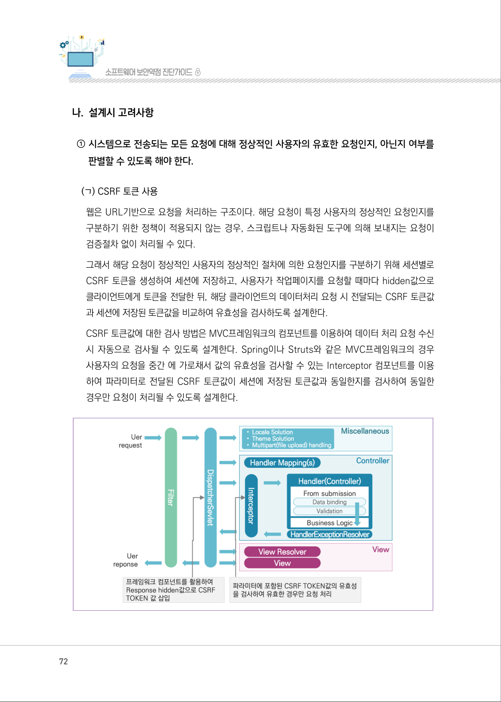
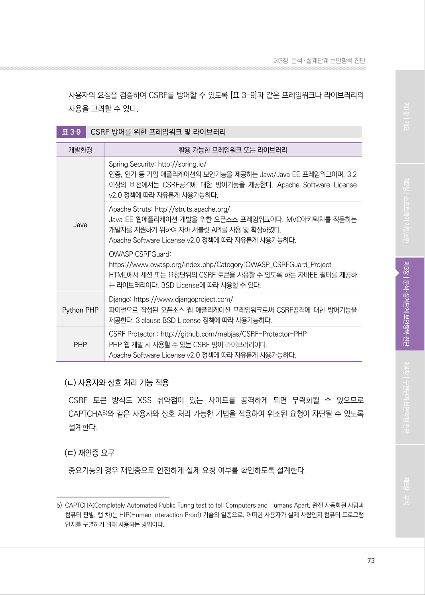
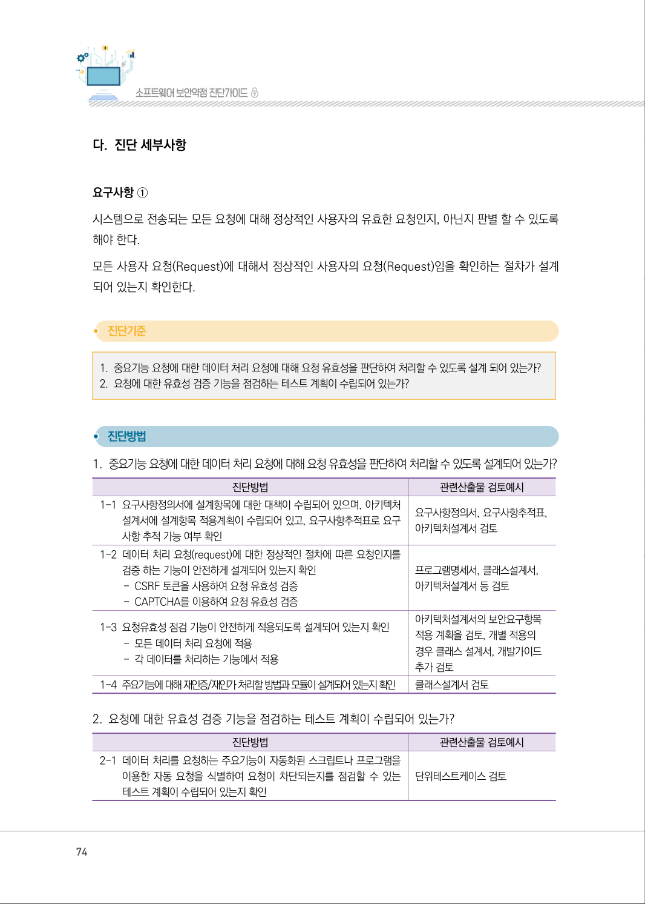
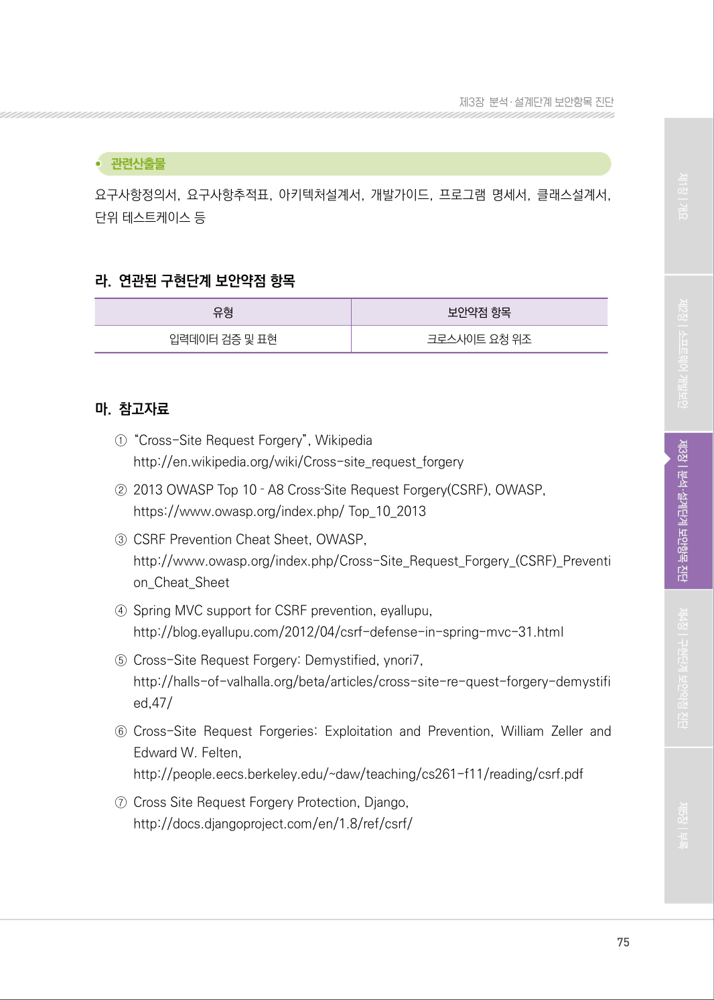

# 1.6 웹 기반 중요 기능 수행 요청 유효성 검증

> 변환 안내(원문 외): 아래 본문은 PDF 텍스트를 추출한 전사입니다. 코드 줄번호·특수 공백·원문 오류를 유지했습니다. 실행용 코드가 아닙니다. 표·그림·들여쓰기는 연결된 페이지 이미지와 대조하세요. 페이지 경계의 줄바꿈을 보존하며, 동일 페이지가 여러 항목에 나뉘면 각 항목의 본문은 해당 구간만 포함합니다.

### PDF 71페이지 / 인쇄 71페이지

<!-- source-page:SW-Diagnosis-2021:71; source-lines:0,2,3,4,5,6,7,8,9,10,11,12,13,14,15,16 -->

71

1.6 웹 기반 중요 기능 수행 요청 유효성 검증

| 유형 | 입력데이터 검증 및 표현 |
| --- | --- |
| 설계항목 | 웹 기반 중요 기능 수행 요청 유효성 검증 |
| 설명 | 비밀번호 변경, 결제 등 사용자 권한 확인이 필요한 중요기능을 수행할 때 웹 서비스 요청에 대한<br>유효성 검증방법 설계 및 유효하지 않은 값에 대한 처리방법을 설계헤야 한다. |
| 보안대책 | ① 시스템으로 전송되는 모든 요청에 대해 정상적인 사용자의 유효한 요청인지, 아닌지 여부를<br>판별할 수 있도록 해야 한다. |

#### 가. 취약점 개요

공격자는 세션탈취, XSS 등으로 자신이 의도한 행위(수정, 삭제, 등록 등)를 사이트가 신뢰하는 인
증된 사용자의 권한으로 실행되게 할 수 있다.

그림3-8 | 크로스 사이트 요청 위조(CSRF)

<details><summary>원본 페이지 이미지 (변환 외 보존 자료)</summary>


</details>

### PDF 72페이지 / 인쇄 72페이지

<!-- source-page:SW-Diagnosis-2021:72; source-lines:0,1,2,3,4,5,6,7,8,9,10,11,12,13,14,15,16 -->

72

#### 나. 설계시 고려사항

① 시스템으로 전송되는 모든 요청에 대해 정상적인 사용자의 유효한 요청인지, 아닌지 여부를 

판별할 수 있도록 해야 한다.

(ㄱ) CSRF 토큰 사용
웹은 URL기반으로 요청을 처리하는 구조이다. 해당 요청이 특정 사용자의 정상적인 요청인지를 
구분하기 위한 정책이 적용되지 않는 경우, 스크립트나 자동화된 도구에 의해 보내지는 요청이 
검증절차 없이 처리될 수 있다.
그래서 해당 요청이 정상적인 사용자의 정상적인 절차에 의한 요청인지를 구분하기 위해 세션별로 
CSRF 토큰을 생성하여 세션에 저장하고, 사용자가 작업페이지를 요청할 때마다 hidden값으로 
클라이언트에게 토큰을 전달한 뒤, 해당 클라이언트의 데이터처리 요청 시 전달되는 CSRF 토큰값
과 세션에 저장된 토큰값을 비교하여 유효성을 검사하도록 설계한다.
CSRF 토큰값에 대한 검사 방법은 MVC프레임워크의 컴포넌트를 이용하여 데이터 처리 요청 수신 
시 자동으로 검사될 수 있도록 설계한다. Spring이나 Struts와 같은 MVC프레임워크의 경우 
사용자의 요청을 중간 에 가로채서 값의 유효성을 검사할 수 있는 Interceptor 컴포넌트를 이용
하여 파라미터로 전달된 CSRF 토큰값이 세션에 저장된 토큰값과 동일한지를 검사하여 동일한 
경우만 요청이 처리될 수 있도록 설계한다.

<details><summary>원본 페이지 이미지 (변환 외 보존 자료)</summary>



</details>

### PDF 73페이지 / 인쇄 73페이지

<!-- source-page:SW-Diagnosis-2021:73; source-lines:0,1,2,3,4,5,6,7,8,9,10,11,12,13,14,15,16,17,18,19,20,21,22,23,24,25,26,27,28,29,30,31,32,33,34,35,36,37 -->

73

제3장분석․ 설계단계 보안항목 진단

사용자의 요청을 검증하여 CSRF를 방어할 수 있도록 [표 3-9]과 같은 프레임워크나 라이브러리의 
사용을 고려할 수 있다.

표3‐9

CSRF 방어를 위한 프레임워크 및 라이브러리

```text
개발환경
활용 가능한 프레임워크 또는 라이브러리
Java
Spring Security: http://spring.io/
인증, 인가 등 기업 애플리케이션의 보안기능을 제공하는 Java/Java EE 프레임워크이며, 3.2
이상의 버전에서는 CSRF공격에 대한 방어기능을 제공한다. Apache Software License 
v2.0 정책에 따라 자유롭게 사용가능하다.
Apache Struts: http://struts.apache.org/
Java EE 웹애플리케이션 개발을 위한 오픈소스 프레임워크이다. MVC아키텍처를 적용하는 
개발자를 지원하기 위하여 자바 서블릿 API를 사용 및 확장하였다.
Apache Software License v2.0 정책에 따라 자유롭게 사용가능하다.
OWASP CSRFGuard:
https://www.owasp.org/index.php/Category:OWASP_CSRFGuard_Project
HTML에서 세션 또는 요청단위의 CSRF 토큰을 사용할 수 있도록 하는 자바EE 필터를 제공하
는 라이브러리이다. BSD License에 따라 사용할 수 있다.
Python PHP
Django: https://www.djangoproject.com/
파이썬으로 작성된 오픈소스 웹 애플리케이션 프레임워크로써 CSRF공격에 대한 방어기능을 
제공한다. 3‐clause BSD License 정책에 따라 사용가능하다.
PHP
CSRF Protector : http://github.com/mebjas/CSRF-Protector-PHP 
PHP 웹 개발 시 사용할 수 있는 CSRF 방어 라이브러리이다.
Apache Software License v2.0 정책에 따라 자유롭게 사용가능하다.
```

(ㄴ) 사용자와 상호 처리 기능 적용
CSRF 토큰 방식도 XSS 취약점이 있는 사이트를 공격하게 되면 무력화될 수 있으므로 
CAPTCHA5)와 같은 사용자와 상호 처리 가능한 기법을 적용하여 위조된 요청이 차단될 수 있도록 
설계한다.

(ㄷ) 재인증 요구
중요기능의 경우 재인증으로 안전하게 실제 요청 여부를 확인하도록 설계한다.

5) CAPTCHA(Completely Automated Public Turing test to tell Computers and Humans Apart, 완전 자동화된 사람과 

컴퓨터 판별, 캡 차)는 HIP(Human Interaction Proof) 기술의 일종으로, 어떠한 사용자가 실제 사람인지 컴퓨터 프로그램
인지를 구별하기 위해 사용되는 방법이다.

<details><summary>원본 페이지 이미지 (변환 외 보존 자료)</summary>



</details>

### PDF 74페이지 / 인쇄 74페이지

<!-- source-page:SW-Diagnosis-2021:74; source-lines:0,1,2,3,4,5,6,7,8,9,10,11,12,13,14,15,16,17,18,19,20,21,22,23,24,25,26,27,28,29,30,31,32,33,34,35,36,37,38 -->

74

#### 다. 진단 세부사항

요구사항 ①
시스템으로 전송되는 모든 요청에 대해 정상적인 사용자의 유효한 요청인지, 아닌지 판별 할 수 있도록 
해야 한다.
모든 사용자 요청(Request)에 대해서 정상적인 사용자의 요청(Request)임을 확인하는 절차가 설계
되어 있는지 확인한다.

#### 1. 중요기능 요청에 대한 데이터 처리 요청에 대해 요청 유효성을 판단하여 처리할 수 있도록 설계 되어 있는가?

#### 2. 요청에 대한 유효성 검증 기능을 점검하는 테스트 계획이 수립되어 있는가?

#### 1. 중요기능 요청에 대한 데이터 처리 요청에 대해 요청 유효성을 판단하여 처리할 수 있도록 설계되어 있는가?

| 진단방법 | 관련산출물 검토예시 |
| --- | --- |
| 1-1 요구사항정의서에 설계항목에 대한 대책이 수립되어 있으며, 아키텍처<br>설계서에 설계항목 적용계획이 수립되어 있고, 요구사항추적표로 요구<br>사항 추적 가능 여부 확인 | 요구사항정의서, 요구사항추적표,<br>아키텍처설계서 검토 |
| 1-2 데이터 처리 요청(request)에 대한 정상적인 절차에 따른 요청인지를<br>검증 하는 기능이 안전하게 설계되어 있는지 확인<br>- CSRF 토큰을 사용하여 요청 유효성 검증<br>- CAPTCHA를 이용하여 요청 유효성 검증 | 프로그램명세서, 클래스설계서,<br>아키텍처설계서 등 검토 |
| 1-3 요청유효성 점검 기능이 안전하게 적용되도록 설계되어 있는지 확인<br>- 모든 데이터 처리 요청에 적용<br>- 각 데이터를 처리하는 기능에서 적용 | 아키텍처설계서의 보안요구항목<br>적용 계획을 검토, 개별 적용의<br>경우 클래스 설계서, 개발가이드<br>추가 검토 |
| 1-4 주요기능에 대해 재인증/재인가 처리할 방법과 모듈이 설계되어 있는지 확인 | 클래스설계서 검토 |

#### 2. 요청에 대한 유효성 검증 기능을 점검하는 테스트 계획이 수립되어 있는가?

| 진단방법 | 관련산출물 검토예시 |
| --- | --- |
| 2-1 데이터 처리를 요청하는 주요기능이 자동화된 스크립트나 프로그램을<br>이용한 자동 요청을 식별하여 요청이 차단되는지를 점검할 수 있는<br>테스트 계획이 수립되어 있는지 확인 | 단위테스트케이스 검토 |

<details><summary>원본 페이지 이미지 (변환 외 보존 자료)</summary>



</details>

### PDF 75페이지 / 인쇄 75페이지

<!-- source-page:SW-Diagnosis-2021:75; source-lines:0,1,2,3,4,5,6,7,8,9,10,11,12,13,14,15,16,17,18,19,20,21,22,23,24,25,26 -->

75

제3장분석․ 설계단계 보안항목 진단

요구사항정의서, 요구사항추적표, 아키텍처설계서, 개발가이드, 프로그램 명세서, 클래스설계서, 
단위 테스트케이스 등

#### 라. 연관된 구현단계 보안약점 항목

| 유형 | 보안약점 항목 |
| --- | --- |
| 입력데이터 검증 및 표현 | 크로스사이트 요청 위조 |

#### 마. 참고자료

①“Cross-Site Request Forgery”, Wikipedia 

http://en.wikipedia.org/wiki/Cross-site_request_forgery 
②2013 OWASP Top 10 ‐ A8 Cross‐Site Request Forgery(CSRF), OWASP,

https://www.owasp.org/index.php/ Top_10_2013
③CSRF Prevention Cheat Sheet, OWASP, 

http://www.owasp.org/index.php/Cross-Site_Request_Forgery_(CSRF)_Preventi
on_Cheat_Sheet
④Spring MVC support for CSRF prevention, eyallupu,

http://blog.eyallupu.com/2012/04/csrf-defense-in-spring-mvc-31.html
⑤Cross-Site Request Forgery: Demystified, ynori7,

http://halls-of-valhalla.org/beta/articles/cross-site-re-quest-forgery-demystifi
ed,47/
⑥Cross-Site Request Forgeries: Exploitation and Prevention, William Zeller and 

Edward W. Felten, 
http://people.eecs.berkeley.edu/~daw/teaching/cs261-f11/reading/csrf.pdf
⑦Cross Site Request Forgery Protection, Django,

http://docs.djangoproject.com/en/1.8/ref/csrf/

<details><summary>원본 페이지 이미지 (변환 외 보존 자료)</summary>



</details>

---

## 탐색 링크 (원문 외)

[통합 인덱스](../../../INDEX.md)

