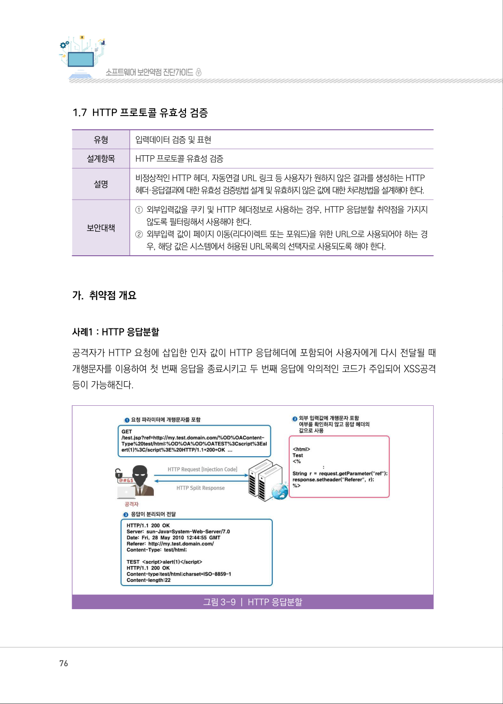
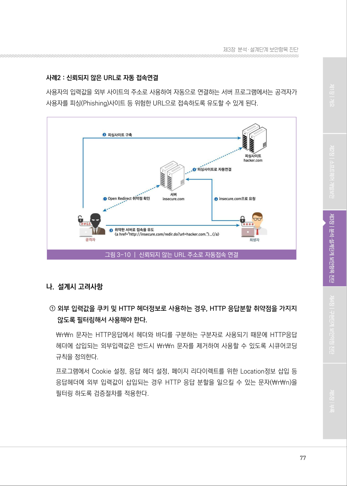
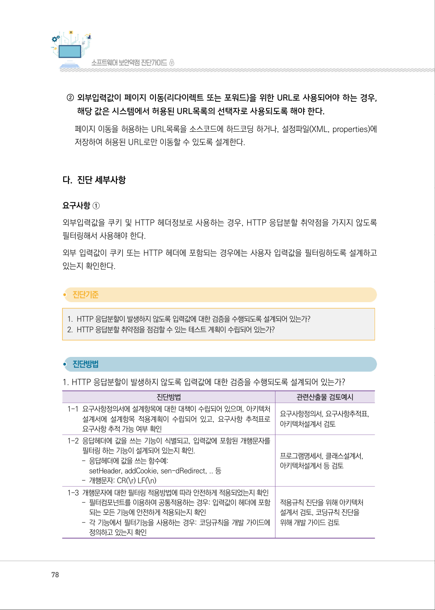
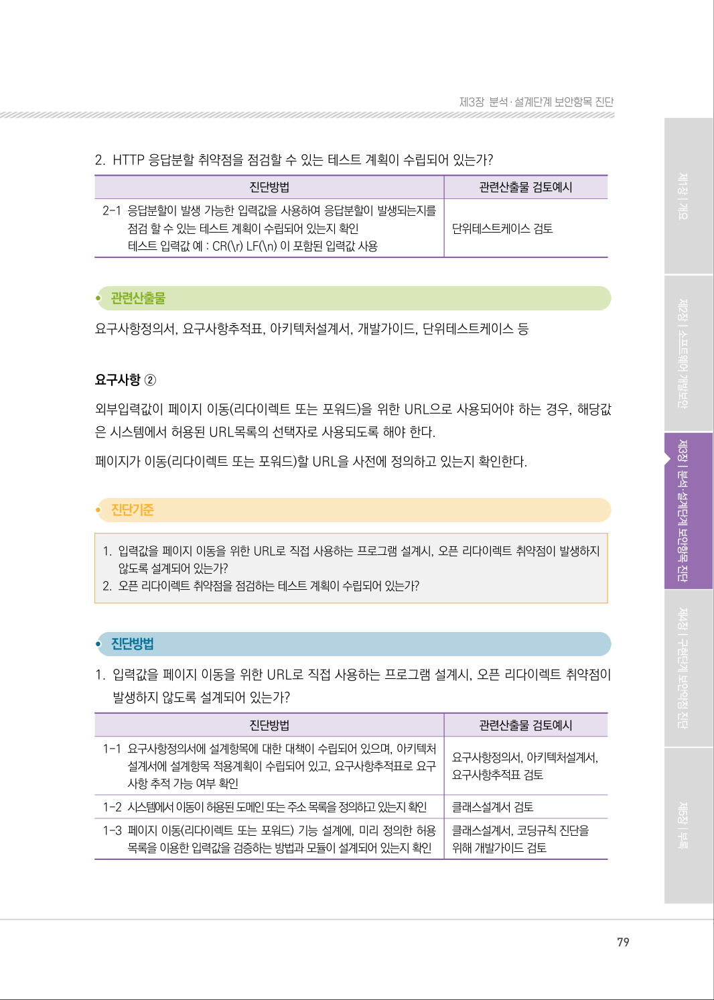
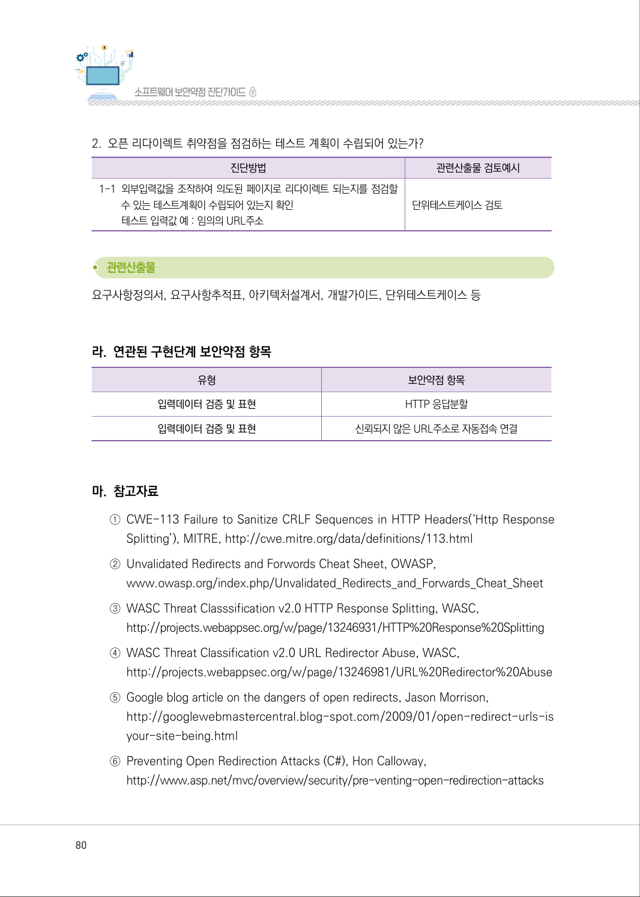

# 1.7 HTTP 프로토콜 유효성 검증

> 변환 안내(원문 외): 아래 본문은 PDF 텍스트를 추출한 전사입니다. 코드 줄번호·특수 공백·원문 오류를 유지했습니다. 실행용 코드가 아닙니다. 표·그림·들여쓰기는 연결된 페이지 이미지와 대조하세요. 페이지 경계의 줄바꿈을 보존하며, 동일 페이지가 여러 항목에 나뉘면 각 항목의 본문은 해당 구간만 포함합니다.

### PDF 76페이지 / 인쇄 76페이지

<!-- source-page:SW-Diagnosis-2021:76; source-lines:0,1,2,3,4,5,6,7,8,9,10,11,12,13,14,15,16,17,18,19 -->

76

1.7 HTTP 프로토콜 유효성 검증

유형

입력데이터 검증 및 표현

설계항목

HTTP 프로토콜 유효성 검증

설명

비정상적인 HTTP 헤더, 자동연결 URL 링크 등 사용자가 원하지 않은 결과를 생성하는 HTTP
헤더·응답결과에 대한 유효성 검증방법 설계 및 유효하지 않은 값에 대한 처리방법을 설계해야 한다.

보안대책

①외부입력값을 쿠키 및 HTTP 헤더정보로 사용하는 경우, HTTP 응답분할 취약점을 가지지 

않도록 필터링해서 사용해야 한다.
②외부입력 값이 페이지 이동(리다이렉트 또는 포워드)을 위한 URL으로 사용되어야 하는 경

우, 해당 값은 시스템에서 허용된 URL목록의 선택자로 사용되도록 해야 한다.

#### 가. 취약점 개요

사례1 : HTTP 응답분할
공격자가 HTTP 요청에 삽입한 인자 값이 HTTP 응답헤더에 포함되어 사용자에게 다시 전달될 때 
개행문자를 이용하여 첫 번째 응답을 종료시키고 두 번째 응답에 악의적인 코드가 주입되어 XSS공격 
등이 가능해진다.

그림3-9 | HTTP 응답분할

원본 페이지 이미지 (변환 외 보존 자료)

### PDF 77페이지 / 인쇄 77페이지

<!-- source-page:SW-Diagnosis-2021:77; source-lines:0,1,2,3,4,5,6,7,8,9,10,11,12,13,14 -->

77

제3장분석․ 설계단계 보안항목 진단

사례2 : 신뢰되지 않은 URL로 자동 접속연결
사용자의 입력값을 외부 사이트의 주소로 사용하여 자동으로 연결하는 서버 프로그램에서는 공격자가 
사용자를 피싱(Phishing)사이트 등 위험한 URL으로 접속하도록 유도할 수 있게 된다.

그림3-10 | 신뢰되지 않는 URL 주소로 자동접속 연결

#### 나. 설계시 고려사항

① 외부 입력값을 쿠키 및 HTTP 헤더정보로 사용하는 경우, HTTP 응답분할 취약점을 가지지 

않도록 필터링해서 사용해야 한다.
￦r￦n 문자는 HTTP응답에서 헤더와 바디를 구분하는 구분자로 사용되기 때문에 HTTP응답
헤더에 삽입되는 외부입력값은 반드시 ￦r￦n 문자를 제거하여 사용할 수 있도록 시큐어코딩 
규칙을 정의한다.
프로그램에서 Cookie 설정, 응답 헤더 설정, 페이지 리다이렉트를 위한 Location정보 삽입 등 
응답헤더에 외부 입력값이 삽입되는 경우 HTTP 응답 분할을 일으킬 수 있는 문자(￦r￦n)을 
필터링 하도록 검증절차를 적용한다.

원본 페이지 이미지 (변환 외 보존 자료)

### PDF 78페이지 / 인쇄 78페이지

<!-- source-page:SW-Diagnosis-2021:78; source-lines:0,1,2,3,4,5,6,7,8,9,10,11,12,13,14,15,16,17,18,19,20,21,22,23,24,25,26,27,28,29,30,31,32,33,34,35 -->

78

② 외부입력값이 페이지 이동(리다이렉트 또는 포워드)을 위한 URL로 사용되어야 하는 경우, 

해당 값은 시스템에서 허용된 URL목록의 선택자로 사용되도록 해야 한다.
페이지 이동을 허용하는 URL목록을 소스코드에 하드코딩 하거나, 설정파일(XML, properties)에 
저장하여 허용된 URL로만 이동할 수 있도록 설계한다.

#### 다. 진단 세부사항

요구사항 ①
외부입력값을 쿠키 및 HTTP 헤더정보로 사용하는 경우, HTTP 응답분할 취약점을 가지지 않도록 
필터링해서 사용해야 한다.
외부 입력값이 쿠키 또는 HTTP 헤더에 포함되는 경우에는 사용자 입력값을 필터링하도록 설계하고 
있는지 확인한다.

#### 1. HTTP 응답분할이 발생하지 않도록 입력값에 대한 검증을 수행되도록 설계되어 있는가?

#### 2. HTTP 응답분할 취약점을 점검할 수 있는 테스트 계획이 수립되어 있는가?

#### 1. HTTP 응답분할이 발생하지 않도록 입력값에 대한 검증을 수행되도록 설계되어 있는가?

| 진단방법 | 관련산출물 검토예시 |
| --- | --- |
| 1-1 요구사항정의서에 설계항목에 대한 대책이 수립되어 있으며, 아키텍처 설계서에 설계항목 적용계획이 수립되어 있고, 요구사항 추적표로 요구사항 추적 가능 여부 확인 | 요구사항정의서, 요구사항추적표, 아키텍처설계서 검토 |
| 1-2 응답헤더에 값을 쓰는 기능이 식별되고, 입력값에 포함된 개행문자를 필터링 하는 기능이 설계되어 있는지 확인. - 응답헤더에 값을 쓰는 함수예: setHeader, addCookie, sen-dRedirect, .. 등 - 개행문자: CR(\r) LF(\n) | 프로그램명세서, 클래스설계서, 아키텍처설계서 등 검토 |
| 1-3 개행문자에 대한 필터링 적용방법에 따라 안전하게 적용되었는지 확인 - 필터컴포넌트를 이용하여 공통적용하는 경우: 입력값이 헤더에 포함 되는 모든 기능에 안전하게 적용되는지 확인 - 각 기능에서 필터기능을 사용하는 경우: 코딩규칙을 개발 가이드에 정의하고 있는지 확인 | 적용규칙 진단을 위해 아키텍처 설계서 검토, 코딩규칙 진단을 위해 개발 가이드 검토 |

원본 페이지 이미지 (변환 외 보존 자료)

### PDF 79페이지 / 인쇄 79페이지

<!-- source-page:SW-Diagnosis-2021:79; source-lines:0,1,2,3,4,5,6,7,8,9,10,11,12,13,14,15,16,17,18,19,20,21,22,23,24,25,26,27,28,29,30,31 -->

79

제3장분석․ 설계단계 보안항목 진단

#### 2. HTTP 응답분할 취약점을 점검할 수 있는 테스트 계획이 수립되어 있는가?

| 진단방법 | 관련산출물 검토예시 |
| --- | --- |
| 2-1 응답분할이 발생 가능한 입력값을 사용하여 응답분할이 발생되는지를 점검 할 수 있는 테스트 계획이 수립되어 있는지 확인 테스트 입력값 예 : CR(\r) LF(\n) 이 포함된 입력값 사용 | 단위테스트케이스 검토 |

요구사항정의서, 요구사항추적표, 아키텍처설계서, 개발가이드, 단위테스트케이스 등

요구사항 ②
외부입력값이 페이지 이동(리다이렉트 또는 포워드)을 위한 URL으로 사용되어야 하는 경우, 해당값
은 시스템에서 허용된 URL목록의 선택자로 사용되도록 해야 한다.
페이지가 이동(리다이렉트 또는 포워드)할 URL을 사전에 정의하고 있는지 확인한다.

#### 1. 입력값을 페이지 이동을 위한 URL로 직접 사용하는 프로그램 설계시, 오픈 리다이렉트 취약점이 발생하지 

않도록 설계되어 있는가?

#### 2. 오픈 리다이렉트 취약점을 점검하는 테스트 계획이 수립되어 있는가?

#### 1. 입력값을 페이지 이동을 위한 URL로 직접 사용하는 프로그램 설계시, 오픈 리다이렉트 취약점이 

발생하지 않도록 설계되어 있는가?

| 진단방법 | 관련산출물 검토예시 |
| --- | --- |
| 1-1 요구사항정의서에 설계항목에 대한 대책이 수립되어 있으며, 아키텍처 설계서에 설계항목 적용계획이 수립되어 있고, 요구사항추적표로 요구 사항 추적 가능 여부 확인 | 요구사항정의서, 아키텍처설계서, 요구사항추적표 검토 |
| 1-2 시스템에서 이동이 허용된 도메인 또는 주소 목록을 정의하고 있는지 확인 | 클래스설계서 검토 |
| 1-3 페이지 이동(리다이렉트 또는 포워드) 기능 설계에, 미리 정의한 허용 목록을 이용한 입력값을 검증하는 방법과 모듈이 설계되어 있는지 확인 | 클래스설계서, 코딩규칙 진단을 위해 개발가이드 검토 |

원본 페이지 이미지 (변환 외 보존 자료)

### PDF 80페이지 / 인쇄 80페이지

<!-- source-page:SW-Diagnosis-2021:80; source-lines:0,1,2,3,4,5,6,7,8,9,10,11,12,13,14,15,16,17,18,19,20,21,22,23,24,25,26,27,28,29 -->

80

#### 2. 오픈 리다이렉트 취약점을 점검하는 테스트 계획이 수립되어 있는가?

| 진단방법 | 관련산출물 검토예시 |
| --- | --- |
| 1-1 외부입력값을 조작하여 의도된 페이지로 리다이렉트 되는지를 점검할 수 있는 테스트계획이 수립되어 있는지 확인 테스트 입력값 예 : 임의의 URL주소 | 단위테스트케이스 검토 |

요구사항정의서, 요구사항추적표, 아키텍처설계서, 개발가이드, 단위테스트케이스 등

#### 라. 연관된 구현단계 보안약점 항목

| 유형 | 보안약점 항목 |
| --- | --- |
| 입력데이터 검증 및 표현 | HTTP 응답분할 |
| 입력데이터 검증 및 표현 | 신뢰되지 않은 URL주소로 자동접속 연결 |

#### 마. 참고자료

①CWE-113 Failure to Sanitize CRLF Sequences in HTTP Headers(‘Http Response 

Splitting’), MITRE, http://cwe.mitre.org/data/definitions/113.html 
②Unvalidated Redirects and Forwords Cheat Sheet, OWASP,

www.owasp.org/index.php/Unvalidated_Redirects_and_Forwards_Cheat_Sheet 
③WASC Threat Classsification v2.0 HTTP Response Splitting, WASC,

http://projects.webappsec.org/w/page/13246931/HTTP%20Response%20Splitting
④WASC Threat Classification v2.0 URL Redirector Abuse, WASC,

http://projects.webappsec.org/w/page/13246981/URL%20Redirector%20Abuse
⑤Google blog article on the dangers of open redirects, Jason Morrison,

http://googlewebmastercentral.blog-spot.com/2009/01/open-redirect-urls-is 
your-site-being.html
⑥Preventing Open Redirection Attacks (C#), Hon Calloway,

http://www.asp.net/mvc/overview/security/pre-venting-open-redirection-attacks

원본 페이지 이미지 (변환 외 보존 자료)

### PDF 81페이지 / 인쇄 81페이지

<!-- source-page:SW-Diagnosis-2021:81; source-lines:1 -->

제3장분석․ 설계단계 보안항목 진단

원본 페이지 이미지 (변환 외 보존 자료)

---

## 탐색 링크 (원문 외)

[통합 인덱스](../../../INDEX.md)

