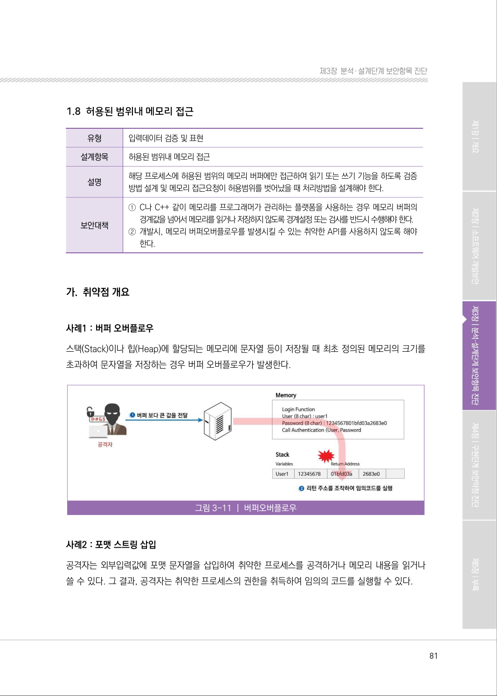
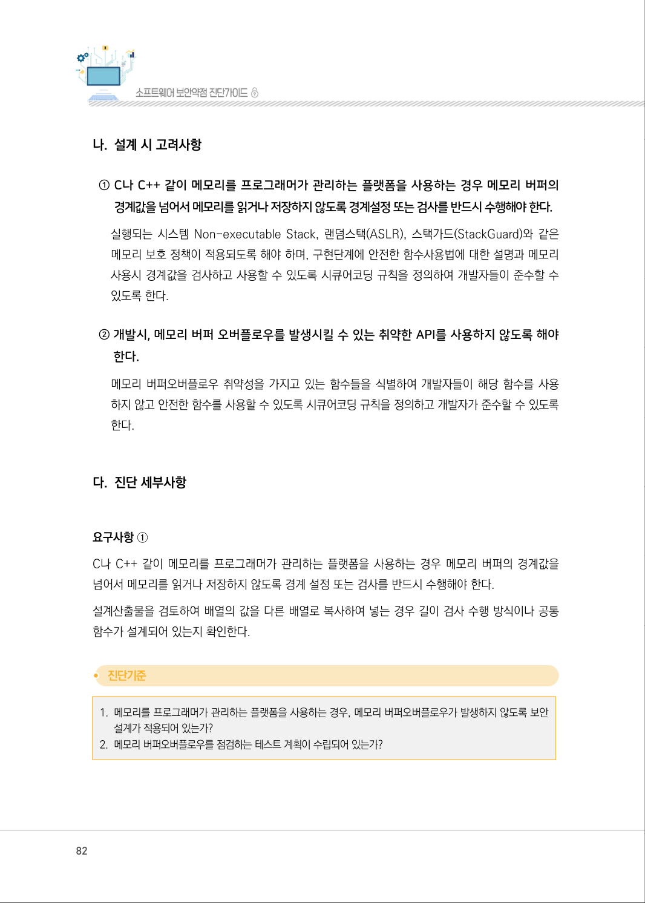
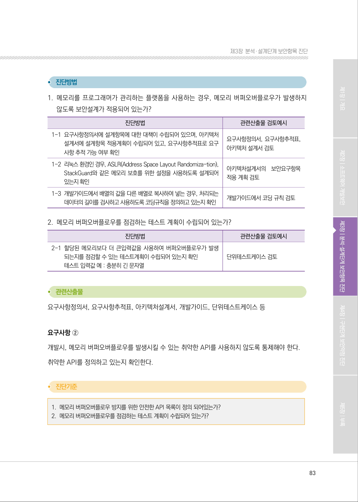
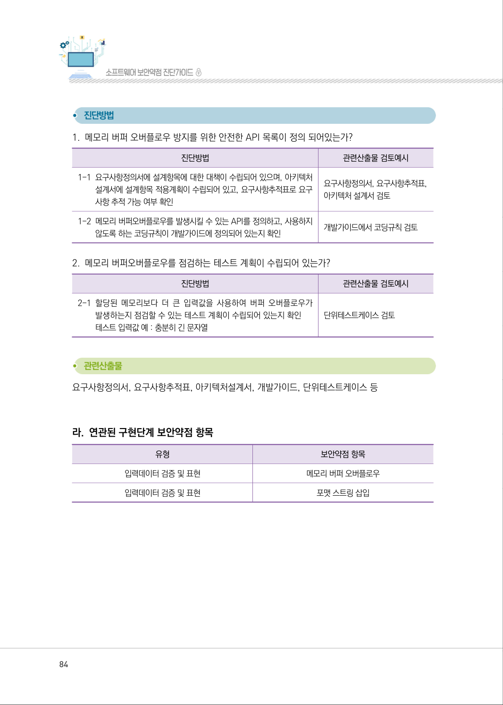
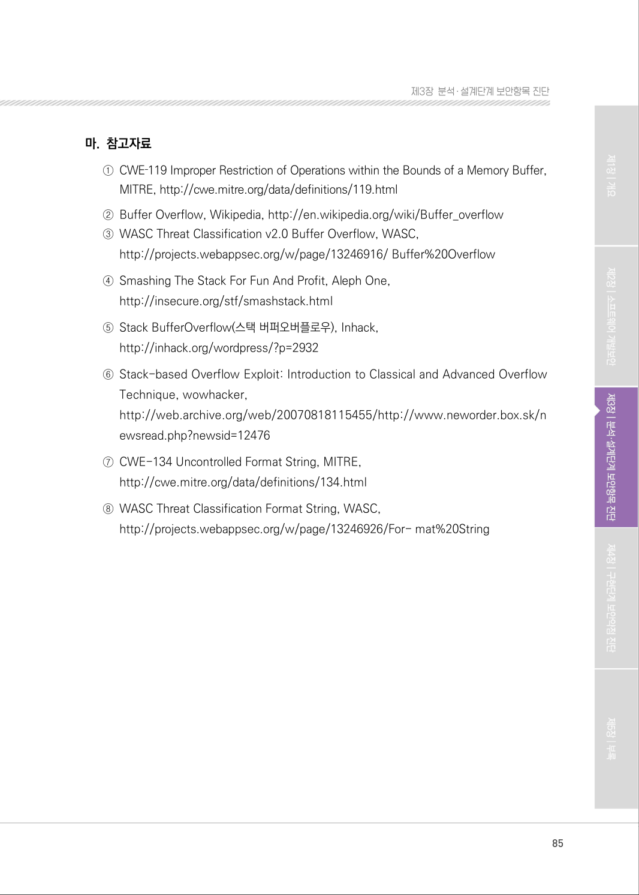

# 1.8 허용된 범위내 메모리 접근

> 변환 안내(원문 외): 아래 본문은 PDF 텍스트를 추출한 전사입니다. 코드 줄번호·특수 공백·원문 오류를 유지했습니다. 실행용 코드가 아닙니다. 표·그림·들여쓰기는 연결된 페이지 이미지와 대조하세요. 페이지 경계의 줄바꿈을 보존하며, 동일 페이지가 여러 항목에 나뉘면 각 항목의 본문은 해당 구간만 포함합니다.

### PDF 81페이지 / 인쇄 81페이지

<!-- source-page:SW-Diagnosis-2021:81; source-lines:0,2,3,4,5,6,7,8,9,10,11,12,13,14,15,16,17,18,19,20,21,22 -->

81

1.8 허용된 범위내 메모리 접근

| 유형 | 입력데이터 검증 및 표현 |
| --- | --- |
| 설계항목 | 허용된 범위내 메모리 접근 |
| 설명 | 해당 프로세스에 허용된 범위의 메모리 버퍼에만 접근하여 읽기 또는 쓰기 기능을 하도록 검증 방법 설계 및 메모리 접근요청이 허용범위를 벗어났을 때 처리방법을 설계해야 한다. |
| 보안대책 | ① C나 C++ 같이 메모리를 프로그래머가 관리하는 플랫폼을 사용하는 경우 메모리 버퍼의 경계값을 넘어서 메모리를 읽거나 저장하지 않도록 경계설정 또는 검사를 반드시 수행해야 한다. ② 개발시, 메모리 버퍼오버플로우를 발생시킬 수 있는 취약한 API를 사용하지 않도록 해야 한다. |

#### 가. 취약점 개요

사례1 : 버퍼 오버플로우
스택(Stack)이나 힙(Heap)에 할당되는 메모리에 문자열 등이 저장될 때 최초 정의된 메모리의 크기를 
초과하여 문자열을 저장하는 경우 버퍼 오버플로우가 발생한다.

그림3-11 | 버퍼오버플로우

사례2 : 포맷 스트링 삽입
공격자는 외부입력값에 포맷 문자열을 삽입하여 취약한 프로세스를 공격하거나 메모리 내용을 읽거나 
쓸 수 있다. 그 결과, 공격자는 취약한 프로세스의 권한을 취득하여 임의의 코드를 실행할 수 있다.

원본 페이지 이미지 (변환 외 보존 자료)

### PDF 82페이지 / 인쇄 82페이지

<!-- source-page:SW-Diagnosis-2021:82; source-lines:0,1,2,3,4,5,6,7,8,9,10,11,12,13,14,15,16,17,18,19,20,21 -->

82

#### 나. 설계 시 고려사항

① C나 C++ 같이 메모리를 프로그래머가 관리하는 플랫폼을 사용하는 경우 메모리 버퍼의 

경계값을 넘어서 메모리를 읽거나 저장하지 않도록 경계설정 또는 검사를 반드시 수행해야 한다.
실행되는 시스템 Non-executable Stack, 랜덤스택(ASLR), 스택가드(StackGuard)와 같은 
메모리 보호 정책이 적용되도록 해야 하며, 구현단계에 안전한 함수사용법에 대한 설명과 메모리 
사용시 경계값을 검사하고 사용할 수 있도록 시큐어코딩 규칙을 정의하여 개발자들이 준수할 수 
있도록 한다.

② 개발시, 메모리 버퍼 오버플로우를 발생시킬 수 있는 취약한 API를 사용하지 않도록 해야 

한다.
메모리 버퍼오버플로우 취약성을 가지고 있는 함수들을 식별하여 개발자들이 해당 함수를 사용 
하지 않고 안전한 함수를 사용할 수 있도록 시큐어코딩 규칙을 정의하고 개발자가 준수할 수 있도록 
한다.

#### 다. 진단 세부사항

요구사항 ①
C나 C++ 같이 메모리를 프로그래머가 관리하는 플랫폼을 사용하는 경우 메모리 버퍼의 경계값을 
넘어서 메모리를 읽거나 저장하지 않도록 경계 설정 또는 검사를 반드시 수행해야 한다.
설계산출물을 검토하여 배열의 값을 다른 배열로 복사하여 넣는 경우 길이 검사 수행 방식이나 공통 
함수가 설계되어 있는지 확인한다.

#### 1. 메모리를 프로그래머가 관리하는 플랫폼을 사용하는 경우, 메모리 버퍼오버플로우가 발생하지 않도록 보안

설계가 적용되어 있는가?

#### 2. 메모리 버퍼오버플로우를 점검하는 테스트 계획이 수립되어 있는가?

원본 페이지 이미지 (변환 외 보존 자료)

### PDF 83페이지 / 인쇄 83페이지

<!-- source-page:SW-Diagnosis-2021:83; source-lines:0,1,2,3,4,5,6,7,8,9,10,11,12,13,14,15,16,17,18,19,20,21,22,23,24,25,26,27,28,29,30,31 -->

83

제3장분석․ 설계단계 보안항목 진단

#### 1. 메모리를 프로그래머가 관리하는 플랫폼을 사용하는 경우, 메모리 버퍼오버플로우가 발생하지 

않도록 보안설계가 적용되어 있는가?

| 진단방법 | 관련산출물 검토예시 |
| --- | --- |
| 1-1 요구사항정의서에 설계항목에 대한 대책이 수립되어 있으며, 아키텍처 설계서에 설계항목 적용계획이 수립되어 있고, 요구사항추적표로 요구 사항 추적 가능 여부 확인 | 요구사항정의서, 요구사항추적표, 아키텍처 설계서 검토 |
| 1-2 리눅스 환경인 경우, ASLR(Address Space Layout Randomiza-tion), StackGuard와 같은 메모리 보호를 위한 설정을 사용하도록 설계되어 있는지 확인 | 아키텍처설계서의 보안요구항목 적용 계획 검토 |
| 1-3 개발가이드에서 배열의 값을 다른 배열로 복사하여 넣는 경우, 처리되는 데이터의 길이를 검사하고 사용하도록 코딩규칙을 정의하고 있는지 확인 | 개발가이드에서 코딩 규칙 검토 |

#### 2. 메모리 버퍼오버플로우를 점검하는 테스트 계획이 수립되어 있는가?

| 진단방법 | 관련산출물 검토예시 |
| --- | --- |
| 2-1 할당된 메모리보다 더 큰입력값을 사용하여 버퍼오버플로우가 발생 되는지를 점검할 수 있는 테스트계획이 수립되어 있는지 확인 테스트 입력값 예 : 충분히 긴 문자열 | 단위테스트케이스 검토 |

요구사항정의서, 요구사항추적표, 아키텍처설계서, 개발가이드, 단위테스트케이스 등

요구사항 ②
개발시, 메모리 버퍼오버플로우를 발생시킬 수 있는 취약한 API를 사용하지 않도록 통제해야 한다.
취약한 API를 정의하고 있는지 확인한다.

#### 1. 메모리 버퍼오버플로우 방지를 위한 안전한 API 목록이 정의 되어있는가?

#### 2. 메모리 버퍼오버플로우를 점검하는 테스트 계획이 수립되어 있는가?

원본 페이지 이미지 (변환 외 보존 자료)

### PDF 84페이지 / 인쇄 84페이지

<!-- source-page:SW-Diagnosis-2021:84; source-lines:0,1,2,3,4,5,6,7,8,9,10,11,12,13,14,15,16,17,18,19,20,21,22,23,24,25,26 -->

84

#### 1. 메모리 버퍼 오버플로우 방지를 위한 안전한 API 목록이 정의 되어있는가?

| 진단방법 | 관련산출물 검토예시 |
| --- | --- |
| 1-1 요구사항정의서에 설계항목에 대한 대책이 수립되어 있으며, 아키텍처 설계서에 설계항목 적용계획이 수립되어 있고, 요구사항추적표로 요구 사항 추적 가능 여부 확인 | 요구사항정의서, 요구사항추적표, 아키텍처 설계서 검토 |
| 1-2 메모리 버퍼오버플로우를 발생시킬 수 있는 API를 정의하고, 사용하지 않도록 하는 코딩규칙이 개발가이드에 정의되어 있는지 확인 | 개발가이드에서 코딩규칙 검토 |

#### 2. 메모리 버퍼오버플로우를 점검하는 테스트 계획이 수립되어 있는가?

| 진단방법 | 관련산출물 검토예시 |
| --- | --- |
| 2-1 할당된 메모리보다 더 큰 입력값을 사용하여 버퍼 오버플로우가 발생하는지 점검할 수 있는 테스트 계획이 수립되어 있는지 확인 테스트 입력값 예 : 충분히 긴 문자열 | 단위테스트케이스 검토 |

요구사항정의서, 요구사항추적표, 아키텍처설계서, 개발가이드, 단위테스트케이스 등

#### 라. 연관된 구현단계 보안약점 항목

| 유형 | 보안약점 항목 |
| --- | --- |
| 입력데이터 검증 및 표현 | 메모리 버퍼 오버플로우 |
| 입력데이터 검증 및 표현 | 포맷 스트링 삽입 |

원본 페이지 이미지 (변환 외 보존 자료)

### PDF 85페이지 / 인쇄 85페이지

<!-- source-page:SW-Diagnosis-2021:85; source-lines:0,1,2,3,4,5,6,7,8,9,10,11,12,13,14,15,16,17,18,19 -->

85

제3장분석․ 설계단계 보안항목 진단

#### 마. 참고자료

①CWE‐119 Improper Restriction of Operations within the Bounds of a Memory Buffer, 

MITRE, http://cwe.mitre.org/data/definitions/119.html
②Buffer Overflow, Wikipedia, http://en.wikipedia.org/wiki/Buffer_overflow
③WASC Threat Classification v2.0 Buffer Overflow, WASC,

http://projects.webappsec.org/w/page/13246916/ Buffer%20Overflow
④Smashing The Stack For Fun And Profit, Aleph One,

http://insecure.org/stf/smashstack.html
⑤Stack BufferOverflow(스택 버퍼오버플로우), Inhack,

http://inhack.org/wordpress/?p=2932 
⑥Stack-based Overflow Exploit: Introduction to Classical and Advanced Overflow 

Technique, wowhacker, 
http://web.archive.org/web/20070818115455/http://www.neworder.box.sk/n
ewsread.php?newsid=12476
⑦CWE-134 Uncontrolled Format String, MITRE,

http://cwe.mitre.org/data/definitions/134.html
⑧WASC Threat Classification Format String, WASC,

http://projects.webappsec.org/w/page/13246926/For- mat%20String

원본 페이지 이미지 (변환 외 보존 자료)

---

## 탐색 링크 (원문 외)

[통합 인덱스](../../../INDEX.md)

