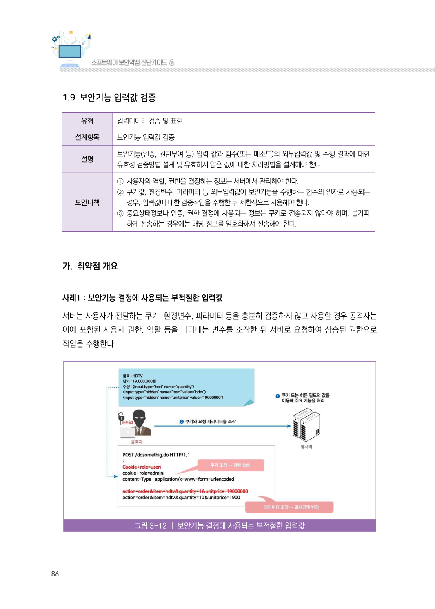
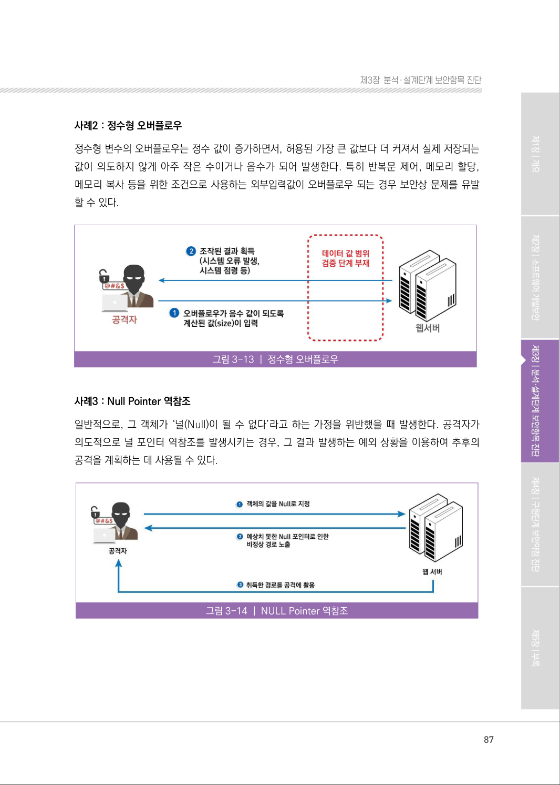
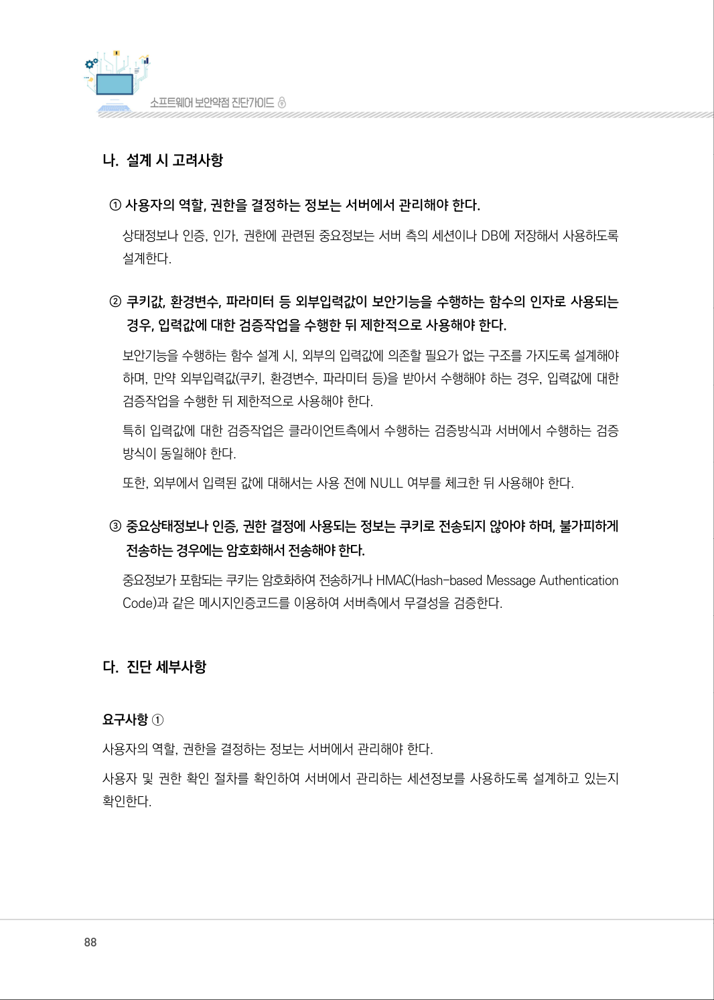
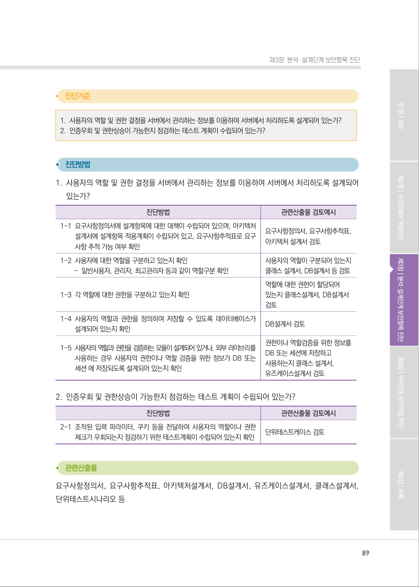
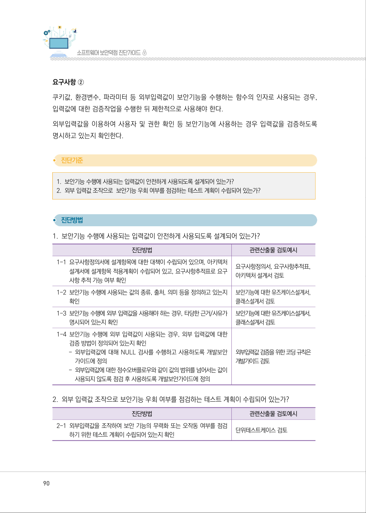
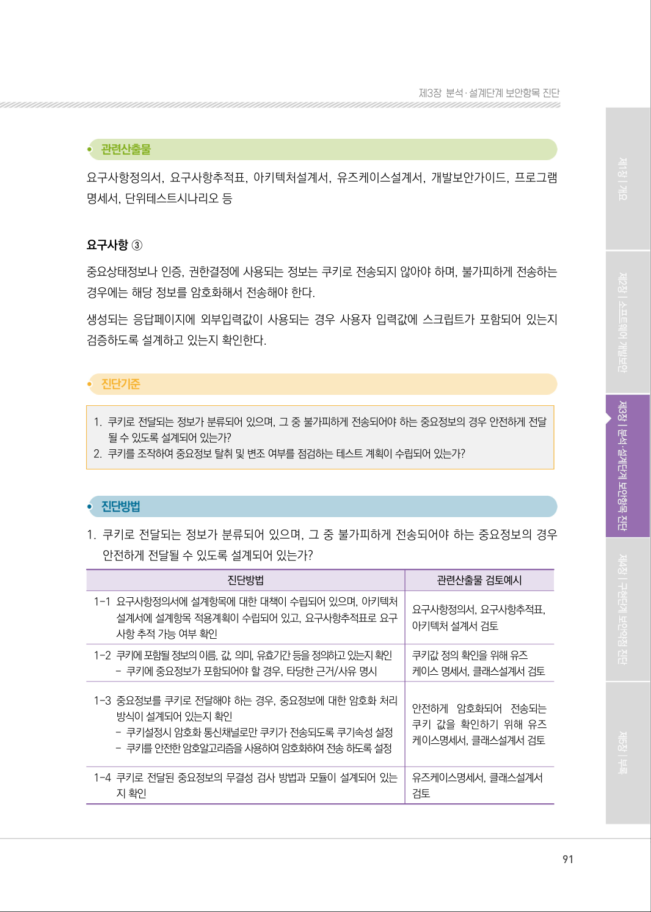
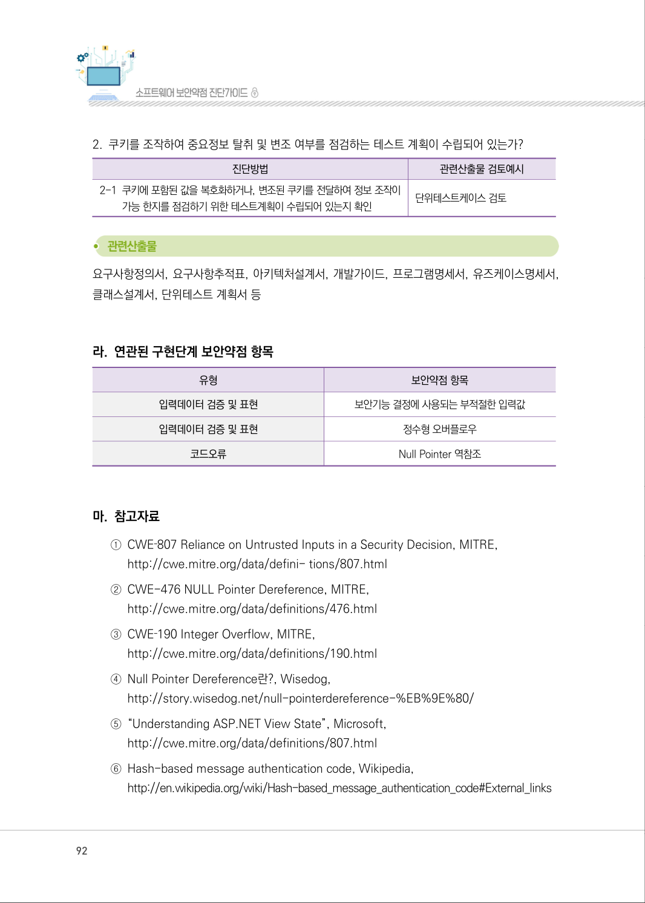

# 1.9 보안기능 입력값 검증

> 변환 안내(원문 외): 아래 본문은 PDF 텍스트를 추출한 전사입니다. 코드 줄번호·특수 공백·원문 오류를 유지했습니다. 실행용 코드가 아닙니다. 표·그림·들여쓰기는 연결된 페이지 이미지와 대조하세요. 페이지 경계의 줄바꿈을 보존하며, 동일 페이지가 여러 항목에 나뉘면 각 항목의 본문은 해당 구간만 포함합니다.

### PDF 86페이지 / 인쇄 86페이지

<!-- source-page:SW-Diagnosis-2021:86; source-lines:0,1,2,3,4,5,6,7,8,9,10,11,12,13,14,15,16,17,18,19,20 -->

86

1.9 보안기능 입력값 검증

유형

입력데이터 검증 및 표현

설계항목

보안기능 입력값 검증

설명

보안기능(인증, 권한부여 등) 입력 값과 함수(또는 메소드)의 외부입력값 및 수행 결과에 대한 
유효성 검증방법 설계 및 유효하지 않은 값에 대한 처리방법을 설계해야 한다.

보안대책

①사용자의 역할, 권한을 결정하는 정보는 서버에서 관리해야 한다.
②쿠키값, 환경변수, 파라미터 등 외부입력값이 보안기능을 수행하는 함수의 인자로 사용되는 

경우, 입력값에 대한 검증작업을 수행한 뒤 제한적으로 사용해야 한다.
③중요상태정보나 인증, 권한 결정에 사용되는 정보는 쿠키로 전송되지 않아야 하며, 불가피 

하게 전송하는 경우에는 해당 정보를 암호화해서 전송해야 한다.

#### 가. 취약점 개요

사례1 : 보안기능 결정에 사용되는 부적절한 입력값
서버는 사용자가 전달하는 쿠키, 환경변수, 파라미터 등을 충분히 검증하지 않고 사용할 경우 공격자는 
이에 포함된 사용자 권한, 역할 등을 나타내는 변수를 조작한 뒤 서버로 요청하여 상승된 권한으로 
작업을 수행한다.

그림3-12 | 보안기능 결정에 사용되는 부적절한 입력값

원본 페이지 이미지 (변환 외 보존 자료)

### PDF 87페이지 / 인쇄 87페이지

<!-- source-page:SW-Diagnosis-2021:87; source-lines:0,1,2,3,4,5,6,7,8,9,10,11,12 -->

87

제3장분석․ 설계단계 보안항목 진단

사례2 : 정수형 오버플로우
정수형 변수의 오버플로우는 정수 값이 증가하면서, 허용된 가장 큰 값보다 더 커져서 실제 저장되는 
값이 의도하지 않게 아주 작은 수이거나 음수가 되어 발생한다. 특히 반복문 제어, 메모리 할당, 
메모리 복사 등을 위한 조건으로 사용하는 외부입력값이 오버플로우 되는 경우 보안상 문제를 유발 
할 수 있다.

그림3-13 | 정수형 오버플로우

사례3 : Null Pointer 역참조
일반적으로, 그 객체가 ‘널(Null)이 될 수 없다’라고 하는 가정을 위반했을 때 발생한다. 공격자가 
의도적으로 널 포인터 역참조를 발생시키는 경우, 그 결과 발생하는 예외 상황을 이용하여 추후의 
공격을 계획하는 데 사용될 수 있다.

그림3-14 | NULL Pointer 역참조

원본 페이지 이미지 (변환 외 보존 자료)

### PDF 88페이지 / 인쇄 88페이지

<!-- source-page:SW-Diagnosis-2021:88; source-lines:0,1,2,3,4,5,6,7,8,9,10,11,12,13,14,15,16,17,18,19,20,21 -->

88

#### 나. 설계 시 고려사항

① 사용자의 역할, 권한을 결정하는 정보는 서버에서 관리해야 한다.

상태정보나 인증, 인가, 권한에 관련된 중요정보는 서버 측의 세션이나 DB에 저장해서 사용하도록 
설계한다.

② 쿠키값, 환경변수, 파라미터 등 외부입력값이 보안기능을 수행하는 함수의 인자로 사용되는 

경우, 입력값에 대한 검증작업을 수행한 뒤 제한적으로 사용해야 한다.
보안기능을 수행하는 함수 설계 시, 외부의 입력값에 의존할 필요가 없는 구조를 가지도록 설계해야 
하며, 만약 외부입력값(쿠키, 환경변수, 파라미터 등)을 받아서 수행해야 하는 경우, 입력값에 대한 
검증작업을 수행한 뒤 제한적으로 사용해야 한다.
특히 입력값에 대한 검증작업은 클라이언트측에서 수행하는 검증방식과 서버에서 수행하는 검증 
방식이 동일해야 한다.
또한, 외부에서 입력된 값에 대해서는 사용 전에 NULL 여부를 체크한 뒤 사용해야 한다.

③ 중요상태정보나 인증, 권한 결정에 사용되는 정보는 쿠키로 전송되지 않아야 하며, 불가피하게 

전송하는 경우에는 암호화해서 전송해야 한다.
중요정보가 포함되는 쿠키는 암호화하여 전송하거나 HMAC(Hash-based Message Authentication 
Code)과 같은 메시지인증코드를 이용하여 서버측에서 무결성을 검증한다.

#### 다. 진단 세부사항

요구사항 ①
사용자의 역할, 권한을 결정하는 정보는 서버에서 관리해야 한다.
사용자 및 권한 확인 절차를 확인하여 서버에서 관리하는 세션정보를 사용하도록 설계하고 있는지 
확인한다.

원본 페이지 이미지 (변환 외 보존 자료)

### PDF 89페이지 / 인쇄 89페이지

<!-- source-page:SW-Diagnosis-2021:89; source-lines:0,1,2,3,4,5,6,7,8,9,10,11,12,13,14,15,16,17,18,19,20,21,22,23,24,25,26,27,28,29,30,31,32,33,34,35,36,37,38 -->

89

제3장분석․ 설계단계 보안항목 진단

#### 1. 사용자의 역할 및 권한 결정을 서버에서 관리하는 정보를 이용하여 서버에서 처리하도록 설계되어 있는가?

#### 2. 인증우회 및 권한상승이 가능한지 점검하는 테스트 계획이 수립되어 있는가?

#### 1. 사용자의 역할 및 권한 결정을 서버에서 관리하는 정보를 이용하여 서버에서 처리하도록 설계되어 

있는가?

| 진단방법 | 관련산출물 검토예시 |
| --- | --- |
| 1-1 요구사항정의서에 설계항목에 대한 대책이 수립되어 있으며, 아키텍처 설계서에 설계항목 적용계획이 수립되어 있고, 요구사항추적표로 요구 사항 추적 가능 여부 확인 | 요구사항정의서, 요구사항추적표, 아키텍처 설계서 검토 |
| 1-2 사용자에 대한 역할을 구분하고 있는지 확인 - 일반사용자, 관리자, 최고관리자 등과 같이 역할구분 확인 | 사용자의 역할이 구분되어 있는지 클래스 설계서, DB설계서 등 검토 |
| 1-3 각 역할에 대한 권한을 구분하고 있는지 확인 | 역할에 대한 권한이 할당되어 있는지 클래스설계서, DB설계서 검토 |
| 1-4 사용자의 역할과 권한을 정의하여 저장할 수 있도록 데이터베이스가 설계되어 있는지 확인 | DB설계서 검토 |
| 1-5 사용자의 역할과 권한을 검증하는 모듈이 설계되어 있거나, 외부 라이브리를 사용하는 경우 사용자의 권한이나 역할 검증을 위한 정보가 DB 또는 세션 에 저장되도록 설계되어 있는지 확인 | 권한이나 역할검증을 위한 정보를 DB 또는 세션에 저장하고 사용하는지 클래스 설계서, 유즈케이스설계서 검토 |

#### 2. 인증우회 및 권한상승이 가능한지 점검하는 테스트 계획이 수립되어 있는가?

진단방법

관련산출물 검토예시

2-1 조작된 입력 파라미터, 쿠키 등을 전달하여 사용자의 역할이나 권한 

체크가 우회되는지 점검하기 위한 테스트계획이 수립되어 있는지 확인

단위테스트케이스 검토

요구사항정의서, 요구사항추적표, 아키텍처설계서, DB설계서, 유즈케이스설계서, 클래스설계서, 
단위테스트시나리오 등

원본 페이지 이미지 (변환 외 보존 자료)

### PDF 90페이지 / 인쇄 90페이지

<!-- source-page:SW-Diagnosis-2021:90; source-lines:0,1,2,3,4,5,6,7,8,9,10,11,12,13,14,15,16,17,18,19,20,21,22,23,24,25,26,27,28,29,30,31,32,33,34,35,36,37 -->

90

요구사항 ②
쿠키값, 환경변수, 파라미터 등 외부입력값이 보안기능을 수행하는 함수의 인자로 사용되는 경우, 
입력값에 대한 검증작업을 수행한 뒤 제한적으로 사용해야 한다.
외부입력값을 이용하여 사용자 및 권한 확인 등 보안기능에 사용하는 경우 입력값을 검증하도록 
명시하고 있는지 확인한다.

#### 1. 보안기능 수행에 사용되는 입력값이 안전하게 사용되도록 설계되어 있는가? 

#### 2. 외부 입력값 조작으로  보안기능 우회 여부를 점검하는 테스트 계획이 수립되어 있는가?

#### 1. 보안기능 수행에 사용되는 입력값이 안전하게 사용되도록 설계되어 있는가?

| 진단방법 | 관련산출물 검토예시 |
| --- | --- |
| 1-1 요구사항정의서에 설계항목에 대한 대책이 수립되어 있으며, 아키텍처 설계서에 설계항목 적용계획이 수립되어 있고, 요구사항추적표로 요구 사항 추적 가능 여부 확인 | 요구사항정의서, 요구사항추적표, 아키텍처 설계서 검토 |
| 1-2 보안기능 수행에 사용되는 값의 종류, 출처, 의미 등을 정의하고 있는지 확인 | 보안기능에 대한 유즈케이스설계서, 클래스설계서 검토 |
| 1-3 보안기능 수행에 외부 입력값을 사용해야 하는 경우, 타당한 근거/사유가 명시되어 있는지 확인 | 보안기능에 대한 유즈케이스설계서, 클래스설계서 검토 |
| 1-4 보안기능 수행에 외부 입력값이 사용되는 경우, 외부 입력값에 대한 검증 방법이 정의되어 있는지 확인 - 외부입력값에 대해 NULL 검사를 수행하고 사용하도록 개발보안 가이드에 정의 - 외부입력값에 대한 정수오버플로우와 같이 값의 범위를 넘어서는 값이 사용되지 않도록 점검 후 사용하도록 개발보안가이드에 정의 | 외부입력값 검증을 위한 코딩 규칙은 개발가이드 검토 |

#### 2. 외부 입력값 조작으로 보안기능 우회 여부를 점검하는 테스트 계획이 수립되어 있는가?

| 진단방법 | 관련산출물 검토예시 |
| --- | --- |
| 2-1 외부입력값을 조작하여 보안 기능의 무력화 또는 오작동 여부를 점검 하기 위한 테스트 계획이 수립되어 있는지 확인 | 단위테스트케이스 검토 |

원본 페이지 이미지 (변환 외 보존 자료)

### PDF 91페이지 / 인쇄 91페이지

<!-- source-page:SW-Diagnosis-2021:91; source-lines:0,1,2,3,4,5,6,7,8,9,10,11,12,13,14,15,16,17,18,19,20,21,22,23,24,25,26,27,28,29,30,31,32,33,34,35 -->

91

제3장분석․ 설계단계 보안항목 진단

요구사항정의서, 요구사항추적표, 아키텍처설계서, 유즈케이스설계서, 개발보안가이드, 프로그램 
명세서, 단위테스트시나리오 등

요구사항 ③
중요상태정보나 인증, 권한결정에 사용되는 정보는 쿠키로 전송되지 않아야 하며, 불가피하게 전송하는 
경우에는 해당 정보를 암호화해서 전송해야 한다.
생성되는 응답페이지에 외부입력값이 사용되는 경우 사용자 입력값에 스크립트가 포함되어 있는지 
검증하도록 설계하고 있는지 확인한다.

#### 1. 쿠키로 전달되는 정보가 분류되어 있으며, 그 중 불가피하게 전송되어야 하는 중요정보의 경우 안전하게 전달

될 수 있도록 설계되어 있는가?

#### 2. 쿠키를 조작하여 중요정보 탈취 및 변조 여부를 점검하는 테스트 계획이 수립되어 있는가?

#### 1. 쿠키로 전달되는 정보가 분류되어 있으며, 그 중 불가피하게 전송되어야 하는 중요정보의 경우 

안전하게 전달될 수 있도록 설계되어 있는가?

| 진단방법 | 관련산출물 검토예시 |
| --- | --- |
| 1-1 요구사항정의서에 설계항목에 대한 대책이 수립되어 있으며, 아키텍처 설계서에 설계항목 적용계획이 수립되어 있고, 요구사항추적표로 요구 사항 추적 가능 여부 확인 | 요구사항정의서, 요구사항추적표, 아키텍처 설계서 검토 |
| 1-2 쿠키에 포함될 정보의 이름, 값, 의미, 유효기간 등을 정의하고 있는지 확인 - 쿠키에 중요정보가 포함되어야 할 경우, 타당한 근거/사유 명시 | 쿠키값 정의 확인을 위해 유즈 케이스 명세서, 클래스설계서 검토 |
| 1-3 중요정보를 쿠키로 전달해야 하는 경우, 중요정보에 대한 암호화 처리 방식이 설계되어 있는지 확인 - 쿠키설정시 암호화 통신채널로만 쿠키가 전송되도록 쿠기속성 설정 - 쿠키를 안전한 암호알고리즘을 사용하여 암호화하여 전송 하도록 설정 | 안전하게 암호화되어 전송되는 쿠키 값을 확인하기 위해 유즈 케이스명세서, 클래스설계서 검토 |
| 1-4 쿠키로 전달된 중요정보의 무결성 검사 방법과 모듈이 설계되어 있는 지 확인 | 유즈케이스명세서, 클래스설계서 검토 |

원본 페이지 이미지 (변환 외 보존 자료)

### PDF 92페이지 / 인쇄 92페이지

<!-- source-page:SW-Diagnosis-2021:92; source-lines:0,1,2,3,4,5,6,7,8,9,10,11,12,13,14,15,16,17,18,19,20,21,22,23,24,25,26,27,28,29,30 -->

92

#### 2. 쿠키를 조작하여 중요정보 탈취 및 변조 여부를 점검하는 테스트 계획이 수립되어 있는가?

| 진단방법 | 관련산출물 검토예시 |
| --- | --- |
| 2-1 쿠키에 포함된 값을 복호화하거나, 변조된 쿠키를 전달하여 정보 조작이 가능 한지를 점검하기 위한 테스트계획이 수립되어 있는지 확인 | 단위테스트케이스 검토 |

요구사항정의서, 요구사항추적표, 아키텍처설계서, 개발가이드, 프로그램명세서, 유즈케이스명세서, 
클래스설계서, 단위테스트 계획서 등

#### 라. 연관된 구현단계 보안약점 항목

| 유형 | 보안약점 항목 |
| --- | --- |
| 입력데이터 검증 및 표현 | 보안기능 결정에 사용되는 부적절한 입력값 |
| 입력데이터 검증 및 표현 | 정수형 오버플로우 |
| 코드오류 | Null Pointer 역참조 |

#### 마. 참고자료

①CWE‐807 Reliance on Untrusted Inputs in a Security Decision, MITRE,

http://cwe.mitre.org/data/defini- tions/807.html
②CWE-476 NULL Pointer Dereference, MITRE,

http://cwe.mitre.org/data/definitions/476.html
③CWE‐190 Integer Overflow, MITRE,

http://cwe.mitre.org/data/definitions/190.html
④Null Pointer Dereference란?, Wisedog,

http://story.wisedog.net/null-pointerdereference-%EB%9E%80/
⑤“Understanding ASP.NET View State”, Microsoft,

http://cwe.mitre.org/data/definitions/807.html
⑥Hash-based message authentication code, Wikipedia,

http://en.wikipedia.org/wiki/Hash-based_message_authentication_code#External_links

원본 페이지 이미지 (변환 외 보존 자료)

### PDF 93페이지 / 인쇄 93페이지

<!-- source-page:SW-Diagnosis-2021:93; source-lines:1 -->

제3장분석․ 설계단계 보안항목 진단

원본 페이지 이미지 (변환 외 보존 자료)

---

## 탐색 링크 (원문 외)

[통합 인덱스](../../../INDEX.md)

