# 1.10 업로드·다운로드 파일 검증

> 변환 안내(원문 외): 아래 본문은 PDF 텍스트를 추출한 전사입니다. 코드 줄번호·특수 공백·원문 오류를 유지했습니다. 실행용 코드가 아닙니다. 표·그림·들여쓰기는 연결된 페이지 이미지와 대조하세요. 페이지 경계의 줄바꿈을 보존하며, 동일 페이지가 여러 항목에 나뉘면 각 항목의 본문은 해당 구간만 포함합니다.

### PDF 93페이지 / 인쇄 93페이지

<!-- source-page:SW-Diagnosis-2021:93; source-lines:0,2,3,4,5,6,7,8,9,10,11,12,13,14,15,16,17,18,19,20 -->

93

1.10 업로드·다운로드 파일 검증

유형

입력데이터 검증 및 표현

설계항목

업로드·다운로드 파일 검증

설명

업로드·다운로드 파일의 무결성, 실행권한 등에 관한 유효성 검증방법 설계 및 부적합한 파일에 
대한 처리방법을 설계한다.

보안대책

①업로드되어 저장되는 파일의 타입, 크기, 개수, 실행권한을 제한해야 한다.
②업로드되어 저장되는 파일은 외부에서 식별되지 않아야 한다.
③파일 다운로드 요청 시, 요청파일명에 대한 검증작업을 수행해야 한다.
④다운로드 받은 소스코드나 실행파일은 무결성 검사를 실행해야 한다.

#### 가. 취약점 개요

사례1 : 위험한 형식 파일 업로드
서버 측에서 실행될 수 있는 스크립트 파일(asp, jsp, php 파일 등)을 업로드 가능하고, 이 파일을 
공격자가 웹으로 직접 실행시킬 수 있는 경우 시스템 내부 명령어를 실행하거나 외부와 연결하여 시
스템을 제어할 수 있게 된다.

그림3-15 | 위험한 형식 파일 업로드

원본 페이지 이미지 (변환 외 보존 자료)

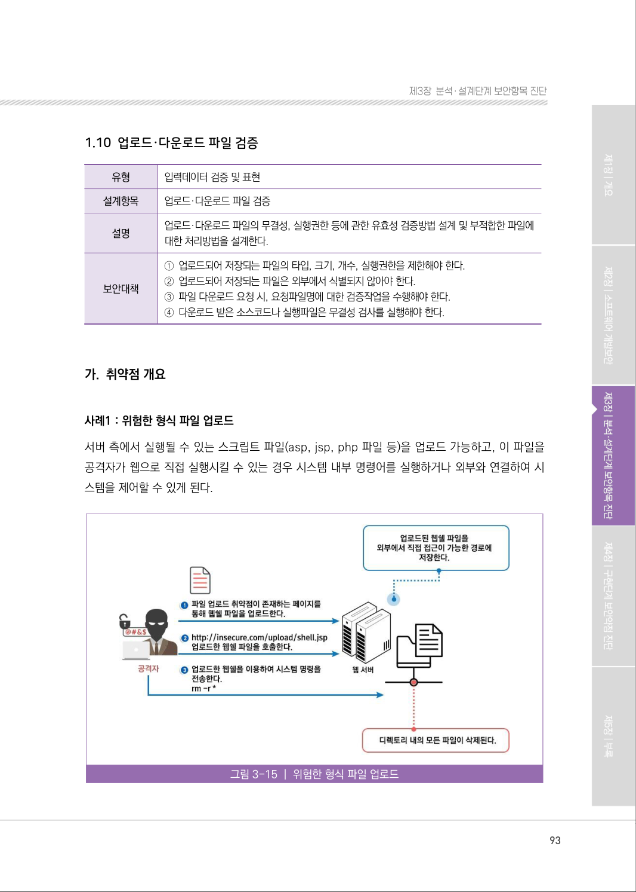

### PDF 94페이지 / 인쇄 94페이지

<!-- source-page:SW-Diagnosis-2021:94; source-lines:0,1,2,3,4,5,6,7,8 -->

94

사례2 : 경로조작 문자를 이용한 파일 다운로드 취약점
외부입력값에 대해 경로 조작에 사용될 수 있는 문자를 필터링하지 않으면, 예상 밖의 접근제한 영역에 
대한 경로 문자열 구성이 가능해져 시스템 정보누출, 서비스 장애 등을 유발할 수 있는 취약점이다.

그림3-16 | 파일 다운로드 취약점

사례3 : 무결성 검사 없는 코드 다운로드
원격으로부터 소스코드 또는 실행파일을 무결성 검사 없이 다운로드 받고 이를 실행할 경우, 호스트 
서버의 변조, DNS 스푸핑 (Spoofing) 또는 전송 시의 코드 변조 등의 방법을 이용하여 공격자가 
악의적인 코드를 실행할 수 있게 된다.

원본 페이지 이미지 (변환 외 보존 자료)

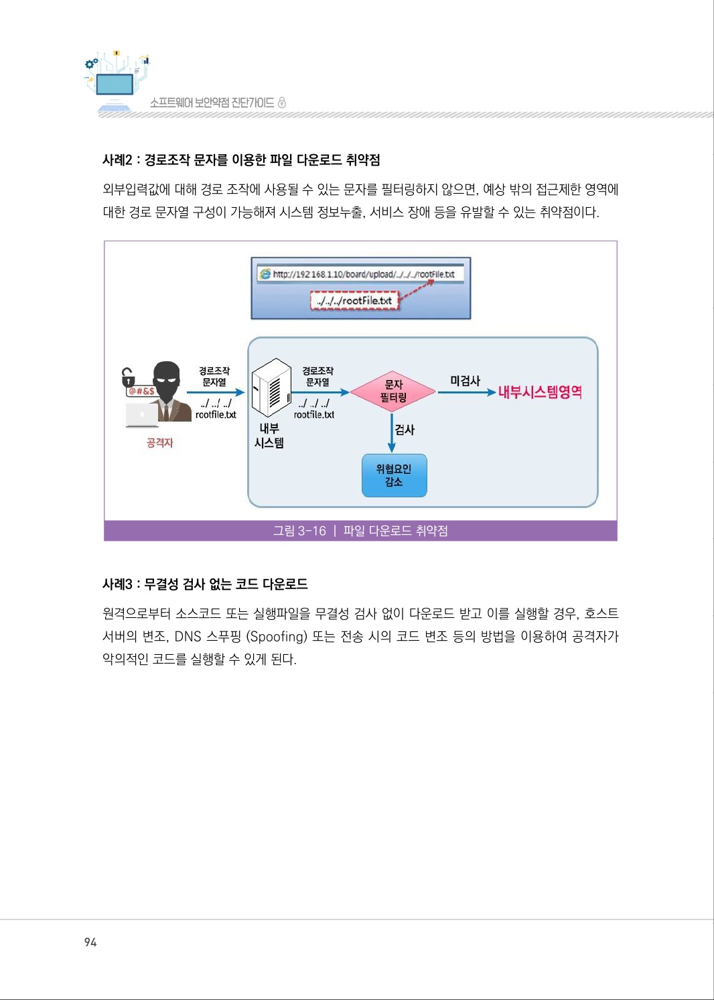

### PDF 95페이지 / 인쇄 95페이지

<!-- source-page:SW-Diagnosis-2021:95; source-lines:0,1,2,3,4,5,6,7,8,9,10,11,12,13,14,15,16,17,18,19,20,21,22,23,24,25 -->

95

제3장분석․ 설계단계 보안항목 진단

#### 나. 설계시 고려사항

① 업로드되어 저장되는 파일의 타입, 크기, 개수, 실행권한을 제한해야 한다.

(ㄱ) 업로드 파일의 크기 제한
업로드되는 파일의 크기 제한은 프레임워크에서 설정할 수도 있고, 프로그램에서 설정할 수도 있다. 
Spring 프레임워크를 사용하는 경우 MultipartResolver 컴포넌트의 속성 값을 설정하여 업로드 
파일의 크기를 제한할 수 있다.

&lt;bean id=”multipartResolver” 
class=”org.springframework.web.multipart.commons.CommonsMultipart Resolver”&gt; 
&lt;!‐‐ max upload size in bytes ‐‐&gt; 
&lt;property name=”maxUploadSize” value=”20971520” /&gt; &lt;!‐‐ 20MB ‐‐&gt; 
&lt;!‐‐ max size of file in memory (in bytes) ‐‐&gt; 
&lt;property name=”maxInMemorySize” value=”1048576” /&gt; &lt;!‐‐ 1MB ‐‐&gt; 
&lt;/bean&gt;

(ㄴ) 파일의 타입 제한
업로드되는 파일유형의 통제는 서버와 클라이언트가 동일한 정책을 적용하도록 설계해야 하며, 
파일의 MIME‐TYPE과 확장자가 동시에 검사될 수 있도록 업로드 파일에 대한 필터링 기능을 
구현한 공통모듈을 설계하여 모든 파일 업로드 기능에 적용하거나 업로드 기능을 가진 컴포넌트에서 
직접 필터링하도록 시큐어 코딩 규칙을 정의한다.

(ㄷ) 업로드되어 저장되는 파일의 실행권한 제거
업로드된 파일은 반드시 실행권한을 가지지 않도록 시스템이 설정되어 있어야 한다. 업로드된 
파일이 저장 되는 디렉터리에 대한 디폴트 파일 또는 디렉터리 생성시 권한을 확인하고, 업로드된 
파일에 실행권한이 주어지지 않도록 시스템설정을 확인한다. 파일이 읽기 권한을 가지고 있기만 
해도 서버에서 해당 파일을 읽어서 실행할 수 있으므로 서버 설정으로 업로드 경로의 파일이 실행
되지 않도록 설정해야한다.

원본 페이지 이미지 (변환 외 보존 자료)

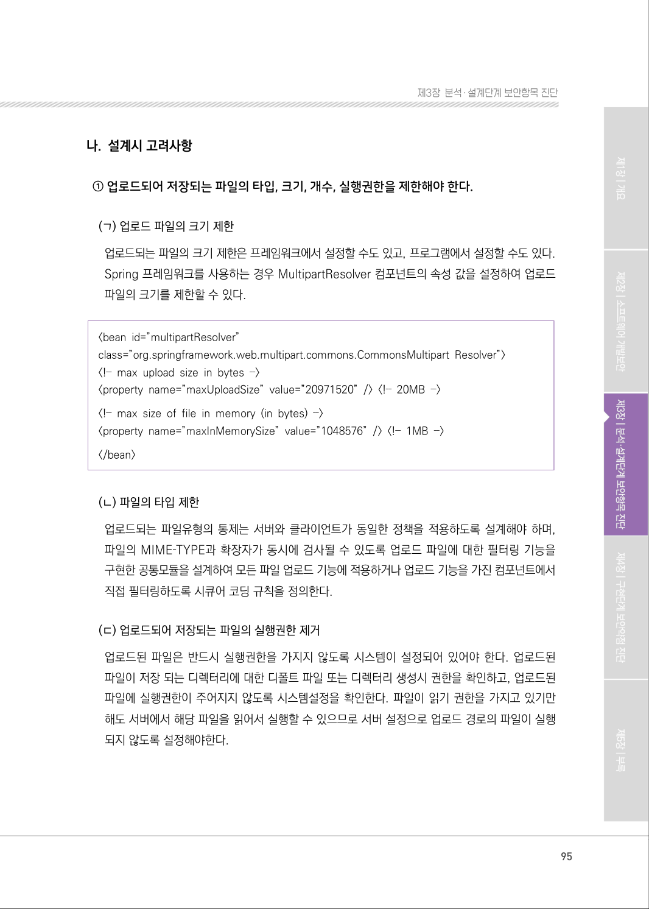

### PDF 96페이지 / 인쇄 96페이지

<!-- source-page:SW-Diagnosis-2021:96; source-lines:0,1,2,3,4,5,6,7,8,9,10,11,12,13,14,15,16,17,18,19,20,21,22,23,24,25 -->

96

② 업로드되어 저장되는 파일은 외부에서 식별되지 않아야 한다.

(ㄱ) 업로드되는 파일의 저장경로는 외부에서 직접 접근이 불가능한 경로사용
파일이 저장되는 경로는 URL로 직접적으로 접근 가능하지 않은 디렉터리를 사용한다. 이 경우 외부
에서 URL을 조작하여 업로드된 파일에 접근할 수 없으므로, 업로드로 저장된 파일에 대한 통제
가 가능하다. 업로드된 파일을 다운로드하기 위해서는 다운로드 처리를 수행하는 컨트롤러를 구
현해야 하며, 컨트롤러 구현 시 허가된 파일에 대한 허가된 사용자만 다운로드 기능을 사용할 수 
있도록 통제한다.

(ㄴ) 업로드되어 저장되는 파일의 파일명은 랜덤하게 생성하여 사용
저장된 파일을 공격자가 찾을 수 없도록 랜덤하게 생성된 파일명을 이용하여 디렉토리에 저장한다. 
이 경우 업로드한 파일명과 저장된 파일명이 매핑되어 관리될 수 있도록, DB 테이블의 칼럼을 
설계할 때 업로드 파일명, 저장된 파일명이 함께 저장되도록 설계한다.

③ 파일 다운로드 요청시, 요청파일명에 대한 검증작업을 수행해야 한다.

(ㄱ) 파일 다운로드를 위해 요청되는 파일명에 경로를 조작하는 문자가 포함되어 있는지 점검
파일명에 경로조작이 가능한 ‘..’, ‘/’, ‘￦’ 문자는 제거하고 사용할 수 있도록 필터링한다.

(ㄴ) 허가된 사용자의 허가된 안전한 파일에 대한 다운로드 요청인지 확인
파일 다운로드 요청 시 허가된 사용자와 파일인지를 확인하는 기능이 구현되도록 파일 다운로드 
컴포넌트가 설계되어야 하며, 파일을 다운로드하는 사용자의 안전을 위해 파일에 대한 악성코드 
또는 바이러스 검사를 수행한 뒤 파일이 다운로드 되도록 기능을 설계한다.

(ㄷ) 사용자의 요청에 의해 서버에 존재하는 파일이 참조되는 경우 화이트리스트 정책으로 접근 통제
시스템에 저장되어 있는 파일을 다운로드 서비스하는 경우, 허용 파일에 대한 목록을 작성하고 
목록의 범위 안의 파일에 대해서만 제한적으로 접근 또는 다운로드할 수 있도록 설계한다.

④ 다운로드 받은 소스코드나 실행파일은 무결성 검사를 실행해야 한다.

원격지에서 다운로드 받은 파일을 사용하거나 실행하는 기능을 구현해야 하는 경우 해당 파일과 
파일의 체크섬 값(해시 값 등)을 같이 다운로드 받아 파일에 대한 무결성 검사를 수행한 뒤 
사용 할 수 있도록 설계한다.

원본 페이지 이미지 (변환 외 보존 자료)

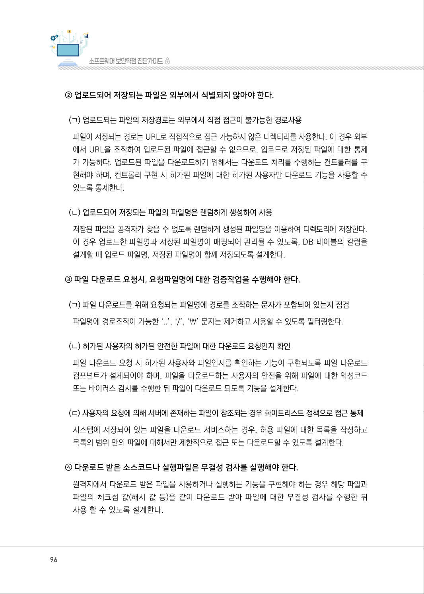

### PDF 97페이지 / 인쇄 97페이지

<!-- source-page:SW-Diagnosis-2021:97; source-lines:0,1,2,3,4,5,6,7,8,9,10,11,12,13,14,15,16,17,18,19,20,21,22,23,24,25,26,27,28,29,30,31,32,33,34,35,36 -->

97

제3장분석․ 설계단계 보안항목 진단

파일 업로드 기능 구현시 [표 3-10]와 같은 프레임워크의 사용을 고려하여 기능의 목적에 부합하는 
형식의 파일만 업로드하도록 허용한다.

표3‐10

위험한 형식의 파일 업로드 대응 프레임워크

|  |  |
| --- | --- |
| 개발환경 | 활용 가능한 프레임워크 또는 라이브러리 |
| Java | Spring: http://spring.io/ 자바 플랫폼을 위한 오픈소스 애플리케이션 프레임워크로써, 업로드 파일에 대해 허용 가능한 확장자를 제한할 수 있다. Apache Software License v2.0 정책에 따라 자유롭게 사용가능하다. |
| PHP | CodeIgniter: https://codeigniter.com/ 비교적 빠르고 간편한 웹 개발 PHP 프레임워크로써, 파일 업로드 기능 구현시 허용할 파일유형과 파일크기제한을 정의할 수 있다. 2.x버전은 OSLv3.0에 따라, 3.x버전은 MIT License에 따라 사용 가능하다. |
| ASP.NET | .NET Framework: https://www.microsoft.com/net 동적 웹페이지 구축을 돕는 웹 애플리케이션 프레임워크로써, 사용자 인증 및 권한 부여를 위한 확장 가능한 프레임워크를 제공한다. Content-Type 속성 파일의 MIME‐Type 형식을 가져 와 허용할 파일 확장명을 지정할 수 있다. |

#### 다. 진단 세부사항

요구사항 ①
업로드되어 저장되는 파일의 타입, 크기, 개수, 실행권한을 제한해야 한다. 업로드되는 파일의 타입, 
크기, 개수 및 실행권한을 제한하도록 설계하고 있는지 확인한다.

#### 1. 업로드 파일의 제한 정책과 방법이 설계되어 있는가?

#### 2. 업로드 파일의 제한 정책을 점검하는 테스트 계획이 수립되어 있는가?

#### 1. 업로드 파일의 제한 정책과 방법이 설계되어 있는가?

| 진단방법 | 관련산출물 검토예시 |
| --- | --- |
| 1-1 요구사항정의서에 설계항목에 대한 대책이 수립되어 있으며, 아키텍처 설계서에 설계항목 적용계획이 수립되어 있고, 요구사항추적표로 요구 사항 추적 가능 여부 확인 | 요구사항정의서, 요구사항추적표, 아키텍처 설계서 검토 |

원본 페이지 이미지 (변환 외 보존 자료)

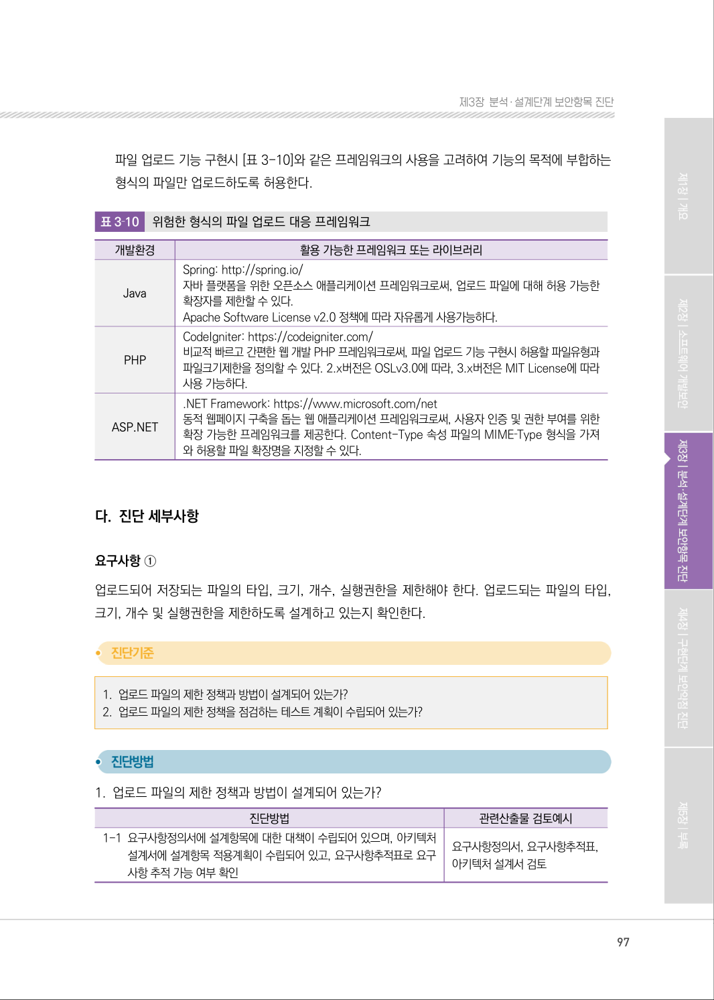

### PDF 98페이지 / 인쇄 98페이지

<!-- source-page:SW-Diagnosis-2021:98; source-lines:0,1,2,3,4,5,6,7,8,9,10,11,12,13,14,15,16,17,18,19,20,21,22,23,24,25,26,27,28 -->

98

| 진단방법 | 관련산출물 검토예시 |
| --- | --- |
| 1-2 업로드 가능한 파일의 타입, 크기, 개수와 저장시 파일의 퍼미션을 정의하고 있는지 확인 - 파일 업로드 기능을 지원하는 프레임워크 또는 라이브러리 사용 여부를 확인하여 업로드되는 파일의 속성을 제한하는 설정이 계획되어 있는지 확인 - 파일 업로드를 수행하는 프로그램 설계시 업로드되는 파일의 속성을 제한하도록 설계되었는지 확인 | 아키텍쳐설계서, 파일업로드 기능의 유즈케이스설계서, 클래스설계서 검토 |

#### 2. 업로드 파일의 제한 정책을 점검하는 테스트 계획이 수립되어 있는가?

| 진단방법 | 관련산출물 검토예시 |
| --- | --- |
| 2-1 허용되지 않는 파일의 타입, 크기, 개수의 업로드가 제한되는지 점검할 수 있는 테스트 계획이 수립되어 있는지 확인 | 단위테스트케이스 검토 |
| 2-2 업로드 후 서버에 저장된 파일의 실행이 제한되는지 검검할 수 있는 테스트 계획이 수립되어 있는지 확인 | 단위테스트케이스 검토 |

요구사항정의서, 요구사항추적표, 아키텍처설계서, 개발가이드, 프로그램명세서, 유즈케이스설계서, 
단위테스트케이스 등

요구사항 ②
업로드되어 저장되는 파일은 외부에서 식별되지 않아야 한다.
업로드된 파일을 외부에서 식별되거나 직접 접근할 수 없도록 설계하고 있는지 확인한다.

#### 1. 업로드 파일이 외부에서 식별되지 않도록 안전한 저장위치에 저장되도록 설계되어 있는가?

#### 2. 업로드 되어 저장된 파일이 외부에서 식별가능한지 여부를 점검하는 테스트 계획이 수립되어 있는가?

원본 페이지 이미지 (변환 외 보존 자료)

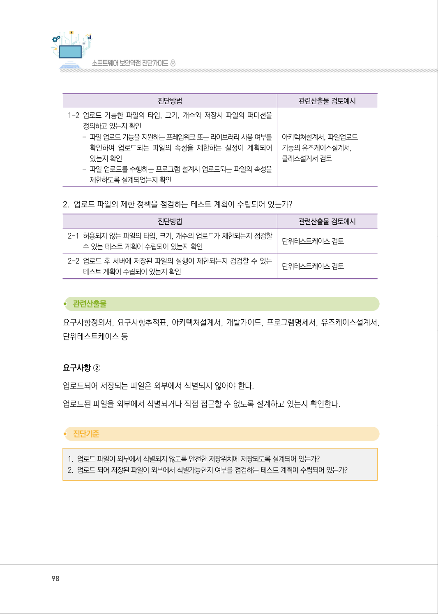

### PDF 99페이지 / 인쇄 99페이지

<!-- source-page:SW-Diagnosis-2021:99; source-lines:0,1,2,3,4,5,6,7,8,9,10,11,12,13,14,15,16,17,18,19,20,21,22,23,24,25,26,27,28,29,30,31,32 -->

99

제3장분석․ 설계단계 보안항목 진단

#### 1. 업로드 파일이 외부에서 식별되지 않도록 안전한 저장 위치에 저장되도록 설계되어 있는가?

| 진단방법 | 관련산출물 검토예시 |
| --- | --- |
| 1-1 요구사항정의서에 설계항목에 대한 대책이 수립되어 있으며, 아키텍처 설계서에 설계항목 적용계획이 수립되어 있고, 요구사항추적표로 요구 사항 추적 가능 여부 확인 | 요구사항정의서, 요구사항추적표, 아키텍처 설계서 검토 |
| 1-2 저장 경로와 파일명을 외부에서 알 수 없도록 정의하고 있는지 확인 - 안전한 난수를 이용하여 파일명을 생성 - 저장되는 파일명이 중복되지 않도록 안전한 알고리즘 적용 | 유즈케이스명세서, 클래스설계서 검토 |
| 1-3 원본 파일명과 저장경로/파일명의 매핑정보를 관리하도록 설계되어 있는지 확인 | 유즈케이스명세서, 클래스설계서, DB 설계서 검토 |

#### 2. 업로드되어 저장된 파일이 외부에서 식별 가능한지 여부를 점검하는 테스트 계획이 수립되어 있는가?

| 진단방법 | 관련산출물 검토예시 |
| --- | --- |
| 2-1 업로드되어 저장되는 파일이 외부에서 식별 가능한지 점검할 수 있는 테스트 계획이 수립되어 있는지 확인 - 저장된 경로 - 저장된 파일명 | 단위테스트케이스 검토 |

요구사항정의서, 요구사항추적표, 아키텍처설계서, 개발가이드, 프로그램명세서, 단위테스트케이스 등

요구사항 ③
파일 다운로드 요청 시, 요청파일명에 대한 검증작업을 수행해야 한다.
파일 다운로드 요청 시 파일에 대한 검증작업이 이루어지도록 설계하고 있는지 확인한다.

#### 1. 다운로드 요청 파일명에 대한 검증이 수행될 수 있도록 설계되어 있는가?

#### 2. 파일 다운로드 정책을 점검하는 테스트 계획이 수립되어 있는가?

원본 페이지 이미지 (변환 외 보존 자료)

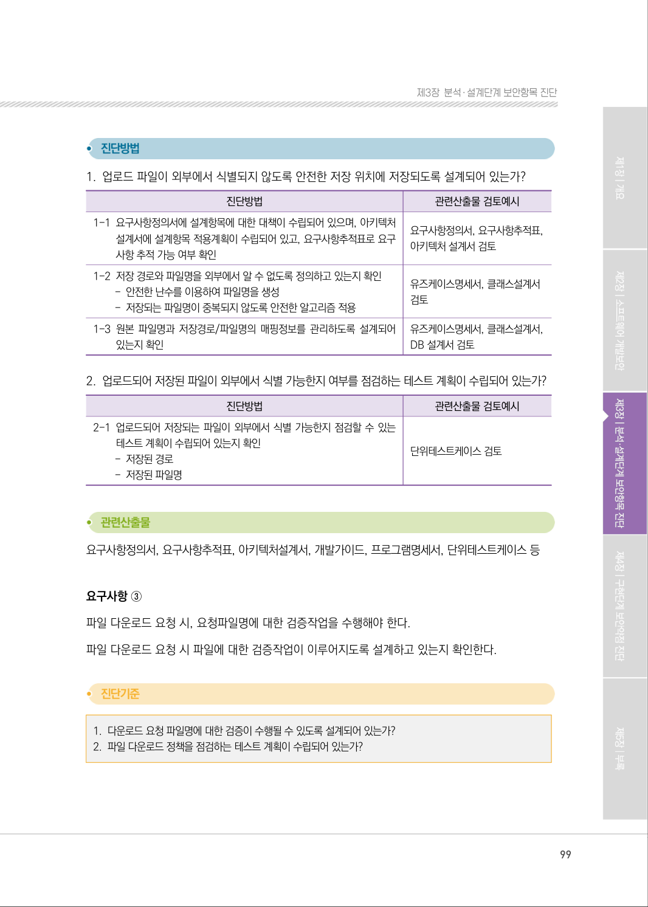

### PDF 100페이지 / 인쇄 100페이지

<!-- source-page:SW-Diagnosis-2021:100; source-lines:0,1,2,3,4,5,6,7,8,9,10,11,12,13,14,15,16,17,18,19,20,21,22,23,24,25,26,27,28,29 -->

100

#### 1. 다운로드 요청 파일명에 대한 검증이 수행될 수 있도록 설계되어 있는가?

| 진단방법 | 관련산출물 검토예시 |
| --- | --- |
| 1-1 요구사항정의서에 설계항목에 대한 대책이 수립되어 있으며, 아키텍처 설계서에 설계항목 적용계획이 수립되어 있고, 요구사항추적표로 요구 사항 추적 가능 여부 확인 | 요구사항정의서, 요구사항추적표, 아키텍처 설계서 검토 |
| 1-2 파일 다운로드 요청방식이 안전하게 설계되어 있는지 확인 - 다운로드 요청 파일명에 대한 경로 조작 문자 포함 여부 - DB정보를 이용하여 요청파일의 유효성 점검 여부 | 유즈케이스명세서, 클래스설계서, DB 설계서 검토 |

#### 2. 파일 다운로드 정책을 점검하는 테스트 계획이 수립되어 있는가?

| 진단방법 | 관련산출물 검토예시 |
| --- | --- |
| 2-1 조작된 파일명을 이용한 파일 다운로드 요청이 차단되는지 점검할 수 있는 테스트 계획이 수립되어 있는지 확인 - 조작된 파일명 입력값 예: 경로 조작 문자(../ ..\\)가 포함된 파일명 - 파라미터를 조작하여 기능에서 제공하지 않은 다른 파일 요청에 대한 차단 여부 점검 | 단위테스트케이스 검토 |

요구사항정의서, 요구사항추적표, 아키텍처설계서, 개발가이드, 프로그램명세서, 유즈케이스명세서, 
클래스설계서, 단위테스트케이스 등

요구사항 ④
다운로드받은 소스코드나 실행파일은 무결성 검사를 실행해야 한다.
다운로드받은 소스코드와 실행파일에 대해 무결성을 검증하도록 설계하고 있는지 확인한다.

#### 1. 파일 다운로드 시 파일의 무결성을 확인할 수 있도록 설계되어 있는가?

#### 2. 다운로드한 파일(소스코드 또는 실행파일)에 대한 무결성 점검을 위한 테스트 계획이 수립되어 있는가?

원본 페이지 이미지 (변환 외 보존 자료)

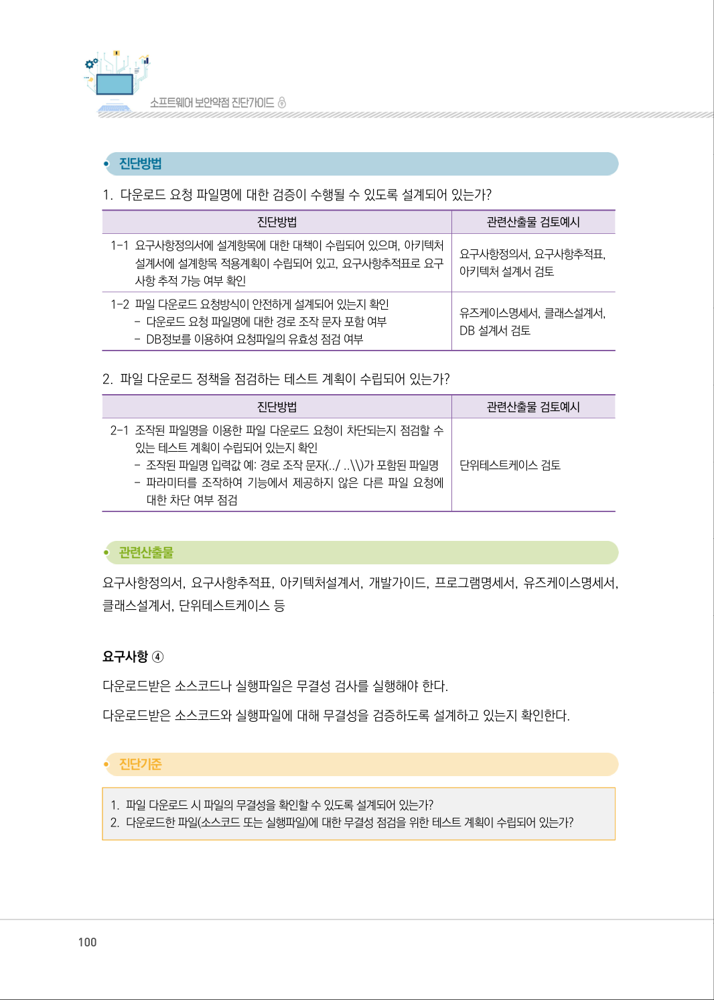

### PDF 101페이지 / 인쇄 101페이지

<!-- source-page:SW-Diagnosis-2021:101; source-lines:0,1,2,3,4,5,6,7,8,9,10,11,12,13,14,15,16,17,18,19,20,21,22,23,24,25,26,27,28,29,30,31,32,33,34 -->

101

제3장분석․ 설계단계 보안항목 진단

#### 1. 파일 다운로드시 파일의 무결성을 확인할 수 있도록 설계되어 있는가?

| 진단방법 | 관련산출물 검토예시 |
| --- | --- |
| 1-1 요구사항정의서에 설계항목에 대한 대책이 수립되어 있으며, 아키텍처 설계서에 설계항목 적용계획이 수립되어 있고, 요구사항추적표로 요구 사항 추적 가능 여부 확인 | 요구사항정의서, 요구사항추적표, 아키텍처 설계서 검토 |
| 1-2 파일의 무결성 검사를 위한 값(예: 해시)이 제공되도록 설계되어 있는지 확인 | 유즈케이스명세서, 클래스설계서, DB 설계서 검토 |
| 1-3 무결성 검사 수행 후 파일이 다운로드 될 수 있도록 파일 다운로드 기능이 설계되어 있는지 확인 | 유즈케이스명세서, 클래스설계서 검토 |

#### 2. 다운로드한 파일(소스코드 또는 실행파일)에 대한 무결성 점검을 위한 테스트 계획이 수립되어 있는가?

| 진단방법 | 관련산출물 검토예시 |
| --- | --- |
| 2-1 변조된 파일에 대한 다운로드 처리가 차단되는지 점검할 수 있는 테스트 계획이 수립되어 있는지 확인 | 단위테스트케이스 검토 |

요구사항정의서, 요구사항추적표, 아키텍처설계서, 개발가이드, 프로그램명세서, 유즈케이스명세서, 
클래스설계서, 단위테스트케이스 등

#### 라. 연관된 구현단계 보안약점 항목

| 유형 | 보안약점 항목 |
| --- | --- |
| 입력데이터 검증 및 표현 | 위험한 형식 파일 업로드 |
| 보안기능 | 부적절한 전자서명 확인 |
| 입력데이터 검증 및 표현 | 무결성 검사 없는 코드 다운로드 |

원본 페이지 이미지 (변환 외 보존 자료)

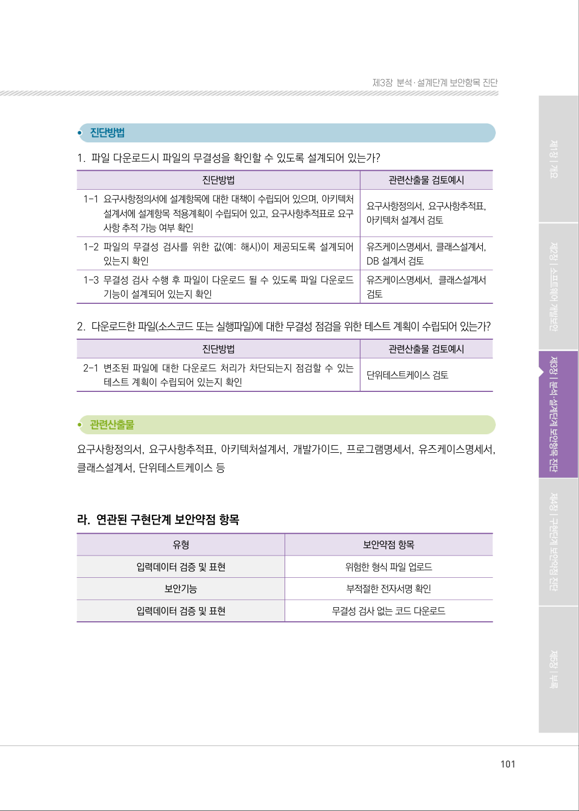

### PDF 102페이지 / 인쇄 102페이지

<!-- source-page:SW-Diagnosis-2021:102; source-lines:0,1,2,3,4,5,6,7,8,9,10,11,12,13,14,15,16,17,18,19,20,21,22,23,24,25,26,27 -->

102

#### 마. 참고자료

①CWE‐434 Unrestricted Upload of File with Dangerous Type, MITRE,

http://cwe.mitre.org/data/definitions/807.html
②CWE‐494 Download of Code Without Integrity Check, MITRE,

http://cwe.mitre.org/data/definitions/494.html
③2010 OWASP Secure Coding Practices, OWASP, File Management,

http://www.owasp.org/index.php/OWASP_Se-cure_Coding_Practices_-_Quick_
Reference_Guide
④2016 OWASP Application Security Verification Standard, OWASP, Files and 

Resources Verification Requirements,
http://www.owasp.org/index.php/Category:OWASP_Application_Security_Verific
ation_Standard_Project
⑤Unrestricted File Upload, OWASP,

http://www.owasp.org/index.php/Unrestricted_File_Upload
⑥Improve File Uploaders’ Protections, Sorouch Dalili,

http://soroush.secproject.com/downloadable/Improve%20
File%20Uploaders%E2%80%99%20Protections.pdf
⑦8 Basic Rules to Implement Secure File Uploads, SANS,

http://software-security.sans.org/blog/2009/12/28/8-basic-rules-to-implemen
tsecure-file-uploads
⑧Top 25 Series-Rank 20-Download of Code Without Integrity Check, SANS,

http://software-security.sans.org/blog/2010/04/05/top-25-series-rank-20-do
wnload-code-integrity-check/
⑨“Introduction to Code Signing”, Microsoft,

http://msdn.microsoft.com/en-us/library /ms537361(VS.85).aspx
⑩Authenticode, Microsoft,

http://msdn.microsoft.com/en-us/library/ms537359(v=VS.85).aspx

원본 페이지 이미지 (변환 외 보존 자료)

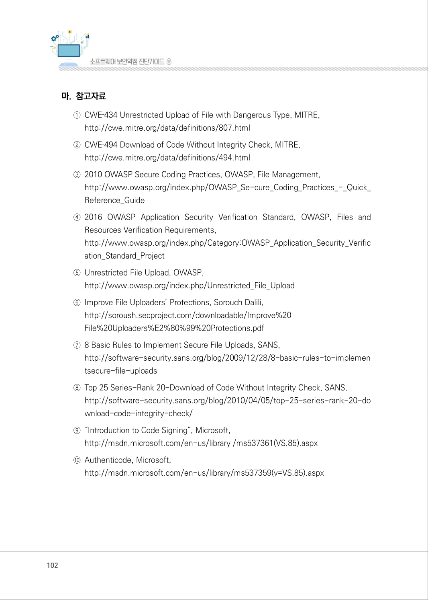

### PDF 103페이지 / 인쇄 103페이지

<!-- source-page:SW-Diagnosis-2021:103; source-lines:1 -->

제3장분석․ 설계단계 보안항목 진단

원본 페이지 이미지 (변환 외 보존 자료)

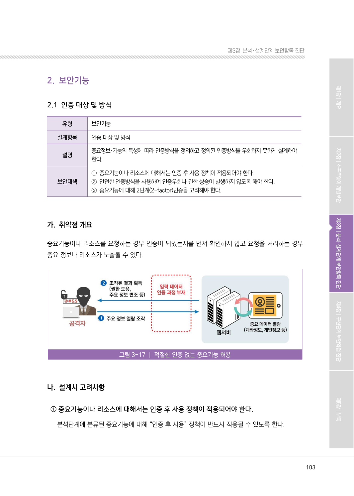

---

## 탐색 링크 (원문 외)

[통합 인덱스](../../../INDEX.md)

