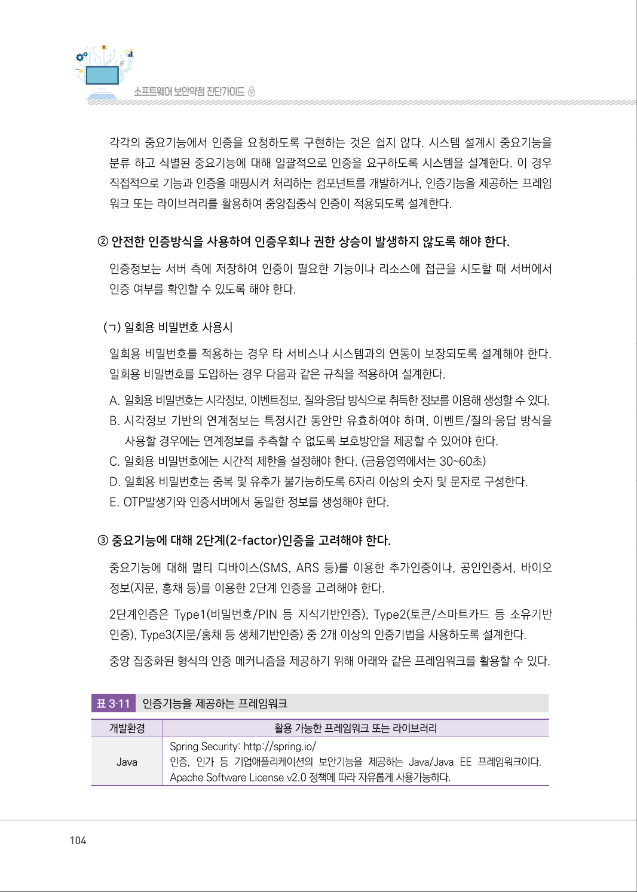
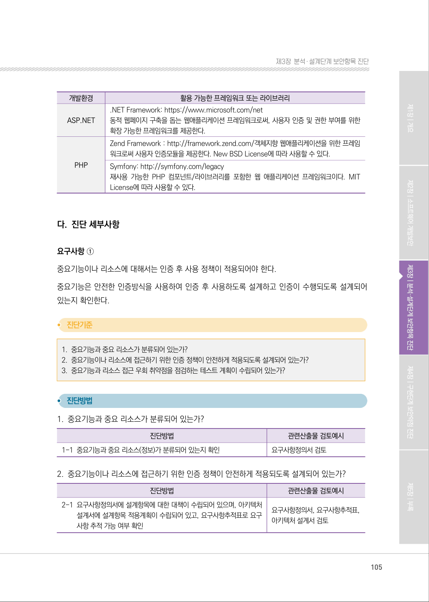
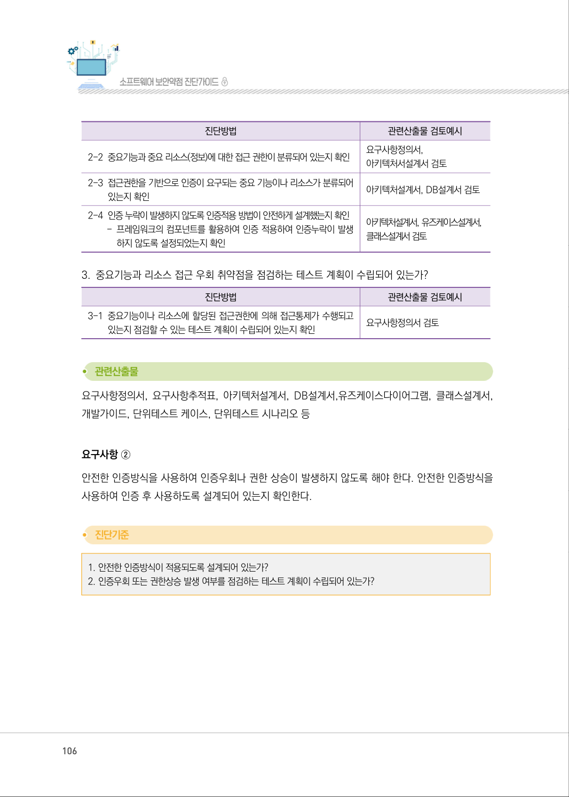
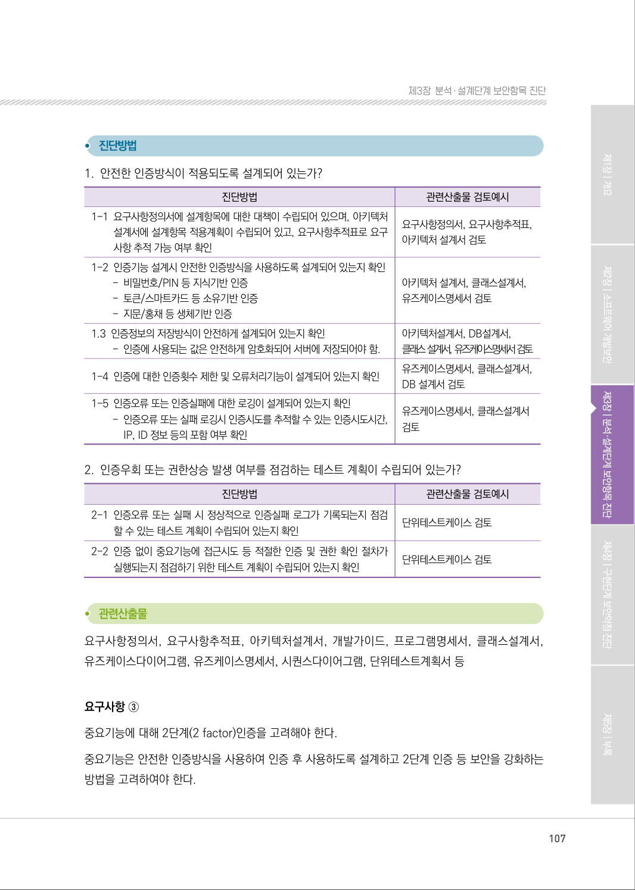
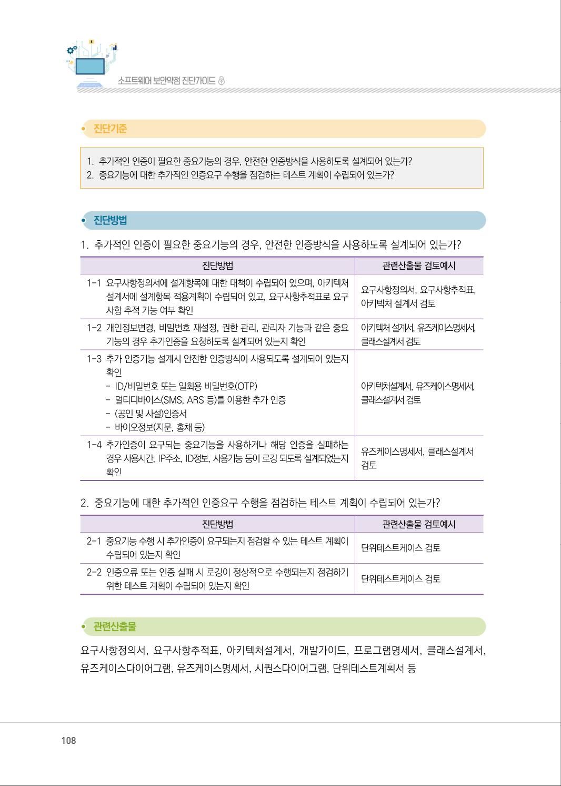
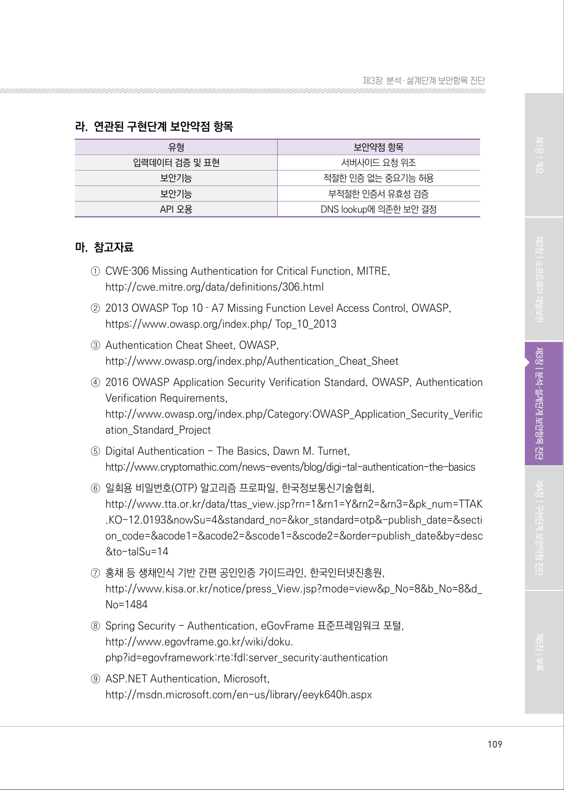

# 2.1 인증 대상 및 방식

> 변환 안내(원문 외): 아래 본문은 PDF 텍스트를 추출한 전사입니다. 코드 줄번호·특수 공백·원문 오류를 유지했습니다. 실행용 코드가 아닙니다. 표·그림·들여쓰기는 연결된 페이지 이미지와 대조하세요. 페이지 경계의 줄바꿈을 보존하며, 동일 페이지가 여러 항목에 나뉘면 각 항목의 본문은 해당 구간만 포함합니다.

### PDF 103페이지 / 인쇄 103페이지

<!-- source-page:SW-Diagnosis-2021:103; source-lines:0,3,4,5,6,7,8,9,10,11,12,13,14,15,16,17,18,19,20,21 -->

103

2.1 인증 대상 및 방식

| 유형 | 보안기능 |
| --- | --- |
| 설계항목 | 인증 대상 및 방식 |
| 설명 | 중요정보·기능의 특성에 따라 인증방식을 정의하고 정의된 인증방식을 우회하지 못하게 설계해야<br>한다. |
| 보안대책 | ① 중요기능이나 리소스에 대해서는 인증 후 사용 정책이 적용되어야 한다.<br>② 안전한 인증방식을 사용하여 인증우회나 권한 상승이 발생하지 않도록 해야 한다.<br>③ 중요기능에 대해 2단계(2-factor)인증을 고려해야 한다. |

#### 가. 취약점 개요

중요기능이나 리소스를 요청하는 경우 인증이 되었는지를 먼저 확인하지 않고 요청을 처리하는 경우 
중요 정보나 리소스가 노출될 수 있다.

그림3-17 | 적절한 인증 없는 중요기능 허용

#### 나. 설계시 고려사항

① 중요기능이나 리소스에 대해서는 인증 후 사용 정책이 적용되어야 한다.

분석단계에 분류된 중요기능에 대해 “인증 후 사용” 정책이 반드시 적용될 수 있도록 한다.

<details><summary>원본 페이지 이미지 (변환 외 보존 자료)</summary>


</details>

### PDF 104페이지 / 인쇄 104페이지

<!-- source-page:SW-Diagnosis-2021:104; source-lines:0,1,2,3,4,5,6,7,8,9,10,11,12,13,14,15,16,17,18,19,20,21,22,23,24,25,26,27,28,29,30 -->

104

각각의 중요기능에서 인증을 요청하도록 구현하는 것은 쉽지 않다. 시스템 설계시 중요기능을 
분류 하고 식별된 중요기능에 대해 일괄적으로 인증을 요구하도록 시스템을 설계한다. 이 경우 
직접적으로 기능과 인증을 매핑시켜 처리하는 컴포넌트를 개발하거나, 인증기능을 제공하는 프레임
워크 또는 라이브러리를 활용하여 중앙집중식 인증이 적용되도록 설계한다.

② 안전한 인증방식을 사용하여 인증우회나 권한 상승이 발생하지 않도록 해야 한다.

인증정보는 서버 측에 저장하여 인증이 필요한 기능이나 리소스에 접근을 시도할 때 서버에서 
인증 여부를 확인할 수 있도록 해야 한다.

(ㄱ) 일회용 비밀번호 사용시
일회용 비밀번호를 적용하는 경우 타 서비스나 시스템과의 연동이 보장되도록 설계해야 한다. 
일회용 비밀번호를 도입하는 경우 다음과 같은 규칙을 적용하여 설계한다.
A. 일회용 비밀번호는 시각정보, 이벤트정보, 질의‐응답 방식으로 취득한 정보를 이용해 생성할 수 있다.
B. 시각정보 기반의 연계정보는 특정시간 동안만 유효하여야 하며, 이벤트/질의‐응답 방식을 

사용할 경우에는 연계정보를 추측할 수 없도록 보호방안을 제공할 수 있어야 한다.
C. 일회용 비밀번호에는 시간적 제한을 설정해야 한다. (금융영역에서는 30~60초)
D. 일회용 비밀번호는 중복 및 유추가 불가능하도록 6자리 이상의 숫자 및 문자로 구성한다.
E. OTP발생기와 인증서버에서 동일한 정보를 생성해야 한다.

③ 중요기능에 대해 2단계(2-factor)인증을 고려해야 한다.

중요기능에 대해 멀티 디바이스(SMS, ARS 등)를 이용한 추가인증이나, 공인인증서, 바이오 
정보(지문, 홍채 등)를 이용한 2단계 인증을 고려해야 한다.
2단계인증은 Type1(비밀번호/PIN 등 지식기반인증), Type2(토큰/스마트카드 등 소유기반
인증), Type3(지문/홍채 등 생체기반인증) 중 2개 이상의 인증기법을 사용하도록 설계한다.
중앙 집중화된 형식의 인증 메커니즘을 제공하기 위해 아래와 같은 프레임워크를 활용할 수 있다.

표3‐11

인증기능을 제공하는 프레임워크

|  |  |
| --- | --- |
| 개발환경 | 활용 가능한 프레임워크 또는 라이브러리 |
| Java | Spring Security: http://spring.io/<br>인증, 인가 등 기업애플리케이션의 보안기능을 제공하는 Java/Java EE 프레임워크이다.<br>Apache Software License v2.0 정책에 따라 자유롭게 사용가능하다. |

<details><summary>원본 페이지 이미지 (변환 외 보존 자료)</summary>



</details>

### PDF 105페이지 / 인쇄 105페이지

<!-- source-page:SW-Diagnosis-2021:105; source-lines:0,1,2,3,4,5,6,7,8,9,10,11,12,13,14,15,16,17,18,19,20,21,22,23,24,25,26,27,28,29,30,31,32,33,34 -->

105

제3장분석․ 설계단계 보안항목 진단

```text
개발환경
활용 가능한 프레임워크 또는 라이브러리
ASP.NET
.NET Framework: https://www.microsoft.com/net 
동적 웹페이지 구축을 돕는 웹애플리케이션 프레임워크로써, 사용자 인증 및 권한 부여를 위한 
확장 가능한 프레임워크를 제공한다.
PHP
Zend Framework : http://framework.zend.com/객체지향 웹애플리케이션을 위한 프레임
워크로써 사용자 인증모듈을 제공한다. New BSD License에 따라 사용할 수 있다.
Symfony: http://symfony.com/legacy
재사용 가능한 PHP 컴포넌트/라이브러리를 포함한 웹 애플리케이션 프레임워크이다. MIT 
License에 따라 사용할 수 있다.
```

#### 다. 진단 세부사항

요구사항 ①
중요기능이나 리소스에 대해서는 인증 후 사용 정책이 적용되어야 한다.
중요기능은 안전한 인증방식을 사용하여 인증 후 사용하도록 설계하고 인증이 수행되도록 설계되어 
있는지 확인한다.

#### 1. 중요기능과 중요 리소스가 분류되어 있는가?

#### 2. 중요기능이나 리소스에 접근하기 위한 인증 정책이 안전하게 적용되도록 설계되어 있는가?

#### 3. 중요기능과 리소스 접근 우회 취약점을 점검하는 테스트 계획이 수립되어 있는가?

#### 1. 중요기능과 중요 리소스가 분류되어 있는가?

| 진단방법 | 관련산출물 검토예시 |
| --- | --- |
| 1-1 중요기능과 중요 리소스(정보)가 분류되어 있는지 확인 | 요구사항정의서 검토 |

#### 2. 중요기능이나 리소스에 접근하기 위한 인증 정책이 안전하게 적용되도록 설계되어 있는가?

| 진단방법 | 관련산출물 검토예시 |
| --- | --- |
| 2-1 요구사항정의서에 설계항목에 대한 대책이 수립되어 있으며, 아키텍처<br>설계서에 설계항목 적용계획이 수립되어 있고, 요구사항추적표로 요구<br>사항 추적 가능 여부 확인 | 요구사항정의서, 요구사항추적표,<br>아키텍처 설계서 검토 |

<details><summary>원본 페이지 이미지 (변환 외 보존 자료)</summary>



</details>

### PDF 106페이지 / 인쇄 106페이지

<!-- source-page:SW-Diagnosis-2021:106; source-lines:0,1,2,3,4,5,6,7,8,9,10,11,12,13,14,15,16,17,18,19,20,21,22,23,24,25,26 -->

106

| 진단방법 | 관련산출물 검토예시 |
| --- | --- |
| 2-2 중요기능과 중요 리소스(정보)에 대한 접근 권한이 분류되어 있는지 확인 | 요구사항정의서,<br>아키텍처서설계서 검토 |
| 2-3 접근권한을 기반으로 인증이 요구되는 중요 기능이나 리소스가 분류되어<br>있는지 확인 | 아키텍처설계서, DB설계서 검토 |
| 2-4 인증 누락이 발생하지 않도록 인증적용 방법이 안전하게 설계했는지 확인<br>- 프레임워크의 컴포넌트를 활용하여 인증 적용하여 인증누락이 발생<br>하지 않도록 설정되었는지 확인 | 아키텍처설계서, 유즈케이스설계서,<br>클래스설계서 검토 |

#### 3. 중요기능과 리소스 접근 우회 취약점을 점검하는 테스트 계획이 수립되어 있는가?

| 진단방법 | 관련산출물 검토예시 |
| --- | --- |
| 3-1 중요기능이나 리소스에 할당된 접근권한에 의해 접근통제가 수행되고<br>있는지 점검할 수 있는 테스트 계획이 수립되어 있는지 확인 | 요구사항정의서 검토 |

요구사항정의서, 요구사항추적표, 아키텍처설계서, DB설계서,유즈케이스다이어그램, 클래스설계서, 
개발가이드, 단위테스트 케이스, 단위테스트 시나리오 등

요구사항 ②
안전한 인증방식을 사용하여 인증우회나 권한 상승이 발생하지 않도록 해야 한다. 안전한 인증방식을 
사용하여 인증 후 사용하도록 설계되어 있는지 확인한다.

#### 1. 안전한 인증방식이 적용되도록 설계되어 있는가?

#### 2. 인증우회 또는 권한상승 발생 여부를 점검하는 테스트 계획이 수립되어 있는가?

<details><summary>원본 페이지 이미지 (변환 외 보존 자료)</summary>



</details>

### PDF 107페이지 / 인쇄 107페이지

<!-- source-page:SW-Diagnosis-2021:107; source-lines:0,1,2,3,4,5,6,7,8,9,10,11,12,13,14,15,16,17,18,19,20,21,22,23,24,25,26,27,28,29,30,31,32,33,34,35,36,37,38,39,40,41,42 -->

107

제3장분석․ 설계단계 보안항목 진단

#### 1. 안전한 인증방식이 적용되도록 설계되어 있는가?

| 진단방법 | 관련산출물 검토예시 |
| --- | --- |
| 1-1 요구사항정의서에 설계항목에 대한 대책이 수립되어 있으며, 아키텍처<br>설계서에 설계항목 적용계획이 수립되어 있고, 요구사항추적표로 요구<br>사항 추적 가능 여부 확인 | 요구사항정의서, 요구사항추적표,<br>아키텍처 설계서 검토 |
| 1-2 인증기능 설계시 안전한 인증방식을 사용하도록 설계되어 있는지 확인<br>- 비밀번호/PIN 등 지식기반 인증<br>- 토큰/스마트카드 등 소유기반 인증<br>- 지문/홍채 등 생체기반 인증 | 아키텍처 설계서, 클래스설계서,<br>유즈케이스명세서 검토 |
| 1.3 인증정보의 저장방식이 안전하게 설계되어 있는지 확인<br>- 인증에 사용되는 값은 안전하게 암호화되어 서버에 저장되어야 함. | 아키텍처설계서, DB설계서,<br>클래스 설계서, 유즈케이스명세서 검토 |
| 1-4 인증에 대한 인증횟수 제한 및 오류처리기능이 설계되어 있는지 확인 | 유즈케이스명세서, 클래스설계서,<br>DB 설계서 검토 |
| 1-5 인증오류 또는 인증실패에 대한 로깅이 설계되어 있는지 확인<br>- 인증오류 또는 실패 로깅시 인증시도를 추적할 수 있는 인증시도시간,<br>IP, ID 정보 등의 포함 여부 확인 | 유즈케이스명세서, 클래스설계서<br>검토 |

#### 2. 인증우회 또는 권한상승 발생 여부를 점검하는 테스트 계획이 수립되어 있는가?

| 진단방법 | 관련산출물 검토예시 |
| --- | --- |
| 2-1 인증오류 또는 실패 시 정상적으로 인증실패 로그가 기록되는지 점검<br>할 수 있는 테스트 계획이 수립되어 있는지 확인 | 단위테스트케이스 검토 |
| 2-2 인증 없이 중요기능에 접근시도 등 적절한 인증 및 권한 확인 절차가<br>실행되는지 점검하기 위한 테스트 계획이 수립되어 있는지 확인 | 단위테스트케이스 검토 |

요구사항정의서, 요구사항추적표, 아키텍처설계서, 개발가이드, 프로그램명세서, 클래스설계서, 
유즈케이스다이어그램, 유즈케이스명세서, 시퀀스다이어그램, 단위테스트계획서 등

요구사항 ③
중요기능에 대해 2단계(2 factor)인증을 고려해야 한다.
중요기능은 안전한 인증방식을 사용하여 인증 후 사용하도록 설계하고 2단계 인증 등 보안을 강화하는 
방법을 고려하여야 한다.

<details><summary>원본 페이지 이미지 (변환 외 보존 자료)</summary>



</details>

### PDF 108페이지 / 인쇄 108페이지

<!-- source-page:SW-Diagnosis-2021:108; source-lines:0,1,2,3,4,5,6,7,8,9,10,11,12,13,14,15,16,17,18,19,20,21,22,23,24,25,26,27,28,29,30,31,32,33,34,35,36,37,38 -->

108

#### 1. 추가적인 인증이 필요한 중요기능의 경우, 안전한 인증방식을 사용하도록 설계되어 있는가?

#### 2. 중요기능에 대한 추가적인 인증요구 수행을 점검하는 테스트 계획이 수립되어 있는가?

#### 1. 추가적인 인증이 필요한 중요기능의 경우, 안전한 인증방식을 사용하도록 설계되어 있는가?

| 진단방법 | 관련산출물 검토예시 |
| --- | --- |
| 1-1 요구사항정의서에 설계항목에 대한 대책이 수립되어 있으며, 아키텍처<br>설계서에 설계항목 적용계획이 수립되어 있고, 요구사항추적표로 요구<br>사항 추적 가능 여부 확인 | 요구사항정의서, 요구사항추적표,<br>아키텍처 설계서 검토 |
| 1-2 개인정보변경, 비밀번호 재설정, 권한 관리, 관리자 기능과 같은 중요<br>기능의 경우 추가인증을 요청하도록 설계되어 있는지 확인 | 아키텍처 설계서, 유즈케이스명세서,<br>클래스설계서 검토 |
| 1-3 추가 인증기능 설계시 안전한 인증방식이 사용되도록 설계되어 있는지<br>확인<br>- ID/비밀번호 또는 일회용 비밀번호(OTP)<br>- 멀티디바이스(SMS, ARS 등)를 이용한 추가 인증<br>- (공인 및 사설)인증서<br>- 바이오정보(지문, 홍채 등) | 아키텍처설계서, 유즈케이스명세서,<br>클래스설계서 검토 |
| 1-4 추가인증이 요구되는 중요기능을 사용하거나 해당 인증을 실패하는<br>경우 사용시간, IP주소, ID정보, 사용기능 등이 로깅 되도록 설계되었는지<br>확인 | 유즈케이스명세서, 클래스설계서<br>검토 |

#### 2. 중요기능에 대한 추가적인 인증요구 수행을 점검하는 테스트 계획이 수립되어 있는가?

| 진단방법 | 관련산출물 검토예시 |
| --- | --- |
| 2-1 중요기능 수행 시 추가인증이 요구되는지 점검할 수 있는 테스트 계획이<br>수립되어 있는지 확인 | 단위테스트케이스 검토 |
| 2-2 인증오류 또는 인증 실패 시 로깅이 정상적으로 수행되는지 점검하기<br>위한 테스트 계획이 수립되어 있는지 확인 | 단위테스트케이스 검토 |

요구사항정의서, 요구사항추적표, 아키텍처설계서, 개발가이드, 프로그램명세서, 클래스설계서, 
유즈케이스다이어그램, 유즈케이스명세서, 시퀀스다이어그램, 단위테스트계획서 등

<details><summary>원본 페이지 이미지 (변환 외 보존 자료)</summary>



</details>

### PDF 109페이지 / 인쇄 109페이지

<!-- source-page:SW-Diagnosis-2021:109; source-lines:0,1,2,3,4,5,6,7,8,9,10,11,12,13,14,15,16,17,18,19,20,21,22,23,24,25,26,27,28,29,30,31,32,33,34,35,36,37,38 -->

109

제3장분석․ 설계단계 보안항목 진단

#### 라. 연관된 구현단계 보안약점 항목

| 유형 | 보안약점 항목 |
| --- | --- |
| 입력데이터 검증 및 표현 | 서버사이드 요청 위조 |
| 보안기능 | 적절한 인증 없는 중요기능 허용 |
| 보안기능 | 부적절한 인증서 유효성 검증 |
| API 오용 | DNS lookup에 의존한 보안 결정 |

#### 마. 참고자료

①CWE‐306 Missing Authentication for Critical Function, MITRE,

http://cwe.mitre.org/data/definitions/306.html
②2013 OWASP Top 10 ‐ A7 Missing Function Level Access Control, OWASP,

https://www.owasp.org/index.php/ Top_10_2013
③Authentication Cheat Sheet, OWASP,

http://www.owasp.org/index.php/Authentication_Cheat_Sheet
④2016 OWASP Application Security Verification Standard, OWASP, Authentication 

Verification Requirements,
http://www.owasp.org/index.php/Category:OWASP_Application_Security_Verific
ation_Standard_Project 
⑤Digital Authentication - The Basics, Dawn M. Turnet,

http://www.cryptomathic.com/news-events/blog/digi-tal-authentication-the-basics
⑥일회용 비밀번호(OTP) 알고리즘 프로파일, 한국정보통신기술협회,

http://www.tta.or.kr/data/ttas_view.jsp?rn=1&amp;rn1=Y&amp;rn2=&amp;rn3=&amp;pk_num=TTAK
.KO-12.0193&amp;nowSu=4&amp;standard_no=&amp;kor_standard=otp&amp;-publish_date=&amp;secti
on_code=&amp;acode1=&amp;acode2=&amp;scode1=&amp;scode2=&amp;order=publish_date&amp;by=desc
&amp;to-talSu=14
⑦홍채 등 생채인식 기반 간편 공인인증 가이드라인, 한국인터넷진흥원,

http://www.kisa.or.kr/notice/press_View.jsp?mode=view&amp;p_No=8&amp;b_No=8&amp;d_
No=1484
⑧Spring Security - Authentication, eGovFrame 표준프레임워크 포털,

http://www.egovframe.go.kr/wiki/doku.
php?id=egovframework:rte:fdl:server_security:authentication
⑨ASP.NET Authentication, Microsoft,

http://msdn.microsoft.com/en-us/library/eeyk640h.aspx

<details><summary>원본 페이지 이미지 (변환 외 보존 자료)</summary>



</details>

---

## 탐색 링크 (원문 외)

[통합 인덱스](../../../INDEX.md)

