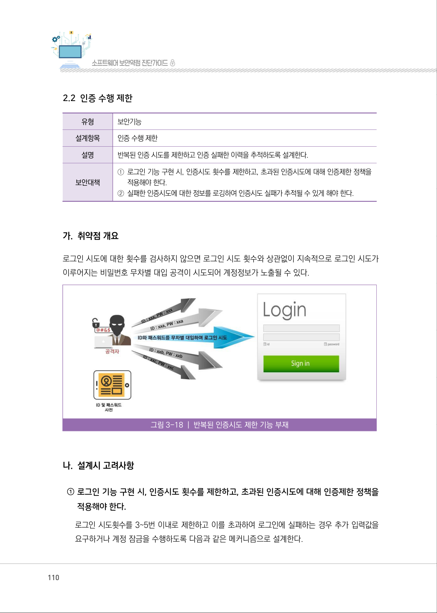
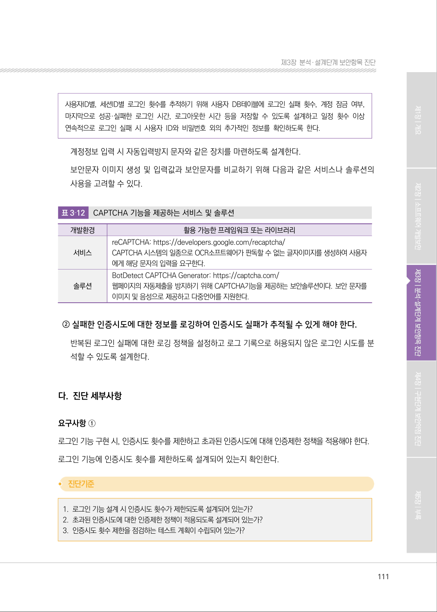
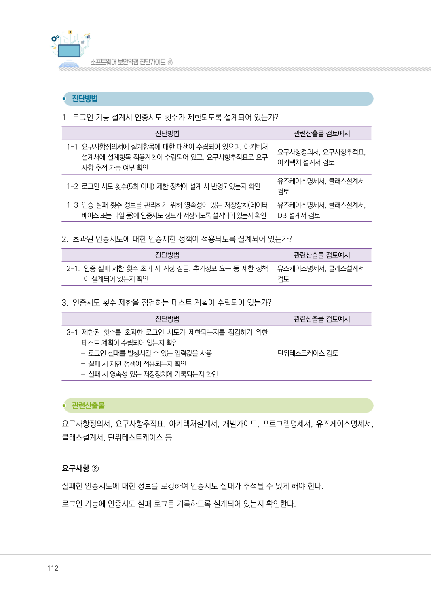
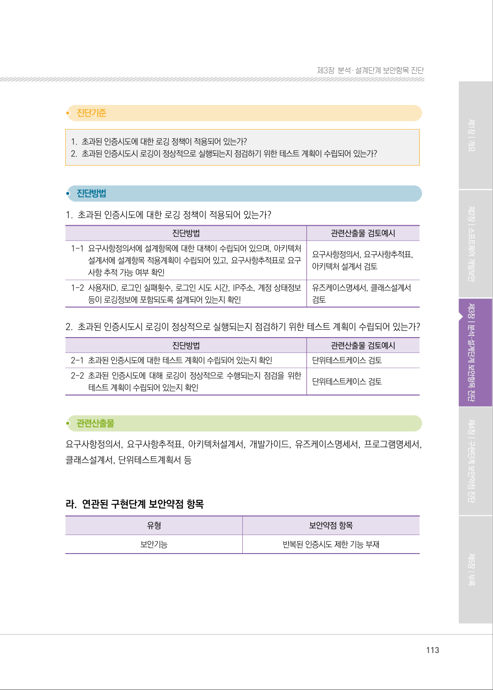
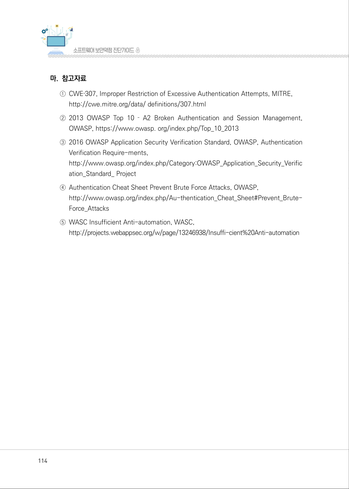

# 2.2 인증 수행 제한

> 변환 안내(원문 외): 아래 본문은 PDF 텍스트를 추출한 전사입니다. 코드 줄번호·특수 공백·원문 오류를 유지했습니다. 실행용 코드가 아닙니다. 표·그림·들여쓰기는 연결된 페이지 이미지와 대조하세요. 페이지 경계의 줄바꿈을 보존하며, 동일 페이지가 여러 항목에 나뉘면 각 항목의 본문은 해당 구간만 포함합니다.

### PDF 110페이지 / 인쇄 110페이지

<!-- source-page:SW-Diagnosis-2021:110; source-lines:0,1,2,3,4,5,6,7,8,9,10,11,12,13,14,15,16,17,18,19,20 -->

110

2.2 인증 수행 제한

| 유형 | 보안기능 |
| --- | --- |
| 설계항목 | 인증 수행 제한 |
| 설명 | 반복된 인증 시도를 제한하고 인증 실패한 이력을 추적하도록 설계한다. |
| 보안대책 | ① 로그인 기능 구현 시, 인증시도 횟수를 제한하고, 초과된 인증시도에 대해 인증제한 정책을 적용해야 한다. ② 실패한 인증시도에 대한 정보를 로깅하여 인증시도 실패가 추적될 수 있게 해야 한다. |

#### 가. 취약점 개요

로그인 시도에 대한 횟수를 검사하지 않으면 로그인 시도 횟수와 상관없이 지속적으로 로그인 시도가 
이루어지는 비밀번호 무차별 대입 공격이 시도되어 계정정보가 노출될 수 있다.

그림3-18 | 반복된 인증시도 제한 기능 부재

#### 나. 설계시 고려사항

① 로그인 기능 구현 시, 인증시도 횟수를 제한하고, 초과된 인증시도에 대해 인증제한 정책을 

적용해야 한다.
로그인 시도횟수를 3~5번 이내로 제한하고 이를 초과하여 로그인에 실패하는 경우 추가 입력값을 
요구하거나 계정 잠금을 수행하도록 다음과 같은 메커니즘으로 설계한다.

원본 페이지 이미지 (변환 외 보존 자료)

### PDF 111페이지 / 인쇄 111페이지

<!-- source-page:SW-Diagnosis-2021:111; source-lines:0,1,2,3,4,5,6,7,8,9,10,11,12,13,14,15,16,17,18,19,20,21,22,23,24,25,26,27,28,29 -->

111

제3장분석․ 설계단계 보안항목 진단

사용자ID별, 세션ID별 로그인 횟수를 추적하기 위해 사용자 DB테이블에 로그인 실패 횟수, 계정 잠금 여부, 
마지막으로 성공·실패한 로그인 시간, 로그아웃한 시간 등을 저장할 수 있도록 설계하고 일정 횟수 이상 
연속적으로 로그인 실패 시 사용자 ID와 비밀번호 외의 추가적인 정보를 확인하도록 한다.

계정정보 입력 시 자동입력방지 문자와 같은 장치를 마련하도록 설계한다.
보안문자 이미지 생성 및 입력값과 보안문자를 비교하기 위해 다음과 같은 서비스나 솔루션의 
사용을 고려할 수 있다.

표3‐12

CAPTCHA 기능을 제공하는 서비스 및 솔루션

|  |  |
| --- | --- |
| 개발환경 | 활용 가능한 프레임워크 또는 라이브러리 |
| 서비스 | reCAPTCHA: https://developers.google.com/recaptcha/ CAPTCHA 시스템의 일종으로 OCR소프트웨어가 판독할 수 없는 글자이미지를 생성하여 사용자 에게 해당 문자의 입력을 요구한다. |
| 솔루션 | BotDetect CAPTCHA Generator: https://captcha.com/ 웹페이지의 자동제출을 방지하기 위해 CAPTCHA기능을 제공하는 보안솔루션이다. 보안 문자를 이미지 및 음성으로 제공하고 다중언어를 지원한다. |

② 실패한 인증시도에 대한 정보를 로깅하여 인증시도 실패가 추적될 수 있게 해야 한다.

반복된 로그인 실패에 대한 로깅 정책을 설정하고 로그 기록으로 허용되지 않은 로그인 시도를 분
석할 수 있도록 설계한다.

#### 다. 진단 세부사항

요구사항 ①
로그인 기능 구현 시, 인증시도 횟수를 제한하고 초과된 인증시도에 대해 인증제한 정책을 적용해야 한다.
로그인 기능에 인증시도 횟수를 제한하도록 설계되어 있는지 확인한다.

#### 1. 로그인 기능 설계 시 인증시도 횟수가 제한되도록 설계되어 있는가? 

#### 2. 초과된 인증시도에 대한 인증제한 정책이 적용되도록 설계되어 있는가? 

#### 3. 인증시도 횟수 제한을 점검하는 테스트 계획이 수립되어 있는가?

원본 페이지 이미지 (변환 외 보존 자료)

### PDF 112페이지 / 인쇄 112페이지

<!-- source-page:SW-Diagnosis-2021:112; source-lines:0,1,2,3,4,5,6,7,8,9,10,11,12,13,14,15,16,17,18,19,20,21,22,23,24,25,26,27,28,29,30,31,32,33,34,35,36 -->

112

#### 1. 로그인 기능 설계시 인증시도 횟수가 제한되도록 설계되어 있는가?

| 진단방법 | 관련산출물 검토예시 |
| --- | --- |
| 1-1 요구사항정의서에 설계항목에 대한 대책이 수립되어 있으며, 아키텍처 설계서에 설계항목 적용계획이 수립되어 있고, 요구사항추적표로 요구 사항 추적 가능 여부 확인 | 요구사항정의서, 요구사항추적표, 아키텍처 설계서 검토 |
| 1-2 로그인 시도 횟수(5회 이내) 제한 정책이 설계 시 반영되었는지 확인 | 유즈케이스명세서, 클래스설계서 검토 |
| 1-3 인증 실패 횟수 정보를 관리하기 위해 영속성이 있는 저장장치(데이터 베이스 또는 파일 등)에 인증시도 정보가 저장되도록 설계되어 있는지 확인 | 유즈케이스명세서, 클래스설계서, DB 설계서 검토 |

#### 2. 초과된 인증시도에 대한 인증제한 정책이 적용되도록 설계되어 있는가?

| 진단방법 | 관련산출물 검토예시 |
| --- | --- |
| 2-1. 인증 실패 제한 횟수 초과 시 계정 잠금, 추가정보 요구 등 제한 정책 이 설계되어 있는지 확인 | 유즈케이스명세서, 클래스설계서 검토 |

#### 3. 인증시도 횟수 제한을 점검하는 테스트 계획이 수립되어 있는가?

| 진단방법 | 관련산출물 검토예시 |
| --- | --- |
| 3-1 제한된 횟수를 초과한 로그인 시도가 제한되는지를 점검하기 위한 테스트 계획이 수립되어 있는지 확인 - 로그인 실패를 발생시킬 수 있는 입력값을 사용 - 실패 시 제한 정책이 적용되는지 확인 - 실패 시 영속성 있는 저장장치에 기록되는지 확인 | 단위테스트케이스 검토 |

요구사항정의서, 요구사항추적표, 아키텍처설계서, 개발가이드, 프로그램명세서, 유즈케이스명세서, 
클래스설계서, 단위테스트케이스 등

요구사항 ②
실패한 인증시도에 대한 정보를 로깅하여 인증시도 실패가 추적될 수 있게 해야 한다.
로그인 기능에 인증시도 실패 로그를 기록하도록 설계되어 있는지 확인한다.

원본 페이지 이미지 (변환 외 보존 자료)

### PDF 113페이지 / 인쇄 113페이지

<!-- source-page:SW-Diagnosis-2021:113; source-lines:0,1,2,3,4,5,6,7,8,9,10,11,12,13,14,15,16,17,18,19,20,21,22,23,24,25,26,27,28,29,30 -->

113

제3장분석․ 설계단계 보안항목 진단

#### 1. 초과된 인증시도에 대한 로깅 정책이 적용되어 있는가?

#### 2. 초과된 인증시도시 로깅이 정상적으로 실행되는지 점검하기 위한 테스트 계획이 수립되어 있는가?

#### 1. 초과된 인증시도에 대한 로깅 정책이 적용되어 있는가?

| 진단방법 | 관련산출물 검토예시 |
| --- | --- |
| 1-1 요구사항정의서에 설계항목에 대한 대책이 수립되어 있으며, 아키텍처 설계서에 설계항목 적용계획이 수립되어 있고, 요구사항추적표로 요구 사항 추적 가능 여부 확인 | 요구사항정의서, 요구사항추적표, 아키텍처 설계서 검토 |
| 1-2 사용자ID, 로그인 실패횟수, 로그인 시도 시간, IP주소, 계정 상태정보 등이 로깅정보에 포함되도록 설계되어 있는지 확인 | 유즈케이스명세서, 클래스설계서 검토 |

#### 2. 초과된 인증시도시 로깅이 정상적으로 실행되는지 점검하기 위한 테스트 계획이 수립되어 있는가?

| 진단방법 | 관련산출물 검토예시 |
| --- | --- |
| 2-1 초과된 인증시도에 대한 테스트 계획이 수립되어 있는지 확인 | 단위테스트케이스 검토 |
| 2-2 초과된 인증시도에 대해 로깅이 정상적으로 수행되는지 점검을 위한 테스트 계획이 수립되어 있는지 확인 | 단위테스트케이스 검토 |

요구사항정의서, 요구사항추적표, 아키텍처설계서, 개발가이드, 유즈케이스명세서, 프로그램명세서, 
클래스설계서, 단위테스트계획서 등

#### 라. 연관된 구현단계 보안약점 항목

| 유형 | 보안약점 항목 |
| --- | --- |
| 보안기능 | 반복된 인증시도 제한 기능 부재 |

원본 페이지 이미지 (변환 외 보존 자료)

### PDF 114페이지 / 인쇄 114페이지

<!-- source-page:SW-Diagnosis-2021:114; source-lines:0,1,2,3,4,5,6,7,8,9,10,11,12,13,14 -->

114

#### 마. 참고자료

①CWE‐307, Improper Restriction of Excessive Authentication Attempts, MITRE,

http://cwe.mitre.org/data/ definitions/307.html 
②2013 OWASP Top 10 ‐ A2 Broken Authentication and Session Management, 

OWASP, https://www.owasp. org/index.php/Top_10_2013
③2016 OWASP Application Security Verification Standard, OWASP, Authentication 

Verification Require-ments,
http://www.owasp.org/index.php/Category:OWASP_Application_Security_Verific
ation_Standard_ Project
④Authentication Cheat Sheet Prevent Brute Force Attacks, OWASP,

http://www.owasp.org/index.php/Au-thentication_Cheat_Sheet#Prevent_Brute-
Force_Attacks
⑤WASC Insufficient Anti-automation, WASC,

http://projects.webappsec.org/w/page/13246938/Insuffi-cient%20Anti-automation

원본 페이지 이미지 (변환 외 보존 자료)

### PDF 115페이지 / 인쇄 115페이지

<!-- source-page:SW-Diagnosis-2021:115; source-lines:1 -->

제3장분석․ 설계단계 보안항목 진단

원본 페이지 이미지 (변환 외 보존 자료)

---

## 탐색 링크 (원문 외)

[통합 인덱스](../../../INDEX.md)

