# 2.3 비밀번호 관리

> 변환 안내(원문 외): 아래 본문은 PDF 텍스트를 추출한 전사입니다. 코드 줄번호·특수 공백·원문 오류를 유지했습니다. 실행용 코드가 아닙니다. 표·그림·들여쓰기는 연결된 페이지 이미지와 대조하세요. 페이지 경계의 줄바꿈을 보존하며, 동일 페이지가 여러 항목에 나뉘면 각 항목의 본문은 해당 구간만 포함합니다.

### PDF 115페이지 / 인쇄 115페이지

<!-- source-page:SW-Diagnosis-2021:115; source-lines:0,2,3,4,5,6,7,8,9,10,11,12,13,14,15,16,17,18,19,20,21,22 -->

115

2.3 비밀번호 관리

| 유형 | 보안기능 |
| --- | --- |
| 설계항목 | 비밀번호 관리 |
| 설명 | 생성규칙, 저장방법, 변경주기 등 비밀번호 관리정책별 안전한 적용방법을 설계한다. |
| 보안대책 | ① 비밀번호 설정 시 한국인터넷진흥원 『비밀번호 선택 및 이용 안내서』 의 비밀번호 보안<br>지침을 적용 한다.<br>② 네트워크로 비밀번호를 전송하는 경우 반드시 비밀번호를 암호화하거나 암호화된 통신<br>채널을 이용해야 한다.<br>③ 비밀번호 저장 시, 솔트가 적용된 안전한 해시함수를 사용해야 하며 비밀번호에 대한<br>해시는 서버에서 실행되도록 해야 한다.<br>④ 비밀번호 재설정/변경 시 안전하게 변경할 수 있는 규칙을 정의해서 적용해야 한다.<br>⑤ 비밀번호 관리 규칙을 정의해서 적용해야 한다. |

#### 가. 취약점 개요

사례1 : 취약한 비밀번호 사용
회원가입 시 안전한 비밀번호 생성규칙이 적용되지 않아서 취약한 비밀번호로 회원가입이 가능할 
경우 무차별 대입 공격으로 비밀번호가 누출될 수 있다.

그림3-19 | 취약한 비밀번호 허용

<details><summary>원본 페이지 이미지 (변환 외 보존 자료)</summary>

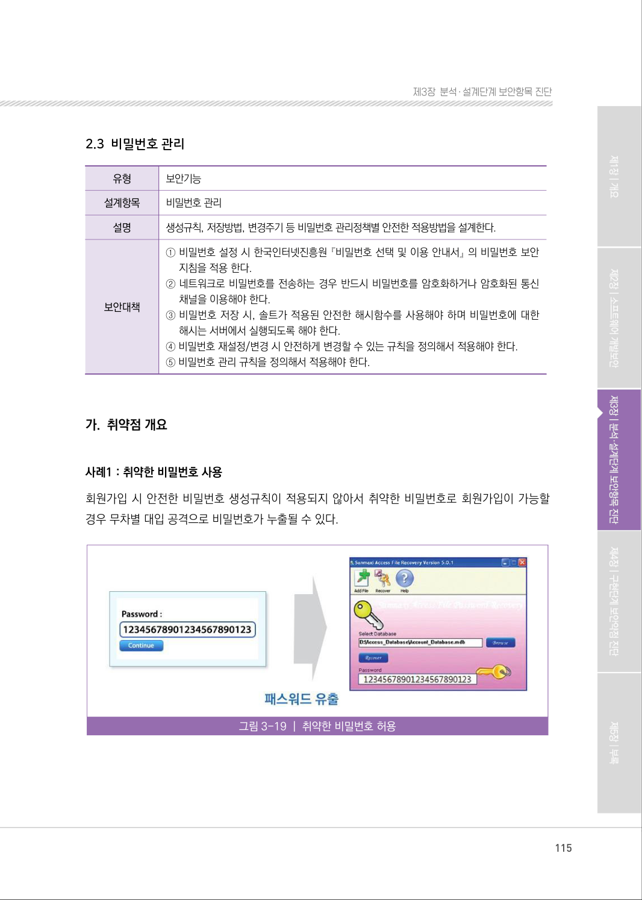

</details>

### PDF 116페이지 / 인쇄 116페이지

<!-- source-page:SW-Diagnosis-2021:116; source-lines:0,1,2,3,4,5,6,7,8,9 -->

116

사례2 : 취약한 비밀번호 복구
비밀번호 복구 메커니즘(아이디/비밀번호 찾기 등)이 취약한 경우 공격자가 불법적으로 다른 사용자의 
비밀번호를 획득, 변경, 복구할 수 있다.

그림3-20 | 취약한 비밀번호 복구

사례3: 하드코드된 중요정보
프로그램 코드 내부에 비밀번호를 하드 코딩하여 내부 인증에 사용하거나 외부 컴포넌트와 통신을 
하는 경우, 관리자용 계정 정보가 노출될 수 있어 위험하다. 또한, 코드 내부에 하드코드된 비밀번호가 
인증실패를 발생시키는 경우, 시스템 관리자가 그 실패의 원인을 파악하기 쉽지 않다.

그림3-21 | 하드코드된 중요정보

<details><summary>원본 페이지 이미지 (변환 외 보존 자료)</summary>

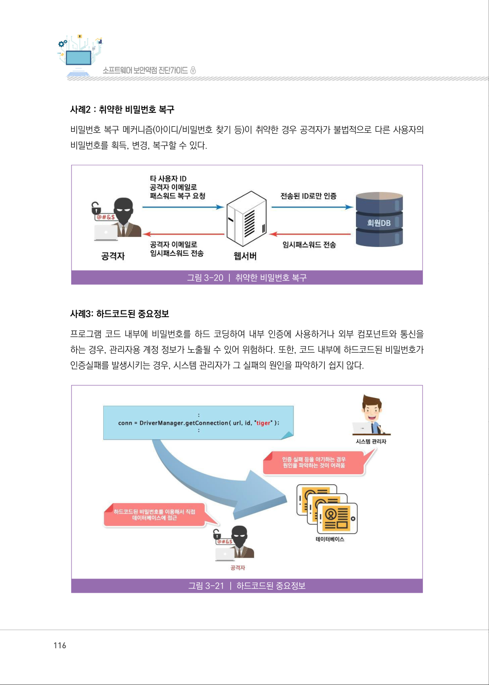

</details>

### PDF 117페이지 / 인쇄 117페이지

<!-- source-page:SW-Diagnosis-2021:117; source-lines:0,1,2,3,4,5,6,7,8,9,10,11,12,13,14,15,16,17,18,19,20,21,22,23,24,25,26,27,28,29,30,31,32,33,34,35,36,37,38,39,40,41,42,43,44,45,46 -->

117

제3장분석․ 설계단계 보안항목 진단

#### 나. 설계시 고려사항

① 비밀번호 설정 시 한국인터넷진흥원의 『패스워드 선택 및 이용 안내서』의 안전한 비밀번호 

생성규칙을 적용한다.

표3‐13

비밀번호 설정규칙

[표 3-14]와 같은 솔루션 사용을 고려하여 사용자가 안전한 비밀번호를 사용하도록 유도한다.

표3‐14

비밀번호 안전성 검증 솔루션

|  |  |
| --- | --- |
| 개발환경 | 활용 가능한 프레임워크 또는 라이브러리 |
| PHP, JSP,<br>ASP | 비밀번호 안전성 검증 S/W : http://seed.kisa.or.kr/iwt/ko/sup/EgovSafePwdLb. do<br>웹 사이트의 회원가입, 비밀번호 변경 및 로그인 메뉴에서 사용자가 입력한 비밀번호에 대한<br>안전성을 검사하여 그 결과를 알려주는 무료 S/W이다. 기본 알고리즘은 C언어로 개발되었으나<br>PHP 확장기능, JNI기능을 활용하여 다양한 서버측 언어로 이용가능하다. |

| 구분 | 안전한 비밀번호 | 안전하지 않은 비밀번호 |
| --- | --- | --- |
| 설명 | • 두 종류 이상의 문자 구성과 8자리<br>이상의 길이로 구성된 문자열<br>※ 문자 종류는 알파벳 대·소문자, 특수문자,<br>숫자 등 4가지<br>• 10자리 이상의 길이로 구성된 문자열<br>※ 숫자로만 구성할 경우 취약할 수 있음 | • 특정 패턴을 갖는 비밀번호<br>※ 동일한 문자의 반복(예, ‘123123’)<br>※ 키보드 상 연속한 위치에 존재하는 문자열(예, ‘qwerty’)<br>※ 숫자가 제일 앞이나 뒤에 오는 구성(예, ‘1security’)<br>• 제3자가 알 수 있는 개인정보를 바탕으로 구성<br>※ 가족, 이름, 생일, 주소, 휴대전화 번호를 포함하는<br>비밀번호<br>• 이용자 ID를 이용<br>※ 이용자 ID가 ‘kisa’일 경우 비밀번호를 ‘kisa1’ 등으로 설정<br>• 한글, 영어 등 사전적 단어로 구성<br>(예, ‘바다나라’, ‘love12’ 등)<br>• 특정 인물이나 널리 알려진 단어를 포함하는 비밀번호<br>※ 사이트, 기업명, 연예인 이름 등의 특정 명칭을 의미<br>• 숫자와 영문자를 비슷한 문자로 치환한 형태로 구성<br>※ 영문자 ‘O’을 숫자’0’, 영문자 ‘I’를 숫자 ‘1’로 치환 등<br>• 기타<br>※ 시스템에서 초기 설정되거나 예제로 제시된 비밀번호<br>※ 한글의 발음을 영문으로, 영문단어의 발음을 한글로<br>변경한 형태의 비밀번호 |

<details><summary>원본 페이지 이미지 (변환 외 보존 자료)</summary>

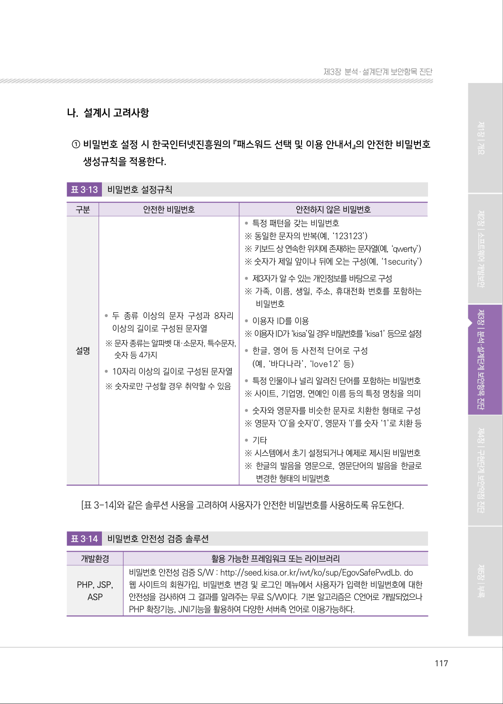

</details>

### PDF 118페이지 / 인쇄 118페이지

<!-- source-page:SW-Diagnosis-2021:118; source-lines:0,1,2,3,4,5,6,7,8,9,10,11,12,13,14,15,16,17,18,19,20,21,22,23,24,25,26,27,28,29,30,31,32,33,34,35,36,37,38,39,40,41 -->

118

② 네트워크로 비밀번호를 전송하는 경우 반드시 비밀번호를 암호화하거나 암호화된 통신 

채널을 이용해야 한다.
웹브라우저와 같은 클라이언트와 웹서버 간의 통신, 서버와 서버 간의 통신 등 인터넷과 같은 
공중망 환경에서는 비밀번호와 같은 중요정보를 송·수신하는 경우 보호대책이 필요하다. 이러한 
보호대책으로 TLS, VPN 등과 같은 다양한 통신 암호기술을 적용할 수 있다.
시스템관리자 및 보안관리자는 TLS를 적용하거나 관련 솔루션을 도입할 때 제품이 표준에 부합하는지, 
상호호환성을 보장하는지, 검증된 제품인지, 오픈소스를 이용하는지 등을 확인해야 한다.
[표 3-15]는 NIST에서 제정한 TLS버전별로 안전하게 이용할 수 있는 암호화알고리즘 구성이다.

표3‐15

TLS 버전별 안전한 암호화 알고리즘

③ 비밀번호 저장 시, 솔트가 적용된 안전한 해시함수를 사용해야 하며, 해시는 서버에서 

실행되도록 해야 한다.
비밀번호는 복호화 되지 않는 일방향 해시함수를 사용해서 암호화하여 저장해야 한다.

[참고 3] 일방향 해시함수

일방향 해시함수는 수학적인 연산으로 원본 메시지를 변환하여 암호화된 메시지인 다이제스트를 생
성한다. 원본 메시지를 알면 암호화된 메시지를 구하기는 쉽지만 암호화된 메시지로는 원본 메시지를 구
할 수 없어야 하며 이를 ‘일방향성’이라고 한다.

암호화방식

```text
구분
알고리즘 
(TLS_키교환알고리즘_WITH_암호알고리즘_메시지인증알고리즘)
서명
TLS 1.2 
서버
TLS_RSA_WITH_AES_256_GCM_SHA384
DSA, 
ECDSA
TLS_ECDHE_ECDSA_WITH_AES_128_CBC_SHA256
TLS_ECDHE_ECDSA_WITH_AES_128_GCM_SHA256
TLS_ECDHE_ECDSA_WITH_AES_256_GCM_SHA384
TLS_ECDHE_RSA_WITH_AES_128_CBC_SHA256
TLS_ECDHE_RSA_WITH_AES_128_GCM_SHA256
TLS
서버
TLS_RSA_WITH_AES_256_CBC_SHA
DSA, 
ECDSA
TLS_ECDHE_ECDSA_WITH_3DES_EDE_CBC_SHA
TLS_ECDHE_ECDSA_WITH_AES_128_CBC_SHA
TLS_ECDHE_RSA_WITH_3DES_EDE_CBC_SHA
TLS_ECDHE_RSA_WITH_AES_128_CBC_SHA
```

<details><summary>원본 페이지 이미지 (변환 외 보존 자료)</summary>

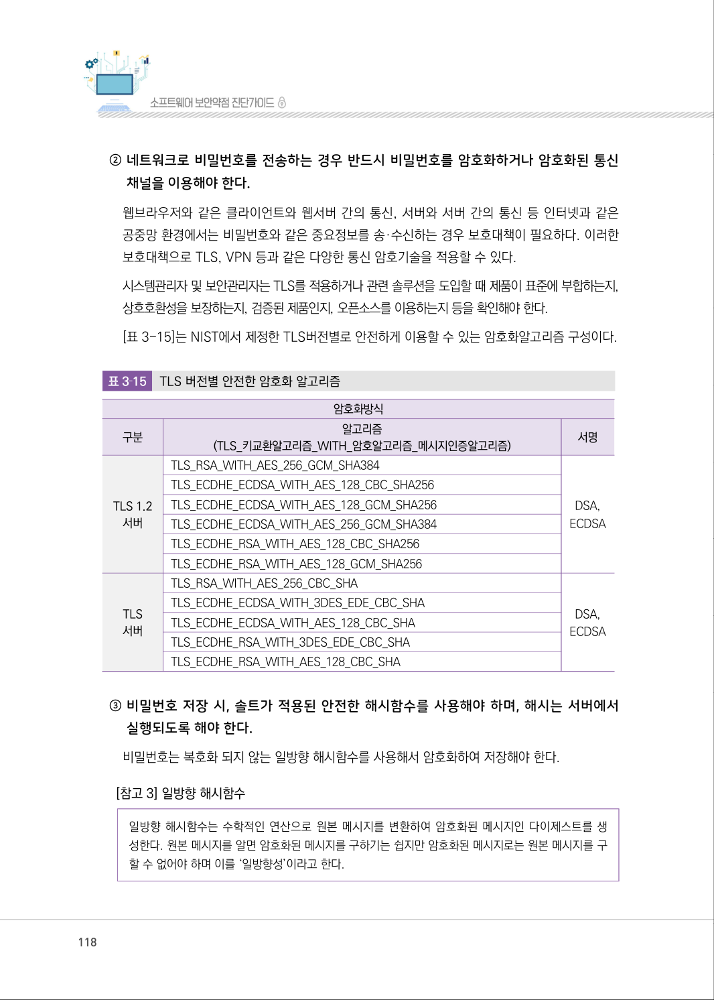

</details>

### PDF 119페이지 / 인쇄 119페이지

<!-- source-page:SW-Diagnosis-2021:119; source-lines:0,1,2,3,4,5,6,7,8,9,10,11,12,13,14,15,16,17,18,19,20,21,22,23,24,25,26,27,28,29 -->

119

제3장분석․ 설계단계 보안항목 진단

[참고 4] 일방향 해시함수의 문제점

  일부에서는 SHA‐256과 같은 해시 함수를 사용해 비밀번호를 암호화하여 저장하고 인증 요청 시, 
저장된 값과 비교하는 것만으로 충분한 암호화 메커니즘을 적용했다고 생각하지만, 해시 함수는 동일한 
메시지는 동일한 다이제스트로 생성되는 구조이므로 무차별 대입으로 원본 문자열의 인식 가능성
(recognizability)의 문제가 존재하며,  해시함수의 빠른 처리 속도 덕분에 공격자도 매우 빠른 속도로 
임의의 문자열을 다이제스트 할 수 있는 문제점을 가질 수 있다. 
  이러한 문제점을 해결하기 위해 솔트(salt)값을 추가하여 해시함수를 실행한다. 솔트(salt)는 일방향 
해시 함수에서 다이제스트를 생성할 때 추가되는 바이트 단위의 임의의 문자열이다. 예를 들어 비밀
번호가 "!t0Et67d3" 이라면 여기에 랜덤하게 생성된 솔트인 “rG7f32‐1dYjfgfd‐9F3fgd‐l4fGdg‐
f4Tmlf”를 추가해 다이제스트를 생성하면, 공격자가 “!t0Et67d3”의 다이제스트를 알아내더라도 솔트 
값이 추가된 다이제스트를 대상으로 비밀번호 일치 여부를 확인하는 것이 어렵게 된다. 
  솔트와 비밀번호의 다이제스트를 데이터베이스에 저장하고, 사용자가 로그인할 때 입력한 비밀번호를 
해시하여 일치 여부를 확인하므로, 즉 모든 비밀번호가 고유의 솔트를 갖고 솔트의 길이가 32바이트 
이상이면 솔트 값이 노출되지 않는 이상 다이제스트를 추측하기 어렵다.

④ 비밀번호 재설정/변경 시 안전하게 변경할 수 있는 규칙을 정의해서 적용해야 한다.

비밀번호 변경은 주기적인 변경과 분실 시 재설정으로 나누어 볼 수 있다.

(ㄱ) 비밀번호 변경
사용자 및 관리자는 안전한 비밀번호 관리를 위해 주기적으로 비밀번호를 변경하여 비밀번호의 
노출위협을 최소화하여야 한다. 사용자는 자신의 비밀번호가 제3자에게 노출되었을 경우 즉시 
새로운 비밀번호로 변경해야 한다. 비밀번호 변경 시 이전에 사용하지 않은 새로운 비밀번호로 
변경해야 하며, 이전의 비밀번호와 연관성이 없어야 한다.

(ㄴ) 비밀번호 재설정
비밀번호를 잊어버렸거나 분실하는 경우 비밀번호 재설정이 필요하다. “비밀번호 찾기” 기능 
구현 시 I-pin 인증, 휴대전화 인증, 질의답변 검증 등으로 비밀번호 재설정 권한을 확인하고 회
원가입 시 등록된 이메일 주소를 이용하여 비밀번호를 재설정할 수 있는 링크를 전송한다. 사
용자는 해당 링크를 클릭하여 자신의 비밀번호를 재설정할 수 있도록 설계한다.

⑤ 비밀번호 관리 규칙을 정의해서 적용해야 한다.

안전한 비밀번호 관리를 위해 다음과 같은 항목을 고려한다.

<details><summary>원본 페이지 이미지 (변환 외 보존 자료)</summary>

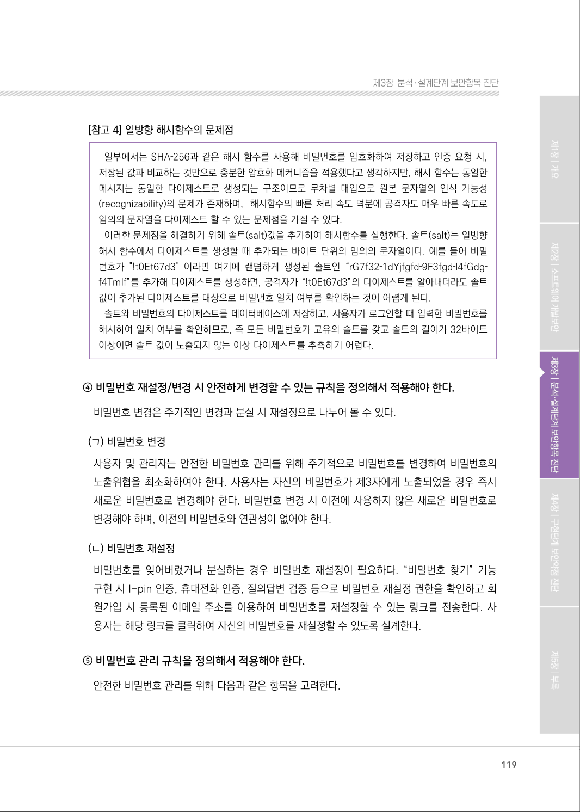

</details>

### PDF 120페이지 / 인쇄 120페이지

<!-- source-page:SW-Diagnosis-2021:120; source-lines:0,1,2,3,4,5,6,7,8,9,10,11,12,13,14,15,16,17,18,19,20,21,22 -->

120

(ㄱ) 변경주기
비밀번호는 3개월(또는 6개월)마다 주기적으로 변경하도록 한다.

(ㄴ) 만료기간 설정
일정기간 시스템 사용자에 대해서는 비밀번호 만료기간을 설정한다.
사용자 정보를 저장하는 DB 테이블에 개인정보 변경주기를 추가한 뒤 일단위로 해당 필드가 업
데이트 되도록 한다. 비밀번호 기간이 만료되면 로그인시 사용자에게 비밀번호 변경을 요청하고, 
비밀번호 변경시 개인정보 변경주기를 초기화하도록 설계한다.

(ㄷ) 성공한 로그인 시간 관리
마지막으로 성공한 로그인 시간 정보를 관리해야 한다.
사용자 테이블에 마지막으로 로그인한 시간정보를 저장하고 사용자에게 알림으로써 계정도용 
여부를 점검 할 수 있도록 개발가이드 구현단계를 작성한다.

[참고 5] 비밀번호 관리 주기

A. 비밀번호 생성

개인 비밀번호는 사용자가 직접 생성하고 그룹 비밀번호는 그룹의 장이 생성하여 구성원들에게 안전한 
방법으로 전달한다.
B. 비밀번호 사용

비밀번호는 제 3자에게 노출되지 않도록 해야 하며, 자신의 비밀번호와 관련된 정보 및 힌트를 제공
하지 않아야 한다. 비밀번호 변경주기는 3개월(또는 6개월)이다. 시스템 및 소프트웨어의 초기 비밀
번호는 설치시 즉시 변경해야 한다.
C. 비밀번호 폐기

비밀번호는 사용용도가 끝나거나 사용주기가 지난 경우 폐기한다. 인증 비밀번호는 시스템 담당자가 
사용자 계정의 삭제와 함께 폐기하고, 암호화 비밀번호는 사용자가 직접 폐기한다.

<details><summary>원본 페이지 이미지 (변환 외 보존 자료)</summary>

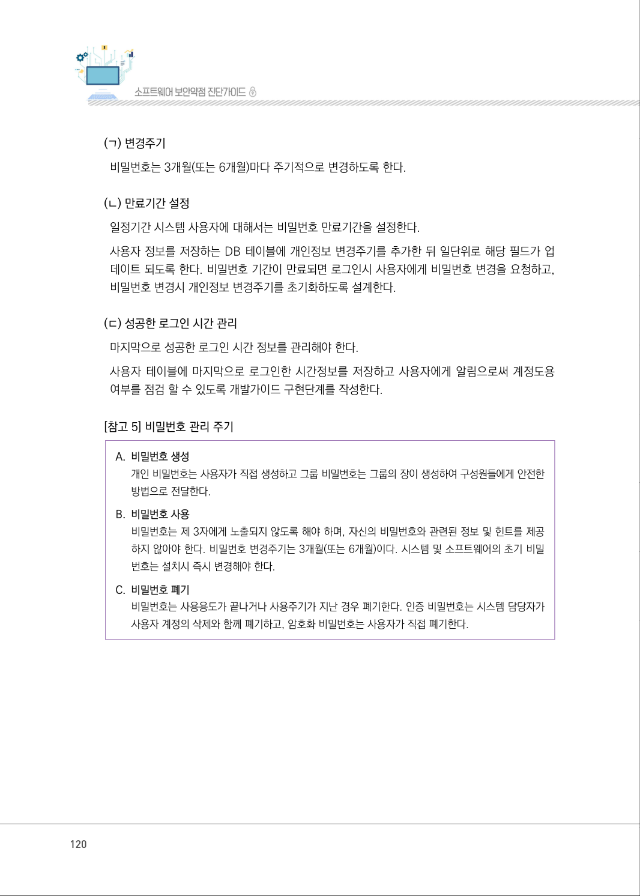

</details>

### PDF 121페이지 / 인쇄 121페이지

<!-- source-page:SW-Diagnosis-2021:121; source-lines:0,1,2,3,4,5,6,7,8,9,10,11,12,13,14,15,16,17,18,19,20,21,22,23,24,25,26,27,28,29,30 -->

121

제3장분석․ 설계단계 보안항목 진단

#### 다. 진단 세부사항

요구사항 ①
비밀번호를 설정할 때 한국인터넷진흥원 『패스워드 선택 및 이용 안내서』의 비밀번호 설정규칙을 
적용해야 한다. 조합규칙, 길이 등 비밀번호가 안전하게 설정되도록 설계되어 있는지 확인한다.

#### 1. 비밀번호 설정 규칙이 안전하게 정의되어 있는가?

#### 2. 비밀번호 설정 규칙을 점검하는 테스트 계획이 수립되어 있는가?

#### 1. 비밀번호 설정 규칙이 안전하게 정의되어 있는가?

| 진단방법 | 관련산출물 검토예시 |
| --- | --- |
| 1-1 요구사항정의서에 설계항목에 대한 대책이 수립되어 있으며, 아키텍처<br>설계서에 설계항목 적용계획이 수립되어 있고, 요구사항추적표로 요구<br>사항 추적 가능 여부 확인 | 요구사항정의서, 요구사항추적표,<br>아키텍처 설계서 검토 |
| 1-2 비밀번호 설정 규칙 정의 시 “문자구성 및 길이조건”, “특정 정보 이용<br>및 패턴 조건”, “기타조건”과 같은 안전한 비밀번호 설정규칙이 설계에<br>적용되었는지 확인<br>- 길이 : 조합 규칙의 복잡도에 따라 최소 8자리 이상<br>- 조합 규칙 : 숫자, 영 대·소 문자, 특수문자 포함<br>- 제한 문자열 : 전화번호, 동일 문자열 반복 제한 등<br>※ 상세 내용은 패스워드 선택 및 이용 안내서(한국인터넷진흥원) 참조 | 요구사항정의서, 유즈케이스설계서,<br>프로그램명세서, 클래스설계서 검토 |

#### 2. 비밀번호 설정규칙을 점검하는 테스트 계획이 수립되어 있는가?

| 진단방법 | 관련산출물 검토예시 |
| --- | --- |
| 2-1 비밀번호 설정규칙을 위배하는 입력값과 그 예상 결과를 포함하는<br>테스트 계획이 수립되어 있는지 확인 | 단위테스트계획서 검토 |

<details><summary>원본 페이지 이미지 (변환 외 보존 자료)</summary>

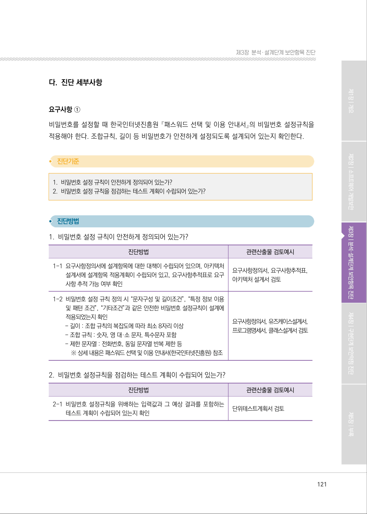

</details>

### PDF 122페이지 / 인쇄 122페이지

<!-- source-page:SW-Diagnosis-2021:122; source-lines:0,1,2,3,4,5,6,7,8,9,10,11,12,13,14,15,16,17,18,19,20,21,22,23,24,25,26,27,28,29,30,31,32,33,34 -->

122

요구사항정의서, 요구사항추적표, 아키텍처설계서, 개발가이드, 프로그램명세서, 단위테스트계획서 등

요구사항 ②
네트워크로 비밀번호를 전송하는 경우 반드시 비밀번호를 암호화하거나 암호화된 통신 채널을 이용
해야 한다.
네트워크로 비밀번호 전송 시 암호화 또는 암호화 채널을 사용하도록 설계되어 있는지 확인한다.

#### 1. 네트워크로 전송되는 비밀번호가 안전한 암호 알고리즘으로 암호화되거나, 안전한 암호화된 통신 채널을 사용

하도록 설계되어 있는가?

#### 2. 네트워크로 전송되는 비밀번호의 암호화를 점검하는 테스트 계획이 수립되어 있는가?

#### 1. 네트워크로 전송되는 비밀번호가 안전한 암호 알고리즘으로 암호화되거나, 안전한 암호화된 통신

채널을 사용하도록 설계되어 있는가?

| 진단방법 | 관련산출물 검토예시 |
| --- | --- |
| 1-1 요구사항정의서에 설계항목에 대한 대책이 수립되어 있으며, 아키텍처<br>설계서에 설계항목 적용계획이 수립되어 있고, 요구사항추적표로 요구<br>사항 추적 가능 여부 확인 | 요구사항정의서, 요구사항추적표,<br>아키텍처 설계서 검토 |
| 1-2 회원가입, 로그인 등 네트워크로 비밀번호가 전송되는 기능이 분류<br>되어 있는지 확인 | 요구사항정의서, 유즈케이스설계서,<br>프로그램명세서, 클래스설계서 검토 |
| 1-3 비밀번호를 암호화해서 전송하는 경우, 안전한 암호 알고리즘을 사용하여<br>암호화하도록 설계되어 있는지 확인 | 유즈케이스명세서, 클래스설계서<br>검토 |
| 1-4 비밀번호를 암호화된 통신채널을 이용하여 전송하는 경우, TLS, VPN<br>등 안전한 통신 채널을 사용하도록 설계되어 있는지 확인 | 아키텍처설계서 검토 |

#### 2. 네트워크로 전송되는 비밀번호의 암호화를 점검하는 테스트 계획이 수립되어 있는가?

진단방법

관련산출물 검토예시

2-1 네트워크 구간의 패킷 스니핑 등으로 비밀번호의 암호화 전송을 점

검하는 테스트 계획이 수립되어 있는지 확인

단위테스트계획서 검토

<details><summary>원본 페이지 이미지 (변환 외 보존 자료)</summary>

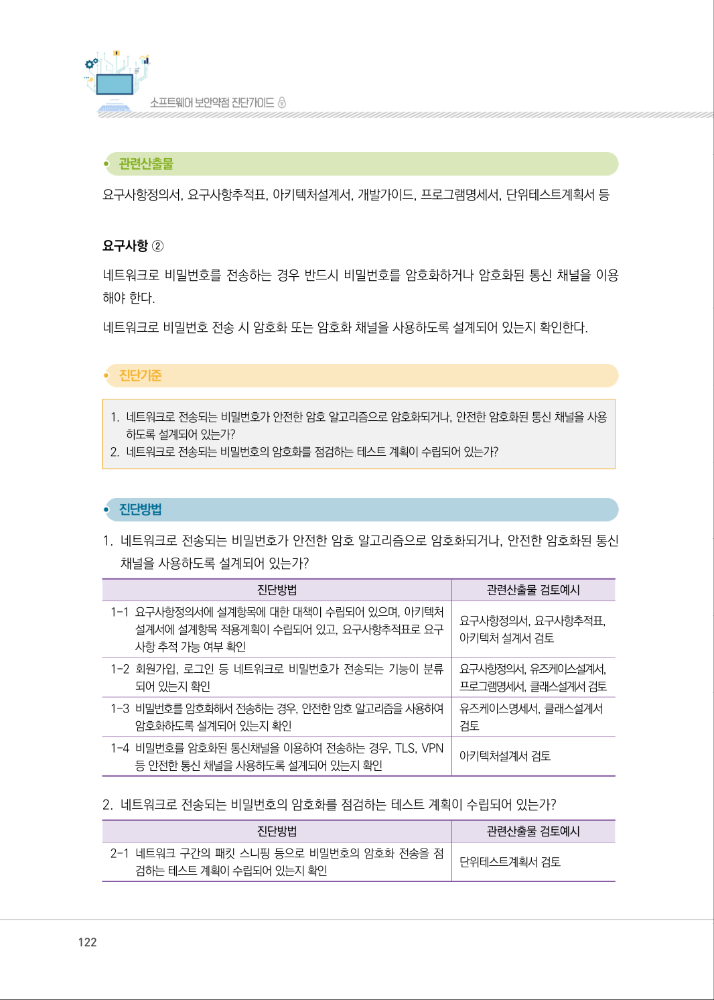

</details>

### PDF 123페이지 / 인쇄 123페이지

<!-- source-page:SW-Diagnosis-2021:123; source-lines:0,1,2,3,4,5,6,7,8,9,10,11,12,13,14,15,16,17,18,19,20,21,22,23,24,25,26,27,28,29,30,31,32,33 -->

123

제3장분석․ 설계단계 보안항목 진단

요구사항정의서, 요구사항추적표, 아키텍처설계서, 유즈케이스명세서, 개발가이드, 프로그램명세서, 
단위테스트케이스 등

요구사항 ③
비밀번호 저장 시, 솔트가 적용된 안전한 해시함수를 사용해야 하며, 해시함수 실행은 서버에서 해야 
한다.
비밀번호 저장 시 해시함수를 사용하도록 설계하고, 사용할 해시함수와 솔트 값을 포함한 해시함수 
사용 방법이 명시되어 있는지 확인한다.

#### 1. 비밀번호 저장 또는 변경시 솔트가 적용된 안전한 해시함수를 이용하여 암호화 하도록 설계되어 있는가?

#### 2. 해시함수를 이용한 비밀번호 암호화가 서버에서 실행되도록 설계되어 있는가?

#### 3. 저장된 비밀번호의 안전성을 점검하는 테스트 계획이 수립되어 있는가?

#### 1. 비밀번호 저장 또는 변경시 솔트가 적용된 안전한 해시함수를 이용하여 암호화하도록 설계되어 

있는가?

| 진단방법 | 관련산출물 검토예시 |
| --- | --- |
| 1-1 요구사항정의서에 설계항목에 대한 대책이 수립되어 있으며, 아키텍처<br>설계서에 설계항목 적용계획이 수립되어 있고, 요구사항추적표로 요구<br>사항 추적 가능 여부 확인 | 요구사항정의서, 요구사항추적표,<br>아키텍처 설계서 검토 |
| 1-2 비밀번호를 암호화하기위해 SHA-2 계열(SHA-224, SHA-256, SHA<br>384, SHA-512)의 해시함수를 사용하는지 확인 | 요구사항정의서, 아키텍처설계서,<br>유즈케이스설계서, 클래스설계서<br>검토 |
| 1-3 해시함수 사용시 솔트값(랜덤하게 생성하여 사용)을 사용하도록 설계<br>되어 있는지 확인 | 유즈케이스명세서, 클래스설계서,<br>DB 설계서 검토 |
| 1-4 솔트값은 데이터 암·복호화에 사용되는 암호키가 저장되는 장소에 저장<br>되도록 설계되어 있는지 확인 | 유즈케이스명세서, 클래스설계서,<br>DB 설계서 검토 |

<details><summary>원본 페이지 이미지 (변환 외 보존 자료)</summary>

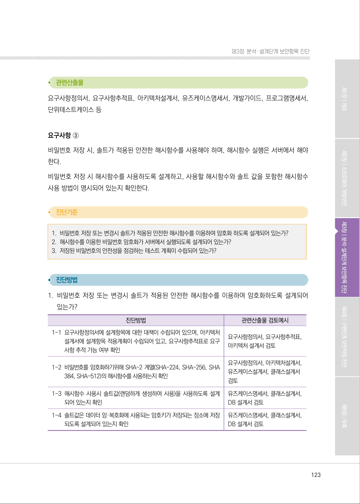

</details>

### PDF 124페이지 / 인쇄 124페이지

<!-- source-page:SW-Diagnosis-2021:124; source-lines:0,1,2,3,4,5,6,7,8,9,10,11,12,13,14,15,16,17,18,19,20,21,22,23,24,25,26,27,28,29,30,31,32,33 -->

124

#### 2. 해시함수를 이용한 비밀번호 암호화가 서버에서 실행되도록 설계되어 있는가?

| 진단방법 | 관련산출물 검토예시 |
| --- | --- |
| 2-1 해시함수를 이용해서 일방향 암호를 서버에서 수행하는 프로그램이<br>설계되어 있는지 확인 | 유즈케이스설계서, 프로그램명세서,<br>클래스설계 검토 |

#### 3. 저장된 비밀번호의 안전성을 점검하는 테스트 계획이 수립되어 있는가?

| 진단방법 | 관련산출물 검토예시 |
| --- | --- |
| 3-1 비밀번호 크랙도구를 이용하여 DB에 저장된 비밀번호의 안전을 점검<br>하는 테스트 계획이 수립되어 있는지 확인 | 단위테스트계획서 검토 |

요구사항정의서, 요구사항추적표, 아키텍처설계서, 유즈케이스명세서, 프로그램명세서, 클래스 설계서, 
단위테스트케이스 등

요구사항 ④
비밀번호 재설정/변경 시 안전하게 변경할 수 있는 규칙을 정의해서 적용해야 한다.
비밀번호를 주기적으로 변경하고, 비밀번호 변경 및 비밀번호 분실로 인한 재설정 시 안전하게 변경 
절차가 이루어지도록 설계되어 있는지 확인한다.

#### 1. 비밀번호를 안전하게 변경할 수 있도록 설계되어 있는가?

#### 2. 비밀번호를 안전하게 재설정 할 수 있도록 설계되어 있는가?

#### 3. 비밀번호 변경 또는 재설정이 안전하게 수행되는지를 점검하는 테스트 계획이 수립되어 있는가?

#### 1. 비밀번호를 안전하게 변경할 수 있도록 설계되어 있는가?

| 진단방법 | 관련산출물 검토예시 |
| --- | --- |
| 1-1 요구사항정의서에 설계항목에 대한 대책이 수립되어 있으며, 아키텍처<br>설계서에 설계항목 적용계획이 수립되어 있고, 요구사항추적표로 요구<br>사항 추적 가능 여부 확인 | 요구사항정의서, 요구사항추적표,<br>아키텍처 설계서 검토 |
| 1-2 비밀번호 변경 시 기존 비밀번호를 확인하도록 설계되어 있는지 확인 | 요구사항정의서, 아키텍처설계서,<br>유즈 케이스설계서, 클래스설계서 검토 |

<details><summary>원본 페이지 이미지 (변환 외 보존 자료)</summary>

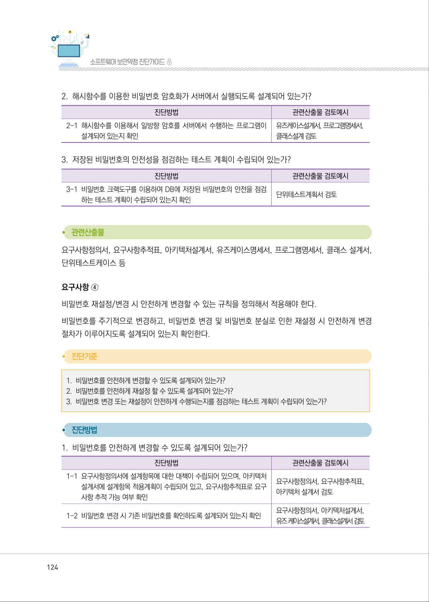

</details>

### PDF 125페이지 / 인쇄 125페이지

<!-- source-page:SW-Diagnosis-2021:125; source-lines:0,1,2,3,4,5,6,7,8,9,10,11,12,13,14,15,16,17,18,19,20,21,22,23,24,25,26,27,28,29,30,31,32,33,34,35,36,37,38,39 -->

125

제3장분석․ 설계단계 보안항목 진단

#### 2. 비밀번호를 안전하게 재설정 할 수 있도록 설계되어 있는가?

| 진단방법 | 관련산출물 검토예시 |
| --- | --- |
| 2-1 비밀번호 재설정 요청 시, 안전한 본인인증 절차를 거치도록 설계되어<br>있는지 확인<br>- 본인 휴대전화인증<br>- I-pin인증<br>- 공인인증서인증<br>- 신용카드인증 등 | 유즈케이스설계서, 프로그램명세서,<br>클래스설계서 검토 |
| 2-2 본인 인증 후 비밀번호 재설정 페이지 연결방식이 안전하게 설계되어<br>있는지 확인<br>- 회원가입 시 등록한 이메일을 이용한 재설정페이지 전송 등 | 요구사항정의서, 아키텍처설계서,<br>유즈케이스설계서, 클래스설계서<br>검토 |

#### 3. 비밀번호 변경 또는 재설정이 안전하게 수행되는지를 점검하는 테스트 계획이 수립되어 있는가?

| 진단방법 | 관련산출물 검토예시 |
| --- | --- |
| 3-1 비밀번호 변경 시 권한이 있는 사용자만 비밀번호 변경이 가능한지를<br>점검하는 테스트 계획이 수립되어 있는지 확인 | 단위테스트계획서 검토 |
| 3-2 비밀번호 재설정 시 본인인증 절차를 우회하거나 비밀번호 재설정 경로로<br>직접 접근하여 비밀번호 재설정이 가능한지를 점검하는 테스트 계획이<br>수립되어 있는지 확인 | 단위테스트계획서 검토 |

요구사항정의서, 요구사항추적표, 아키텍처설계서, 유즈케이스설계서,DB설계서, 클래스설계서, 개발 
가이드, 프로그램명세서, 단위테스트계획서 등

요구사항 ⑤
비밀번호 관리 규칙을 정의해서 적용해야 한다.
비밀번호 변경주기, 만료기간 설정, 성공한 로그인 시간 관리를 포함하여 비밀번호 관리규칙이 설계
되어 있는지 확인한다.

| 진단방법 | 관련산출물 검토예시 |
| --- | --- |
| 1-3 안전한 비밀번호 설정규칙이 적용되도록 설계되어 있는지 확인 | 유즈케이스명세서, 클래스설계서,<br>DB 설계서 검토 |

<details><summary>원본 페이지 이미지 (변환 외 보존 자료)</summary>

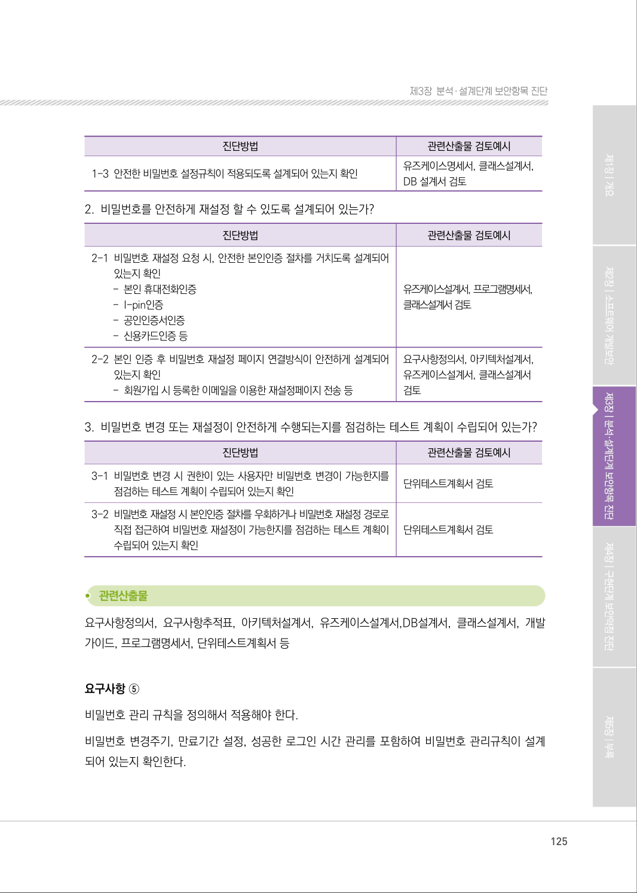

</details>

### PDF 126페이지 / 인쇄 126페이지

<!-- source-page:SW-Diagnosis-2021:126; source-lines:0,1,2,3,4,5,6,7,8,9,10,11,12,13,14,15,16,17,18,19,20,21,22,23,24,25,26,27,28,29,30,31,32,33,34 -->

126

#### 1. 비밀번호 관리 규칙이 설계되어 있는가?

#### 2. 비밀번호 관리 규칙을 점검하는 테스트 계획이 수립되어 있는가?

#### 1. 비밀번호 관리 규칙이 설계되어 있는가?

| 진단방법 | 관련산출물 검토예시 |
| --- | --- |
| 1-1 요구사항정의서에 설계항목에 대한 대책이 수립되어 있으며, 아키텍처<br>설계서에 설계항목 적용계획이 수립되어 있고, 요구사항추적표로 요구<br>사항 추적 가능 여부 확인 | 요구사항정의서, 요구사항추적표,<br>아키텍처 설계서 검토 |
| 1-2 비밀번호 만료기간이나 변경 주기에 대한 정책이 정의되어 있는지 확인 | 요구사항정의서, 아키텍처설계서<br>검토 |
| 1-3 비밀번호 만료기간이나 변경주기 정책을 관리할 수 있도록 데이터베이스와<br>프로그램 기능이 설계되어 있는지 확인<br>- 비밀번호 최종변경일, 비밀번호 만료기간, 변경주기 등의 정보 관리 | 프로그램명세서, 유즈케이스설계서,<br>클래스설계서, DB설계서 검토 |

#### 2. 비밀번호 관리 규칙을 점검하는 테스트 계획이 수립되어 있는가?

| 진단방법 | 관련산출물 검토예시 |
| --- | --- |
| 2-1 비밀번호 만료기간이나 변경주기 정책이 수립되어 있는 경우, 해당<br>정책이 안전하게 적용되었는지를 점검하기 위한 테스트 계획이 수립되어<br>있는지 확인 | 단위테스트케이스 검토 |

요구사항정의서, 요구사항추적표, 아키텍처설계서, 개발가이드, 유즈케이스설계서, 프로그램명세서, 
클래스설계서, 단위테스트계획서 등

#### 라. 연관된 구현단계 보안약점 항목

유형

보안약점 항목

보안기능

하드코드된 중요정보

보안기능

취약한 비밀번호 허용

<details><summary>원본 페이지 이미지 (변환 외 보존 자료)</summary>

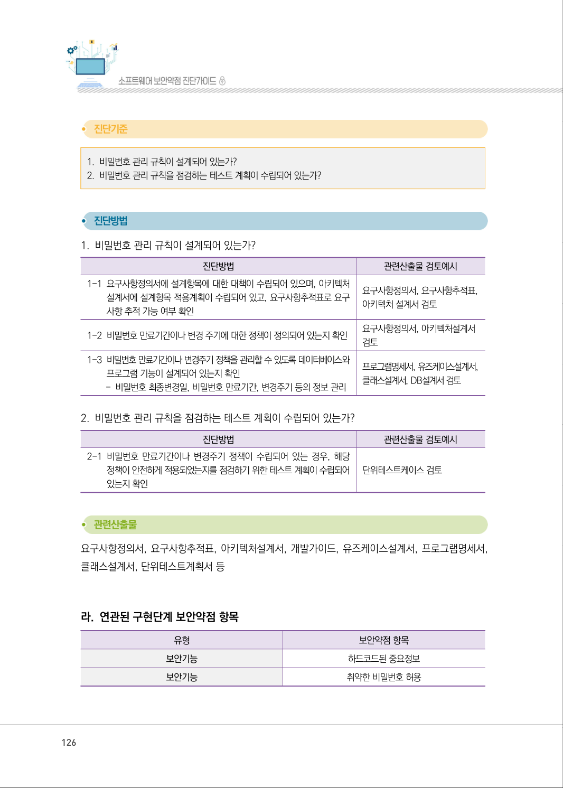

</details>

### PDF 127페이지 / 인쇄 127페이지

<!-- source-page:SW-Diagnosis-2021:127; source-lines:0,1,2,3,4,5,6,7,8,9,10,11,12,13,14,15,16,17,18,19,20,21 -->

127

제3장분석․ 설계단계 보안항목 진단

#### 마. 참고자료

①CWE‐521 Weak Password Requirements, MITRE,

http://cwe.mitre.org/data/definitions/521.html
②2013 OWASP Top 10‐A2 Broken Authentication and Session Management, OWASP,

https://www.owasp.org/ index.php/Top_10_2013
③2016 OWASP Application Security Verification Standard, OWASP, Authentication 

Verification Requirements,
http://www.owasp.org/index.php/Category:OWASP_Application_Security_Verific
ation_Standard_Project
④WASC Threat Classification Abuse of Functionality, WASC,

http://projects.webappsec.org/w/page/13246913/Abuse%20of%20Functionality
⑤WASC Threat Classification Insufficient Password Recovery, WASC,

http://projects.webappsec.org/w/page/13246942/Insufficient%20Password%20
Recovery
⑥암호이용 안내서, 한국인터넷진흥원,

http://www.kisa.or.kr/jsp/common/downloadAction.jsp?bno=259&amp;dno=31&amp;fseq=1
⑦Forgot Password Cheat Sheet, OWASP,

http://www.owasp.org/index.php/Forgot_Password_Cheat_Sheet
⑧Password Storage Cheat Sheet, OWASP,

http://www.owasp.org/index.php/Password_Storage_Cheat_Sheet

<details><summary>원본 페이지 이미지 (변환 외 보존 자료)</summary>

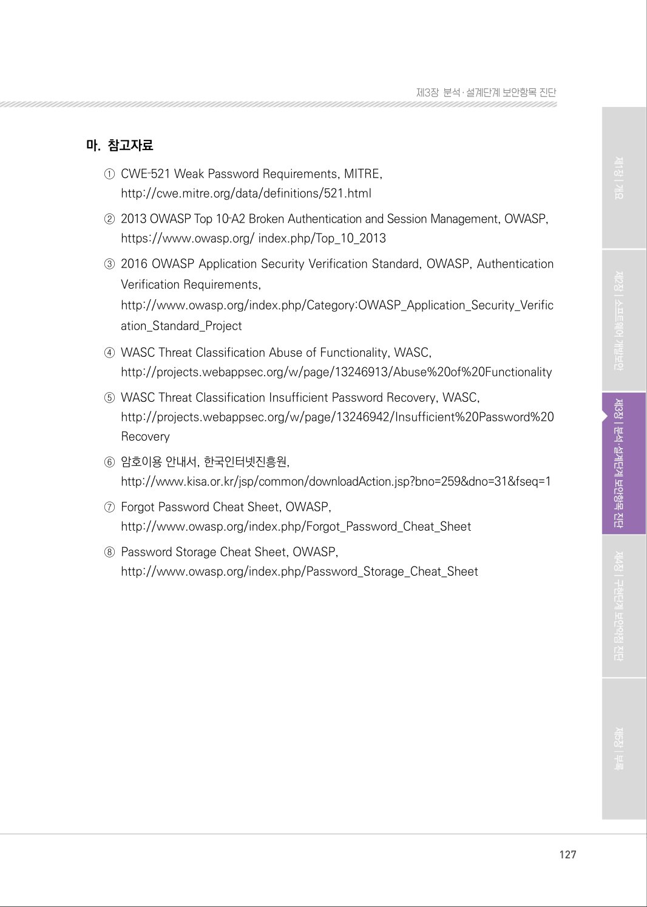

</details>

---

## 탐색 링크 (원문 외)

[통합 인덱스](../../../INDEX.md)

