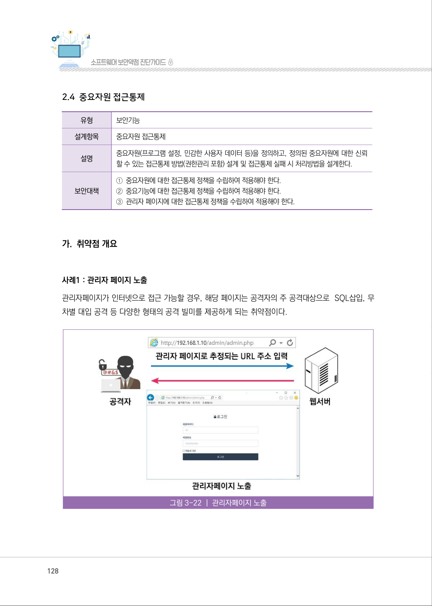
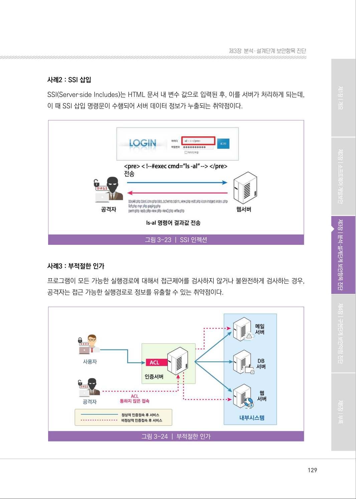
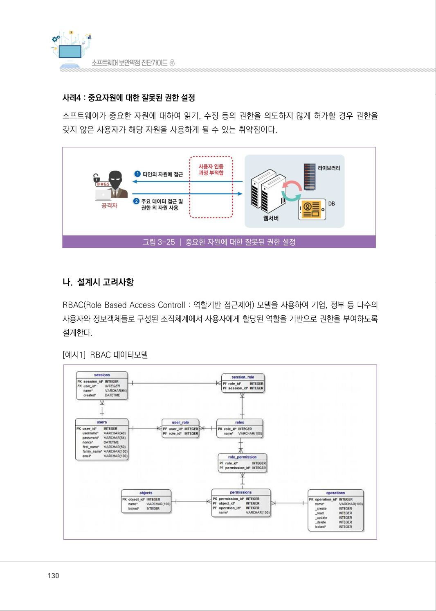
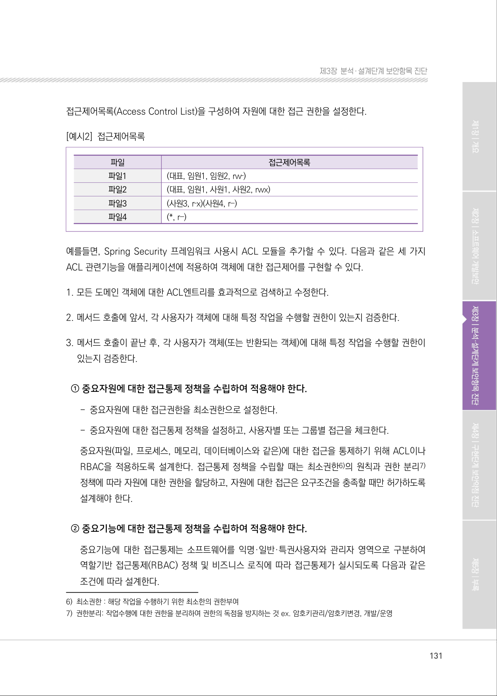
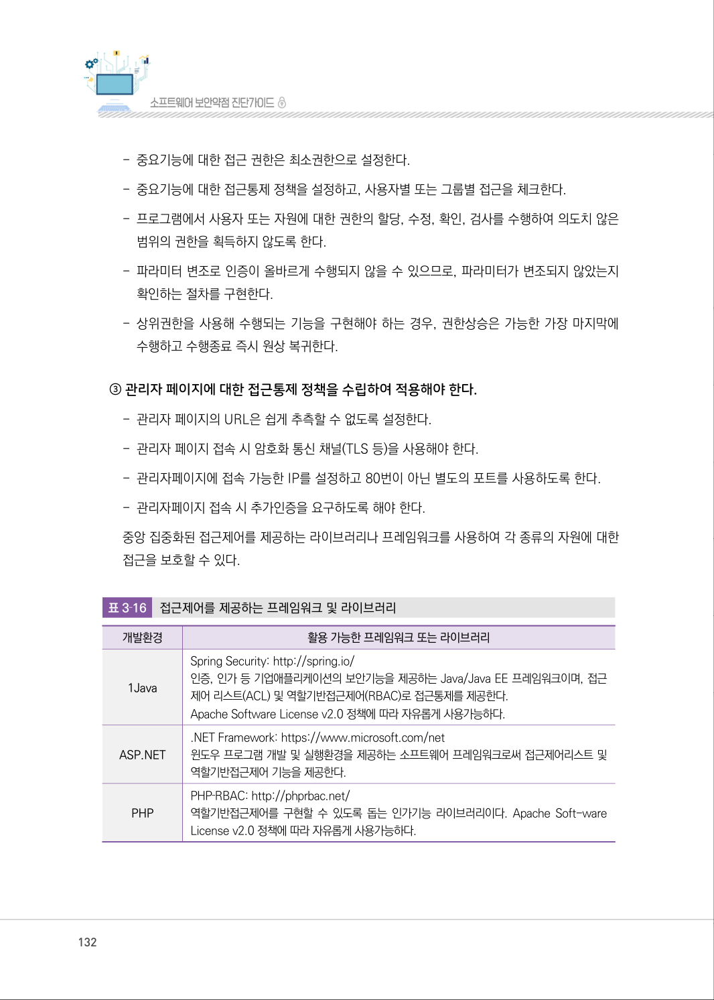
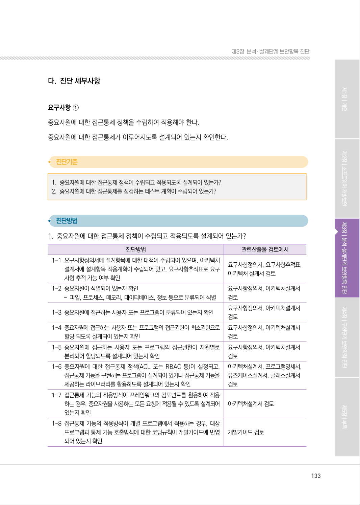
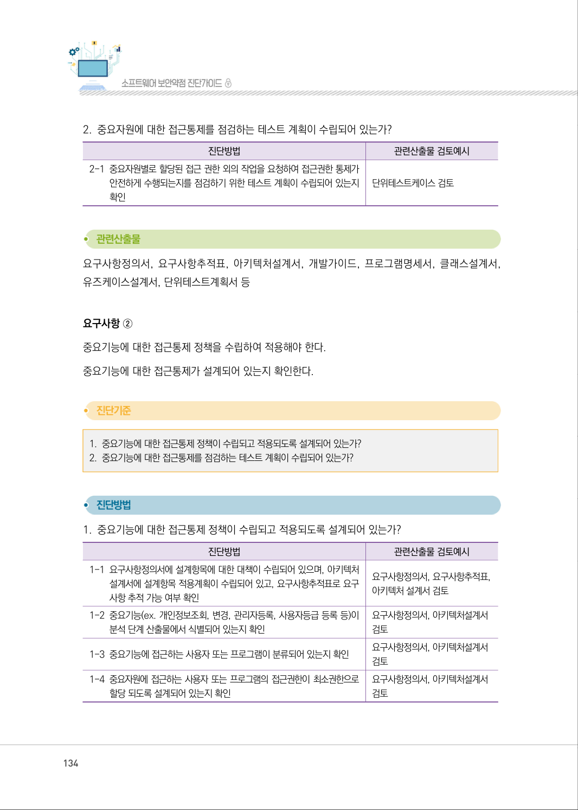
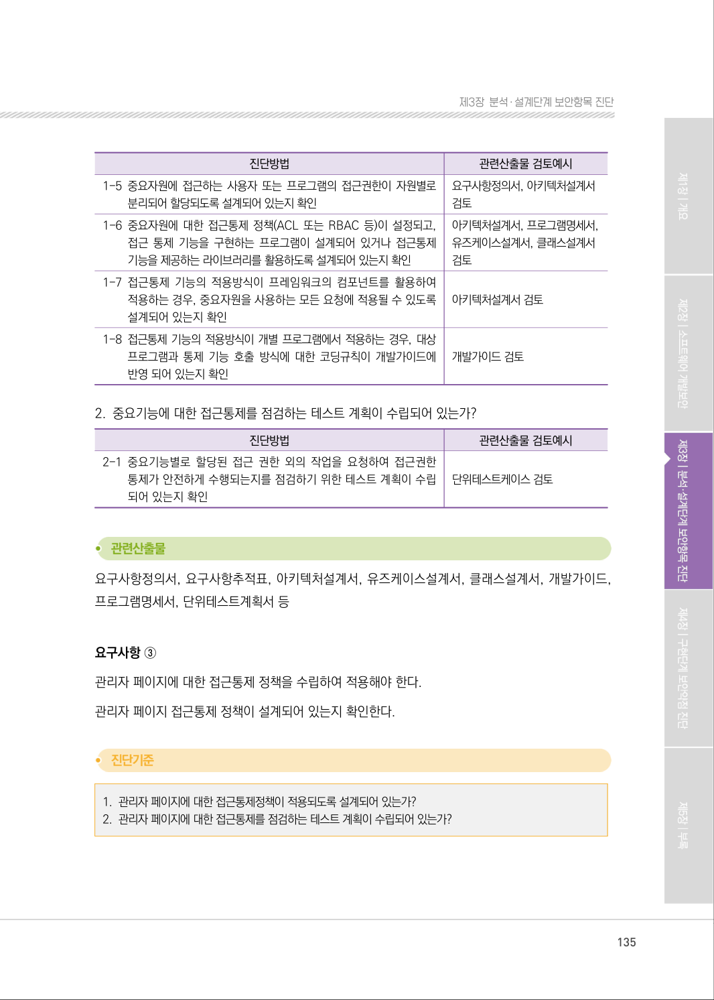
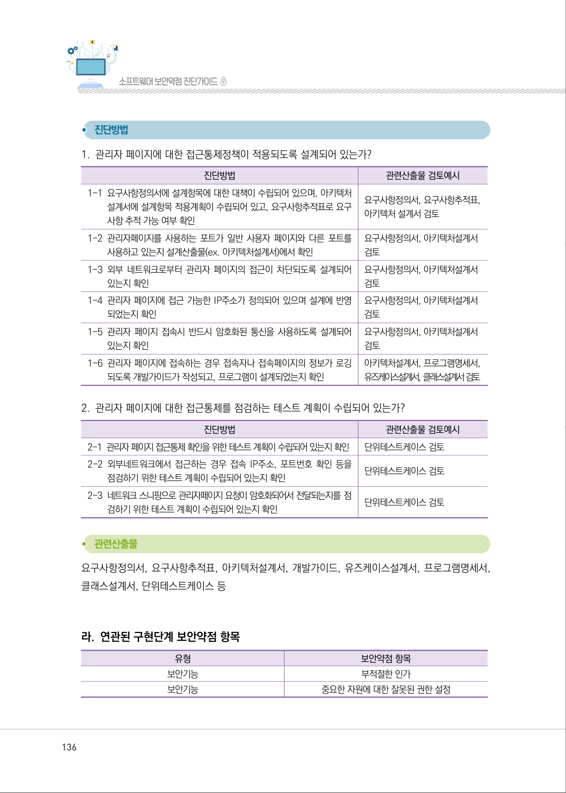
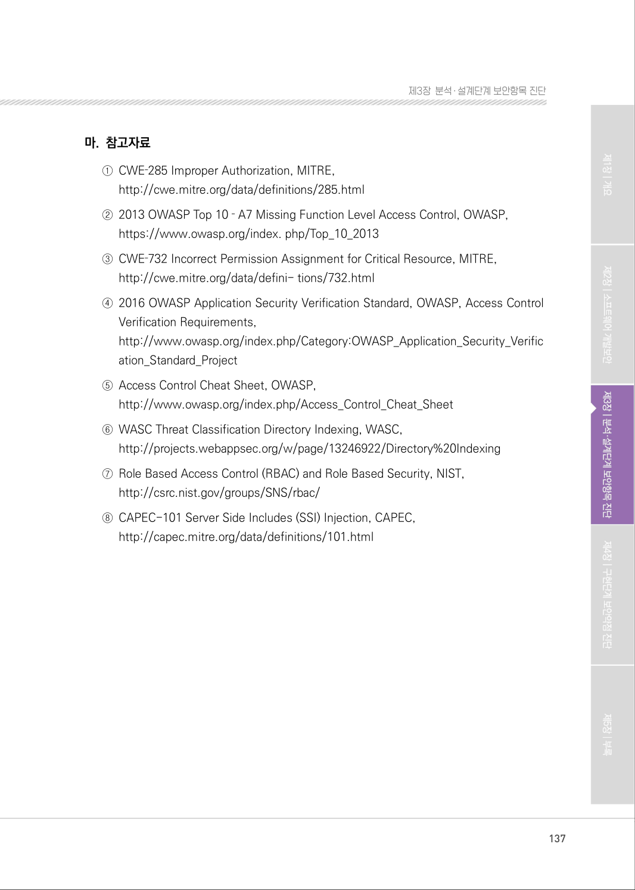

# 2.4 중요자원 접근통제

> 변환 안내(원문 외): 아래 본문은 PDF 텍스트를 추출한 전사입니다. 코드 줄번호·특수 공백·원문 오류를 유지했습니다. 실행용 코드가 아닙니다. 표·그림·들여쓰기는 연결된 페이지 이미지와 대조하세요. 페이지 경계의 줄바꿈을 보존하며, 동일 페이지가 여러 항목에 나뉘면 각 항목의 본문은 해당 구간만 포함합니다.

### PDF 128페이지 / 인쇄 128페이지

<!-- source-page:SW-Diagnosis-2021:128; source-lines:0,1,2,3,4,5,6,7,8,9,10,11,12,13,14,15,16,17 -->

128

2.4 중요자원 접근통제

유형

보안기능

설계항목

중요자원 접근통제

설명

중요자원(프로그램 설정, 민감한 사용자 데이터 등)을 정의하고, 정의된 중요자원에 대한 신뢰
할 수 있는 접근통제 방법(권한관리 포함) 설계 및 접근통제 실패 시 처리방법을 설계한다.

보안대책

①중요자원에 대한 접근통제 정책을 수립하여 적용해야 한다.
②중요기능에 대한 접근통제 정책을 수립하여 적용해야 한다.
③관리자 페이지에 대한 접근통제 정책을 수립하여 적용해야 한다.

#### 가. 취약점 개요

사례1 : 관리자 페이지 노출
관리자페이지가 인터넷으로 접근 가능할 경우, 해당 페이지는 공격자의 주 공격대상으로  SQL삽입, 무
차별 대입 공격 등 다양한 형태의 공격 빌미를 제공하게 되는 취약점이다.

그림3-22 | 관리자페이지 노출

원본 페이지 이미지 (변환 외 보존 자료)

### PDF 129페이지 / 인쇄 129페이지

<!-- source-page:SW-Diagnosis-2021:129; source-lines:0,1,2,3,4,5,6,7,8,9 -->

129

제3장분석․ 설계단계 보안항목 진단

사례2 : SSI 삽입
SSI(Server‐side Includes)는 HTML 문서 내 변수 값으로 입력된 후, 이를 서버가 처리하게 되는데, 
이 때 SSI 삽입 명령문이 수행되어 서버 데이터 정보가 누출되는 취약점이다.

그림3-23 | SSI 인젝션

사례3 : 부적절한 인가
프로그램이 모든 가능한 실행경로에 대해서 접근제어를 검사하지 않거나 불완전하게 검사하는 경우, 
공격자는 접근 가능한 실행경로로 정보를 유출할 수 있는 취약점이다.

그림3-24 | 부적절한 인가

원본 페이지 이미지 (변환 외 보존 자료)

### PDF 130페이지 / 인쇄 130페이지

<!-- source-page:SW-Diagnosis-2021:130; source-lines:0,1,2,3,4,5,6,7,8,9 -->

130

사례4 : 중요자원에 대한 잘못된 권한 설정
소프트웨어가 중요한 자원에 대하여 읽기, 수정 등의 권한을 의도하지 않게 허가할 경우 권한을 
갖지 않은 사용자가 해당 자원을 사용하게 될 수 있는 취약점이다.

그림3-25 | 중요한 자원에 대한 잘못된 권한 설정

#### 나. 설계시 고려사항

RBAC(Role Based Access Controll : 역할기반 접근제어) 모델을 사용하여 기업, 정부 등 다수의 
사용자와 정보객체들로 구성된 조직체계에서 사용자에게 할당된 역할을 기반으로 권한을 부여하도록 
설계한다.

[예시1] RBAC 데이터모델

원본 페이지 이미지 (변환 외 보존 자료)

### PDF 131페이지 / 인쇄 131페이지

<!-- source-page:SW-Diagnosis-2021:131; source-lines:0,1,2,3,4,5,6,7,8,9,10,11,12,13,14,15,16,17,18,19,20,21,22,23,24,25,26,27,28,29,30,31,32 -->

131

제3장분석․ 설계단계 보안항목 진단

접근제어목록(Access Control List)을 구성하여 자원에 대한 접근 권한을 설정한다.

[예시2] 접근제어목록

파일

접근제어목록

파일1

(대표, 임원1, 임원2, rw‐)

파일2

(대표, 임원1, 사원1, 사원2, rwx)

파일3

(사원3, r‐x)(사원4, r‐‐)

파일4

(*, r‐‐)

예를들면, Spring Security 프레임워크 사용시 ACL 모듈을 추가할 수 있다. 다음과 같은 세 가지 
ACL 관련기능을 애플리케이션에 적용하여 객체에 대한 접근제어를 구현할 수 있다.

#### 1. 모든 도메인 객체에 대한 ACL엔트리를 효과적으로 검색하고 수정한다.

#### 2. 메서드 호출에 앞서, 각 사용자가 객체에 대해 특정 작업을 수행할 권한이 있는지 검증한다.

#### 3. 메서드 호출이 끝난 후, 각 사용자가 객체(또는 반환되는 객체)에 대해 특정 작업을 수행할 권한이 

있는지 검증한다.

① 중요자원에 대한 접근통제 정책을 수립하여 적용해야 한다.

- 중요자원에 대한 접근권한을 최소권한으로 설정한다.
- 중요자원에 대한 접근통제 정책을 설정하고, 사용자별 또는 그룹별 접근을 체크한다.
중요자원(파일, 프로세스, 메모리, 데이터베이스와 같은)에 대한 접근을 통제하기 위해 ACL이나 
RBAC을 적용하도록 설계한다. 접근통제 정책을 수립할 때는 최소권한6)의 원칙과 권한 분리7) 
정책에 따라 자원에 대한 권한을 할당하고, 자원에 대한 접근은 요구조건을 충족할 때만 허가하도록 
설계해야 한다.

② 중요기능에 대한 접근통제 정책을 수립하여 적용해야 한다.

중요기능에 대한 접근통제는 소프트웨어를 익명·일반·특권사용자와 관리자 영역으로 구분하여 
역할기반 접근통제(RBAC) 정책 및 비즈니스 로직에 따라 접근통제가 실시되도록 다음과 같은 
조건에 따라 설계한다.
6) 최소권한 : 해당 작업을 수행하기 위한 최소한의 권한부여
7) 권한분리: 작업수행에 대한 권한을 분리하여 권한의 독점을 방지하는 것 ex. 암호키관리/암호키변경, 개발/운영

원본 페이지 이미지 (변환 외 보존 자료)

### PDF 132페이지 / 인쇄 132페이지

<!-- source-page:SW-Diagnosis-2021:132; source-lines:0,1,2,3,4,5,6,7,8,9,10,11,12,13,14,15,16,17,18,19,20,21,22,23,24,25,26,27,28,29,30,31,32 -->

132

- 중요기능에 대한 접근 권한은 최소권한으로 설정한다.
- 중요기능에 대한 접근통제 정책을 설정하고, 사용자별 또는 그룹별 접근을 체크한다.
- 프로그램에서 사용자 또는 자원에 대한 권한의 할당, 수정, 확인, 검사를 수행하여 의도치 않은 

범위의 권한을 획득하지 않도록 한다.
- 파라미터 변조로 인증이 올바르게 수행되지 않을 수 있으므로, 파라미터가 변조되지 않았는지 

확인하는 절차를 구현한다.
- 상위권한을 사용해 수행되는 기능을 구현해야 하는 경우, 권한상승은 가능한 가장 마지막에 

수행하고 수행종료 즉시 원상 복귀한다.

③ 관리자 페이지에 대한 접근통제 정책을 수립하여 적용해야 한다.

- 관리자 페이지의 URL은 쉽게 추측할 수 없도록 설정한다.
- 관리자 페이지 접속 시 암호화 통신 채널(TLS 등)을 사용해야 한다.
- 관리자페이지에 접속 가능한 IP를 설정하고 80번이 아닌 별도의 포트를 사용하도록 한다. 
- 관리자페이지 접속 시 추가인증을 요구하도록 해야 한다.
중앙 집중화된 접근제어를 제공하는 라이브러리나 프레임워크를 사용하여 각 종류의 자원에 대한 
접근을 보호할 수 있다.

표3‐16

접근제어를 제공하는 프레임워크 및 라이브러리

|  |  |
| --- | --- |
| 개발환경 | 활용 가능한 프레임워크 또는 라이브러리 |
| 1Java | Spring Security: http://spring.io/ 인증, 인가 등 기업애플리케이션의 보안기능을 제공하는 Java/Java EE 프레임워크이며, 접근 제어 리스트(ACL) 및 역할기반접근제어(RBAC)로 접근통제를 제공한다. Apache Software License v2.0 정책에 따라 자유롭게 사용가능하다. |
| ASP.NET | .NET Framework: https://www.microsoft.com/net 윈도우 프로그램 개발 및 실행환경을 제공하는 소프트웨어 프레임워크로써 접근제어리스트 및 역할기반접근제어 기능을 제공한다. |
| PHP | PHP‐RBAC: http://phprbac.net/ 역할기반접근제어를 구현할 수 있도록 돕는 인가기능 라이브러리이다. Apache Soft-ware License v2.0 정책에 따라 자유롭게 사용가능하다. |

원본 페이지 이미지 (변환 외 보존 자료)

### PDF 133페이지 / 인쇄 133페이지

<!-- source-page:SW-Diagnosis-2021:133; source-lines:0,1,2,3,4,5,6,7,8,9,10,11,12,13,14,15,16,17,18,19,20,21,22,23,24,25,26,27,28,29,30,31,32,33,34,35,36,37,38,39,40,41,42,43,44 -->

133

제3장분석․ 설계단계 보안항목 진단

#### 다. 진단 세부사항

요구사항 ①
중요자원에 대한 접근통제 정책을 수립하여 적용해야 한다.
중요자원에 대한 접근통제가 이루어지도록 설계되어 있는지 확인한다.

#### 1. 중요자원에 대한 접근통제 정책이 수립되고 적용되도록 설계되어 있는가?

#### 2. 중요자원에 대한 접근통제를 점검하는 테스트 계획이 수립되어 있는가?

#### 1. 중요자원에 대한 접근통제 정책이 수립되고 적용되도록 설계되어 있는가?

| 진단방법 | 관련산출물 검토예시 |
| --- | --- |
| 1-1 요구사항정의서에 설계항목에 대한 대책이 수립되어 있으며, 아키텍처 설계서에 설계항목 적용계획이 수립되어 있고, 요구사항추적표로 요구 사항 추적 가능 여부 확인 | 요구사항정의서, 요구사항추적표, 아키텍처 설계서 검토 |
| 1-2 중요자원이 식별되어 있는지 확인 - 파일, 프로세스, 메모리, 데이터베이스, 정보 등으로 분류되어 식별 | 요구사항정의서, 아키텍처설계서 검토 |
| 1-3 중요자원에 접근하는 사용자 또는 프로그램이 분류되어 있는지 확인 | 요구사항정의서, 아키텍처설계서 검토 |
| 1-4 중요자원에 접근하는 사용자 또는 프로그램의 접근권한이 최소권한으로 할당 되도록 설계되어 있는지 확인 | 요구사항정의서, 아키텍처설계서 검토 |
| 1-5 중요자원에 접근하는 사용자 또는 프로그램의 접근권한이 자원별로 분리되어 할당되도록 설계되어 있는지 확인 | 요구사항정의서, 아키텍처설계서 검토 |
| 1-6 중요자원에 대한 접근통제 정책(ACL 또는 RBAC 등)이 설정되고, 접근통제 기능을 구현하는 프로그램이 설계되어 있거나 접근통제 기능을 제공하는 라이브러리를 활용하도록 설계되어 있는지 확인 | 아키텍처설계서, 프로그램명세서, 유즈케이스설계서, 클래스설계서 검토 |
| 1-7 접근통제 기능의 적용방식이 프레임워크의 컴포넌트를 활용하여 적용 하는 경우, 중요자원을 사용하는 모든 요청에 적용될 수 있도록 설계되어 있는지 확인 | 아키텍처설계서 검토 |
| 1-8 접근통제 기능의 적용방식이 개별 프로그램에서 적용하는 경우, 대상 프로그램과 통제 기능 호출방식에 대한 코딩규칙이 개발가이드에 반영 되어 있는지 확인 | 개발가이드 검토 |

원본 페이지 이미지 (변환 외 보존 자료)

### PDF 134페이지 / 인쇄 134페이지

<!-- source-page:SW-Diagnosis-2021:134; source-lines:0,1,2,3,4,5,6,7,8,9,10,11,12,13,14,15,16,17,18,19,20,21,22,23,24,25,26,27,28,29,30,31,32,33 -->

134

#### 2. 중요자원에 대한 접근통제를 점검하는 테스트 계획이 수립되어 있는가?

| 진단방법 | 관련산출물 검토예시 |
| --- | --- |
| 2-1 중요자원별로 할당된 접근 권한 외의 작업을 요청하여 접근권한 통제가 안전하게 수행되는지를 점검하기 위한 테스트 계획이 수립되어 있는지 확인 | 단위테스트케이스 검토 |

요구사항정의서, 요구사항추적표, 아키텍처설계서, 개발가이드, 프로그램명세서, 클래스설계서, 
유즈케이스설계서, 단위테스트계획서 등

요구사항 ②
중요기능에 대한 접근통제 정책을 수립하여 적용해야 한다.
중요기능에 대한 접근통제가 설계되어 있는지 확인한다.

#### 1. 중요기능에 대한 접근통제 정책이 수립되고 적용되도록 설계되어 있는가?

#### 2. 중요기능에 대한 접근통제를 점검하는 테스트 계획이 수립되어 있는가?

#### 1. 중요기능에 대한 접근통제 정책이 수립되고 적용되도록 설계되어 있는가?

| 진단방법 | 관련산출물 검토예시 |
| --- | --- |
| 1-1 요구사항정의서에 설계항목에 대한 대책이 수립되어 있으며, 아키텍처 설계서에 설계항목 적용계획이 수립되어 있고, 요구사항추적표로 요구 사항 추적 가능 여부 확인 | 요구사항정의서, 요구사항추적표, 아키텍처 설계서 검토 |
| 1-2 중요기능(ex. 개인정보조회, 변경, 관리자등록, 사용자등급 등록 등)이 분석 단계 산출물에서 식별되어 있는지 확인 | 요구사항정의서, 아키텍처설계서 검토 |
| 1-3 중요기능에 접근하는 사용자 또는 프로그램이 분류되어 있는지 확인 | 요구사항정의서, 아키텍처설계서 검토 |
| 1-4 중요자원에 접근하는 사용자 또는 프로그램의 접근권한이 최소권한으로 할당 되도록 설계되어 있는지 확인 | 요구사항정의서, 아키텍처설계서 검토 |

원본 페이지 이미지 (변환 외 보존 자료)

### PDF 135페이지 / 인쇄 135페이지

<!-- source-page:SW-Diagnosis-2021:135; source-lines:0,1,2,3,4,5,6,7,8,9,10,11,12,13,14,15,16,17,18,19,20,21,22,23,24,25,26,27,28,29,30,31,32,33,34,35 -->

135

제3장분석․ 설계단계 보안항목 진단

| 진단방법 | 관련산출물 검토예시 |
| --- | --- |
| 1-5 중요자원에 접근하는 사용자 또는 프로그램의 접근권한이 자원별로 분리되어 할당되도록 설계되어 있는지 확인 | 요구사항정의서, 아키텍처설계서 검토 |
| 1-6 중요자원에 대한 접근통제 정책(ACL 또는 RBAC 등)이 설정되고, 접근 통제 기능을 구현하는 프로그램이 설계되어 있거나 접근통제 기능을 제공하는 라이브러리를 활용하도록 설계되어 있는지 확인 | 아키텍처설계서, 프로그램명세서, 유즈케이스설계서, 클래스설계서 검토 |
| 1-7 접근통제 기능의 적용방식이 프레임워크의 컴포넌트를 활용하여 적용하는 경우, 중요자원을 사용하는 모든 요청에 적용될 수 있도록 설계되어 있는지 확인 | 아키텍처설계서 검토 |
| 1-8 접근통제 기능의 적용방식이 개별 프로그램에서 적용하는 경우, 대상 프로그램과 통제 기능 호출 방식에 대한 코딩규칙이 개발가이드에 반영 되어 있는지 확인 | 개발가이드 검토 |

#### 2. 중요기능에 대한 접근통제를 점검하는 테스트 계획이 수립되어 있는가?

진단방법

관련산출물 검토예시

2-1 중요기능별로 할당된 접근 권한 외의 작업을 요청하여 접근권한 

통제가 안전하게 수행되는지를 점검하기 위한 테스트 계획이 수립
되어 있는지 확인

단위테스트케이스 검토

요구사항정의서, 요구사항추적표, 아키텍처설계서, 유즈케이스설계서, 클래스설계서, 개발가이드, 
프로그램명세서, 단위테스트계획서 등

요구사항 ③
관리자 페이지에 대한 접근통제 정책을 수립하여 적용해야 한다.
관리자 페이지 접근통제 정책이 설계되어 있는지 확인한다.

#### 1. 관리자 페이지에 대한 접근통제정책이 적용되도록 설계되어 있는가?

#### 2. 관리자 페이지에 대한 접근통제를 점검하는 테스트 계획이 수립되어 있는가?

원본 페이지 이미지 (변환 외 보존 자료)

### PDF 136페이지 / 인쇄 136페이지

<!-- source-page:SW-Diagnosis-2021:136; source-lines:0,1,2,3,4,5,6,7,8,9,10,11,12,13,14,15,16,17,18,19,20,21,22,23,24,25,26,27,28,29,30,31,32,33,34,35,36,37,38,39,40,41,42,43,44,45,46,47,48 -->

136

#### 1. 관리자 페이지에 대한 접근통제정책이 적용되도록 설계되어 있는가?

| 진단방법 | 관련산출물 검토예시 |
| --- | --- |
| 1-1 요구사항정의서에 설계항목에 대한 대책이 수립되어 있으며, 아키텍처 설계서에 설계항목 적용계획이 수립되어 있고, 요구사항추적표로 요구 사항 추적 가능 여부 확인 | 요구사항정의서, 요구사항추적표, 아키텍처 설계서 검토 |
| 1-2 관리자페이지를 사용하는 포트가 일반 사용자 페이지와 다른 포트를 사용하고 있는지 설계산출물(ex. 아키텍처설계서)에서 확인 | 요구사항정의서, 아키텍처설계서 검토 |
| 1-3 외부 네트워크로부터 관리자 페이지의 접근이 차단되도록 설계되어 있는지 확인 | 요구사항정의서, 아키텍처설계서 검토 |
| 1-4 관리자 페이지에 접근 가능한 IP주소가 정의되어 있으며 설계에 반영 되었는지 확인 | 요구사항정의서, 아키텍처설계서 검토 |
| 1-5 관리자 페이지 접속시 반드시 암호화된 통신을 사용하도록 설계되어 있는지 확인 | 요구사항정의서, 아키텍처설계서 검토 |
| 1-6 관리자 페이지에 접속하는 경우 접속자나 접속페이지의 정보가 로깅 되도록 개발가이드가 작성되고, 프로그램이 설계되었는지 확인 | 아키텍처설계서, 프로그램명세서, 유즈케이스설계서, 클래스설계서 검토 |

#### 2. 관리자 페이지에 대한 접근통제를 점검하는 테스트 계획이 수립되어 있는가?

| 진단방법 | 관련산출물 검토예시 |
| --- | --- |
| 2-1 관리자 페이지 접근통제 확인을 위한 테스트 계획이 수립되어 있는지 확인 | 단위테스트케이스 검토 |
| 2-2 외부네트워크에서 접근하는 경우 접속 IP주소, 포트번호 확인 등을 점검하기 위한 테스트 계획이 수립되어 있는지 확인 | 단위테스트케이스 검토 |
| 2-3 네트워크 스니핑으로 관리자페이지 요청이 암호화되어서 전달되는지를 점 검하기 위한 테스트 계획이 수립되어 있는지 확인 | 단위테스트케이스 검토 |

요구사항정의서, 요구사항추적표, 아키텍처설계서, 개발가이드, 유즈케이스설계서, 프로그램명세서, 
클래스설계서, 단위테스트케이스 등

#### 라. 연관된 구현단계 보안약점 항목

유형

보안약점 항목

보안기능

부적절한 인가

보안기능

중요한 자원에 대한 잘못된 권한 설정

원본 페이지 이미지 (변환 외 보존 자료)

### PDF 137페이지 / 인쇄 137페이지

<!-- source-page:SW-Diagnosis-2021:137; source-lines:0,1,2,3,4,5,6,7,8,9,10,11,12,13,14,15,16,17,18,19,20 -->

137

제3장분석․ 설계단계 보안항목 진단

#### 마. 참고자료

①CWE‐285 Improper Authorization, MITRE,

http://cwe.mitre.org/data/definitions/285.html
②2013 OWASP Top 10 ‐ A7 Missing Function Level Access Control, OWASP,

https://www.owasp.org/index. php/Top_10_2013
③CWE‐732 Incorrect Permission Assignment for Critical Resource, MITRE,

http://cwe.mitre.org/data/defini- tions/732.html 
④2016 OWASP Application Security Verification Standard, OWASP, Access Control 

Verification Requirements,
http://www.owasp.org/index.php/Category:OWASP_Application_Security_Verific
ation_Standard_Project
⑤Access Control Cheat Sheet, OWASP,

http://www.owasp.org/index.php/Access_Control_Cheat_Sheet
⑥WASC Threat Classification Directory Indexing, WASC,

http://projects.webappsec.org/w/page/13246922/Directory%20Indexing
⑦Role Based Access Control (RBAC) and Role Based Security, NIST,

http://csrc.nist.gov/groups/SNS/rbac/
⑧CAPEC-101 Server Side Includes (SSI) Injection, CAPEC,

http://capec.mitre.org/data/definitions/101.html

원본 페이지 이미지 (변환 외 보존 자료)

---

## 탐색 링크 (원문 외)

[통합 인덱스](../../../INDEX.md)

