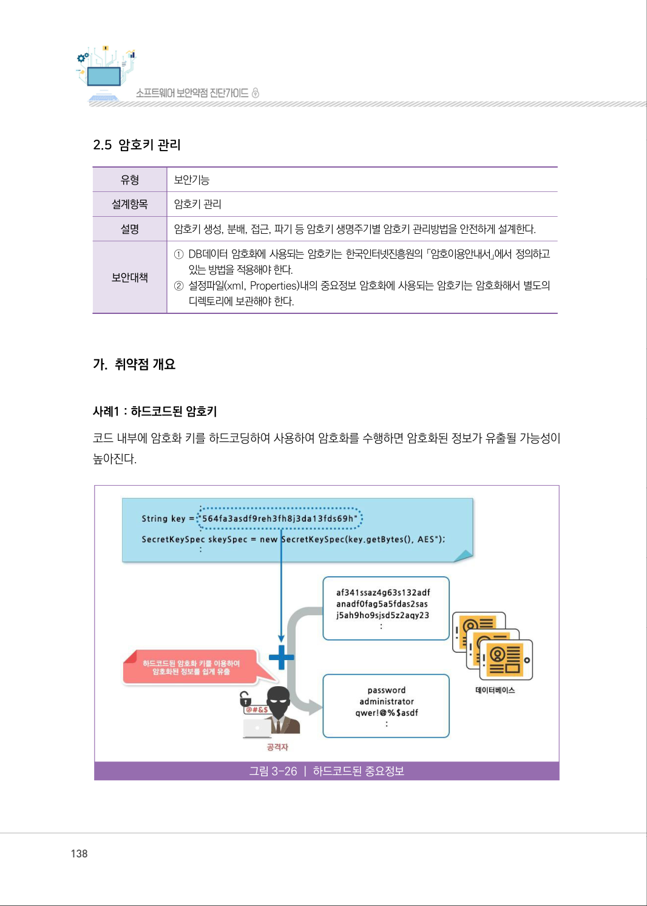
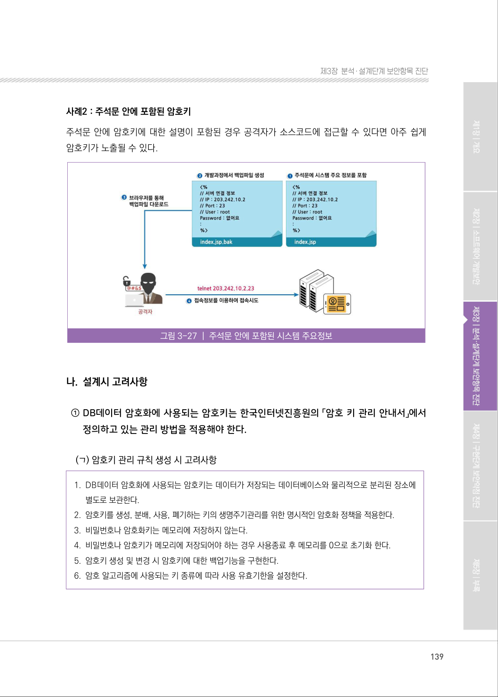
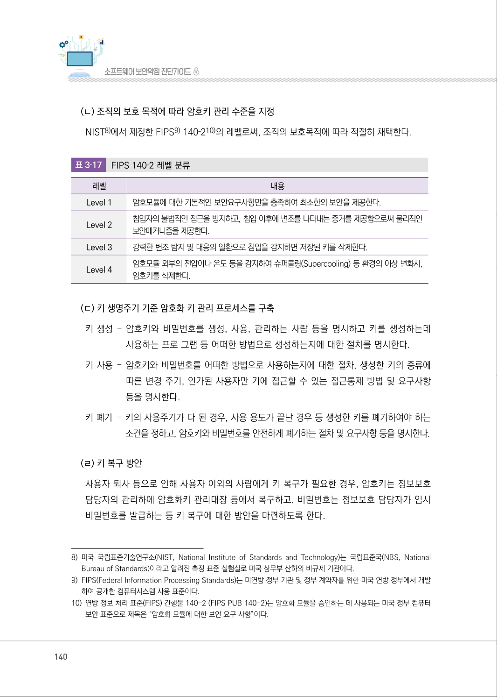
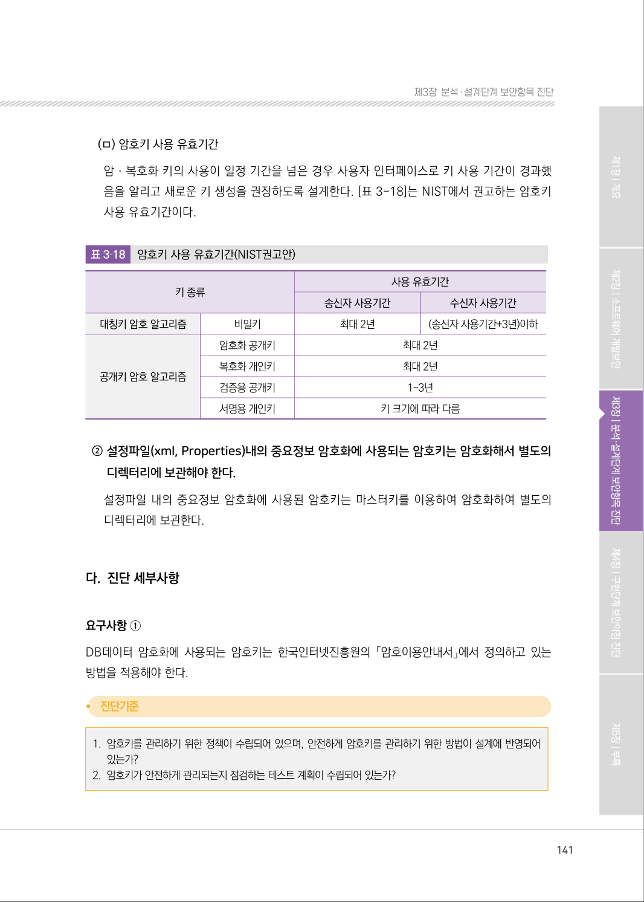
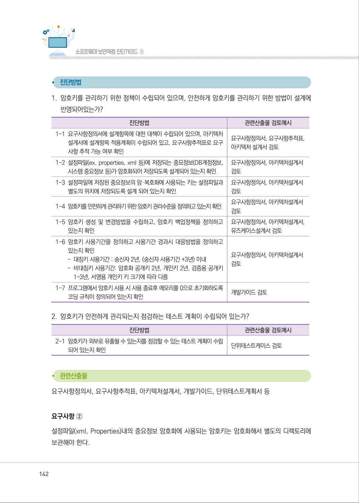
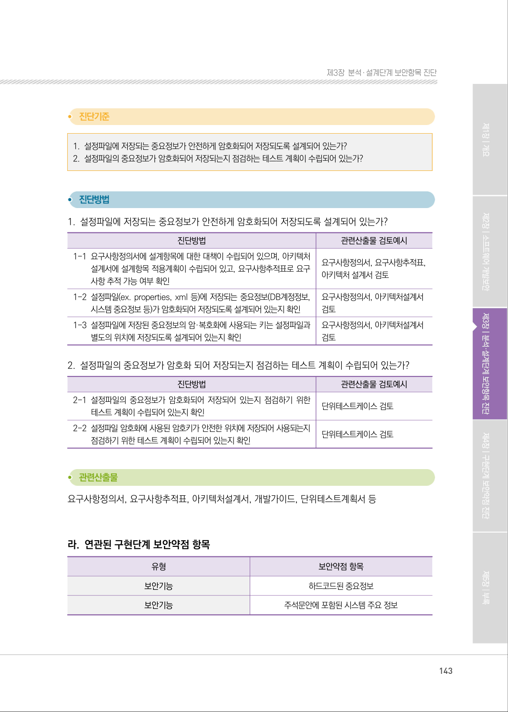
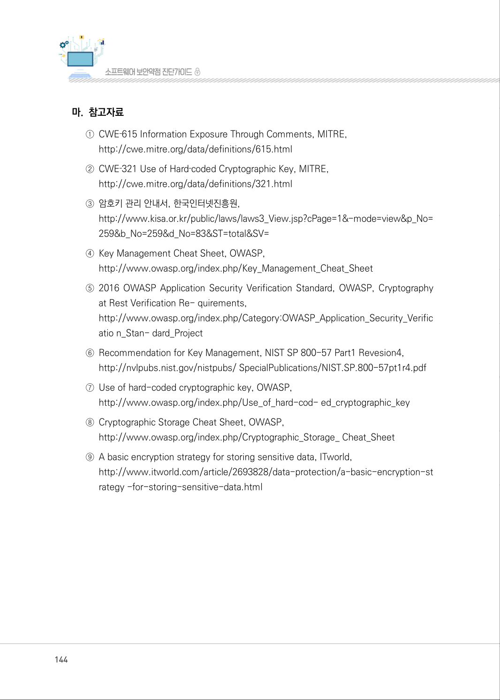

# 2.5 암호키 관리

> 변환 안내(원문 외): 아래 본문은 PDF 텍스트를 추출한 전사입니다. 코드 줄번호·특수 공백·원문 오류를 유지했습니다. 실행용 코드가 아닙니다. 표·그림·들여쓰기는 연결된 페이지 이미지와 대조하세요. 페이지 경계의 줄바꿈을 보존하며, 동일 페이지가 여러 항목에 나뉘면 각 항목의 본문은 해당 구간만 포함합니다.

### PDF 138페이지 / 인쇄 138페이지

<!-- source-page:SW-Diagnosis-2021:138; source-lines:0,1,2,3,4,5,6,7,8,9,10,11,12,13,14,15,16,17 -->

138

2.5 암호키 관리

유형

보안기능

설계항목

암호키 관리
설명

암호키 생성, 분배, 접근, 파기 등 암호키 생명주기별 암호키 관리방법을 안전하게 설계한다. 

보안대책

①DB데이터 암호화에 사용되는 암호키는 한국인터넷진흥원의 「암호이용안내서」에서 정의하고 

있는 방법을 적용해야 한다.
②설정파일(xml, Properties)내의 중요정보 암호화에 사용되는 암호키는 암호화해서 별도의 

디렉토리에 보관해야 한다.

#### 가. 취약점 개요

사례1 : 하드코드된 암호키
코드 내부에 암호화 키를 하드코딩하여 사용하여 암호화를 수행하면 암호화된 정보가 유출될 가능성이 
높아진다.

그림3-26 | 하드코드된 중요정보

<details><summary>원본 페이지 이미지 (변환 외 보존 자료)</summary>



</details>

### PDF 139페이지 / 인쇄 139페이지

<!-- source-page:SW-Diagnosis-2021:139; source-lines:0,1,2,3,4,5,6,7,8,9,10,11,12,13,14,15,16 -->

139

제3장분석․ 설계단계 보안항목 진단

사례2 : 주석문 안에 포함된 암호키
주석문 안에 암호키에 대한 설명이 포함된 경우 공격자가 소스코드에 접근할 수 있다면 아주 쉽게 
암호키가 노출될 수 있다.

그림3-27 | 주석문 안에 포함된 시스템 주요정보

#### 나. 설계시 고려사항

① DB데이터 암호화에 사용되는 암호키는 한국인터넷진흥원의 「암호 키 관리 안내서」에서 

정의하고 있는 관리 방법을 적용해야 한다.

(ㄱ) 암호키 관리 규칙 생성 시 고려사항

#### 1. DB데이터 암호화에 사용되는 암호키는 데이터가 저장되는 데이터베이스와 물리적으로 분리된 장소에 

별도로 보관한다.

#### 2. 암호키를 생성, 분배, 사용, 폐기하는 키의 생명주기관리를 위한 명시적인 암호화 정책을 적용한다.

#### 3. 비밀번호나 암호화키는 메모리에 저장하지 않는다.

#### 4. 비밀번호나 암호키가 메모리에 저장되어야 하는 경우 사용종료 후 메모리를 0으로 초기화 한다.

#### 5. 암호키 생성 및 변경 시 암호키에 대한 백업기능을 구현한다.

#### 6. 암호 알고리즘에 사용되는 키 종류에 따라 사용 유효기한을 설정한다.

<details><summary>원본 페이지 이미지 (변환 외 보존 자료)</summary>



</details>

### PDF 140페이지 / 인쇄 140페이지

<!-- source-page:SW-Diagnosis-2021:140; source-lines:0,1,2,3,4,5,6,7,8,9,10,11,12,13,14,15,16,17,18,19,20,21,22,23,24,25,26,27,28,29,30,31,32,33,34 -->

140

(ㄴ) 조직의 보호 목적에 따라 암호키 관리 수준을 지정
NIST8)에서 제정한 FIPS9) 140‐210)의 레벨로써, 조직의 보호목적에 따라 적절히 채택한다.

표3‐17

FIPS 140‐2 레벨 분류

|  |  |
| --- | --- |
| 레벨 | 내용 |
| Level 1 | 암호모듈에 대한 기본적인 보안요구사항만을 충족하여 최소한의 보안을 제공한다. |
| Level 2 | 침입자의 불법적인 접근을 방지하고, 침입 이후에 변조를 나타내는 증거를 제공함으로써 물리적인<br>보안메커니즘을 제공한다. |
| Level 3 | 강력한 변조 탐지 및 대응의 일환으로 침입을 감지하면 저장된 키를 삭제한다. |
| Level 4 | 암호모듈 외부의 전압이나 온도 등을 감지하여 슈퍼쿨링(Supercooling) 등 환경의 이상 변화시,<br>암호키를 삭제한다. |

(ㄷ) 키 생명주기 기준 암호화 키 관리 프로세스를 구축
키 생성– 암호키와 비밀번호를 생성, 사용, 관리하는 사람 등을 명시하고 키를 생성하는데 

사용하는 프로 그램 등 어떠한 방법으로 생성하는지에 대한 절차를 명시한다.
키 사용– 암호키와 비밀번호를 어떠한 방법으로 사용하는지에 대한 절차, 생성한 키의 종류에 

따른 변경 주기, 인가된 사용자만 키에 접근할 수 있는 접근통제 방법 및 요구사항 
등을 명시한다.
키 폐기– 키의 사용주기가 다 된 경우, 사용 용도가 끝난 경우 등 생성한 키를 폐기하여야 하는 

조건을 정하고, 암호키와 비밀번호를 안전하게 폐기하는 절차 및 요구사항 등을 명시한다.

(ㄹ) 키 복구 방안
사용자 퇴사 등으로 인해 사용자 이외의 사람에게 키 복구가 필요한 경우, 암호키는 정보보호 
담당자의 관리하에 암호화키 관리대장 등에서 복구하고, 비밀번호는 정보보호 담당자가 임시
비밀번호를 발급하는 등 키 복구에 대한 방안을 마련하도록 한다.

8) 미국 국립표준기술연구소(NIST, National Institute of Standards and Technology)는 국립표준국(NBS, National 

Bureau of Standards)이라고 알려진 측정 표준 실험실로 미국 상무부 산하의 비규제 기관이다.
9) FIPS(Federal Information Processing Standards)는 미연방 정부 기관 및 정부 계약자를 위한 미국 연방 정부에서 개발 

하여 공개한 컴퓨터시스템 사용 표준이다.
10) 연방 정보 처리 표준(FIPS) 간행물 140-2 (FIPS PUB 140-2)는 암호화 모듈을 승인하는 데 사용되는 미국 정부 컴퓨터 

보안 표준으로 제목은 “암호화 모듈에 대한 보안 요구 사항”이다.

<details><summary>원본 페이지 이미지 (변환 외 보존 자료)</summary>



</details>

### PDF 141페이지 / 인쇄 141페이지

<!-- source-page:SW-Diagnosis-2021:141; source-lines:0,1,2,3,4,5,6,7,8,9,10,11,12,13,14,15,16,17,18,19,20,21,22,23,24,25,26,27,28,29,30,31,32,33,34,35 -->

141

제3장분석․ 설계단계 보안항목 진단

(ㅁ) 암호키 사용 유효기간
암ㆍ복호화 키의 사용이 일정 기간을 넘은 경우 사용자 인터페이스로 키 사용 기간이 경과했
음을 알리고 새로운 키 생성을 권장하도록 설계한다. [표 3-18]는 NIST에서 권고하는 암호키 
사용 유효기간이다.

표3‐18

암호키 사용 유효기간(NIST권고안)

```text
키 종류
사용 유효기간
송신자 사용기간
수신자 사용기간
대칭키 암호 알고리즘
비밀키
최대 2년
(송신자 사용기간+3년)이하
공개키 암호 알고리즘
암호화 공개키
최대 2년
복호화 개인키
최대 2년
검증용 공개키
1~3년
서명용 개인키
키 크기에 따라 다름
```

② 설정파일(xml, Properties)내의 중요정보 암호화에 사용되는 암호키는 암호화해서 별도의 

디렉터리에 보관해야 한다.
설정파일 내의 중요정보 암호화에 사용된 암호키는 마스터키를 이용하여 암호화하여 별도의 
디렉터리에 보관한다.

#### 다. 진단 세부사항

요구사항 ①
DB데이터 암호화에 사용되는 암호키는 한국인터넷진흥원의 「암호이용안내서」에서 정의하고 있는 
방법을 적용해야 한다.

#### 1. 암호키를 관리하기 위한 정책이 수립되어 있으며, 안전하게 암호키를 관리하기 위한 방법이 설계에 반영되어 

있는가?

#### 2. 암호키가 안전하게 관리되는지 점검하는 테스트 계획이 수립되어 있는가?

<details><summary>원본 페이지 이미지 (변환 외 보존 자료)</summary>



</details>

### PDF 142페이지 / 인쇄 142페이지

<!-- source-page:SW-Diagnosis-2021:142; source-lines:0,1,2,3,4,5,6,7,8,9,10,11,12,13,14,15,16,17,18,19,20,21,22,23,24,25,26,27,28,29,30,31,32,33,34,35,36,37,38,39,40,41,42,43,44 -->

142

#### 1. 암호키를 관리하기 위한 정책이 수립되어 있으며, 안전하게 암호키를 관리하기 위한 방법이 설계에 

반영되어있는가?

| 진단방법 | 관련산출물 검토예시 |
| --- | --- |
| 1-1 요구사항정의서에 설계항목에 대한 대책이 수립되어 있으며, 아키텍처<br>설계서에 설계항목 적용계획이 수립되어 있고, 요구사항추적표로 요구<br>사항 추적 가능 여부 확인 | 요구사항정의서, 요구사항추적표,<br>아키텍처 설계서 검토 |
| 1-2 설정파일(ex. properties, xml 등)에 저장되는 중요정보(DB계정정보,<br>시스템 중요정보 등)가 암호화되어 저장되도록 설계되어 있는지 확인 | 요구사항정의서, 아키텍처설계서<br>검토 |
| 1-3 설정파일에 저장된 중요정보의 암·복호화에 사용되는 키는 설정파일과<br>별도의 위치에 저장되도록 설계 되어 있는지 확인 | 요구사항정의서, 아키텍처설계서<br>검토 |
| 1-4 암호키를 안전하게 관리하기 위한 암호키 관리수준을 정의하고 있는지 확인 | 요구사항정의서, 아키텍처설계서<br>검토 |
| 1-5 암호키 생성 및 변경방법을 수립하고, 암호키 백업정책을 정의하고<br>있는지 확인 | 요구사항정의서, 아키텍처설계서,<br>유즈케이스설계서 검토 |
| 1-6 암호키 사용기간을 정의하고 사용기간 경과시 대응방법을 정의하고<br>있는지 확인<br>- 대칭키 사용기간 : 송신자 2년, (송신자 사용기간 +3년) 이내<br>- 비대칭키 사용기간: 암호화 공개키 2년, 개인키 2년, 검증용 공개키<br>1~3년, 서명용 개인키 키 크기에 따라 다름 | 요구사항정의서, 아키텍처설계서<br>검토 |
| 1-7 프로그램에서 암호키 사용 시 사용 종료후 메모리를 0으로 초기화하도록<br>코딩 규칙이 정의되어 있는지 확인 | 개발가이드 검토 |

#### 2. 암호키가 안전하게 관리되는지 점검하는 테스트 계획이 수립되어 있는가?

| 진단방법 | 관련산출물 검토예시 |
| --- | --- |
| 2-1 암호키가 외부로 유출될 수 있는지를 점검할 수 있는 테스트 계획이 수립<br>되어 있는지 확인 | 단위테스트케이스 검토 |

요구사항정의서, 요구사항추적표, 아키텍처설계서, 개발가이드, 단위테스트계획서 등

요구사항 ②
설정파일(xml, Properties)내의 중요정보 암호화에 사용되는 암호키는 암호화해서 별도의 디렉토리에 
보관해야 한다.

<details><summary>원본 페이지 이미지 (변환 외 보존 자료)</summary>



</details>

### PDF 143페이지 / 인쇄 143페이지

<!-- source-page:SW-Diagnosis-2021:143; source-lines:0,1,2,3,4,5,6,7,8,9,10,11,12,13,14,15,16,17,18,19,20,21,22,23,24,25,26,27,28,29,30,31,32,33,34,35,36 -->

143

제3장분석․ 설계단계 보안항목 진단

#### 1. 설정파일에 저장되는 중요정보가 안전하게 암호화되어 저장되도록 설계되어 있는가?

#### 2. 설정파일의 중요정보가 암호화되어 저장되는지 점검하는 테스트 계획이 수립되어 있는가?

#### 1. 설정파일에 저장되는 중요정보가 안전하게 암호화되어 저장되도록 설계되어 있는가?

| 진단방법 | 관련산출물 검토예시 |
| --- | --- |
| 1-1 요구사항정의서에 설계항목에 대한 대책이 수립되어 있으며, 아키텍처<br>설계서에 설계항목 적용계획이 수립되어 있고, 요구사항추적표로 요구<br>사항 추적 가능 여부 확인 | 요구사항정의서, 요구사항추적표,<br>아키텍처 설계서 검토 |
| 1-2 설정파일(ex. properties, xml 등)에 저장되는 중요정보(DB계정정보,<br>시스템 중요정보 등)가 암호화되어 저장되도록 설계되어 있는지 확인 | 요구사항정의서, 아키텍처설계서<br>검토 |
| 1-3 설정파일에 저장된 중요정보의 암·복호화에 사용되는 키는 설정파일과<br>별도의 위치에 저장되도록 설계되어 있는지 확인 | 요구사항정의서, 아키텍처설계서<br>검토 |

#### 2. 설정파일의 중요정보가 암호화 되어 저장되는지 점검하는 테스트 계획이 수립되어 있는가?

| 진단방법 | 관련산출물 검토예시 |
| --- | --- |
| 2-1 설정파일의 중요정보가 암호화되어 저장되어 있는지 점검하기 위한<br>테스트 계획이 수립되어 있는지 확인 | 단위테스트케이스 검토 |
| 2-2 설정파일 암호화에 사용된 암호키가 안전한 위치에 저장되어 사용되는지<br>점검하기 위한 테스트 계획이 수립되어 있는지 확인 | 단위테스트케이스 검토 |

요구사항정의서, 요구사항추적표, 아키텍처설계서, 개발가이드, 단위테스트계획서 등

#### 라. 연관된 구현단계 보안약점 항목

| 유형 | 보안약점 항목 |
| --- | --- |
| 보안기능 | 하드코드된 중요정보 |
| 보안기능 | 주석문안에 포함된 시스템 주요 정보 |

<details><summary>원본 페이지 이미지 (변환 외 보존 자료)</summary>



</details>

### PDF 144페이지 / 인쇄 144페이지

<!-- source-page:SW-Diagnosis-2021:144; source-lines:0,1,2,3,4,5,6,7,8,9,10,11,12,13,14,15,16,17,18,19,20,21,22,23 -->

144

#### 마. 참고자료

①CWE‐615 Information Exposure Through Comments, MITRE,

http://cwe.mitre.org/data/definitions/615.html
②CWE‐321 Use of Hard‐coded Cryptographic Key, MITRE,

http://cwe.mitre.org/data/definitions/321.html
③암호키 관리 안내서, 한국인터넷진흥원,

http://www.kisa.or.kr/public/laws/laws3_View.jsp?cPage=1&amp;-mode=view&amp;p_No=
259&amp;b_No=259&amp;d_No=83&amp;ST=total&amp;SV=
④Key Management Cheat Sheet, OWASP,

http://www.owasp.org/index.php/Key_Management_Cheat_Sheet
⑤2016 OWASP Application Security Verification Standard, OWASP, Cryptography 

at Rest Verification Re- quirements,
http://www.owasp.org/index.php/Category:OWASP_Application_Security_Verific
atio n_Stan- dard_Project
⑥Recommendation for Key Management, NIST SP 800-57 Part1 Revesion4,

http://nvlpubs.nist.gov/nistpubs/ SpecialPublications/NIST.SP.800-57pt1r4.pdf
⑦Use of hard-coded cryptographic key, OWASP,

http://www.owasp.org/index.php/Use_of_hard-cod- ed_cryptographic_key
⑧Cryptographic Storage Cheat Sheet, OWASP,

http://www.owasp.org/index.php/Cryptographic_Storage_ Cheat_Sheet
⑨A basic encryption strategy for storing sensitive data, ITworld,

http://www.itworld.com/article/2693828/data-protection/a-basic-encryption-st
rategy -for-storing-sensitive-data.html

<details><summary>원본 페이지 이미지 (변환 외 보존 자료)</summary>



</details>

### PDF 145페이지 / 인쇄 145페이지

<!-- source-page:SW-Diagnosis-2021:145; source-lines:1 -->

제3장분석․ 설계단계 보안항목 진단

<details><summary>원본 페이지 이미지 (변환 외 보존 자료)</summary>


</details>

---

## 탐색 링크 (원문 외)

[통합 인덱스](../../../INDEX.md)

