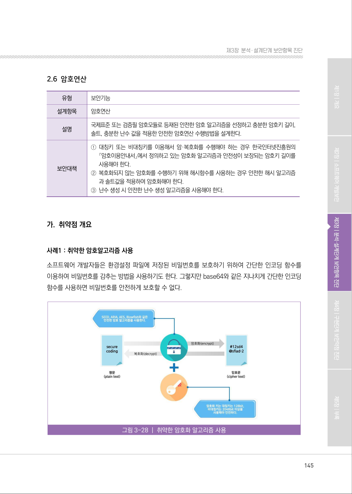
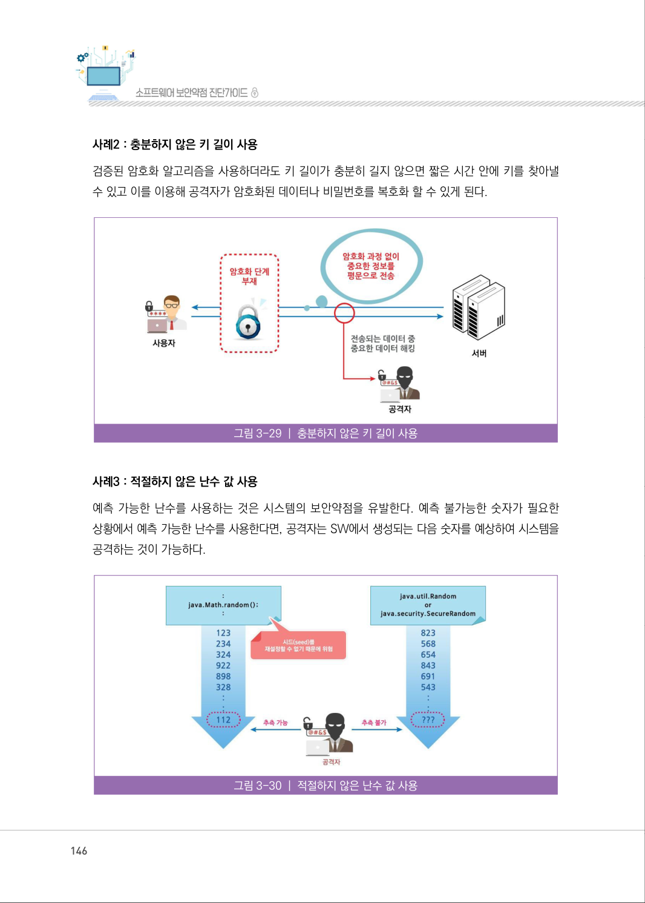
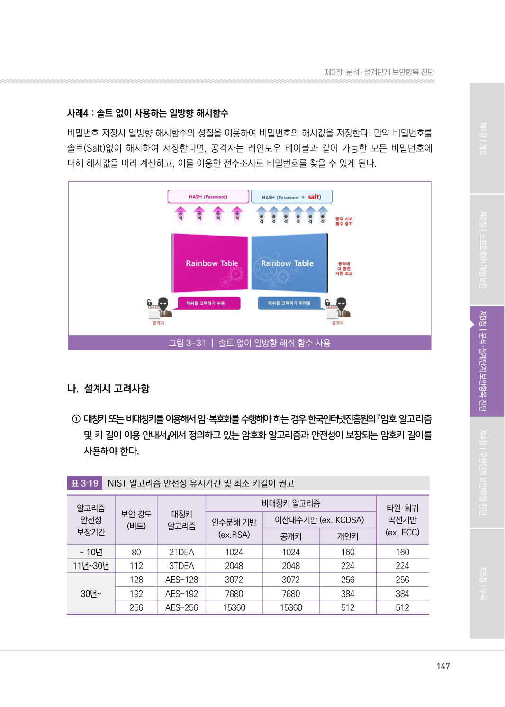
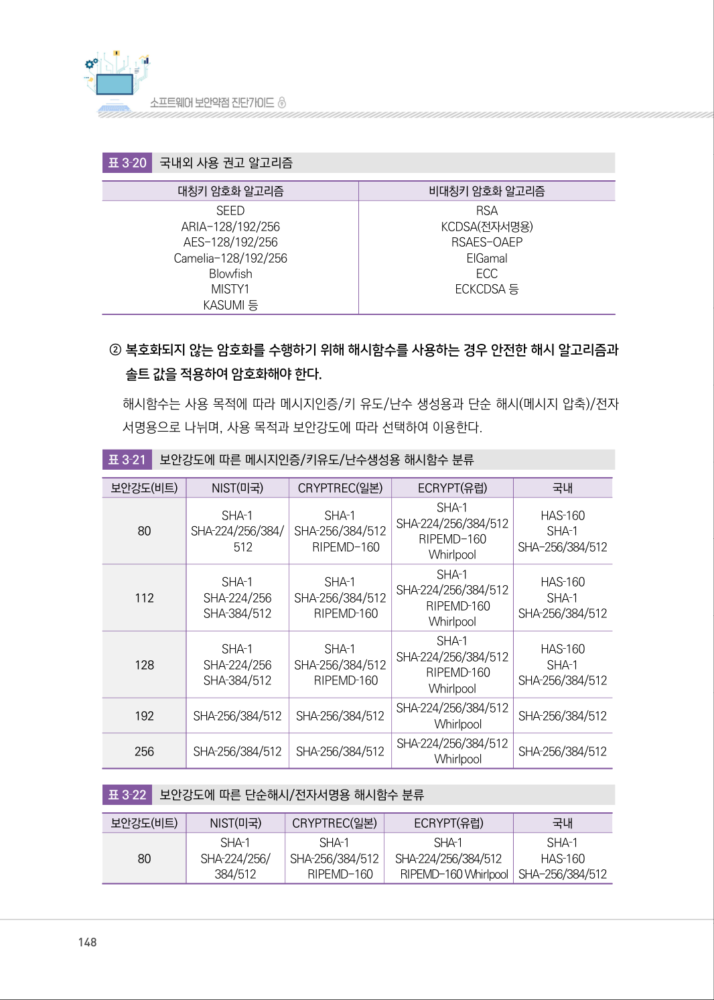
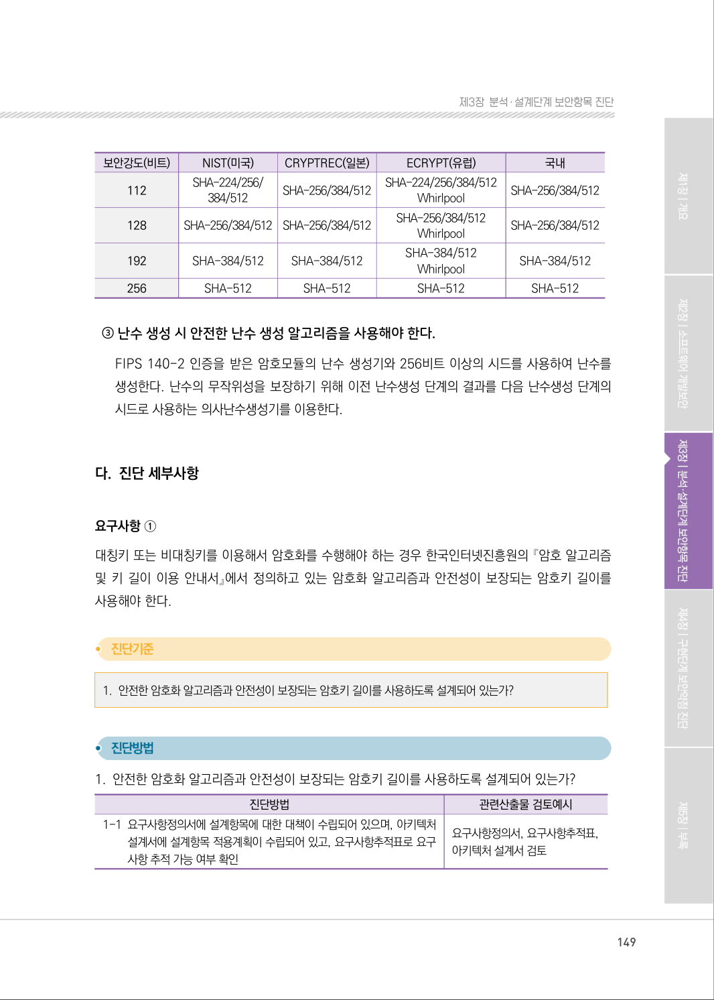
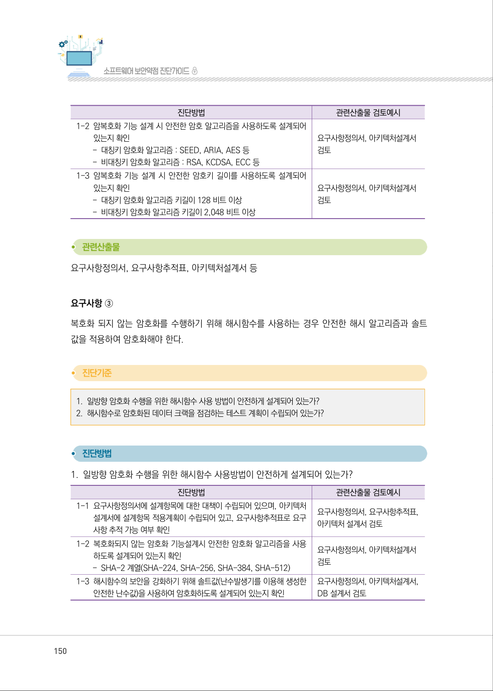
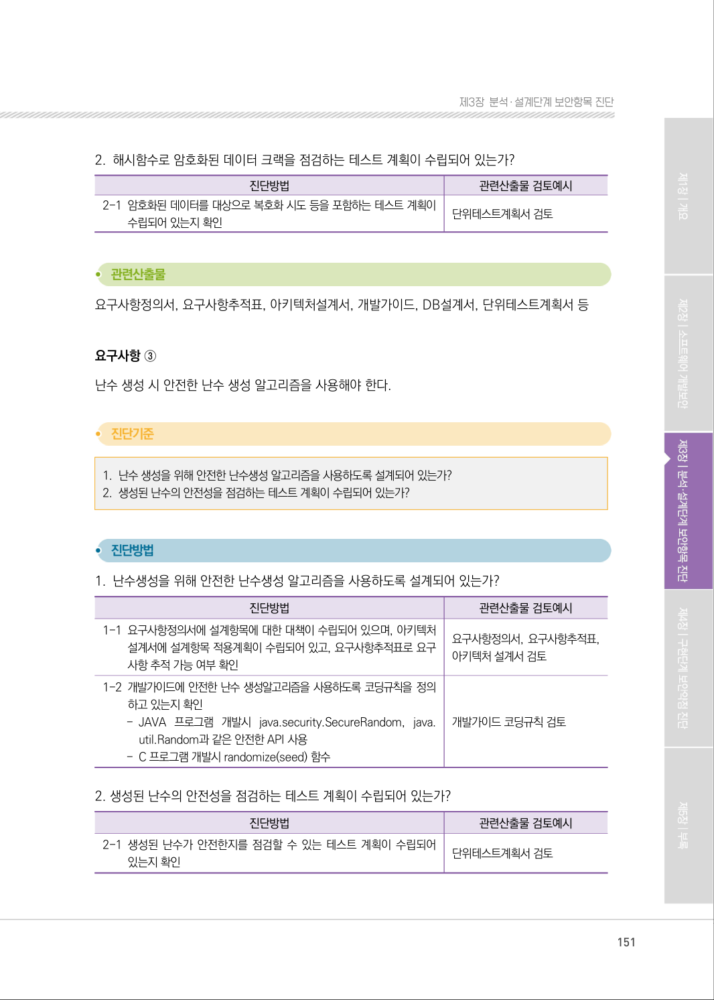
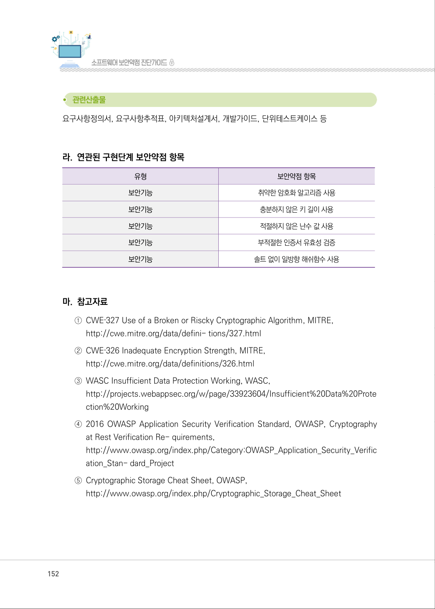
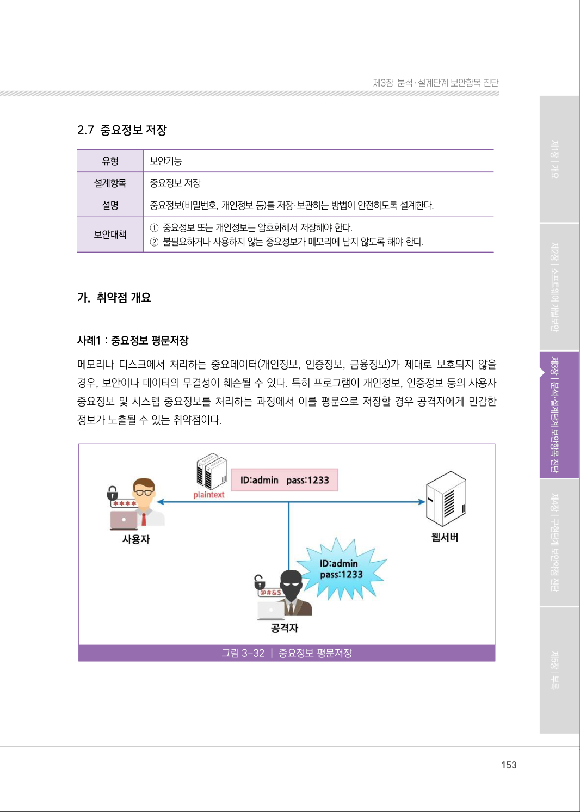

# 2.6 암호연산

> 변환 안내(원문 외): 아래 본문은 PDF 텍스트를 추출한 전사입니다. 코드 줄번호·특수 공백·원문 오류를 유지했습니다. 실행용 코드가 아닙니다. 표·그림·들여쓰기는 연결된 페이지 이미지와 대조하세요. 페이지 경계의 줄바꿈을 보존하며, 동일 페이지가 여러 항목에 나뉘면 각 항목의 본문은 해당 구간만 포함합니다.

### PDF 145페이지 / 인쇄 145페이지

<!-- source-page:SW-Diagnosis-2021:145; source-lines:0,2,3,4,5,6,7,8,9,10,11,12,13,14,15,16,17,18,19,20,21,22 -->

145

2.6 암호연산

유형

보안기능

설계항목

암호연산

설명

국제표준 또는 검증필 암호모듈로 등재된 안전한 암호 알고리즘을 선정하고 충분한 암호키 길이, 
솔트, 충분한 난수 값을 적용한 안전한 암호연산 수행방법을 설계한다.

보안대책

①대칭키 또는 비대칭키를 이용해서 암·복호화를 수행해야 하는 경우 한국인터넷진흥원의 

『암호이용안내서』에서 정의하고 있는 암호화 알고리즘과 안전성이 보장되는 암호키 길이를 
사용해야 한다.
②복호화되지 않는 암호화를 수행하기 위해 해시함수를 사용하는 경우 안전한 해시 알고리즘

과 솔트값을 적용하여 암호화해야 한다.
③난수 생성 시 안전한 난수 생성 알고리즘을 사용해야 한다.

#### 가. 취약점 개요

사례1 : 취약한 암호알고리즘 사용
소프트웨어 개발자들은 환경설정 파일에 저장된 비밀번호를 보호하기 위하여 간단한 인코딩 함수를 
이용하여 비밀번호를 감추는 방법을 사용하기도 한다. 그렇지만 base64와 같은 지나치게 간단한 인코딩 
함수를 사용하면 비밀번호를 안전하게 보호할 수 없다.

그림3-28 | 취약한 암호화 알고리즘 사용

<details><summary>원본 페이지 이미지 (변환 외 보존 자료)</summary>



</details>

### PDF 146페이지 / 인쇄 146페이지

<!-- source-page:SW-Diagnosis-2021:146; source-lines:0,1,2,3,4,5,6,7,8,9 -->

146

사례2 : 충분하지 않은 키 길이 사용
검증된 암호화 알고리즘을 사용하더라도 키 길이가 충분히 길지 않으면 짧은 시간 안에 키를 찾아낼 
수 있고 이를 이용해 공격자가 암호화된 데이터나 비밀번호를 복호화 할 수 있게 된다.

그림3-29 | 충분하지 않은 키 길이 사용

사례3 : 적절하지 않은 난수 값 사용
예측 가능한 난수를 사용하는 것은 시스템의 보안약점을 유발한다. 예측 불가능한 숫자가 필요한 
상황에서 예측 가능한 난수를 사용한다면, 공격자는 SW에서 생성되는 다음 숫자를 예상하여 시스템을 
공격하는 것이 가능하다.

그림3-30 | 적절하지 않은 난수 값 사용

<details><summary>원본 페이지 이미지 (변환 외 보존 자료)</summary>



</details>

### PDF 147페이지 / 인쇄 147페이지

<!-- source-page:SW-Diagnosis-2021:147; source-lines:0,1,2,3,4,5,6,7,8,9,10,11,12,13,14,15,16,17,18,19,20,21,22,23,24,25,26,27,28,29,30,31,32,33,34,35,36,37,38,39,40,41,42,43,44,45,46,47,48,49,50,51,52,53,54,55,56,57,58,59,60,61 -->

147

제3장분석․ 설계단계 보안항목 진단

사례4 : 솔트 없이 사용하는 일방향 해시함수
비밀번호 저장시 일방향 해시함수의 성질을 이용하여 비밀번호의 해시값을 저장한다. 만약 비밀번호를 
솔트(Salt)없이 해시하여 저장한다면, 공격자는 레인보우 테이블과 같이 가능한 모든 비밀번호에 
대해 해시값을 미리 계산하고, 이를 이용한 전수조사로 비밀번호를 찾을 수 있게 된다.

그림3-31 | 솔트 없이 일방향 해쉬 함수 사용

#### 나. 설계시 고려사항

① 대칭키 또는 비대칭키를 이용해서 암·복호화를 수행해야 하는 경우 한국인터넷진흥원의 『암호 알고리즘 

및 키 길이 이용 안내서』에서 정의하고 있는 암호화 알고리즘과 안전성이 보장되는 암호키 길이를 
사용해야 한다.

표3‐19

NIST 알고리즘 안전성 유지기간 및 최소 키길이 권고

```text
알고리즘 
안전성
보장기간
보안 강도
(비트)
대칭키
알고리즘
비대칭키 알고리즘 
타원·회귀
곡선기반
(ex. ECC)
인수분해 기반
(ex.RSA)
이산대수기반 (ex. KCDSA)
공개키
개인키
~ 10년
80 
2TDEA 
1024 
1024 
160 
160
11년~30년
112 
3TDEA 
2048 
2048 
224 
224
30년~
128 
AES-128 
3072 
3072 
256 
256
192 
AES-192 
7680 
7680 
384 
384
256 
AES-256 
15360 
15360 
512 
512
```

<details><summary>원본 페이지 이미지 (변환 외 보존 자료)</summary>



</details>

### PDF 148페이지 / 인쇄 148페이지

<!-- source-page:SW-Diagnosis-2021:148; source-lines:0,1,2,3,4,5,6,7,8,9,10,11,12,13,14,15,16,17,18,19,20,21,22,23,24,25,26,27,28,29,30,31,32,33,34,35,36,37,38,39,40,41,42,43,44,45,46,47,48,49,50,51,52,53,54,55,56,57,58,59,60,61,62,63,64,65,66,67,68,69,70,71,72,73,74,75,76,77,78,79,80,81,82,83,84,85,86,87,88,89,90,91,92,93,94,95,96,97,98,99,100,101,102 -->

148

표3‐20

국내외 사용 권고 알고리즘

|  |  |
| --- | --- |
| 대칭키 암호화 알고리즘 | 비대칭키 암호화 알고리즘 |
| SEED<br>ARIA-128/192/256<br>AES-128/192/256<br>Camelia-128/192/256<br>Blowfish<br>MISTY1<br>KASUMI 등 | RSA<br>KCDSA(전자서명용)<br>RSAES-OAEP<br>ElGamal<br>ECC<br>ECKCDSA 등 |

② 복호화되지 않는 암호화를 수행하기 위해 해시함수를 사용하는 경우 안전한 해시 알고리즘과 

솔트 값을 적용하여 암호화해야 한다.
해시함수는 사용 목적에 따라 메시지인증/키 유도/난수 생성용과 단순 해시(메시지 압축)/전자 
서명용으로 나뉘며, 사용 목적과 보안강도에 따라 선택하여 이용한다.
표3‐21

보안강도에 따른 메시지인증/키유도/난수생성용 해시함수 분류

|  |  |  |  |  |
| --- | --- | --- | --- | --- |
| 보안강도(비트) | NIST(미국) | CRYPTREC(일본) | ECRYPT(유럽) | 국내 |
| 80 | SHA‐1<br>SHA‐224/256/384/<br>512 | SHA‐1<br>SHA‐256/384/512<br>RIPEMD-160 | SHA‐1<br>SHA‐224/256/384/512<br>RIPEMD-160<br>Whirlpool | HAS‐160<br>SHA‐1<br>SHA-256/384/512 |
| 112 | SHA‐1<br>SHA‐224/256<br>SHA‐384/512 | SHA‐1<br>SHA‐256/384/512<br>RIPEMD‐160 | SHA‐1<br>SHA‐224/256/384/512<br>RIPEMD‐160<br>Whirlpool | HAS‐160<br>SHA‐1<br>SHA‐256/384/512 |
| 128 | SHA‐1<br>SHA‐224/256<br>SHA‐384/512 | SHA‐1<br>SHA‐256/384/512<br>RIPEMD‐160 | SHA‐1<br>SHA‐224/256/384/512<br>RIPEMD‐160<br>Whirlpool | HAS‐160<br>SHA‐1<br>SHA‐256/384/512 |
| 192 | SHA‐256/384/512 | SHA‐256/384/512 | SHA‐224/256/384/512<br>Whirlpool | SHA‐256/384/512 |
| 256 | SHA‐256/384/512 | SHA‐256/384/512 | SHA‐224/256/384/512<br>Whirlpool | SHA‐256/384/512 |

표3‐22

보안강도에 따른 단순해시/전자서명용 해시함수 분류

|  |  |  |  |  |
| --- | --- | --- | --- | --- |
| 보안강도(비트) | NIST(미국) | CRYPTREC(일본) | ECRYPT(유럽) | 국내 |
| 80 | SHA‐1<br>SHA‐224/256/<br>384/512 | SHA‐1<br>SHA‐256/384/512<br>RIPEMD-160 | SHA‐1<br>SHA‐224/256/384/512<br>RIPEMD-160 Whirlpool | SHA‐1<br>HAS‐160<br>SHA-256/384/512 |

<details><summary>원본 페이지 이미지 (변환 외 보존 자료)</summary>



</details>

### PDF 149페이지 / 인쇄 149페이지

<!-- source-page:SW-Diagnosis-2021:149; source-lines:0,1,2,3,4,5,6,7,8,9,10,11,12,13,14,15,16,17,18,19,20,21,22,23,24,25,26,27,28,29,30,31,32,33,34,35,36,37,38,39,40,41,42,43,44,45,46,47,48 -->

149

제3장분석․ 설계단계 보안항목 진단

|  |  |  |  |  |
| --- | --- | --- | --- | --- |
| 보안강도(비트) | NIST(미국) | CRYPTREC(일본) | ECRYPT(유럽) | 국내 |
| 112 | SHA-224/256/<br>384/512 | SHA-256/384/512 | SHA-224/256/384/512<br>Whirlpool | SHA-256/384/512 |
| 128 | SHA-256/384/512 | SHA-256/384/512 | SHA-256/384/512<br>Whirlpool | SHA-256/384/512 |
| 192 | SHA-384/512 | SHA-384/512 | SHA-384/512<br>Whirlpool | SHA-384/512 |
| 256 | SHA-512 | SHA-512 | SHA-512 | SHA-512 |

③ 난수 생성 시 안전한 난수 생성 알고리즘을 사용해야 한다.

FIPS 140-2 인증을 받은 암호모듈의 난수 생성기와 256비트 이상의 시드를 사용하여 난수를 
생성한다. 난수의 무작위성을 보장하기 위해 이전 난수생성 단계의 결과를 다음 난수생성 단계의 
시드로 사용하는 의사난수생성기를 이용한다.

#### 다. 진단 세부사항

요구사항 ①
대칭키 또는 비대칭키를 이용해서 암호화를 수행해야 하는 경우 한국인터넷진흥원의 『암호 알고리즘 
및 키 길이 이용 안내서』에서 정의하고 있는 암호화 알고리즘과 안전성이 보장되는 암호키 길이를 
사용해야 한다.

#### 1. 안전한 암호화 알고리즘과 안전성이 보장되는 암호키 길이를 사용하도록 설계되어 있는가?

#### 1. 안전한 암호화 알고리즘과 안전성이 보장되는 암호키 길이를 사용하도록 설계되어 있는가?

| 진단방법 | 관련산출물 검토예시 |
| --- | --- |
| 1-1 요구사항정의서에 설계항목에 대한 대책이 수립되어 있으며, 아키텍처<br>설계서에 설계항목 적용계획이 수립되어 있고, 요구사항추적표로 요구<br>사항 추적 가능 여부 확인 | 요구사항정의서, 요구사항추적표,<br>아키텍처 설계서 검토 |

<details><summary>원본 페이지 이미지 (변환 외 보존 자료)</summary>



</details>

### PDF 150페이지 / 인쇄 150페이지

<!-- source-page:SW-Diagnosis-2021:150; source-lines:0,1,2,3,4,5,6,7,8,9,10,11,12,13,14,15,16,17,18,19,20,21,22,23,24,25,26,27,28,29,30,31,32,33,34,35,36,37 -->

150

| 진단방법 | 관련산출물 검토예시 |
| --- | --- |
| 1-2 암복호화 기능 설계 시 안전한 암호 알고리즘을 사용하도록 설계되어<br>있는지 확인<br>- 대칭키 암호화 알고리즘 : SEED, ARIA, AES 등<br>- 비대칭키 암호화 알고리즘 : RSA, KCDSA, ECC 등 | 요구사항정의서, 아키텍처설계서<br>검토 |
| 1-3 암복호화 기능 설계 시 안전한 암호키 길이를 사용하도록 설계되어<br>있는지 확인<br>- 대칭키 암호화 알고리즘 키길이 128 비트 이상<br>- 비대칭키 암호화 알고리즘 키길이 2,048 비트 이상 | 요구사항정의서, 아키텍처설계서<br>검토 |

요구사항정의서, 요구사항추적표, 아키텍처설계서 등

요구사항 ③
복호화 되지 않는 암호화를 수행하기 위해 해시함수를 사용하는 경우 안전한 해시 알고리즘과 솔트 
값을 적용하여 암호화해야 한다.

#### 1. 일방향 암호화 수행을 위한 해시함수 사용 방법이 안전하게 설계되어 있는가?

#### 2. 해시함수로 암호화된 데이터 크랙을 점검하는 테스트 계획이 수립되어 있는가?

#### 1. 일방향 암호화 수행을 위한 해시함수 사용방법이 안전하게 설계되어 있는가?

| 진단방법 | 관련산출물 검토예시 |
| --- | --- |
| 1-1 요구사항정의서에 설계항목에 대한 대책이 수립되어 있으며, 아키텍처<br>설계서에 설계항목 적용계획이 수립되어 있고, 요구사항추적표로 요구<br>사항 추적 가능 여부 확인 | 요구사항정의서, 요구사항추적표,<br>아키텍처 설계서 검토 |
| 1-2 복호화되지 않는 암호화 기능설계시 안전한 암호화 알고리즘을 사용<br>하도록 설계되어 있는지 확인<br>- SHA-2 계열(SHA-224, SHA-256, SHA-384, SHA-512) | 요구사항정의서, 아키텍처설계서<br>검토 |
| 1-3 해시함수의 보안을 강화하기 위해 솔트값(난수발생기를 이용해 생성한<br>안전한 난수값)을 사용하여 암호화하도록 설계되어 있는지 확인 | 요구사항정의서, 아키텍처설계서,<br>DB 설계서 검토 |

<details><summary>원본 페이지 이미지 (변환 외 보존 자료)</summary>



</details>

### PDF 151페이지 / 인쇄 151페이지

<!-- source-page:SW-Diagnosis-2021:151; source-lines:0,1,2,3,4,5,6,7,8,9,10,11,12,13,14,15,16,17,18,19,20,21,22,23,24,25,26,27,28,29,30,31,32 -->

151

제3장분석․ 설계단계 보안항목 진단

#### 2. 해시함수로 암호화된 데이터 크랙을 점검하는 테스트 계획이 수립되어 있는가?

| 진단방법 | 관련산출물 검토예시 |
| --- | --- |
| 2-1 암호화된 데이터를 대상으로 복호화 시도 등을 포함하는 테스트 계획이<br>수립되어 있는지 확인 | 단위테스트계획서 검토 |

요구사항정의서, 요구사항추적표, 아키텍처설계서, 개발가이드, DB설계서, 단위테스트계획서 등

요구사항 ③
난수 생성 시 안전한 난수 생성 알고리즘을 사용해야 한다.

#### 1. 난수 생성을 위해 안전한 난수생성 알고리즘을 사용하도록 설계되어 있는가?

#### 2. 생성된 난수의 안전성을 점검하는 테스트 계획이 수립되어 있는가?

#### 1. 난수생성을 위해 안전한 난수생성 알고리즘을 사용하도록 설계되어 있는가?

| 진단방법 | 관련산출물 검토예시 |
| --- | --- |
| 1-1 요구사항정의서에 설계항목에 대한 대책이 수립되어 있으며, 아키텍처<br>설계서에 설계항목 적용계획이 수립되어 있고, 요구사항추적표로 요구<br>사항 추적 가능 여부 확인 | 요구사항정의서, 요구사항추적표,<br>아키텍처 설계서 검토 |
| 1-2 개발가이드에 안전한 난수 생성알고리즘을 사용하도록 코딩규칙을 정의<br>하고 있는지 확인<br>- JAVA 프로그램 개발시 java.security.SecureRandom, java.<br>util.Random과 같은 안전한 API 사용<br>- C 프로그램 개발시 randomize(seed) 함수 | 개발가이드 코딩규칙 검토 |

#### 2. 생성된 난수의 안전성을 점검하는 테스트 계획이 수립되어 있는가?

| 진단방법 | 관련산출물 검토예시 |
| --- | --- |
| 2-1 생성된 난수가 안전한지를 점검할 수 있는 테스트 계획이 수립되어<br>있는지 확인 | 단위테스트계획서 검토 |

<details><summary>원본 페이지 이미지 (변환 외 보존 자료)</summary>



</details>

### PDF 152페이지 / 인쇄 152페이지

<!-- source-page:SW-Diagnosis-2021:152; source-lines:0,1,2,3,4,5,6,7,8,9,10,11,12,13,14,15,16,17,18,19,20,21,22,23,24,25,26,27,28 -->

152

요구사항정의서, 요구사항추적표, 아키텍처설계서, 개발가이드, 단위테스트케이스 등

#### 라. 연관된 구현단계 보안약점 항목

| 유형 | 보안약점 항목 |
| --- | --- |
| 보안기능 | 취약한 암호화 알고리즘 사용 |
| 보안기능 | 충분하지 않은 키 길이 사용 |
| 보안기능 | 적절하지 않은 난수 값 사용 |
| 보안기능 | 부적절한 인증서 유효성 검증 |
| 보안기능 | 솔트 없이 일방향 해쉬함수 사용 |

#### 마. 참고자료

①CWE‐327 Use of a Broken or Riscky Cryptographic Algorithm, MITRE,

http://cwe.mitre.org/data/defini- tions/327.html
②CWE‐326 Inadequate Encryption Strength, MITRE,

http://cwe.mitre.org/data/definitions/326.html
③WASC Insufficient Data Protection Working, WASC,

http://projects.webappsec.org/w/page/33923604/Insufficient%20Data%20Prote
ction%20Working
④2016 OWASP Application Security Verification Standard, OWASP, Cryptography 

at Rest Verification Re- quirements,
http://www.owasp.org/index.php/Category:OWASP_Application_Security_Verific
ation_Stan- dard_Project
⑤Cryptographic Storage Cheat Sheet, OWASP,

http://www.owasp.org/index.php/Cryptographic_Storage_Cheat_Sheet

<details><summary>원본 페이지 이미지 (변환 외 보존 자료)</summary>



</details>

### PDF 153페이지 / 인쇄 153페이지

<!-- source-page:SW-Diagnosis-2021:153; source-lines:1 -->

제3장분석․ 설계단계 보안항목 진단

<details><summary>원본 페이지 이미지 (변환 외 보존 자료)</summary>



</details>

---

## 탐색 링크 (원문 외)

[통합 인덱스](../../../INDEX.md)

