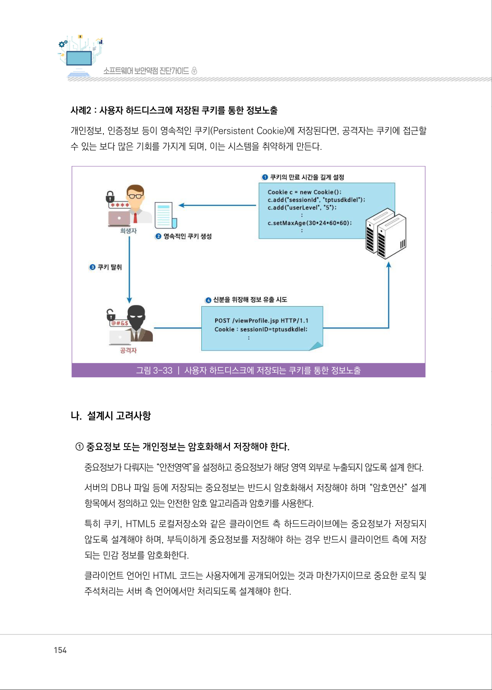
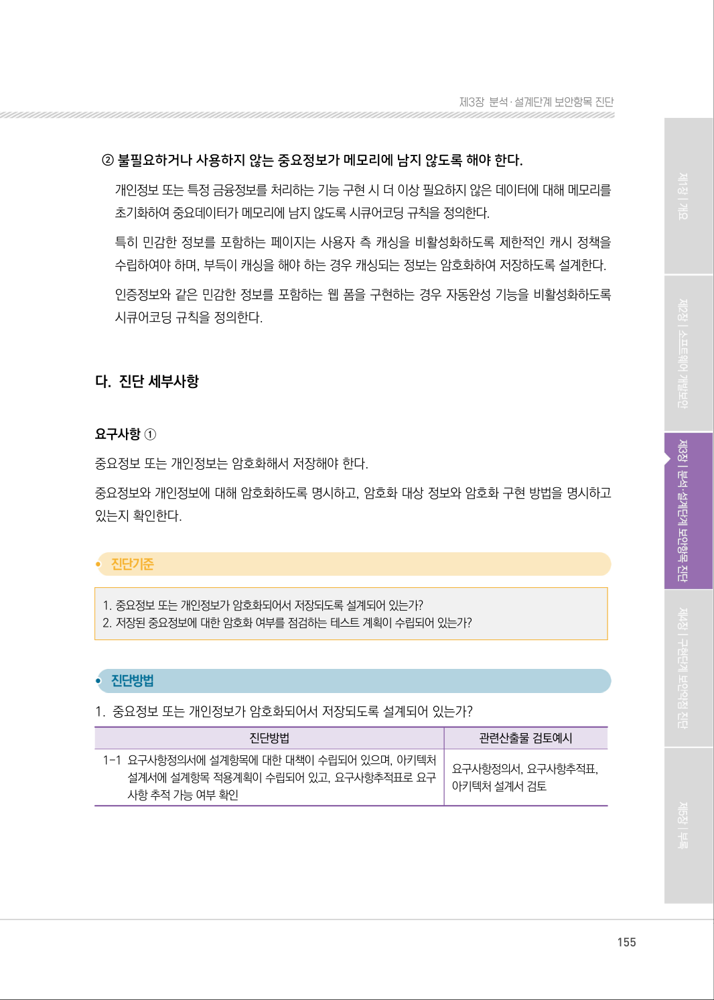
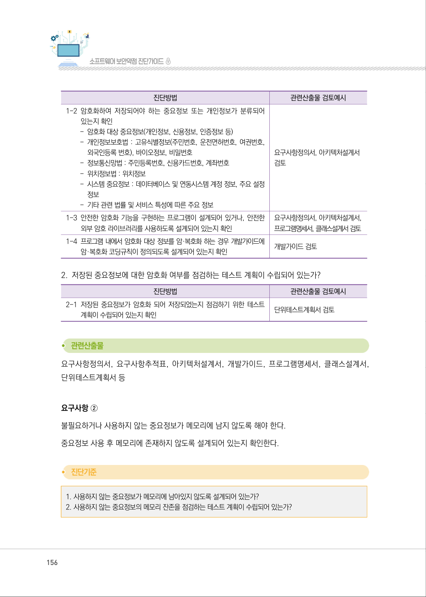
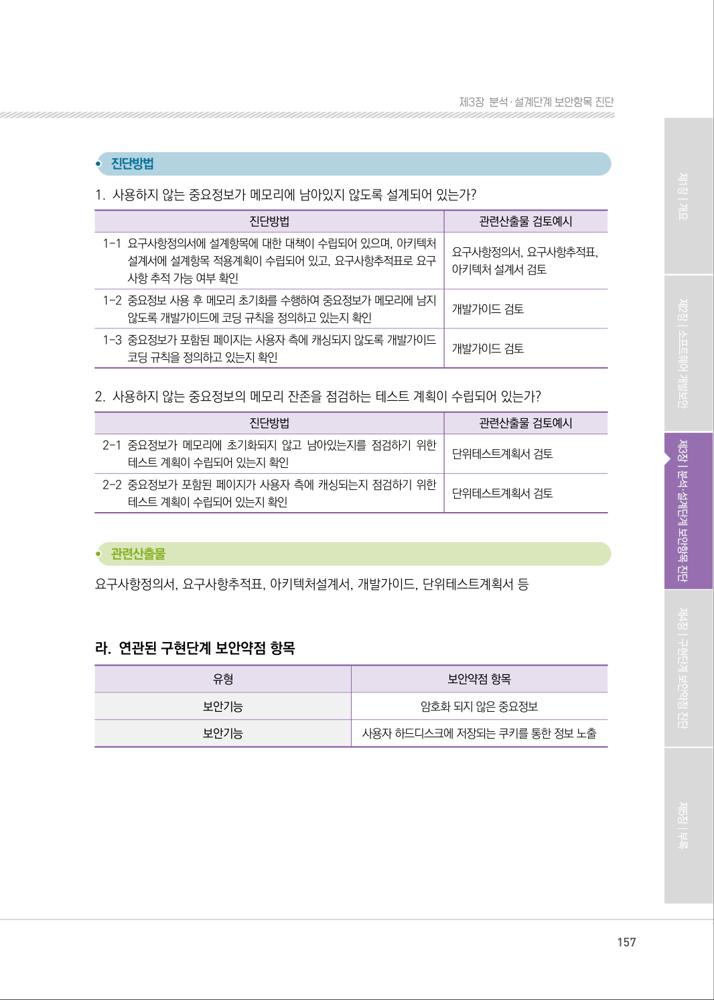
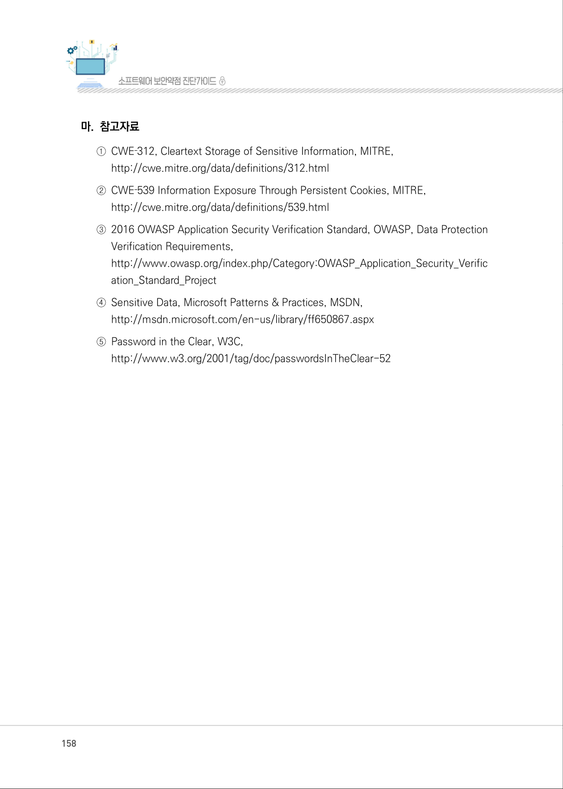
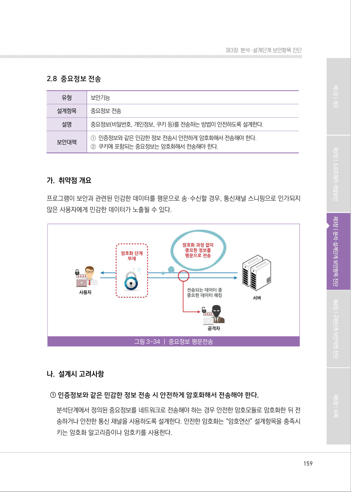

# 2.7 중요정보 저장

> 변환 안내(원문 외): 아래 본문은 PDF 텍스트를 추출한 전사입니다. 코드 줄번호·특수 공백·원문 오류를 유지했습니다. 실행용 코드가 아닙니다. 표·그림·들여쓰기는 연결된 페이지 이미지와 대조하세요. 페이지 경계의 줄바꿈을 보존하며, 동일 페이지가 여러 항목에 나뉘면 각 항목의 본문은 해당 구간만 포함합니다.

### PDF 153페이지 / 인쇄 153페이지

<!-- source-page:SW-Diagnosis-2021:153; source-lines:0,2,3,4,5,6,7,8,9,10,11,12,13,14,15,16,17,18 -->

153

2.7 중요정보 저장

| 유형 | 보안기능 |
| --- | --- |
| 설계항목 | 중요정보 저장 |
| 설명 | 중요정보(비밀번호, 개인정보 등)를 저장·보관하는 방법이 안전하도록 설계한다. |
| 보안대책 | ① 중요정보 또는 개인정보는 암호화해서 저장해야 한다. ② 불필요하거나 사용하지 않는 중요정보가 메모리에 남지 않도록 해야 한다. |

#### 가. 취약점 개요

사례1 : 중요정보 평문저장
메모리나 디스크에서 처리하는 중요데이터(개인정보, 인증정보, 금융정보)가 제대로 보호되지 않을 
경우, 보안이나 데이터의 무결성이 훼손될 수 있다. 특히 프로그램이 개인정보, 인증정보 등의 사용자 
중요정보 및 시스템 중요정보를 처리하는 과정에서 이를 평문으로 저장할 경우 공격자에게 민감한 
정보가 노출될 수 있는 취약점이다.

그림3-32 | 중요정보 평문저장

원본 페이지 이미지 (변환 외 보존 자료)

### PDF 154페이지 / 인쇄 154페이지

<!-- source-page:SW-Diagnosis-2021:154; source-lines:0,1,2,3,4,5,6,7,8,9,10,11,12,13,14 -->

154

사례2 : 사용자 하드디스크에 저장된 쿠키를 통한 정보노출
개인정보, 인증정보 등이 영속적인 쿠키(Persistent Cookie)에 저장된다면, 공격자는 쿠키에 접근할 
수 있는 보다 많은 기회를 가지게 되며, 이는 시스템을 취약하게 만든다.

그림3-33 | 사용자 하드디스크에 저장되는 쿠키를 통한 정보노출

#### 나. 설계시 고려사항

① 중요정보 또는 개인정보는 암호화해서 저장해야 한다.

중요정보가 다뤄지는 “안전영역”을 설정하고 중요정보가 해당 영역 외부로 누출되지 않도록 설계 한다.
서버의 DB나 파일 등에 저장되는 중요정보는 반드시 암호화해서 저장해야 하며 “암호연산” 설계
항목에서 정의하고 있는 안전한 암호 알고리즘과 암호키를 사용한다. 
특히 쿠키, HTML5 로컬저장소와 같은 클라이언트 측 하드드라이브에는 중요정보가 저장되지 
않도록 설계해야 하며, 부득이하게 중요정보를 저장해야 하는 경우 반드시 클라이언트 측에 저장
되는 민감 정보를 암호화한다.
클라이언트 언어인 HTML 코드는 사용자에게 공개되어있는 것과 마찬가지이므로 중요한 로직 및 
주석처리는 서버 측 언어에서만 처리되도록 설계해야 한다.

원본 페이지 이미지 (변환 외 보존 자료)

### PDF 155페이지 / 인쇄 155페이지

<!-- source-page:SW-Diagnosis-2021:155; source-lines:0,1,2,3,4,5,6,7,8,9,10,11,12,13,14,15,16,17,18,19,20,21,22,23 -->

155

제3장분석․ 설계단계 보안항목 진단

② 불필요하거나 사용하지 않는 중요정보가 메모리에 남지 않도록 해야 한다.

개인정보 또는 특정 금융정보를 처리하는 기능 구현 시 더 이상 필요하지 않은 데이터에 대해 메모리를 
초기화하여 중요데이터가 메모리에 남지 않도록 시큐어코딩 규칙을 정의한다.
특히 민감한 정보를 포함하는 페이지는 사용자 측 캐싱을 비활성화하도록 제한적인 캐시 정책을 
수립하여야 하며, 부득이 캐싱을 해야 하는 경우 캐싱되는 정보는 암호화하여 저장하도록 설계한다.
인증정보와 같은 민감한 정보를 포함하는 웹 폼을 구현하는 경우 자동완성 기능을 비활성화하도록 
시큐어코딩 규칙을 정의한다.

#### 다. 진단 세부사항

요구사항 ①
중요정보 또는 개인정보는 암호화해서 저장해야 한다.
중요정보와 개인정보에 대해 암호화하도록 명시하고, 암호화 대상 정보와 암호화 구현 방법을 명시하고 
있는지 확인한다.

#### 1. 중요정보 또는 개인정보가 암호화되어서 저장되도록 설계되어 있는가?

#### 2. 저장된 중요정보에 대한 암호화 여부를 점검하는 테스트 계획이 수립되어 있는가? 

#### 1. 중요정보 또는 개인정보가 암호화되어서 저장되도록 설계되어 있는가?

| 진단방법 | 관련산출물 검토예시 |
| --- | --- |
| 1-1 요구사항정의서에 설계항목에 대한 대책이 수립되어 있으며, 아키텍처 설계서에 설계항목 적용계획이 수립되어 있고, 요구사항추적표로 요구 사항 추적 가능 여부 확인 | 요구사항정의서, 요구사항추적표, 아키텍처 설계서 검토 |

원본 페이지 이미지 (변환 외 보존 자료)

### PDF 156페이지 / 인쇄 156페이지

<!-- source-page:SW-Diagnosis-2021:156; source-lines:0,1,2,3,4,5,6,7,8,9,10,11,12,13,14,15,16,17,18,19,20,21,22,23,24,25,26,27,28,29,30,31,32,33,34 -->

156

| 진단방법 | 관련산출물 검토예시 |
| --- | --- |
| 1-2 암호화하여 저장되어야 하는 중요정보 또는 개인정보가 분류되어 있는지 확인 - 암호화 대상 중요정보(개인정보, 신용정보, 인증정보 등) - 개인정보보호법 : 고유식별정보(주민번호, 운전면허번호, 여권번호, 외국인등록 번호), 바이오정보, 비밀번호 - 정보통신망법 : 주민등록번호, 신용카드번호, 계좌번호 - 위치정보법 : 위치정보 - 시스템 중요정보 : 데이터베이스 및 연동시스템 계정 정보, 주요 설정 정보 - 기타 관련 법률 및 서비스 특성에 따른 주요 정보 | 요구사항정의서, 아키텍처설계서 검토 |
| 1-3 안전한 암호화 기능을 구현하는 프로그램이 설계되어 있거나, 안전한 외부 암호 라이브러리를 사용하도록 설계되어 있는지 확인 | 요구사항정의서, 아키텍처설계서, 프로그램명세서, 클래스설계서 검토 |
| 1-4 프로그램 내에서 암호화 대상 정보를 암·복호화 하는 경우 개발가이드에 암·복호화 코딩규칙이 정의되도록 설계되어 있는지 확인 | 개발가이드 검토 |

#### 2. 저장된 중요정보에 대한 암호화 여부를 점검하는 테스트 계획이 수립되어 있는가?

| 진단방법 | 관련산출물 검토예시 |
| --- | --- |
| 2-1 저장된 중요정보가 암호화 되어 저장되었는지 점검하기 위한 테스트 계획이 수립되어 있는지 확인 | 단위테스트계획서 검토 |

요구사항정의서, 요구사항추적표, 아키텍처설계서, 개발가이드, 프로그램명세서, 클래스설계서, 
단위테스트계획서 등

요구사항 ②
불필요하거나 사용하지 않는 중요정보가 메모리에 남지 않도록 해야 한다.
중요정보 사용 후 메모리에 존재하지 않도록 설계되어 있는지 확인한다.

#### 1. 사용하지 않는 중요정보가 메모리에 남아있지 않도록 설계되어 있는가?

#### 2. 사용하지 않는 중요정보의 메모리 잔존을 점검하는 테스트 계획이 수립되어 있는가?

원본 페이지 이미지 (변환 외 보존 자료)

### PDF 157페이지 / 인쇄 157페이지

<!-- source-page:SW-Diagnosis-2021:157; source-lines:0,1,2,3,4,5,6,7,8,9,10,11,12,13,14,15,16,17,18,19,20,21,22,23,24,25,26,27,28,29,30,31,32 -->

157

제3장분석․ 설계단계 보안항목 진단

#### 1. 사용하지 않는 중요정보가 메모리에 남아있지 않도록 설계되어 있는가?

| 진단방법 | 관련산출물 검토예시 |
| --- | --- |
| 1-1 요구사항정의서에 설계항목에 대한 대책이 수립되어 있으며, 아키텍처 설계서에 설계항목 적용계획이 수립되어 있고, 요구사항추적표로 요구 사항 추적 가능 여부 확인 | 요구사항정의서, 요구사항추적표, 아키텍처 설계서 검토 |
| 1-2 중요정보 사용 후 메모리 초기화를 수행하여 중요정보가 메모리에 남지 않도록 개발가이드에 코딩 규칙을 정의하고 있는지 확인 | 개발가이드 검토 |
| 1-3 중요정보가 포함된 페이지는 사용자 측에 캐싱되지 않도록 개발가이드 코딩 규칙을 정의하고 있는지 확인 | 개발가이드 검토 |

#### 2. 사용하지 않는 중요정보의 메모리 잔존을 점검하는 테스트 계획이 수립되어 있는가?

| 진단방법 | 관련산출물 검토예시 |
| --- | --- |
| 2-1 중요정보가 메모리에 초기화되지 않고 남아있는지를 점검하기 위한 테스트 계획이 수립되어 있는지 확인 | 단위테스트계획서 검토 |
| 2-2 중요정보가 포함된 페이지가 사용자 측에 캐싱되는지 점검하기 위한 테스트 계획이 수립되어 있는지 확인 | 단위테스트계획서 검토 |

요구사항정의서, 요구사항추적표, 아키텍처설계서, 개발가이드, 단위테스트계획서 등

#### 라. 연관된 구현단계 보안약점 항목

| 유형 | 보안약점 항목 |
| --- | --- |
| 보안기능 | 암호화 되지 않은 중요정보 |
| 보안기능 | 사용자 하드디스크에 저장되는 쿠키를 통한 정보 노출 |

원본 페이지 이미지 (변환 외 보존 자료)

### PDF 158페이지 / 인쇄 158페이지

<!-- source-page:SW-Diagnosis-2021:158; source-lines:0,1,2,3,4,5,6,7,8,9,10,11,12,13 -->

158

#### 마. 참고자료

①CWE‐312, Cleartext Storage of Sensitive Information, MITRE,

http://cwe.mitre.org/data/definitions/312.html
②CWE‐539 Information Exposure Through Persistent Cookies, MITRE,

http://cwe.mitre.org/data/definitions/539.html 
③2016 OWASP Application Security Verification Standard, OWASP, Data Protection 

Verification Requirements,
http://www.owasp.org/index.php/Category:OWASP_Application_Security_Verific
ation_Standard_Project
④Sensitive Data, Microsoft Patterns &amp; Practices, MSDN,

http://msdn.microsoft.com/en-us/library/ff650867.aspx
⑤Password in the Clear, W3C,

http://www.w3.org/2001/tag/doc/passwordsInTheClear-52

원본 페이지 이미지 (변환 외 보존 자료)

### PDF 159페이지 / 인쇄 159페이지

<!-- source-page:SW-Diagnosis-2021:159; source-lines:1 -->

제3장분석․ 설계단계 보안항목 진단

원본 페이지 이미지 (변환 외 보존 자료)

---

## 탐색 링크 (원문 외)

[통합 인덱스](../../../INDEX.md)

