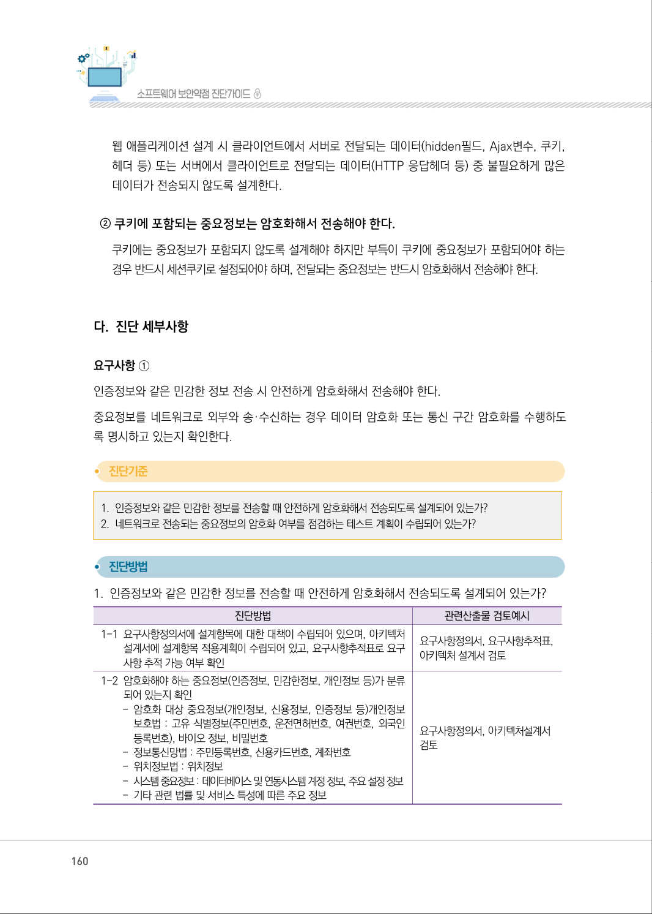
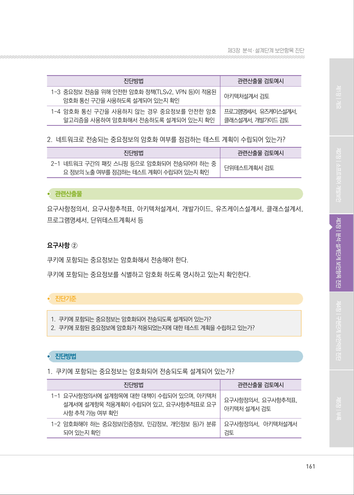
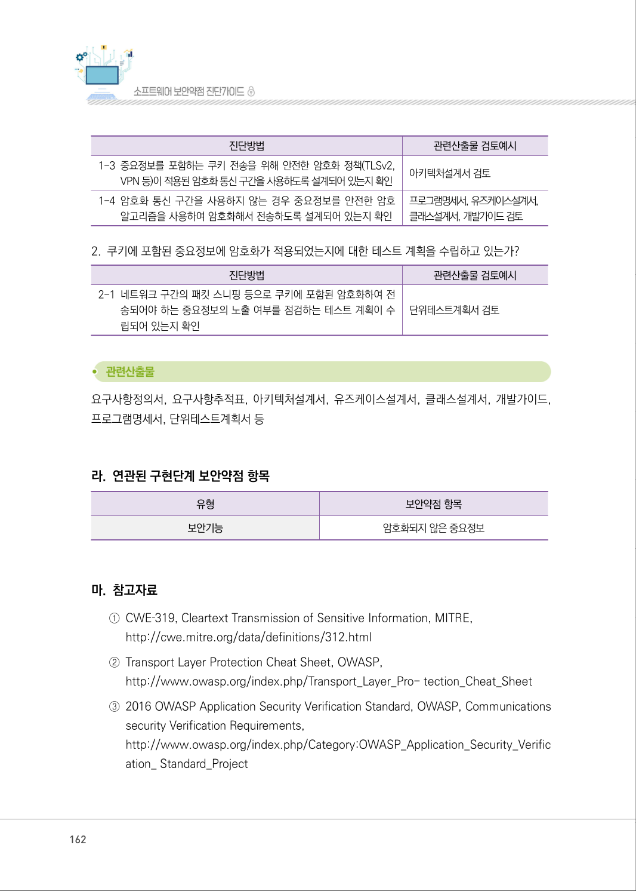
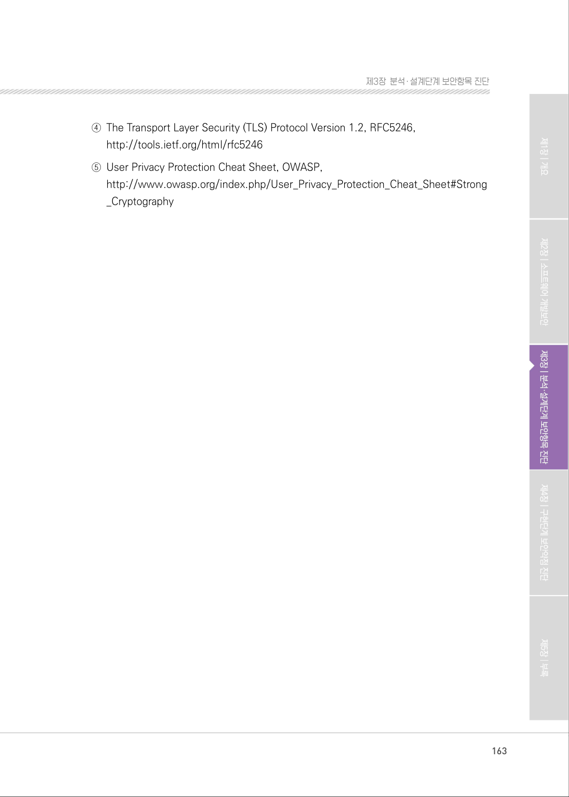

# 2.8 중요정보 전송

> 변환 안내(원문 외): 아래 본문은 PDF 텍스트를 추출한 전사입니다. 코드 줄번호·특수 공백·원문 오류를 유지했습니다. 실행용 코드가 아닙니다. 표·그림·들여쓰기는 연결된 페이지 이미지와 대조하세요. 페이지 경계의 줄바꿈을 보존하며, 동일 페이지가 여러 항목에 나뉘면 각 항목의 본문은 해당 구간만 포함합니다.

### PDF 159페이지 / 인쇄 159페이지

<!-- source-page:SW-Diagnosis-2021:159; source-lines:0,2,3,4,5,6,7,8,9,10,11,12,13,14,15,16,17,18,19,20 -->

159

2.8 중요정보 전송

| 유형 | 보안기능 |
| --- | --- |
| 설계항목 | 중요정보 전송 |
| 설명 | 중요정보(비밀번호, 개인정보, 쿠키 등)를 전송하는 방법이 안전하도록 설계한다. |
| 보안대책 | ① 인증정보와 같은 민감한 정보 전송시 안전하게 암호화해서 전송해야 한다. ② 쿠키에 포함되는 중요정보는 암호화해서 전송해야 한다. |

#### 가. 취약점 개요

프로그램이 보안과 관련된 민감한 데이터를 평문으로 송·수신할 경우, 통신채널 스니핑으로 인가되지 
않은 사용자에게 민감한 데이터가 노출될 수 있다.

그림3-34 | 중요정보 평문전송

#### 나. 설계시 고려사항

① 인증정보와 같은 민감한 정보 전송 시 안전하게 암호화해서 전송해야 한다.

분석단계에서 정의된 중요정보를 네트워크로 전송해야 하는 경우 안전한 암호모듈로 암호화한 뒤 전
송하거나 안전한 통신 채널을 사용하도록 설계한다. 안전한 암호화는 “암호연산” 설계항목을 충족시
키는 암호화 알고리즘이나 암호키를 사용한다.

원본 페이지 이미지 (변환 외 보존 자료)

### PDF 160페이지 / 인쇄 160페이지

<!-- source-page:SW-Diagnosis-2021:160; source-lines:0,1,2,3,4,5,6,7,8,9,10,11,12,13,14,15,16,17,18,19,20,21,22,23,24,25,26,27,28,29,30,31,32 -->

160

웹 애플리케이션 설계 시 클라이언트에서 서버로 전달되는 데이터(hidden필드, Ajax변수, 쿠키, 
헤더 등) 또는 서버에서 클라이언트로 전달되는 데이터(HTTP 응답헤더 등) 중 불필요하게 많은 
데이터가 전송되지 않도록 설계한다.

② 쿠키에 포함되는 중요정보는 암호화해서 전송해야 한다.

쿠키에는 중요정보가 포함되지 않도록 설계해야 하지만 부득이 쿠키에 중요정보가 포함되어야 하는 
경우 반드시 세션쿠키로 설정되어야 하며, 전달되는 중요정보는 반드시 암호화해서 전송해야 한다.

#### 다. 진단 세부사항

요구사항 ①
인증정보와 같은 민감한 정보 전송 시 안전하게 암호화해서 전송해야 한다.
중요정보를 네트워크로 외부와 송·수신하는 경우 데이터 암호화 또는 통신 구간 암호화를 수행하도
록 명시하고 있는지 확인한다.

#### 1. 인증정보와 같은 민감한 정보를 전송할 때 안전하게 암호화해서 전송되도록 설계되어 있는가?

#### 2. 네트워크로 전송되는 중요정보의 암호화 여부를 점검하는 테스트 계획이 수립되어 있는가?

#### 1. 인증정보와 같은 민감한 정보를 전송할 때 안전하게 암호화해서 전송되도록 설계되어 있는가?

| 진단방법 | 관련산출물 검토예시 |
| --- | --- |
| 1-1 요구사항정의서에 설계항목에 대한 대책이 수립되어 있으며, 아키텍처 설계서에 설계항목 적용계획이 수립되어 있고, 요구사항추적표로 요구 사항 추적 가능 여부 확인 | 요구사항정의서, 요구사항추적표, 아키텍처 설계서 검토 |
| 1-2 암호화해야 하는 중요정보(인증정보, 민감한정보, 개인정보 등)가 분류 되어 있는지 확인 - 암호화 대상 중요정보(개인정보, 신용정보, 인증정보 등)개인정보 보호법 : 고유 식별정보(주민번호, 운전면허번호, 여권번호, 외국인 등록번호), 바이오 정보, 비밀번호 - 정보통신망법 : 주민등록번호, 신용카드번호, 계좌번호 - 위치정보법 : 위치정보 - 시스템 중요정보 : 데이터베이스 및 연동시스템 계정 정보, 주요 설정 정보 - 기타 관련 법률 및 서비스 특성에 따른 주요 정보 | 요구사항정의서, 아키텍처설계서 검토 |

원본 페이지 이미지 (변환 외 보존 자료)

### PDF 161페이지 / 인쇄 161페이지

<!-- source-page:SW-Diagnosis-2021:161; source-lines:0,1,2,3,4,5,6,7,8,9,10,11,12,13,14,15,16,17,18,19,20,21,22,23,24,25,26,27,28,29,30,31,32,33,34,35 -->

161

제3장분석․ 설계단계 보안항목 진단

| 진단방법 | 관련산출물 검토예시 |
| --- | --- |
| 1-3 중요정보 전송을 위해 안전한 암호화 정책(TLSv2, VPN 등)이 적용된 암호화 통신 구간을 사용하도록 설계되어 있는지 확인 | 아키텍처설계서 검토 |
| 1-4 암호화 통신 구간을 사용하지 않는 경우 중요정보를 안전한 암호 알고리즘을 사용하여 암호화해서 전송하도록 설계되어 있는지 확인 | 프로그램명세서, 유즈케이스설계서, 클래스설계서, 개발가이드 검토 |

#### 2. 네트워크로 전송되는 중요정보의 암호화 여부를 점검하는 테스트 계획이 수립되어 있는가?

| 진단방법 | 관련산출물 검토예시 |
| --- | --- |
| 2-1 네트워크 구간의 패킷 스니핑 등으로 암호화되어 전송되어야 하는 중 요 정보의 노출 여부를 점검하는 테스트 계획이 수립되어 있는지 확인 | 단위테스트계획서 검토 |

요구사항정의서, 요구사항추적표, 아키텍처설계서, 개발가이드, 유즈케이스설계서, 클래스설계서, 
프로그램명세서, 단위테스트계획서 등

요구사항 ②
쿠키에 포함되는 중요정보는 암호화해서 전송해야 한다.
쿠키에 포함되는 중요정보를 식별하고 암호화 하도록 명시하고 있는지 확인한다.

#### 1. 쿠키에 포함되는 중요정보는 암호화되어 전송되도록 설계되어 있는가?

#### 2. 쿠키에 포함된 중요정보에 암호화가 적용되었는지에 대한 테스트 계획을 수립하고 있는가?

#### 1. 쿠키에 포함되는 중요정보는 암호화되어 전송되도록 설계되어 있는가?

| 진단방법 | 관련산출물 검토예시 |
| --- | --- |
| 1-1 요구사항정의서에 설계항목에 대한 대책이 수립되어 있으며, 아키텍처 설계서에 설계항목 적용계획이 수립되어 있고, 요구사항추적표로 요구 사항 추적 가능 여부 확인 | 요구사항정의서, 요구사항추적표, 아키텍처 설계서 검토 |
| 1-2 암호화해야 하는 중요정보(인증정보, 민감정보, 개인정보 등)가 분류 되어 있는지 확인 | 요구사항정의서, 아키텍처설계서 검토 |

원본 페이지 이미지 (변환 외 보존 자료)

### PDF 162페이지 / 인쇄 162페이지

<!-- source-page:SW-Diagnosis-2021:162; source-lines:0,1,2,3,4,5,6,7,8,9,10,11,12,13,14,15,16,17,18,19,20,21,22,23,24,25,26,27,28,29,30,31,32 -->

162

| 진단방법 | 관련산출물 검토예시 |
| --- | --- |
| 1-3 중요정보를 포함하는 쿠키 전송을 위해 안전한 암호화 정책(TLSv2, VPN 등)이 적용된 암호화 통신 구간을 사용하도록 설계되어 있는지 확인 | 아키텍처설계서 검토 |
| 1-4 암호화 통신 구간을 사용하지 않는 경우 중요정보를 안전한 암호 알고리즘을 사용하여 암호화해서 전송하도록 설계되어 있는지 확인 | 프로그램명세서, 유즈케이스설계서, 클래스설계서, 개발가이드 검토 |

#### 2. 쿠키에 포함된 중요정보에 암호화가 적용되었는지에 대한 테스트 계획을 수립하고 있는가?

| 진단방법 | 관련산출물 검토예시 |
| --- | --- |
| 2-1 네트워크 구간의 패킷 스니핑 등으로 쿠키에 포함된 암호화하여 전 송되어야 하는 중요정보의 노출 여부를 점검하는 테스트 계획이 수 립되어 있는지 확인 | 단위테스트계획서 검토 |

요구사항정의서, 요구사항추적표, 아키텍처설계서, 유즈케이스설계서, 클래스설계서, 개발가이드, 
프로그램명세서, 단위테스트계획서 등

#### 라. 연관된 구현단계 보안약점 항목

유형

보안약점 항목

보안기능

암호화되지 않은 중요정보

#### 마. 참고자료

①CWE‐319, Cleartext Transmission of Sensitive Information, MITRE,

http://cwe.mitre.org/data/definitions/312.html
②Transport Layer Protection Cheat Sheet, OWASP,

http://www.owasp.org/index.php/Transport_Layer_Pro- tection_Cheat_Sheet
③2016 OWASP Application Security Verification Standard, OWASP, Communications 

security Verification Requirements,
http://www.owasp.org/index.php/Category:OWASP_Application_Security_Verific
ation_ Standard_Project

원본 페이지 이미지 (변환 외 보존 자료)

### PDF 163페이지 / 인쇄 163페이지

<!-- source-page:SW-Diagnosis-2021:163; source-lines:0,1,2,3,4,5,6 -->

163

제3장분석․ 설계단계 보안항목 진단

④The Transport Layer Security (TLS) Protocol Version 1.2, RFC5246,

http://tools.ietf.org/html/rfc5246 
⑤User Privacy Protection Cheat Sheet, OWASP,

http://www.owasp.org/index.php/User_Privacy_Protection_Cheat_Sheet#Strong
_Cryptography

원본 페이지 이미지 (변환 외 보존 자료)

---

## 탐색 링크 (원문 외)

[통합 인덱스](../../../INDEX.md)

