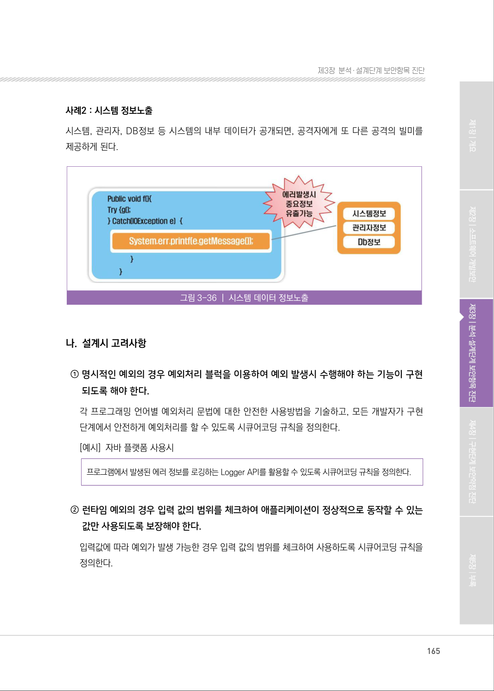
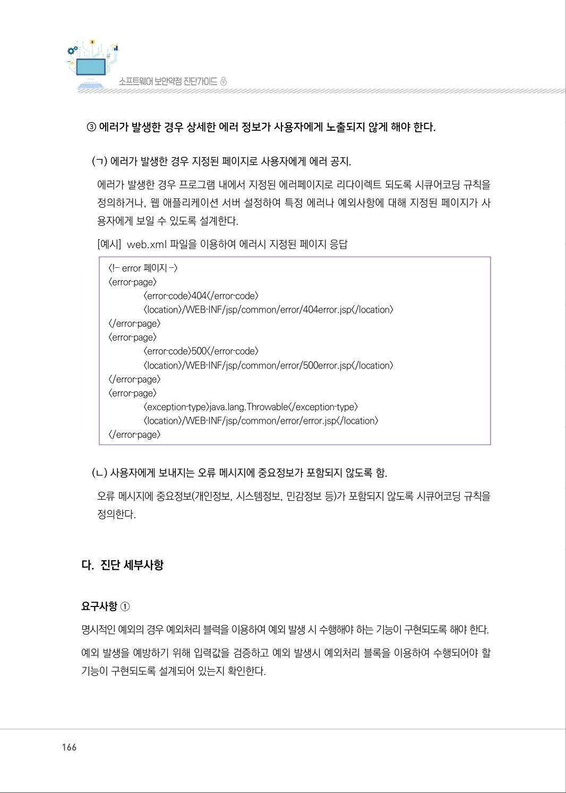
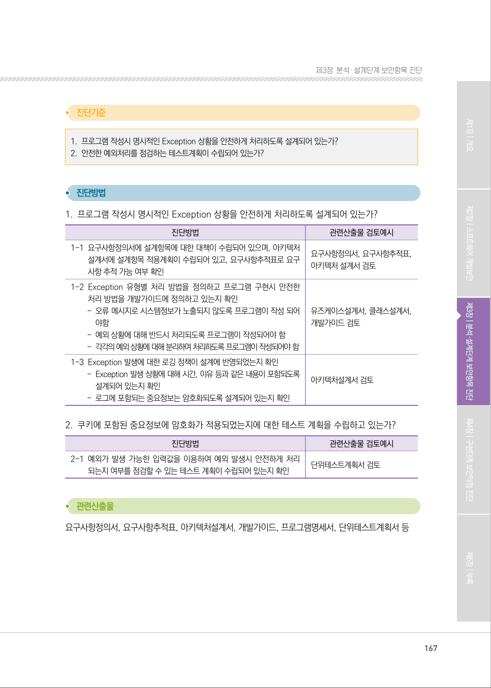
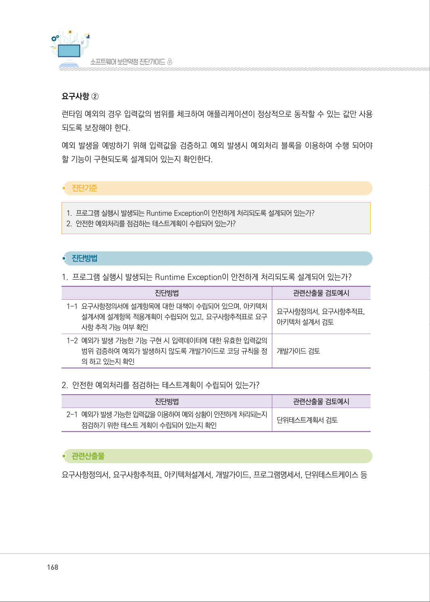
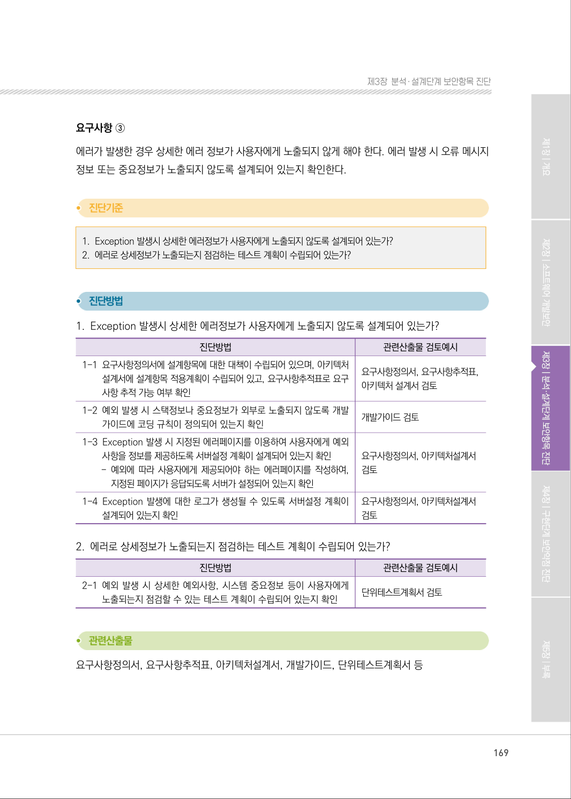
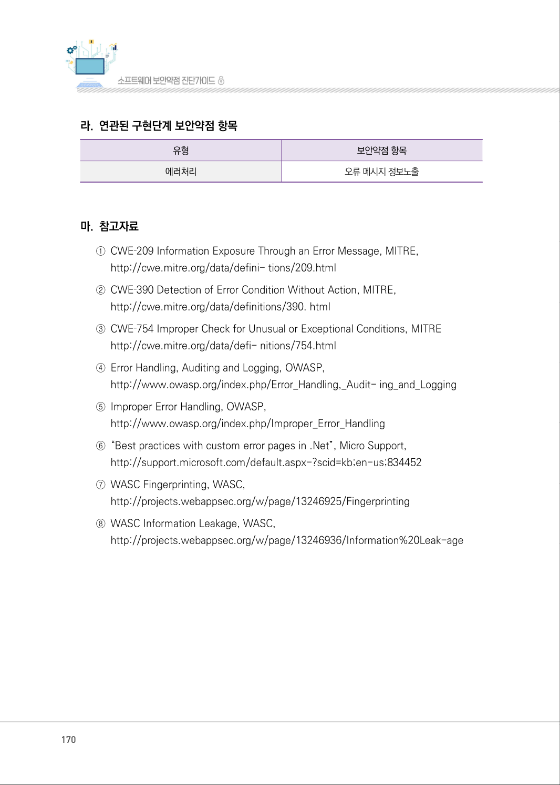

# 3.1 예외처리

> 변환 안내(원문 외): 아래 본문은 PDF 텍스트를 추출한 전사입니다. 코드 줄번호·특수 공백·원문 오류를 유지했습니다. 실행용 코드가 아닙니다. 표·그림·들여쓰기는 연결된 페이지 이미지와 대조하세요. 페이지 경계의 줄바꿈을 보존하며, 동일 페이지가 여러 항목에 나뉘면 각 항목의 본문은 해당 구간만 포함합니다.

### PDF 164페이지 / 인쇄 164페이지

<!-- source-page:SW-Diagnosis-2021:164; source-lines:0,2,3,4,5,6,7,8,9,10,11,12,13,14,15,16,17,18,19,20 -->

164

3.1 예외처리

| 유형 | 에러처리 |
| --- | --- |
| 설계항목 | 예외처리 |
| 설명 | 오류메시지에 중요정보(개인정보, 시스템 정보, 민감 정보 등)가 노출되거나, 부적절한 에러 및 오류처리로 인하여 의도치 않은 상황이 발생하지 않도록 설계한다. |
| 보안대책 | ① 명시적인 예외의 경우 예외처리 블럭을 이용하여 예외 발생시 수행해야 하는 기능이 구현 되도록 해야 한다. ② 런타임 예외의 경우 입력값의 범위를 체크하여 애플리케이션이 정상적으로 동작할 수 있는 값만 사용되도록 보장해야 한다. ③ 에러가 발생한 경우 상세한 에러 정보가 사용자에게 노출되지 않게 해야 한다. |

#### 가. 취약점 개요

사례1 : 오류 메시지 정보노출
웹 서버에 별도의 에러페이지를 설정하지 않은 경우, 에러 메시지로 서버 데이터 정보 등 공격에 필요
한 정보가 노출되는 취약점이다.

그림3-35 | 오류 메시지 정보노출

원본 페이지 이미지 (변환 외 보존 자료)

### PDF 165페이지 / 인쇄 165페이지

<!-- source-page:SW-Diagnosis-2021:165; source-lines:0,1,2,3,4,5,6,7,8,9,10,11,12,13,14,15,16 -->

165

제3장분석․ 설계단계 보안항목 진단

사례2 : 시스템 정보노출
시스템, 관리자, DB정보 등 시스템의 내부 데이터가 공개되면, 공격자에게 또 다른 공격의 빌미를 
제공하게 된다.

그림3-36 | 시스템 데이터 정보노출

#### 나. 설계시 고려사항

① 명시적인 예외의 경우 예외처리 블럭을 이용하여 예외 발생시 수행해야 하는 기능이 구현 

되도록 해야 한다.
각 프로그래밍 언어별 예외처리 문법에 대한 안전한 사용방법을 기술하고, 모든 개발자가 구현 
단계에서 안전하게 예외처리를 할 수 있도록 시큐어코딩 규칙을 정의한다. 
[예시] 자바 플랫폼 사용시

프로그램에서 발생된 에러 정보를 로깅하는 Logger API를 활용할 수 있도록 시큐어코딩 규칙을 정의한다.

② 런타임 예외의 경우 입력 값의 범위를 체크하여 애플리케이션이 정상적으로 동작할 수 있는 

값만 사용되도록 보장해야 한다.
입력값에 따라 예외가 발생 가능한 경우 입력 값의 범위를 체크하여 사용하도록 시큐어코딩 규칙을 
정의한다.

원본 페이지 이미지 (변환 외 보존 자료)

### PDF 166페이지 / 인쇄 166페이지

<!-- source-page:SW-Diagnosis-2021:166; source-lines:0,1,2,3,4,5,6,7,8,9,10,11,12,13,14,15,16,17,18,19,20,21,22,23,24,25,26,27 -->

166

③ 에러가 발생한 경우 상세한 에러 정보가 사용자에게 노출되지 않게 해야 한다.

(ㄱ) 에러가 발생한 경우 지정된 페이지로 사용자에게 에러 공지.
에러가 발생한 경우 프로그램 내에서 지정된 에러페이지로 리다이렉트 되도록 시큐어코딩 규칙을 
정의하거나, 웹 애플리케이션 서버 설정하여 특정 에러나 예외사항에 대해 지정된 페이지가 사
용자에게 보일 수 있도록 설계한다.
[예시] web.xml 파일을 이용하여 에러시 지정된 페이지 응답

&lt;!‐‐ error 페이지 ‐‐&gt;
&lt;error‐page&gt;

&lt;error‐code&gt;404&lt;/error‐code&gt;
&lt;location&gt;/WEB‐INF/jsp/common/error/404error.jsp&lt;/location&gt;
&lt;/error‐page&gt;
&lt;error‐page&gt;

&lt;error‐code&gt;500&lt;/error‐code&gt;
&lt;location&gt;/WEB‐INF/jsp/common/error/500error.jsp&lt;/location&gt;
&lt;/error‐page&gt;
&lt;error‐page&gt;

&lt;exception‐type&gt;java.lang.Throwable&lt;/exception‐type&gt;
&lt;location&gt;/WEB‐INF/jsp/common/error/error.jsp&lt;/location&gt;
&lt;/error‐page&gt;

(ㄴ) 사용자에게 보내지는 오류 메시지에 중요정보가 포함되지 않도록 함.
오류 메시지에 중요정보(개인정보, 시스템정보, 민감정보 등)가 포함되지 않도록 시큐어코딩 규칙을 
정의한다.

#### 다. 진단 세부사항

요구사항 ①
명시적인 예외의 경우 예외처리 블럭을 이용하여 예외 발생 시 수행해야 하는 기능이 구현되도록 해야 한다.
예외 발생을 예방하기 위해 입력값을 검증하고 예외 발생시 예외처리 블록을 이용하여 수행되어야 할 
기능이 구현되도록 설계되어 있는지 확인한다.

원본 페이지 이미지 (변환 외 보존 자료)

### PDF 167페이지 / 인쇄 167페이지

<!-- source-page:SW-Diagnosis-2021:167; source-lines:0,1,2,3,4,5,6,7,8,9,10,11,12,13,14,15,16,17,18,19,20,21,22,23,24,25,26,27,28,29,30,31 -->

167

제3장분석․ 설계단계 보안항목 진단

#### 1. 프로그램 작성시 명시적인 Exception 상황을 안전하게 처리하도록 설계되어 있는가?

#### 2. 안전한 예외처리를 점검하는 테스트계획이 수립되어 있는가?

#### 1. 프로그램 작성시 명시적인 Exception 상황을 안전하게 처리하도록 설계되어 있는가?

| 진단방법 | 관련산출물 검토예시 |
| --- | --- |
| 1-1 요구사항정의서에 설계항목에 대한 대책이 수립되어 있으며, 아키텍처 설계서에 설계항목 적용계획이 수립되어 있고, 요구사항추적표로 요구 사항 추적 가능 여부 확인 | 요구사항정의서, 요구사항추적표, 아키텍처 설계서 검토 |
| 1-2 Exception 유형별 처리 방법을 정의하고 프로그램 구현시 안전한 처리 방법을 개발가이드에 정의하고 있는지 확인 - 오류 메시지로 시스템정보가 노출되지 않도록 프로그램이 작성 되어 야함 - 예외 상황에 대해 반드시 처리되도록 프로그램이 작성되어야 함 - 각각의 예외 상황에 대해 분리하여 처리하도록 프로그램이 작성되어야 함 | 유즈케이스설계서, 클래스설계서, 개발가이드 검토 |
| 1-3 Exception 발생에 대한 로깅 정책이 설계에 반영되었는지 확인 - Exception 발생 상황에 대해 시간, 이유 등과 같은 내용이 포함되도록 설계되어 있는지 확인 - 로그에 포함되는 중요정보는 암호화되도록 설계되어 있는지 확인 | 아키텍처설계서 검토 |

#### 2. 쿠키에 포함된 중요정보에 암호화가 적용되었는지에 대한 테스트 계획을 수립하고 있는가?

| 진단방법 | 관련산출물 검토예시 |
| --- | --- |
| 2-1 예외가 발생 가능한 입력값을 이용하여 예외 발생시 안전하게 처리 되는지 여부를 점검할 수 있는 테스트 계획이 수립되어 있는지 확인 | 단위테스트계획서 검토 |

요구사항정의서, 요구사항추적표, 아키텍처설계서, 개발가이드, 프로그램명세서, 단위테스트계획서 등

원본 페이지 이미지 (변환 외 보존 자료)

### PDF 168페이지 / 인쇄 168페이지

<!-- source-page:SW-Diagnosis-2021:168; source-lines:0,1,2,3,4,5,6,7,8,9,10,11,12,13,14,15,16,17,18,19,20,21,22,23,24,25,26 -->

168

요구사항 ②
런타임 예외의 경우 입력값의 범위를 체크하여 애플리케이션이 정상적으로 동작할 수 있는 값만 사용
되도록 보장해야 한다.
예외 발생을 예방하기 위해 입력값을 검증하고 예외 발생시 예외처리 블록을 이용하여 수행 되어야 
할 기능이 구현되도록 설계되어 있는지 확인한다.

#### 1. 프로그램 실행시 발생되는 Runtime Exception이 안전하게 처리되도록 설계되어 있는가?

#### 2. 안전한 예외처리를 점검하는 테스트계획이 수립되어 있는가?

#### 1. 프로그램 실행시 발생되는 Runtime Exception이 안전하게 처리되도록 설계되어 있는가?

| 진단방법 | 관련산출물 검토예시 |
| --- | --- |
| 1-1 요구사항정의서에 설계항목에 대한 대책이 수립되어 있으며, 아키텍처 설계서에 설계항목 적용계획이 수립되어 있고, 요구사항추적표로 요구 사항 추적 가능 여부 확인 | 요구사항정의서, 요구사항추적표, 아키텍처 설계서 검토 |
| 1-2 예외가 발생 가능한 기능 구현 시 입력데이터에 대한 유효한 입력값의 범위 검증하여 예외가 발생하지 않도록 개발가이드로 코딩 규칙을 정 의 하고 있는지 확인 | 개발가이드 검토 |

#### 2. 안전한 예외처리를 점검하는 테스트계획이 수립되어 있는가?

진단방법

관련산출물 검토예시

2-1 예외가 발생 가능한 입력값을 이용하여 예외 상황이 안전하게 처리되는지 

점검하기 위한 테스트 게획이 수립되어 있는지 확인

단위테스트계획서 검토

요구사항정의서, 요구사항추적표, 아키텍처설계서, 개발가이드, 프로그램명세서, 단위테스트케이스 등

원본 페이지 이미지 (변환 외 보존 자료)

### PDF 169페이지 / 인쇄 169페이지

<!-- source-page:SW-Diagnosis-2021:169; source-lines:0,1,2,3,4,5,6,7,8,9,10,11,12,13,14,15,16,17,18,19,20,21,22,23,24,25,26,27,28,29,30,31,32,33,34 -->

169

제3장분석․ 설계단계 보안항목 진단

요구사항 ③
에러가 발생한 경우 상세한 에러 정보가 사용자에게 노출되지 않게 해야 한다. 에러 발생 시 오류 메시지 
정보 또는 중요정보가 노출되지 않도록 설계되어 있는지 확인한다.

#### 1. Exception 발생시 상세한 에러정보가 사용자에게 노출되지 않도록 설계되어 있는가?

#### 2. 에러로 상세정보가 노출되는지 점검하는 테스트 계획이 수립되어 있는가?

#### 1. Exception 발생시 상세한 에러정보가 사용자에게 노출되지 않도록 설계되어 있는가?

| 진단방법 | 관련산출물 검토예시 |
| --- | --- |
| 1-1 요구사항정의서에 설계항목에 대한 대책이 수립되어 있으며, 아키텍처 설계서에 설계항목 적용계획이 수립되어 있고, 요구사항추적표로 요구 사항 추적 가능 여부 확인 | 요구사항정의서, 요구사항추적표, 아키텍처 설계서 검토 |
| 1-2 예외 발생 시 스택정보나 중요정보가 외부로 노출되지 않도록 개발 가이드에 코딩 규칙이 정의되어 있는지 확인 | 개발가이드 검토 |
| 1-3 Exception 발생 시 지정된 에러페이지를 이용하여 사용자에게 예외 사항을 정보를 제공하도록 서버설정 계획이 설계되어 있는지 확인 - 예외에 따라 사용자에게 제공되어야 하는 에러페이지를 작성하여, 지정된 페이지가 응답되도록 서버가 설정되어 있는지 확인 | 요구사항정의서, 아키텍처설계서 검토 |
| 1-4 Exception 발생에 대한 로그가 생성될 수 있도록 서버설정 계획이 설계되어 있는지 확인 | 요구사항정의서, 아키텍처설계서 검토 |

#### 2. 에러로 상세정보가 노출되는지 점검하는 테스트 계획이 수립되어 있는가?

진단방법

관련산출물 검토예시

2-1 예외 발생 시 상세한 예외사항, 시스템 중요정보 등이 사용자에게 

노출되는지 점검할 수 있는 테스트 계획이 수립되어 있는지 확인

단위테스트계획서 검토

요구사항정의서, 요구사항추적표, 아키텍처설계서, 개발가이드, 단위테스트계획서 등

원본 페이지 이미지 (변환 외 보존 자료)

### PDF 170페이지 / 인쇄 170페이지

<!-- source-page:SW-Diagnosis-2021:170; source-lines:0,1,2,3,4,5,6,7,8,9,10,11,12,13,14,15,16,17,18,19,20,21,22 -->

170

#### 라. 연관된 구현단계 보안약점 항목

유형

보안약점 항목

에러처리

오류 메시지 정보노출

#### 마. 참고자료

①CWE‐209 Information Exposure Through an Error Message, MITRE,

http://cwe.mitre.org/data/defini- tions/209.html
②CWE‐390 Detection of Error Condition Without Action, MITRE,

http://cwe.mitre.org/data/definitions/390. html
③CWE‐754 Improper Check for Unusual or Exceptional Conditions, MITRE

http://cwe.mitre.org/data/defi- nitions/754.html
④Error Handling, Auditing and Logging, OWASP,

http://www.owasp.org/index.php/Error_Handling,_Audit- ing_and_Logging 
⑤Improper Error Handling, OWASP,

http://www.owasp.org/index.php/Improper_Error_Handling
⑥“Best practices with custom error pages in .Net”, Micro Support,

http://support.microsoft.com/default.aspx-?scid=kb;en-us;834452
⑦WASC Fingerprinting, WASC,

http://projects.webappsec.org/w/page/13246925/Fingerprinting
⑧WASC Information Leakage, WASC,

http://projects.webappsec.org/w/page/13246936/Information%20Leak-age

원본 페이지 이미지 (변환 외 보존 자료)

### PDF 171페이지 / 인쇄 171페이지

<!-- source-page:SW-Diagnosis-2021:171; source-lines:1 -->

제3장분석․ 설계단계 보안항목 진단

원본 페이지 이미지 (변환 외 보존 자료)

---

## 탐색 링크 (원문 외)

[통합 인덱스](../../../INDEX.md)

