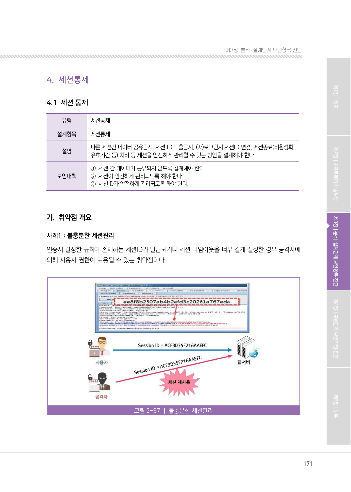
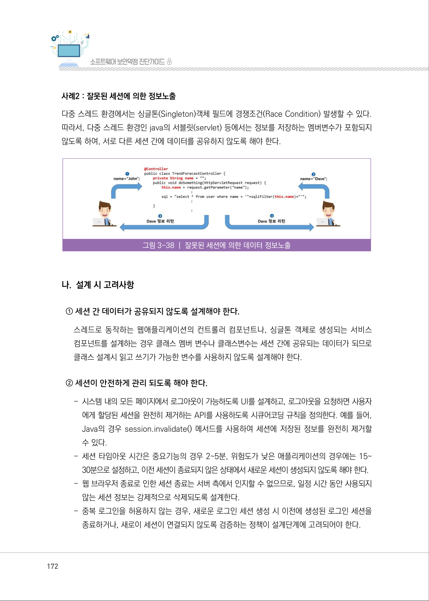
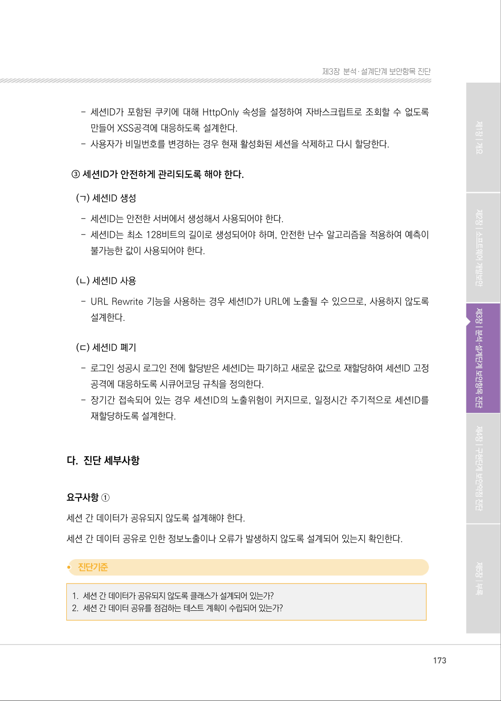
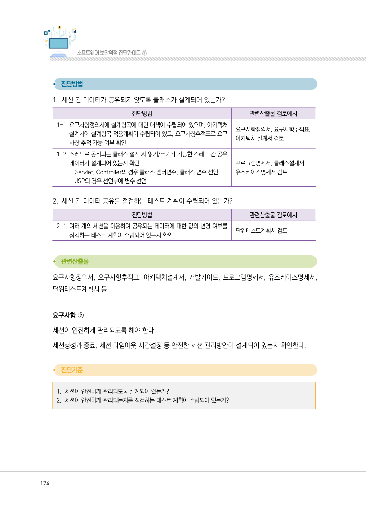
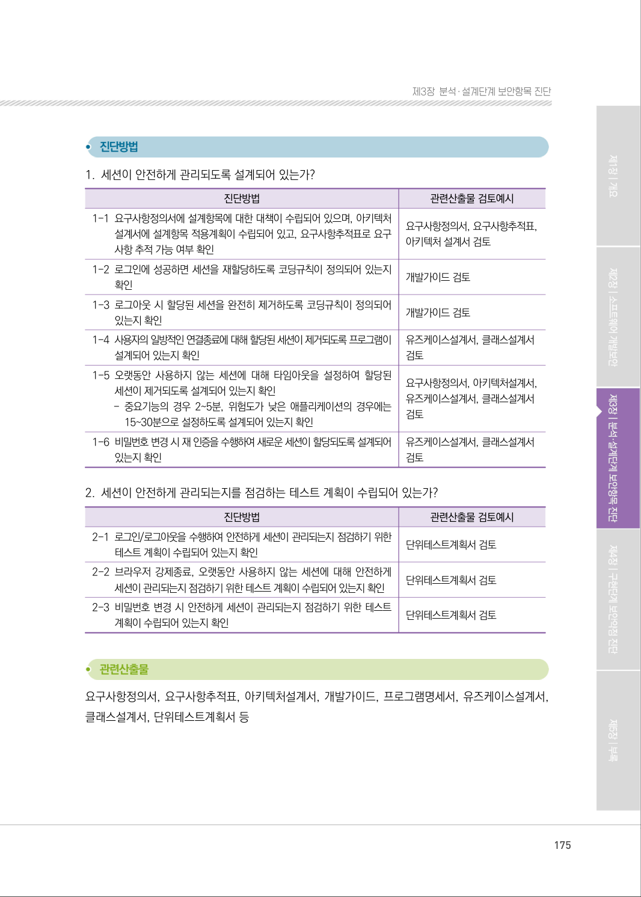
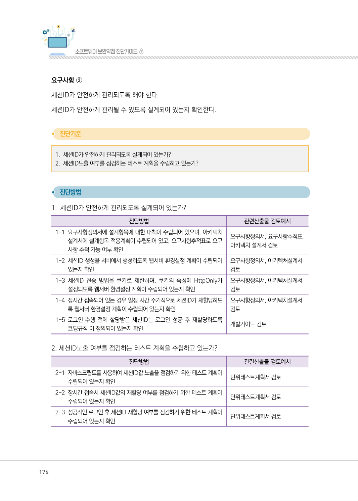
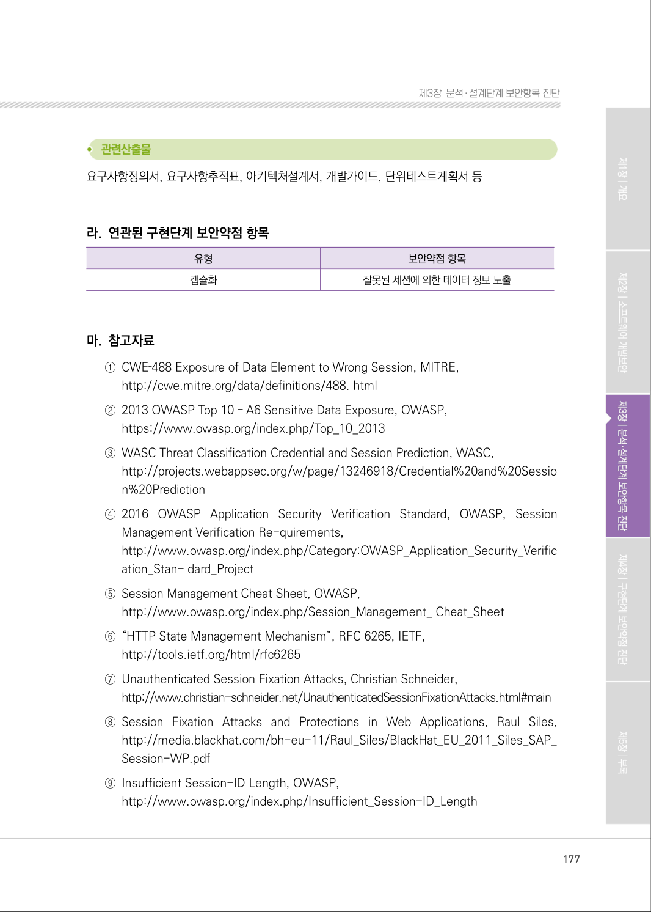
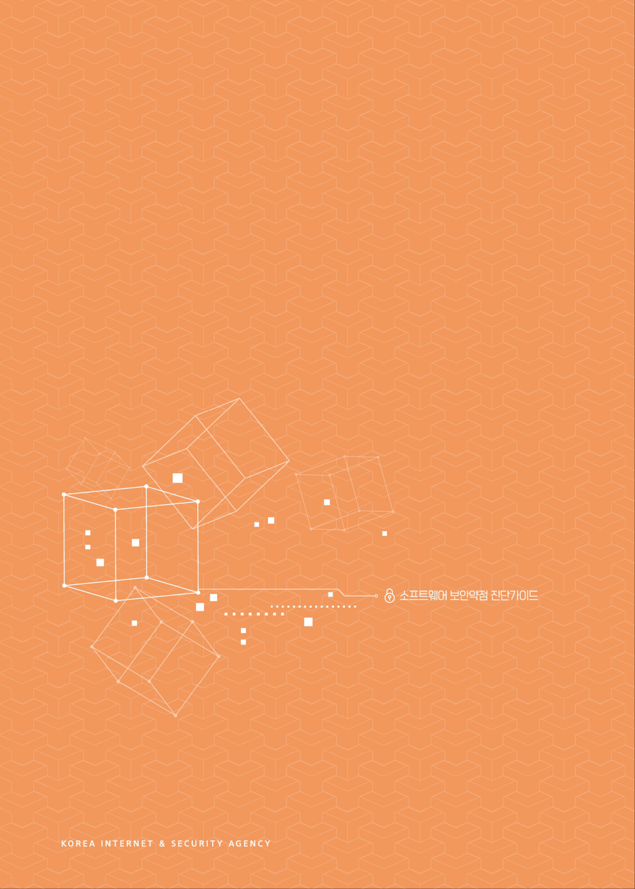
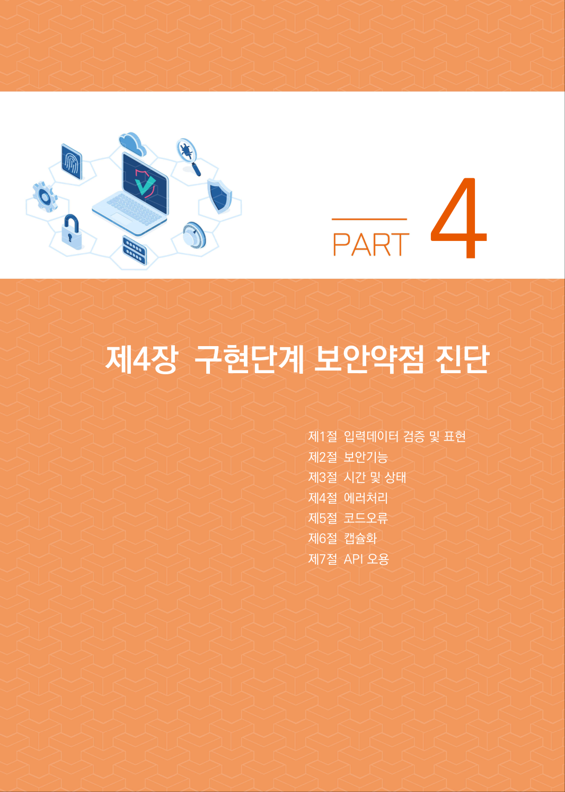

# 4.1 세션 통제

> 변환 안내(원문 외): 아래 본문은 PDF 텍스트를 추출한 전사입니다. 코드 줄번호·특수 공백·원문 오류를 유지했습니다. 실행용 코드가 아닙니다. 표·그림·들여쓰기는 연결된 페이지 이미지와 대조하세요. 페이지 경계의 줄바꿈을 보존하며, 동일 페이지가 여러 항목에 나뉘면 각 항목의 본문은 해당 구간만 포함합니다.

### PDF 171페이지 / 인쇄 171페이지

<!-- source-page:SW-Diagnosis-2021:171; source-lines:0,3,4,5,6,7,8,9,10,11,12,13,14,15,16,17,18,19 -->

171

4.1 세션 통제

유형

세션통제

설계항목

세션통제

설명

다른 세션간 데이터 공유금지, 세션 ID 노출금지, (재)로그인시 세션ID 변경, 세션종료(비활성화, 
유효기간 등) 처리 등 세션을 안전하게 관리할 수 있는 방안을 설계해야 한다.

보안대책

①세션 간 데이터가 공유되지 않도록 설계해야 한다. 
②세션이 안전하게 관리되도록 해야 한다. 
③세션ID가 안전하게 관리되도록 해야 한다. 

#### 가. 취약점 개요

사례1 : 불충분한 세션관리
인증시 일정한 규칙이 존재하는 세션ID가 발급되거나 세션 타임아웃을 너무 길게 설정한 경우 공격자에 
의해 사용자 권한이 도용될 수 있는 취약점이다.

그림3-37 | 불충분한 세션관리

원본 페이지 이미지 (변환 외 보존 자료)

### PDF 172페이지 / 인쇄 172페이지

<!-- source-page:SW-Diagnosis-2021:172; source-lines:0,1,2,3,4,5,6,7,8,9,10,11,12,13,14,15,16,17,18,19,20,21 -->

172

사례2 : 잘못된 세션에 의한 정보노출
다중 스레드 환경에서는 싱글톤(Singleton)객체 필드에 경쟁조건(Race Condition) 발생할 수 있다. 
따라서, 다중 스레드 환경인 java의 서블릿(servlet) 등에서는 정보를 저장하는 멤버변수가 포함되지 
않도록 하여, 서로 다른 세션 간에 데이터를 공유하지 않도록 해야 한다.

그림3-38 | 잘못된 세션에 의한 데이터 정보노출

#### 나. 설계 시 고려사항

① 세션 간 데이터가 공유되지 않도록 설계해야 한다.

스레드로 동작하는 웹애플리케이션의 컨트롤러 컴포넌트나, 싱글톤 객체로 생성되는 서비스 
컴포넌트를 설계하는 경우 클래스 멤버 변수나 클래스변수는 세션 간에 공유되는 데이터가 되므로 
클래스 설계시 읽고 쓰기가 가능한 변수를 사용하지 않도록 설계해야 한다.

② 세션이 안전하게 관리 되도록 해야 한다.

- 시스템 내의 모든 페이지에서 로그아웃이 가능하도록 UI를 설계하고, 로그아웃을 요청하면 사용자 

에게 할당된 세션을 완전히 제거하는 API를 사용하도록 시큐어코딩 규칙을 정의한다. 예를 들어, 
Java의 경우 session.invalidate() 메서드를 사용하여 세션에 저장된 정보를 완전히 제거할 
수 있다.
- 세션 타임아웃 시간은 중요기능의 경우 2~5분, 위험도가 낮은 애플리케이션의 경우에는 15~ 

30분으로 설정하고, 이전 세션이 종료되지 않은 상태에서 새로운 세션이 생성되지 않도록 해야 한다.
- 웹 브라우저 종료로 인한 세션 종료는 서버 측에서 인지할 수 없으므로, 일정 시간 동안 사용되지 

않는 세션 정보는 강제적으로 삭제되도록 설계한다.
- 중복 로그인을 허용하지 않는 경우, 새로운 로그인 세션 생성 시 이전에 생성된 로그인 세션을 

종료하거나, 새로이 세션이 연결되지 않도록 검증하는 정책이 설계단계에 고려되어야 한다.

원본 페이지 이미지 (변환 외 보존 자료)

### PDF 173페이지 / 인쇄 173페이지

<!-- source-page:SW-Diagnosis-2021:173; source-lines:0,1,2,3,4,5,6,7,8,9,10,11,12,13,14,15,16,17,18,19,20,21,22,23 -->

173

제3장분석․ 설계단계 보안항목 진단

- 세션ID가 포함된 쿠키에 대해 HttpOnly 속성을 설정하여 자바스크립트로 조회할 수 없도록 

만들어 XSS공격에 대응하도록 설계한다.
- 사용자가 비밀번호를 변경하는 경우 현재 활성화된 세션을 삭제하고 다시 할당한다.

③ 세션ID가 안전하게 관리되도록 해야 한다.
(ㄱ) 세션ID 생성
- 세션ID는 안전한 서버에서 생성해서 사용되어야 한다.
- 세션ID는 최소 128비트의 길이로 생성되어야 하며, 안전한 난수 알고리즘을 적용하여 예측이 

불가능한 값이 사용되어야 한다.

(ㄴ) 세션ID 사용
- URL Rewrite 기능을 사용하는 경우 세션ID가 URL에 노출될 수 있으므로, 사용하지 않도록 

설계한다.

(ㄷ) 세션ID 폐기
- 로그인 성공시 로그인 전에 할당받은 세션ID는 파기하고 새로운 값으로 재할당하여 세션ID 고정 

공격에 대응하도록 시큐어코딩 규칙을 정의한다.
- 장기간 접속되어 있는 경우 세션ID의 노출위험이 커지므로, 일정시간 주기적으로 세션ID를 

재할당하도록 설계한다.

#### 다. 진단 세부사항

요구사항 ①
세션 간 데이터가 공유되지 않도록 설계해야 한다.
세션 간 데이터 공유로 인한 정보노출이나 오류가 발생하지 않도록 설계되어 있는지 확인한다.

#### 1. 세션 간 데이터가 공유되지 않도록 클래스가 설계되어 있는가?

#### 2. 세션 간 데이터 공유를 점검하는 테스트 계획이 수립되어 있는가?

원본 페이지 이미지 (변환 외 보존 자료)

### PDF 174페이지 / 인쇄 174페이지

<!-- source-page:SW-Diagnosis-2021:174; source-lines:0,1,2,3,4,5,6,7,8,9,10,11,12,13,14,15,16,17,18,19,20,21,22,23,24,25,26,27 -->

174

#### 1. 세션 간 데이터가 공유되지 않도록 클래스가 설계되어 있는가?

| 진단방법 | 관련산출물 검토예시 |
| --- | --- |
| 1-1 요구사항정의서에 설계항목에 대한 대책이 수립되어 있으며, 아키텍처 설계서에 설계항목 적용계획이 수립되어 있고, 요구사항추적표로 요구 사항 추적 가능 여부 확인 | 요구사항정의서, 요구사항추적표, 아키텍처 설계서 검토 |
| 1-2 스레드로 동작되는 클래스 설계 시 읽기/쓰기가 가능한 스레드 간 공유 데이터가 설계되어 있는지 확인 - Servlet, Controller의 경우 클래스 멤버변수, 클래스 변수 선언 - JSP의 경우 선언부에 변수 선언 | 프로그램명세서, 클래스설계서, 유즈케이스명세서 검토 |

#### 2. 세션 간 데이터 공유를 점검하는 테스트 계획이 수립되어 있는가?

| 진단방법 | 관련산출물 검토예시 |
| --- | --- |
| 2-1 여러 개의 세션을 이용하여 공유되는 데이터에 대한 값의 변경 여부를 점검하는 테스트 계획이 수립되어 있는지 확인 | 단위테스트계획서 검토 |

요구사항정의서, 요구사항추적표, 아키텍처설계서, 개발가이드, 프로그램명세서, 유즈케이스명세서, 
단위테스트계획서 등

요구사항 ②
세션이 안전하게 관리되도록 해야 한다.
세션생성과 종료, 세션 타임아웃 시간설정 등 안전한 세션 관리방안이 설계되어 있는지 확인한다.

#### 1. 세션이 안전하게 관리되도록 설계되어 있는가? 

#### 2. 세션이 안전하게 관리되는지를 점검하는 테스트 계획이 수립되어 있는가?

원본 페이지 이미지 (변환 외 보존 자료)

### PDF 175페이지 / 인쇄 175페이지

<!-- source-page:SW-Diagnosis-2021:175; source-lines:0,1,2,3,4,5,6,7,8,9,10,11,12,13,14,15,16,17,18,19,20,21,22,23,24,25,26,27,28,29,30,31,32,33,34,35,36,37,38,39,40,41,42,43,44 -->

175

제3장분석․ 설계단계 보안항목 진단

#### 1. 세션이 안전하게 관리되도록 설계되어 있는가?

| 진단방법 | 관련산출물 검토예시 |
| --- | --- |
| 1-1 요구사항정의서에 설계항목에 대한 대책이 수립되어 있으며, 아키텍처 설계서에 설계항목 적용계획이 수립되어 있고, 요구사항추적표로 요구 사항 추적 가능 여부 확인 | 요구사항정의서, 요구사항추적표, 아키텍처 설계서 검토 |
| 1-2 로그인에 성공하면 세션을 재할당하도록 코딩규칙이 정의되어 있는지 확인 | 개발가이드 검토 |
| 1-3 로그아웃 시 할당된 세션을 완전히 제거하도록 코딩규칙이 정의되어 있는지 확인 | 개발가이드 검토 |
| 1-4 사용자의 일방적인 연결종료에 대해 할당된 세션이 제거되도록 프로그램이 설계되어 있는지 확인 | 유즈케이스설계서, 클래스설계서 검토 |
| 1-5 오랫동안 사용하지 않는 세션에 대해 타임아웃을 설정하여 할당된 세션이 제거되도록 설계되어 있는지 확인 - 중요기능의 경우 2~5분, 위험도가 낮은 애플리케이션의 경우에는 15~30분으로 설정하도록 설계되어 있는지 확인 | 요구사항정의서, 아키텍처설계서, 유즈케이스설계서, 클래스설계서 검토 |
| 1-6 비밀번호 변경 시 재 인증을 수행하여 새로운 세션이 할당되도록 설계되어 있는지 확인 | 유즈케이스설계서, 클래스설계서 검토 |

#### 2. 세션이 안전하게 관리되는지를 점검하는 테스트 계획이 수립되어 있는가?

| 진단방법 | 관련산출물 검토예시 |
| --- | --- |
| 2-1 로그인/로그아웃을 수행하여 안전하게 세션이 관리되는지 점검하기 위한 테스트 계획이 수립되어 있는지 확인 | 단위테스트계획서 검토 |
| 2-2 브라우저 강제종료, 오랫동안 사용하지 않는 세션에 대해 안전하게 세션이 관리되는지 점검하기 위한 테스트 계획이 수립되어 있는지 확인 | 단위테스트계획서 검토 |
| 2-3 비밀번호 변경 시 안전하게 세션이 관리되는지 점검하기 위한 테스트 계획이 수립되어 있는지 확인 | 단위테스트계획서 검토 |

요구사항정의서, 요구사항추적표, 아키텍처설계서, 개발가이드, 프로그램명세서, 유즈케이스설계서, 
클래스설계서, 단위테스트계획서 등

원본 페이지 이미지 (변환 외 보존 자료)

### PDF 176페이지 / 인쇄 176페이지

<!-- source-page:SW-Diagnosis-2021:176; source-lines:0,1,2,3,4,5,6,7,8,9,10,11,12,13,14,15,16,17,18,19,20,21,22,23,24,25,26,27,28,29,30,31,32,33,34,35,36,37,38,39,40 -->

176

요구사항 ③
세션ID가 안전하게 관리되도록 해야 한다. 
세션ID가 안전하게 관리될 수 있도록 설계되어 있는지 확인한다.

#### 1. 세션ID가 안전하게 관리되도록 설계되어 있는가?

#### 2. 세션ID노출 여부를 점검하는 테스트 계획을 수립하고 있는가?

#### 1. 세션ID가 안전하게 관리되도록 설계되어 있는가?

| 진단방법 | 관련산출물 검토예시 |
| --- | --- |
| 1-1 요구사항정의서에 설계항목에 대한 대책이 수립되어 있으며, 아키텍처 설계서에 설계항목 적용계획이 수립되어 있고, 요구사항추적표로 요구 사항 추적 가능 여부 확인 | 요구사항정의서, 요구사항추적표, 아키텍처 설계서 검토 |
| 1-2 세션ID 생성을 서버에서 생성하도록 웹서버 환경설정 계획이 수립되어 있는지 확인 | 요구사항정의서, 아키텍처설계서 검토 |
| 1-3 세션ID 전송 방법을 쿠키로 제한하며, 쿠키의 속성에 HttpOnly가 설정되도록 웹서버 환경설정 계획이 수립되어 있는지 확인 | 요구사항정의서, 아키텍처설계서 검토 |
| 1-4 장시간 접속되어 있는 경우 일정 시간 주기적으로 세션ID가 재할당하도 록 웹서버 환경설정 계획이 수립되어 있는지 확인 | 요구사항정의서, 아키텍처설계서 검토 |
| 1-5 로그인 수행 전에 할당받은 세션ID는 로그인 성공 후 재할당하도록 코딩규칙 이 정의되어 있는지 확인 | 개발가이드 검토 |

#### 2. 세션ID노출 여부를 점검하는 테스트 계획을 수립하고 있는가?

| 진단방법 | 관련산출물 검토예시 |
| --- | --- |
| 2-1 자바스크립트를 사용하여 세션ID값 노출을 점검하기 위한 테스트 계획이 수립되어 있는지 확인 | 단위테스트계획서 검토 |
| 2-2 장시간 접속시 세션ID값의 재할당 여부를 점검하기 위한 테스트 계획이 수립되어 있는지 확인 | 단위테스트계획서 검토 |
| 2-3 성공적인 로그인 후 세션ID 재할당 여부를 점검하기 위한 테스트 계획이 수립되어 있는지 확인 | 단위테스트계획서 검토 |

원본 페이지 이미지 (변환 외 보존 자료)

### PDF 177페이지 / 인쇄 177페이지

<!-- source-page:SW-Diagnosis-2021:177; source-lines:0,1,2,3,4,5,6,7,8,9,10,11,12,13,14,15,16,17,18,19,20,21,22,23,24,25,26,27,28,29,30 -->

177

제3장분석․ 설계단계 보안항목 진단

요구사항정의서, 요구사항추적표, 아키텍처설계서, 개발가이드, 단위테스트계획서 등

#### 라. 연관된 구현단계 보안약점 항목

| 유형 | 보안약점 항목 |
| --- | --- |
| 캡슐화 | 잘못된 세션에 의한 데이터 정보 노출 |

#### 마. 참고자료

①CWE‐488 Exposure of Data Element to Wrong Session, MITRE,

http://cwe.mitre.org/data/definitions/488. html
②2013 OWASP Top 10 – A6 Sensitive Data Exposure, OWASP,

https://www.owasp.org/index.php/Top_10_2013
③WASC Threat Classification Credential and Session Prediction, WASC, 

http://projects.webappsec.org/w/page/13246918/Credential%20and%20Sessio
n%20Prediction
④2016 OWASP Application Security Verification Standard, OWASP, Session 

Management Verification Re-quirements,
http://www.owasp.org/index.php/Category:OWASP_Application_Security_Verific
ation_Stan- dard_Project
⑤Session Management Cheat Sheet, OWASP,

http://www.owasp.org/index.php/Session_Management_ Cheat_Sheet
⑥“HTTP State Management Mechanism”, RFC 6265, IETF,

http://tools.ietf.org/html/rfc6265
⑦Unauthenticated Session Fixation Attacks, Christian Schneider,

http://www.christian-schneider.net/UnauthenticatedSessionFixationAttacks.html#main
⑧Session Fixation Attacks and Protections in Web Applications, Raul Siles, 

http://media.blackhat.com/bh-eu-11/Raul_Siles/BlackHat_EU_2011_Siles_SAP_
Session-WP.pdf
⑨Insufficient Session-ID Length, OWASP,

http://www.owasp.org/index.php/Insufficient_Session-ID_Length

원본 페이지 이미지 (변환 외 보존 자료)

### PDF 178페이지 / 인쇄 178페이지

<!-- source-page:SW-Diagnosis-2021:178; source-lines: -->

원본 페이지 이미지 (변환 외 보존 자료)

### PDF 179페이지 / 인쇄 179페이지

<!-- source-page:SW-Diagnosis-2021:179; source-lines:8 -->

4

원본 페이지 이미지 (변환 외 보존 자료)

---

## 탐색 링크 (원문 외)

[통합 인덱스](../../../INDEX.md)

