# 1. SQL 삽입

> 변환 안내(원문 외): 아래 본문은 PDF 텍스트를 추출한 전사입니다. 코드 줄번호·특수 공백·원문 오류를 유지했습니다. 실행용 코드가 아닙니다. 표·그림·들여쓰기는 연결된 페이지 이미지와 대조하세요. 페이지 경계의 줄바꿈을 보존하며, 동일 페이지가 여러 항목에 나뉘면 각 항목의 본문은 해당 구간만 포함합니다.

### PDF 180페이지 / 인쇄 180페이지

<!-- source-page:SW-Diagnosis-2021:180; source-lines:0,8,9,10,11,12,13,14,15,16,17,18,19,20,21,22,23 -->

180

#### 1. SQL 삽입

#### 가. 개요

데이터베이스(DB)와 연동된 웹 응용프로그램에서 입력된 데이터에 대한 유효성 검증을 하지 않을 
경우, 공격자가 입력 폼 및 URL 입력란에 SQL 문을 삽입하여 DB로부터 정보를 열람하거나 조작할 
수 있는 보안약점을 말한다.

취약한 웹 응용프로그램에서는 사용자로부터 입력된 값을 필터링 과정 없이 넘겨받아 동적쿼리 
(Dynamic Query)11)를 생성하기 때문에 개발자가 의도하지 않은 쿼리가 생성되어 정보유출에 악용 
될 수 있다.

#### 나. 보안대책

PreparedStatement12)객체 등을 이용하여 DB에 컴파일 된 쿼리문(상수)을 전달하는 방법을 사용
한다. PreparedStatement를 사용하는 경우에는 DB 쿼리에 사용되는 외부입력값에 대하여 특수문자 
및 쿼리 예약어를 필터링하고, 스트러츠(Struts), 스프링(Spring) 등과 같은 프레임워크를 사용하는 
경우에는 외부입력값 검증모듈 및 보안모듈을 상황에 맞추어 적절하게 사용한다.

11) 동적쿼리(Dynamic Query) : 컬럼이나 테이블명을 바꿔 SQL쿼리를 실시간 생성해 DB에 전달하여 처리하는 방식
12) PreparedStatement : 컴파일된 쿼리 객체로 MySQL, Oracle, DB2, SQL Server 등에서 지원하며, Java의 JDBC, 

Perl의 DBI, PHP의 PDO, ASP의 ADO를 이용하여 사용가능

<details><summary>원본 페이지 이미지 (변환 외 보존 자료)</summary>

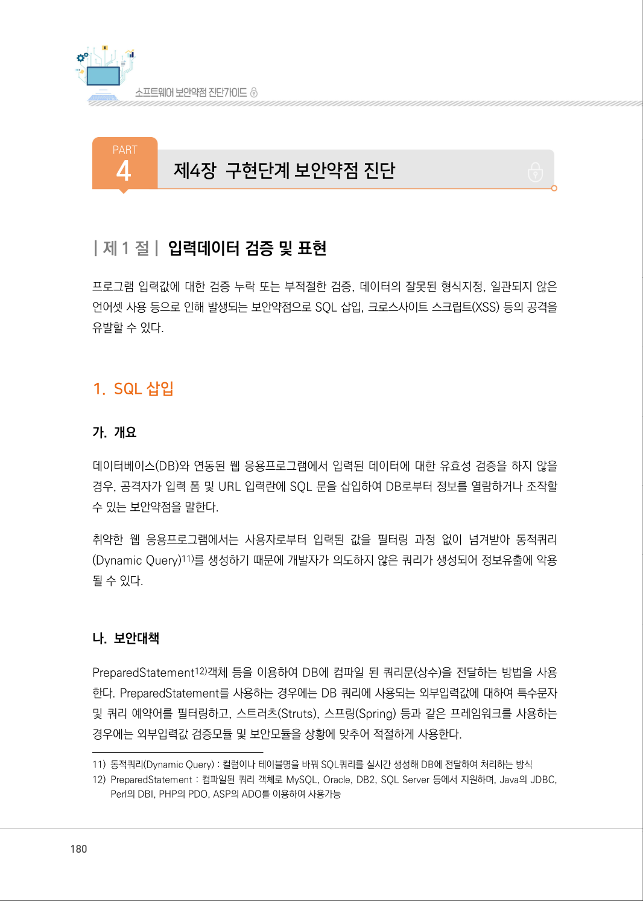

</details>

### PDF 181페이지 / 인쇄 181페이지

<!-- source-page:SW-Diagnosis-2021:181; source-lines:0,1,2,3,4,5,6,7,8,9,10,11,12,13,14,15,16,17,18,19,20,21,22,23,24,25,26,27,28,29,30,31 -->

181

제4장구현단계 보안약점 진단

#### 다. 코드예제

다음은 안전하지 않은 코드의 예로, 외부로부터 입력받은 gubun의 값을 아무런 검증과정을 거치지 
않고 SQL 쿼리를 생성하는데 사용하고 있다. 이 경우 gubun의 값으로 a' or 'a' = 'a 를 입력하면 
조건절이 b_gubun = 'a' or 'a' = 'a' 로 바뀌어 쿼리의 구조가 변경되어 board 테이블의 모든 내용이 
조회된다.

#### 안전하지 않은 코드의 예 JDBC API

```text
1: //외부로부터 입력받은 값을 검증 없이 사용할 경우 안전하지 않다.
2: String gubun = request.getParameter("gubun");
3: ......
4: String sql = "SELECT * FROM board WHERE b_gubun = '" + gubun + "'";
5: Connection con = db.getConnection();
6: Statement stmt = con.createStatement();
7: //외부로부터 입력받은 값이 검증 또는 처리 없이 쿼리로 수행되어 안전하지 않다.
8: ResultSet rs = stmt.executeQuery(sql);
```

이를 안전한 코드로 변환하면 다음과 같다. 파라미터(Parameter)를 받는 PreparedStatement 
객체를 상수 스트링으로 생성하고, 파라미터 부분을 setString, setParameter등의 메소드로 설정
하여, 외부의 입력이 쿼리문의 구조를 바꾸는 것을 방지해야 한다.

#### 안전한 코드의 예 JDBC API

```text
1: String gubun = request.getParameter("gubun");
2: ......
3: //1. 사용자에 의해 외부로부터 입력받은 값은 안전하지 않을 수 있으므로, PreparedStatement 
사용을 위해 ?문자로 바인딩 변수를 사용한다.
4: String sql = "SELECT * FROM board WHERE b_gubun = ?";
5: Connection con = db.getConnection();
6: //2. PreparedStatement 사용한다.
7: PreparedStatement pstmt = con.prepareStatement(sql);
8: //3.PreparedStatement 객체를 상수 스트링으로 생성하고, 파라미터 부분을 setString등의 메소드로 
설정하여 안전하다.
9: pstmt.setString(1, gubun);
10: ResultSet rs = pstmt.executeQuery();
```

<details><summary>원본 페이지 이미지 (변환 외 보존 자료)</summary>

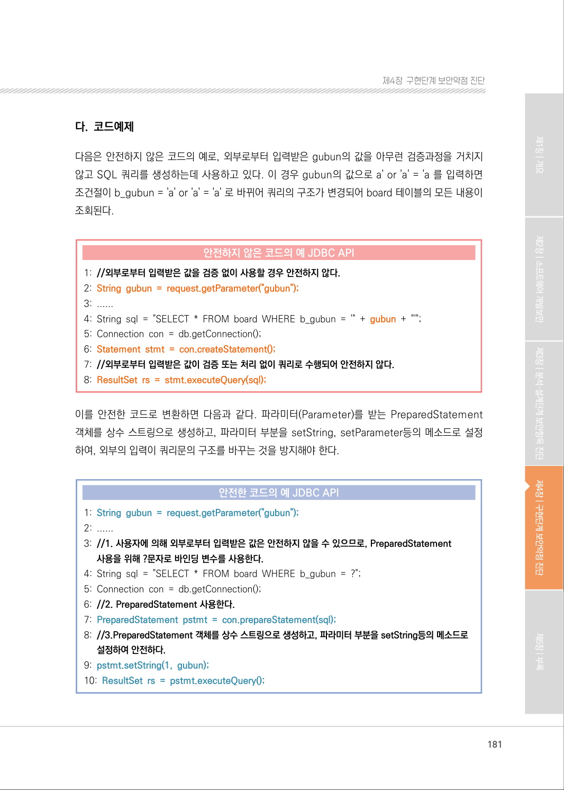

</details>

### PDF 182페이지 / 인쇄 182페이지

<!-- source-page:SW-Diagnosis-2021:182; source-lines:0,1,2,3,4,5,6,7,8,9,10,11,12,13,14,15,16,17,18,19,20,21,22,23,24,25 -->

182

MyBatis Data Map은 외부에서 입력되는 값이 SQL 질의문을 연결하는 문자열로 사용되는 경우에 
의도하지 않은 정보가 노출될 수 있는 공격 형태이다.

#### 안전하지 않은 코드의 예 MyBatis

```xml
1: <?xml version="1.0" encoding="UTF-8" ?> 
2: <!DOCTYPE mapper PUBLIC "-//mybatis.org//DTD Mapper 3.0//EN“
"http://mybatis.org/dtd/mybatis-3-mapper.dtd"> 
3: ...... 
4: <select id="boardSearch" parameterType="map" resultType="BoardDto">
5: //$기호를 사용하는 경우 외부에서 입력된 keyword값을 문자열에 결합한 형태로 쿼리에 반영되므로 
안전하지 않다.
6:        select * from tbl_board where title like '%${keyword}%' order by pos asc
7: </select>1
```

외부 입력값을 MyBatis 쿼리맵에 바인딩할 경우 $ 기호가 아닌 # 기호를 사용해야 한다. $ 기호를 
사용하는 경우 입력값을 문자열에 결합하는 형태로 쿼리에 반영하므로 쿼리문이 조작될 수 있다.

#### 안전한 코드의 예 MyBatis

```xml
1: <?xml version="1.0" encoding="UTF-8" ?>
2: <!DOCTYPE mapper PUBLIC "-//mybatis.org//DTD Mapper 3.0//EN“
"http://mybatis.org/dtd/mybatis-3-mapper.dtd">
3: ......
4: <select id="boardSearch" parameterType="map" resultType="BoardDto">
5: //$ 대신 #기호를 사용하여 변수가 쿼리맵에 바인딩 될 수 있도록 수정하는 것이 안전하다.
6:        select * from tbl_board where title like '%'||#{keyword}||'%' order by pos asc
7: </select>
```

<details><summary>원본 페이지 이미지 (변환 외 보존 자료)</summary>

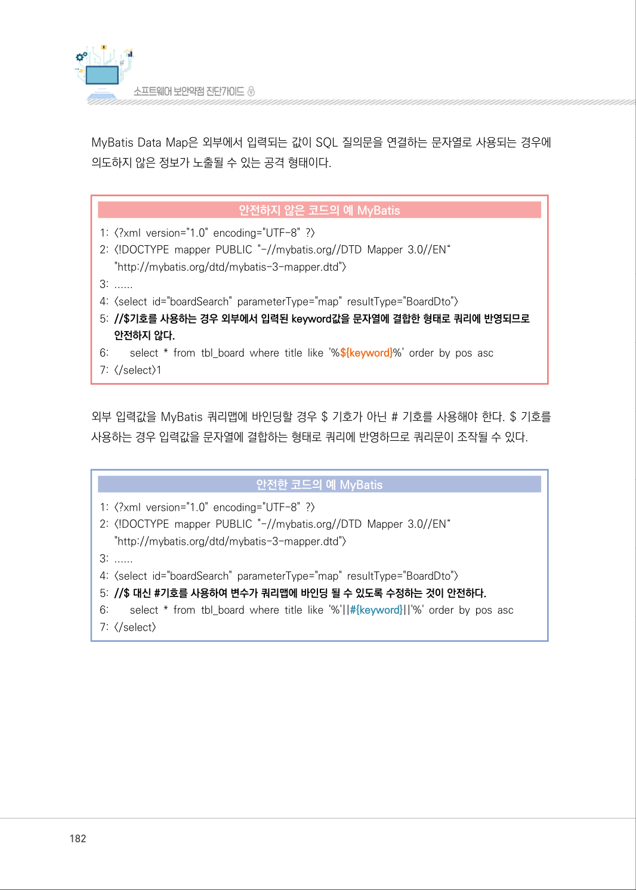

</details>

### PDF 183페이지 / 인쇄 183페이지

<!-- source-page:SW-Diagnosis-2021:183; source-lines:0,1,2,3,4,5,6,7,8,9,10,11,12,13,14,15,16,17,18,19,20,21,22,23,24,25,26,27,28,29 -->

183

제4장구현단계 보안약점 진단

Hibernate의 경우 기본으로 PreparedStatement를 사용하지만, 아래 코드와 같이 파라미터 바인딩
(binding)없이 사용할 경우 외부로부터 입력받은 값에 의해 쿼리의 구조가 변경 될 수 있다.

#### 안전하지 않은 코드의 예 Hibernate

```text
1: import org.hibernate.Query
2: import org.hibernate.Session 
3: ......
4: //외부로부터 입력받은 값을 검증 없이 사용할 경우 안전하지 않다.
5: String name = request.getParameter("name");
6: //Hiberate는 기본으로 PreparedStatement를 사용하지만, 파라미터 바인딩 없이 사용 할 경우 
안전하지 않다.
7: Query query = session.createQuery("from Student where studentName = '" + name 
+ "'  ");
```

아래 코드와 같이 외부 입력값이 위치하는 부분을 ? 또는 :명명된 파라미터 변수로 설정하고, 실행 시에 
해당 파라미터가 전달되는 바인딩(binding)을 함으로써 외부의 입력이 쿼리의 구조를 변경시키는 
것을 방지할 수 있다.

#### 안전한 코드의 예 Hibernate

```text
1: import org.hibernate.Query 
2: import org.hibernate.Session 
3: ...... 
4: String name = request.getParameter("name");
5: //1. 파라미터 바인딩을 위해 ?를 사용한다.
6: Query query = session.createQuery("from Student where studentName = ? ");
7: //2. 파라미터 바인딩을 사용하여 외부 입력값에 의해 쿼리 구조 변경을 못하게 사용하였다.
8: query.setString(0, name);
```

#### 안전한 코드의 예 Hibernate

```text
1: import org.hibernate.Query 
2: import org.hibernate.Session 
3: ......
```

<details><summary>원본 페이지 이미지 (변환 외 보존 자료)</summary>

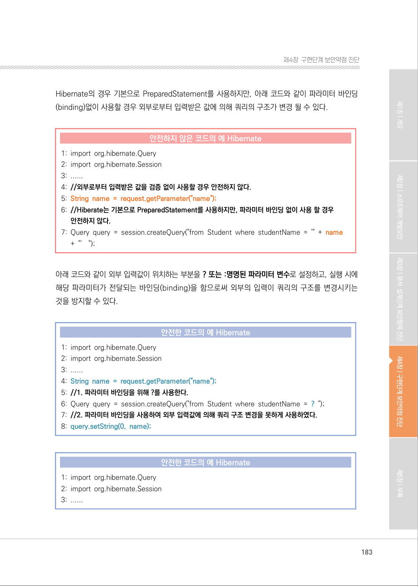

</details>

### PDF 184페이지 / 인쇄 184페이지

<!-- source-page:SW-Diagnosis-2021:184; source-lines:0,1,2,3,4,5,6,7,8,9,10,11,12,13,14,15,16,17,18,19,20,21,22,23,24,25,26,27,28,29,30,31,32,33,34,35 -->

184

#### 안전한 코드의 예 Hibernate

```text
4: String name = request.getParameter("name");
5: //1. 파라미터 바인딩을 위해 명명된 파라미터 변수를 사용한다.
6: Query query = session.createQuery("from Student where studentName = :name ");
7: //2. 파라미터 바인딩을 사용하여 외부 입력값에 의해 쿼리 구조 변경을 못하게 사용하였다.
8: query.setParameter("name", name);
```

다음 C# 코드는 외부 입력값을 SQL 쿼리에 직접 사용하고 있어, 쿼리의 구조가 변경될 위험이 
있습니다.

#### 안전하지 않은 코드의 예 C#

```csharp
1: public void ButtonClickBad(object sender, EventArgs e)
2: { 
3:    string connect = "MyConnString"; 
4:    string usrinput = Request["ID"];
5: // 외부로부터 입력받은 값을 SQL 쿼리에 직접 사용하는 것은 안전하지 않다.
6:    string query = "Select * From Products Where ProductID = " + usrinput;
7:    using (var conn = new SqlConnection(connect)) 
8:    { 
9:      using (var cmd = new SqlCommand(query, conn)) 
10:    {
11:      conn.Open();
12:      cmd.ExecuteReader(); /* BUG */ 
13:    }
14:    }
15: }
```

<details><summary>원본 페이지 이미지 (변환 외 보존 자료)</summary>

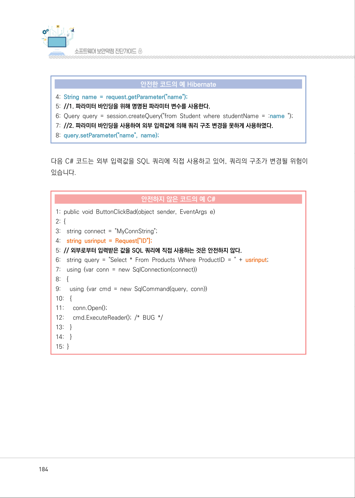

</details>

### PDF 185페이지 / 인쇄 185페이지

<!-- source-page:SW-Diagnosis-2021:185; source-lines:0,1,2,3,4,5,6,7,8,9,10,11,12,13,14,15,16,17,18,19,20,21,22,23,24,25,26,27,28,29 -->

185

제4장구현단계 보안약점 진단

파라미터 바인딩을 사용하여 쿼리의 구조가 변경될 위험을 제거해야 합니다.

#### 안전한 코드의 예 C#

```csharp
1: void ButtonClickGood(object sender, EventArgs e)
2: {
3:    string connect = "MyConnString"; 
4: string usrinput = Request["ID"]; 
5: //파라미터 바인딩을 위해 @을 사용합니다. 외부입력 값에 의해 쿼리 구조 변경을 할 수 없습니다.
6:    string query = "Select * From Products Where ProductID = @ProductID";
7:    using (var conn = new SqlConnection(connect))
8:    {
9:      using (var cmd = new SqlCommand(query, conn)) 
10:    {
11:      cmd.Parameters.AddWithValue("@ProductID",
Convert.ToInt32(Request["ProductID"]);
12:      conn.Open();
13:      cmd.ExecuteReader();
14:    }
15: }
```

<details><summary>원본 페이지 이미지 (변환 외 보존 자료)</summary>

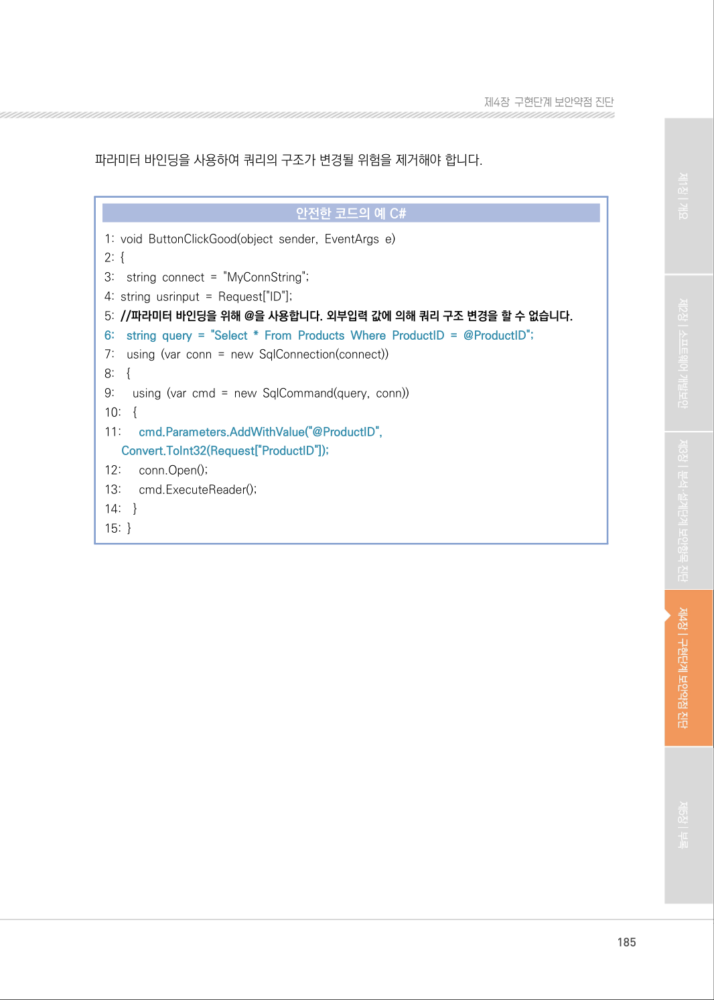

</details>

### PDF 186페이지 / 인쇄 186페이지

<!-- source-page:SW-Diagnosis-2021:186; source-lines:0,1,2,3,4,5,6,7,8,9,10,11,12,13,14,15,16,17,18,19,20,21,22,23,24,25,26,27,28,29,30,31,32,33,34,35,36,37,38,39,40,41,42,43,44,45,46,47,48,49,50,51,52,53,54,55,56,57,58,59,60 -->

186

#### 라. 진단방법

Statement statement13) 객체로 쿼리가 실행되는 부분을 확인하고(①), Statement 객체가 
Pre-paredStatement 객체인지 확인한다(②). PreparedStatement 객체를 사용하고 setString 
등의 메소 드로 외부 입력값을 설정하는 경우에는 기본적으로 안전하다고 판정하지만, 쿼리에 사용되는 
변수가 외부 입력값인 경우엔 적절한 필터링 모듈이 존재하는지 추가로 확인해야 한다(③). 즉, 쿼리 
생성과 관련된 외부 입력값에 대한 필터링 모듈이 반드시 존재해야 하며, 그 외에도 관련 프레임워크
에서 적절한 조치가 이루어질 경우에 안전하다고 판정한다.

일반적인 진단의 예

```text
1:    class Login { 
2:      public Connection getConnection() throws SQLException { 
3:        DriverManager.registerDriver(new com.microsoft.sqlserver.jdbc.SQLServerDriver());
4:        String dbConnection = PropertyManager.getProperty(“db.connection”);
5:      return DriverManager.getConnection(dbConnection); 
6:      }
7:      // 외부입력 값(username, password)을 제공받음 
8:      public void doPrivilegedAction(String username, char[] password) throws SQLException {
9:      Connection connection = getConnection();
10:    if (connection == null) { 
11:        // handle error 
12:        }
13:        try {
14:        String pwd = HashUtil.hashPassword(password); 
15:        String sqlString = “SELECT * FROM db_user WHERE username = ‘”+ username 
+ “’ AND password = ‘” + pwd + “’”; ··········································································③
16:        Statement stmt = connection.createStatement(); ························································②
17:        ResultSet rs = stmt.executeQuery(sqlString); ·······························································①
18:        if (!rs.next()) { 
19:        throw new SecurityException(“User name or password incorrect”);
20:        }
21:        // Authenticated; proceed
22:        } finally {
23:        // …
24:      }
25: }
26: }
```

13) statement : 자바에서 사용하는 객체 중 하나

<details><summary>원본 페이지 이미지 (변환 외 보존 자료)</summary>

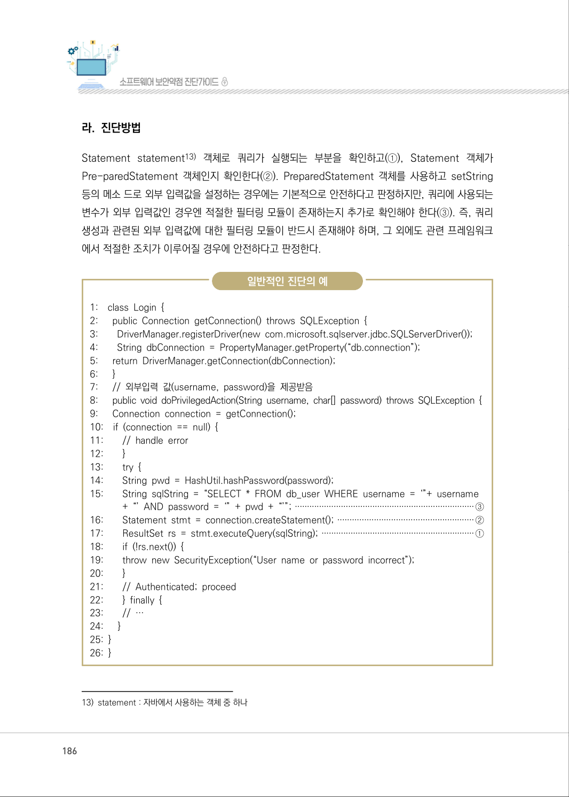

</details>

### PDF 187페이지 / 인쇄 187페이지

<!-- source-page:SW-Diagnosis-2021:187; source-lines:0,1,2,3,4,5,6,7,8,9,10,11,12,13,14,15,16,17,18,19,20,21,22,23,24,25,26,27,28,29,30,31,32,33 -->

187

제4장구현단계 보안약점 진단

다음의 예제를 살펴보면, 5라인에서 PreparedStatement 객체를 사용하고 있으나 객체를 상수 
스트링으로 생성하여 파라미터 부분을 setString 메소드로 설정하지 않아, 4라인에서 사용자의 외부 
입력 값이 쿼리문의 구조를 바꾸게 되어 취약하다고 판정한다.

정탐코드의 예

```text
1: … 
2: String tableName = props.getProperty(“jdbc.tableName”); 
3: String name = props.getProperty(“jdbc.name”); 
4: String query = “SELECT * FROM “ + tableName + “ WHERE Name =‘” + name + “’”;
5: stmt = con.prepareStatement(query); 
6: rs = stmt.executeQuery(); 
7: … 
```

다음의 예제를 살펴보면, 15라인에서 사용자의 입력값이 변수 pid에 저장되고, 19라인에서 comment 
Dao.getProjectCommentTblByWhere 함수의 파라미터로 사용된다. 해당 함수의 134라인에서 
문자열을 만들게 되고, 138번 라인에서 해당 문자열을 이용해서 쿼리를 실행하므로 취약하다고 
판정 한다.

정탐코드의 예

&lt; projectDetail.jsp &gt;

```text
14: <% 
15: String pid = request.getParameter(“projectid”) == null ? “” : 
request.getParame- ter(“projectid”); 
16:MashupProjectDao mashupDao = (MashupProjectDao)
DAOHelper.getMashupPro- jectDao(application); 
17: ProjectCommentDao commentDao = (ProjectCommentDao)
DAOHelper.getProject- CommentDao(application); 
18: MashupProjectTbl prjTbl = mashupDao.getMashupProjectTbl(pid); 
19: ArrayList commentList =
commentDao.getProjectCommentTblByWhere(“where projectid=” + pid +  “ order by 
writedate desc”); 
```

```text
20: String loginID = session.getAttribute(“userid”) == null ? “” : (String)
session.getAt- tribute(“userid”); 
21: int category = prjTbl.getCategory(); 
22: String categoryStr = “”;
```

<details><summary>원본 페이지 이미지 (변환 외 보존 자료)</summary>

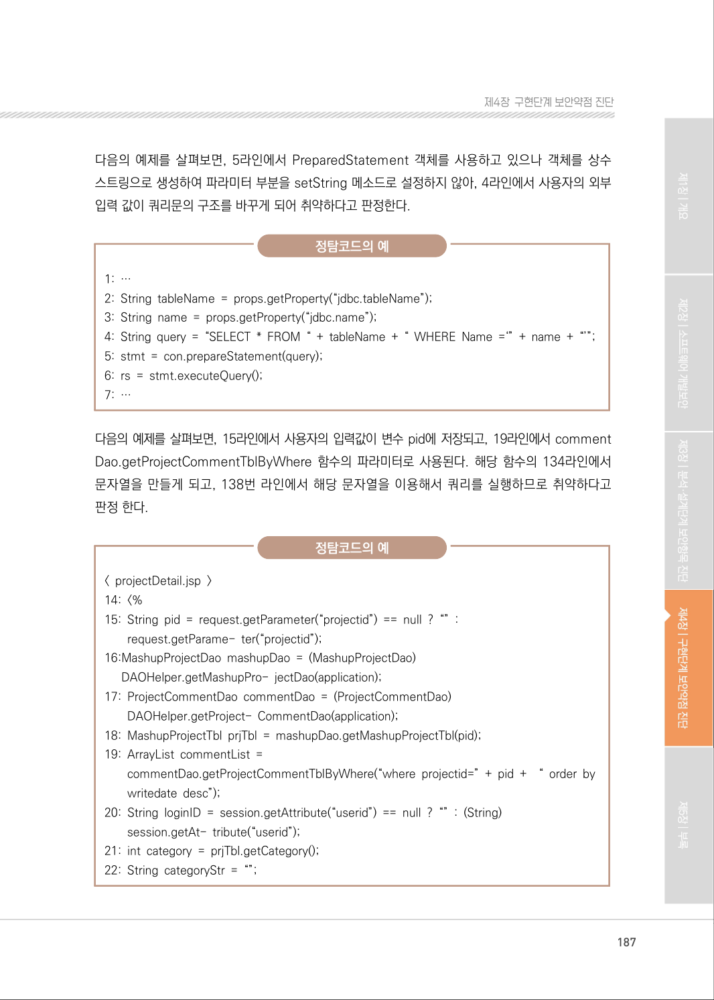

</details>

### PDF 188페이지 / 인쇄 188페이지

<!-- source-page:SW-Diagnosis-2021:188; source-lines:0,1,2,3,4,5,6,7,8,9,10,11,12,13,14,15,16,17,18,19,20,21,22,23,24,25,26,27,28,29,30,31,32,33,34,35,36,37,38,39,40,41,42,43,44 -->

188

정탐코드의 예

&lt; ProjectCommentDAO.java &gt; 

```text
131:public ArrayList getProjectCommentTblByWhere(String where) { 
132:    String sql_ = 
this.getMessageSourceAccessor().getMessage(“ProjectCommentDao.
getProjectCommentTbl”);
```

```text
133:      ArrayList ret = new ArrayList();
134:      sql_ += “ “ + where;
135:
136:      try { 
137:        JdbcTemplate template_ = this.getJdbcTemplate(); 
138:        List tmp = template_.query(sql_, new ProjectCommentRowMapper());
139:        ret = Util.trimToResize(tmp);
140:      } catch (DataAccessException e) {
```

[ SQL 삽입 : JDO ]
외부의 입력값에 대한 적절한 검사 과정을 거치지 않고, JDO(Java Data Objects) API의 SQL 또는 
JDOQL 쿼리 생성을 위한 문자열로 사용하면, 공격자가 프로그래머가 의도하지 않았던 문자열을 
전달함으로써 쿼리의 의미를 왜곡시키거나 그 구조를 변경하여 임의의 쿼리 명령어를 수행할 수 있다.
다음의 예제에서는 공격자가 외부의 입력(name) 값을 foo’; DELETE FROM MYTABLE; --로 
주게 되면, 다음과 같은 쿼리가 실행되어 테이블이 삭제될 수 있으므로 취약하다고 판정한다.
SELECT col1 FROM MYTABLE WHERE name = ‘foo’ ; DELETE FROM MYTABLE; --’

정탐코드의 예

```text
1: … 
2: public class U9102 implements ContactDAO { 
3:    public List<Contact> listContacts() { 
4:      PersistenceManager pm = getPersistenceManagerFactory().getPersistenceMan ager(); 
5:      String query = “select from “ + Contact.class.getName(); 
6:      try { 
7:        Properties props = new Properties(); 
8:        String fileName = “contacts.txt”;
```

<details><summary>원본 페이지 이미지 (변환 외 보존 자료)</summary>

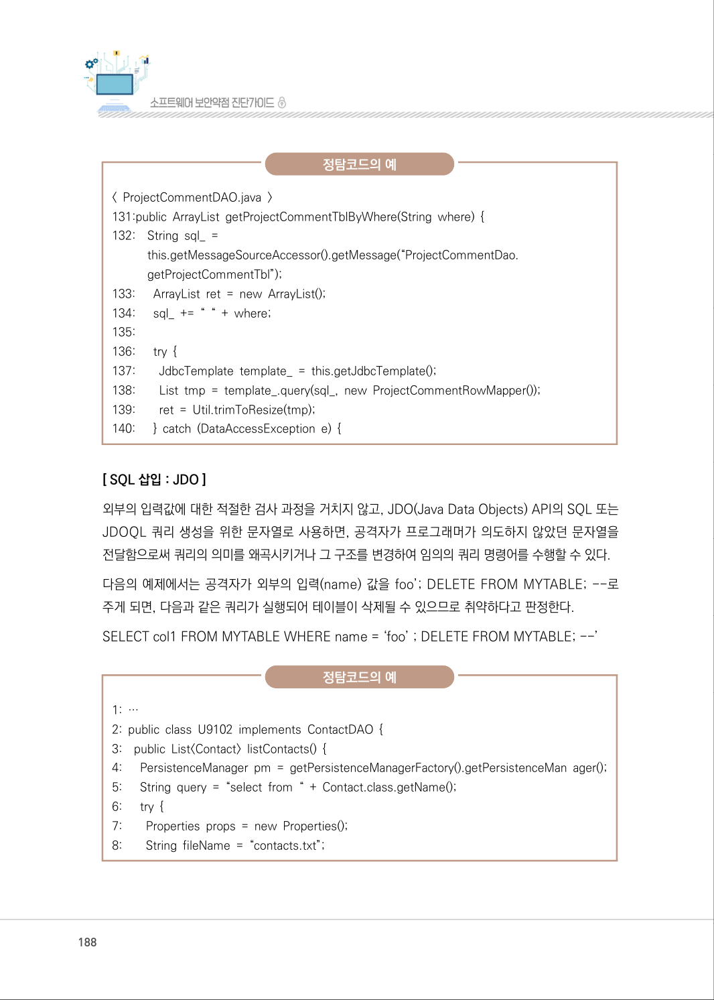

</details>

### PDF 189페이지 / 인쇄 189페이지

<!-- source-page:SW-Diagnosis-2021:189; source-lines:0,1,2,3,4,5,6,7,8,9,10,11,12,13,14,15,16,17,18,19,20,21,22,23,24,25,26,27,28,29,30,31,32,33,34,35,36,37,38,39,40,41,42,43,44,45,46,47,48,49,50,51,52,53,54 -->

189

제4장구현단계 보안약점 진단

정탐코드의 예

```text
9:           FileInputStream in = new FileInputStream(fileName); 
10:
11:         if (in != null) { 
12:         props.load(in); 
13:         in.close(); 
14:        }
15:        // 외부로부터 입력을 받는다 
16:        String name = props.getProperty(“name”); 
17:        if (name != null) { 
18:         query += “ where name = ‘” + name + “’”; 
19:        }
20:      } catch (IOException e) { 
21:        … 
22:      } 
23:      // 외부입력 값이 JDO 객체의 인자로 사용된다. 
24:      return (List<Contact>) pm.newQuery(query).execute(); 
25:    }
26: }
27: …
```

[ SQL 삽입 : Persistence ]
J2EE Persistence API를 사용하는 응용프로그램에서 외부의 입력값을 검증 없이 쿼리에 그대로 사용 
하면, 쿼리의 의미를 왜곡시키거나 그 구조를 변경함으로써 임의의 쿼리가 실행될 수 있다. 공격자가 
외부 입력(id)의 값으로 foo’; DELETE FROM MYTABLE; --을 주게 되면, 다음과 같은 쿼리가 
실행되어 테이블이 삭제될 수 있으므로 취약하다고 판정한다.
SELECT col1 FROM MYTABLE WHERE name = ‘foo’ ; DELETE FROM MYTABLE; --’

정탐코드의 예

```text
1:    public class U9103 implements ServletContextListener { 
2:      public List<?> getAllItemsInWildcardCollection() { 
3:        EntityManager em = getEntityManager(); 
4:        List<U9103> r_type = null; 
5:         try {
```

<details><summary>원본 페이지 이미지 (변환 외 보존 자료)</summary>

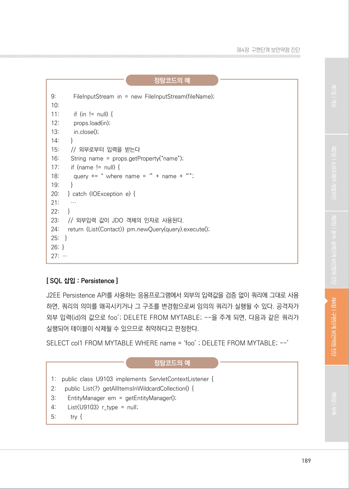

</details>

### PDF 190페이지 / 인쇄 190페이지

<!-- source-page:SW-Diagnosis-2021:190; source-lines:0,1,2,3,4,5,6,7,8,9,10,11,12,13,14,15,16,17,18,19,20,21,22,23,24,25,26,27,28,29,30,31,32,33,34,35,36,37,38,39,40,41,42,43 -->

190

정탐코드의 예

```text
6:        Properties props = new Properties(); 
7:        String fileName = “conditions.txt”; 
8:         FileInputStream in = new FileInputStream(fileName); 
9:         props.load(in);
10:        // 외부로부터 입력을 받는다. 
11:        String id = props.getProperty(“id”); 
12:        // 외부 입력 값이 query의 인자로 사용이 된다. 
13:        Query query = em.createNativeQuery(“SELECT OBJECT(i) FROM Item i WHERE 
i.itemID > “ + id); 
14:        List<U9103> items = query.getResultList(); 
15:        …
16:        return r_type;
17:    }
18: …
```

[ SQL 삽입 : mybatis Data Map ]
외부에서 입력된 값이 쿼리의 인자값으로만 사용되지 않고, 쿼리 명령어에 연결되는 문자열 로 사용 
되면, 공격자가 의도하지 않았던 문자열을 전달함으로써 쿼리의 의미를 왜곡시키거나, 그 구조를 
변경하여 임의의 DB 명령어를 수행할 수 있다.
다음의 예제는 mybatis Data Map에서 사용하는 쿼리 설정파일(XML)이다. 정의된 쿼리 중 
delStu- dent 명령어 선언에서 쿼리에 삽입되는 인자들 중 $name$으로 전달되는 문자열 값은 
그대로 연결되어 쿼리가 만들어진다. 따라서 만약 NAME의 값으로 ‘ OR ‘x’=’x 을 전달하면 다음과 
같은 쿼리가 실행되어 테이블의 모든 원소를 삭제할 수 있으므로 취약하다고 판정한다.
DELETE STUDENTS WHERE NUM = #num# and NAME = ‘’ OR ‘x’=’x’ 

정탐코드의 예

```text
1: <?xml version=”1.0” encoding=”UTF-8”?> 
2: <!DOCTYPE sqlMap PUBLIC “-//iBATIS.com//DTD SQL Map 2.0//EN”
“http://www. ibatis.com/dtd/sql-map-2.dtd”>
3: <sqlMap namespace=”Student”>
4:    <resultMap id=”StudentResult” class=”Student”>
```

<details><summary>원본 페이지 이미지 (변환 외 보존 자료)</summary>

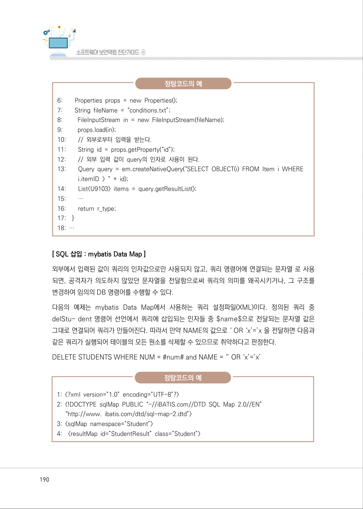

</details>

### PDF 191페이지 / 인쇄 191페이지

<!-- source-page:SW-Diagnosis-2021:191; source-lines:0,1,2,3,4,5,6,7,8,9,10,11,12,13,14,15,16,17,18,19,20,21,22,23,24,25,26,27,28,29,30,31,32,33,34,35,36 -->

191

제4장구현단계 보안약점 진단

정탐코드의 예

```text
5:    <result column=”ID” property=”id” />
6:    <result column=”NAME” property=”name” />
7:    </resultMap>
8: <select id=”listStudents” resultMap=”StudentResult”>
9:    SELECT NUM, NAME 
10: FROM STUDENTS 
11: ORDER BY NUM 
12:</select>
13:<select id=”nameStudent” parameterClass=”Integer” resultClass=”Student”>
14: SELECT NUM, NAME 
15: FROM STUDENTS 
16: WHERE NUM = #num# 
17:</select> 
18:<!-- dynamic SQL 사용 --> 
19:<delete id=”delStudent” parameterClass=”Student”> 
20: DELETE STUDENTS 
21: WHERE NUM = #num# AND NAME = ‘$name$’ 
22:</delete>
23:</sqlMap>
```

[ SQL 삽입 : Hibernate ]
외부의 신뢰할 수 없는 입력을 적절한 검사 과정을 거치지 않고 Hibernate API의 SQL 쿼리 생성을 
위한 문자열로 사용하면, 공격자가 프로그래머가 의도하지 않았던 문자열을 전달함으로써 쿼리의 
의미를 왜곡시키거나 그 구조를 변경하여 임의의 DB 명령어가 수행되도록 할 수 있다.
다음의 예제에서는 외부의 입력(name)을 아무 검증과정 없이 쿼리에 그대로 사용하고 있다. 만일, 
외부의 입력으로 “n’ or ‘1’=’1”과 같은 문자열이 입력되면, 다음과 같은 쿼리가 실행되어 테이블 
내의 모든 레코드가 반환될 수 있으므로 취약하다고 판정한다.
“from Student where studentName=’n’ or ‘1’=’1’”

정탐코드의 예

```text
1: import org.hibernate.Query
2: import org.hibernate.Session
```

<details><summary>원본 페이지 이미지 (변환 외 보존 자료)</summary>

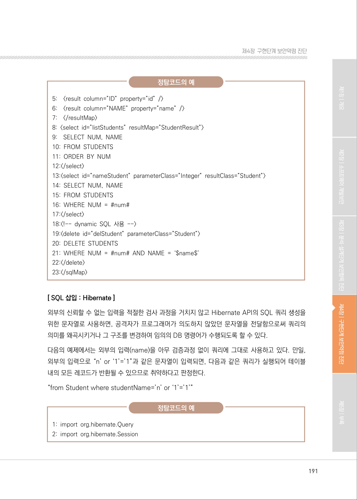

</details>

### PDF 192페이지 / 인쇄 192페이지

<!-- source-page:SW-Diagnosis-2021:192; source-lines:0,1,2,3,4,5,6,7,8,9,10,11,12,13,14,15,16,17,18,19,20,21 -->

192

정탐코드의 예

```text
3: ......
4: String name = request.getParameter(“name”); 
5: Query query = session.createQuery(“from Student where studentName = ‘” +  name 
+ “’ “);
```

아래 코드에서는 외부 입력값이 위치하는 부분을 ?로 설정하고, 실행 시에 해당 파라미터가 전달되도록 
수정함으로써 외부의 입력(name)이 쿼리의 구조를 변경시키는 것을 방지하고 있어 취약하지 않다.

오탐코드의 예

```text
1: import org.hibernate.Query
2: import org.hibernate.Session
3: ......
4: String name = request.getParameter(“name”);
5: Query query = session.createQuery(“from Student where studentName = ? “);
6: query.setString(0, name);
```

오탐코드의 예

```text
1: import org.hibernate.Query
2: import org.hibernate.Session
3: ......
4: String name = request.getParameter(“name”);
5: Query query = session.createQuery(“from Student where studentName = :name “);
6: query.setParameter(“name”, name);
```

<details><summary>원본 페이지 이미지 (변환 외 보존 자료)</summary>

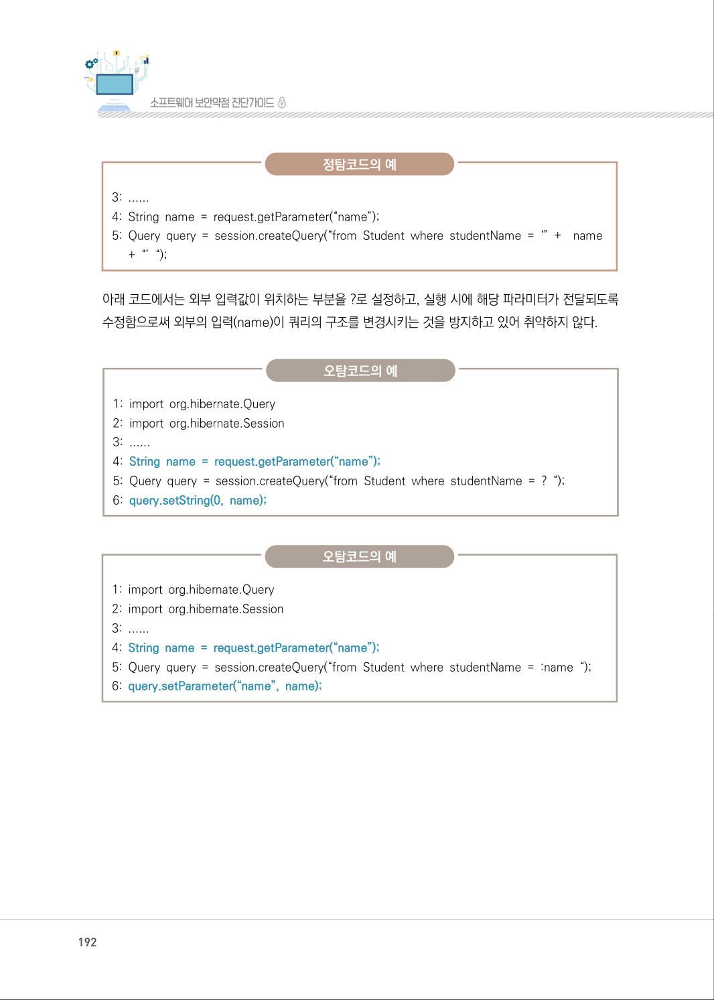

</details>

### PDF 193페이지 / 인쇄 193페이지

<!-- source-page:SW-Diagnosis-2021:193; source-lines:0,1,2,3,4,5,6,7,8,9,10,11,12 -->

193

제4장구현단계 보안약점 진단

#### 마. 참고자료

[1] CWE-89 SQL Injection, MITRE,

http://cwe.mitre.org/data/definitions/89.html 
[2] Threat and Vulnerability, "SQL Injection", Microsoft, 

http://technet.microsoft.com/en-us/library/ms161953%28v=SQL.105%29.aspx
[3] Input validation and Data Sanitization, Threat and Vulnerability, Prevent SQL 

Injection, CERT,
http://www.securecoding.cert.org/confluence/display/java/IDS00-J.+Prevent+S
QL+injection
[4] SQL Injection Prevention Cheat Sheet, OWASP

https://www.owasp.org/index.php/SQL_Injection_Prevention_Cheat_Sheet

<details><summary>원본 페이지 이미지 (변환 외 보존 자료)</summary>

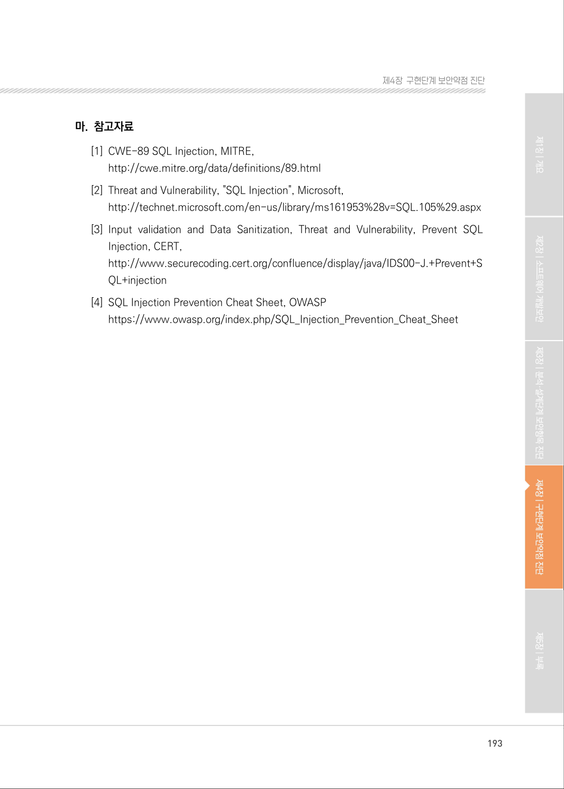

</details>

---

## 탐색 링크 (원문 외)

[통합 인덱스](../../../INDEX.md)

