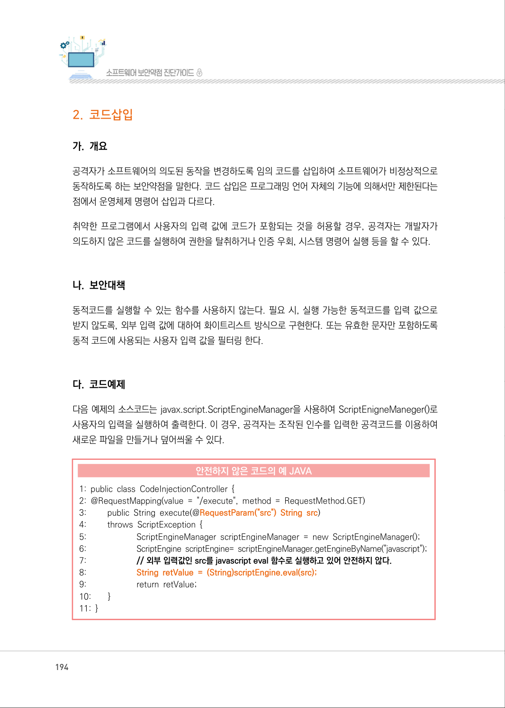
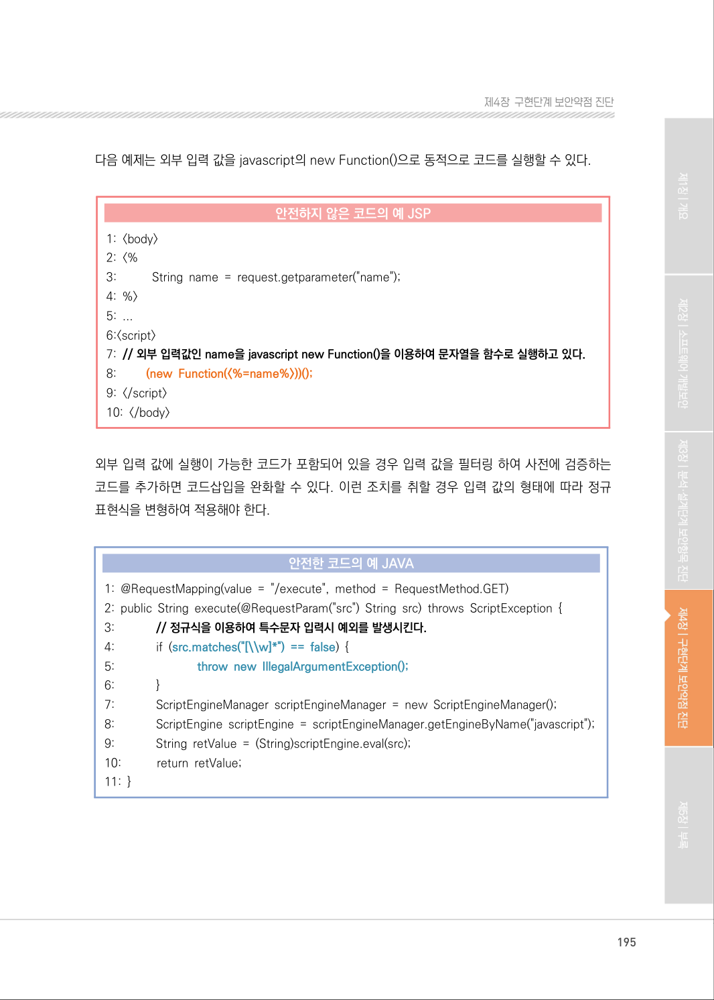
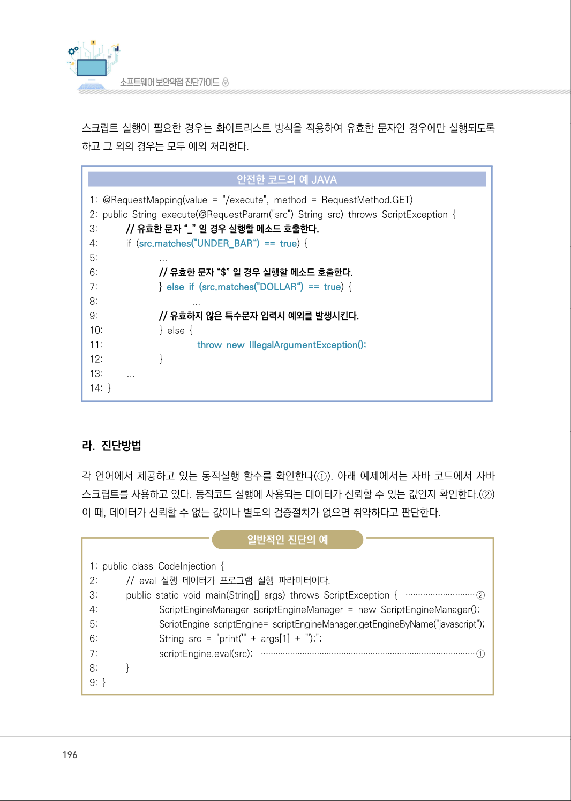
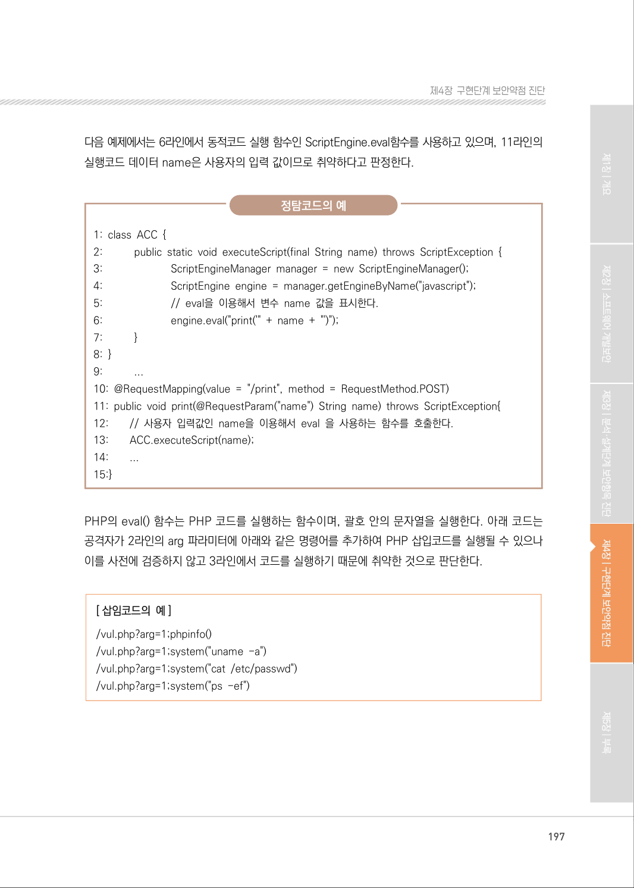
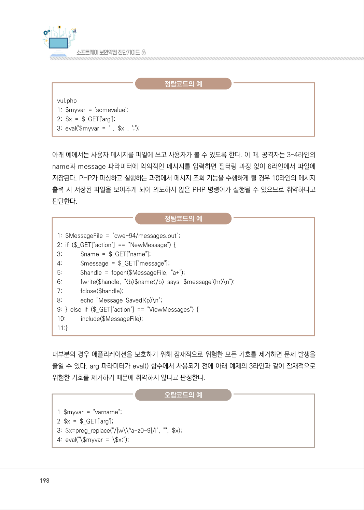
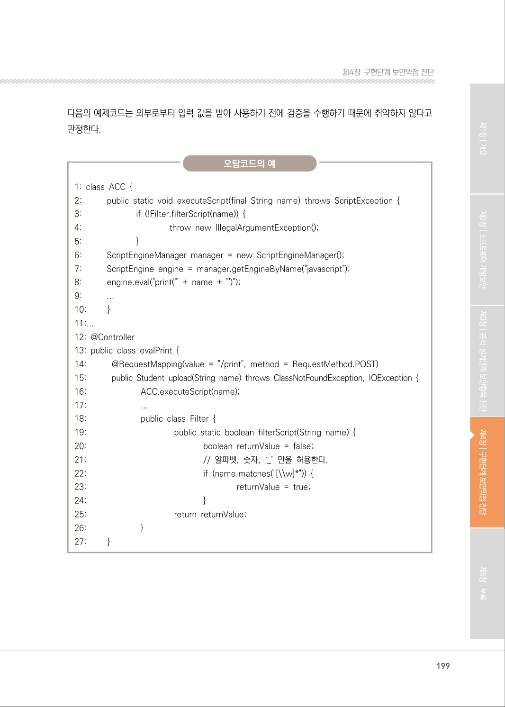
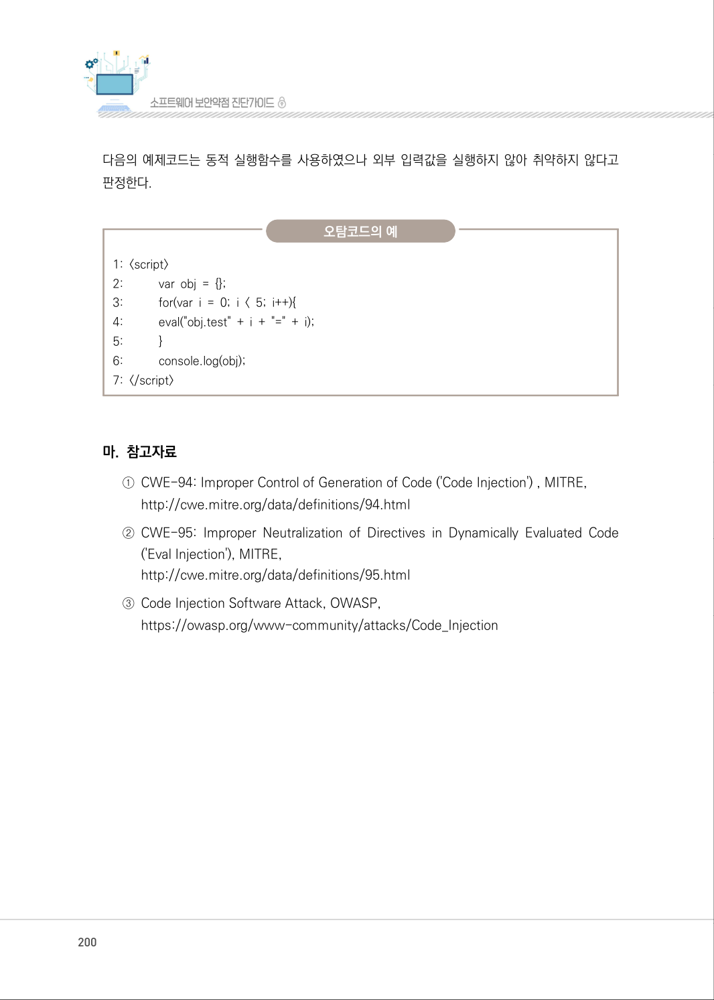
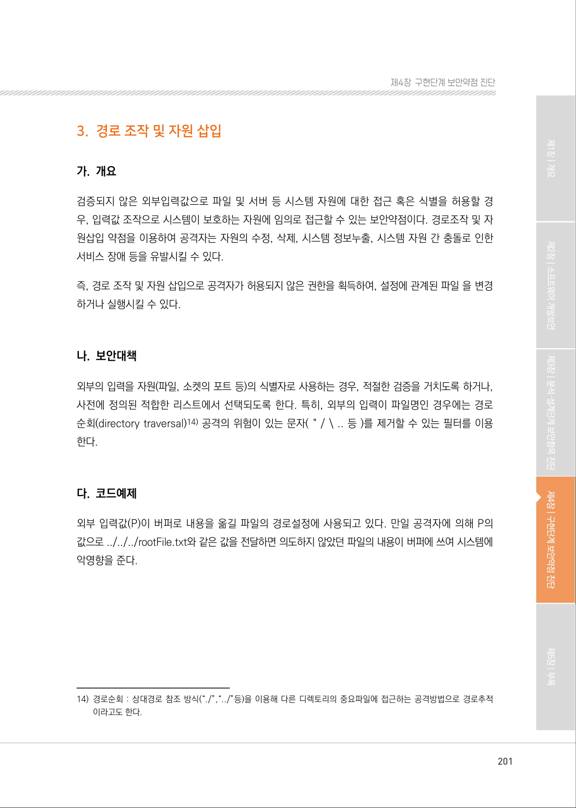

# 2. 코드삽입

> 변환 안내(원문 외): 아래 본문은 PDF 텍스트를 추출한 전사입니다. 코드 줄번호·특수 공백·원문 오류를 유지했습니다. 실행용 코드가 아닙니다. 표·그림·들여쓰기는 연결된 페이지 이미지와 대조하세요. 페이지 경계의 줄바꿈을 보존하며, 동일 페이지가 여러 항목에 나뉘면 각 항목의 본문은 해당 구간만 포함합니다.

### PDF 194페이지 / 인쇄 194페이지

<!-- source-page:SW-Diagnosis-2021:194; source-lines:0,1,2,3,4,5,6,7,8,9,10,11,12,13,14,15,16,17,18,19,20,21,22,23,24,25,26,27,28,29,30,31,32,33,34,35 -->

194

#### 2. 코드삽입

#### 가. 개요

공격자가 소프트웨어의 의도된 동작을 변경하도록 임의 코드를 삽입하여 소프트웨어가 비정상적으로 
동작하도록 하는 보안약점을 말한다. 코드 삽입은 프로그래밍 언어 자체의 기능에 의해서만 제한된다는 
점에서 운영체제 명령어 삽입과 다르다.

취약한 프로그램에서 사용자의 입력 값에 코드가 포함되는 것을 허용할 경우, 공격자는 개발자가 
의도하지 않은 코드를 실행하여 권한을 탈취하거나 인증 우회, 시스템 명령어 실행 등을 할 수 있다.

#### 나. 보안대책

동적코드를 실행할 수 있는 함수를 사용하지 않는다. 필요 시, 실행 가능한 동적코드를 입력 값으로 
받지 않도록, 외부 입력 값에 대하여 화이트리스트 방식으로 구현한다. 또는 유효한 문자만 포함하도록 
동적 코드에 사용되는 사용자 입력 값을 필터링 한다.

#### 다. 코드예제

다음 예제의 소스코드는 javax.script.ScriptEngineManager을 사용하여 ScriptEnigneManeger()로 
사용자의 입력을 실행하여 출력한다. 이 경우, 공격자는 조작된 인수를 입력한 공격코드를 이용하여 
새로운 파일을 만들거나 덮어씌울 수 있다.

#### 안전하지 않은 코드의 예 JAVA

```java
1: public class CodeInjectionController { 
2: @RequestMapping(value = "/execute", method = RequestMethod.GET) 
3:         public String execute(@RequestParam("src") String src)
4:         throws ScriptException { 
5:                       ScriptEngineManager scriptEngineManager = new ScriptEngineManager();
6:                       ScriptEngine scriptEngine= scriptEngineManager.getEngineByName("javascript");
7:                       // 외부 입력값인 src를 javascript eval 함수로 실행하고 있어 안전하지 않다.
8:                       String retValue = (String)scriptEngine.eval(src);
9:                       return retValue;
10:        }
11: }
```

<details><summary>원본 페이지 이미지 (변환 외 보존 자료)</summary>



</details>

### PDF 195페이지 / 인쇄 195페이지

<!-- source-page:SW-Diagnosis-2021:195; source-lines:0,1,2,3,4,5,6,7,8,9,10,11,12,13,14,15,16,17,18,19,20,21,22,23,24,25,26,27,28,29,30,31,32,33,34,35,36,37,38 -->

195

제4장구현단계 보안약점 진단

다음 예제는 외부 입력 값을 javascript의 new Function()으로 동적으로 코드를 실행할 수 있다.

#### 안전하지 않은 코드의 예 JSP

```jsp
1: <body>
2: <%
3:           String name = request.getparameter("name");
4: %>
5: ...
6:<script>
7: // 외부 입력값인 name을 javascript new Function()을 이용하여 문자열을 함수로 실행하고 있다.
8:         (new Function(<%=name%>))();
9: </script>
10: </body>
```

외부 입력 값에 실행이 가능한 코드가 포함되어 있을 경우 입력 값을 필터링 하여 사전에 검증하는 
코드를 추가하면 코드삽입을 완화할 수 있다. 이런 조치를 취할 경우 입력 값의 형태에 따라 정규 
표현식을 변형하여 적용해야 한다.

#### 안전한 코드의 예 JAVA

```java
1: @RequestMapping(value = "/execute", method = RequestMethod.GET)
2: public String execute(@RequestParam("src") String src) throws ScriptException {
3:             // 정규식을 이용하여 특수문자 입력시 예외를 발생시킨다.
4:             if (src.matches("[\\w]*") == false) { 
5:                           throw new IllegalArgumentException();
6:             }
7:             ScriptEngineManager scriptEngineManager = new ScriptEngineManager();
8:             ScriptEngine scriptEngine = scriptEngineManager.getEngineByName("javascript");
9:             String retValue = (String)scriptEngine.eval(src);
10:           return retValue;
11: }
```

<details><summary>원본 페이지 이미지 (변환 외 보존 자료)</summary>



</details>

### PDF 196페이지 / 인쇄 196페이지

<!-- source-page:SW-Diagnosis-2021:196; source-lines:0,1,2,3,4,5,6,7,8,9,10,11,12,13,14,15,16,17,18,19,20,21,22,23,24,25,26,27,28,29,30,31,32,33,34,35,36,37,38,39,40,41,42,43,44,45,46,47,48,49 -->

196

스크립트 실행이 필요한 경우는 화이트리스트 방식을 적용하여 유효한 문자인 경우에만 실행되도록 
하고 그 외의 경우는 모두 예외 처리한다.

#### 안전한 코드의 예 JAVA

```java
1: @RequestMapping(value = "/execute", method = RequestMethod.GET)
2: public String execute(@RequestParam("src") String src) throws ScriptException {
3:           // 유효한 문자 “_” 일 경우 실행할 메소드 호출한다.
4:           if (src.matches("UNDER_BAR“) == true) { 
5:                         ...
6:                         // 유효한 문자 “$” 일 경우 실행할 메소드 호출한다.
7:                         } else if (src.matches("DOLLAR“) == true) {
8:                                      ...
9:                         // 유효하지 않은 특수문자 입력시 예외를 발생시킨다.
10:                       } else {
11:                                      throw new IllegalArgumentException();
12:                       }
13:         ...
14: }
```

#### 라. 진단방법

각 언어에서 제공하고 있는 동적실행 함수를 확인한다(①). 아래 예제에서는 자바 코드에서 자바 
스크립트를 사용하고 있다. 동적코드 실행에 사용되는 데이터가 신뢰할 수 있는 값인지 확인한다.(②) 
이 때, 데이터가 신뢰할 수 없는 값이나 별도의 검증절차가 없으면 취약하다고 판단한다.

일반적인 진단의 예

```text
1: public class CodeInjection { 
2:           // eval 실행 데이터가 프로그램 실행 파라미터이다. 
3:           public static void main(String[] args) throws ScriptException { ····························②
4:                         ScriptEngineManager scriptEngineManager = new ScriptEngineManager();
5:                         ScriptEngine scriptEngine= scriptEngineManager.getEngineByName("javascript");
6:                         String src = "print('" + args[1] + "');";
7:                         scriptEngine.eval(src); ························································································①
8:           }
9: }
```

<details><summary>원본 페이지 이미지 (변환 외 보존 자료)</summary>



</details>

### PDF 197페이지 / 인쇄 197페이지

<!-- source-page:SW-Diagnosis-2021:197; source-lines:0,1,2,3,4,5,6,7,8,9,10,11,12,13,14,15,16,17,18,19,20,21,22,23,24,25,26,27,28,29,30,31,32,33,34,35,36,37 -->

197

제4장구현단계 보안약점 진단

다음 예제에서는 6라인에서 동적코드 실행 함수인 ScriptEngine.eval함수를 사용하고 있으며, 11라인의 
실행코드 데이터 name은 사용자의 입력 값이므로 취약하다고 판정한다.

정탐코드의 예

```text
1: class ACC { 
2:           public static void executeScript(final String name) throws ScriptException {
3:                         ScriptEngineManager manager = new ScriptEngineManager();
4:                         ScriptEngine engine = manager.getEngineByName("javascript");
5:                         // eval을 이용해서 변수 name 값을 표시한다. 
6:                         engine.eval("print('" + name + "')");
7:           }
8: }
9:           ...
10: @RequestMapping(value = "/print", method = RequestMethod.POST) 
11: public void print(@RequestParam("name") String name) throws ScriptException{
12:        // 사용자 입력값인 name을 이용해서 eval 을 사용하는 함수를 호출한다.
13:        ACC.executeScript(name);
14:        ...
15:}
```

PHP의 eval() 함수는 PHP 코드를 실행하는 함수이며, 괄호 안의 문자열을 실행한다. 아래 코드는 
공격자가 2라인의 arg 파라미터에 아래와 같은 명령어를 추가하여 PHP 삽입코드를 실행될 수 있으나 
이를 사전에 검증하지 않고 3라인에서 코드를 실행하기 때문에 취약한 것으로 판단한다.

[ 삽임코드의 예]
/vul.php?arg=1;phpinfo() 
/vul.php?arg=1;system("uname -a") 
/vul.php?arg=1;system("cat /etc/passwd") 
/vul.php?arg=1;system("ps -ef")

<details><summary>원본 페이지 이미지 (변환 외 보존 자료)</summary>



</details>

### PDF 198페이지 / 인쇄 198페이지

<!-- source-page:SW-Diagnosis-2021:198; source-lines:0,1,2,3,4,5,6,7,8,9,10,11,12,13,14,15,16,17,18,19,20,21,22,23,24,25,26,27,28,29,30,31,32,33,34,35,36,37 -->

198

정탐코드의 예

vul.php

```text
1: $myvar = 'somevalue'; 
2: $x = $_GET['arg']; 
3: eval('$myvar = ' . $x . ';');
```

아래 예에서는 사용자 메시지를 파일에 쓰고 사용자가 볼 수 있도록 한다. 이 때, 공격자는 3~4라인의 
name과 message 파라미터에 악의적인 메시지를 입력하면 필터링 과정 없이 6라인에서 파일에 
저장된다. PHP가 파싱하고 실행하는 과정에서 메시지 조회 기능을 수행하게 될 경우 10라인의 메시지 
출력 시 저장된 파일을 보여주게 되어 의도하지 않은 PHP 명령어가 실행될 수 있으므로 취약하다고 
판단한다.

정탐코드의 예

```text
1: $MessageFile = "cwe-94/messages.out";
2: if ($_GET["action"] == "NewMessage") {
3:           $name = $_GET["name"]; 
4:           $message = $_GET["message"]; 
5:           $handle = fopen($MessageFile, "a+"); 
6:           fwrite($handle, "<b>$name</b> says '$message'<hr>\n");
7:           fclose($handle);
8:           echo "Message Saved!<p>\n";
9: } else if ($_GET["action"] == "ViewMessages") {
10:         include($MessageFile);
11:}
```

대부분의 경우 애플리케이션을 보호하기 위해 잠재적으로 위험한 모든 기호를 제거하면 문제 발생을 
줄일 수 있다. arg 파라미터가 eval() 함수에서 사용되기 전에 아래 예제의 3라인과 같이 잠재적으로 
위험한 기호를 제거하기 때문에 취약하지 않다고 판정한다.

오탐코드의 예

1 $myvar = "varname";
2 $x = $_GET['arg'];

```text
3: $x=preg_replace("/[w\\^a-z0-9]/i", "", $x);
4: eval("\$myvar = \$x;");
```

<details><summary>원본 페이지 이미지 (변환 외 보존 자료)</summary>



</details>

### PDF 199페이지 / 인쇄 199페이지

<!-- source-page:SW-Diagnosis-2021:199; source-lines:0,1,2,3,4,5,6,7,8,9,10,11,12,13,14,15,16,17,18,19,20,21,22,23,24,25,26,27,28,29,30,31,32,33,34,35,36,37,38,39,40,41,42,43,44,45,46,47,48,49,50,51,52,53,54 -->

199

제4장구현단계 보안약점 진단

다음의 예제코드는 외부로부터 입력 값을 받아 사용하기 전에 검증을 수행하기 때문에 취약하지 않다고 
판정한다.

오탐코드의 예

```text
1: class ACC { 
2:           public static void executeScript(final String name) throws ScriptException {
3:                         if (!Filter.filterScript(name)) {
4:                                        throw new IllegalArgumentException();
5:                         }
6:           ScriptEngineManager manager = new ScriptEngineManager(); 
7:           ScriptEngine engine = manager.getEngineByName("javascript"); 
8:           engine.eval("print('" + name + "')"); 
9:           ...
10:         }
11:...
12: @Controller
13: public class evalPrint {
14:           @RequestMapping(value = "/print", method = RequestMethod.POST)
15:           public Student upload(String name) throws ClassNotFoundException, IOException {
16:                         ACC.executeScript(name);
17:                         ...
18:                         public class Filter {
19:                                        public static boolean filterScript(String name) {
20:                                                     boolean returnValue = false;
21:                                                     // 알파벳, 숫자, ‘_’ 만을 허용한다.
22:                                                     if (name.matches("[\\w]*")) { 
23:                                                                    returnValue = true;
24:                                                     }
25:                                        return returnValue;
26:                         }
27:         }
```

<details><summary>원본 페이지 이미지 (변환 외 보존 자료)</summary>



</details>

### PDF 200페이지 / 인쇄 200페이지

<!-- source-page:SW-Diagnosis-2021:200; source-lines:0,1,2,3,4,5,6,7,8,9,10,11,12,13,14,15,16,17,18,19,20,21,22,23 -->

200

다음의 예제코드는 동적 실행함수를 사용하였으나 외부 입력값을 실행하지 않아 취약하지 않다고 
판정한다.

오탐코드의 예

```text
1: <script>
2:           var obj = {};
3:           for(var i = 0; i < 5; i++){
4:           eval("obj.test" + i + "=" + i);
5:           }
6:           console.log(obj);
7: </script>
```

#### 마. 참고자료

①CWE-94: Improper Control of Generation of Code ('Code Injection') , MITRE,

http://cwe.mitre.org/data/definitions/94.html 
②CWE-95: Improper Neutralization of Directives in Dynamically Evaluated Code 

('Eval Injection'), MITRE,
http://cwe.mitre.org/data/definitions/95.html 
③Code Injection Software Attack, OWASP,

https://owasp.org/www-community/attacks/Code_Injection

<details><summary>원본 페이지 이미지 (변환 외 보존 자료)</summary>



</details>

### PDF 201페이지 / 인쇄 201페이지

<!-- source-page:SW-Diagnosis-2021:201; source-lines:1 -->

제4장구현단계 보안약점 진단

<details><summary>원본 페이지 이미지 (변환 외 보존 자료)</summary>



</details>

---

## 탐색 링크 (원문 외)

[통합 인덱스](../../../INDEX.md)

