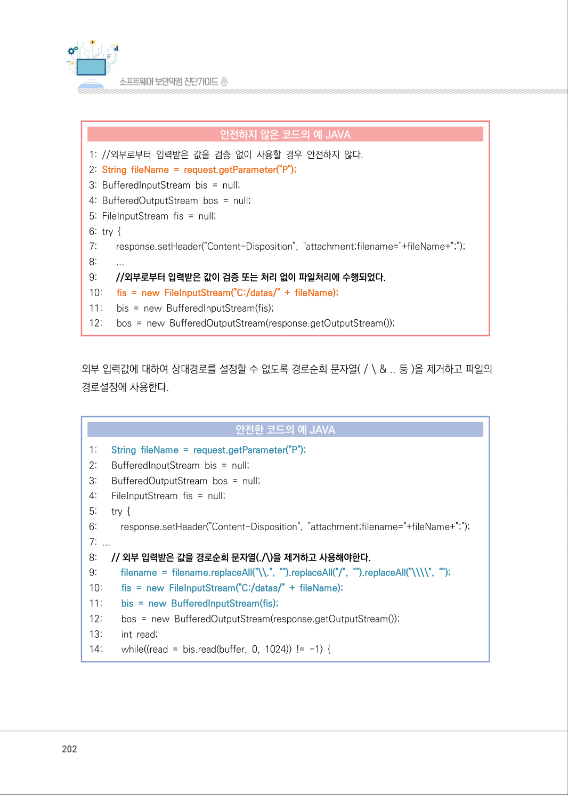
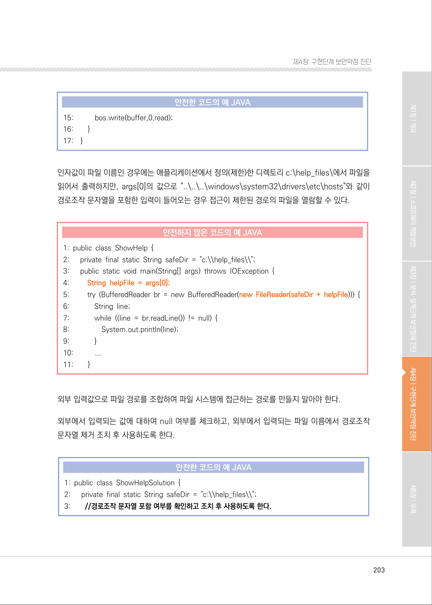
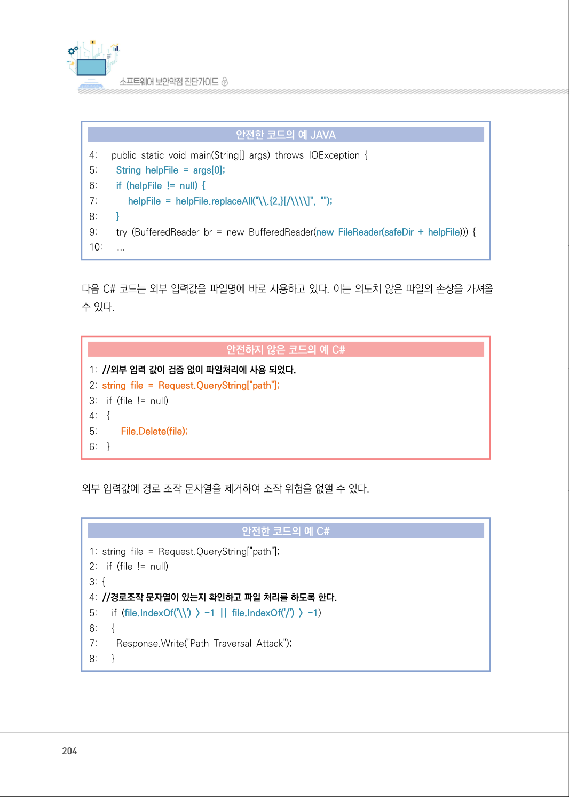
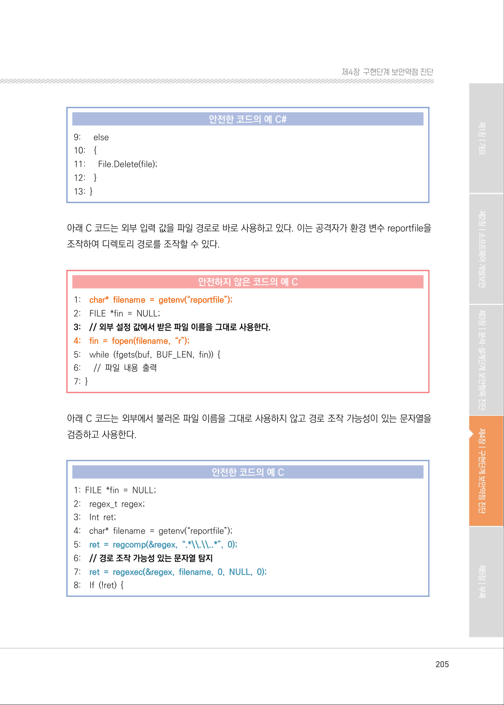
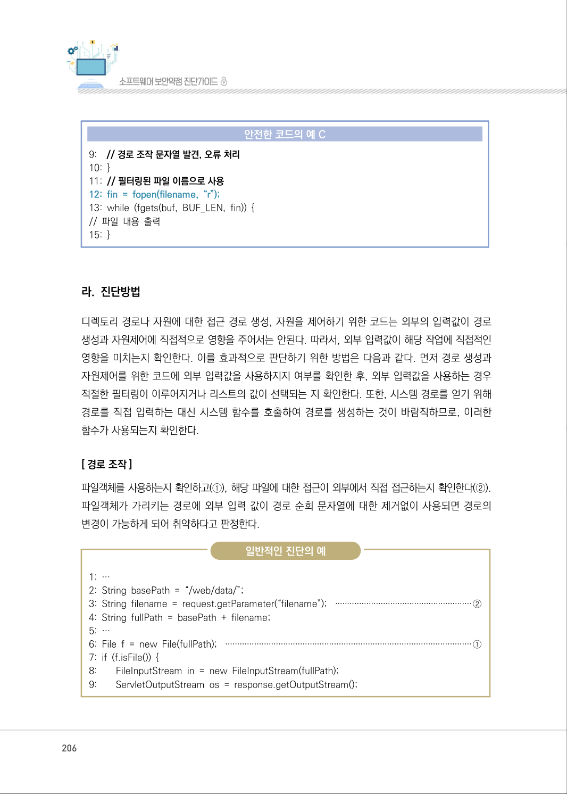
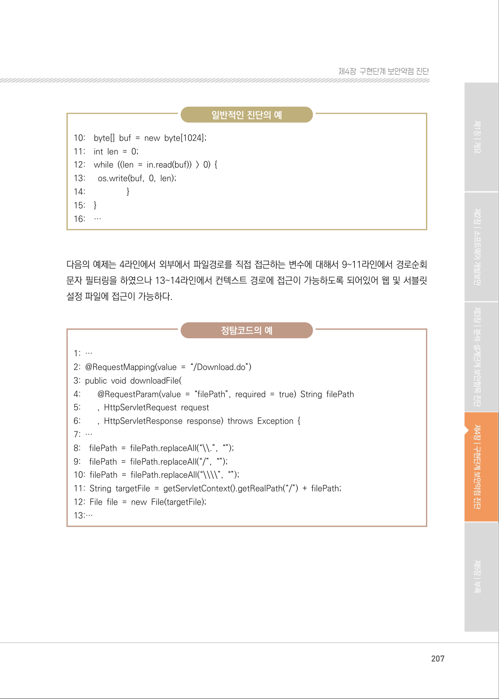
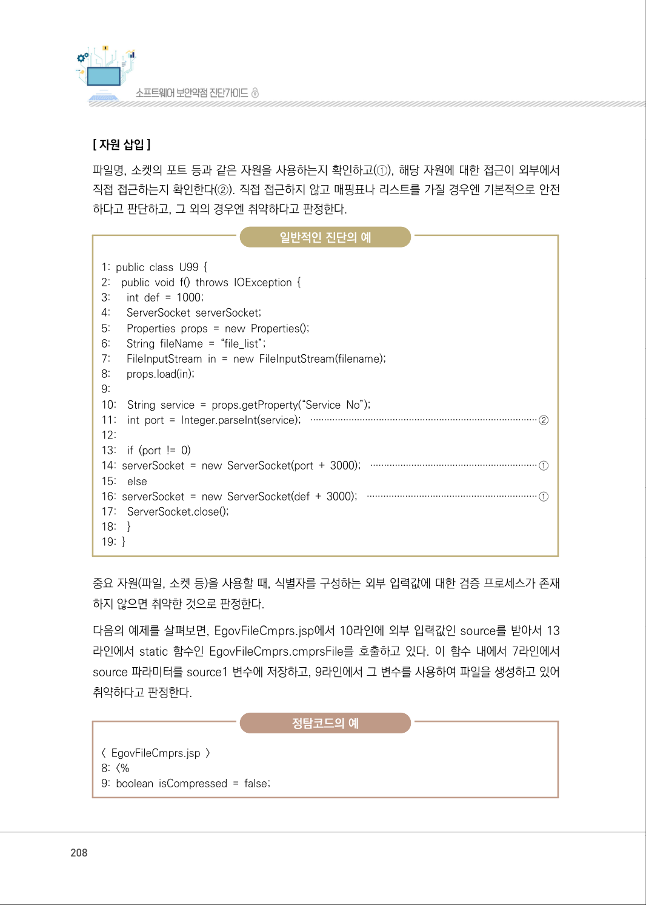
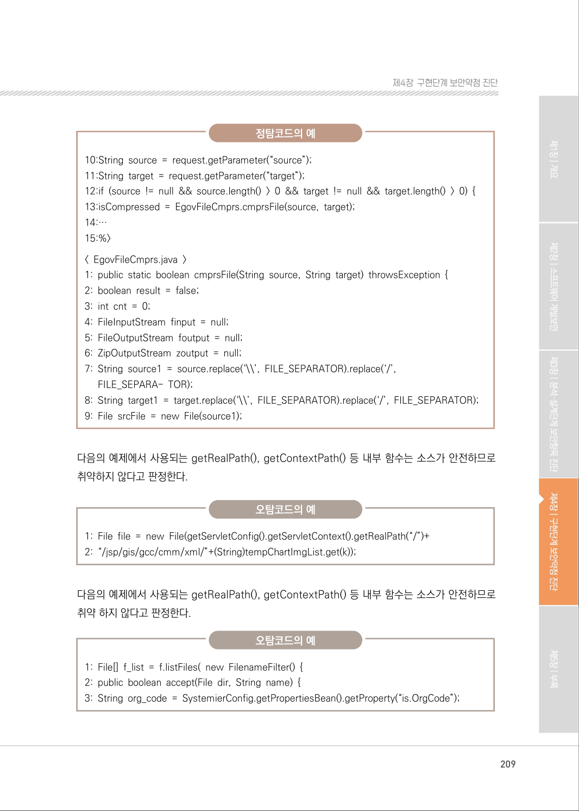
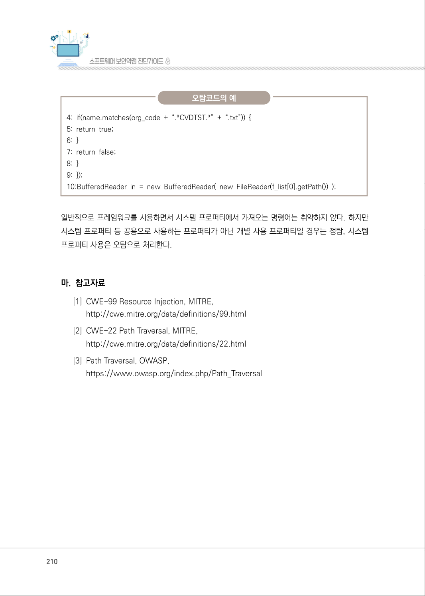

# 3. 경로 조작 및 자원 삽입

> 변환 안내(원문 외): 아래 본문은 PDF 텍스트를 추출한 전사입니다. 코드 줄번호·특수 공백·원문 오류를 유지했습니다. 실행용 코드가 아닙니다. 표·그림·들여쓰기는 연결된 페이지 이미지와 대조하세요. 페이지 경계의 줄바꿈을 보존하며, 동일 페이지가 여러 항목에 나뉘면 각 항목의 본문은 해당 구간만 포함합니다.

### PDF 201페이지 / 인쇄 201페이지

<!-- source-page:SW-Diagnosis-2021:201; source-lines:0,2,3,4,5,6,7,8,9,10,11,12,13,14,15,16,17,18,19,20 -->

201

#### 3. 경로 조작 및 자원 삽입

#### 가. 개요

검증되지 않은 외부입력값으로 파일 및 서버 등 시스템 자원에 대한 접근 혹은 식별을 허용할 경
우, 입력값 조작으로 시스템이 보호하는 자원에 임의로 접근할 수 있는 보안약점이다. 경로조작 및 자
원삽입 약점을 이용하여 공격자는 자원의 수정, 삭제, 시스템 정보누출, 시스템 자원 간 충돌로 인한 
서비스 장애 등을 유발시킬 수 있다.

즉, 경로 조작 및 자원 삽입으로 공격자가 허용되지 않은 권한을 획득하여, 설정에 관계된 파일 을 변경
하거나 실행시킬 수 있다.

#### 나. 보안대책

외부의 입력을 자원(파일, 소켓의 포트 등)의 식별자로 사용하는 경우, 적절한 검증을 거치도록 하거나, 
사전에 정의된 적합한 리스트에서 선택되도록 한다. 특히, 외부의 입력이 파일명인 경우에는 경로 
순회(directory traversal)14) 공격의 위험이 있는 문자( “ / \ .. 등 )를 제거할 수 있는 필터를 이용 
한다.

#### 다. 코드예제

외부 입력값(P)이 버퍼로 내용을 옮길 파일의 경로설정에 사용되고 있다. 만일 공격자에 의해 P의 
값으로 ../../../rootFile.txt와 같은 값을 전달하면 의도하지 않았던 파일의 내용이 버퍼에 쓰여 시스템에 
악영향을 준다.

14) 경로순회 : 상대경로 참조 방식(“./”,“../”등)을 이용해 다른 디렉토리의 중요파일에 접근하는 공격방법으로 경로추적

이라고도 한다.

<details><summary>원본 페이지 이미지 (변환 외 보존 자료)</summary>


</details>

### PDF 202페이지 / 인쇄 202페이지

<!-- source-page:SW-Diagnosis-2021:202; source-lines:0,1,2,3,4,5,6,7,8,9,10,11,12,13,14,15,16,17,18,19,20,21,22,23,24,25,26,27,28,29,30,31,32,33,34,35,36,37,38,39,40,41,42,43,44,45,46,47,48,49 -->

202

#### 안전하지 않은 코드의 예 JAVA

```java
1: //외부로부터 입력받은 값을 검증 없이 사용할 경우 안전하지 않다.
2: String fileName = request.getParameter("P");
3: BufferedInputStream bis = null;
4: BufferedOutputStream bos = null;
5: FileInputStream fis = null;
6: try {
7:        response.setHeader("Content-Disposition", "attachment;filename="+fileName+";");
8:        ...
9:        //외부로부터 입력받은 값이 검증 또는 처리 없이 파일처리에 수행되었다.
10:      fis = new FileInputStream("C:/datas/" + fileName);
11:      bis = new BufferedInputStream(fis);
12:      bos = new BufferedOutputStream(response.getOutputStream());
```

외부 입력값에 대하여 상대경로를 설정할 수 없도록 경로순회 문자열( / \ &amp; .. 등 )을 제거하고 파일의 
경로설정에 사용한다.

#### 안전한 코드의 예 JAVA

```java
1:      String fileName = request.getParameter("P");
2:      BufferedInputStream bis = null; 
3:      BufferedOutputStream bos = null; 
4:      FileInputStream fis = null; 
5:      try { 
6:         response.setHeader("Content-Disposition", "attachment;filename="+fileName+";");
7: ...
8:      // 외부 입력받은 값을 경로순회 문자열(./\)을 제거하고 사용해야한다.
9:         filename = filename.replaceAll("\\.", "").replaceAll("/", "").replaceAll("\\\\", "");
10:        fis = new FileInputStream("C:/datas/" + fileName);
11:        bis = new BufferedInputStream(fis);
12:        bos = new BufferedOutputStream(response.getOutputStream());
13:        int read;
14:        while((read = bis.read(buffer, 0, 1024)) != -1) {
```

<details><summary>원본 페이지 이미지 (변환 외 보존 자료)</summary>



</details>

### PDF 203페이지 / 인쇄 203페이지

<!-- source-page:SW-Diagnosis-2021:203; source-lines:0,1,2,3,4,5,6,7,8,9,10,11,12,13,14,15,16,17,18,19,20,21,22,23,24,25,26,27,28,29,30,31,32,33,34,35,36,37,38,39,40,41,42 -->

203

제4장구현단계 보안약점 진단

#### 안전한 코드의 예 JAVA

```java
15:           bos.write(buffer,0,read); 
16:        }
17:    }
```

인자값이 파일 이름인 경우에는 애플리케이션에서 정의(제한)한 디렉토리 c:\help_files\에서 파일을 
읽어서 출력하지만, args[0]의 값으로 "..\..\..\windows\system32\drivers\etc\hosts"와 같이 
경로조작 문자열을 포함한 입력이 들어오는 경우 접근이 제한된 경로의 파일을 열람할 수 있다.

#### 안전하지 않은 코드의 예 JAVA

```java
1: public class ShowHelp { 
2:      private final static String safeDir = "c:\\help_files\\"; 
3:      public static void main(String[] args) throws IOException { 
4:         String helpFile = args[0];
5:         try (BufferedReader br = new BufferedReader(new FileReader(safeDir + helpFile))) {
6:             String line;
7:             while ((line = br.readLine()) != null) { 
8:                 System.out.println(line);
9:             }
10:           ...
11:        }
```

외부 입력값으로 파일 경로를 조합하여 파일 시스템에 접근하는 경로를 만들지 말아야 한다.

외부에서 입력되는 값에 대하여 null 여부를 체크하고, 외부에서 입력되는 파일 이름에서 경로조작 
문자열 제거 조치 후 사용하도록 한다.

#### 안전한 코드의 예 JAVA

```java
1: public class ShowHelpSolution { 
2:      private final static String safeDir = "c:\\help_files\\";
3:        //경로조작 문자열 포함 여부를 확인하고 조치 후 사용하도록 한다.
```

<details><summary>원본 페이지 이미지 (변환 외 보존 자료)</summary>



</details>

### PDF 204페이지 / 인쇄 204페이지

<!-- source-page:SW-Diagnosis-2021:204; source-lines:0,1,2,3,4,5,6,7,8,9,10,11,12,13,14,15,16,17,18,19,20,21,22,23,24,25,26,27,28,29,30,31,32,33,34,35,36,37,38,39,40,41,42,43 -->

204

#### 안전한 코드의 예 JAVA

```java
4:      public static void main(String[] args) throws IOException { 
5:        String helpFile = args[0];
6:        if (helpFile != null) {
7:            helpFile = helpFile.replaceAll("\\.{2,}[/\\\\]", ""); 
8:        }
9:        try (BufferedReader br = new BufferedReader(new FileReader(safeDir + helpFile))) {
10:      ...
```

다음 C# 코드는 외부 입력값을 파일명에 바로 사용하고 있다. 이는 의도치 않은 파일의 손상을 가져올 
수 있다.

#### 안전하지 않은 코드의 예 C#

```csharp
1: //외부 입력 값이 검증 없이 파일처리에 사용 되었다.
2: string file = Request.QueryString["path"];
3:    if (file != null)
4:    {
5:         File.Delete(file);
6:    }
```

외부 입력값에 경로 조작 문자열을 제거하여 조작 위험을 없앨 수 있다.

#### 안전한 코드의 예 C#

```csharp
1: string file = Request.QueryString["path"];
2:    if (file != null) 
3: {
4: //경로조작 문자열이 있는지 확인하고 파일 처리를 하도록 한다.
5:      if (file.IndexOf('\\') > -1 || file.IndexOf('/') > -1)
6:      {
7:        Response.Write("Path Traversal Attack");
8:      }
```

<details><summary>원본 페이지 이미지 (변환 외 보존 자료)</summary>



</details>

### PDF 205페이지 / 인쇄 205페이지

<!-- source-page:SW-Diagnosis-2021:205; source-lines:0,1,2,3,4,5,6,7,8,9,10,11,12,13,14,15,16,17,18,19,20,21,22,23,24,25,26,27,28,29,30,31,32,33,34,35,36,37,38,39,40,41,42,43,44,45 -->

205

제4장구현단계 보안약점 진단

#### 안전한 코드의 예 C#

```csharp
9:      else
10:    {
11:      File.Delete(file);
12:    }
13: }
```

아래 C 코드는 외부 입력 값을 파일 경로로 바로 사용하고 있다. 이는 공격자가 환경 변수 reportfile을 
조작하여 디렉토리 경로를 조작할 수 있다.

#### 안전하지 않은 코드의 예 C

```c
1:    char* filename = getenv(“reportfile”);
2:    FILE *fin = NULL; 
3:    // 외부 설정 값에서 받은 파일 이름을 그대로 사용한다.
4:    fin = fopen(filename, “r”);
5:    while (fgets(buf, BUF_LEN, fin)) { 
6:      // 파일 내용 출력
7: }
```

아래 C 코드는 외부에서 불러온 파일 이름을 그대로 사용하지 않고 경로 조작 가능성이 있는 문자열을 
검증하고 사용한다.

#### 안전한 코드의 예 C

```c
1: FILE *fin = NULL;
2:    regex_t regex; 
3:    Int ret; 
4:    char* filename = getenv(“reportfile”); 
5:    ret = regcomp(&regex, “.*\\.\\..*”, 0); 
6:    // 경로 조작 가능성 있는 문자열 탐지
7:    ret = regexec(&regex, filename, 0, NULL, 0);
8:    If (!ret) {
```

<details><summary>원본 페이지 이미지 (변환 외 보존 자료)</summary>



</details>

### PDF 206페이지 / 인쇄 206페이지

<!-- source-page:SW-Diagnosis-2021:206; source-lines:0,1,2,3,4,5,6,7,8,9,10,11,12,13,14,15,16,17,18,19,20,21,22,23,24,25,26,27,28,29,30,31,32,33 -->

206

#### 안전한 코드의 예 C

```c
9:    // 경로 조작 문자열 발견, 오류 처리
10: }
11: // 필터링된 파일 이름으로 사용
12: fin = fopen(filename, “r”);
13: while (fgets(buf, BUF_LEN, fin)) { 
// 파일 내용 출력 
15: }
```

#### 라. 진단방법

디렉토리 경로나 자원에 대한 접근 경로 생성, 자원을 제어하기 위한 코드는 외부의 입력값이 경로 
생성과 자원제어에 직접적으로 영향을 주어서는 안된다. 따라서, 외부 입력값이 해당 작업에 직접적인 
영향을 미치는지 확인한다. 이를 효과적으로 판단하기 위한 방법은 다음과 같다. 먼저 경로 생성과 
자원제어를 위한 코드에 외부 입력값을 사용하지지 여부를 확인한 후, 외부 입력값을 사용하는 경우 
적절한 필터링이 이루어지거나 리스트의 값이 선택되는 지 확인한다. 또한, 시스템 경로를 얻기 위해 
경로를 직접 입력하는 대신 시스템 함수를 호출하여 경로를 생성하는 것이 바람직하므로, 이러한 
함수가 사용되는지 확인한다.

[ 경로 조작]
파일객체를 사용하는지 확인하고(①), 해당 파일에 대한 접근이 외부에서 직접 접근하는지 확인한다(②). 
파일객체가 가리키는 경로에 외부 입력 값이 경로 순회 문자열에 대한 제거없이 사용되면 경로의 
변경이 가능하게 되어 취약하다고 판정한다.

일반적인 진단의 예

```text
1: … 
2: String basePath = “/web/data/”; 
3: String filename = request.getParameter(“filename”); ·························································②
4: String fullPath = basePath + filename; 
5: …
6: File f = new File(fullPath); ······································································································①
7: if (f.isFile()) { 
8:        FileInputStream in = new FileInputStream(fullPath);
9:        ServletOutputStream os = response.getOutputStream();
```

<details><summary>원본 페이지 이미지 (변환 외 보존 자료)</summary>



</details>

### PDF 207페이지 / 인쇄 207페이지

<!-- source-page:SW-Diagnosis-2021:207; source-lines:0,1,2,3,4,5,6,7,8,9,10,11,12,13,14,15,16,17,18,19,20,21,22,23,24,25,26,27,28,29,30,31,32,33,34,35,36,37,38 -->

207

제4장구현단계 보안약점 진단

일반적인 진단의 예

```text
10:    byte[] buf = new byte[1024]; 
11:    int len = 0; 
12:    while ((len = in.read(buf)) > 0) { 
13:      os.write(buf, 0, len); 
14:                   }
15:    }
16:    …
```

다음의 예제는 4라인에서 외부에서 파일경로를 직접 접근하는 변수에 대해서 9~11라인에서 경로순회 
문자 필터링을 하였으나 13~14라인에서 컨텍스트 경로에 접근이 가능하도록 되어있어 웹 및 서블릿 
설정 파일에 접근이 가능하다.

정탐코드의 예

```text
1: …
2: @RequestMapping(value = “/Download.do”)
3: public void downloadFile(
4:        @RequestParam(value = “filePath”, required = true) String filePath
5:        , HttpServletRequest request
6:        , HttpServletResponse response) throws Exception {
7: …
8:    filePath = filePath.replaceAll(“\\.”, “”);
9:    filePath = filePath.replaceAll(“/”, “”);
10: filePath = filePath.replaceAll(“\\\\”, “”);
11: String targetFile = getServletContext().getRealPath(“/”) + filePath;
12: File file = new File(targetFile);
13:…
```

<details><summary>원본 페이지 이미지 (변환 외 보존 자료)</summary>



</details>

### PDF 208페이지 / 인쇄 208페이지

<!-- source-page:SW-Diagnosis-2021:208; source-lines:0,1,2,3,4,5,6,7,8,9,10,11,12,13,14,15,16,17,18,19,20,21,22,23,24,25,26,27,28,29,30,31,32,33,34,35,36,37,38,39,40,41,42,43,44,45,46,47 -->

208

[ 자원 삽입]
파일명, 소켓의 포트 등과 같은 자원을 사용하는지 확인하고(①), 해당 자원에 대한 접근이 외부에서 
직접 접근하는지 확인한다(②). 직접 접근하지 않고 매핑표나 리스트를 가질 경우엔 기본적으로 안전 
하다고 판단하고, 그 외의 경우엔 취약하다고 판정한다.

일반적인 진단의 예

```text
1: public class U99 {
2:    public void f() throws IOException { 
3:      int def = 1000; 
4:      ServerSocket serverSocket; 
5:      Properties props = new Properties(); 
6:      String fileName = “file_list”; 
7:      FileInputStream in = new FileInputStream(filename);
8:      props.load(in); 
9:
10:    String service = props.getProperty(“Service No”); 
11:    int port = Integer.parseInt(service); ···················································································②
12:
13:    if (port != 0) 
14: serverSocket = new ServerSocket(port + 3000); ·····························································①
15:    else
16: serverSocket = new ServerSocket(def + 3000); ······························································①
17:    ServerSocket.close(); 
18:    }
19: }
```

중요 자원(파일, 소켓 등)을 사용할 때, 식별자를 구성하는 외부 입력값에 대한 검증 프로세스가 존재 
하지 않으면 취약한 것으로 판정한다.
다음의 예제를 살펴보면, EgovFileCmprs.jsp에서 10라인에 외부 입력값인 source를 받아서 13
라인에서 static 함수인 EgovFileCmprs.cmprsFile를 호출하고 있다. 이 함수 내에서 7라인에서 
source 파라미터를 source1 변수에 저장하고, 9라인에서 그 변수를 사용하여 파일을 생성하고 있어 
취약하다고 판정한다.

정탐코드의 예

&lt; EgovFileCmprs.jsp &gt;

```text
8: <%
9: boolean isCompressed = false;
```

<details><summary>원본 페이지 이미지 (변환 외 보존 자료)</summary>



</details>

### PDF 209페이지 / 인쇄 209페이지

<!-- source-page:SW-Diagnosis-2021:209; source-lines:0,1,2,3,4,5,6,7,8,9,10,11,12,13,14,15,16,17,18,19,20,21,22,23,24,25,26,27,28,29,30 -->

209

제4장구현단계 보안약점 진단

정탐코드의 예

```text
10:String source = request.getParameter(“source”); 
11:String target = request.getParameter(“target”); 
12:if (source != null && source.length() > 0 && target != null && target.length() > 0) {
13:isCompressed = EgovFileCmprs.cmprsFile(source, target); 
14:… 
15:%>
< EgovFileCmprs.java >
```

```text
1: public static boolean cmprsFile(String source, String target) throwsException {
2: boolean result = false; 
3: int cnt = 0; 
4: FileInputStream finput = null; 
5: FileOutputStream foutput = null; 
6: ZipOutputStream zoutput = null; 
7: String source1 = source.replace(‘\\’, FILE_SEPARATOR).replace(‘/’,
FILE_SEPARA- TOR); 
8: String target1 = target.replace(‘\\’, FILE_SEPARATOR).replace(‘/’, FILE_SEPARATOR);
9: File srcFile = new File(source1);
```

다음의 예제에서 사용되는 getRealPath(), getContextPath() 등 내부 함수는 소스가 안전하므로 
취약하지 않다고 판정한다.

오탐코드의 예

```text
1: File file = new File(getServletConfig().getServletContext().getRealPath(“/”)+
2: “/jsp/gis/gcc/cmm/xml/”+(String)tempChartImgList.get(k));
```

다음의 예제에서 사용되는 getRealPath(), getContextPath() 등 내부 함수는 소스가 안전하므로 
취약 하지 않다고 판정한다.

오탐코드의 예

```text
1: File[] f_list = f.listFiles( new FilenameFilter() { 
2: public boolean accept(File dir, String name) { 
3: String org_code = SystemierConfig.getPropertiesBean().getProperty(“is.OrgCode”);
```

<details><summary>원본 페이지 이미지 (변환 외 보존 자료)</summary>



</details>

### PDF 210페이지 / 인쇄 210페이지

<!-- source-page:SW-Diagnosis-2021:210; source-lines:0,1,2,3,4,5,6,7,8,9,10,11,12,13,14,15,16,17,18 -->

210

오탐코드의 예

```text
4: if(name.matches(org_code + “.*CVDTST.*” + “.txt”)) { 
5: return true; 
6: } 
7: return false; 
8: } 
9: });
10:BufferedReader in = new BufferedReader( new FileReader(f_list[0].getPath()) );
```

일반적으로 프레임워크를 사용하면서 시스템 프로퍼티에서 가져오는 명령어는 취약하지 않다. 하지만 
시스템 프로퍼티 등 공용으로 사용하는 프로퍼티가 아닌 개별 사용 프로퍼티일 경우는 정탐, 시스템 
프로퍼티 사용은 오탐으로 처리한다.

#### 마. 참고자료

[1] CWE-99 Resource Injection, MITRE,

http://cwe.mitre.org/data/definitions/99.html
[2] CWE-22 Path Traversal, MITRE,

http://cwe.mitre.org/data/definitions/22.html
[3] Path Traversal, OWASP,

https://www.owasp.org/index.php/Path_Traversal

<details><summary>원본 페이지 이미지 (변환 외 보존 자료)</summary>



</details>

### PDF 211페이지 / 인쇄 211페이지

<!-- source-page:SW-Diagnosis-2021:211; source-lines:1 -->

제4장구현단계 보안약점 진단

<details><summary>원본 페이지 이미지 (변환 외 보존 자료)</summary>


</details>

---

## 탐색 링크 (원문 외)

[통합 인덱스](../../../INDEX.md)

