# 4. 크로스사이트 스크립트

> 변환 안내(원문 외): 아래 본문은 PDF 텍스트를 추출한 전사입니다. 코드 줄번호·특수 공백·원문 오류를 유지했습니다. 실행용 코드가 아닙니다. 표·그림·들여쓰기는 연결된 페이지 이미지와 대조하세요. 페이지 경계의 줄바꿈을 보존하며, 동일 페이지가 여러 항목에 나뉘면 각 항목의 본문은 해당 구간만 포함합니다.

### PDF 211페이지 / 인쇄 211페이지

<!-- source-page:SW-Diagnosis-2021:211; source-lines:0,2,3,4,5,6,7,8,9,10,11,12,13,14,15,16,17,18,19,20,21,22,23 -->

211

#### 4. 크로스사이트 스크립트

#### 가. 개요

웹 페이지에 악의적인 스크립트를 포함시켜 사용자 측에서 실행되게 유도할 수 있다. 예를 들어, 검증 
되지 않은 외부 입력이 동적 웹페이지 생성에 사용될 경우, 전송된 동적 웹페이지를 열람하는 접속자의 
권한으로 부적절한 스크립트가 수행되어 정보유출 등의 공격을 유발할 수 있다.

#### 나. 보안대책

외부입력값에 스크립트가 삽입되지 못하도록 문자변환 함수 또는 메서드를 사용하여 &lt; &gt; &amp; “ 등을 
&amp;lt; &amp;gt; &amp;amp; &amp;quot;로 치환한다. HTML태그를 허용하는 게시판에서는 허용되는 HTML 태그들을 
화이트리스트로 만들어 해당 태그만 지원하도록 한다.

#### 다. 코드예제

크로스사이트 스크립트(XSS)는 크게 3가지 공격 방법이 존재한다.

Reflected XSS 공격은 검색 결과, 에러 메시지 등으로 서버가 외부에서 입력받은 악성 스크립트가 포
함된 URL 파라미터 값을 사용자 브라우저에서 응답할 때 발생한다. 공격 스크립트가 삽입된 URL을 
사용자가 쉽게 확인할 수 없도록 변형하여, 이메일, 메신저, 파일 등으로 실행을 유도하는 공격이다.

Stored XSS 공격은 웹 사이트의 게시판, 코멘트 필드, 사용자 프로필 등의 입력 form으로  악성 스
크립트를 삽입하여 DB에 저장되면, 사용자가 사이트를 방문하여 저장되어 있는 페이지에 정보를 요
청할 때, 서버는 악성 스크립트를 사용자에게 전달하여 사용자 브라우저에서 스크립트가 실행 되면서 공
격한다.

DOM기반 XSS 공격은 외부에서 입력받은 악성 스크립트가 포한된 URL 파라미터 값이 서버를 거치지 
않고, DOM 생성의 일부로 실행되면서 공격한다. Reflected XSS 및 Stored XSS 공격은 서버 애플리
케이션 취약점으로 인해, 응답 페이지에 악성 스크립트가 포함되어 브라우저로 전달되면서 공격하는 
것인 반면, DOM기반 XSS는 서버와 관계없이 발생하는 것이 차이점이다.

<details><summary>원본 페이지 이미지 (변환 외 보존 자료)</summary>

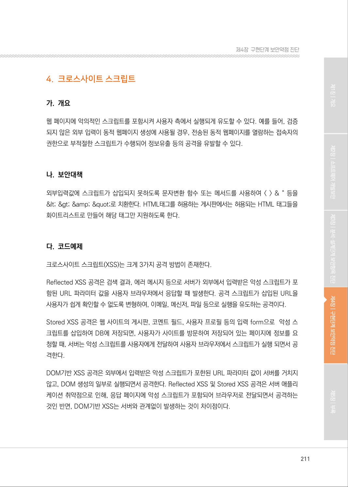

</details>

### PDF 212페이지 / 인쇄 212페이지

<!-- source-page:SW-Diagnosis-2021:212; source-lines:0,1,2,3,4,5,6,7,8,9,10,11,12,13,14,15,16,17,18,19,20,21,22,23,24,25,26,27 -->

212

#### 안전하지 않은 코드의 예 JAVA

```java
1: <% String keyword = request.getParameter("keyword"); %> 
2: //외부 입력값에 대하여 검증 없이 화면에 출력될 경우 공격스크립트가 포함된 URL을 생성 할 수 있어 
안전하지 않다.(Reflected XSS)
3: 검색어 : <%=keyword%>
```

#### 안전하지 않은 코드의 예 JAVA

```java
1: //게시판 등의 입력form으로 외부값이 DB에 저장되고, 이를 검증 없이 화면에 출력될 경우 
공격스크립트가 실행되어 안전하지 않다.(Stored XSS)
2: 검색결과 : ${m.content}
3: <script type=“text/javascript”>
4: //외부 입력값에 대하여 검증 없이 브라우저에서 실행되는 경우 서버를 거치지 않는 공격스크립트가 
포함된 URL을 생성 할 수 있어 안전하지 않다. (DOM 기반 XSS)
5: document.write(“keyword:” + <%=keyword%>);
6: </script>
```

외부 입력값 파라미터나 게시판 등의 form에 의해 서버의 처리 결과를 사용자 화면에 출력하는 경우, 
입력값에 대해서 문자열 치환 함수를 이용하여 스크립트 문자열을 제거하거나, JSTL을 이용하여 
출력하거나, 잘 만들어진 외부 XSS 방지 라이브러리를 활용하는 것이 안전하다. 

크로스사이트 스크립트의 경우 동작 상황에 따라 동일한 조치방법을 사용하면, 크로스사이트 스크립트 
방지는 되더라도 원하는 동작이 정상적으로 되지 않을 수 있기 때문에, 잘 만들어진 외부 XSS방지 
라이브러리를 이용하여 각 동작 상황에 따라 적절하게 사용하는 것을 권장한다.

#### 안전한 코드의 예 JAVA

```java
1: <% String keyword = request.getParameter("keyword"); %> 
2: // 방법1. 입력값에 대하여 스크립트 공격가능성이 있는 문자열을 치환한다.
3: keyword = keyword.replaceAll("&", "&amp;");
4: keyword = keyword.replaceAll("<", "&lt;");
5: keyword = keyword.replaceAll(">", "&gt;");
6: keyword = keyword.replaceAll("\"", "&quot;");
```

<details><summary>원본 페이지 이미지 (변환 외 보존 자료)</summary>

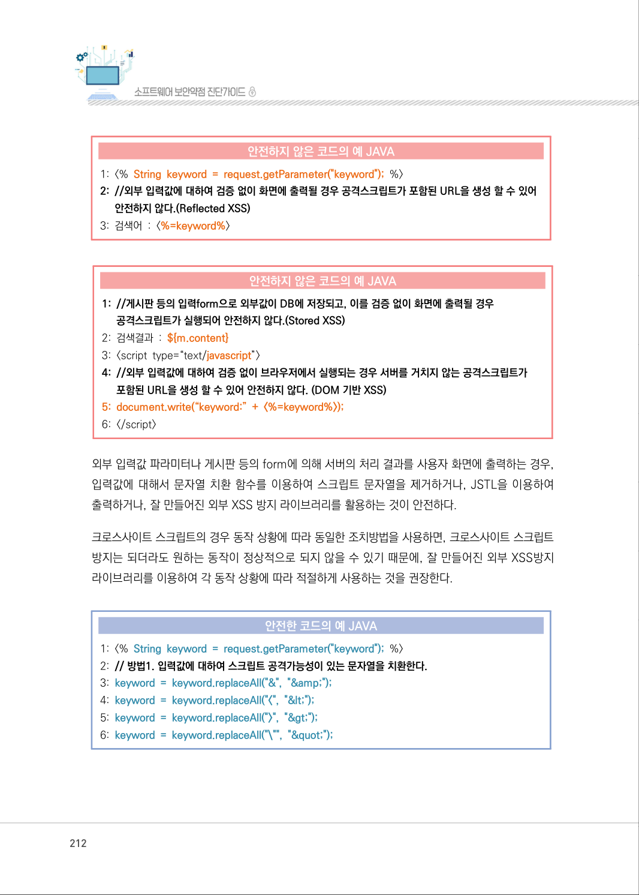

</details>

### PDF 213페이지 / 인쇄 213페이지

<!-- source-page:SW-Diagnosis-2021:213; source-lines:0,1,2,3,4,5,6,7,8,9,10,11,12,13,14,15,16,17,18,19,20,21,22,23,24,25,26,27,28 -->

213

제4장구현단계 보안약점 진단

#### 안전한 코드의 예 JAVA

```java
7: keyword = keyword.replaceAll("'", "&#x27;");
8: keyword = keyword.replaceAll("/"", "&#x2F;");
9: keyword = keyword.replaceAll("(", "&#x28;");
10:keyword = keyword.replaceAll(")", "&#x29;");
11:검색어 : <%=keyword%>
12://방법2. JSP에서 출력값에 JSTL c:out 을 사용하여 처리한다. 
13:<%@ taglib prefix="c" uri="http://java.sun.com/jsp/jstl/core"%>
14:<%@ taglib uri="http://java.sun.com/jsp/jstl/functions" prefix="fn" %>
15:검색결과 : <c:out value="${m.content}"/> 
16:<script type="text/javascript"> 
17: //방법3. 잘 만들어진 외부 라이브러리를 활용(NAVER Lucy-XSS-Filter, OWASP ESAPI, 
OWASP Java-Encoder-Project)
18:document.write("keyword:“ +
<%=Encoder.encodeForJS(Encoder.encodeForHTML(keyword))%>);
19: </script>
```

다음 C# 코드는 외부 입력값을 출력에 바로 사용하고 있다. 이는 XSS 공격을 유발 할 수 있다.

#### 안전하지 않은 코드의 예 C#

```csharp
1: string usrInput = Request.QueryString["ID"];
2: // 외부 입력 값이 검증 없이 화면에 출력 됩니다.
3: string str = "ID : " + usrinput;
4: Request.Write(str);
```

AntiXss 패키지 등을 사용하여 XSS 공격을 예방할 수 있다.

#### 안전한 코드의 예 C#

```csharp
1: string usrInput = Request.QueryString["ID"]; 
2: string str = "ID : " + usrinput; 
3: //AntiXss 패키지 등을 이용하여 외부 입력값을 필터링 합니다.
```

<details><summary>원본 페이지 이미지 (변환 외 보존 자료)</summary>

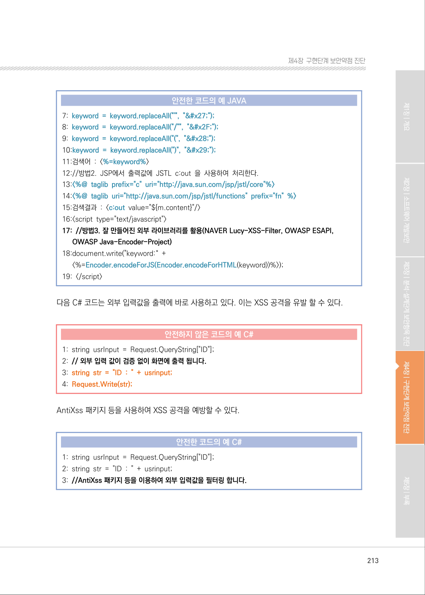

</details>

### PDF 214페이지 / 인쇄 214페이지

<!-- source-page:SW-Diagnosis-2021:214; source-lines:0,1,2,3,4,5,6,7,8,9,10,11,12,13,14,15,16,17,18,19,20,21,22,23,24,25,26,27,28,29,30,31 -->

214

#### 안전한 코드의 예 C#

```csharp
4: var sanitizedStr = Sanitizer.GetSafeHtmlFragment(str);
5: Request.Write(sanitizedStr);
```

아래 C 코드 예제는 외부 입력값으로 사용자로부터 받은 입력값을 검증 없이 바로 cgi에 출력하는 
화면이다.

#### 안전하지 않은 코드의 예 C

```c
1: int XSS(int argc, char* argv[]) { 
2:        unsigned int i = 0; 
3:        char data[1024]; 
4:        …
5:        // cgiFromString으로 받아온 사용자 입력값이 검증 없이 화면에 출력됩니다.
6:   cgiFromString(“user input”, data, sizeof(data));
7:   fprintf(cgiOut, “Print user input = %s<br/>”, data);
8:        fprintf(cgiOut, “</body></html>\n”);
9:        return 0;13:
10: }
```

cgi에 출력하기 전에 사용자 입력값을 검증하여야 한다.

#### 안전한 코드의 예 C

```c
1: cgiFromString(“user input”, data, sizeof(data)); 
2: // data에 위험한 문자열을 검사하는 코드를 추가한다. 
3: if(strchr(p, ‘<’)) return; 
4: if(strchr(p, ‘>’)) return; 
5: … 
6: fprintf(cgiOut, “Print user input = %s<br/>”, data); 
7: fprintf(cgiOut, “</body></html>\n”);
```

<details><summary>원본 페이지 이미지 (변환 외 보존 자료)</summary>

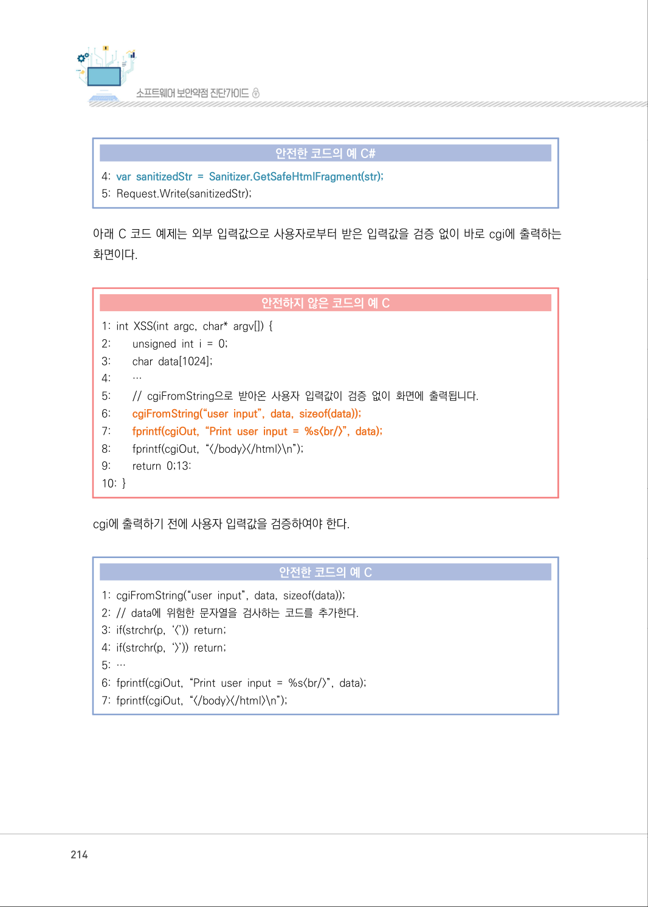

</details>

### PDF 215페이지 / 인쇄 215페이지

<!-- source-page:SW-Diagnosis-2021:215; source-lines:0,1,2,3,4,5,6,7,8,9,10,11,12,13,14,15,16,17,18,19,20,21,22,23,24,25,26,27,28,29,30,31,32,33,34,35,36,37,38,39 -->

215

제4장구현단계 보안약점 진단

#### 라. 진단방법

웹 페이지로 출력하는 변수값이 존재하는지 확인하고(①), 해당 변수값이 외부 입력값 또는 사용자 
입력 데이터 폼에 의해 저장된 데이터 베이스 값인지 확인한(②) 후 변수값이 적절하게 필터를 거치는지 
확인한다. 적절한 필터를 거친 후 출력되는 경우나 프레임워크 등을 사용하여 자체적인 검증 기능이 
존재하면 안전하지만 그 외에는 취약하다.

일반적인 진단의 예

```text
1:    <%@page contentType=”text/html” pageEncoding=”UTF-8”%> 
2:    <html> 
3:    <head> 
4:    <meta http-equiv=”Content-Type” content=”text/html; charset=UTF-8”>
5:    </head> 
6:    <body> 
7:    <h1>XSS Sample</h1> 
8:    <% 
9:    // 외부로부터 이름을 받음 
10: String name = request.getParameter(“name”); ·································································②
11: String title = null; 
12: … 
13: rs = pstmt.executeQuery(query); 
14: while(rs.next()){ 
15: title = rs.getString(“title”)) ······································································································②
16: …} 
17: %> 
18:
19: <!-- 외부로부터 받은 name이 적절한 필터없이 그대로 출력 -->
20: <p>NAME:<%=name%></p> ·····································································································①
21: <p>TITLE:<%=title%></p> ·········································································································①
22: </body>
23: </html>
```

<details><summary>원본 페이지 이미지 (변환 외 보존 자료)</summary>

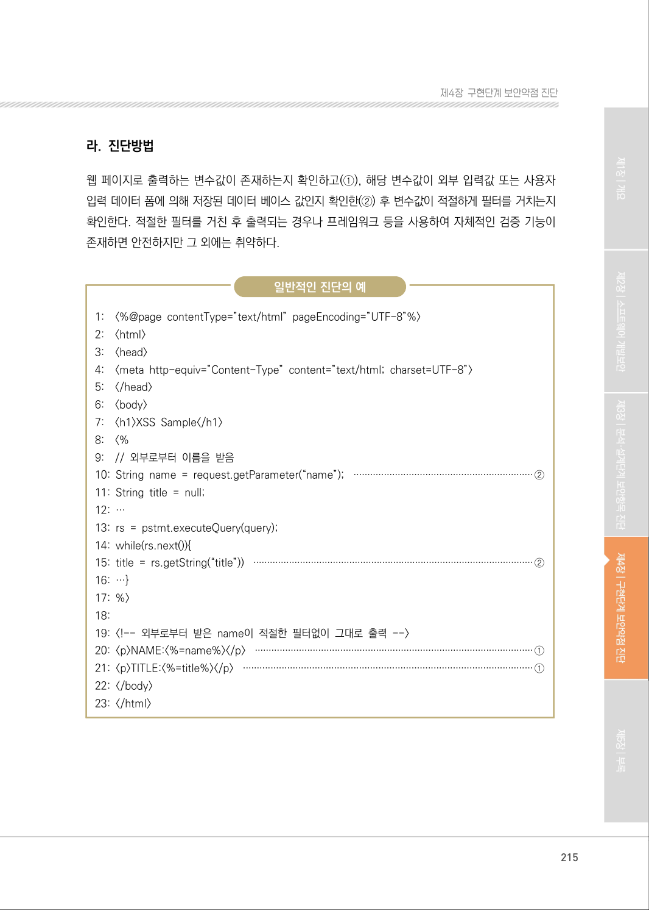

</details>

### PDF 216페이지 / 인쇄 216페이지

<!-- source-page:SW-Diagnosis-2021:216; source-lines:0,1,2,3,4,5,6,7,8,9,10,11,12,13,14,15,16,17,18,19,20,21,22,23,24,25,26,27,28,29,30,31,32,33,34,35,36 -->

216

[ 크로스사이트 스크립트 : Reflected ]
다음의 예제에서 @ModelAttribute(“apApsCommonCodeVO”) ApApsCommonCodeVO apAp 
sCommonCodeVO 어노테이션에 따라 apsApsCommonCodeVO는 외부 입력값이다. 20라인에서 
외부 입력값의 target값을 저장하고 26번째 라인에서 외부 입력값을 response의 output stream에 
출력하고 있다. 그 과정에서 입력값에 대한 필터링이 없으므로 취약한 것으로 판정한다.

정탐코드의 예

```text
16: @RequestMapping(“/aps/common/makeCommonCode.do”) 
17: public void makeCommonCode(HttpSession session,
@ModelAttribute(“apApsCom- monCodeVO”)
18: ApApsCommonCodeVO apApsCommonCodeVO, HttpServletRequest request, 
HttpServletResponse
19: response, ModelMap model) throws Exception {
20: String target = apApsCommonCodeVO.getTarget();
21: List resultList = apApsExcelService.selectCommonCode(apApsCommonCodeVO);
22: JSONArray jsonArray = new JSONArray();
23: jsonArray = JSONArray.fromObject(resultList);
24: response.setContentType(“text/xml;charset=utf-8”);
25: PrintWriter printWriter = response.getWriter();
26: printWriter.print(target);
27: printWriter.print(jsonArray.toString());
28: printWriter.flush();
29: printWriter.close();
30: }
```

다음의 예제에서는 2라인에서 외부 입력값으로 request.getQueryString()를 입력받아 6라인에서 
URL을 구성하여 출력하고 있어 취약하다.

정탐코드의 예

```text
1:    …
2:    <%@ taglib prefix=”c” url=”http://java.sun.com/jsp/jstl/core”%> 
3:    <%@ taglib uri=”http://java.sun.com/jsp/jstl/functions” prefix=”fn”%>
4:    …
5:    <c:out value=”${param.name}” escapeXml=”false” />
```

<details><summary>원본 페이지 이미지 (변환 외 보존 자료)</summary>

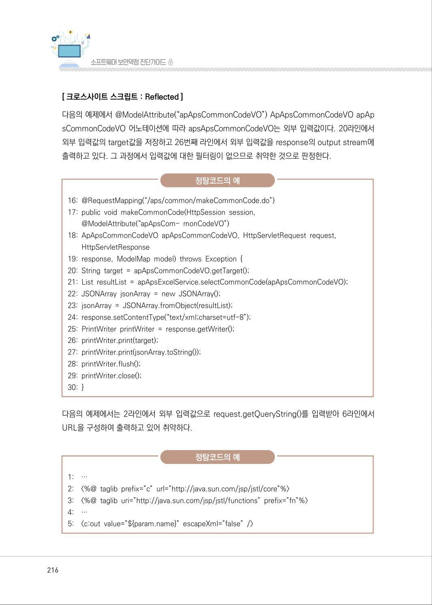

</details>

### PDF 217페이지 / 인쇄 217페이지

<!-- source-page:SW-Diagnosis-2021:217; source-lines:0,1,2,3,4,5,6,7,8,9,10,11,12,13,14,15,16,17,18,19,20,21,22,23,24,25,26,27,28,29,30,31,32,33,34,35,36,37,38,39,40,41,42,43,44,45,46,47,48 -->

217

제4장구현단계 보안약점 진단

다음의 예제에서는 JSTL의 &lt;c:out&gt;을 이용하여 외부 값을 출력할 때 escapeXml값을 false로 설정
하였기 때문에 스크립트가 실행될 수 있어 취약한 것으로 판정한다.

정탐코드의 예

```text
1:    <%
2:    String param = request.getParameter(“param”); 
3:    if ( param != null ) { 
4:           param = param.replaceAll(“<script>”,””); 
5:           param = param.replaceAll(“</script>”,””); 
6:    }
7:    %>
8:    …
9:    <p> 제목 : <%=title%> </p>
```

다음의 예제에서는 필터링을 사용하였으나 &lt;script&gt; 문장을 공백으로 치환하였기 때문에 &lt;sc&lt;script&gt;ript&gt; 
등으로 공격할 경우 스크립트가 실행되어 취약한 것으로 판정한다.

정탐코드의 예

```text
1:    <%
2:      String query = request.getQueryString(); 
3:      String nextUrl = request.getRequestURL().toString() + query; 
4:    %>
5:    ….
6:    <input type=”hidden” name=”nextUrl” value= “<%=nextUrl%>” />
```

다음의 예제에서는 외부 입력값이 html 주석으로 되어있어 수행되지 않으나, 공격시 주석을 닫는 
부분과 함께 공격 스크립트를 삽입(--&gt;&lt;script&gt;…&lt;/script&gt;)하면 취약하다.

정탐코드의 예

```text
1:    <%
2:    String param = request.getParameter(“param”);
3:    %>
4:    <!-- <%=param%> -->
```

<details><summary>원본 페이지 이미지 (변환 외 보존 자료)</summary>

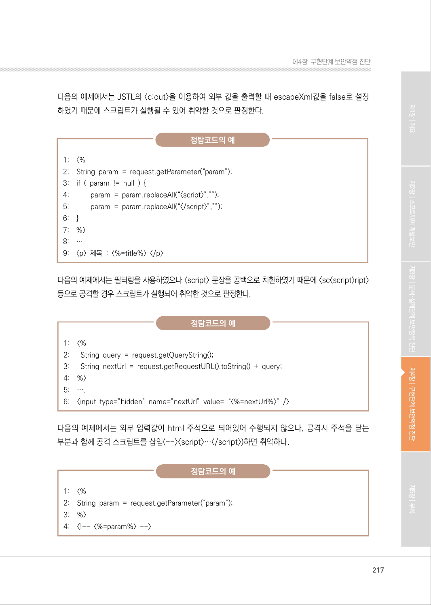

</details>

### PDF 218페이지 / 인쇄 218페이지

<!-- source-page:SW-Diagnosis-2021:218; source-lines:0,1,2,3,4,5,6,7,8,9,10,11,12,13,14,15,16,17,18,19,20,21,22,23,24,25,26,27,28,29,30,31,32,33 -->

218

다음의 예제에서는 외부 입력값에 스크립트 공격을 시도하더라도, 해당 스크립트 공격이 URL로 포함 
되어 이동하기 때문에, 공격이 수행되지 않아 안전한 것으로 판정한다.

오탐코드의 예

1:

1: &lt;%=respose.sendRedirect(requst.getParameter(“url”))%&gt;

다음의 예제에서는 외부 입력값에 스크립트 공격을 시도하더라도, 해당 스크립트 공격이 URL로 포함 
되어 이동하기 때문에, 공격이 수행되지 않아 안전한 것으로 판정한다. 

오탐코드의 예

```text
1:    <script language=”javascript”>
2:    location.href(‘<%=request.getParameter(“url”)%>’);
```

다음의 예제에서와 같이 JSTL의 &lt;c:out&gt;을 이용하여 외부 값을 출력할 때는 안전한 것으로 판정한다.

오탐코드의 예

```text
1:    <%@ taglib prefix=”c” url=”http://java.sun.com/jsp/jstl/core”%> 
2:    <%@ taglib uri=”http://java.sun.com/jsp/jstl/functions” prefix=”fn”%> 
3:    …
4:    <c:out value=”${param.name}”/>
```

다음의 예제에서와 같이 JSTL의 escapeXml을 이용하여 외부 값을 출력할 때는 안전한 것으로 판정
한다.

오탐코드의 예

```text
1:    <%@ taglib prefix=”c” url=”http://java.sun.com/jsp/jstl/core”%> 
2:    <%@ taglib uri=”http://java.sun.com/jsp/jstl/functions” prefix=”fn”%> 
3:    …
4:    ${fn:escapeXml(param.name)}
```

<details><summary>원본 페이지 이미지 (변환 외 보존 자료)</summary>

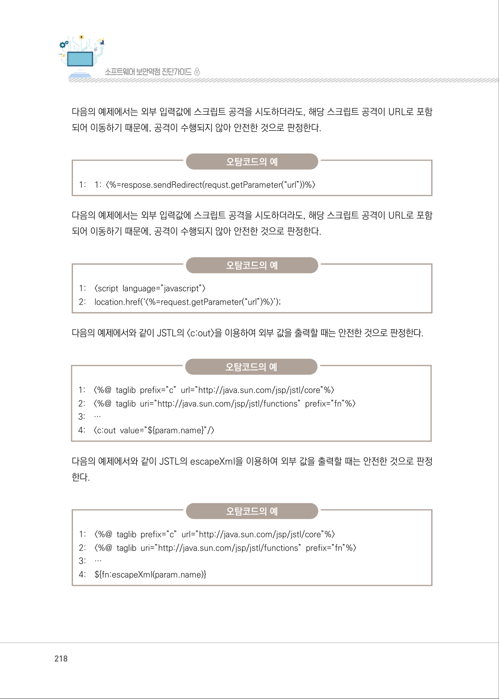

</details>

### PDF 219페이지 / 인쇄 219페이지

<!-- source-page:SW-Diagnosis-2021:219; source-lines:0,1,2,3,4,5,6,7,8,9,10,11,12,13,14,15,16,17,18,19,20,21,22,23,24,25,26,27,28,29,30,31,32,33,34,35,36,37,38,39,40,41,42 -->

219

제4장구현단계 보안약점 진단

다음의 예제와 같이 출력값이 문자형이 아닌 경우에는 안전한 것으로 판정한다.

오탐코드의 예

```text
1:    Int pageNm = Integer.parseInt(request.getParameter(“pageNm”); 
2:    <input type=text size=10 name=”pageNm” value=’<%=pageNm%>’ /> 
```

다음의 예제와 같이 subString을 이용하여 글자 수가 짧은 글자 수 이하로 제한된 경우에는 안전한 
것으로 판정한다.

오탐코드의 예

```text
1:    <%
2:    // 외부로 부터 입력을 받는다. 
3:    String date = request.getParameter(“date”); 
4:    String year = date.substring(0, 4); 
5:    String month = date.substring(4, 6); 
6:    String day = date.substring(6, 8); 
7:    out.println(year + “년” + month + “월” + day + “일” ); 
8:    %>
```

다음의 예제와 같이 출력값이 프로그램 내부에서 정해진 경우에는 안전한 것으로 판정한다.

오탐코드의 예

```text
1:    g1 = new WKTReader().read(geometryParam);
2:    p1 = (Polygon) g1.buffer(Double.parseDouble(bufferSizeParam));
3:    response.setContentType(“text/plain;charset=EUC-KR”);
4:    response.setHeader(“Cache-Control”, “no-cache”);
5:    response.getWriter().write(p1.toText());
```

다음의 예제와 같이 웹페이지가 아닌 System 콘솔에 출력하는 경우에는 안전한 것으로 판정한다.

오탐코드의 예

1:

//파라메터 설정

<details><summary>원본 페이지 이미지 (변환 외 보존 자료)</summary>

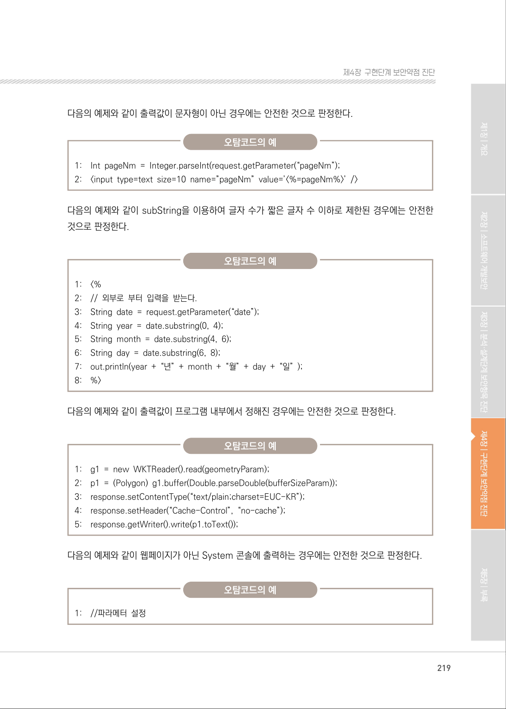

</details>

### PDF 220페이지 / 인쇄 220페이지

<!-- source-page:SW-Diagnosis-2021:220; source-lines:0,1,2,3,4,5,6,7,8,9,10,11,12,13,14,15,16,17,18,19,20,21,22,23,24,25,26,27,28,29,30,31,32,33,34,35,36,37,38,39,40,41,42,43,44,45,46,47,48 -->

220

오탐코드의 예

```text
2:    String exam_tgt_se = request.getParameter(“exam_tgt_se”); 
3:    String mw_take_no = request.getParameter(“mw_take_no”); 
4:    String apv_perm_reg_mgt_no = request.getParameter(“apv_perm_reg_mgt_no”);
5:    String mw_afr_no = request.getParameter(“mw_afr_no”); 
6:
7:    System.out.println(“exam_tgt_se : “ + exam_tgt_se); 
8:    System.out.println(“mw_take_no : “ + mw_take_no); 
9:    System.out.println(“apv_perm_reg_mgt_no : “ + apv_perm_reg_mgt_no);
```

다음의 예제와 같이 사용자 입력값이 아닌 경우에는 안전한 것으로 판정한다.

오탐코드의 예

```text
1:    var CompPath = “%XPLATFORM%\\” + sKey + “\\component”;
2:    //XLauncher.componentpath = CompPath; 
3:    XLauncher.onlyone = “false”; 
4:    var iconStr = “<%= request.getRequestURL() %>”;
```

[ 크로스사이트 스크립트 : Stored ]
다음의 예제와 같이 게시판 제목, 내용 또는 사용자 정보와 같이 입력 폼에 의해 데이터베이스에 저장 된 
데이터가 웹페이지에 출력될 경우 취약하며, 메뉴 이름 등과 같이 사용자 입력으로 수정되지 않는 
데이터베이스에 저장된 값이 출력될 경우 취약하지 않는다고 판정한다. 데이터베이스가 할당된 변수가 
사용자 입력으로 수정되는 변수 여부 판단은 정적도구를 사용하여 판단하기 어렵다.

오탐코드의 예

```text
1:    <%
2:    …
3:    rs = pstmt.executeQuery(query);
4:    while(rs.next()){ 
5:    board_contents = rs.getString(“board_contents”))
6:    … }
7:    %>
8:    …
```

<details><summary>원본 페이지 이미지 (변환 외 보존 자료)</summary>

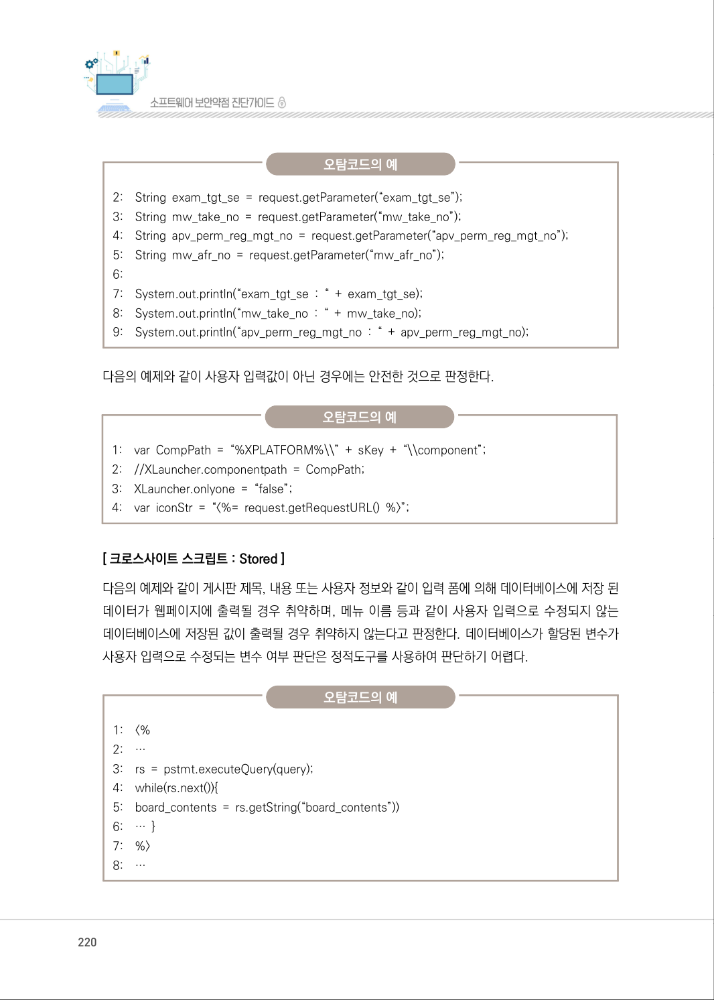

</details>

### PDF 221페이지 / 인쇄 221페이지

<!-- source-page:SW-Diagnosis-2021:221; source-lines:0,1,2,3,4,5,6,7,8,9,10,11,12,13,14,15,16,17,18,19,20,21,22,23,24,25,26,27,28,29,30,31,32,33,34,35,36,37 -->

221

제4장구현단계 보안약점 진단

오탐코드의 예

9:

&lt;p&gt; 제목 : &lt;%=board_contents%&gt; &lt;/p&gt; 

[ 크로스사이트 스크립트 : DOM ]
다음의 예제에서는 request.getParameter()에서 전달된 외부의 입력(name)이 document.write()의 
인자 값 생성에 그대로 사용되어 취약한 것으로 판정한다.

정탐코드의 예

```text
1: …
2: <% 
3: // 외부로 부터 입력을 받는다. 
4: String name = request.getParameter(“name”);
5: %>
6: <SCRIPT language=”javascript”> 
7: // 외부의 입력을 그대로 출력한다. 
8: document.write(“name:” + <%=name%> );
```

다음의 예제에서는 request.getParameter()에서 전달된 외부의 입력(name)이 필터링되고 있으나 
;) alert(documement.cookie);&lt;%--를 파라미터에 입력할 경우 악성 스크립트가 실행된다. 크로스
사이트 스크립트 : DOM을 방지하기 위해 ;, %, - 등도 필터링 문자에 추가한다.

정탐코드의 예

```text
1:    …
2:    <% 
3:    String name = request.getParameter(“name”); 
4: name = name.replaceAll(“<”,”&lt;”); 
5: name = name.replaceAll(“>”,”&gt;”); 
6:      name = name.replaceAll(“&”,”&amp;”); 
7:    name = name.replaceAll(“””,”&quot;”); 
8: name = name.replaceAll(“’”, 
“&#x27;”); 9: name = name.replaceAll(“/”,
“&#x2F;”); 10: %> 
```

```text
11: <SCRIPT language=”javascript”> 
12: document.write(“name:” + <%=name%> );
```

<details><summary>원본 페이지 이미지 (변환 외 보존 자료)</summary>

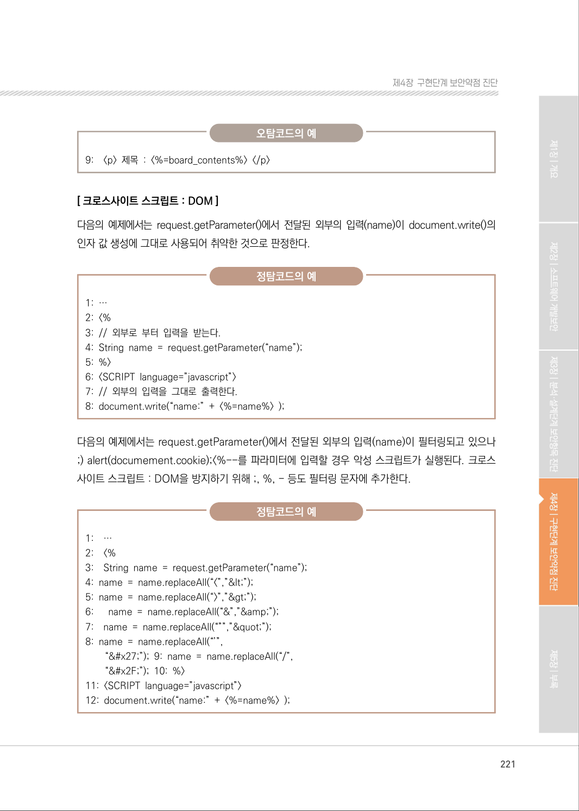

</details>

### PDF 222페이지 / 인쇄 222페이지

<!-- source-page:SW-Diagnosis-2021:222; source-lines:0,1,2,3,4,5,6,7,8,9,10,11,12,13,14 -->

222

#### 마. 참고자료

[1] CWE-79 Improper Neutralization of Input During Web Page Generation ('Cross-site 

Scripting'), MITRE,
http://cwe.mitre.org/data/definitions/79.html
[2] Properly encode or escape output, CERT,

http://www.securecoding.cert.org/confluence/display/java/IDS51-J.+Properly+
encode+or+escape+output
[3] XSS (Cross Site Scripting) Prevention Cheat Sheet, OWASP,

http://www.owasp.org/index.php/XSS_(Cross_Site_Scripting)_Prevention_Cheat
_Sheet
[4] DOM based XSS Prevention Cheat Sheet, OWASP,

https://www.owasp.org/index.php/DOM_based_XSS_Prevention_Cheat_Sheet
[5] “Understanding Malicious Content Mitigation for Web Developers”

http://www.cert.org/tech_tips/malicious_code_mitigation.html

<details><summary>원본 페이지 이미지 (변환 외 보존 자료)</summary>

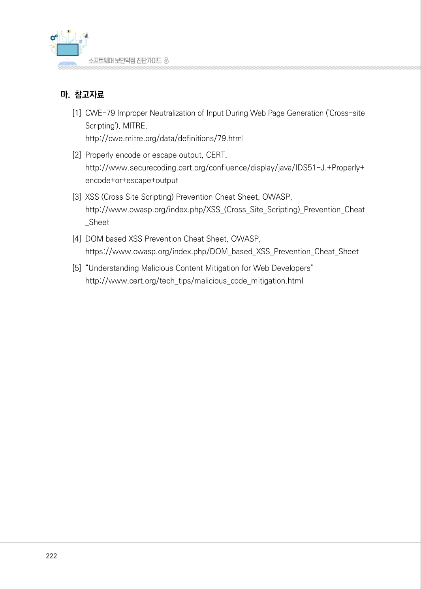

</details>

### PDF 223페이지 / 인쇄 223페이지

<!-- source-page:SW-Diagnosis-2021:223; source-lines:1 -->

제4장구현단계 보안약점 진단

<details><summary>원본 페이지 이미지 (변환 외 보존 자료)</summary>

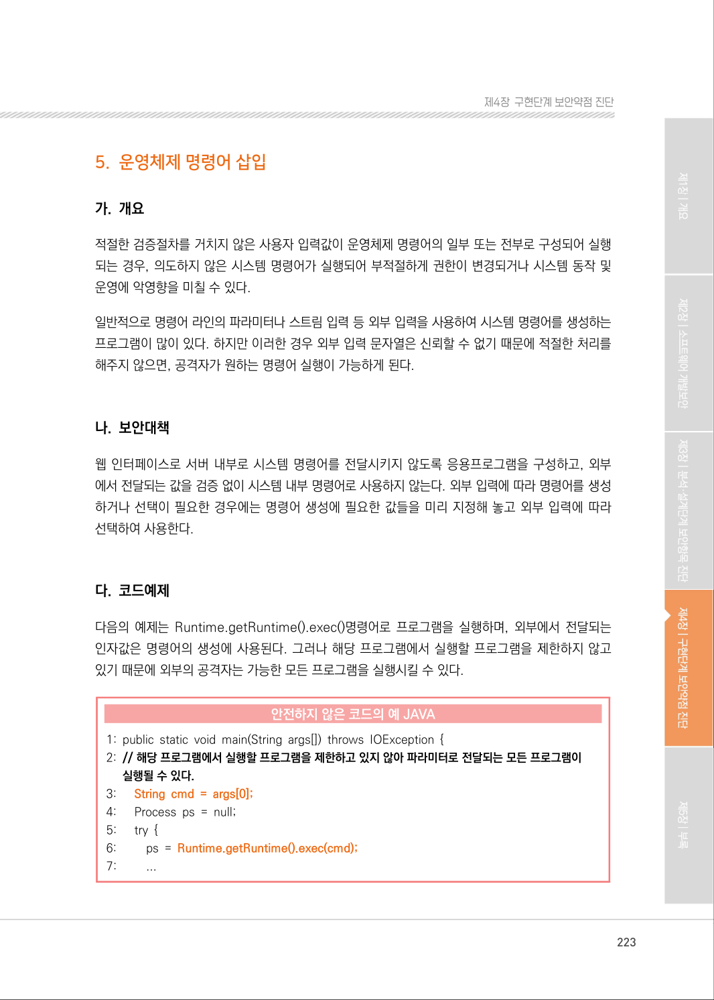

</details>

---

## 탐색 링크 (원문 외)

[통합 인덱스](../../../INDEX.md)

