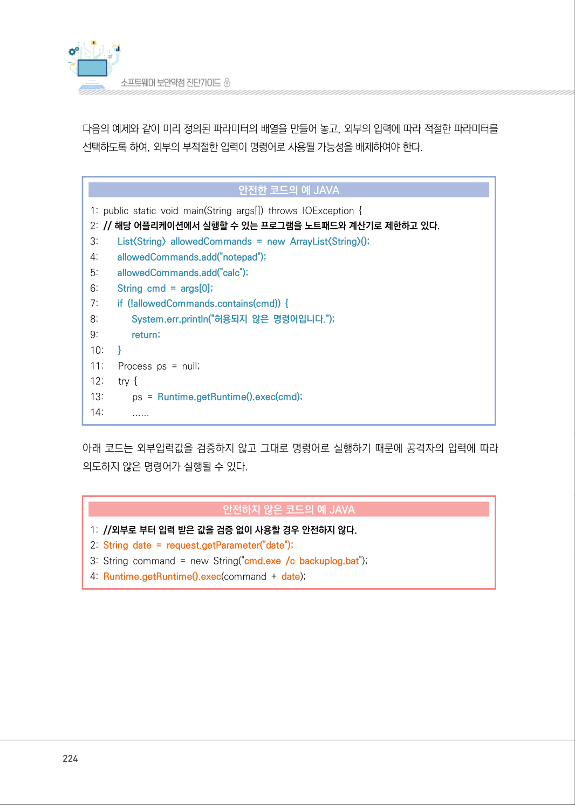
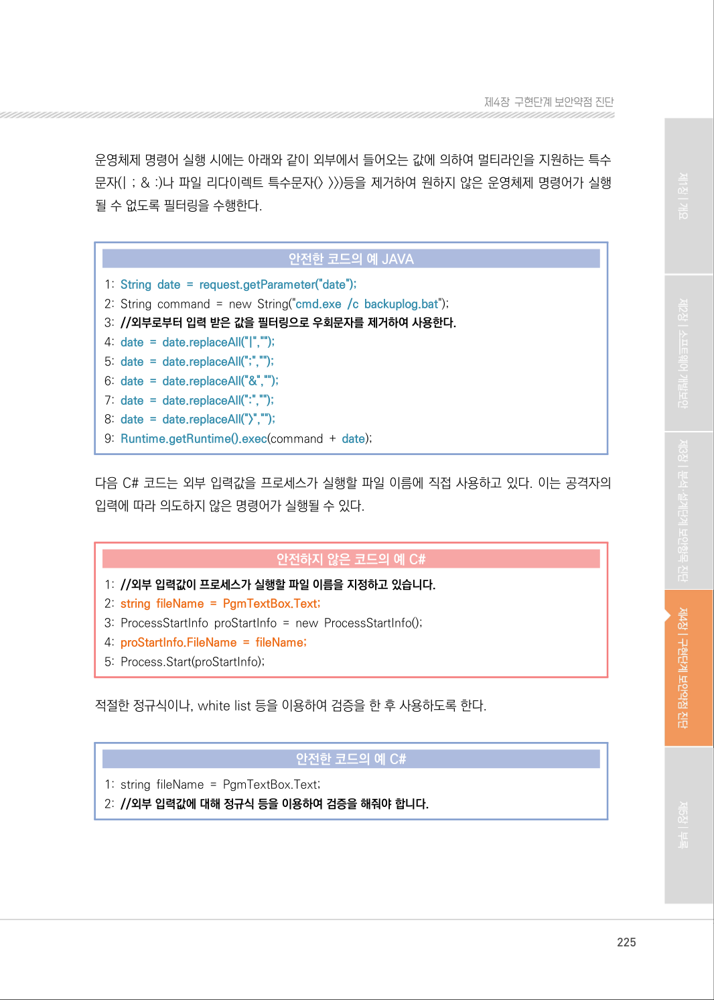
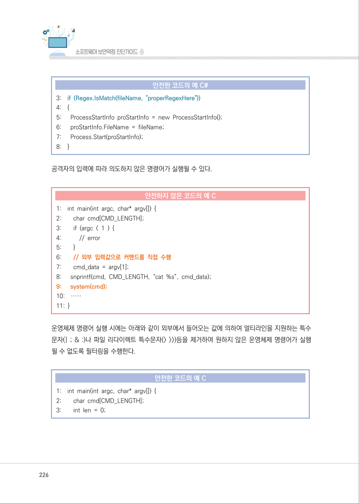
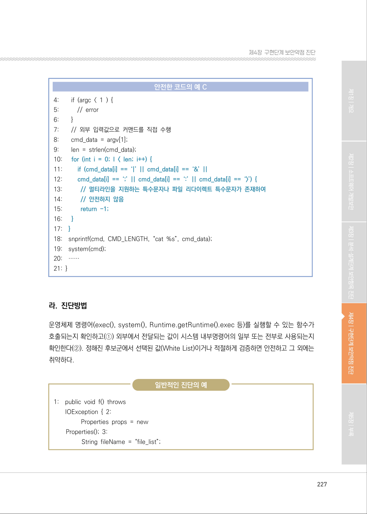
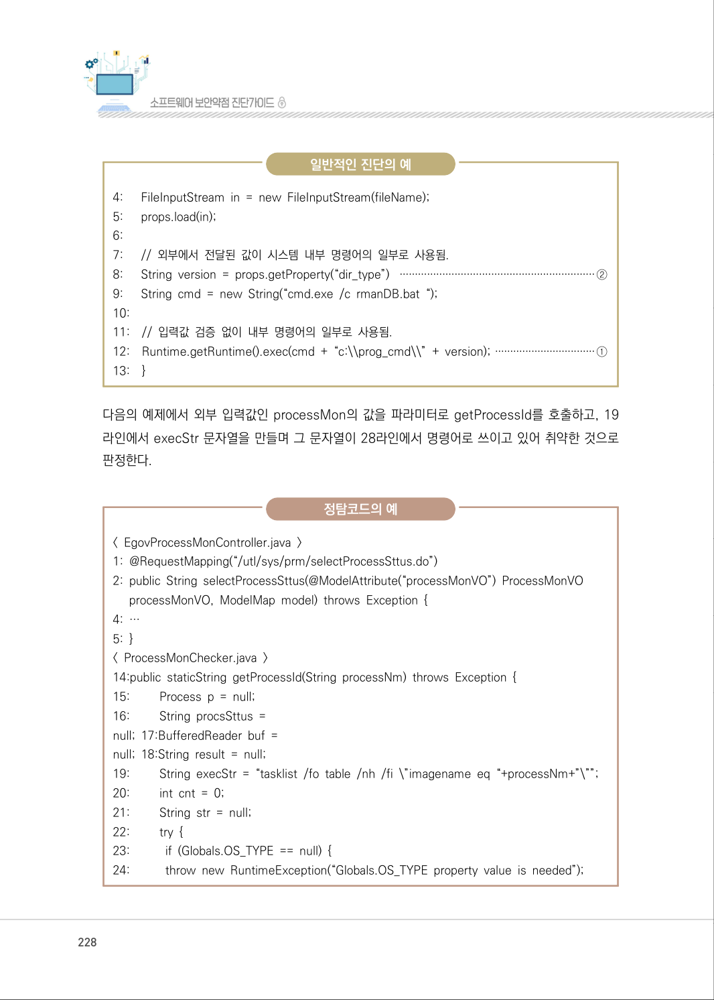
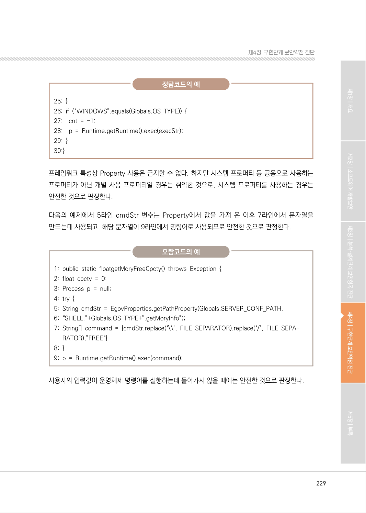
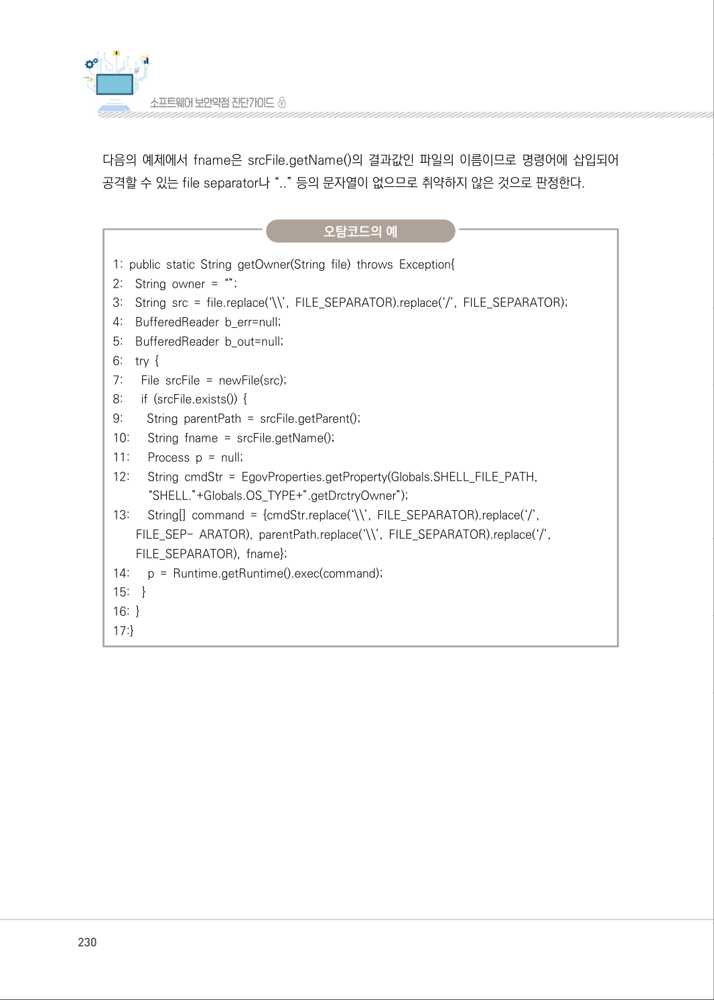
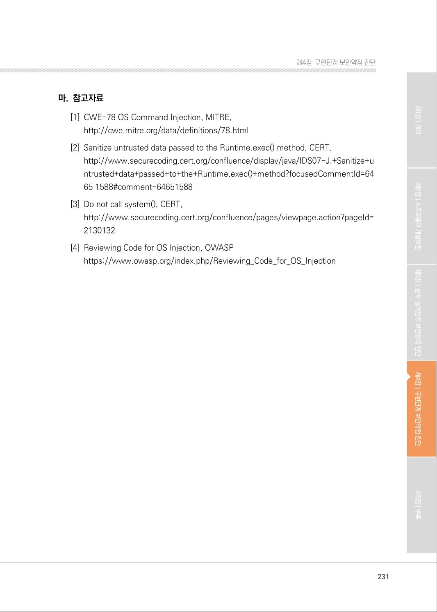

# 5. 운영체제 명령어 삽입

> 변환 안내(원문 외): 아래 본문은 PDF 텍스트를 추출한 전사입니다. 코드 줄번호·특수 공백·원문 오류를 유지했습니다. 실행용 코드가 아닙니다. 표·그림·들여쓰기는 연결된 페이지 이미지와 대조하세요. 페이지 경계의 줄바꿈을 보존하며, 동일 페이지가 여러 항목에 나뉘면 각 항목의 본문은 해당 구간만 포함합니다.

### PDF 223페이지 / 인쇄 223페이지

<!-- source-page:SW-Diagnosis-2021:223; source-lines:0,2,3,4,5,6,7,8,9,10,11,12,13,14,15,16,17,18,19,20,21,22,23,24,25,26,27,28,29,30,31,32 -->

223

#### 5. 운영체제 명령어 삽입

#### 가. 개요

적절한 검증절차를 거치지 않은 사용자 입력값이 운영체제 명령어의 일부 또는 전부로 구성되어 실행
되는 경우, 의도하지 않은 시스템 명령어가 실행되어 부적절하게 권한이 변경되거나 시스템 동작 및 
운영에 악영향을 미칠 수 있다.

일반적으로 명령어 라인의 파라미터나 스트림 입력 등 외부 입력을 사용하여 시스템 명령어를 생성하는 
프로그램이 많이 있다. 하지만 이러한 경우 외부 입력 문자열은 신뢰할 수 없기 때문에 적절한 처리를 
해주지 않으면, 공격자가 원하는 명령어 실행이 가능하게 된다.

#### 나. 보안대책

웹 인터페이스로 서버 내부로 시스템 명령어를 전달시키지 않도록 응용프로그램을 구성하고, 외부
에서 전달되는 값을 검증 없이 시스템 내부 명령어로 사용하지 않는다. 외부 입력에 따라 명령어를 생성
하거나 선택이 필요한 경우에는 명령어 생성에 필요한 값들을 미리 지정해 놓고 외부 입력에 따라 
선택하여 사용한다.

#### 다. 코드예제

다음의 예제는 Runtime.getRuntime().exec()명령어로 프로그램을 실행하며, 외부에서 전달되는 
인자값은 명령어의 생성에 사용된다. 그러나 해당 프로그램에서 실행할 프로그램을 제한하지 않고 
있기 때문에 외부의 공격자는 가능한 모든 프로그램을 실행시킬 수 있다.

#### 안전하지 않은 코드의 예 JAVA

```java
1: public static void main(String args[]) throws IOException { 
2: // 해당 프로그램에서 실행할 프로그램을 제한하고 있지 않아 파라미터로 전달되는 모든 프로그램이 
실행될 수 있다. 
3:      String cmd = args[0];
4:      Process ps = null; 
5:      try { 
6:         ps = Runtime.getRuntime().exec(cmd);
7:         ...
```

<details><summary>원본 페이지 이미지 (변환 외 보존 자료)</summary>


</details>

### PDF 224페이지 / 인쇄 224페이지

<!-- source-page:SW-Diagnosis-2021:224; source-lines:0,1,2,3,4,5,6,7,8,9,10,11,12,13,14,15,16,17,18,19,20,21,22,23,24,25,26,27,28,29,30,31,32,33,34,35,36 -->

224

다음의 예제와 같이 미리 정의된 파라미터의 배열을 만들어 놓고, 외부의 입력에 따라 적절한 파라미터를 
선택하도록 하여, 외부의 부적절한 입력이 명령어로 사용될 가능성을 배제하여야 한다.

#### 안전한 코드의 예 JAVA

```java
1: public static void main(String args[]) throws IOException { 
2: // 해당 어플리케이션에서 실행할 수 있는 프로그램을 노트패드와 계산기로 제한하고 있다.
3:        List<String> allowedCommands = new ArrayList<String>();
4:        allowedCommands.add("notepad");
5:        allowedCommands.add("calc");
6:        String cmd = args[0];
7:        if (!allowedCommands.contains(cmd)) {
8:             System.err.println("허용되지 않은 명령어입니다.");
9:             return;
10:      }
11:      Process ps = null;
12:      try {
13:           ps = Runtime.getRuntime().exec(cmd);
14:           ......
```

아래 코드는 외부입력값을 검증하지 않고 그대로 명령어로 실행하기 때문에 공격자의 입력에 따라 
의도하지 않은 명령어가 실행될 수 있다.

#### 안전하지 않은 코드의 예 JAVA

```java
1: //외부로 부터 입력 받은 값을 검증 없이 사용할 경우 안전하지 않다.
2: String date = request.getParameter("date");
3: String command = new String("cmd.exe /c backuplog.bat"); 
4: Runtime.getRuntime().exec(command + date);
```

<details><summary>원본 페이지 이미지 (변환 외 보존 자료)</summary>



</details>

### PDF 225페이지 / 인쇄 225페이지

<!-- source-page:SW-Diagnosis-2021:225; source-lines:0,1,2,3,4,5,6,7,8,9,10,11,12,13,14,15,16,17,18,19,20,21,22,23,24,25,26 -->

225

제4장구현단계 보안약점 진단

운영체제 명령어 실행 시에는 아래와 같이 외부에서 들어오는 값에 의하여 멀티라인을 지원하는 특수 
문자(| ; &amp; :)나 파일 리다이렉트 특수문자(&gt; &gt;&gt;)등을 제거하여 원하지 않은 운영체제 명령어가 실행 
될 수 없도록 필터링을 수행한다.

#### 안전한 코드의 예 JAVA

```java
1: String date = request.getParameter("date");
2: String command = new String("cmd.exe /c backuplog.bat");
3: //외부로부터 입력 받은 값을 필터링으로 우회문자를 제거하여 사용한다.
4: date = date.replaceAll("|","");
5: date = date.replaceAll(";","");
6: date = date.replaceAll("&","");
7: date = date.replaceAll(":","");
8: date = date.replaceAll(">","");
9: Runtime.getRuntime().exec(command + date);
```

다음 C# 코드는 외부 입력값을 프로세스가 실행할 파일 이름에 직접 사용하고 있다. 이는 공격자의 
입력에 따라 의도하지 않은 명령어가 실행될 수 있다.

#### 안전하지 않은 코드의 예 C#

```csharp
1: //외부 입력값이 프로세스가 실행할 파일 이름을 지정하고 있습니다.
2: string fileName = PgmTextBox.Text;
3: ProcessStartInfo proStartInfo = new ProcessStartInfo();
4: proStartInfo.FileName = fileName;
5: Process.Start(proStartInfo); 
```

적절한 정규식이나, white list 등을 이용하여 검증을 한 후 사용하도록 한다.

#### 안전한 코드의 예 C#

```csharp
1: string fileName = PgmTextBox.Text;
2: //외부 입력값에 대해 정규식 등을 이용하여 검증을 해줘야 합니다.
```

<details><summary>원본 페이지 이미지 (변환 외 보존 자료)</summary>



</details>

### PDF 226페이지 / 인쇄 226페이지

<!-- source-page:SW-Diagnosis-2021:226; source-lines:0,1,2,3,4,5,6,7,8,9,10,11,12,13,14,15,16,17,18,19,20,21,22,23,24,25,26,27,28,29,30,31,32,33,34,35,36,37,38,39,40,41,42,43,44,45,46 -->

226

#### 안전한 코드의 예 C#

```csharp
3:    if (Regex.IsMatch(fileName, "properRegexHere"))
4:    {
5:      ProcessStartInfo proStartInfo = new ProcessStartInfo(); 
6:      proStartInfo.FileName = fileName;
7:      Process.Start(proStartInfo);
8:    }
```

공격자의 입력에 따라 의도하지 않은 명령어가 실행될 수 있다.

#### 안전하지 않은 코드의 예 C

```c
1:    int main(int argc, char* argv[]) { 
2:        char cmd[CMD_LENGTH]; 
3:        if (argc < 1 ) { 
4:           // error 
5:        }
6:        // 외부 입력값으로 커맨드를 직접 수행 
7:        cmd_data = argv[1];
8:      snprintf(cmd, CMD_LENGTH, “cat %s”, cmd_data); 
9:      system(cmd);
10:    ……
11: }
```

운영체제 명령어 실행 시에는 아래와 같이 외부에서 들어오는 값에 의하여 멀티라인을 지원하는 특수 
문자(| ; &amp; :)나 파일 리다이렉트 특수문자(&gt; &gt;&gt;)등을 제거하여 원하지 않은 운영체제 명령어가 실행 
될 수 없도록 필터링을 수행한다.

#### 안전한 코드의 예 C

```c
1:    int main(int argc, char* argv[]) { 
2:        char cmd[CMD_LENGTH]; 
3:        int len = 0;
```

<details><summary>원본 페이지 이미지 (변환 외 보존 자료)</summary>



</details>

### PDF 227페이지 / 인쇄 227페이지

<!-- source-page:SW-Diagnosis-2021:227; source-lines:0,1,2,3,4,5,6,7,8,9,10,11,12,13,14,15,16,17,18,19,20,21,22,23,24,25,26,27,28,29,30,31,32,33,34,35,36,37,38,39,40,41,42,43,44,45,46,47,48,49 -->

227

제4장구현단계 보안약점 진단

#### 안전한 코드의 예 C

```c
4:        if (argc < 1 ) {
5:           // error
6:        }
7:        // 외부 입력값으로 커맨드를 직접 수행 
8:        cmd_data = argv[1]; 
9:        len = strlen(cmd_data); 
10:      for (int i = 0; I < len; i++) {
11:         if (cmd_data[i] == ‘|’ || cmd_data[i] == ‘&’ ||
12:         cmd_data[i] == ‘;’ || cmd_data[i] == ‘:’ || cmd_data[i] == ‘>’) { 
13:           // 멀티라인을 지원하는 특수문자나 파일 리다이렉트 특수문자가 존재하여
14:           // 안전하지 않음
15:           return -1;
16:      }
17:    }
18:    snprintf(cmd, CMD_LENGTH, “cat %s”, cmd_data); 
19:    system(cmd);
20:    ……
21: }
```

#### 라. 진단방법

운영체제 명령어(exec(), system(), Runtime.getRuntime().exec 등)를 실행할 수 있는 함수가 
호출되는지 확인하고(①) 외부에서 전달되는 값이 시스템 내부명령어의 일부 또는 전부로 사용되는지 
확인한다(②). 정해진 후보군에서 선택된 값(White List)이거나 적절하게 검증하면 안전하고 그 외에는 
취약하다.

일반적인 진단의 예

1:

public void f() throws
IOException { 2:

Properties props = new
Properties(); 3:

String fileName = “file_list”;

<details><summary>원본 페이지 이미지 (변환 외 보존 자료)</summary>



</details>

### PDF 228페이지 / 인쇄 228페이지

<!-- source-page:SW-Diagnosis-2021:228; source-lines:0,1,2,3,4,5,6,7,8,9,10,11,12,13,14,15,16,17,18,19,20,21,22,23,24,25,26,27,28,29,30,31,32,33,34,35,36,37,38,39,40,41,42,43,44,45,46,47,48,49 -->

228

일반적인 진단의 예

```text
4:      FileInputStream in = new FileInputStream(fileName); 
5:      props.load(in);
6:
7:      // 외부에서 전달된 값이 시스템 내부 명령어의 일부로 사용됨. 
8:      String version = props.getProperty(“dir_type”) ································································②
9:      String cmd = new String(“cmd.exe /c rmanDB.bat “);
10: 
11:    // 입력값 검증 없이 내부 명령어의 일부로 사용됨. 
12:    Runtime.getRuntime().exec(cmd + “c:\\prog_cmd\\” + version); ·································①
13:    }
```

다음의 예제에서 외부 입력값인 processMon의 값을 파라미터로 getProcessId를 호출하고, 19 
라인에서 execStr 문자열을 만들며 그 문자열이 28라인에서 명령어로 쓰이고 있어 취약한 것으로 
판정한다.

정탐코드의 예

&lt; EgovProcessMonController.java &gt; 

```text
1: @RequestMapping(“/utl/sys/prm/selectProcessSttus.do”) 
2: public String selectProcessSttus(@ModelAttribute(“processMonVO”) ProcessMonVO 
processMonVO, ModelMap model) throws Exception { 
4: …
5: }
< ProcessMonChecker.java >
14:public staticString getProcessId(String processNm) throws Exception {
15:         Process p = null; 
16:         String procsSttus = 
null; 17:BufferedReader buf =
null; 18:String result = null;
```

```text
19:         String execStr = “tasklist /fo table /nh /fi \”imagename eq “+processNm+”\””;
20:         int cnt = 0;
21:         String str = null;
22:         try {
23:           if (Globals.OS_TYPE == null) {
24:           throw new RuntimeException(“Globals.OS_TYPE property value is needed”);
```

<details><summary>원본 페이지 이미지 (변환 외 보존 자료)</summary>



</details>

### PDF 229페이지 / 인쇄 229페이지

<!-- source-page:SW-Diagnosis-2021:229; source-lines:0,1,2,3,4,5,6,7,8,9,10,11,12,13,14,15,16,17,18,19,20,21,22,23,24,25,26,27 -->

229

제4장구현단계 보안약점 진단

정탐코드의 예

```text
25: }
26: if (“WINDOWS”.equals(Globals.OS_TYPE)) { 
27:    cnt = -1; 
28:    p = Runtime.getRuntime().exec(execStr); 
29: }
30:}
```

프레임워크 특성상 Property 사용은 금지할 수 없다. 하지만 시스템 프로퍼티 등 공용으로 사용하는 
프로퍼티가 아닌 개별 사용 프로퍼티일 경우는 취약한 것으로, 시스템 프로퍼티를 사용하는 경우는 
안전한 것으로 판정한다.

다음의 예제에서 5라인 cmdStr 변수는 Property에서 값을 가져 온 이후 7라인에서 문자열을 
만드는데 사용되고, 해당 문자열이 9라인에서 명령어로 사용되므로 안전한 것으로 판정한다.

오탐코드의 예

```text
1: public static floatgetMoryFreeCpcty() throws Exception {
2: float cpcty = 0; 
3: Process p = null; 
4: try { 
5: String cmdStr = EgovProperties.getPathProperty(Globals.SERVER_CONF_PATH,
6: “SHELL.”+Globals.OS_TYPE+”.getMoryInfo”); 
7: String[] command = {cmdStr.replace(‘\\’, FILE_SEPARATOR).replace(‘/’, FILE_SEPA- 
RATOR),”FREE“} 
8: }
9: p = Runtime.getRuntime().exec(command); 
```

사용자의 입력값이 운영체제 명령어를 실행하는데 들어가지 않을 때에는 안전한 것으로 판정한다.

<details><summary>원본 페이지 이미지 (변환 외 보존 자료)</summary>



</details>

### PDF 230페이지 / 인쇄 230페이지

<!-- source-page:SW-Diagnosis-2021:230; source-lines:0,1,2,3,4,5,6,7,8,9,10,11,12,13,14,15,16,17,18,19,20,21,22,23,24,25,26,27,28,29,30,31,32,33,34,35,36,37 -->

230

다음의 예제에서 fname은 srcFile.getName()의 결과값인 파일의 이름이므로 명령어에 삽입되어 
공격할 수 있는 file separator나 “..” 등의 문자열이 없으므로 취약하지 않은 것으로 판정한다.

오탐코드의 예

```text
1: public static String getOwner(String file) throws Exception{ 
2:    String owner = “”; 
3:    String src = file.replace(‘\\’, FILE_SEPARATOR).replace(‘/’, FILE_SEPARATOR);
4:    BufferedReader b_err=null; 
5:    BufferedReader b_out=null; 
6:    try { 
7:      File srcFile = newFile(src); 
8:      if (srcFile.exists()) { 
9:        String parentPath = srcFile.getParent(); 
10:      String fname = srcFile.getName(); 
11:      Process p = null; 
12:      String cmdStr = EgovProperties.getProperty(Globals.SHELL_FILE_PATH, 
“SHELL.”+Globals.OS_TYPE+”.getDrctryOwner”); 
13:      String[] command = {cmdStr.replace(‘\\’, FILE_SEPARATOR).replace(‘/’,
FILE_SEP- ARATOR), parentPath.replace(‘\\’, FILE_SEPARATOR).replace(‘/’,
FILE_SEPARATOR), fname};
```

```text
14:      p = Runtime.getRuntime().exec(command); 
15:    }
16: }
17:}
```

<details><summary>원본 페이지 이미지 (변환 외 보존 자료)</summary>



</details>

### PDF 231페이지 / 인쇄 231페이지

<!-- source-page:SW-Diagnosis-2021:231; source-lines:0,1,2,3,4,5,6,7,8,9,10,11,12,13 -->

231

제4장구현단계 보안약점 진단

#### 마. 참고자료

[1] CWE-78 OS Command Injection, MITRE,

http://cwe.mitre.org/data/definitions/78.html 
[2] Sanitize untrusted data passed to the Runtime.exec() method, CERT,

http://www.securecoding.cert.org/confluence/display/java/IDS07-J.+Sanitize+u
ntrusted+data+passed+to+the+Runtime.exec()+method?focusedCommentId=64
65 1588#comment-64651588 
[3] Do not call system(), CERT,

http://www.securecoding.cert.org/confluence/pages/viewpage.action?pageId=
2130132
[4] Reviewing Code for OS Injection, OWASP

https://www.owasp.org/index.php/Reviewing_Code_for_OS_Injection

<details><summary>원본 페이지 이미지 (변환 외 보존 자료)</summary>



</details>

---

## 탐색 링크 (원문 외)

[통합 인덱스](../../../INDEX.md)

