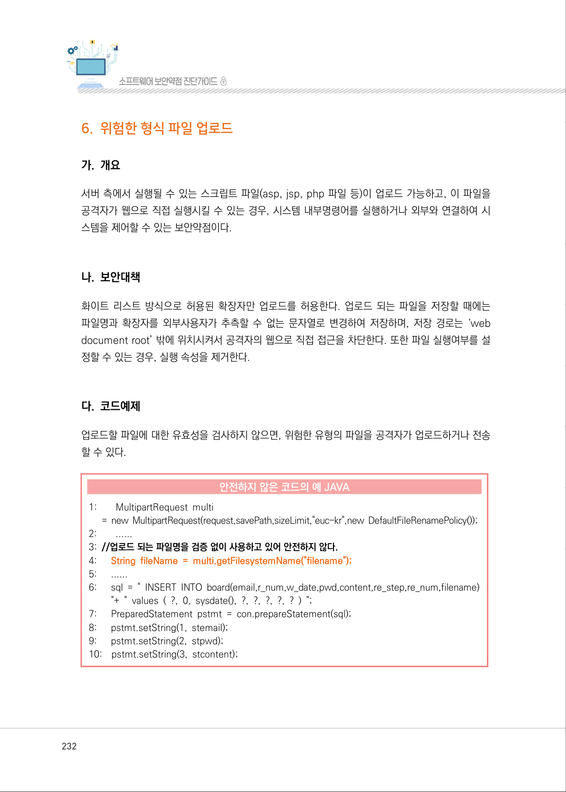
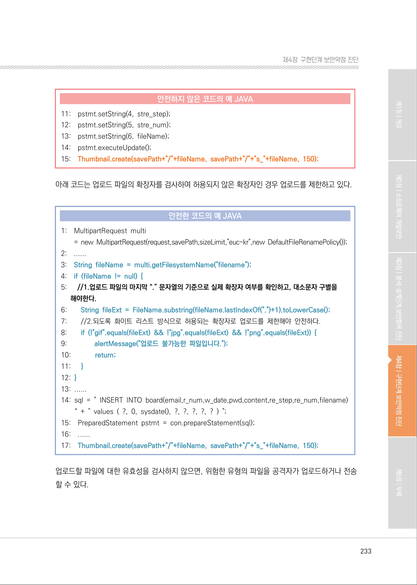
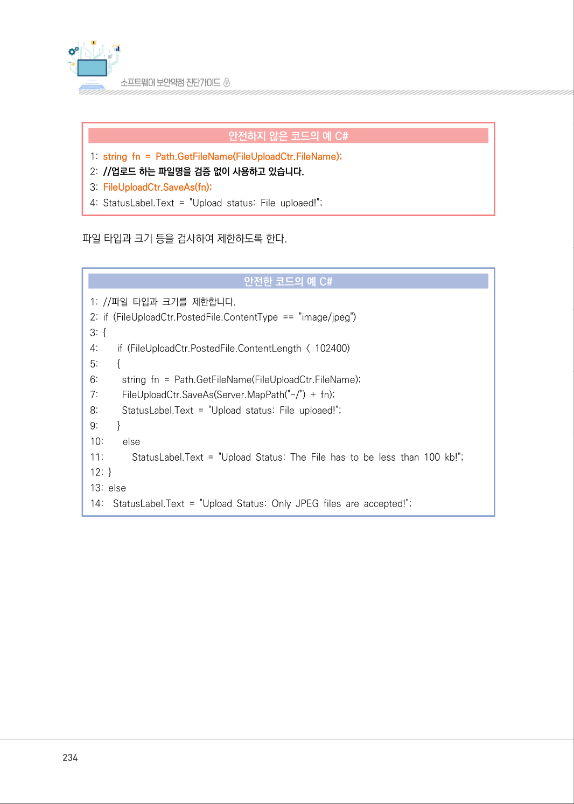
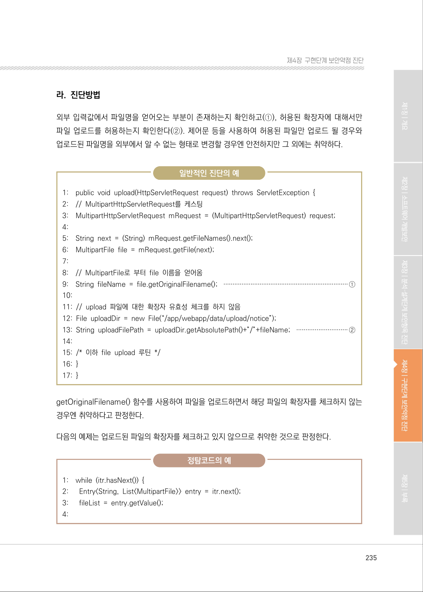
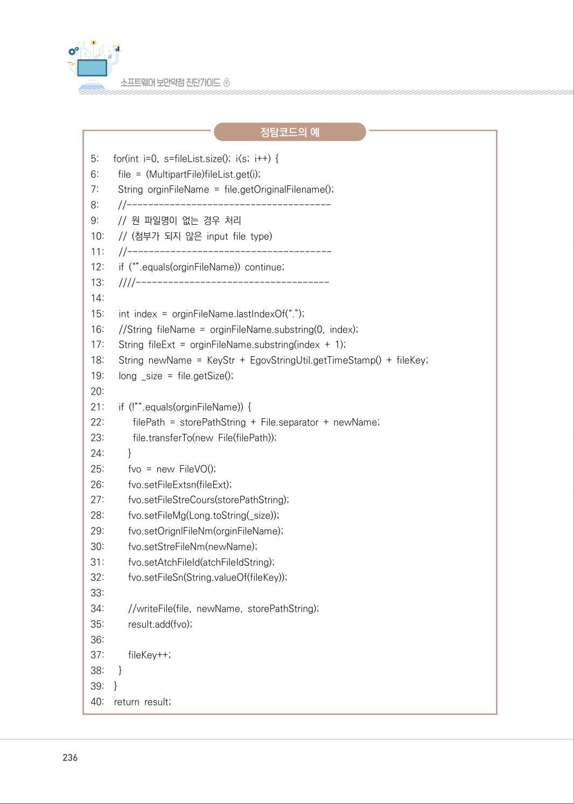
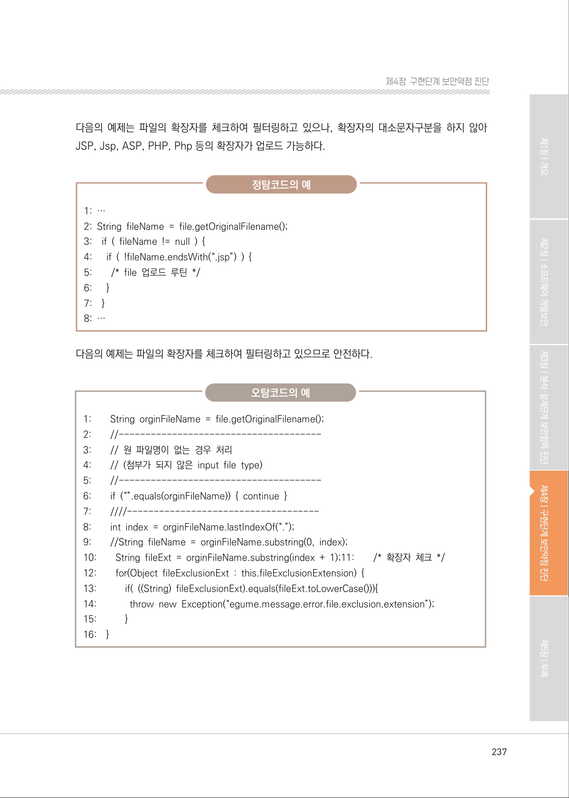
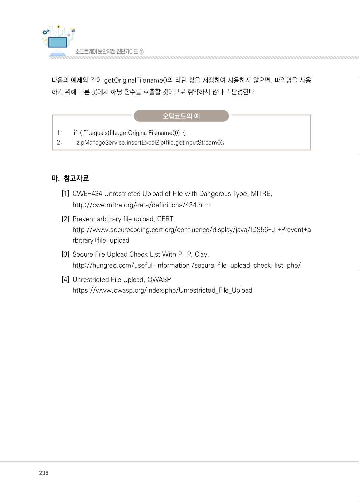
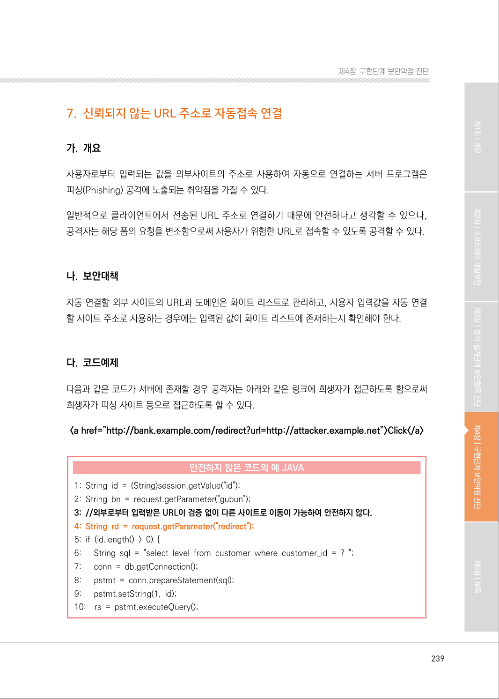

# 6. 위험한 형식 파일 업로드

> 변환 안내(원문 외): 아래 본문은 PDF 텍스트를 추출한 전사입니다. 코드 줄번호·특수 공백·원문 오류를 유지했습니다. 실행용 코드가 아닙니다. 표·그림·들여쓰기는 연결된 페이지 이미지와 대조하세요. 페이지 경계의 줄바꿈을 보존하며, 동일 페이지가 여러 항목에 나뉘면 각 항목의 본문은 해당 구간만 포함합니다.

### PDF 232페이지 / 인쇄 232페이지

<!-- source-page:SW-Diagnosis-2021:232; source-lines:0,1,2,3,4,5,6,7,8,9,10,11,12,13,14,15,16,17,18,19,20,21,22,23,24,25,26,27,28,29,30,31,32,33,34,35 -->

232

#### 6. 위험한 형식 파일 업로드

#### 가. 개요

서버 측에서 실행될 수 있는 스크립트 파일(asp, jsp, php 파일 등)이 업로드 가능하고, 이 파일을 
공격자가 웹으로 직접 실행시킬 수 있는 경우, 시스템 내부명령어를 실행하거나 외부와 연결하여 시
스템을 제어할 수 있는 보안약점이다.

#### 나. 보안대책

화이트 리스트 방식으로 허용된 확장자만 업로드를 허용한다. 업로드 되는 파일을 저장할 때에는 
파일명과 확장자를 외부사용자가 추측할 수 없는 문자열로 변경하여 저장하며, 저장 경로는 ‘web 
document root’ 밖에 위치시켜서 공격자의 웹으로 직접 접근을 차단한다. 또한 파일 실행여부를 설
정할 수 있는 경우, 실행 속성을 제거한다.

#### 다. 코드예제

업로드할 파일에 대한 유효성을 검사하지 않으면, 위험한 유형의 파일을 공격자가 업로드하거나 전송 
할 수 있다.

#### 안전하지 않은 코드의 예 JAVA

```java
1:        MultipartRequest multi
= new MultipartRequest(request,savePath,sizeLimit,"euc-kr",new DefaultFileRenamePolicy());
2:        ......
3: //업로드 되는 파일명을 검증 없이 사용하고 있어 안전하지 않다.
4:      String fileName = multi.getFilesystemName("filename");
5:      ......
6:      sql = " INSERT INTO board(email,r_num,w_date,pwd,content,re_step,re_num,filename)
"+ " values ( ?, 0, sysdate(), ?, ?, ?, ?, ? ) ";
7:      PreparedStatement pstmt = con.prepareStatement(sql);
8:      pstmt.setString(1, stemail);
9:      pstmt.setString(2, stpwd);
10:    pstmt.setString(3, stcontent);
```

<details><summary>원본 페이지 이미지 (변환 외 보존 자료)</summary>



</details>

### PDF 233페이지 / 인쇄 233페이지

<!-- source-page:SW-Diagnosis-2021:233; source-lines:0,1,2,3,4,5,6,7,8,9,10,11,12,13,14,15,16,17,18,19,20,21,22,23,24,25,26,27,28,29,30,31,32,33,34,35,36,37,38,39,40,41,42,43,44,45,46,47,48,49,50 -->

233

제4장구현단계 보안약점 진단

#### 안전하지 않은 코드의 예 JAVA

```java
11:    pstmt.setString(4, stre_step);
12:    pstmt.setString(5, stre_num);
13:    pstmt.setString(6, fileName);
14:    pstmt.executeUpdate();
15:    Thumbnail.create(savePath+"/"+fileName, savePath+"/"+"s_"+fileName, 150);
```

아래 코드는 업로드 파일의 확장자를 검사하여 허용되지 않은 확장자인 경우 업로드를 제한하고 있다.

#### 안전한 코드의 예 JAVA

```java
1:    MultipartRequest multi
= new MultipartRequest(request,savePath,sizeLimit,"euc-kr",new DefaultFileRenamePolicy());
2:    ......
3:    String fileName = multi.getFilesystemName("filename");
4:    if (fileName != null) {
5:      //1.업로드 파일의 마지막 “.” 문자열의 기준으로 실제 확장자 여부를 확인하고, 대소문자 구별을 
해야한다.
6:        String fileExt = FileName.substring(fileName.lastIndexOf(".")+1).toLowerCase();
7:        //2.되도록 화이트 리스트 방식으로 허용되는 확장자로 업로드를 제한해야 안전하다.
8:        if (!"gif".equals(fileExt) && !"jpg".equals(fileExt) && !"png".equals(fileExt)) {
9:               alertMessage("업로드 불가능한 파일입니다.");
10:             return;
11:      }
12: }
13: ......
14: sql = " INSERT INTO board(email,r_num,w_date,pwd,content,re_step,re_num,filename)
“ + " values ( ?, 0, sysdate(), ?, ?, ?, ?, ? ) ";
15:    PreparedStatement pstmt = con.prepareStatement(sql); 
16:    ......
17:    Thumbnail.create(savePath+"/"+fileName, savePath+"/"+"s_"+fileName, 150);
```

업로드할 파일에 대한 유효성을 검사하지 않으면, 위험한 유형의 파일을 공격자가 업로드하거나 전송 
할 수 있다.

<details><summary>원본 페이지 이미지 (변환 외 보존 자료)</summary>



</details>

### PDF 234페이지 / 인쇄 234페이지

<!-- source-page:SW-Diagnosis-2021:234; source-lines:0,1,2,3,4,5,6,7,8,9,10,11,12,13,14,15,16,17,18,19,20,21,22,23,24,25,26,27,28,29,30 -->

234

#### 안전하지 않은 코드의 예 C#

```csharp
1: string fn = Path.GetFileName(FileUploadCtr.FileName);
2: //업로드 하는 파일명을 검증 없이 사용하고 있습니다.
3: FileUploadCtr.SaveAs(fn);
4: StatusLabel.Text = "Upload status: File uploaed!";
```

파일 타입과 크기 등을 검사하여 제한하도록 한다.

#### 안전한 코드의 예 C#

```csharp
1: //파일 타입과 크기를 제한합니다. 
2: if (FileUploadCtr.PostedFile.ContentType == "image/jpeg") 
3: { 
4:        if (FileUploadCtr.PostedFile.ContentLength < 102400) 
5:        {
6:         string fn = Path.GetFileName(FileUploadCtr.FileName);
7:         FileUploadCtr.SaveAs(Server.MapPath("~/") + fn); 
8:         StatusLabel.Text = "Upload status: File uploaed!"; 
9:        }
10:        else
11:           StatusLabel.Text = "Upload Status: The File has to be less than 100 kb!";
12: }
13: else
14:    StatusLabel.Text = "Upload Status: Only JPEG files are accepted!";
```

<details><summary>원본 페이지 이미지 (변환 외 보존 자료)</summary>



</details>

### PDF 235페이지 / 인쇄 235페이지

<!-- source-page:SW-Diagnosis-2021:235; source-lines:0,1,2,3,4,5,6,7,8,9,10,11,12,13,14,15,16,17,18,19,20,21,22,23,24,25,26,27,28,29,30,31,32,33,34,35,36,37,38,39,40,41 -->

235

제4장구현단계 보안약점 진단

#### 라. 진단방법

외부 입력값에서 파일명을 얻어오는 부분이 존재하는지 확인하고(①), 허용된 확장자에 대해서만 
파일 업로드를 허용하는지 확인한다(②). 제어문 등을 사용하여 허용된 파일만 업로드 될 경우와 
업로드된 파일명을 외부에서 알 수 없는 형태로 변경할 경우엔 안전하지만 그 외에는 취약하다.

일반적인 진단의 예

```text
1:    public void upload(HttpServletRequest request) throws ServletException {
2:    // MultipartHttpServletRequest를 케스팅 
3:    MultipartHttpServletRequest mRequest = (MultipartHttpServletRequest) request;
4: 
5:    String next = (String) mRequest.getFileNames().next(); 
6:    MultipartFile file = mRequest.getFile(next); 
7:
8:    // MultipartFile로 부터 file 이름을 얻어옴 
9:    String fileName = file.getOriginalFilename(); ·····································································①
10:
11: // upload 파일에 대한 확장자 유효성 체크를 하지 않음 
12: File uploadDir = new File(“/app/webapp/data/upload/notice”); 
13: String uploadFilePath = uploadDir.getAbsolutePath()+”/”+fileName; ····························②
14:
15: /* 이하 file upload 루틴 */
16: }
17: }
```

getOriginalFilename() 함수를 사용하여 파일을 업로드하면서 해당 파일의 확장자를 체크하지 않는 
경우엔 취약하다고 판정한다.

다음의 예제는 업로드된 파일의 확장자를 체크하고 있지 않으므로 취약한 것으로 판정한다.

정탐코드의 예

```text
1:    while (itr.hasNext()) { 
2:      Entry<String, List<MultipartFile>> entry = itr.next(); 
3:      fileList = entry.getValue(); 
4:
```

<details><summary>원본 페이지 이미지 (변환 외 보존 자료)</summary>



</details>

### PDF 236페이지 / 인쇄 236페이지

<!-- source-page:SW-Diagnosis-2021:236; source-lines:0,1,2,3,4,5,6,7,8,9,10,11,12,13,14,15,16,17,18,19,20,21,22,23,24,25,26,27,28,29,30,31,32,33,34,35,36,37,38,39,40,41,42,43,44,45,46,47,48,49,50,51,52,53,54,55,56,57,58,59,60,61,62,63,64,65,66,67,68,69 -->

236

정탐코드의 예

```text
5:      for(int i=0, s=fileList.size(); i<s; i++) { 
6:        file = (MultipartFile)fileList.get(i); 
7:        String orginFileName = file.getOriginalFilename(); 
8:        //--------------------------------------
9:        // 원 파일명이 없는 경우 처리 
10:      // (첨부가 되지 않은 input file type) 
11:      //--------------------------------------
12:      if (“”.equals(orginFileName)) continue; 
13:      ////------------------------------------
14:
15:      int index = orginFileName.lastIndexOf(“.”); 
16:      //String fileName = orginFileName.substring(0, index);
17:      String fileExt = orginFileName.substring(index + 1);
18:      String newName = KeyStr + EgovStringUtil.getTimeStamp() + fileKey;
19:      long _size = file.getSize();
20:
21:      if (!””.equals(orginFileName)) {
22:           filePath = storePathString + File.separator + newName;
23:           file.transferTo(new File(filePath));
24:         }
25:         fvo = new FileVO();
26:         fvo.setFileExtsn(fileExt);
27:         fvo.setFileStreCours(storePathString);
28:         fvo.setFileMg(Long.toString(_size));
29:         fvo.setOrignlFileNm(orginFileName);
30:         fvo.setStreFileNm(newName);
31:         fvo.setAtchFileId(atchFileIdString);
32:         fvo.setFileSn(String.valueOf(fileKey));
33: 
34:         //writeFile(file, newName, storePathString);
35:         result.add(fvo);
36:
37:         fileKey++;
38:      }
39:    }
40:    return result;
```

<details><summary>원본 페이지 이미지 (변환 외 보존 자료)</summary>



</details>

### PDF 237페이지 / 인쇄 237페이지

<!-- source-page:SW-Diagnosis-2021:237; source-lines:0,1,2,3,4,5,6,7,8,9,10,11,12,13,14,15,16,17,18,19,20,21,22,23,24,25,26,27,28,29,30,31,32,33,34,35,36,37,38,39,40,41,42,43,44,45,46,47,48,49,50 -->

237

제4장구현단계 보안약점 진단

다음의 예제는 파일의 확장자를 체크하여 필터링하고 있으나, 확장자의 대소문자구분을 하지 않아 
JSP, Jsp, ASP, PHP, Php 등의 확장자가 업로드 가능하다.

정탐코드의 예

```text
1: … 
2: String fileName = file.getOriginalFilename(); 
3:    if ( fileName != null ) { 
4:      if ( !fileName.endsWith(“.jsp”) ) { 
5:        /* file 업로드 루틴 */ 
6:      }
7:    }
8: …
```

다음의 예제는 파일의 확장자를 체크하여 필터링하고 있으므로 안전하다.

오탐코드의 예

```text
1:        String orginFileName = file.getOriginalFilename(); 
2:        //--------------------------------------
3:        // 원 파일명이 없는 경우 처리 
4:        // (첨부가 되지 않은 input file type) 
5:        //--------------------------------------
6:        if (“”.equals(orginFileName)) { continue } 
7:        ////------------------------------------
8:        int index = orginFileName.lastIndexOf(“.”); 
9:        //String fileName = orginFileName.substring(0, index); 
10:        String fileExt = orginFileName.substring(index + 1);11:        /* 확장자 체크 */
12:        for(Object fileExclusionExt : this.fileExclusionExtension) { 
13:           if( ((String) fileExclusionExt).equals(fileExt.toLowerCase())){ 
14:             throw new Exception(“egume.message.error.file.exclusion.extension”);
15:           }
16:    }
```

<details><summary>원본 페이지 이미지 (변환 외 보존 자료)</summary>



</details>

### PDF 238페이지 / 인쇄 238페이지

<!-- source-page:SW-Diagnosis-2021:238; source-lines:0,1,2,3,4,5,6,7,8,9,10,11,12,13,14,15,16,17 -->

238

다음의 예제와 같이 getOriginalFilename()의 리턴 값을 저장하여 사용하지 않으면, 파일명을 사용
하기 위해 다른 곳에서 해당 함수를 호출할 것이므로 취약하지 않다고 판정한다.

오탐코드의 예

```text
1:        if (!””.equals(file.getOriginalFilename())) {
2:         zipManageService.insertExcelZip(file.getInputStream());
```

#### 마. 참고자료

[1] CWE-434 Unrestricted Upload of File with Dangerous Type, MITRE,

http://cwe.mitre.org/data/definitions/434.html
[2] Prevent arbitrary file upload, CERT,

http://www.securecoding.cert.org/confluence/display/java/IDS56-J.+Prevent+a
rbitrary+file+upload 
[3] Secure File Upload Check List With PHP, Clay,

http://hungred.com/useful-information /secure-file-upload-check-list-php/
[4] Unrestricted File Upload, OWASP

https://www.owasp.org/index.php/Unrestricted_File_Upload

<details><summary>원본 페이지 이미지 (변환 외 보존 자료)</summary>



</details>

### PDF 239페이지 / 인쇄 239페이지

<!-- source-page:SW-Diagnosis-2021:239; source-lines:1 -->

제4장구현단계 보안약점 진단

<details><summary>원본 페이지 이미지 (변환 외 보존 자료)</summary>



</details>

---

## 탐색 링크 (원문 외)

[통합 인덱스](../../../INDEX.md)

