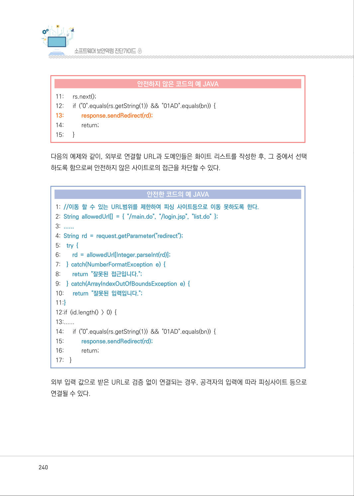
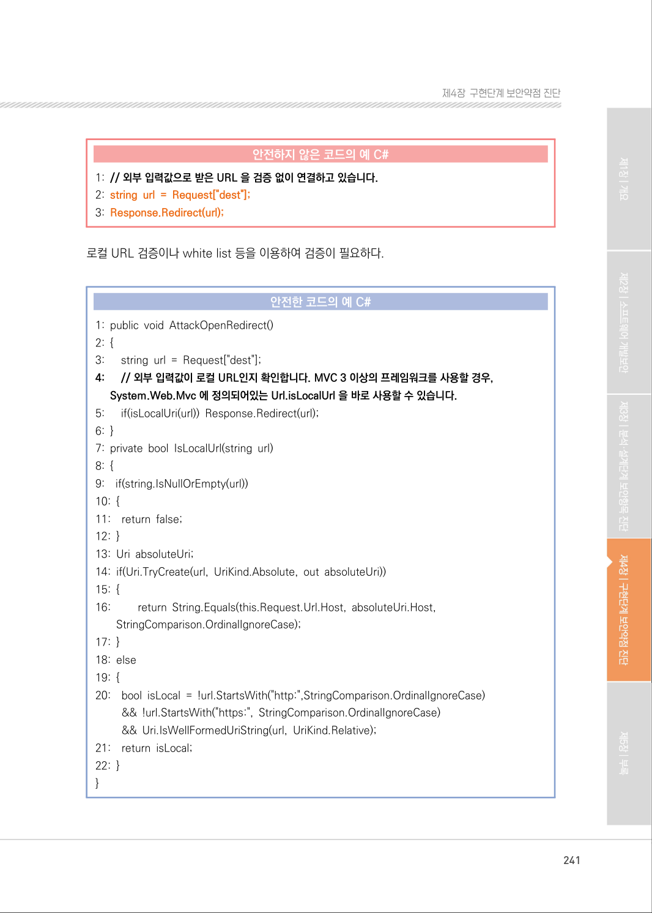
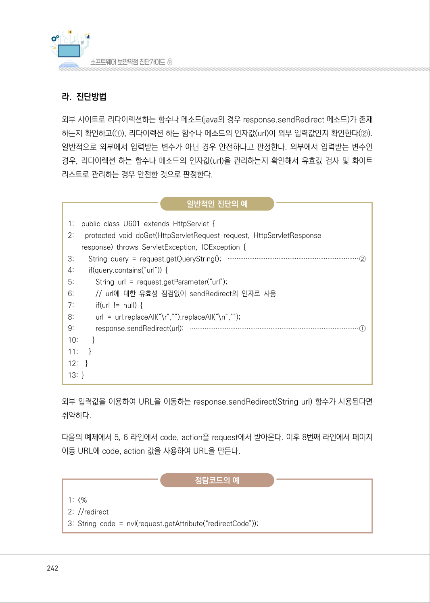
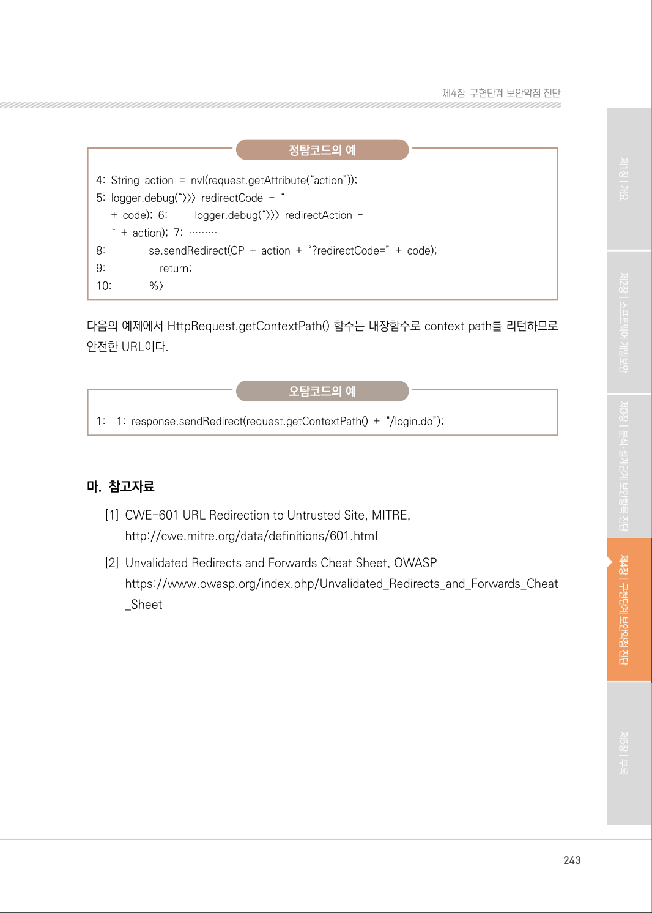

# 7. 신뢰되지 않는 URL 주소로 자동접속 연결

> 변환 안내(원문 외): 아래 본문은 PDF 텍스트를 추출한 전사입니다. 코드 줄번호·특수 공백·원문 오류를 유지했습니다. 실행용 코드가 아닙니다. 표·그림·들여쓰기는 연결된 페이지 이미지와 대조하세요. 페이지 경계의 줄바꿈을 보존하며, 동일 페이지가 여러 항목에 나뉘면 각 항목의 본문은 해당 구간만 포함합니다.

### PDF 239페이지 / 인쇄 239페이지

<!-- source-page:SW-Diagnosis-2021:239; source-lines:0,2,3,4,5,6,7,8,9,10,11,12,13,14,15,16,17,18,19,20,21,22,23,24,25,26,27,28,29,30 -->

239

#### 7. 신뢰되지 않는 URL 주소로 자동접속 연결

#### 가. 개요

사용자로부터 입력되는 값을 외부사이트의 주소로 사용하여 자동으로 연결하는 서버 프로그램은 
피싱(Phishing) 공격에 노출되는 취약점을 가질 수 있다.

일반적으로 클라이언트에서 전송된 URL 주소로 연결하기 때문에 안전하다고 생각할 수 있으나, 
공격자는 해당 폼의 요청을 변조함으로써 사용자가 위험한 URL로 접속할 수 있도록 공격할 수 있다.

#### 나. 보안대책

자동 연결할 외부 사이트의 URL과 도메인은 화이트 리스트로 관리하고, 사용자 입력값을 자동 연결 
할 사이트 주소로 사용하는 경우에는 입력된 값이 화이트 리스트에 존재하는지 확인해야 한다.

#### 다. 코드예제

다음과 같은 코드가 서버에 존재할 경우 공격자는 아래와 같은 링크에 희생자가 접근하도록 함으로써 
희생자가 피싱 사이트 등으로 접근하도록 할 수 있다.

&lt;a href=”http://bank.example.com/redirect?url=http://attacker.example.net”&gt;Click&lt;/a&gt;

#### 안전하지 않은 코드의 예 JAVA

```java
1: String id = (String)session.getValue("id"); 
2: String bn = request.getParameter("gubun"); 
3: //외부로부터 입력받은 URL이 검증 없이 다른 사이트로 이동이 가능하여 안전하지 않다.
4: String rd = request.getParameter("redirect");
5: if (id.length() > 0) { 
6:      String sql = "select level from customer where customer_id = ? ";
7:      conn = db.getConnection(); 
8:      pstmt = conn.prepareStatement(sql); 
9:      pstmt.setString(1, id); 
10:    rs = pstmt.executeQuery();
```

<details><summary>원본 페이지 이미지 (변환 외 보존 자료)</summary>


</details>

### PDF 240페이지 / 인쇄 240페이지

<!-- source-page:SW-Diagnosis-2021:240; source-lines:0,1,2,3,4,5,6,7,8,9,10,11,12,13,14,15,16,17,18,19,20,21,22,23,24,25,26,27,28,29,30,31,32,33,34,35,36,37,38,39,40,41,42,43 -->

240

#### 안전하지 않은 코드의 예 JAVA

```java
11:      rs.next();
12:      if ("0".equals(rs.getString(1)) && "01AD".equals(bn)) { 
13:           response.sendRedirect(rd);
14:           return;
15:      }
```

다음의 예제와 같이, 외부로 연결할 URL과 도메인들은 화이트 리스트를 작성한 후, 그 중에서 선택 
하도록 함으로써 안전하지 않은 사이트로의 접근을 차단할 수 있다.

#### 안전한 코드의 예 JAVA

```java
1: //이동 할 수 있는 URL범위를 제한하여 피싱 사이트등으로 이동 못하도록 한다.
2: String allowedUrl[] = { "/main.do", "/login.jsp", "list.do" };
3: ......
4: String rd = request.getParameter("redirect");
5:    try { 
6:        rd = allowedUrl[Integer.parseInt(rd)]; 
7:    } catch(NumberFormatException e) { 
8:        return "잘못된 접근입니다.";
9:    } catch(ArrayIndexOutOfBoundsException e) {
10:      return "잘못된 입력입니다.";
11:}
12:if (id.length() > 0) { 
13:...... 
14:      if ("0".equals(rs.getString(1)) && "01AD".equals(bn)) {
15:           response.sendRedirect(rd);
16:           return;
17:    }
```

외부 입력 값으로 받은 URL로 검증 없이 연결되는 경우, 공격자의 입력에 따라 피싱사이트 등으로 
연결될 수 있다.

<details><summary>원본 페이지 이미지 (변환 외 보존 자료)</summary>



</details>

### PDF 241페이지 / 인쇄 241페이지

<!-- source-page:SW-Diagnosis-2021:241; source-lines:0,1,2,3,4,5,6,7,8,9,10,11,12,13,14,15,16,17,18,19,20,21,22,23,24,25,26,27,28,29,30,31,32,33,34,35,36,37,38,39,40,41,42 -->

241

제4장구현단계 보안약점 진단

#### 안전하지 않은 코드의 예 C#

```csharp
1: // 외부 입력값으로 받은 URL 을 검증 없이 연결하고 있습니다.
2: string url = Request["dest"];
3: Response.Redirect(url);
```

로컬 URL 검증이나 white list 등을 이용하여 검증이 필요하다.

#### 안전한 코드의 예 C#

```csharp
1: public void AttackOpenRedirect() 
2: {
3:      string url = Request["dest"];
4:      // 외부 입력값이 로컬 URL인지 확인합니다. MVC 3 이상의 프레임워크를 사용할 경우, 
System.Web.Mvc 에 정의되어있는 Url.isLocalUrl 을 바로 사용할 수 있습니다.
5:      if(isLocalUri(url)) Response.Redirect(url); 
6: }
7: private bool IsLocalUrl(string url) 
8: {
9:    if(string.IsNullOrEmpty(url)) 
10: {
11:    return false;
12: }
13: Uri absoluteUri;
14: if(Uri.TryCreate(url, UriKind.Absolute, out absoluteUri)) 
15: {
16:         return String.Equals(this.Request.Url.Host, absoluteUri.Host, 
StringComparison.OrdinalIgnoreCase);
17: }
18: else
19: {
20:    bool isLocal = !url.StartsWith("http:",StringComparison.OrdinalIgnoreCase)
&& !url.StartsWith("https:", StringComparison.OrdinalIgnoreCase)
&& Uri.IsWellFormedUriString(url, UriKind.Relative); 
```

```text
21:    return isLocal;
22: }
}
```

<details><summary>원본 페이지 이미지 (변환 외 보존 자료)</summary>



</details>

### PDF 242페이지 / 인쇄 242페이지

<!-- source-page:SW-Diagnosis-2021:242; source-lines:0,1,2,3,4,5,6,7,8,9,10,11,12,13,14,15,16,17,18,19,20,21,22,23,24,25,26,27,28,29,30,31,32,33,34,35,36,37,38,39,40,41 -->

242

#### 라. 진단방법

외부 사이트로 리다이렉션하는 함수나 메소드(java의 경우 response.sendRedirect 메소드)가 존재 
하는지 확인하고(①), 리다이렉션 하는 함수나 메소드의 인자값(url)이 외부 입력값인지 확인한다(②). 
일반적으로 외부에서 입력받는 변수가 아닌 경우 안전하다고 판정한다. 외부에서 입력받는 변수인 
경우, 리다이렉션 하는 함수나 메소드의 인자값(url)을 관리하는지 확인해서 유효값 검사 및 화이트 
리스트로 관리하는 경우 안전한 것으로 판정한다.

일반적인 진단의 예

```text
1:    public class U601 extends HttpServlet { 
2:      protected void doGet(HttpServletRequest request, HttpServletResponse
response) throws ServletException, IOException { 
3:        String query = request.getQueryString(); ········································································②
4:        if(query.contains(“url”)) { 
5:           String url = request.getParameter(“url”); 
6:           // url에 대한 유효성 점검없이 sendRedirect의 인자로 사용 
7:           if(url != null) {
8:           url = url.replaceAll(“\r”,””).replaceAll(“\n”,””); 
9:           response.sendRedirect(url); ····························································································①
10:        }
11:      }
12:    }
13: }
```

외부 입력값을 이용하여 URL을 이동하는 response.sendRedirect(String url) 함수가 사용된다면 
취약하다.

다음의 예제에서 5, 6 라인에서 code, action을 request에서 받아온다. 이후 8번째 라인에서 페이지 
이동 URL에 code, action 값을 사용하여 URL을 만든다.

정탐코드의 예

```text
1: <%
2: //redirect
3: String code = nvl(request.getAttribute(“redirectCode”));
```

<details><summary>원본 페이지 이미지 (변환 외 보존 자료)</summary>



</details>

### PDF 243페이지 / 인쇄 243페이지

<!-- source-page:SW-Diagnosis-2021:243; source-lines:0,1,2,3,4,5,6,7,8,9,10,11,12,13,14,15,16,17,18,19,20,21,22,23,24 -->

243

제4장구현단계 보안약점 진단

정탐코드의 예

```text
4: String action = nvl(request.getAttribute(“action”)); 
5: logger.debug(“>>> redirectCode - “
+ code); 6:         logger.debug(“>>> redirectAction –
“ + action); 7: ………
```

```text
8:               se.sendRedirect(CP + action + “?redirectCode=” + code); 
9:                   return;
10:             %>
```

다음의 예제에서 HttpRequest.getContextPath() 함수는 내장함수로 context path를 리턴하므로 
안전한 URL이다.

오탐코드의 예

1:

1: response.sendRedirect(request.getContextPath() + “/login.do”);

#### 마. 참고자료

[1] CWE-601 URL Redirection to Untrusted Site, MITRE,

http://cwe.mitre.org/data/definitions/601.html
[2] Unvalidated Redirects and Forwards Cheat Sheet, OWASP 

https://www.owasp.org/index.php/Unvalidated_Redirects_and_Forwards_Cheat
_Sheet

<details><summary>원본 페이지 이미지 (변환 외 보존 자료)</summary>



</details>

---

## 탐색 링크 (원문 외)

[통합 인덱스](../../../INDEX.md)

