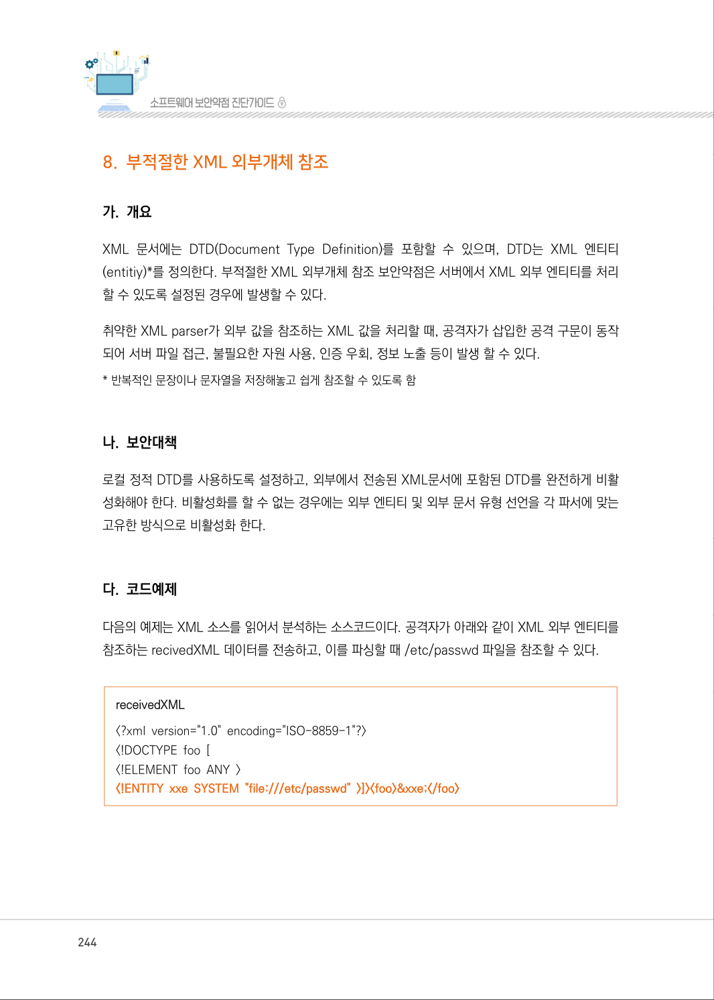
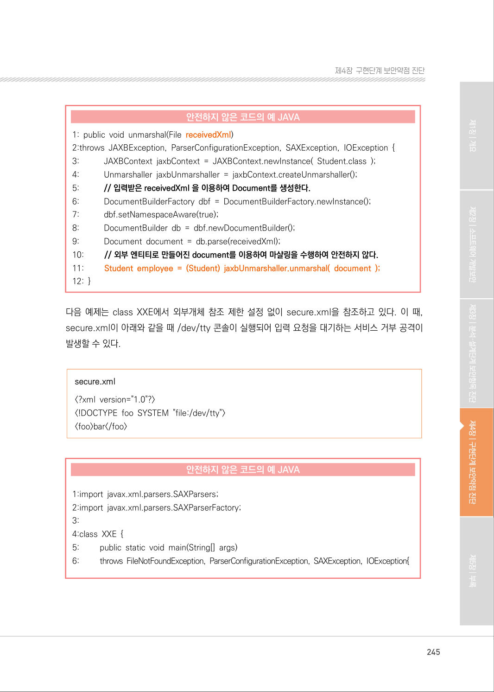
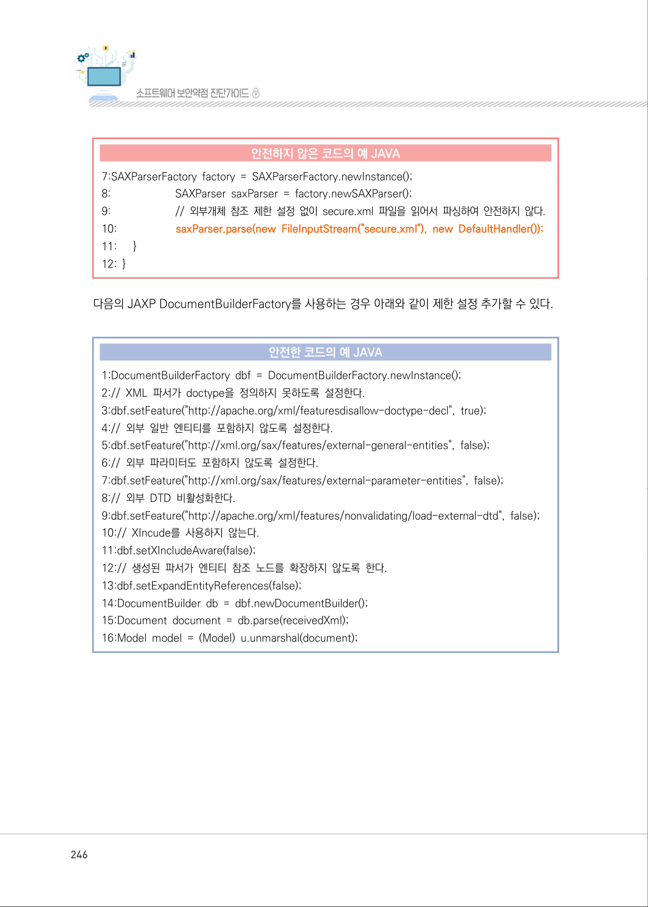
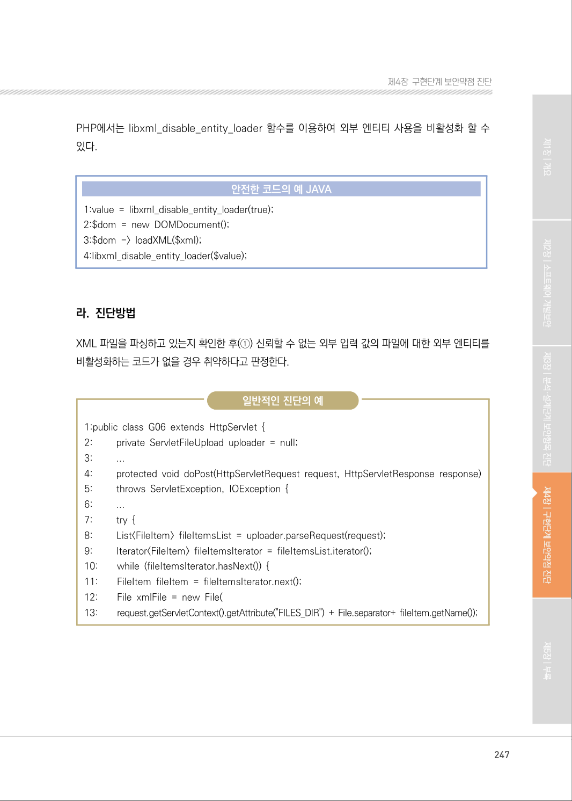
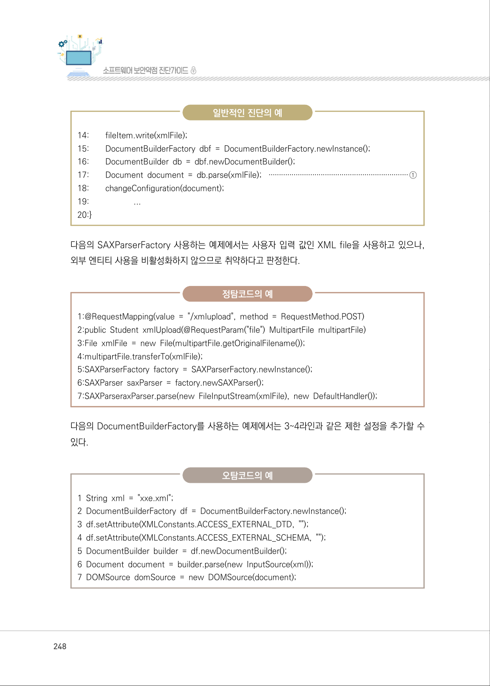
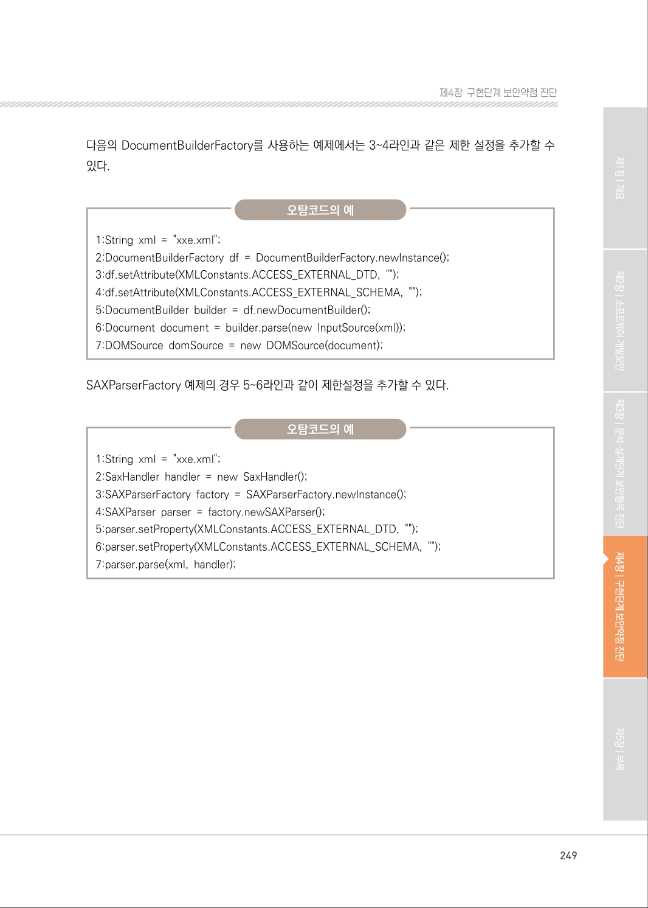
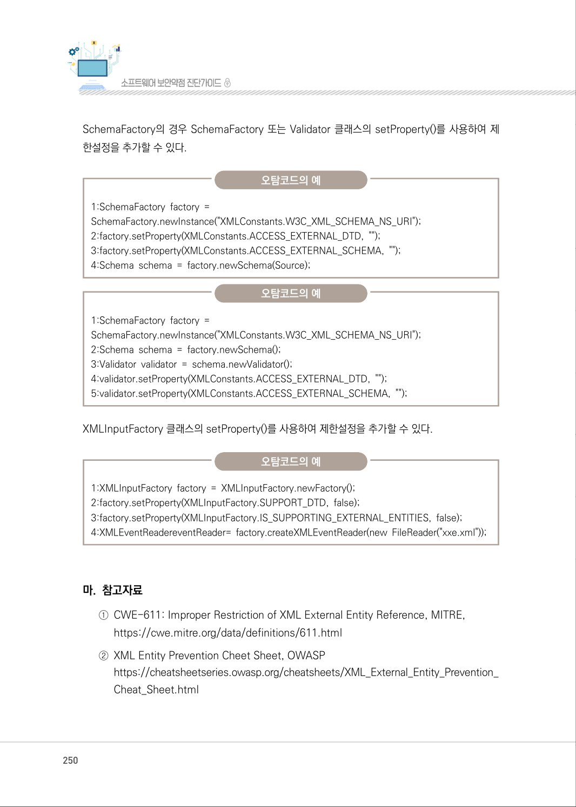

# 8. 부적절한 XML 외부개체 참조

> 변환 안내(원문 외): 아래 본문은 PDF 텍스트를 추출한 전사입니다. 코드 줄번호·특수 공백·원문 오류를 유지했습니다. 실행용 코드가 아닙니다. 표·그림·들여쓰기는 연결된 페이지 이미지와 대조하세요. 페이지 경계의 줄바꿈을 보존하며, 동일 페이지가 여러 항목에 나뉘면 각 항목의 본문은 해당 구간만 포함합니다.

### PDF 244페이지 / 인쇄 244페이지

<!-- source-page:SW-Diagnosis-2021:244; source-lines:0,1,2,3,4,5,6,7,8,9,10,11,12,13,14,15,16,17,18,19,20 -->

244

#### 8. 부적절한 XML 외부개체 참조

#### 가. 개요

XML 문서에는 DTD(Document Type Definition)를 포함할 수 있으며, DTD는 XML 엔티티
(entitiy)*를 정의한다. 부적절한 XML 외부개체 참조 보안약점은 서버에서 XML 외부 엔티티를 처리
할 수 있도록 설정된 경우에 발생할 수 있다.

취약한 XML parser가 외부 값을 참조하는 XML 값을 처리할 때, 공격자가 삽입한 공격 구문이 동작 
되어 서버 파일 접근, 불필요한 자원 사용, 인증 우회, 정보 노출 등이 발생 할 수 있다.
* 반복적인 문장이나 문자열을 저장해놓고 쉽게 참조할 수 있도록 함

#### 나. 보안대책

로컬 정적 DTD를 사용하도록 설정하고, 외부에서 전송된 XML문서에 포함된 DTD를 완전하게 비활
성화해야 한다. 비활성화를 할 수 없는 경우에는 외부 엔티티 및 외부 문서 유형 선언을 각 파서에 맞는 
고유한 방식으로 비활성화 한다.

#### 다. 코드예제

다음의 예제는 XML 소스를 읽어서 분석하는 소스코드이다. 공격자가 아래와 같이 XML 외부 엔티티를 
참조하는 recivedXML 데이터를 전송하고, 이를 파싱할 때 /etc/passwd 파일을 참조할 수 있다.

receivedXML
&lt;?xml version="1.0" encoding="ISO-8859-1"?&gt;
&lt;!DOCTYPE foo [
&lt;!ELEMENT foo ANY &gt;
&lt;!ENTITY xxe SYSTEM "file:///etc/passwd" &gt;]&gt;&lt;foo&gt;&amp;xxe;&lt;/foo&gt;

<details><summary>원본 페이지 이미지 (변환 외 보존 자료)</summary>



</details>

### PDF 245페이지 / 인쇄 245페이지

<!-- source-page:SW-Diagnosis-2021:245; source-lines:0,1,2,3,4,5,6,7,8,9,10,11,12,13,14,15,16,17,18,19,20,21,22,23,24,25,26,27,28,29,30,31,32,33,34,35,36,37,38,39 -->

245

제4장구현단계 보안약점 진단

#### 안전하지 않은 코드의 예 JAVA

```java
1: public void unmarshal(File receivedXml)
2:throws JAXBException, ParserConfigurationException, SAXException, IOException {
3:           JAXBContext jaxbContext = JAXBContext.newInstance( Student.class );
4:           Unmarshaller jaxbUnmarshaller = jaxbContext.createUnmarshaller();
5:           // 입력받은 receivedXml 을 이용하여 Document를 생성한다.
6:           DocumentBuilderFactory dbf = DocumentBuilderFactory.newInstance();
7:           dbf.setNamespaceAware(true);
8:           DocumentBuilder db = dbf.newDocumentBuilder();
9:           Document document = db.parse(receivedXml);
10:         // 외부 엔티티로 만들어진 document를 이용하여 마샬링을 수행하여 안전하지 않다.
11:         Student employee = (Student) jaxbUnmarshaller.unmarshal( document );
12: }
```

다음 예제는 class XXE에서 외부개체 참조 제한 설정 없이 secure.xml을 참조하고 있다. 이 때, 
secure.xml이 아래와 같을 때 /dev/tty 콘솔이 실행되어 입력 요청을 대기하는 서비스 거부 공격이 
발생할 수 있다.

secure.xml
&lt;?xml version="1.0"?&gt;
&lt;!DOCTYPE foo SYSTEM "file:/dev/tty"&gt;
&lt;foo&gt;bar&lt;/foo&gt;

#### 안전하지 않은 코드의 예 JAVA

```java
1:import javax.xml.parsers.SAXParsers; 
2:import javax.xml.parsers.SAXParserFactory; 
3:
4:class XXE {
5:         public static void main(String[] args) 
6:         throws FileNotFoundException, ParserConfigurationException, SAXException, IOException{
```

<details><summary>원본 페이지 이미지 (변환 외 보존 자료)</summary>



</details>

### PDF 246페이지 / 인쇄 246페이지

<!-- source-page:SW-Diagnosis-2021:246; source-lines:0,1,2,3,4,5,6,7,8,9,10,11,12,13,14,15,16,17,18,19,20,21,22,23,24,25,26,27,28,29 -->

246

#### 안전하지 않은 코드의 예 JAVA

```java
7:SAXParserFactory factory = SAXParserFactory.newInstance(); 
8:                       SAXParser saxParser = factory.newSAXParser();
9:                       // 외부개체 참조 제한 설정 없이 secure.xml 파일을 읽어서 파싱하여 안전하지 않다.
10:                     saxParser.parse(new FileInputStream("secure.xml"), new DefaultHandler());
11:      }
12: }
```

다음의 JAXP DocumentBuilderFactory를 사용하는 경우 아래와 같이 제한 설정 추가할 수 있다.

#### 안전한 코드의 예 JAVA

```java
1:DocumentBuilderFactory dbf = DocumentBuilderFactory.newInstance();
2:// XML 파서가 doctype을 정의하지 못하도록 설정한다.
3:dbf.setFeature("http://apache.org/xml/featuresdisallow-doctype-decl", true);
4:// 외부 일반 엔티티를 포함하지 않도록 설정한다.
5:dbf.setFeature("http://xml.org/sax/features/external-general-entities", false);
6:// 외부 파라미터도 포함하지 않도록 설정한다.
7:dbf.setFeature("http://xml.org/sax/features/external-parameter-entities", false);
8:// 외부 DTD 비활성화한다.
9:dbf.setFeature("http://apache.org/xml/features/nonvalidating/load-external-dtd", false);
10:// XIncude를 사용하지 않는다.
11:dbf.setXIncludeAware(false);
12:// 생성된 파서가 엔티티 참조 노드를 확장하지 않도록 한다.
13:dbf.setExpandEntityReferences(false);
14:DocumentBuilder db = dbf.newDocumentBuilder();
15:Document document = db.parse(receivedXml);
16:Model model = (Model) u.unmarshal(document);
```

<details><summary>원본 페이지 이미지 (변환 외 보존 자료)</summary>



</details>

### PDF 247페이지 / 인쇄 247페이지

<!-- source-page:SW-Diagnosis-2021:247; source-lines:0,1,2,3,4,5,6,7,8,9,10,11,12,13,14,15,16,17,18,19,20,21,22,23,24,25,26,27,28,29,30,31,32,33,34,35,36,37 -->

247

제4장구현단계 보안약점 진단

PHP에서는 libxml_disable_entity_loader 함수를 이용하여 외부 엔티티 사용을 비활성화 할 수 
있다.

#### 안전한 코드의 예 JAVA

```java
1:value = libxml_disable_entity_loader(true);
2:$dom = new DOMDocument();
3:$dom -> loadXML($xml); 
4:libxml_disable_entity_loader($value);
```

#### 라. 진단방법

XML 파일을 파싱하고 있는지 확인한 후(①) 신뢰할 수 없는 외부 입력 값의 파일에 대한 외부 엔티티를 
비활성화하는 코드가 없을 경우 취약하다고 판정한다.

일반적인 진단의 예

```text
1:public class G06 extends HttpServlet { 
2:         private ServletFileUpload uploader = null; 
3:         ...
4:         protected void doPost(HttpServletRequest request, HttpServletResponse response)
5:         throws ServletException, IOException { 
6:         ...
7:         try {
8:         List<FileItem> fileItemsList = uploader.parseRequest(request); 
9:         Iterator<FileItem> fileItemsIterator = fileItemsList.iterator(); 
10:        while (fileItemsIterator.hasNext()) { 
11:        FileItem fileItem = fileItemsIterator.next(); 
12:        File xmlFile = new File( 
13:        request.getServletContext().getAttribute("FILES_DIR") + File.separator+ fileItem.getName());
```

<details><summary>원본 페이지 이미지 (변환 외 보존 자료)</summary>



</details>

### PDF 248페이지 / 인쇄 248페이지

<!-- source-page:SW-Diagnosis-2021:248; source-lines:0,1,2,3,4,5,6,7,8,9,10,11,12,13,14,15,16,17,18,19,20,21,22,23,24,25,26,27,28,29,30,31,32,33,34 -->

248

일반적인 진단의 예

```text
14:        fileItem.write(xmlFile);
15:        DocumentBuilderFactory dbf = DocumentBuilderFactory.newInstance();
16:        DocumentBuilder db = dbf.newDocumentBuilder(); 
17:        Document document = db.parse(xmlFile); ···································································①
18:        changeConfiguration(document); 
19:                     ...
20:}
```

다음의 SAXParserFactory 사용하는 예제에서는 사용자 입력 값인 XML file을 사용하고 있으나, 
외부 엔티티 사용을 비활성화하지 않으므로 취약하다고 판정한다.

정탐코드의 예

```text
1:@RequestMapping(value = "/xmlupload", method = RequestMethod.POST) 
2:public Student xmlUpload(@RequestParam("file") MultipartFile multipartFile)
3:File xmlFile = new File(multipartFile.getOriginalFilename());
4:multipartFile.transferTo(xmlFile);
5:SAXParserFactory factory = SAXParserFactory.newInstance();
6:SAXParser saxParser = factory.newSAXParser();
7:SAXParseraxParser.parse(new FileInputStream(xmlFile), new DefaultHandler());
```

다음의 DocumentBuilderFactory를 사용하는 예제에서는 3~4라인과 같은 제한 설정을 추가할 수 
있다.

오탐코드의 예

1 String xml = "xxe.xml"; 
2 DocumentBuilderFactory df = DocumentBuilderFactory.newInstance(); 
3 df.setAttribute(XMLConstants.ACCESS_EXTERNAL_DTD, "");
4 df.setAttribute(XMLConstants.ACCESS_EXTERNAL_SCHEMA, "");
5 DocumentBuilder builder = df.newDocumentBuilder(); 
6 Document document = builder.parse(new InputSource(xml)); 
7 DOMSource domSource = new DOMSource(document); 

<details><summary>원본 페이지 이미지 (변환 외 보존 자료)</summary>



</details>

### PDF 249페이지 / 인쇄 249페이지

<!-- source-page:SW-Diagnosis-2021:249; source-lines:0,1,2,3,4,5,6,7,8,9,10,11,12,13,14,15,16,17,18,19,20 -->

249

제4장구현단계 보안약점 진단

다음의 DocumentBuilderFactory를 사용하는 예제에서는 3~4라인과 같은 제한 설정을 추가할 수 
있다.

오탐코드의 예

```text
1:String xml = "xxe.xml"; 
2:DocumentBuilderFactory df = DocumentBuilderFactory.newInstance();
3:df.setAttribute(XMLConstants.ACCESS_EXTERNAL_DTD, "");
4:df.setAttribute(XMLConstants.ACCESS_EXTERNAL_SCHEMA, "");
5:DocumentBuilder builder = df.newDocumentBuilder();
6:Document document = builder.parse(new InputSource(xml));
7:DOMSource domSource = new DOMSource(document);
```

SAXParserFactory 예제의 경우 5~6라인과 같이 제한설정을 추가할 수 있다.

오탐코드의 예

```text
1:String xml = "xxe.xml";
2:SaxHandler handler = new SaxHandler();
3:SAXParserFactory factory = SAXParserFactory.newInstance();
4:SAXParser parser = factory.newSAXParser();
5:parser.setProperty(XMLConstants.ACCESS_EXTERNAL_DTD, "");
6:parser.setProperty(XMLConstants.ACCESS_EXTERNAL_SCHEMA, "");
7:parser.parse(xml, handler);
```

<details><summary>원본 페이지 이미지 (변환 외 보존 자료)</summary>



</details>

### PDF 250페이지 / 인쇄 250페이지

<!-- source-page:SW-Diagnosis-2021:250; source-lines:0,1,2,3,4,5,6,7,8,9,10,11,12,13,14,15,16,17,18,19,20,21,22,23,24,25,26,27 -->

250

SchemaFactory의 경우 SchemaFactory 또는 Validator 클래스의 setProperty()를 사용하여 제
한설정을 추가할 수 있다.

오탐코드의 예

```text
1:SchemaFactory factory =
SchemaFactory.newInstance("XMLConstants.W3C_XML_SCHEMA_NS_URI");
2:factory.setProperty(XMLConstants.ACCESS_EXTERNAL_DTD, "");
3:factory.setProperty(XMLConstants.ACCESS_EXTERNAL_SCHEMA, "");
4:Schema schema = factory.newSchema(Source); 
```

오탐코드의 예

```text
1:SchemaFactory factory =
SchemaFactory.newInstance("XMLConstants.W3C_XML_SCHEMA_NS_URI");
2:Schema schema = factory.newSchema();
3:Validator validator = schema.newValidator();
4:validator.setProperty(XMLConstants.ACCESS_EXTERNAL_DTD, "");
5:validator.setProperty(XMLConstants.ACCESS_EXTERNAL_SCHEMA, "");
```

XMLInputFactory 클래스의 setProperty()를 사용하여 제한설정을 추가할 수 있다. 

오탐코드의 예

```text
1:XMLInputFactory factory = XMLInputFactory.newFactory(); 
2:factory.setProperty(XMLInputFactory.SUPPORT_DTD, false); 
3:factory.setProperty(XMLInputFactory.IS_SUPPORTING_EXTERNAL_ENTITIES, false);
4:XMLEventReadereventReader= factory.createXMLEventReader(new FileReader("xxe.xml")); 
```

#### 마. 참고자료

①CWE-611: Improper Restriction of XML External Entity Reference, MITRE,

https://cwe.mitre.org/data/definitions/611.html 
②XML Entity Prevention Cheet Sheet, OWASP

https://cheatsheetseries.owasp.org/cheatsheets/XML_External_Entity_Prevention_
Cheat_Sheet.html

<details><summary>원본 페이지 이미지 (변환 외 보존 자료)</summary>



</details>

### PDF 251페이지 / 인쇄 251페이지

<!-- source-page:SW-Diagnosis-2021:251; source-lines:1 -->

제4장구현단계 보안약점 진단

<details><summary>원본 페이지 이미지 (변환 외 보존 자료)</summary>


</details>

---

## 탐색 링크 (원문 외)

[통합 인덱스](../../../INDEX.md)

