# 9. XML 삽입

> 변환 안내(원문 외): 아래 본문은 PDF 텍스트를 추출한 전사입니다. 코드 줄번호·특수 공백·원문 오류를 유지했습니다. 실행용 코드가 아닙니다. 표·그림·들여쓰기는 연결된 페이지 이미지와 대조하세요. 페이지 경계의 줄바꿈을 보존하며, 동일 페이지가 여러 항목에 나뉘면 각 항목의 본문은 해당 구간만 포함합니다.

### PDF 251페이지 / 인쇄 251페이지

<!-- source-page:SW-Diagnosis-2021:251; source-lines:0,2,3,4,5,6,7,8,9,10,11,12,13,14,15,16,17,18,19,20,21,22,23 -->

251

#### 9. XML 삽입

#### 가. 개요

검증되지 않은 외부 입력 값이 XQuery 또는 XPath 쿼리문을 생성하는 문자열로 사용되어 공격자가 
쿼리문의 구조로 임의로 변경하고 임의의 쿼리를 실행하여 허가되지 않은 데이터를 열람하거나 인증
절차를 우회할 수 있는 보안약점이다.

#### 나. 보안대책

XQuery 또는 Xpath 쿼리에 사용되는 외부 입력데이터에 대하여 특수문자 및 쿼리 예약어를 필터링
하고 파라미터화된 쿼리문을 지원하는 XQuery를 사용한다.

#### 다. 코드예제

ㆍXQuery 삽입

다음의 예제에서는 executeQuery로 생성하는 쿼리의 파라미터의 일부로 외부입력값 (name)을 
사용하고 있다. 만일 something' or '1'='1 을 name의 값으로 전달하면 다음과 같은 쿼리문을 
수행할 수 있으며, 이로써 파일 내의 모든 값을 출력할 수 있게 된다.
doc('users.xml')/userlist/user[uname='something' or '1‘='1’]

#### 안전하지 않은 코드의 예 JAVA

```java
1: // 외부 입력 값을 검증하지 않고 XQuery 표현식에 사용한다.
2: String name = props.getProperty("name");
3: .......
4: // 외부 입력 값에 의해 쿼리 구조가 변경 되어 안전하지 않다.
5: String es = "doc('users.xml')/userlist/user[uname='"+name+"']";
6: XQPreparedExpression expr = conn.prepareExpression(es); 
7: XQResultSequence result = expr.executeQuery();
```

<details><summary>원본 페이지 이미지 (변환 외 보존 자료)</summary>

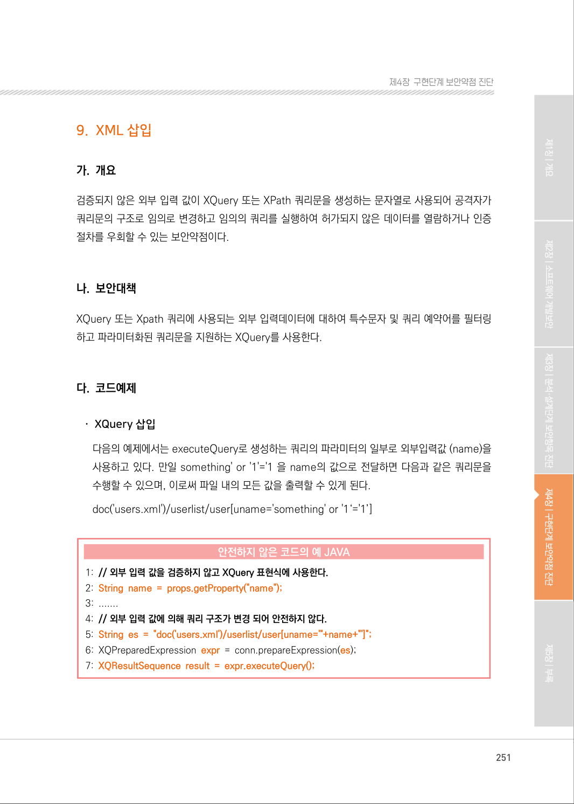

</details>

### PDF 252페이지 / 인쇄 252페이지

<!-- source-page:SW-Diagnosis-2021:252; source-lines:0,1,2,3,4,5,6,7,8,9,10,11,12,13,14,15,16,17,18,19,20,21,22,23,24,25,26,27,28,29,30,31,32,33,34,35,36,37,38,39,40,41,42 -->

252

다음의 예제에서는 외부 입력값을 받고 해당 값 기반의 XQuery상의 쿼리 구조를 변경시키지 않는 
bindString 함수를 이용함으로써 외부 입력값으로 쿼리 구조가 변경될 수 없도록 한다.

#### 안전한 코드의 예 JAVA

```java
1: // blingString 함수로 쿼리 구조가 변경되는 것을 방지한다.
2: String name = props.getProperty("name");
3: .......
4: String es = "doc('users.xml')/userlist/user[uname='$xname']"; 
5: XQPreparedExpression expr = conn.prepareExpression(es); 
6: expr.bindString(new QName("xname"), name, null);
7: XQResultSequence result = expr.executeQuery();
```

다음의 C# 코드도 외부입력 값을 이용하여 XQuery 문을 만들고 있다.

#### 안전하지 않은 코드의 예 C#

```csharp
//외부 입력 값으로 XQuery 문을 만듭니다. 
1:String squery = 
2:         "for $user in doc(users.xml)//user[username='"
3:        + UserTextBox.Text
4:        + "'and pass='"
5:        + PwdTextBox.Text
6:        + "'] return $user";
7:Processor processor = new Processor(); 
8:XQueryCompiler compiler = processor.NewXQueryCompiler(); 
9:XdmNode indoc = processor.NewDocumentBuilder().Build(new
Uri(Server.MapPath("users.xml"))); 
10:    using (StreamReader query = new StreamReader(squery)) 
11:    {
12:    XQueryCompiler compiler = processor.NewXQueryCompiler(); 
13:    XQueryExecutable exp = compiler.Compile(query.ReadToEnd());
14:    XQueryEvaluator eval = exp.Load(); 
15:    eval.ContextItem = indoc; 
16:    Serializer qout = new Serializer();
```

<details><summary>원본 페이지 이미지 (변환 외 보존 자료)</summary>

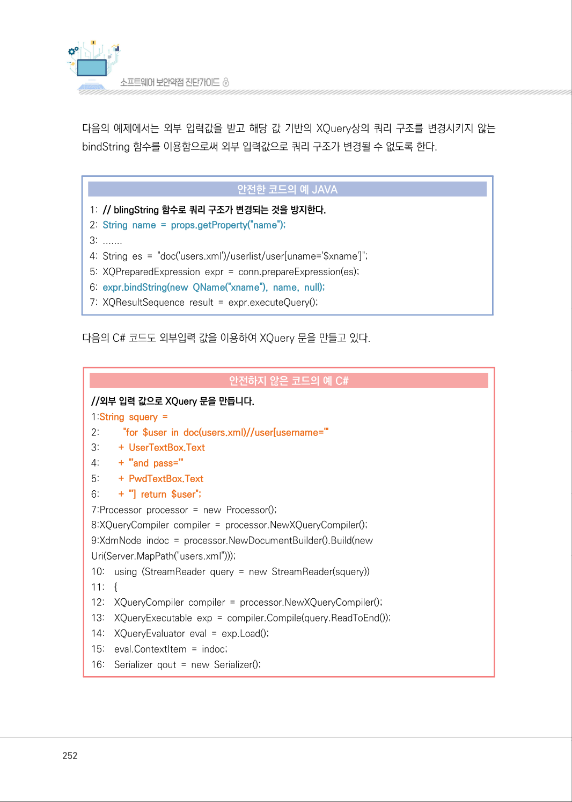

</details>

### PDF 253페이지 / 인쇄 253페이지

<!-- source-page:SW-Diagnosis-2021:253; source-lines:0,1,2,3,4,5,6,7,8,9,10,11,12,13,14,15,16,17,18,19,20,21,22,23,24,25,26,27,28,29,30,31,32,33,34,35,36,37,38,39,40,41,42,43,44,45,46,47,48 -->

253

제4장구현단계 보안약점 진단

#### 안전하지 않은 코드의 예 C#

```csharp
17:    qout.SetOutputProperty(Serializer.METHOD, "xml"); 
18:    qout.SetOutputProperty(Serializer.DOCTYPE_PUBLIC, "-//W3C//DTD XHTML
1.0 Strict//EN");
19:    qout.SetOutputProperty(Serializer.DOCTYPE_SYSTEM,
"http://www.w3.org/TR/xhtml1/DTD/xhtml1-strict.dtd");
20:    qout.SetOutputProperty(Serializer.INDENT, "yes"); 
21:    qout.SetOutputProperty(Serializer.OMIT_XML_DECLARATION, "no");
22:    qout.SetOutputWriter(Response.Output);
//별다른 검증 없이 XML 데이터에 접근합니다. 
23:    eval.Run(qout);27:
}
```

문자열 필터링으로 쿼리문 조작을 막을 수 있다.

#### 안전한 코드의 예 C#

```csharp
1:String squery = 
2:        "for $user in doc(users.xml)//user[username='"
3:      + UserTextBox.Text
4:      + "'and pass='"
5:      + PwdTextBox.Text
6:      + "'] return $user";
// 문자열 필터링으로 위험한 문자열을 제거해 줍니다.
7:      string validatedQuery = squery.Replace('/','*');
8: Processor processor = new Processor();
9: XQueryCompiler compiler = processor.NewXQueryCompiler(); 
10:                 XdmNode indoc = processor.NewDocumentBuilder().Build(new 
Uri(Server.MapPath("users.xml"))); 
11:using (StreamReader query = new StreamReader(validatedQuery)) 
12:{ // tainted value propagated 
13:      XQueryCompiler compiler = processor.NewXQueryCompiler(); 
14:      XQueryExecutable exp = compiler.Compile(query.ReadToEnd()); //
xquery created
```

<details><summary>원본 페이지 이미지 (변환 외 보존 자료)</summary>

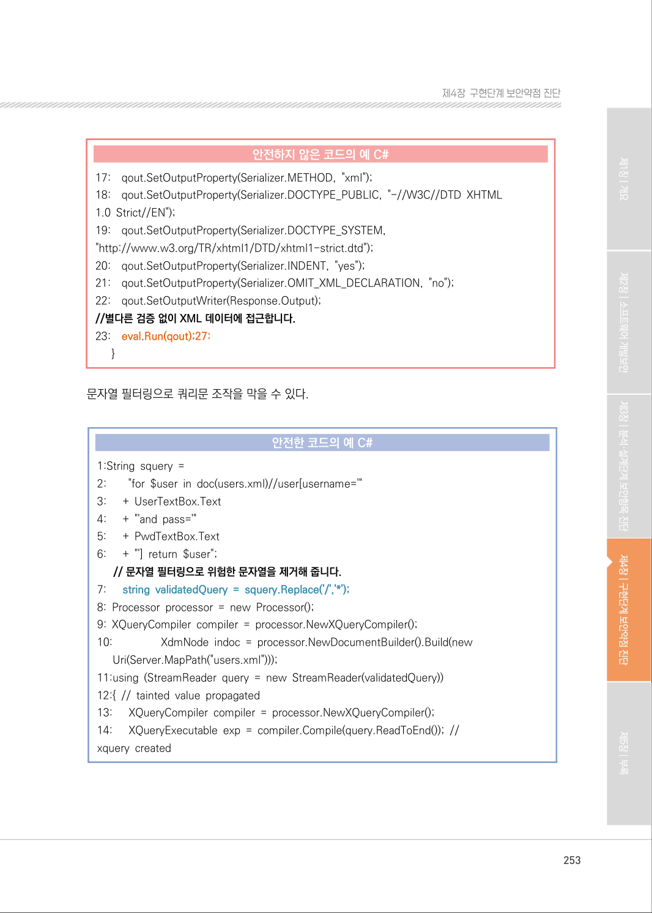

</details>

### PDF 254페이지 / 인쇄 254페이지

<!-- source-page:SW-Diagnosis-2021:254; source-lines:0,1,2,3,4,5,6,7,8,9,10,11,12,13,14,15,16,17,18,19,20,21,22,23,24,25,26,27,28,29,30,31,32,33,34,35,36,37,38,39 -->

254

#### 안전한 코드의 예 C#

```csharp
15:      XQueryEvaluator eval = exp.Load();
16:      eval.ContextItem = indoc; 
17:      Serializer qout = new Serializer(); 
18:      qout.SetOutputProperty(Serializer.METHOD, "xml"); 
19:      qout.SetOutputProperty(Serializer.DOCTYPE_PUBLIC, "-//W3C//DTD XHTML
1.0 Strict//EN");
20:      qout.SetOutputProperty(Serializer.DOCTYPE_SYSTEM,
"http://www.w3.org/TR/xhtml1/DTD/xhtml1-strict.dtd"); 
21:      qout.SetOutputProperty(Serializer.INDENT, "yes"); 
22:      qout.SetOutputProperty(Serializer.OMIT_XML_DECLARATION, "no");
23:      qout.SetOutputWriter(Response.Output); 
24:      eval.Run(qout);
25:}
```

ㆍXPath 삽입

아래 예제에서는 nm과 pw에 대한 입력값 검증을 수행하지 않으므로 nm의 값으로 “tester”, 
pw의 값으로 “x’ or ‘x’=‘x”을 전달하면 아래와 같은 질의문이 생성되어 인증과정을 거치지 않고 
로그인할 수 있다.
“//users/user[login/text()=‘tester’ and password/text()=‘x’ or //‘x’=‘x’]/home_dir/text()”

#### 안전하지 않은 코드의 예 JAVA

```java
// 프로퍼티로부터 외부 입력값 name과 password를 읽어와 각각 nm, pw변수에 저장
1:String nm = props.getProperty("name");
2:String pw = props.getProperty("password");
3:......
4:XPathFactory factory = XPathFactory.newInstance(); 
5:XPath xpath = factory.newXPath(); 
6:...... 
// 검증되지 않은 입력값 외부 입력값 nm, pw를 사용하여 안전하지 않은 질의문이 작성되어 expr 변수에 
저장된다.
```

<details><summary>원본 페이지 이미지 (변환 외 보존 자료)</summary>

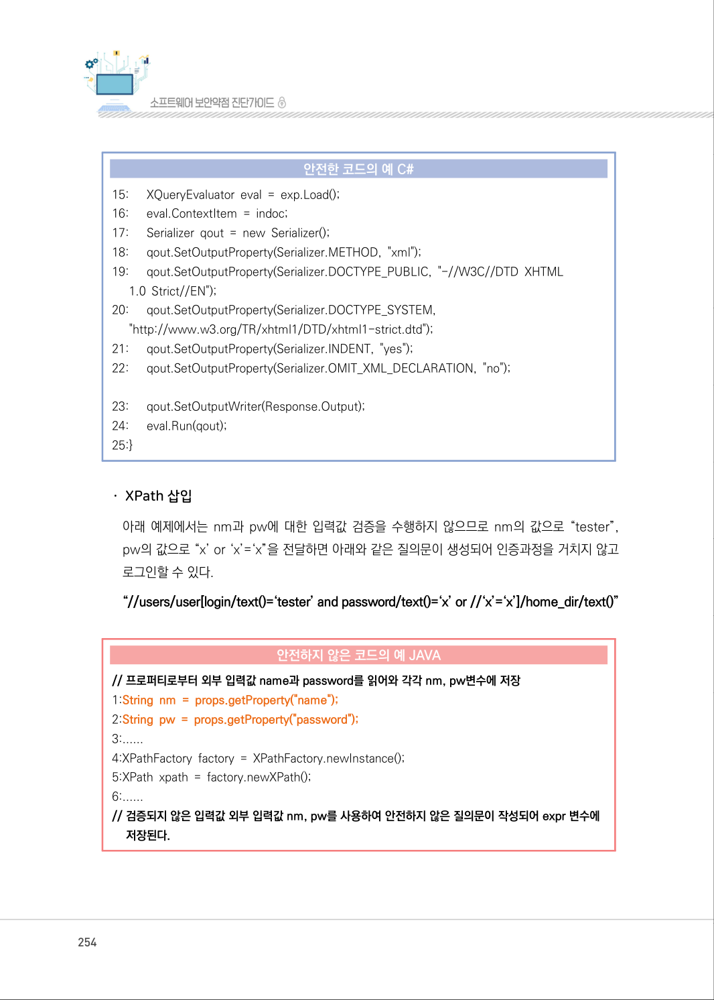

</details>

### PDF 255페이지 / 인쇄 255페이지

<!-- source-page:SW-Diagnosis-2021:255; source-lines:0,1,2,3,4,5,6,7,8,9,10,11,12,13,14,15,16,17,18,19,20,21,22,23,24,25,26,27,28,29,30,31,32,33,34,35,36,37 -->

255

제4장구현단계 보안약점 진단

#### 안전하지 않은 코드의 예 JAVA

```java
7:XPathExpression expr = xpath.compile("//users/user[login/text()='"+nm+"' and 
password/text()='"+pw+"']/home_dir/text()"); 
// 안전하지 않은 질의문이 담긴 expr을 평가하여 결과를 result에 저장한다.
```

```text
8:Object result = expr.evaluate(doc, XPathConstants.NODESET);
// result의 결과를 NodeList 타입으로 변환하여 nodes 저장한다.
9:NodeList nodes = (NodeList) result; 
10:for (int i=0; i<nodes.getLength(); i++) { 
11:      String value = nodes.item(i).getNodeValue(); 
12:      if (value.indexOf(">") < 0) { 
// 공격자가 이름과 비밀번호를 확인할 수 있다. 
13:        System.out.println(value);
14:    }:
15:}
```

다음의 예제는 XQuery를 사용하여 미리 쿼리 골격을 생성함으로써 외부입력으로 인해 쿼리 구조가 
바뀌는 것을 막을 수 있다.

#### 안전한 코드의 예 JAVA

```java
[ login.xq 파일 ]
declare variable $loginID as xs:string external; 
declare variable $password as xs:string external; 
//users/user[@loginID=$loginID and @password=$password] 
// XQuery를 이용한 XPath Injection 방지
1:String nm = props.getProperty("name");
2:String pw = props.getProperty("password");
3:Document doc = new Builder().build("users.xml"); 
//파라미터화된 쿼리가 담겨있는 login.xq를 읽어와서 파라미터화된 쿼리를 생성한다.
4:XQuery xquery = new XQueryFactory().createXQuery(new File("login.xq"));
5:Map vars = new HashMap();
//검증되지 않은 외부값인 nm, pw를 파라미터화된 쿼리의 파라미터로 설정한다. 
6:vars.put("loginID", nm);
7:vars.put("password", pw);
// 파라미터화된 쿼리를 실행하므로 외부값을 검증 없이 사용하여도 안전하다.
```

<details><summary>원본 페이지 이미지 (변환 외 보존 자료)</summary>

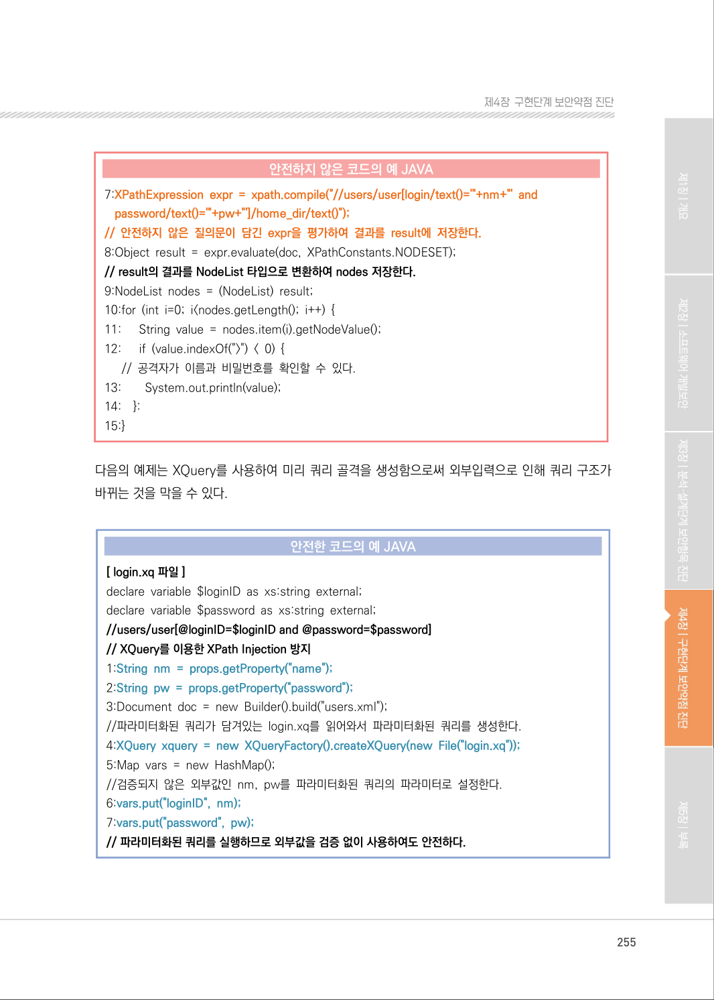

</details>

### PDF 256페이지 / 인쇄 256페이지

<!-- source-page:SW-Diagnosis-2021:256; source-lines:0,1,2,3,4,5,6,7,8,9,10,11,12,13,14,15,16,17,18,19,20,21,22,23,24,25,26,27,28,29,30,31,32,33,34,35,36,37,38,39,40,41,42,43 -->

256

#### 안전한 코드의 예 JAVA

```java
8:Nodes results = xquery.execute(doc, null, vars).toNodes();
9:for (int i=0; i<results.size(); i++) {
10:      System.out.println(results.get(i).toXML());21:
11:}
```

파라미터화된 쿼리를 지원하는 XQuery 구문으로 대체할 수 없는 경우에는 XPath 삽입을 유발할 수 
있는 문자들을 입력값에서 제거하고 XPath 구문을 생성, 실행하도록 한다.

#### 안전한 코드의 예 JAVA

```java
// XPath 삽입을 유발할 수 있는 문자들을 입력값에서 제거
1:public String XPathFilter(String input) {
2:    if (input != null) return input.replaceAll("[',\\[]", "");
3:    else return "";
4:}
5:......
// 외부 입력값에 사용 
6:String nm = XPathFilter(props.getProperty("name"));
7:String pw = XPathFilter(props.getProperty("password"));
8:        ......
9:XPathFactory factory = XPathFactory.newInstance(); 
10:XPath xpath = factory.newXPath();
11:           ......
//외부 입력값인 nm, pw를 검증하여 쿼리문을 생성하므로 안전하다.
12:XPathExpression expr = xpath.compile("//users/user[login/text()='"+nm+"' and 
password/text()='"+pw+"']/home_dir/text()");
13:Object result = expr.evaluate(doc, XPathConstants.NODESET);
14:NodeList nodes = (NodeList) result;
15:for (int i=0; i<nodes.getLength(); i++) {
16:    String value = nodes.item(i).getNodeValue();
17:    if (value.indexOf(">") < 0) {
18:         System.out.println(value);
19:    }
20:}
21:    ......
```

<details><summary>원본 페이지 이미지 (변환 외 보존 자료)</summary>

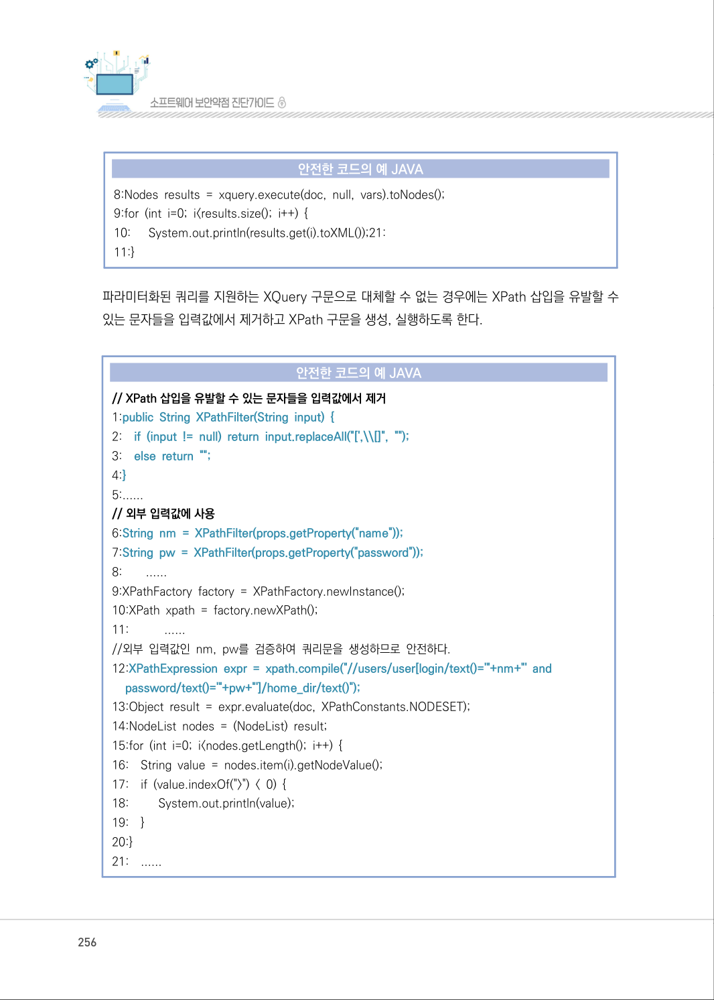

</details>

### PDF 257페이지 / 인쇄 257페이지

<!-- source-page:SW-Diagnosis-2021:257; source-lines:0,1,2,3,4,5,6,7,8,9,10,11,12,13,14,15,16,17,18,19,20,21,22,23,24,25,26,27,28,29,30,31,32,33,34,35,36,37,38,39,40,41,42 -->

257

제4장구현단계 보안약점 진단

아래 코드는 입력값을 검증하지 않고 입력값을 XPath 구문 생성 및 실행에 사용하고 있다. 입력값으로 
any' or 'a' = 'a 와 같이 XPath 구문을 조작하는 문자열을 전달하는 경우 //food [name='any' or 'a' 
= 'a']/price 같이 구문이 만들어지고 실행되어 모든 food의 가격(price)가 조회되게 된다.

#### 안전하지 않은 코드의 예 JAVA

```java
1:public static void main(String[] args) throws Exception { 
2:    if (args.length <= 0) {
3:        System.err.println("가격을 검색할 식품의 이름을 입력하세요."); 
4:        return;
5:    }
6:    String name = args[0];
7:    DocumentBuilder docBuilder =DocumentBuilderFactory.newInstance().newDocumentBuilder();
Document doc = docBuilder.parse("http://www.w3schools.com/xml/simple.xml");
8:    XPath xpath = XPathFactory.newInstance().newXPath();
// 프로그램의 커맨드 옵션으로 입력되는 외부값 name을 사용하여 쿼리문을 직접
// 작성하여 수행하므로 안전하지 않다.
```

```text
9:    NodeList nodes = (NodeList) xpath.evaluate("//food[name='" + name + "']/price", 
doc, XPathConstants.NODESET);
10:    for (int i = 0; i < nodes.getLength(); i++) { 
11:      System.out.println(nodes.item(i).getTextContent());
12: }
13:}
```

외부 입력값을 XPath 구문 생성 및 실행에 사용하는 경우 XPath 구문을 조작할 수 있는 문자열을 
제거하고 사용할 수 있도록 한다.

#### 안전한 코드의 예 JAVA

```java
1:public static void main(String[] args) throws Exception { 
2:    if (args.length <= 0) { 
3:         System.err.println("가격을 검색할 식품의 이름을 입력하세요.");
4:         return;
```

<details><summary>원본 페이지 이미지 (변환 외 보존 자료)</summary>

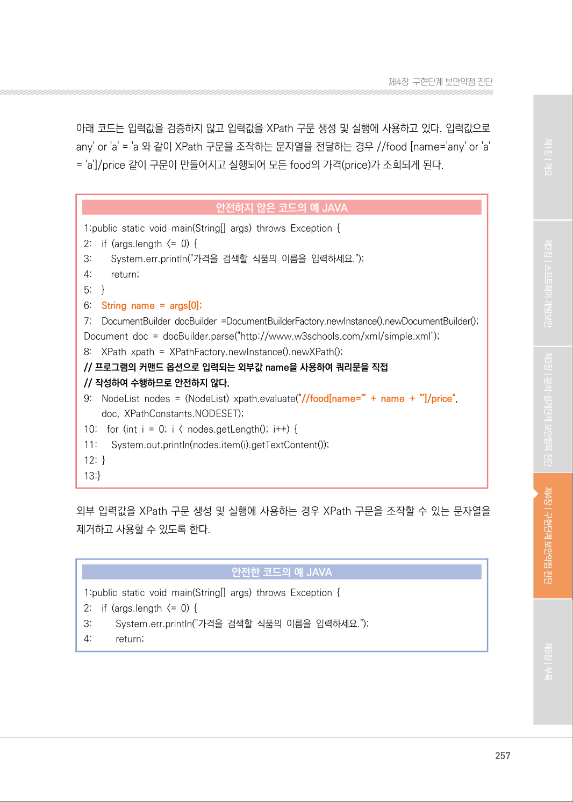

</details>

### PDF 258페이지 / 인쇄 258페이지

<!-- source-page:SW-Diagnosis-2021:258; source-lines:0,1,2,3,4,5,6,7,8,9,10,11,12,13,14,15,16,17,18,19,20,21,22,23,24,25,26,27,28,29,30,31,32,33,34,35,36,37,38,39,40,41,42,43,44,45 -->

258

#### 안전한 코드의 예 JAVA

```java
5:    }
//프로그램의 커맨드 옵션으로 입력되는 외부값 name에서 XPath 구문을 조작할 수
// 는 문자를 제거하는 검증을 수행하여 안전하다.
```

```text
6:    String name = args[0];
7:    if (name != null) {
8:         name = name.replaceAll("[()\\-'\\[\\]:,*/]", "");
9:    }
10:    DocumentBuilder docBuilder = DocumentBuilderFactory.newInstance().newDocumentBuilder();
11:    Document doc = docBuilder.parse("http://www.w3schools.com/xml/simple.xml");
12:    XPath xpath = XPathFactory.newInstance().newXPath(); 
13:    NodeList nodes = (NodeList) xpath.evaluate("//food[name='" + name + "']/price", 
doc, XPathConstants.NODESET);
14:    for (int i = 0; i < nodes.getLength(); i++) { 
15: System.out.println(nodes.item(i).getTextContent()); 
16:    }
17:}
```

다음의 예제는 외부입력을 사용하여 XPath 식에 바로 사용합니다. 이는 공격자의 입력에 따라 
XQuery의 구조를 바꾸어 예기치 않은 공격이 발생할 수 있습니다.

#### 안전하지 않은 코드의 예 C#

```csharp
1:string acctID = Request["acctID"];
2:string query = null;
3:if(acctID != null)
4:{ 
5:    StringBuffer sb = new StringBuffer("/accounts/account[acctID='"); 
6:    sb.Append(acctID); 
7:    sb.Append("']/email/text()"); 
8:    query = sb.ToString(); 
9:}
10: XPathDocument docNav = new XPathDocument(myXml);
```

<details><summary>원본 페이지 이미지 (변환 외 보존 자료)</summary>

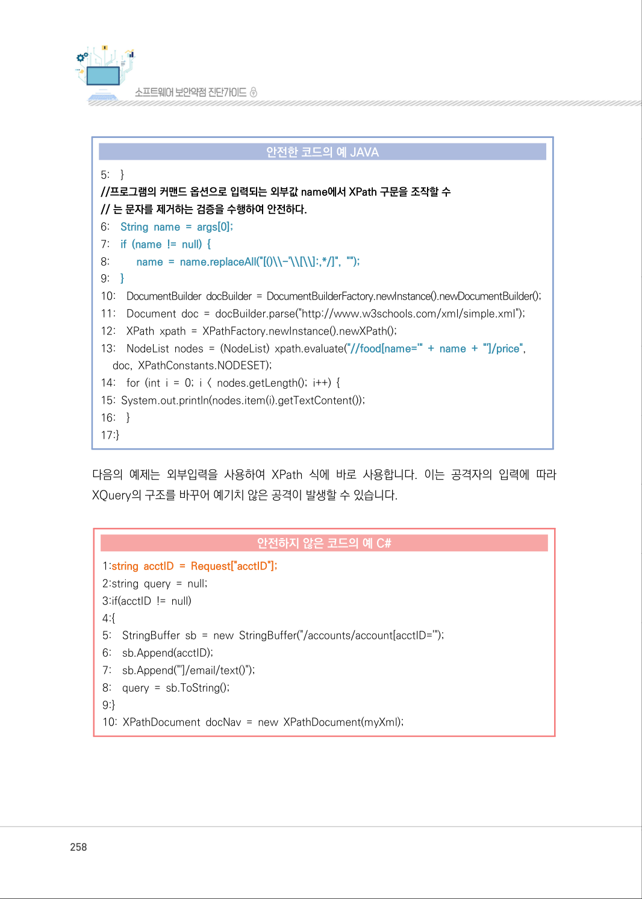

</details>

### PDF 259페이지 / 인쇄 259페이지

<!-- source-page:SW-Diagnosis-2021:259; source-lines:0,1,2,3,4,5,6,7,8,9,10,11,12,13,14,15,16,17,18,19,20,21,22,23,24,25,26,27,28,29,30,31,32 -->

259

제4장구현단계 보안약점 진단

#### 안전하지 않은 코드의 예 C#

```csharp
11:XPathNavigator nav = docNav.CreateNavigator(); 
//외부 입력값을 검증 없이 사용하고 있습니다.
12:nav.Evaluate(query);
```

다음의 예제는 XPathExpression을 사용하여 미리 쿼리 골격을 생성함으로써 외부입력으로 인해 쿼리 
구조가 바뀌는 것을 막을 수 있다.

#### 안전한 코드의 예 C#

```csharp
1:string xpath = "/accounts/account[@acctID=$acctID]/email/text()";
2:XPathExpression expr = DynamicContext.Compile(xpath);
3:DynamicContext ctx = new DynamicContext();
4:ctx.AddVariable("acctID", AccountIDTextBox.Text);
5:expr.SetContext(ctx);
6:XPathNodeIterator data = nav.Select(expr);
```

#### 라. 진단방법

ㆍXQuery 삽입

XQuery가 실행되는 부분을 확인하고(①), XQuery 쿼리스트링에 사용되는 변수가 외부 입력값 
여부를 확인한 후(②), 변수에 대한 필터링 모듈이 존재하는지 확인한다. 필터링 모듈이 존재하거나 
관련 프레임워크에서 적절히 조치할 경우 안전한 것으로 판정한다.

일반적인 진단의 예

```text
1:    …
2:    // 외부로부터 입력을 받음
3:    String name = props.getProperty(“name”); ········································································②
4:    Hashtable env = new Hashtable(); 
5:    env.put(Context.INITIAL_CONTEXT_FACTORY, “com.sun.jndi.ldap.LdapCtxFactory”);
6:    env.put(Context.PROVIDER_URL, “ldap://localhost:389/o=rootDir”);
```

<details><summary>원본 페이지 이미지 (변환 외 보존 자료)</summary>

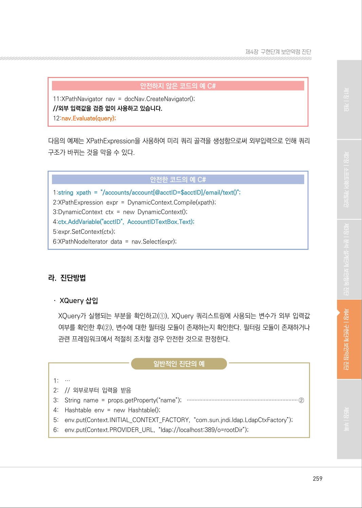

</details>

### PDF 260페이지 / 인쇄 260페이지

<!-- source-page:SW-Diagnosis-2021:260; source-lines:0,1,2,3,4,5,6,7,8,9,10,11,12,13,14,15,16,17,18,19,20,21,22,23,24,25,26,27,28,29,30,31,32,33,34,35,36,37,38,39,40,41 -->

260

일반적인 진단의 예

```text
7:    javax.naming.directory.DirContext ctx = new InitialDirContext(env); 
8:    javax.xml.xquery.XQDataSource xqds = (javax.xml.xquery.XQDataSource) 
ctx.lookup(“x- qj/personnel”); 
9:    javax.xml.xquery.XQConnection conn = xqds.getConnection(); 
10:
11: String es = “doc(‘users.xml’)/userlist/user[uname=’” + name + “’]”; ·························②
12: // 입력값이 Xquery의 인자로 사용 
13: XQPreparedExpression expr = conn.prepareExpression(es); 
14: XQResultSequence result = expr.executeQuery(); ···························································①
15: while (result.next()) { 
16: String str = result.getAtomicValue(); 
17: if (str.indexOf(‘>’) < 0) { 
18: System.out.println(str); 
19: }
20: …
```

다음의 코드에서는 외부의 입력(name)값을 executeQuery를 사용한 쿼리생성의 문자열 인자 생성에 
사용하고 있다. 만일 다음과 something’ or ‘=’1 을 name의 값으로 전달하면 다음과 같은 쿼리 
문을 수행할 수 있으며, 이로써 파일 내의 모든 값을 출력할 수 있게 되어 취약하다.

(doc(‘users.xml’)/userlist/user[uname=’something’ or ‘=’)

정탐코드의 예

```text
1:    …
2:    // 외부로부터 입력을 받음 
3:    String name = props.getProperty(“name”); 
4:    Hashtable env = new Hashtable(); 
5:    env.put(Context.INITIAL_CONTEXT_FACTORY, “com.sun.jndi.ldap.LdapCtxFactory”);
6:    env.put(Context.PROVIDER_URL, “ldap://localhost:389/o=rootDir”); 
7:    javax.naming.directory.DirContext ctx = new InitialDirContext(env); 
8:    javax.xml.xquery.XQDataSource xqds = (javax.xml.xquery.XQDataSource) 
ctx.lookup(“x- qj/personnel”);
```

<details><summary>원본 페이지 이미지 (변환 외 보존 자료)</summary>

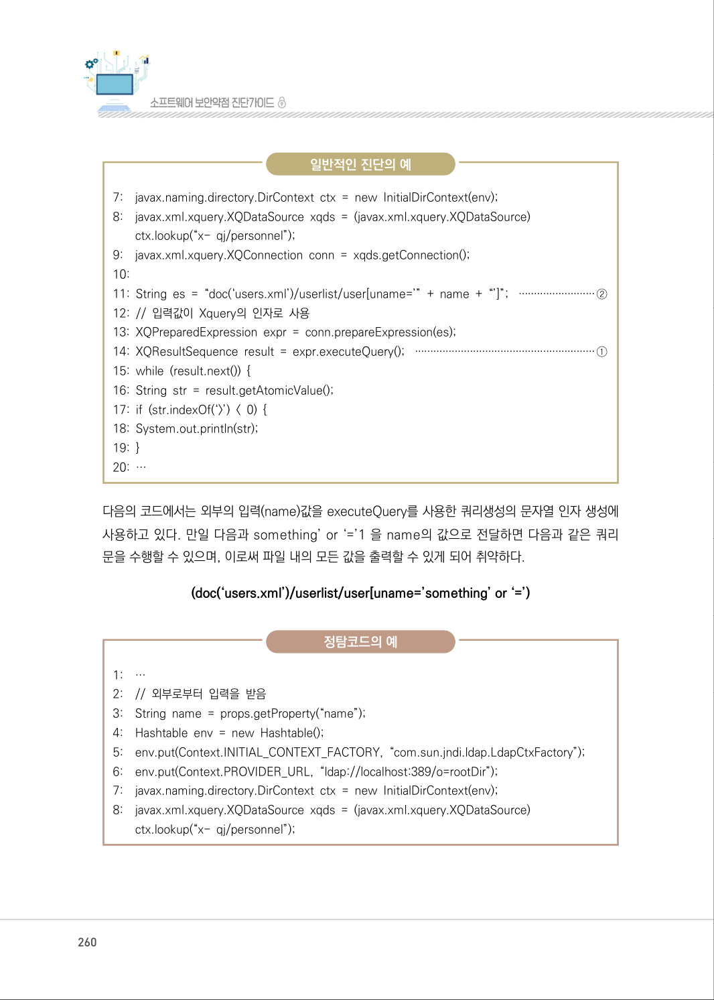

</details>

### PDF 261페이지 / 인쇄 261페이지

<!-- source-page:SW-Diagnosis-2021:261; source-lines:0,1,2,3,4,5,6,7,8,9,10,11,12,13,14,15,16,17,18,19,20,21,22,23,24,25,26,27,28,29,30,31,32,33,34,35 -->

261

제4장구현단계 보안약점 진단

정탐코드의 예

```text
9: javax.xml.xquery.XQConnection conn = xqds.getConnection(); 
10:
11:String es = “doc(‘users.xml’)/userlist/user[uname=’” + name + “’]”; 
12:// 입력 값이 Xquery의 인자로 사용 
13:XQPreparedExpression expr = conn.prepareExpression(es); 
14:XQResultSequence result = expr.executeQuery(); 
15:while (result.next()) { 
16:String str = result.getAtomicValue(); 
17:if (str.indexOf(‘>’) < 0) { 
18:System.out.println(str); 
19:}
20:…
```

ㆍXPath 삽입

XPath 객체로 쿼리 스트링이 컴파일 되는 부분을 확인하고(①), XPath 쿼리스트링에 사용되는 
변수가 외부 입력값 인지 확인한 후(②) 변수에 대한 필터링 모듈이 존재하는지 확인한다. 필터
링 모듈이 존재하거나 관련 프레임워크에서 적절하게 조치된 경우엔 안전하다고 판정한다.

일반적인 진단의 예

```text
1:    …
2:    String acctID = request.getParameter(“acctID”); ·······························································②
3:    String query = null;
4:    if(acctID != null) { 
5:    StringBuffer sb = new StringBuffer(“/accounts/account[acctID=’”); 
6:    sb.append(acctID); ····················································································································②
7:    sb.append(“’]/email/text()”); 
8:    query = sb.toString();
```

<details><summary>원본 페이지 이미지 (변환 외 보존 자료)</summary>

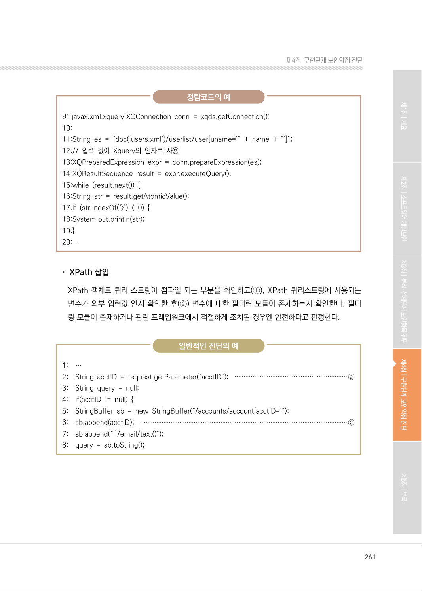

</details>

### PDF 262페이지 / 인쇄 262페이지

<!-- source-page:SW-Diagnosis-2021:262; source-lines:0,1,2,3,4,5,6,7,8,9,10,11,12,13,14,15,16,17,18,19,20,21,22,23,24,25,26,27,28,29,30,31,32,33,34,35,36,37,38,39,40,41 -->

262

일반적인 진단의 예

```text
9:    }
10: DocumentBuilderFactory domFactory = DocumentBuilderFactory.newInstance();
11: domFactory.setNamespaceAware(true); 
12: DocumentBuilder builder = domFactory.newDocumentBuilder(); 
13: Document doc = builder.parse(“accounts.xml”); 
14: XPathFactory factory = XPathFactory.newInstance(); 
15: XPath xpath = factory.newXPath(); 
16: XPathExpression expr = xpath.compile(query); ·································································①
17: Object result = expr.evaluate(doc, XPathConstants.NODESET); 
18: …
```

다음의 예제에서는 name의 값으로 “”user1””, passwd의 값으로 “”’ or “=’””을 전달하면 다음과 
같은 쿼리문이 생성되어 인증과정을 거치지 않고 로그인할 수 있어 취약하다고 판정한다.

(//users/user[login/text()=’user1’ or ‘’=’’ and password/text() = “” or “”=””]/home_dir/text())

정탐코드의 예

```text
1:    … 
2:    // 외부로부터 입력을 받음 
3:    String name = props.getProperty(“name”); 
4:    String passwd = props.getProperty(“password”); 
5:    …
6:    XPathFactory factory = XPathFactory.newInstance(); 
7:    XPath xpath = factory.newXPath(); 
8:    … 
9:    // 외부 입력이 xpath의 인자로 사용 
10: XPathExpression expr = xpath.compile(“//users/user[login/text()=’” + name + “’ and 
password/text() = ‘” + passwd + “’]/home_dir/text()”); 
11: Object result = expr.evaluate(doc, XPathConstants.NODESET); 
12: NodeList nodes = (NodeList) result; 
13: for (int i = 0; i < nodes.getLength(); i++) { 
14: String value = nodes.item(i).getNodeValue(); 
15: if (value.indexOf(“>”) < 0) {
```

<details><summary>원본 페이지 이미지 (변환 외 보존 자료)</summary>

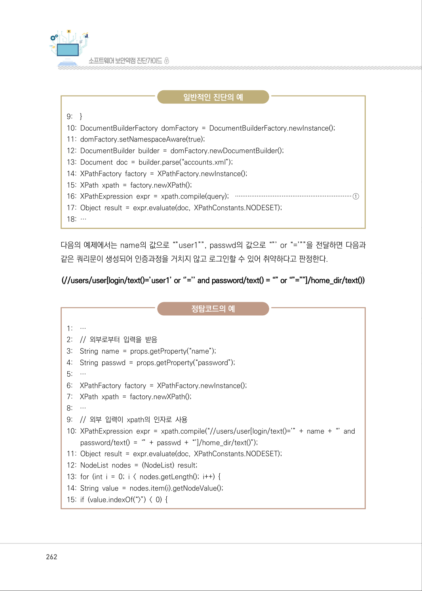

</details>

### PDF 263페이지 / 인쇄 263페이지

<!-- source-page:SW-Diagnosis-2021:263; source-lines:0,1,2,3,4,5,6,7,8,9,10,11,12,13,14,15,16,17,18 -->

263

제4장구현단계 보안약점 진단

정탐코드의 예

```text
16: System.out.println(value);
17: }
18: …
```

#### 마. 참고자료

[1] CWE-652 XQuery Injection, MITRE,

http://cwe.mitre.org/data/definitions/652.html
[2] Prevent XML Injection, CERT,

http://www.securecoding.cert.org/confluence/display/java/IDS16-J.+Prevent+X
ML+Injection
[3] CWE-643 XPath Injection, MITRE,

http://cwe.mitre.org/data/definitions/643.html 
[4] Prevent XPath Injection, CERT,

http://www.securecoding.cert.org/confluence/display/java/IDS53-J.+Prevent+ 
XPath +Injection
[5] XPATH Injection, OWASP,

https://www.owasp.org/index.php/XPATH_Injection

<details><summary>원본 페이지 이미지 (변환 외 보존 자료)</summary>

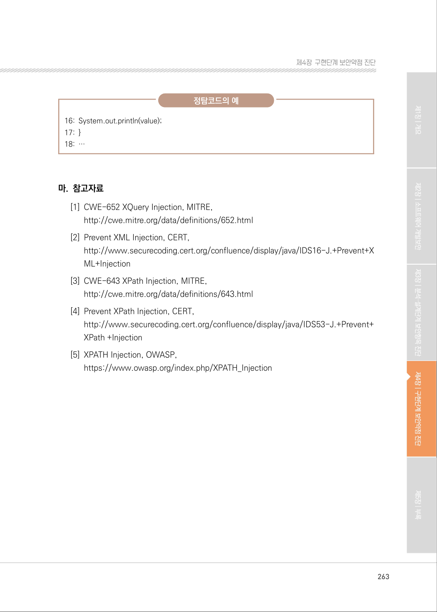

</details>

---

## 탐색 링크 (원문 외)

[통합 인덱스](../../../INDEX.md)

