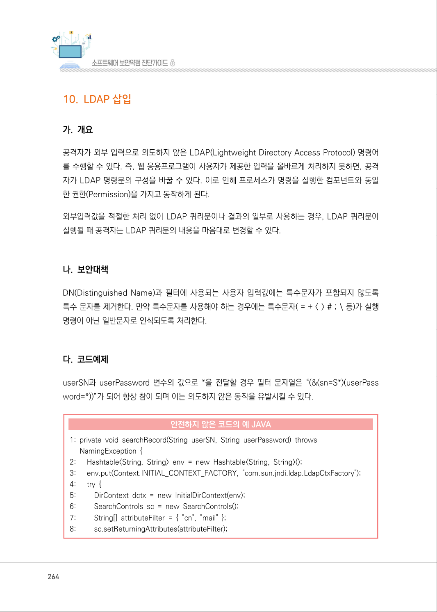
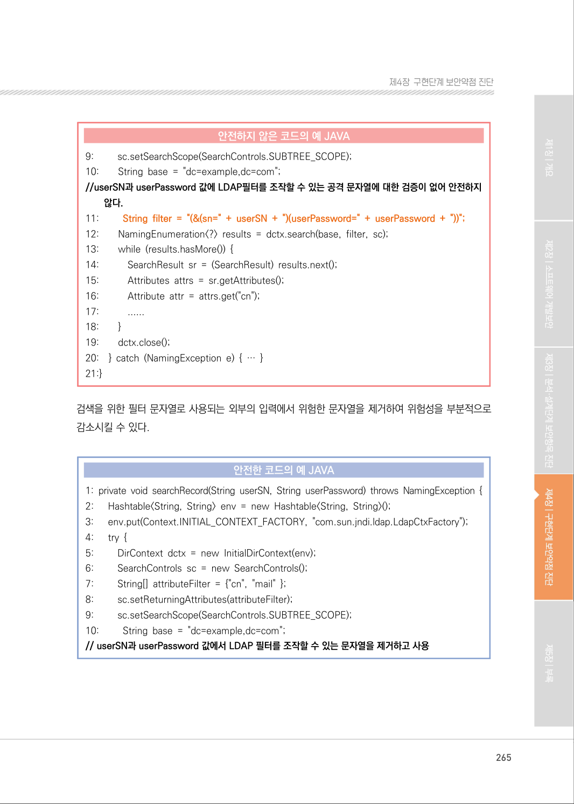
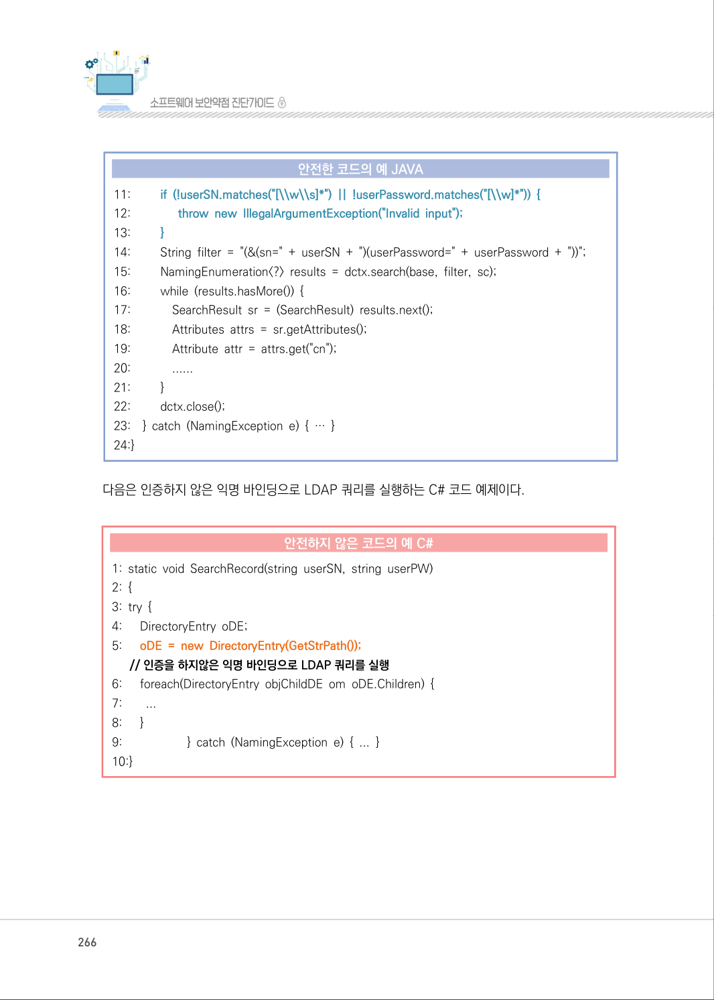
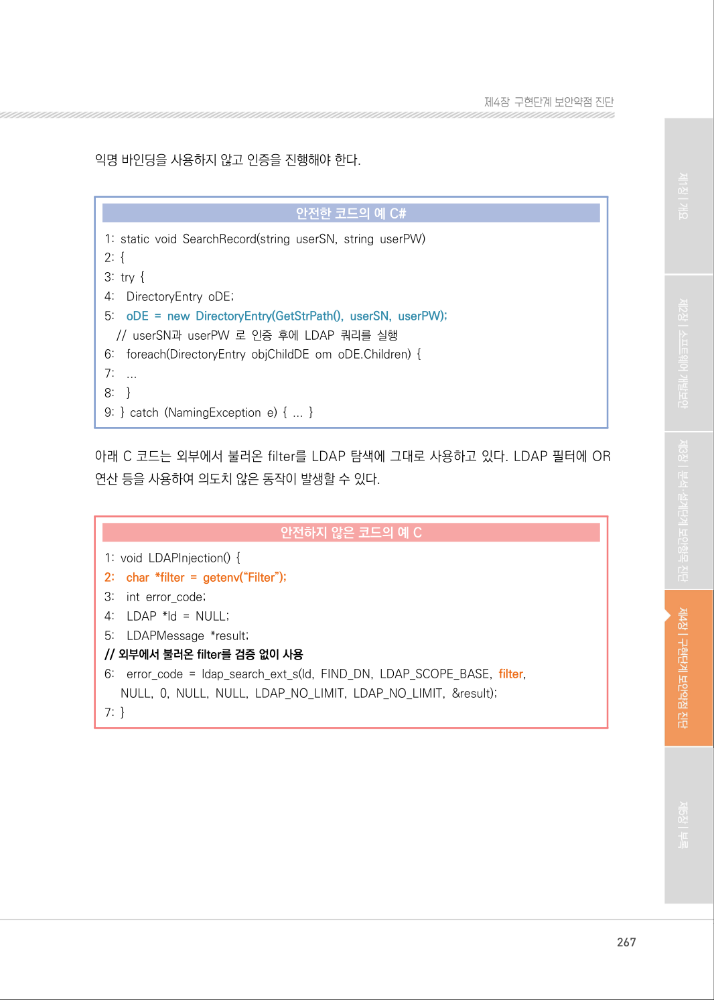
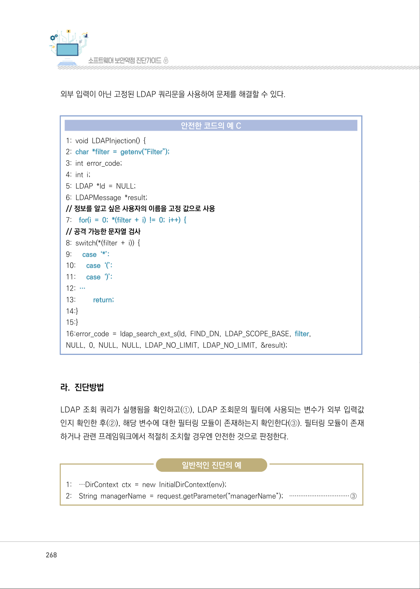
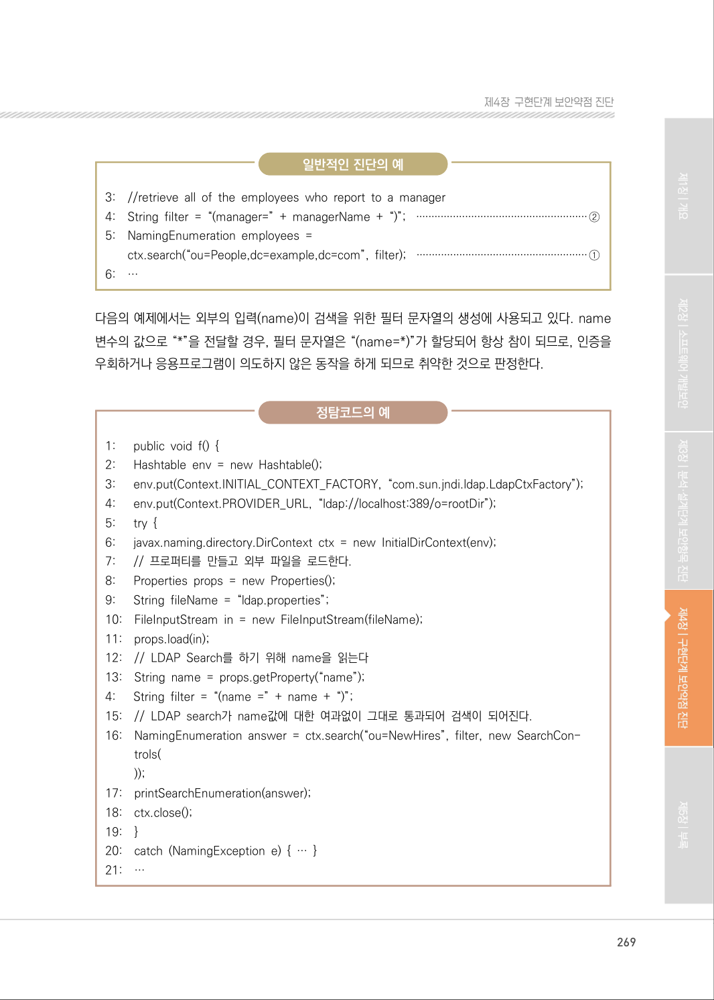
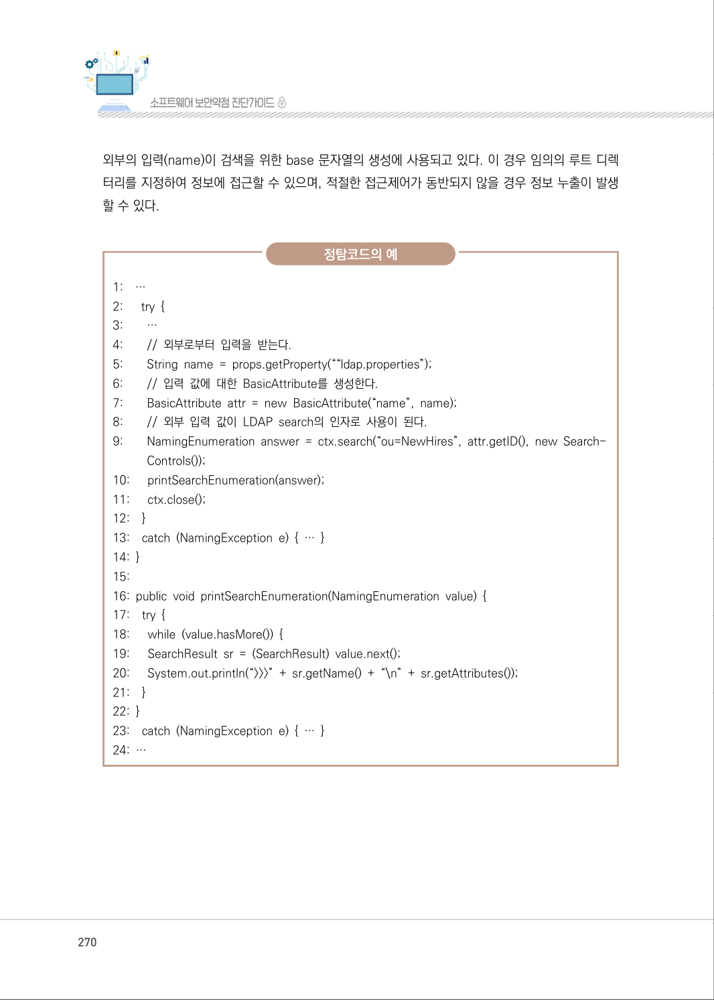
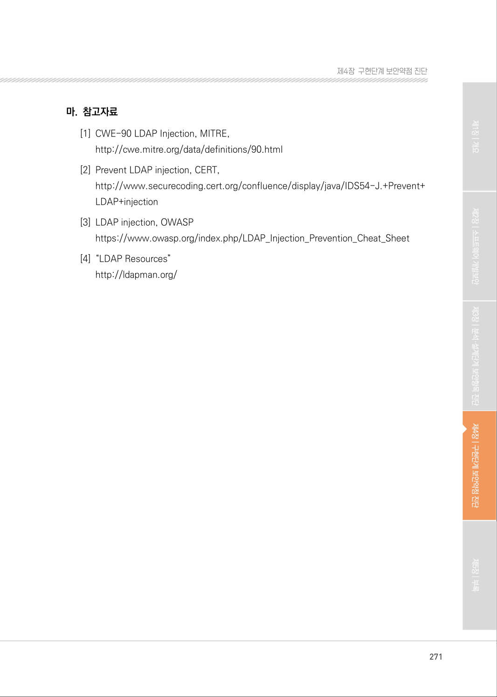

# 10. LDAP 삽입

> 변환 안내(원문 외): 아래 본문은 PDF 텍스트를 추출한 전사입니다. 코드 줄번호·특수 공백·원문 오류를 유지했습니다. 실행용 코드가 아닙니다. 표·그림·들여쓰기는 연결된 페이지 이미지와 대조하세요. 페이지 경계의 줄바꿈을 보존하며, 동일 페이지가 여러 항목에 나뉘면 각 항목의 본문은 해당 구간만 포함합니다.

### PDF 264페이지 / 인쇄 264페이지

<!-- source-page:SW-Diagnosis-2021:264; source-lines:0,1,2,3,4,5,6,7,8,9,10,11,12,13,14,15,16,17,18,19,20,21,22,23,24,25,26,27,28,29,30,31,32 -->

264

#### 10. LDAP 삽입

#### 가. 개요

공격자가 외부 입력으로 의도하지 않은 LDAP(Lightweight Directory Access Protocol) 명령어
를 수행할 수 있다. 즉, 웹 응용프로그램이 사용자가 제공한 입력을 올바르게 처리하지 못하면, 공격
자가 LDAP 명령문의 구성을 바꿀 수 있다. 이로 인해 프로세스가 명령을 실행한 컴포넌트와 동일
한 권한(Permission)을 가지고 동작하게 된다.

외부입력값을 적절한 처리 없이 LDAP 쿼리문이나 결과의 일부로 사용하는 경우, LDAP 쿼리문이 
실행될 때 공격자는 LDAP 쿼리문의 내용을 마음대로 변경할 수 있다.

#### 나. 보안대책

DN(Distinguished Name)과 필터에 사용되는 사용자 입력값에는 특수문자가 포함되지 않도록 
특수 문자를 제거한다. 만약 특수문자를 사용해야 하는 경우에는 특수문자( = + &lt; &gt; # ; \ 등)가 실행
명령이 아닌 일반문자로 인식되도록 처리한다.

#### 다. 코드예제

userSN과 userPassword 변수의 값으로 *을 전달할 경우 필터 문자열은 “(&amp;(sn=S*)(userPass 
word=*))”가 되어 항상 참이 되며 이는 의도하지 않은 동작을 유발시킬 수 있다.

#### 안전하지 않은 코드의 예 JAVA

```java
1: private void searchRecord(String userSN, String userPassword) throws 
NamingException { 
2:      Hashtable<String, String> env = new Hashtable<String, String>(); 
3:      env.put(Context.INITIAL_CONTEXT_FACTORY, "com.sun.jndi.ldap.LdapCtxFactory");
4:      try { 
5:         DirContext dctx = new InitialDirContext(env); 
6:         SearchControls sc = new SearchControls(); 
7:         String[] attributeFilter = { "cn", "mail" }; 
8:         sc.setReturningAttributes(attributeFilter);
```

<details><summary>원본 페이지 이미지 (변환 외 보존 자료)</summary>



</details>

### PDF 265페이지 / 인쇄 265페이지

<!-- source-page:SW-Diagnosis-2021:265; source-lines:0,1,2,3,4,5,6,7,8,9,10,11,12,13,14,15,16,17,18,19,20,21,22,23,24,25,26,27,28,29,30,31,32,33,34,35,36,37,38,39,40,41,42,43,44,45,46,47,48,49,50,51,52 -->

265

제4장구현단계 보안약점 진단

#### 안전하지 않은 코드의 예 JAVA

```java
9:         sc.setSearchScope(SearchControls.SUBTREE_SCOPE); 
10:        String base = "dc=example,dc=com"; 
//userSN과 userPassword 값에 LDAP필터를 조작할 수 있는 공격 문자열에 대한 검증이 없어 안전하지 
않다.
```

```text
11:         String filter = "(&(sn=" + userSN + ")(userPassword=" + userPassword + "))";
12:        NamingEnumeration<?> results = dctx.search(base, filter, sc);
13:        while (results.hasMore()) { 
14:           SearchResult sr = (SearchResult) results.next(); 
15:           Attributes attrs = sr.getAttributes(); 
16:           Attribute attr = attrs.get("cn"); 
17:           ......
18:        }
19:        dctx.close(); 
20:    } catch (NamingException e) { … } 
21:}
```

검색을 위한 필터 문자열로 사용되는 외부의 입력에서 위험한 문자열을 제거하여 위험성을 부분적으로 
감소시킬 수 있다.

#### 안전한 코드의 예 JAVA

```java
1: private void searchRecord(String userSN, String userPassword) throws NamingException {
2:      Hashtable<String, String> env = new Hashtable<String, String>(); 
3:      env.put(Context.INITIAL_CONTEXT_FACTORY, "com.sun.jndi.ldap.LdapCtxFactory");
4:      try {
5:         DirContext dctx = new InitialDirContext(env); 
6:         SearchControls sc = new SearchControls(); 
7:         String[] attributeFilter = {"cn", "mail" }; 
8:         sc.setReturningAttributes(attributeFilter); 
9:         sc.setSearchScope(SearchControls.SUBTREE_SCOPE); 
10:         String base = "dc=example,dc=com"; 
// userSN과 userPassword 값에서 LDAP 필터를 조작할 수 있는 문자열을 제거하고 사용
```

<details><summary>원본 페이지 이미지 (변환 외 보존 자료)</summary>



</details>

### PDF 266페이지 / 인쇄 266페이지

<!-- source-page:SW-Diagnosis-2021:266; source-lines:0,1,2,3,4,5,6,7,8,9,10,11,12,13,14,15,16,17,18,19,20,21,22,23,24,25,26,27,28,29,30,31,32,33,34,35,36,37,38,39,40,41,42,43,44,45,46,47 -->

266

#### 안전한 코드의 예 JAVA

```java
11:         if (!userSN.matches("[\\w\\s]*") || !userPassword.matches("[\\w]*")) {
12:               throw new IllegalArgumentException("Invalid input");
13:         }
14:         String filter = "(&(sn=" + userSN + ")(userPassword=" + userPassword + "))";
15:         NamingEnumeration<?> results = dctx.search(base, filter, sc);
16:         while (results.hasMore()) {
17:             SearchResult sr = (SearchResult) results.next();
18:             Attributes attrs = sr.getAttributes();
19:             Attribute attr = attrs.get("cn");
20:             ......
21:         }
22:         dctx.close();
23:    } catch (NamingException e) { … }
24:}
```

다음은 인증하지 않은 익명 바인딩으로 LDAP 쿼리를 실행하는 C# 코드 예제이다.

#### 안전하지 않은 코드의 예 C#

```csharp
1: static void SearchRecord(string userSN, string userPW) 
2: { 
3: try { 
4:      DirectoryEntry oDE; 
5:      oDE = new DirectoryEntry(GetStrPath());
// 인증을 하지않은 익명 바인딩으로 LDAP 쿼리를 실행
6:      foreach(DirectoryEntry objChildDE om oDE.Children) { 
7:        ...
8:      }
9:                     } catch (NamingException e) { ... } 
10:}
```

<details><summary>원본 페이지 이미지 (변환 외 보존 자료)</summary>



</details>

### PDF 267페이지 / 인쇄 267페이지

<!-- source-page:SW-Diagnosis-2021:267; source-lines:0,1,2,3,4,5,6,7,8,9,10,11,12,13,14,15,16,17,18,19,20,21,22,23,24,25,26,27,28,29,30,31,32,33,34,35 -->

267

제4장구현단계 보안약점 진단

익명 바인딩을 사용하지 않고 인증을 진행해야 한다.

#### 안전한 코드의 예 C#

```csharp
1: static void SearchRecord(string userSN, string userPW) 
2: { 
3: try { 
4:    DirectoryEntry oDE; 
5:    oDE = new DirectoryEntry(GetStrPath(), userSN, userPW);
// userSN과 userPW 로 인증 후에 LDAP 쿼리를 실행 
6:    foreach(DirectoryEntry objChildDE om oDE.Children) { 
7:    ...
8:    }
9: } catch (NamingException e) { ... }
```

아래 C 코드는 외부에서 불러온 filter를 LDAP 탐색에 그대로 사용하고 있다. LDAP 필터에 OR 
연산 등을 사용하여 의도치 않은 동작이 발생할 수 있다.

#### 안전하지 않은 코드의 예 C

```c
1: void LDAPInjection() { 
2:    char *filter = getenv(“Filter”);
3:    int error_code; 
4:    LDAP *ld = NULL; 
5:    LDAPMessage *result; 
// 외부에서 불러온 filter를 검증 없이 사용 
6:    error_code = ldap_search_ext_s(ld, FIND_DN, LDAP_SCOPE_BASE, filter,
NULL, 0, NULL, NULL, LDAP_NO_LIMIT, LDAP_NO_LIMIT, &result);
7: }
```

<details><summary>원본 페이지 이미지 (변환 외 보존 자료)</summary>



</details>

### PDF 268페이지 / 인쇄 268페이지

<!-- source-page:SW-Diagnosis-2021:268; source-lines:0,1,2,3,4,5,6,7,8,9,10,11,12,13,14,15,16,17,18,19,20,21,22,23,24,25,26,27,28,29,30,31,32,33,34,35 -->

268

외부 입력이 아닌 고정된 LDAP 쿼리문을 사용하여 문제를 해결할 수 있다.

#### 안전한 코드의 예 C

```c
1: void LDAPInjection() { 
2: char *filter = getenv(“Filter”); 
3: int error_code; 
4: int i; 
5: LDAP *ld = NULL; 
6: LDAPMessage *result; 
// 정보를 알고 싶은 사용자의 이름을 고정 값으로 사용 
7:    for(i = 0; *(filter + i) != 0; i++) { 
// 공격 가능한 문자열 검사 
8: switch(*(filter + i)) { 
9:      case ‘*’: 
10:      case ‘(’: 
11:      case ‘)’: 
12: …
13:         return;
14:}
15:}
16:error_code = ldap_search_ext_s(ld, FIND_DN, LDAP_SCOPE_BASE, filter,
NULL, 0, NULL, NULL, LDAP_NO_LIMIT, LDAP_NO_LIMIT, &result); 
```

#### 라. 진단방법

LDAP 조회 쿼리가 실행됨을 확인하고(①), LDAP 조회문의 필터에 사용되는 변수가 외부 입력값 
인지 확인한 후(②), 해당 변수에 대한 필터링 모듈이 존재하는지 확인한다(③). 필터링 모듈이 존재
하거나 관련 프레임워크에서 적절히 조치할 경우엔 안전한 것으로 판정한다.

일반적인 진단의 예

```text
1:    …DirContext ctx = new InitialDirContext(env); 
2:    String managerName = request.getParameter(“managerName”); ·································③
```

<details><summary>원본 페이지 이미지 (변환 외 보존 자료)</summary>



</details>

### PDF 269페이지 / 인쇄 269페이지

<!-- source-page:SW-Diagnosis-2021:269; source-lines:0,1,2,3,4,5,6,7,8,9,10,11,12,13,14,15,16,17,18,19,20,21,22,23,24,25,26,27,28,29,30,31,32,33,34,35,36,37,38,39,40,41,42,43,44,45,46,47,48,49,50,51,52,53,54,55,56,57,58,59 -->

269

제4장구현단계 보안약점 진단

일반적인 진단의 예

```text
3:    //retrieve all of the employees who report to a manager 
4:    String filter = “(manager=” + managerName + “)”; ························································②
5:    NamingEnumeration employees =
ctx.search(“ou=People,dc=example,dc=com”, filter); ························································①
6:    …
```

다음의 예제에서는 외부의 입력(name)이 검색을 위한 필터 문자열의 생성에 사용되고 있다. name 
변수의 값으로 “*”을 전달할 경우, 필터 문자열은 “(name=*)”가 할당되어 항상 참이 되므로, 인증을 
우회하거나 응용프로그램이 의도하지 않은 동작을 하게 되므로 취약한 것으로 판정한다.

정탐코드의 예

```text
1:      public void f() { 
2:      Hashtable env = new Hashtable(); 
3:      env.put(Context.INITIAL_CONTEXT_FACTORY, “com.sun.jndi.ldap.LdapCtxFactory”);
4:      env.put(Context.PROVIDER_URL, “ldap://localhost:389/o=rootDir”);
5:      try { 
6:      javax.naming.directory.DirContext ctx = new InitialDirContext(env); 
7:      // 프로퍼티를 만들고 외부 파일을 로드한다. 
8:      Properties props = new Properties(); 
9:      String fileName = “ldap.properties”; 
10:    FileInputStream in = new FileInputStream(fileName); 
11:    props.load(in); 
12:    // LDAP Search를 하기 위해 name을 읽는다 
13:    String name = props.getProperty(“name”); 
```

```text
4:      String filter = “(name =” + name + “)”; 
15:    // LDAP search가 name값에 대한 여과없이 그대로 통과되어 검색이 되어진다.
16:    NamingEnumeration answer = ctx.search(“ou=NewHires”, filter, new SearchCon-
trols(
));
```

```text
17:    printSearchEnumeration(answer); 
18:    ctx.close(); 
19:    }
20:    catch (NamingException e) { … }
21:    …
```

<details><summary>원본 페이지 이미지 (변환 외 보존 자료)</summary>



</details>

### PDF 270페이지 / 인쇄 270페이지

<!-- source-page:SW-Diagnosis-2021:270; source-lines:0,1,2,3,4,5,6,7,8,9,10,11,12,13,14,15,16,17,18,19,20,21,22,23,24,25,26,27,28,29,30,31,32,33,34,35,36,37,38,39,40,41,42,43,44,45,46,47,48 -->

270

외부의 입력(name)이 검색을 위한 base 문자열의 생성에 사용되고 있다. 이 경우 임의의 루트 디렉
터리를 지정하여 정보에 접근할 수 있으며, 적절한 접근제어가 동반되지 않을 경우 정보 누출이 발생 
할 수 있다.

정탐코드의 예

```text
1:    …
2:      try { 
3:        …
4:        // 외부로부터 입력을 받는다. 
5:        String name = props.getProperty(““ldap.properties”); 
6:        // 입력 값에 대한 BasicAttribute를 생성한다. 
7:        BasicAttribute attr = new BasicAttribute(“name”, name); 
8:        // 외부 입력 값이 LDAP search의 인자로 사용이 된다. 
9:        NamingEnumeration answer = ctx.search(“ou=NewHires”, attr.getID(), new Search- 
Controls()); 
10:      printSearchEnumeration(answer); 
11:      ctx.close();
12:    }
13:    catch (NamingException e) { … } 
14: }
15:
16: public void printSearchEnumeration(NamingEnumeration value) {
17:    try {
18:      while (value.hasMore()) { 
19:      SearchResult sr = (SearchResult) value.next(); 
20:      System.out.println(“>>>” + sr.getName() + “\n” + sr.getAttributes());
21:    }
22: }
23:    catch (NamingException e) { … } 
24: …
```

<details><summary>원본 페이지 이미지 (변환 외 보존 자료)</summary>



</details>

### PDF 271페이지 / 인쇄 271페이지

<!-- source-page:SW-Diagnosis-2021:271; source-lines:0,1,2,3,4,5,6,7,8,9,10,11 -->

271

제4장구현단계 보안약점 진단

#### 마. 참고자료

[1] CWE-90 LDAP Injection, MITRE,

http://cwe.mitre.org/data/definitions/90.html 
[2] Prevent LDAP injection, CERT,

http://www.securecoding.cert.org/confluence/display/java/IDS54-J.+Prevent+ 
LDAP+injection
[3] LDAP injection, OWASP

https://www.owasp.org/index.php/LDAP_Injection_Prevention_Cheat_Sheet
[4] “LDAP Resources”

http://ldapman.org/

<details><summary>원본 페이지 이미지 (변환 외 보존 자료)</summary>



</details>

---

## 탐색 링크 (원문 외)

[통합 인덱스](../../../INDEX.md)

