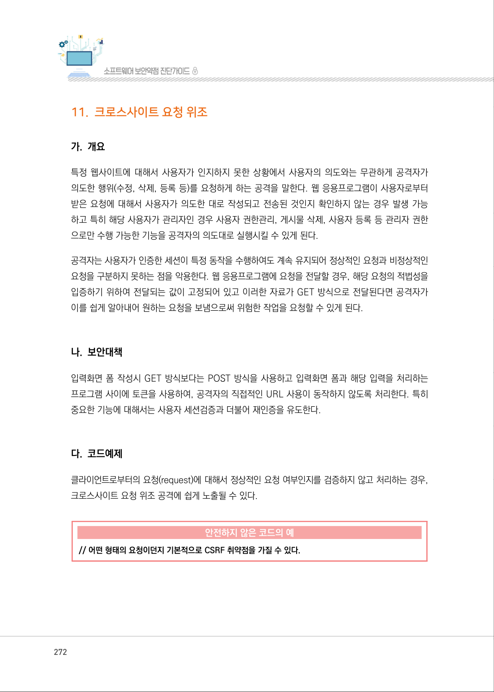
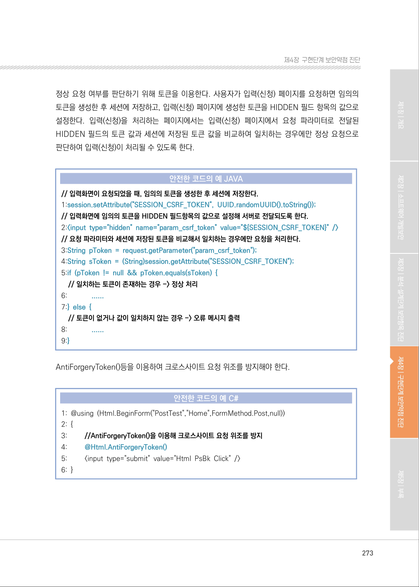
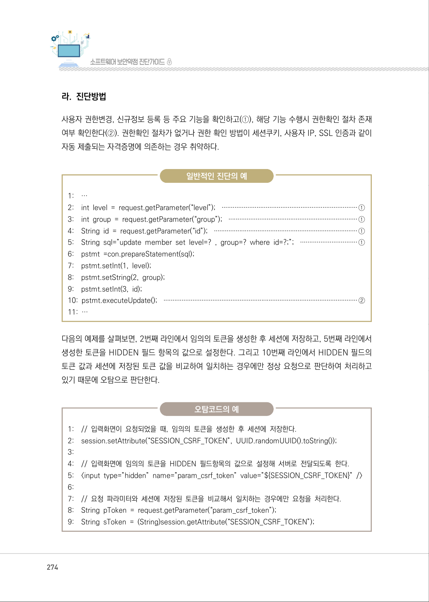
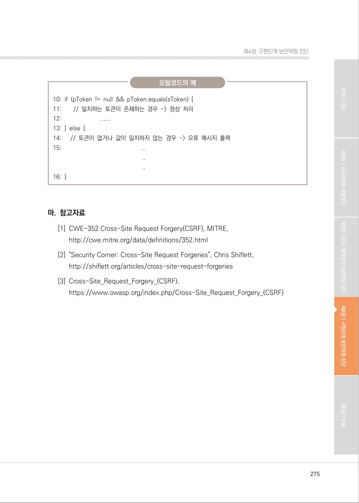

# 11. 크로스사이트 요청 위조

> 변환 안내(원문 외): 아래 본문은 PDF 텍스트를 추출한 전사입니다. 코드 줄번호·특수 공백·원문 오류를 유지했습니다. 실행용 코드가 아닙니다. 표·그림·들여쓰기는 연결된 페이지 이미지와 대조하세요. 페이지 경계의 줄바꿈을 보존하며, 동일 페이지가 여러 항목에 나뉘면 각 항목의 본문은 해당 구간만 포함합니다.

### PDF 272페이지 / 인쇄 272페이지

<!-- source-page:SW-Diagnosis-2021:272; source-lines:0,1,2,3,4,5,6,7,8,9,10,11,12,13,14,15,16,17,18,19,20 -->

272

#### 11. 크로스사이트 요청 위조

#### 가. 개요

특정 웹사이트에 대해서 사용자가 인지하지 못한 상황에서 사용자의 의도와는 무관하게 공격자가 
의도한 행위(수정, 삭제, 등록 등)를 요청하게 하는 공격을 말한다. 웹 응용프로그램이 사용자로부터 
받은 요청에 대해서 사용자가 의도한 대로 작성되고 전송된 것인지 확인하지 않는 경우 발생 가능 
하고 특히 해당 사용자가 관리자인 경우 사용자 권한관리, 게시물 삭제, 사용자 등록 등 관리자 권한
으로만 수행 가능한 기능을 공격자의 의도대로 실행시킬 수 있게 된다.

공격자는 사용자가 인증한 세션이 특정 동작을 수행하여도 계속 유지되어 정상적인 요청과 비정상적인 
요청을 구분하지 못하는 점을 악용한다. 웹 응용프로그램에 요청을 전달할 경우, 해당 요청의 적법성을 
입증하기 위하여 전달되는 값이 고정되어 있고 이러한 자료가 GET 방식으로 전달된다면 공격자가 
이를 쉽게 알아내어 원하는 요청을 보냄으로써 위험한 작업을 요청할 수 있게 된다.

#### 나. 보안대책

입력화면 폼 작성시 GET 방식보다는 POST 방식을 사용하고 입력화면 폼과 해당 입력을 처리하는 
프로그램 사이에 토큰을 사용하여, 공격자의 직접적인 URL 사용이 동작하지 않도록 처리한다. 특히 
중요한 기능에 대해서는 사용자 세션검증과 더불어 재인증을 유도한다.

#### 다. 코드예제

클라이언트로부터의 요청(request)에 대해서 정상적인 요청 여부인지를 검증하지 않고 처리하는 경우, 
크로스사이트 요청 위조 공격에 쉽게 노출될 수 있다.

#### 안전하지 않은 코드의 예

```text
// 어떤 형태의 요청이던지 기본적으로 CSRF 취약점을 가질 수 있다.
```

<details><summary>원본 페이지 이미지 (변환 외 보존 자료)</summary>



</details>

### PDF 273페이지 / 인쇄 273페이지

<!-- source-page:SW-Diagnosis-2021:273; source-lines:0,1,2,3,4,5,6,7,8,9,10,11,12,13,14,15,16,17,18,19,20,21,22,23,24,25,26,27,28,29,30,31,32,33,34 -->

273

제4장구현단계 보안약점 진단

정상 요청 여부를 판단하기 위해 토큰을 이용한다. 사용자가 입력(신청) 페이지를 요청하면 임의의 
토큰을 생성한 후 세션에 저장하고, 입력(신청) 페이지에 생성한 토큰을 HIDDEN 필드 항목의 값으로 
설정한다. 입력(신청)을 처리하는 페이지에서는 입력(신청) 페이지에서 요청 파라미터로 전달된 
HIDDEN 필드의 토큰 값과 세션에 저장된 토큰 값을 비교하여 일치하는 경우에만 정상 요청으로 
판단하여 입력(신청)이 처리될 수 있도록 한다.

#### 안전한 코드의 예 JAVA

```java
// 입력화면이 요청되었을 때, 임의의 토큰을 생성한 후 세션에 저장한다.
1:session.setAttribute("SESSION_CSRF_TOKEN", UUID.randomUUID().toString());
// 입력화면에 임의의 토큰을 HIDDEN 필드항목의 값으로 설정해 서버로 전달되도록 한다.
2:<input type="hidden" name="param_csrf_token" value="${SESSION_CSRF_TOKEN}" />
// 요청 파라미터와 세션에 저장된 토큰을 비교해서 일치하는 경우에만 요청을 처리한다.
3:String pToken = request.getParameter("param_csrf_token");
4:String sToken = (String)session.getAttribute("SESSION_CSRF_TOKEN");
5:if (pToken != null && pToken.equals(sToken) {
// 일치하는 토큰이 존재하는 경우 -> 정상 처리
6:             ......
7:} else { 
// 토큰이 없거나 값이 일치하지 않는 경우 -> 오류 메시지 출력 
8:             ......
9:}
```

AntiForgeryToken()등을 이용하여 크로스사이트 요청 위조를 방지해야 한다.

#### 안전한 코드의 예 C#

```csharp
1: @using (Html.BeginForm("PostTest","Home",FormMethod.Post,null)) 
2: {
3:         //AntiForgeryToken()을 이용해 크로스사이트 요청 위조를 방지
4:         @Html.AntiForgeryToken()
5:         <input type="submit" value="Html PsBk Click" />
6: }
```

<details><summary>원본 페이지 이미지 (변환 외 보존 자료)</summary>



</details>

### PDF 274페이지 / 인쇄 274페이지

<!-- source-page:SW-Diagnosis-2021:274; source-lines:0,1,2,3,4,5,6,7,8,9,10,11,12,13,14,15,16,17,18,19,20,21,22,23,24,25,26,27,28,29,30,31,32,33,34,35,36,37,38,39,40,41,42,43,44,45,46 -->

274

#### 라. 진단방법

사용자 권한변경, 신규정보 등록 등 주요 기능을 확인하고(①), 해당 기능 수행시 권한확인 절차 존재 
여부 확인한다(②). 권한확인 절차가 없거나 권한 확인 방법이 세션쿠키, 사용자 IP, SSL 인증과 같이 
자동 제출되는 자격증명에 의존하는 경우 취약하다.

일반적인 진단의 예

```text
1:    …
2:    int level = request.getParameter(“level”); ··········································································①
3:    int group = request.getParameter(“group”); ·······································································①
4:    String id = request.getParameter(“id”); ···············································································①
5:    String sql=”update member set level=? , group=? where id=?;”; ·······························①
6:    pstmt =con.prepareStatement(sql);
7:    pstmt.setInt(1, level); 
8:    pstmt.setString(2, group); 
9:    pstmt.setInt(3, id); 
10: pstmt.executeUpdate(); ···········································································································②
11: …
```

다음의 예제를 살펴보면, 2번째 라인에서 임의의 토큰을 생성한 후 세션에 저장하고, 5번째 라인에서 
생성한 토큰을 HIDDEN 필드 항목의 값으로 설정한다. 그리고 10번째 라인에서 HIDDEN 필드의 
토큰 값과 세션에 저장된 토큰 값을 비교하여 일치하는 경우에만 정상 요청으로 판단하여 처리하고 
있기 때문에 오탐으로 판단한다.

오탐코드의 예

```text
1:    // 입력화면이 요청되었을 때, 임의의 토큰을 생성한 후 세션에 저장한다. 
2:    session.setAttribute(“SESSION_CSRF_TOKEN”, UUID.randomUUID().toString());
3:
4:    // 입력화면에 임의의 토큰을 HIDDEN 필드항목의 값으로 설정해 서버로 전달되도록 한다.
5:    <input type=”hidden” name=”param_csrf_token” value=”${SESSION_CSRF_TOKEN}” />
6:
7:    // 요청 파라미터와 세션에 저장된 토큰을 비교해서 일치하는 경우에만 요청을 처리한다.
8:    String pToken = request.getParameter(“param_csrf_token”);
9:    String sToken = (String)session.getAttribute(“SESSION_CSRF_TOKEN”);
```

<details><summary>원본 페이지 이미지 (변환 외 보존 자료)</summary>



</details>

### PDF 275페이지 / 인쇄 275페이지

<!-- source-page:SW-Diagnosis-2021:275; source-lines:0,1,2,3,4,5,6,7,8,9,10,11,12,13,14,15,16,17,18,19,20,21,22 -->

275

제4장구현단계 보안약점 진단

오탐코드의 예

```text
10: if (pToken != null && pToken.equals(sToken) { 
11:        // 일치하는 토큰이 존재하는 경우 -> 정상 처리 
12:                         ......
13: } else { 
14:      // 토큰이 없거나 값이 일치하지 않는 경우 -> 오류 메시지 출력 
15:                                                   ..
..
..
```

16: }

#### 마. 참고자료

[1] CWE-352 Cross-Site Request Forgery(CSRF), MITRE,

http://cwe.mitre.org/data/definitions/352.html 
[2] "Security Corner: Cross-Site Request Forgeries", Chris Shiflett,

http://shiflett.org/articles/cross-site-request-forgeries
[3] Cross-Site_Request_Forgery_(CSRF),

https://www.owasp.org/index.php/Cross-Site_Request_Forgery_(CSRF)

<details><summary>원본 페이지 이미지 (변환 외 보존 자료)</summary>



</details>

---

## 탐색 링크 (원문 외)

[통합 인덱스](../../../INDEX.md)

