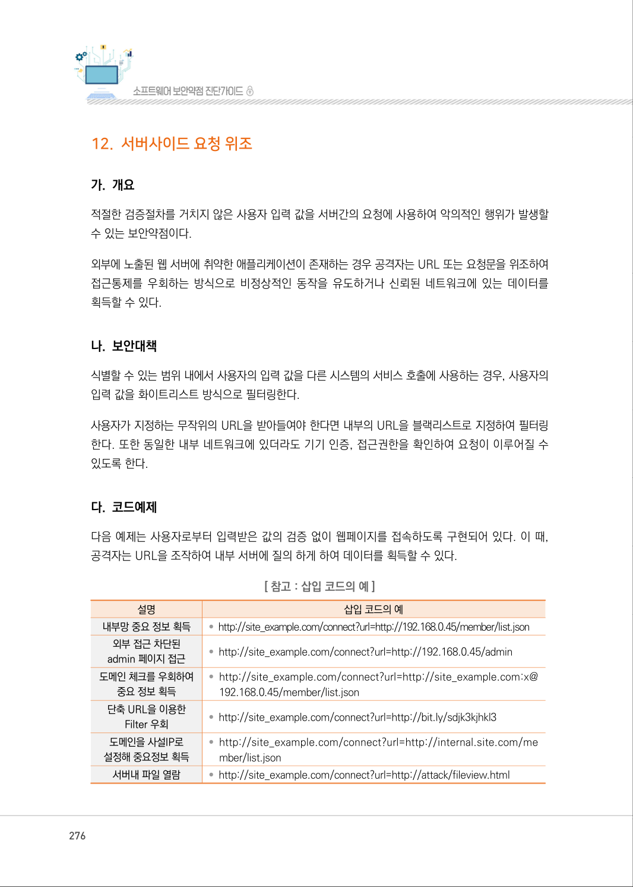
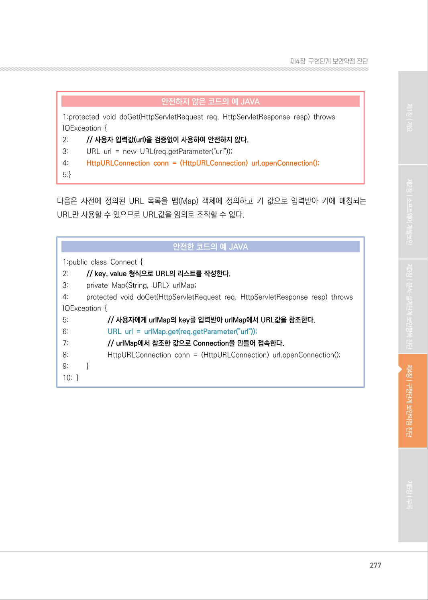
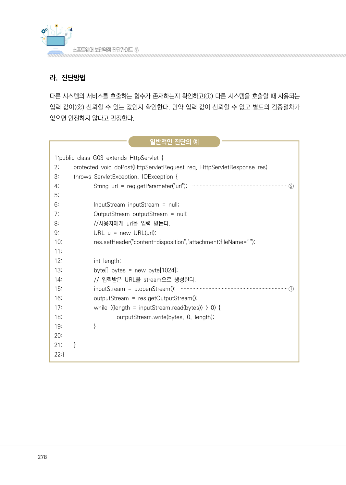
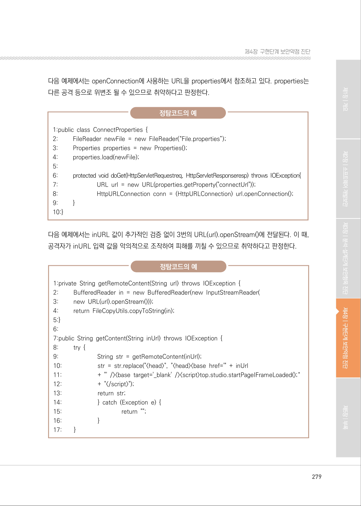
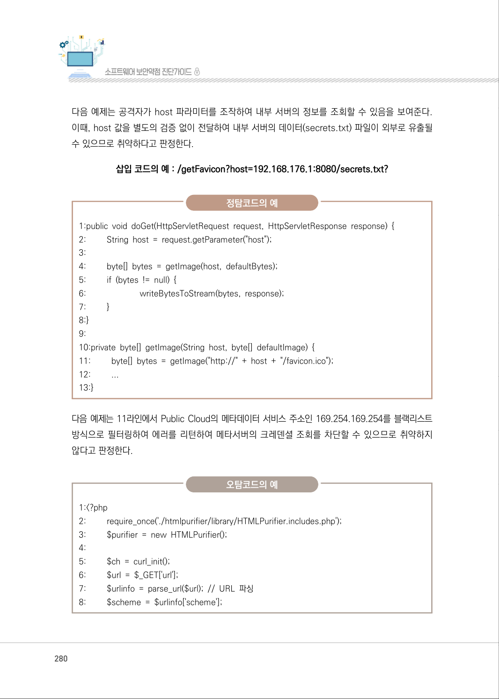
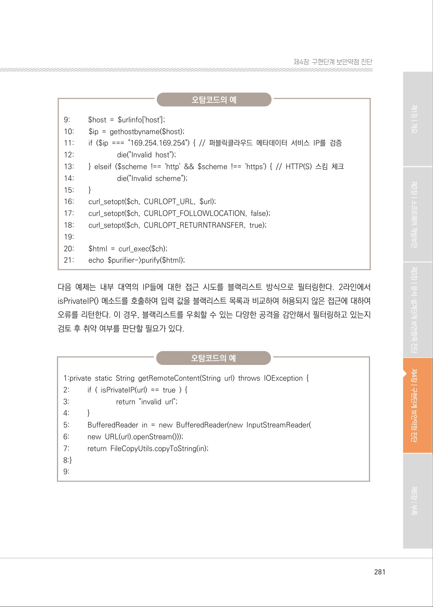
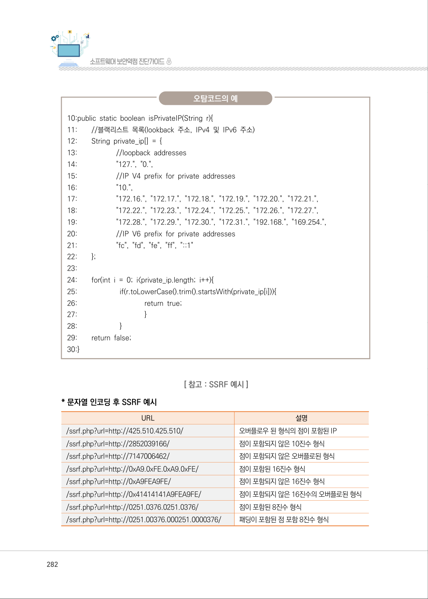
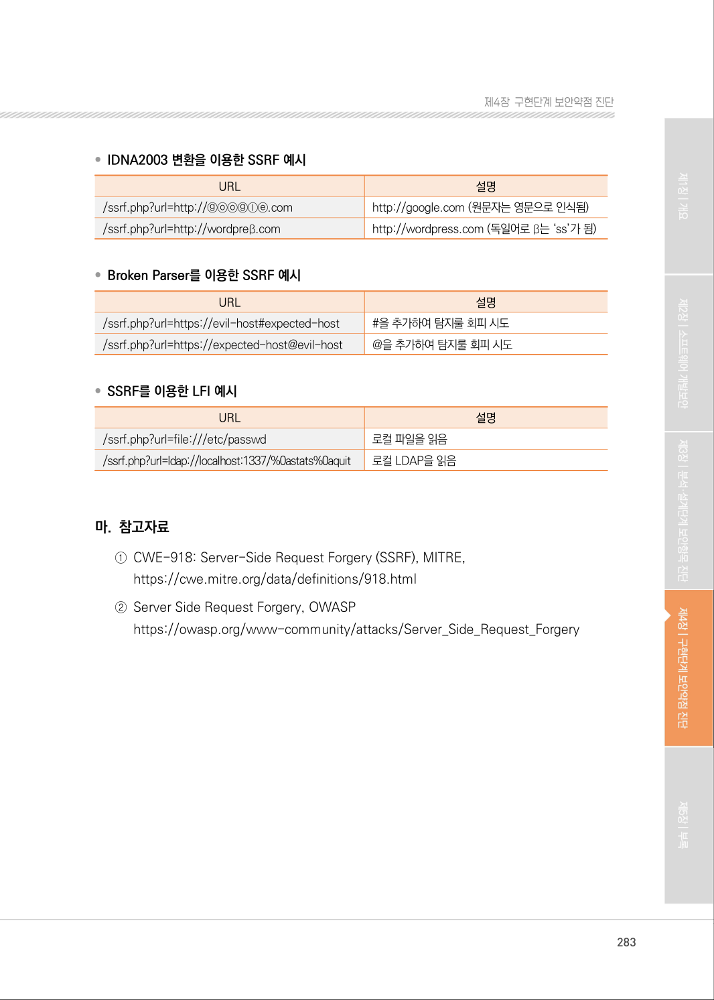

# 12. 서버사이드 요청 위조

> 변환 안내(원문 외): 아래 본문은 PDF 텍스트를 추출한 전사입니다. 코드 줄번호·특수 공백·원문 오류를 유지했습니다. 실행용 코드가 아닙니다. 표·그림·들여쓰기는 연결된 페이지 이미지와 대조하세요. 페이지 경계의 줄바꿈을 보존하며, 동일 페이지가 여러 항목에 나뉘면 각 항목의 본문은 해당 구간만 포함합니다.

### PDF 276페이지 / 인쇄 276페이지

<!-- source-page:SW-Diagnosis-2021:276; source-lines:0,1,2,3,4,5,6,7,8,9,10,11,12,13,14,15,16,17,18,19,20,21,22,23,24,25,26,27,28,29,30,31,32,33,34,35,36,37 -->

276

#### 12. 서버사이드 요청 위조

#### 가. 개요

적절한 검증절차를 거치지 않은 사용자 입력 값을 서버간의 요청에 사용하여 악의적인 행위가 발생할 
수 있는 보안약점이다.

외부에 노출된 웹 서버에 취약한 애플리케이션이 존재하는 경우 공격자는 URL 또는 요청문을 위조하여 
접근통제를 우회하는 방식으로 비정상적인 동작을 유도하거나 신뢰된 네트워크에 있는 데이터를 
획득할 수 있다.

#### 나. 보안대책

식별할 수 있는 범위 내에서 사용자의 입력 값을 다른 시스템의 서비스 호출에 사용하는 경우, 사용자의 
입력 값을 화이트리스트 방식으로 필터링한다.

사용자가 지정하는 무작위의 URL을 받아들여야 한다면 내부의 URL을 블랙리스트로 지정하여 필터링 
한다. 또한 동일한 내부 네트워크에 있더라도 기기 인증, 접근권한을 확인하여 요청이 이루어질 수 
있도록 한다.

#### 다. 코드예제

다음 예제는 사용자로부터 입력받은 값의 검증 없이 웹페이지를 접속하도록 구현되어 있다. 이 때, 
공격자는 URL을 조작하여 내부 서버에 질의 하게 하여 데이터를 획득할 수 있다.

[ 참고 : 삽입 코드의 예]

| 설명 | 삽입 코드의 예 |
| --- | --- |
| 내부망 중요 정보 획득 | • http://site example.com/connect?url=http://192.168.0.45/member/list.json<br>_ |
| 외부 접근 차단된<br>admin 페이지 접근 | • http://site example.com/connect?url=http://192.168.0.45/admin<br>_ |
| 도메인 체크를 우회하여<br>중요 정보 획득 | • http://site example.com/connect?url=http://site example.com:x@<br>_ _<br>192.168.0.45/member/list.json |
| 단축 URL을 이용한<br>Filter 우회 | • http://site example.com/connect?url=http://bit.ly/sdjk3kjhkl3<br>_ |
| 도메인을 사설IP로<br>설정해 중요정보 획득 | • http://site example.com/connect?url=http://internal.site.com/me<br>_<br>mber/list.json |
| 서버내 파일 열람 | • http://site example.com/connect?url=http://attack/fileview.html<br>_ |

<details><summary>원본 페이지 이미지 (변환 외 보존 자료)</summary>



</details>

### PDF 277페이지 / 인쇄 277페이지

<!-- source-page:SW-Diagnosis-2021:277; source-lines:0,1,2,3,4,5,6,7,8,9,10,11,12,13,14,15,16,17,18,19,20,21,22,23,24,25,26,27,28,29,30,31,32,33 -->

277

제4장구현단계 보안약점 진단

#### 안전하지 않은 코드의 예 JAVA

```java
1:protected void doGet(HttpServletRequest req, HttpServletResponse resp) throws 
IOException { 
2:         // 사용자 입력값(url)을 검증없이 사용하여 안전하지 않다.
3:         URL url = new URL(req.getParameter("url"));
4:         HttpURLConnection conn = (HttpURLConnection) url.openConnection();
5:}
```

다음은 사전에 정의된 URL 목록을 맵(Map) 객체에 정의하고 키 값으로 입력받아 키에 매칭되는 
URL만 사용할 수 있으므로 URL값을 임의로 조작할 수 없다.

#### 안전한 코드의 예 JAVA

```java
1:public class Connect { 
2:         // key, value 형식으로 URL의 리스트를 작성한다.
3:         private Map<String, URL> urlMap;
4:         protected void doGet(HttpServletRequest req, HttpServletResponse resp) throws 
IOException { 
5:                     // 사용자에게 urlMap의 key를 입력받아 urlMap에서 URL값을 참조한다.
6:                     URL url = urlMap.get(req.getParameter("url"));
7:                     // urlMap에서 참조한 값으로 Connection을 만들어 접속한다.
8:                     HttpURLConnection conn = (HttpURLConnection) url.openConnection();
9:         }
10: }
```

<details><summary>원본 페이지 이미지 (변환 외 보존 자료)</summary>



</details>

### PDF 278페이지 / 인쇄 278페이지

<!-- source-page:SW-Diagnosis-2021:278; source-lines:0,1,2,3,4,5,6,7,8,9,10,11,12,13,14,15,16,17,18,19,20,21,22,23,24,25,26,27,28,29,30,31,32,33,34,35,36,37,38,39,40,41,42,43,44 -->

278

#### 라. 진단방법

다른 시스템의 서비스를 호출하는 함수가 존재하는지 확인하고(①) 다른 시스템을 호출할 때 사용되는 
입력 값이(②) 신뢰할 수 있는 값인지 확인한다. 만약 입력 값이 신뢰할 수 없고 별도의 검증절차가 
없으면 안전하지 않다고 판정한다.

일반적인 진단의 예

```text
1:public class G03 extends HttpServlet { 
2:         protected void doPost(HttpServletRequest req, HttpServletResponse res)
3:         throws ServletException, IOException { 
4:                       String url = req.getParameter("url"); ·································································②
5:
6:                       InputStream inputStream = null; 
7:                       OutputStream outputStream = null; 
8:                       //사용자에게 url을 입력 받는다.
9:                       URL u = new URL(url);
10:                     res.setHeader("content-disposition","attachment;fileName=‘’");
11:
12:                     int length;
13:                     byte[] bytes = new byte[1024];
14:                     // 입력받은 URL을 stream으로 생성한다.
15:                     inputStream = u.openStream(); ·········································································①
16:                     outputStream = res.getOutputStream(); 
17:                     while ((length = inputStream.read(bytes)) > 0) { 
18:                                    outputStream.write(bytes, 0, length); 
19:                     }
20:
21:        }
22:}
```

<details><summary>원본 페이지 이미지 (변환 외 보존 자료)</summary>



</details>

### PDF 279페이지 / 인쇄 279페이지

<!-- source-page:SW-Diagnosis-2021:279; source-lines:0,1,2,3,4,5,6,7,8,9,10,11,12,13,14,15,16,17,18,19,20,21,22,23,24,25,26,27,28,29,30,31,32,33,34,35,36,37,38,39,40,41,42,43,44,45,46,47,48,49,50,51,52,53,54 -->

279

제4장구현단계 보안약점 진단

다음 예제에서는 openConnection에 사용하는 URL을 properties에서 참조하고 있다. properties는 
다른 공격 등으로 위변조 될 수 있으므로 취약하다고 판정한다.

정탐코드의 예

```text
1:public class ConnectProperties {
2:         FileReader newFile = new FileReader(“File.properties”);
3:         Properties properties = new Properties();
4:         properties.load(newFile);
5:
6:         protected void doGet(HttpServletRequestreq, HttpServletResponseresp) throws IOException{
7:                         URL url = new URL(properties.getProperty("connectUrl"));
8:                         HttpURLConnection conn = (HttpURLConnection) url.openConnection();
9:         }
10:}
```

다음 예제에서는 inURL 값이 추가적인 검증 없이 3번의 URL(url).openStream()에 전달된다. 이 때, 
공격자가 inURL 입력 값을 악의적으로 조작하여 피해를 끼칠 수 있으므로 취약하다고 판정한다.

정탐코드의 예

```text
1:private String getRemoteContent(String url) throws IOException { 
2:         BufferedReader in = new BufferedReader(new InputStreamReader(
3:         new URL(url).openStream()));
4:         return FileCopyUtils.copyToString(in);
5:}
6:
7:public String getContent(String inUrl) throws IOException { 
8:         try {
9:                         String str = getRemoteContent(inUrl);
10:                       str = str.replace("<head>", "<head><base href='" + inUrl 
11:                       + "' /><base target='_blank' /><script>top.studio.startPageIFrameLoaded();“
12:                       + "</script>"); 
13:                       return str; 
14:                       } catch (Exception e) { 
15:                                      return "";
16:                       }
17:        }
```

<details><summary>원본 페이지 이미지 (변환 외 보존 자료)</summary>



</details>

### PDF 280페이지 / 인쇄 280페이지

<!-- source-page:SW-Diagnosis-2021:280; source-lines:0,1,2,3,4,5,6,7,8,9,10,11,12,13,14,15,16,17,18,19,20,21,22,23,24,25,26,27,28,29,30,31,32,33,34,35,36,37,38,39,40,41,42,43 -->

280

다음 예제는 공격자가 host 파라미터를 조작하여 내부 서버의 정보를 조회할 수 있음을 보여준다. 
이때, host 값을 별도의 검증 없이 전달하여 내부 서버의 데이터(secrets.txt) 파일이 외부로 유출될 
수 있으므로 취약하다고 판정한다.

삽입 코드의 예 : /getFavicon?host=192.168.176.1:8080/secrets.txt?

정탐코드의 예

```text
1:public void doGet(HttpServletRequest request, HttpServletResponse response) {
2:         String host = request.getParameter("host");
3:
4:         byte[] bytes = getImage(host, defaultBytes);
5:         if (bytes != null) {
6:                         writeBytesToStream(bytes, response);
7:         }
8:}
9: 
10:private byte[] getImage(String host, byte[] defaultImage) { 
11:         byte[] bytes = getImage("http://" + host + "/favicon.ico");
12:         ...
13:}
```

다음 예제는 11라인에서 Public Cloud의 메타데이터 서비스 주소인 169.254.169.254를 블랙리스트 
방식으로 필터링하여 에러를 리턴하여 메타서버의 크레덴셜 조회를 차단할 수 있으므로 취약하지 
않다고 판정한다.

오탐코드의 예

```text
1:<?php
2:         require_once('./htmlpurifier/library/HTMLPurifier.includes.php');
3:         $purifier = new HTMLPurifier();
4:
5:         $ch = curl_init();
6:         $url = $_GET['url'];
7:         $urlinfo = parse_url($url); // URL 파싱
8:         $scheme = $urlinfo['scheme'];
```

<details><summary>원본 페이지 이미지 (변환 외 보존 자료)</summary>



</details>

### PDF 281페이지 / 인쇄 281페이지

<!-- source-page:SW-Diagnosis-2021:281; source-lines:0,1,2,3,4,5,6,7,8,9,10,11,12,13,14,15,16,17,18,19,20,21,22,23,24,25,26,27,28,29,30,31,32,33,34,35,36,37,38,39,40,41,42,43,44,45,46,47 -->

281

제4장구현단계 보안약점 진단

오탐코드의 예

```text
9:         $host = $urlinfo['host'];
10:        $ip = gethostbyname($host);
11:        if ($ip === "169.254.169.254") { // 퍼블릭클라우드 메타데이터 서비스 IP를 검증
12:                       die("Invalid host");
13:        } elseif ($scheme !== 'http' && $scheme !== 'https') { // HTTP(S) 스킴 체크
14:                       die("Invalid scheme");
15:        }
16:        curl_setopt($ch, CURLOPT_URL, $url);
17:        curl_setopt($ch, CURLOPT_FOLLOWLOCATION, false);
18:        curl_setopt($ch, CURLOPT_RETURNTRANSFER, true);
19:
20:        $html = curl_exec($ch);
21:        echo $purifier->purify($html);
```

다음 예제는 내부 대역의 IP들에 대한 접근 시도를 블랙리스트 방식으로 필터링한다. 2라인에서 
isPrivateIP() 메소드를 호출하여 입력 값을 블랙리스트 목록과 비교하여 허용되지 않은 접근에 대하여 
오류를 리턴한다. 이 경우, 블랙리스트를 우회할 수 있는 다양한 공격을 감안해서 필터링하고 있는지 
검토 후 취약 여부를 판단할 필요가 있다.

오탐코드의 예

```text
1:private static String getRemoteContent(String url) throws IOException {
2:         if ( isPrivateIP(url) == true ) {
3:                         return "invalid url"; 
4:         }
5:         BufferedReader in = new BufferedReader(new InputStreamReader(
6:         new URL(url).openStream())); 
7:         return FileCopyUtils.copyToString(in); 
8:}
9:
```

<details><summary>원본 페이지 이미지 (변환 외 보존 자료)</summary>



</details>

### PDF 282페이지 / 인쇄 282페이지

<!-- source-page:SW-Diagnosis-2021:282; source-lines:0,1,2,3,4,5,6,7,8,9,10,11,12,13,14,15,16,17,18,19,20,21,22,23,24,25,26,27,28,29,30,31,32,33,34,35,36,37,38,39,40,41,42,43,44,45,46,47,48,49,50,51,52,53,54,55,56,57,58,59,60 -->

282

오탐코드의 예

```text
10:public static boolean isPrivateIP(String r){ 
11:        //블랙리스트 목록(lookback 주소, IPv4 및 IPv6 주소) 
12:        String private_ip[] = {
13:                     //loopback addresses
14:                     "127.", "0.", 
15:                     //IP V4 prefix for private addresses 
16:                     "10.",
17:                     "172.16.", "172.17.", "172.18.", "172.19.", "172.20.", "172.21.",
18:                     "172.22.", "172.23.", "172.24.", "172.25.", "172.26.", "172.27.",
19:                     "172.28.", "172.29.", "172.30.", "172.31.", "192.168.", "169.254.",
20:                     //IP V6 prefix for private addresses
21:                     "fc", "fd", "fe", "ff", "::1"
22:        };
23:
24:        for(int i = 0; i<private_ip.length; i++){ 
25:                       if(r.toLowerCase().trim().startsWith(private_ip[i])){ 
26:                                    return true;
27:                                    }
28:                       }
29:        return false;
30:}
```

[ 참고 : SSRF 예시]

* 문자열 인코딩 후 SSRF 예시

| URL | 설명 |
| --- | --- |
| /ssrf.php?url=http://425.510.425.510/ | 오버플로우 된 형식의 점이 포함된 IP |
| /ssrf.php?url=http://2852039166/ | 점이 포함되지 않은 10진수 형식 |
| /ssrf.php?url=http://7147006462/ | 점이 포함되지 않은 오버플로된 형식 |
| /ssrf.php?url=http://0xA9.0xFE.0xA9.0xFE/ | 점이 포함된 16진수 형식 |
| /ssrf.php?url=http://0xA9FEA9FE/ | 점이 포함되지 않은 16진수 형식 |
| /ssrf.php?url=http://0x41414141A9FEA9FE/ | 점이 포함되지 않은 16진수의 오버플로된 형식 |
| /ssrf.php?url=http://0251.0376.0251.0376/ | 점이 포함된 8진수 형식 |
| /ssrf.php?url=http://0251.00376.000251.0000376/ | 패딩이 포함된 점 포함 8진수 형식 |

<details><summary>원본 페이지 이미지 (변환 외 보존 자료)</summary>



</details>

### PDF 283페이지 / 인쇄 283페이지

<!-- source-page:SW-Diagnosis-2021:283; source-lines:0,1,2,3,4,5,6,7,8,9,10,11,12,13,14,15,16,17,18,19,20,21,22,23,24,25,26,27 -->

283

제4장구현단계 보안약점 진단

• IDNA2003 변환을 이용한 SSRF 예시

URL

설명

/ssrf.php?url=http://ⓖⓞⓞⓖⓛⓔ.com

http://google.com (원문자는 영문으로 인식됨)

/ssrf.php?url=http://wordpreß.com

http://wordpress.com (독일어로 ß는 ‘ss’가 됨)

• Broken Parser를 이용한 SSRF 예시

URL

설명

/ssrf.php?url=https://evil-host#expected-host

#을 추가하여 탐지룰 회피 시도

/ssrf.php?url=https://expected-host@evil-host

@을 추가하여 탐지룰 회피 시도

• SSRF를 이용한 LFI 예시

| URL | 설명 |
| --- | --- |
| /ssrf.php?url=file:///etc/passwd | 로컬 파일을 읽음 |
| /ssrf.php?url=ldap://localhost:1337/%0astats%0aquit | 로컬 LDAP을 읽음 |

#### 마. 참고자료

①CWE-918: Server-Side Request Forgery (SSRF), MITRE,

https://cwe.mitre.org/data/definitions/918.html
②Server Side Request Forgery, OWASP

https://owasp.org/www-community/attacks/Server_Side_Request_Forgery

<details><summary>원본 페이지 이미지 (변환 외 보존 자료)</summary>



</details>

---

## 탐색 링크 (원문 외)

[통합 인덱스](../../../INDEX.md)

