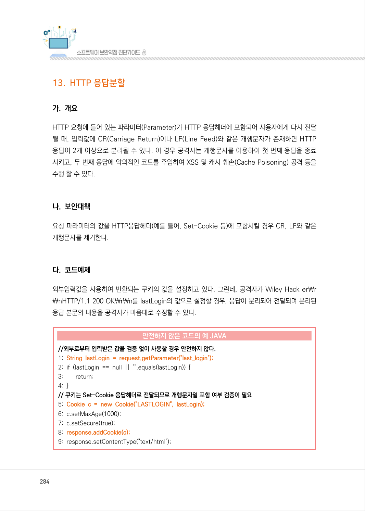
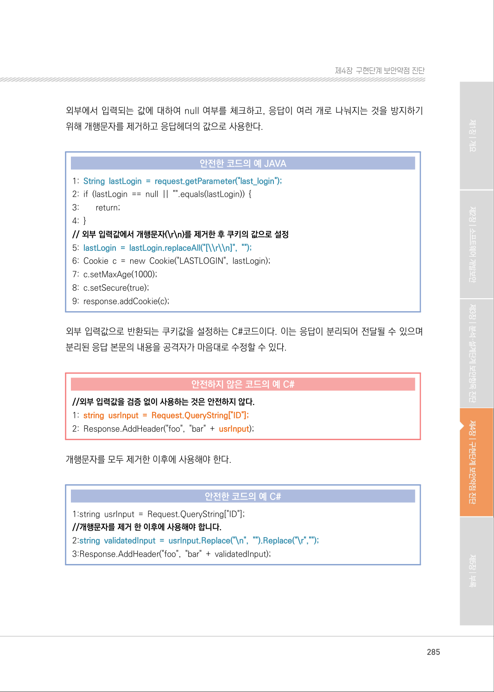
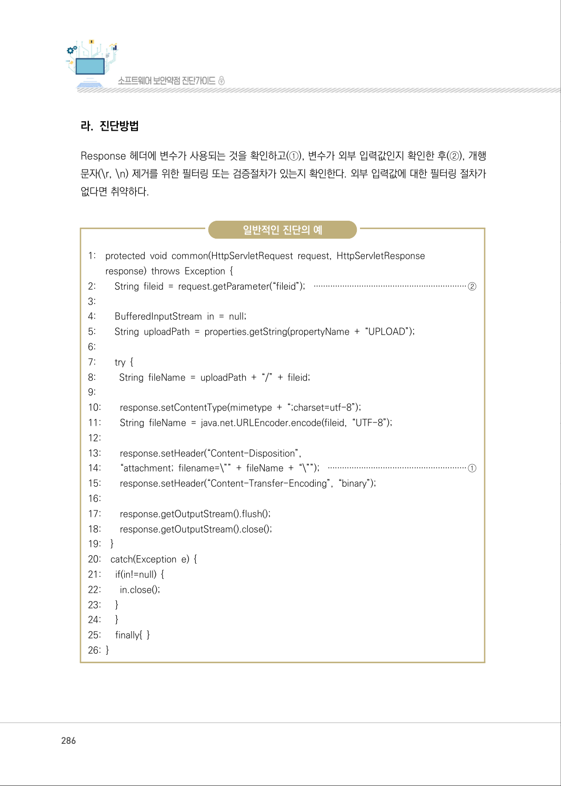
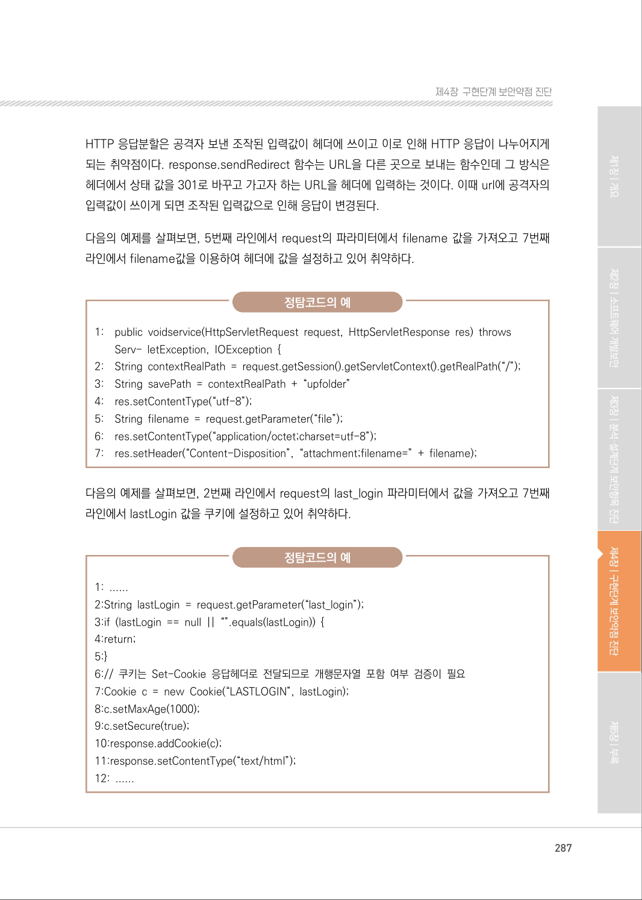
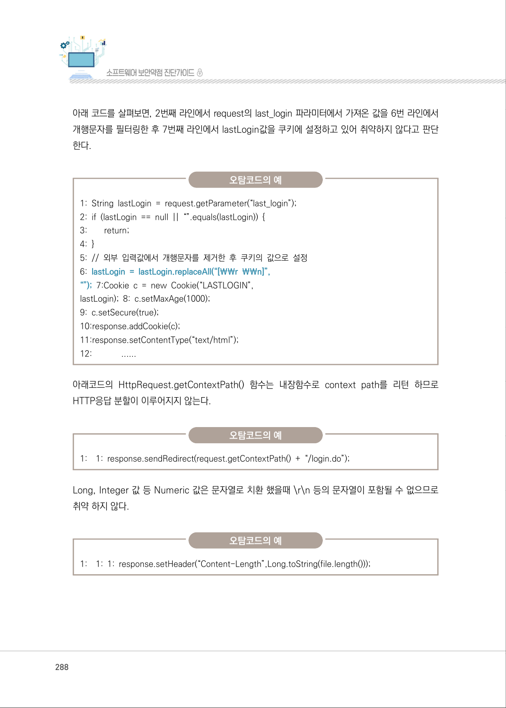
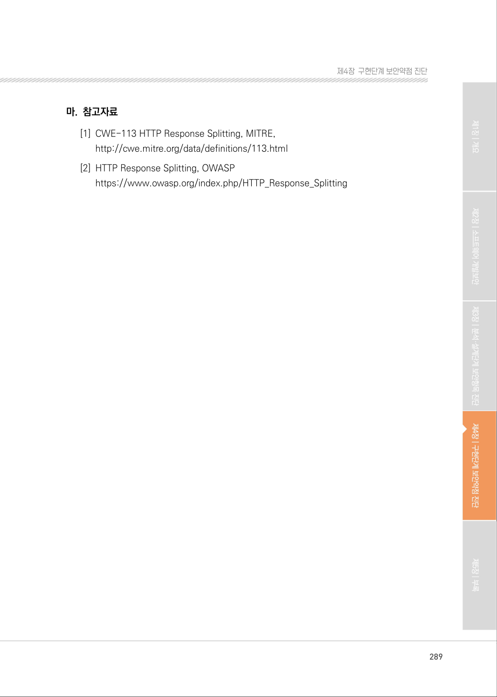

# 13. HTTP 응답분할

> 변환 안내(원문 외): 아래 본문은 PDF 텍스트를 추출한 전사입니다. 코드 줄번호·특수 공백·원문 오류를 유지했습니다. 실행용 코드가 아닙니다. 표·그림·들여쓰기는 연결된 페이지 이미지와 대조하세요. 페이지 경계의 줄바꿈을 보존하며, 동일 페이지가 여러 항목에 나뉘면 각 항목의 본문은 해당 구간만 포함합니다.

### PDF 284페이지 / 인쇄 284페이지

<!-- source-page:SW-Diagnosis-2021:284; source-lines:0,1,2,3,4,5,6,7,8,9,10,11,12,13,14,15,16,17,18,19,20,21,22,23,24,25,26,27 -->

284

#### 13. HTTP 응답분할

#### 가. 개요

HTTP 요청에 들어 있는 파라미터(Parameter)가 HTTP 응답헤더에 포함되어 사용자에게 다시 전달 
될 때, 입력값에 CR(Carriage Return)이나 LF(Line Feed)와 같은 개행문자가 존재하면 HTTP 
응답이 2개 이상으로 분리될 수 있다. 이 경우 공격자는 개행문자를 이용하여 첫 번째 응답을 종료
시키고, 두 번째 응답에 악의적인 코드를 주입하여 XSS 및 캐시 훼손(Cache Poisoning) 공격 등을 
수행 할 수 있다.

#### 나. 보안대책

요청 파라미터의 값을 HTTP응답헤더(예를 들어, Set-Cookie 등)에 포함시킬 경우 CR, LF와 같은 
개행문자를 제거한다.

#### 다. 코드예제

외부입력값을 사용하여 반환되는 쿠키의 값을 설정하고 있다. 그런데, 공격자가 Wiley Hack er￦r
￦nHTTP/1.1 200 OK￦r￦n를 lastLogin의 값으로 설정할 경우, 응답이 분리되어 전달되며 분리된 
응답 본문의 내용을 공격자가 마음대로 수정할 수 있다.

#### 안전하지 않은 코드의 예 JAVA

```java
//외부로부터 입력받은 값을 검증 없이 사용할 경우 안전하지 않다.
1: String lastLogin = request.getParameter("last_login");
2: if (lastLogin == null || "".equals(lastLogin)) {
3:        return; 
4: }
// 쿠키는 Set-Cookie 응답헤더로 전달되므로 개행문자열 포함 여부 검증이 필요
5: Cookie c = new Cookie("LASTLOGIN", lastLogin);
6: c.setMaxAge(1000);
7: c.setSecure(true);
8: response.addCookie(c);
9: response.setContentType("text/html");
```

<details><summary>원본 페이지 이미지 (변환 외 보존 자료)</summary>



</details>

### PDF 285페이지 / 인쇄 285페이지

<!-- source-page:SW-Diagnosis-2021:285; source-lines:0,1,2,3,4,5,6,7,8,9,10,11,12,13,14,15,16,17,18,19,20,21,22,23,24,25,26,27 -->

285

제4장구현단계 보안약점 진단

외부에서 입력되는 값에 대하여 null 여부를 체크하고, 응답이 여러 개로 나눠지는 것을 방지하기 
위해 개행문자를 제거하고 응답헤더의 값으로 사용한다.

#### 안전한 코드의 예 JAVA

```java
1: String lastLogin = request.getParameter("last_login");
2: if (lastLogin == null || "".equals(lastLogin)) {
3:        return;
4: }
// 외부 입력값에서 개행문자(\r\n)를 제거한 후 쿠키의 값으로 설정 
5: lastLogin = lastLogin.replaceAll("[\\r\\n]", "");
6: Cookie c = new Cookie("LASTLOGIN", lastLogin);
7: c.setMaxAge(1000); 
8: c.setSecure(true); 
9: response.addCookie(c); 
```

외부 입력값으로 반환되는 쿠키값을 설정하는 C#코드이다. 이는 응답이 분리되어 전달될 수 있으며 
분리된 응답 본문의 내용을 공격자가 마음대로 수정할 수 있다.

#### 안전하지 않은 코드의 예 C#

```csharp
//외부 입력값을 검증 없이 사용하는 것은 안전하지 않다.
1: string usrInput = Request.QueryString["ID"];
2: Response.AddHeader("foo", "bar" + usrInput);
```

개행문자를 모두 제거한 이후에 사용해야 한다.

#### 안전한 코드의 예 C#

```csharp
1:string usrInput = Request.QueryString["ID"];
//개행문자를 제거 한 이후에 사용해야 합니다.
2:string validatedInput = usrInput.Replace("\n", "").Replace("\r","");
3:Response.AddHeader("foo", "bar" + validatedInput);
```

<details><summary>원본 페이지 이미지 (변환 외 보존 자료)</summary>



</details>

### PDF 286페이지 / 인쇄 286페이지

<!-- source-page:SW-Diagnosis-2021:286; source-lines:0,1,2,3,4,5,6,7,8,9,10,11,12,13,14,15,16,17,18,19,20,21,22,23,24,25,26,27,28,29,30,31,32,33,34,35,36,37,38,39,40,41,42,43,44,45,46,47,48,49,50,51,52 -->

286

#### 라. 진단방법

Response 헤더에 변수가 사용되는 것을 확인하고(①), 변수가 외부 입력값인지 확인한 후(②), 개행 
문자(\r, \n) 제거를 위한 필터링 또는 검증절차가 있는지 확인한다. 외부 입력값에 대한 필터링 절차가 
없다면 취약하다.

일반적인 진단의 예

```text
1:    protected void common(HttpServletRequest request, HttpServletResponse
response) throws Exception { 
2:        String fileid = request.getParameter(“fileid”); ································································②
3:
4:        BufferedInputStream in = null; 
5:        String uploadPath = properties.getString(propertyName + “UPLOAD”);
6:
7:        try {
8:         String fileName = uploadPath + “/” + fileid; 
9:
10:        response.setContentType(mimetype + “;charset=utf-8”); 
11:        String fileName = java.net.URLEncoder.encode(fileid, “UTF-8”); 
12:
13:        response.setHeader(“Content-Disposition”,
14:        “attachment; filename=\”” + fileName + “\””); ··························································①
15:        response.setHeader(“Content-Transfer-Encoding”, “binary”);
16:
17:        response.getOutputStream().flush();
18:        response.getOutputStream().close();
19:    }
20:    catch(Exception e) { 
21:      if(in!=null) { 
22:        in.close(); 
23:      }
24:      }
25:      finally{ }
26: }
```

<details><summary>원본 페이지 이미지 (변환 외 보존 자료)</summary>



</details>

### PDF 287페이지 / 인쇄 287페이지

<!-- source-page:SW-Diagnosis-2021:287; source-lines:0,1,2,3,4,5,6,7,8,9,10,11,12,13,14,15,16,17,18,19,20,21,22,23,24,25,26,27,28,29,30,31,32,33,34,35,36,37,38 -->

287

제4장구현단계 보안약점 진단

HTTP 응답분할은 공격자 보낸 조작된 입력값이 헤더에 쓰이고 이로 인해 HTTP 응답이 나누어지게 
되는 취약점이다. response.sendRedirect 함수는 URL을 다른 곳으로 보내는 함수인데 그 방식은 
헤더에서 상태 값을 301로 바꾸고 가고자 하는 URL을 헤더에 입력하는 것이다. 이때 url에 공격자의 
입력값이 쓰이게 되면 조작된 입력값으로 인해 응답이 변경된다.

다음의 예제를 살펴보면, 5번째 라인에서 request의 파라미터에서 filename 값을 가져오고 7번째 
라인에서 filename값을 이용하여 헤더에 값을 설정하고 있어 취약하다.

정탐코드의 예

```text
1:    public voidservice(HttpServletRequest request, HttpServletResponse res) throws 
Serv- letException, IOException { 
2:    String contextRealPath = request.getSession().getServletContext().getRealPath(“/”);
3:    String savePath = contextRealPath + “upfolder” 
4:    res.setContentType(“utf-8”);
5:    String filename = request.getParameter(“file”);
6:    res.setContentType(“application/octet;charset=utf-8”);
7:    res.setHeader(“Content-Disposition”, “attachment;filename=” + filename); 
```

다음의 예제를 살펴보면, 2번째 라인에서 request의 last_login 파라미터에서 값을 가져오고 7번째 
라인에서 lastLogin 값을 쿠키에 설정하고 있어 취약하다.

정탐코드의 예

```text
1: ...... 
2:String lastLogin = request.getParameter(“last_login”); 
3:if (lastLogin == null || “”.equals(lastLogin)) { 
4:return; 
5:} 
6:// 쿠키는 Set-Cookie 응답헤더로 전달되므로 개행문자열 포함 여부 검증이 필요
7:Cookie c = new Cookie(“LASTLOGIN”, lastLogin);
8:c.setMaxAge(1000);
9:c.setSecure(true);
10:response.addCookie(c);
11:response.setContentType(“text/html”);
12: ......
```

<details><summary>원본 페이지 이미지 (변환 외 보존 자료)</summary>



</details>

### PDF 288페이지 / 인쇄 288페이지

<!-- source-page:SW-Diagnosis-2021:288; source-lines:0,1,2,3,4,5,6,7,8,9,10,11,12,13,14,15,16,17,18,19,20,21,22,23,24,25,26,27,28 -->

288

아래 코드를 살펴보면, 2번째 라인에서 request의 last_login 파라미터에서 가져온 값을 6번 라인에서 
개행문자를 필터링한 후 7번째 라인에서 lastLogin값을 쿠키에 설정하고 있어 취약하지 않다고 판단
한다.

오탐코드의 예

```text
1: String lastLogin = request.getParameter(“last_login”); 
2: if (lastLogin == null || “”.equals(lastLogin)) { 
3:        return;
4: }
5: // 외부 입력값에서 개행문자를 제거한 후 쿠키의 값으로 설정 
6: lastLogin = lastLogin.replaceAll(“[￦￦r ￦￦n]”,
“”); 7:Cookie c = new Cookie(“LASTLOGIN”,
lastLogin); 8: c.setMaxAge(1000); 
```

```text
9: c.setSecure(true); 
10:response.addCookie(c); 
11:response.setContentType(“text/html”); 
12:             ......
```

아래코드의 HttpRequest.getContextPath() 함수는 내장함수로 context path를 리턴 하므로 
HTTP응답 분할이 이루어지지 않는다.

오탐코드의 예

1:

1: response.sendRedirect(request.getContextPath() + “/login.do”);

Long, Integer 값 등 Numeric 값은 문자열로 치환 했을때 \r\n 등의 문자열이 포함될 수 없으므로 
취약 하지 않다.

오탐코드의 예

1:

1: 1: response.setHeader(“Content-Length”,Long.toString(file.length()));

<details><summary>원본 페이지 이미지 (변환 외 보존 자료)</summary>



</details>

### PDF 289페이지 / 인쇄 289페이지

<!-- source-page:SW-Diagnosis-2021:289; source-lines:0,1,2,3,4,5,6 -->

289

제4장구현단계 보안약점 진단

#### 마. 참고자료

[1] CWE-113 HTTP Response Splitting, MITRE,

http://cwe.mitre.org/data/definitions/113.html
[2] HTTP Response Splitting, OWASP

https://www.owasp.org/index.php/HTTP_Response_Splitting

<details><summary>원본 페이지 이미지 (변환 외 보존 자료)</summary>



</details>

---

## 탐색 링크 (원문 외)

[통합 인덱스](../../../INDEX.md)

